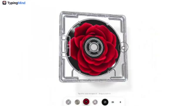

# Awesome AI Motion

<a id="mosaic"></a>

<p align="center"><a href="https://guanmo-ai.github.io/awesome-ai-motion/?lang=en"></a></p>

Extraordinary motion. New creative possibilities. · [简体中文](README.md)

**[Explore the gallery ↗](https://guanmo-ai.github.io/awesome-ai-motion/?lang=en)** &nbsp; · &nbsp; [Submit a work](https://github.com/guanmo-ai/awesome-ai-motion/issues/new?template=submit.yml)

<sub>821 works &nbsp; · &nbsp; Click the mosaic to open the gallery</sub>

<a id="spotlights"></a>

## Worth watching now

Ranked by bookmarks and publication date, giving popular recent work more weight. Bookmark counts are source-post snapshots.

<table>
<tr>
<td width="33%" align="center" valign="middle"><a href="https://guanmo-ai.github.io/awesome-ai-motion/?lang=en#case-2103273003555402193"></a></td>
<td width="33%" align="center" valign="middle"><a href="https://guanmo-ai.github.io/awesome-ai-motion/?lang=en#case-2106426962738880879"></a></td>
<td width="33%" align="center" valign="middle"><a href="https://guanmo-ai.github.io/awesome-ai-motion/?lang=en#case-2108948624004526516"></a></td>
</tr>
<tr>
<td width="33%" valign="top"><strong>One shape, a seamle&#8203;ss UI morph loop</strong><br><sub><a href="https://x.com/twoclipping">@twocli&#8203;pping</a></sub><br><sub>Bookmarks 19,303 · 2026-09-24</sub><br><br><a href="https://guanmo-ai.github.io/awesome-ai-motion/?lang=en#case-2103273003555402193">Watch ↗</a> · <a href="https://x.com/twoclipping/status/2103273003555402193">Original</a></td>
<td width="33%" valign="top"><strong>Warefl&#8203;ow: a strate&#8203;gy-game-style wareho&#8203;use interf&#8203;ace</strong><br><sub><a href="https://x.com/DilumSanjaya">@DilumS&#8203;anjaya</a></sub><br><sub>Bookmarks 10,714 · 2026-10-03</sub><br><br><a href="https://guanmo-ai.github.io/awesome-ai-motion/?lang=en#case-2106426962738880879">Watch ↗</a> · <a href="https://x.com/DilumSanjaya/status/2106426962738880879">Original</a></td>
<td width="33%" valign="top"><strong>Anatom&#8203;y: Workin&#8203;g Machin&#8203;e Illust&#8203;ration&#8203;s</strong><br><sub><a href="https://x.com/wheresryan22">@wheres&#8203;ryan22</a></sub><br><sub>Bookmarks 6,423 · 2026-10-10</sub><br><br><a href="https://guanmo-ai.github.io/awesome-ai-motion/?lang=en#case-2108948624004526516">Watch ↗</a> · <a href="https://x.com/wheresryan22/status/2108948624004526516">Original</a></td>
</tr>
<tr>
<td width="33%" align="center" valign="middle"><a href="https://guanmo-ai.github.io/awesome-ai-motion/?lang=en#case-2103315922098470926"></a></td>
<td width="33%" align="center" valign="middle"><a href="https://guanmo-ai.github.io/awesome-ai-motion/?lang=en#case-2109257723246501895"></a></td>
<td width="33%" align="center" valign="middle"><a href="https://guanmo-ai.github.io/awesome-ai-motion/?lang=en#case-2102591147927654847"></a></td>
</tr>
<tr>
<td width="33%" valign="top"><strong>A 15-second motion design showre&#8203;el</strong><br><sub><a href="https://x.com/stephanlivera">@stepha&#8203;nliver&#8203;a</a></sub><br><sub>Bookmarks 11,692 · 2026-09-25</sub><br><br><a href="https://guanmo-ai.github.io/awesome-ai-motion/?lang=en#case-2103315922098470926">Watch ↗</a> · <a href="https://x.com/stephanlivera/status/2103315922098470926">Original</a></td>
<td width="33%" valign="top"><strong>A Transp&#8203;arent CD Case with an Animat&#8203;ed Lid</strong><br><sub><a href="https://x.com/ann_nnng">@ann_nn&#8203;ng</a></sub><br><sub>Bookmarks 3,816 · 2026-10-11</sub><br><br><a href="https://guanmo-ai.github.io/awesome-ai-motion/?lang=en#case-2109257723246501895">Watch ↗</a> · <a href="https://x.com/ann_nnng/status/2109257723246501895">Original</a></td>
<td width="33%" valign="top"><strong>An intera&#8203;ctive camera lens lab</strong><br><sub><a href="https://x.com/RyanSael">@RyanSa&#8203;el</a></sub><br><sub>Bookmarks 9,188 · 2026-09-23</sub><br><br><a href="https://guanmo-ai.github.io/awesome-ai-motion/?lang=en#case-2102591147927654847">Watch ↗</a> · <a href="https://x.com/RyanSael/status/2102591147927654847">Original</a></td>
</tr>
</table>

<a id="browse"></a>

## Find a direction for your next project

| Explore | What you will find | Works |
| :-- | :-- | --: |
| <a id="category-product"></a>[Product & marketing](browse/product.en.md) | Product stories, interfaces and brand launches | 155 |
| <a id="category-education"></a>[Education & explainers](browse/education.en.md) | Visual explanations of complex ideas | 159 |
| <a id="category-motion"></a>[Motion design](browse/motion.en.md) | Timing, typography, morphs and transitions | 108 |
| <a id="category-characters"></a>[Pixel art & characters](browse/characters.en.md) | Character performance, pixel art and style | 56 |
| <a id="category-interactive"></a>[3D & interactive](browse/interactive.en.md) | Responsive spaces and physical simulations | 199 |
| <a id="category-stories"></a>[Narrative films](browse/stories.en.md) | Storyboards, cinematography and complete films | 81 |
| <a id="category-music"></a>[Music & lyrics](browse/music.en.md) | Music, visuals and emotion in sync | 63 |

[Search, filter and watch all works in the gallery →](https://guanmo-ai.github.io/awesome-ai-motion/?lang=en)

<a id="more"></a>

## Keep exploring

<details>
<summary>Most-bookmarked works</summary>

## Most bookmarked

<table>
<tbody>
<tr>
<td width="50%" height="225" align="center" valign="middle"><a href="https://guanmo-ai.github.io/awesome-ai-motion/?lang=en#case-2103273003555402193"></a></td>
<td width="50%" height="225" align="center" valign="middle"><a href="https://guanmo-ai.github.io/awesome-ai-motion/?lang=en#case-2103315922098470926"></a></td>
</tr>
<tr>
<td width="50%" valign="top"><strong>One shape, a seamless UI morph loop</strong><br><sub><a href="https://x.com/twoclipping">@twoclipping</a> · Motion design</sub><br><sub>0:14 · Bookmarks 19,303</sub><br><a href="https://guanmo-ai.github.io/awesome-ai-motion/?lang=en#case-2103273003555402193">▶ Play</a> · <a href="https://x.com/twoclipping/status/2103273003555402193">Original post</a></td>
<td width="50%" valign="top"><strong>A 15-second motion design showreel</strong><br><sub><a href="https://x.com/stephanlivera">@stephanlivera</a> · Motion design</sub><br><sub>0:15 · Bookmarks 11,692</sub><br><a href="https://guanmo-ai.github.io/awesome-ai-motion/?lang=en#case-2103315922098470926">▶ Play</a> · <a href="https://x.com/stephanlivera/status/2103315922098470926">Original post</a></td>
</tr>
</tbody>
<tbody>
<tr>
<td width="50%" height="225" align="center" valign="middle"><a href="https://guanmo-ai.github.io/awesome-ai-motion/?lang=en#case-2106426962738880879"></a></td>
<td width="50%" height="225" align="center" valign="middle"><a href="https://guanmo-ai.github.io/awesome-ai-motion/?lang=en#case-2102591147927654847"></a></td>
</tr>
<tr>
<td width="50%" valign="top"><strong>Wareflow: a strategy-game-style warehouse interface</strong><br><sub><a href="https://x.com/DilumSanjaya">@DilumSanjaya</a> · 3D &amp; interactive</sub><br><sub>1:12 · Bookmarks 10,714 · Details pending</sub><br><a href="https://guanmo-ai.github.io/awesome-ai-motion/?lang=en#case-2106426962738880879">▶ Play</a> · <a href="https://x.com/DilumSanjaya/status/2106426962738880879">Original post</a></td>
<td width="50%" valign="top"><strong>An interactive camera lens lab</strong><br><sub><a href="https://x.com/RyanSael">@RyanSael</a> · Education &amp; explainers</sub><br><sub>0:32 · Bookmarks 9,188</sub><br><a href="https://guanmo-ai.github.io/awesome-ai-motion/?lang=en#case-2102591147927654847">▶ Play</a> · <a href="https://x.com/RyanSael/status/2102591147927654847">Original post</a></td>
</tr>
</tbody>
<tbody>
<tr>
<td width="50%" height="225" align="center" valign="middle"><a href="https://guanmo-ai.github.io/awesome-ai-motion/?lang=en#case-2102801274173587569"></a></td>
<td width="50%" height="225" align="center" valign="middle"><a href="https://guanmo-ai.github.io/awesome-ai-motion/?lang=en#case-2108948624004526516"></a></td>
</tr>
<tr>
<td width="50%" valign="top"><strong>Claude Pop: a mixed-workflow music video</strong><br><sub><a href="https://x.com/donaldjewkes">@donaldjewkes</a> · Music &amp; lyrics</sub><br><sub>2:22 · Bookmarks 8,096</sub><br><a href="https://guanmo-ai.github.io/awesome-ai-motion/?lang=en#case-2102801274173587569">▶ Play</a> · <a href="https://x.com/donaldjewkes/status/2102801274173587569">Original post</a></td>
<td width="50%" valign="top"><strong>Anatomy: Working Machine Illustrations</strong><br><sub><a href="https://x.com/wheresryan22">@wheresryan22</a> · 3D &amp; interactive</sub><br><sub>0:39 · Bookmarks 6,423 · Details pending</sub><br><a href="https://guanmo-ai.github.io/awesome-ai-motion/?lang=en#case-2108948624004526516">▶ Play</a> · <a href="https://x.com/wheresryan22/status/2108948624004526516">Original post</a></td>
</tr>
</tbody>
</table>

<sub>Bookmark counts are source-post snapshots, not a live ranking.</sub>

</details>

<a id="featured"></a>

<details>
<summary>Curator selections</summary>

<table>
<tbody>
<tr>
<td width="50%" height="225" align="center" valign="middle"><a href="https://guanmo-ai.github.io/awesome-ai-motion/?lang=en#case-2109941504827654305"></a></td>
<td width="50%" height="225" align="center" valign="middle"><a href="https://guanmo-ai.github.io/awesome-ai-motion/?lang=en#case-2103918792845963545"></a></td>
</tr>
<tr>
<td width="50%" valign="top"><strong>Awesome AI Motion: Turn Ideas into Motion with AI</strong><br><sub><a href="https://x.com/guanmo_ai">@guanmo_ai</a> · Product &amp; marketing</sub><br><sub>0:15 · Bookmarks 0 · Details pending</sub><br><a href="https://guanmo-ai.github.io/awesome-ai-motion/?lang=en#case-2109941504827654305">▶ Play</a> · <a href="https://x.com/guanmo_ai/status/2109941504827654305">Original post</a></td>
<td width="50%" valign="top"><strong>A character-led Pocketsflow product explainer</strong><br><sub><a href="https://x.com/achxvi">@achxvi</a> · Product &amp; marketing</sub><br><sub>0:15 · Bookmarks 2,005</sub><br><a href="https://guanmo-ai.github.io/awesome-ai-motion/?lang=en#case-2103918792845963545">▶ Play</a> · <a href="https://x.com/achxvi/status/2103918792845963545">Original post</a></td>
</tr>
</tbody>
<tbody>
<tr>
<td width="50%" height="225" align="center" valign="middle"><a href="https://guanmo-ai.github.io/awesome-ai-motion/?lang=en#case-2103315922098470926"></a></td>
<td width="50%" height="225" align="center" valign="middle"><a href="https://guanmo-ai.github.io/awesome-ai-motion/?lang=en#case-2102583898865873225"></a></td>
</tr>
<tr>
<td width="50%" valign="top"><strong>A 15-second motion design showreel</strong><br><sub><a href="https://x.com/stephanlivera">@stephanlivera</a> · Motion design</sub><br><sub>0:15 · Bookmarks 11,692</sub><br><a href="https://guanmo-ai.github.io/awesome-ai-motion/?lang=en#case-2103315922098470926">▶ Play</a> · <a href="https://x.com/stephanlivera/status/2103315922098470926">Original post</a></td>
<td width="50%" valign="top"><strong>Five thousand years of Chinese history</strong><br><sub><a href="https://x.com/akokoi1">@akokoi1</a> · Education &amp; explainers</sub><br><sub>2:38 · Bookmarks 762</sub><br><a href="https://guanmo-ai.github.io/awesome-ai-motion/?lang=en#case-2102583898865873225">▶ Play</a> · <a href="https://x.com/akokoi1/status/2102583898865873225">Original post</a></td>
</tr>
</tbody>
<tbody>
<tr>
<td width="50%" height="225" align="center" valign="middle"><a href="https://guanmo-ai.github.io/awesome-ai-motion/?lang=en#case-2103099194693271874"></a></td>
<td width="50%" height="225" align="center" valign="middle"><a href="https://guanmo-ai.github.io/awesome-ai-motion/?lang=en#case-2103116235009347650"></a></td>
</tr>
<tr>
<td width="50%" valign="top"><strong>Pip travels through twelve visual styles</strong><br><sub><a href="https://x.com/pradeepXkapoor">@pradeepXkapoor</a> · Pixel art &amp; characters</sub><br><sub>1:15 · Bookmarks 532</sub><br><a href="https://guanmo-ai.github.io/awesome-ai-motion/?lang=en#case-2103099194693271874">▶ Play</a> · <a href="https://x.com/pradeepXkapoor/status/2103099194693271874">Original post</a></td>
<td width="50%" valign="top"><strong>The Battle of Austerlitz in code</strong><br><sub><a href="https://x.com/WinterArc2125">@WinterArc2125</a> · Narrative films</sub><br><sub>5:01 · Bookmarks 272</sub><br><a href="https://guanmo-ai.github.io/awesome-ai-motion/?lang=en#case-2103116235009347650">▶ Play</a> · <a href="https://x.com/WinterArc2125/status/2103116235009347650">Original post</a></td>
</tr>
</tbody>
</table>

</details>

<a id="about"></a>

<details>
<summary>About the collection and its sources</summary>

A collection of motion and interactive work drawn, rendered or driven by AI-written code, including animation made with Blender, Three.js and Canvas, with creators’ public code, prompts and process notes. See the [collection scope](docs/DISCOVERY.md#收录范围); selections and full audiovisual reviews are recorded independently.

Click a cover to play in the gallery; works without gallery video open on the creator’s X post. Public prompts do not guarantee identical results, and works have not been independently reproduced.

[Sources and ordering](docs/SOURCES.md) · [Verification scope and coverage](docs/COVERAGE.md) · [Collection criteria](docs/QUALITY.md) · [Records with details pending](browse/discoveries.en.md)

</details>

<a id="local-gallery"></a>

<details>
<summary>Run the gallery locally</summary>

Clone the repository and run from its directory (Node.js 22+, no dependencies to install):

```sh
node scripts/serve.mjs
```

Open http://127.0.0.1:4178 .

[Maintainer guide](docs/MAINTAINING.md) · [Static hosting](docs/DEPLOYMENT.md)

</details>

---

Created and maintained by [Guanmo / @guanmo_ai](https://x.com/guanmo_ai). Thank you to every creator sharing their work and process.

[Contribute](CONTRIBUTING.md) · [Correction or removal](https://github.com/guanmo-ai/awesome-ai-motion/issues/new?template=correction.yml) · [Third-party content](THIRD_PARTY.md) · [MIT](LICENSE)

<sub>MIT applies to this repository’s original scripts. Third-party works, assets and prompts remain the property of their creators.</sub>
