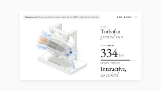
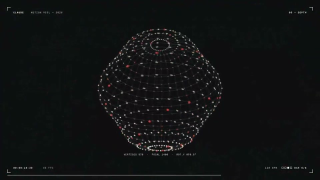
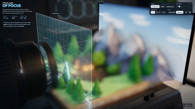
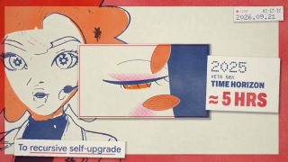
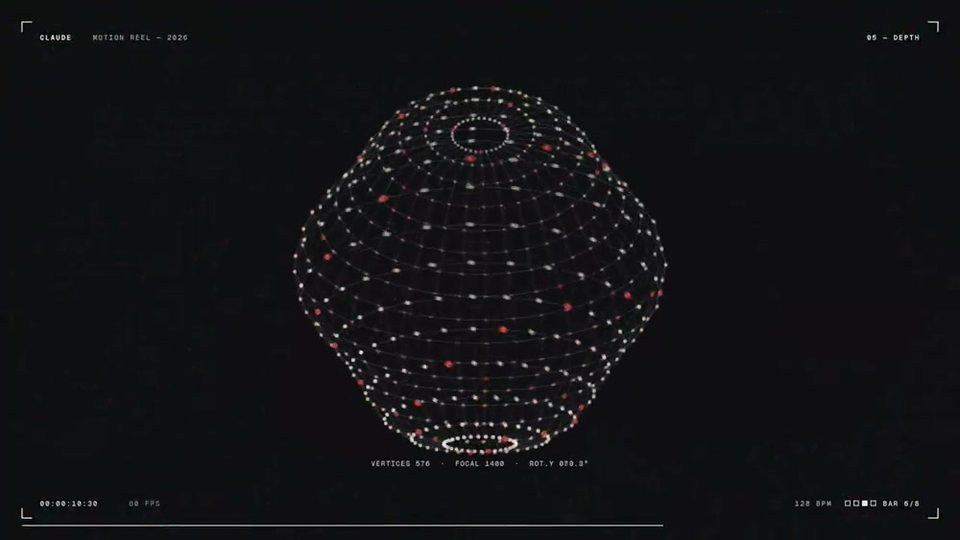
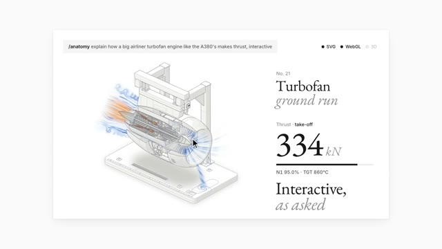

# Awesome AI Motion

<a id="mosaic"></a>

<p align="center"><a href="https://guanmo-ai.github.io/awesome-ai-motion/"></a></p>

发现惊艳动效，探索更多创作可能。 · [English](README.en.md)

**[进入作品画廊 ↗](https://guanmo-ai.github.io/awesome-ai-motion/)** &nbsp; · &nbsp; [推荐作品](https://github.com/guanmo-ai/awesome-ai-motion/issues/new?template=submit.yml)

<sub>821 个作品 &nbsp; · &nbsp; 点击拼图进入画廊</sub>

<a id="spotlights"></a>

## 最近值得一看

综合收藏数与发布时间排序，让高收藏的新作品优先。收藏数为原帖快照。

<table>
<tr>
<td width="33%" align="center" valign="middle"><a href="https://guanmo-ai.github.io/awesome-ai-motion/#case-2103273003555402193"></a></td>
<td width="33%" align="center" valign="middle"><a href="https://guanmo-ai.github.io/awesome-ai-motion/#case-2106426962738880879"></a></td>
<td width="33%" align="center" valign="middle"><a href="https://guanmo-ai.github.io/awesome-ai-motion/#case-2108948624004526516"></a></td>
</tr>
<tr>
<td width="33%" valign="top"><strong>一个形状串起整套 UI</strong><br><sub><a href="https://x.com/twoclipping">@twocli&#8203;pping</a></sub><br><sub>收藏 19,303 · 2026-09-24</sub><br><br><a href="https://guanmo-ai.github.io/awesome-ai-motion/#case-2103273003555402193">观看 ↗</a> · <a href="https://x.com/twoclipping/status/2103273003555402193">原帖</a></td>
<td width="33%" valign="top"><strong>Warefl&#8203;ow：策略游戏式仓库管理界面</strong><br><sub><a href="https://x.com/DilumSanjaya">@DilumS&#8203;anjaya</a></sub><br><sub>收藏 10,714 · 2026-10-03</sub><br><br><a href="https://guanmo-ai.github.io/awesome-ai-motion/#case-2106426962738880879">观看 ↗</a> · <a href="https://x.com/DilumSanjaya/status/2106426962738880879">原帖</a></td>
<td width="33%" valign="top"><strong>Anatom&#8203;y：会动的机器说明图</strong><br><sub><a href="https://x.com/wheresryan22">@wheres&#8203;ryan22</a></sub><br><sub>收藏 6,423 · 2026-10-10</sub><br><br><a href="https://guanmo-ai.github.io/awesome-ai-motion/#case-2108948624004526516">观看 ↗</a> · <a href="https://x.com/wheresryan22/status/2108948624004526516">原帖</a></td>
</tr>
<tr>
<td width="33%" align="center" valign="middle"><a href="https://guanmo-ai.github.io/awesome-ai-motion/#case-2103315922098470926"></a></td>
<td width="33%" align="center" valign="middle"><a href="https://guanmo-ai.github.io/awesome-ai-motion/#case-2102591147927654847"></a></td>
<td width="33%" align="center" valign="middle"><a href="https://guanmo-ai.github.io/awesome-ai-motion/#case-2102801274173587569"></a></td>
</tr>
<tr>
<td width="33%" valign="top"><strong>15 秒动态设计自由发挥</strong><br><sub><a href="https://x.com/stephanlivera">@stepha&#8203;nliver&#8203;a</a></sub><br><sub>收藏 11,692 · 2026-09-25</sub><br><br><a href="https://guanmo-ai.github.io/awesome-ai-motion/#case-2103315922098470926">观看 ↗</a> · <a href="https://x.com/stephanlivera/status/2103315922098470926">原帖</a></td>
<td width="33%" valign="top"><strong>用镜头实验室解释对焦</strong><br><sub><a href="https://x.com/RyanSael">@RyanSa&#8203;el</a></sub><br><sub>收藏 9,188 · 2026-09-23</sub><br><br><a href="https://guanmo-ai.github.io/awesome-ai-motion/#case-2102591147927654847">观看 ↗</a> · <a href="https://x.com/RyanSael/status/2102591147927654847">原帖</a></td>
<td width="33%" valign="top"><strong>Claude Pop 混合制作 MV</strong><br><sub><a href="https://x.com/donaldjewkes">@donald&#8203;jewkes</a></sub><br><sub>收藏 8,096 · 2026-09-23</sub><br><br><a href="https://guanmo-ai.github.io/awesome-ai-motion/#case-2102801274173587569">观看 ↗</a> · <a href="https://x.com/donaldjewkes/status/2102801274173587569">原帖</a></td>
</tr>
</table>

<a id="browse"></a>

## 为下一次创作找参考

| 方向 | 可以发现什么 | 作品 |
| :-- | :-- | --: |
| <a id="category-product"></a>[产品宣传](browse/product.md) | 把产品、功能与品牌讲清楚 | 159 |
| <a id="category-education"></a>[知识讲解](browse/education.md) | 把抽象概念变成看得懂的画面 | 158 |
| <a id="category-motion"></a>[短动效](browse/motion.md) | 观察节奏、字排、形变与转场 | 104 |
| <a id="category-characters"></a>[角色动画](browse/characters.md) | 探索角色表演、像素与风格 | 57 |
| <a id="category-interactive"></a>[交互演示](browse/interactive.md) | 走进可响应的空间与物理世界 | 197 |
| <a id="category-stories"></a>[叙事短片](browse/stories.md) | 从分镜、镜头到完整叙事 | 82 |
| <a id="category-music"></a>[音乐与歌词](browse/music.md) | 让音乐、画面与情绪同步 | 64 |

[在画廊中搜索、筛选和播放全部作品 →](https://guanmo-ai.github.io/awesome-ai-motion/)

<a id="more"></a>

## 继续发现

<details>
<summary>收藏最多的作品</summary>

## 收藏最多

<table>
<tbody>
<tr>
<td width="50%" height="225" align="center" valign="middle"><a href="https://guanmo-ai.github.io/awesome-ai-motion/#case-2103273003555402193"></a></td>
<td width="50%" height="225" align="center" valign="middle"><a href="https://guanmo-ai.github.io/awesome-ai-motion/#case-2103315922098470926"></a></td>
</tr>
<tr>
<td width="50%" valign="top"><strong>一个形状串起整套 UI</strong><br><sub><a href="https://x.com/twoclipping">@twoclipping</a> · 短动效</sub><br><sub>0:14 · 收藏 19,303</sub><br><a href="https://guanmo-ai.github.io/awesome-ai-motion/#case-2103273003555402193">▶ 播放</a> · <a href="https://x.com/twoclipping/status/2103273003555402193">原帖</a></td>
<td width="50%" valign="top"><strong>15 秒动态设计自由发挥</strong><br><sub><a href="https://x.com/stephanlivera">@stephanlivera</a> · 短动效</sub><br><sub>0:15 · 收藏 11,692</sub><br><a href="https://guanmo-ai.github.io/awesome-ai-motion/#case-2103315922098470926">▶ 播放</a> · <a href="https://x.com/stephanlivera/status/2103315922098470926">原帖</a></td>
</tr>
</tbody>
<tbody>
<tr>
<td width="50%" height="225" align="center" valign="middle"><a href="https://guanmo-ai.github.io/awesome-ai-motion/#case-2106426962738880879"></a></td>
<td width="50%" height="225" align="center" valign="middle"><a href="https://guanmo-ai.github.io/awesome-ai-motion/#case-2102591147927654847"></a></td>
</tr>
<tr>
<td width="50%" valign="top"><strong>Wareflow：策略游戏式仓库管理界面</strong><br><sub><a href="https://x.com/DilumSanjaya">@DilumSanjaya</a> · 交互演示</sub><br><sub>1:12 · 收藏 10,714 · 资料待完善</sub><br><a href="https://guanmo-ai.github.io/awesome-ai-motion/#case-2106426962738880879">▶ 播放</a> · <a href="https://x.com/DilumSanjaya/status/2106426962738880879">原帖</a></td>
<td width="50%" valign="top"><strong>用镜头实验室解释对焦</strong><br><sub><a href="https://x.com/RyanSael">@RyanSael</a> · 知识讲解</sub><br><sub>0:32 · 收藏 9,188</sub><br><a href="https://guanmo-ai.github.io/awesome-ai-motion/#case-2102591147927654847">▶ 播放</a> · <a href="https://x.com/RyanSael/status/2102591147927654847">原帖</a></td>
</tr>
</tbody>
<tbody>
<tr>
<td width="50%" height="225" align="center" valign="middle"><a href="https://guanmo-ai.github.io/awesome-ai-motion/#case-2102801274173587569"></a></td>
<td width="50%" height="225" align="center" valign="middle"><a href="https://guanmo-ai.github.io/awesome-ai-motion/#case-2108948624004526516"></a></td>
</tr>
<tr>
<td width="50%" valign="top"><strong>Claude Pop 混合制作 MV</strong><br><sub><a href="https://x.com/donaldjewkes">@donaldjewkes</a> · 音乐与歌词</sub><br><sub>2:22 · 收藏 8,096</sub><br><a href="https://guanmo-ai.github.io/awesome-ai-motion/#case-2102801274173587569">▶ 播放</a> · <a href="https://x.com/donaldjewkes/status/2102801274173587569">原帖</a></td>
<td width="50%" valign="top"><strong>Anatomy：会动的机器说明图</strong><br><sub><a href="https://x.com/wheresryan22">@wheresryan22</a> · 交互演示</sub><br><sub>0:39 · 收藏 6,423 · 资料待完善</sub><br><a href="https://guanmo-ai.github.io/awesome-ai-motion/#case-2108948624004526516">▶ 播放</a> · <a href="https://x.com/wheresryan22/status/2108948624004526516">原帖</a></td>
</tr>
</tbody>
</table>

<sub>收藏数字为原帖快照，并非实时榜单。</sub>

</details>

<a id="featured"></a>

<details>
<summary>策展人标记的作品</summary>

<table>
<tbody>
<tr>
<td width="50%" height="225" align="center" valign="middle"><a href="https://guanmo-ai.github.io/awesome-ai-motion/#case-2103918792845963545"></a></td>
<td width="50%" height="225" align="center" valign="middle"><a href="https://guanmo-ai.github.io/awesome-ai-motion/#case-2103315922098470926"></a></td>
</tr>
<tr>
<td width="50%" valign="top"><strong>Pocketsflow 角色产品讲解</strong><br><sub><a href="https://x.com/achxvi">@achxvi</a> · 产品宣传</sub><br><sub>0:15 · 收藏 2,005</sub><br><a href="https://guanmo-ai.github.io/awesome-ai-motion/#case-2103918792845963545">▶ 播放</a> · <a href="https://x.com/achxvi/status/2103918792845963545">原帖</a></td>
<td width="50%" valign="top"><strong>15 秒动态设计自由发挥</strong><br><sub><a href="https://x.com/stephanlivera">@stephanlivera</a> · 短动效</sub><br><sub>0:15 · 收藏 11,692</sub><br><a href="https://guanmo-ai.github.io/awesome-ai-motion/#case-2103315922098470926">▶ 播放</a> · <a href="https://x.com/stephanlivera/status/2103315922098470926">原帖</a></td>
</tr>
</tbody>
<tbody>
<tr>
<td width="50%" height="225" align="center" valign="middle"><a href="https://guanmo-ai.github.io/awesome-ai-motion/#case-2102583898865873225"></a></td>
<td width="50%" height="225" align="center" valign="middle"><a href="https://guanmo-ai.github.io/awesome-ai-motion/#case-2103099194693271874"></a></td>
</tr>
<tr>
<td width="50%" valign="top"><strong>用线稿回顾中华五千年</strong><br><sub><a href="https://x.com/akokoi1">@akokoi1</a> · 知识讲解</sub><br><sub>2:38 · 收藏 762</sub><br><a href="https://guanmo-ai.github.io/awesome-ai-motion/#case-2102583898865873225">▶ 播放</a> · <a href="https://x.com/akokoi1/status/2102583898865873225">原帖</a></td>
<td width="50%" valign="top"><strong>机器人穿越十二种画风</strong><br><sub><a href="https://x.com/pradeepXkapoor">@pradeepXkapoor</a> · 角色动画</sub><br><sub>1:15 · 收藏 532</sub><br><a href="https://guanmo-ai.github.io/awesome-ai-motion/#case-2103099194693271874">▶ 播放</a> · <a href="https://x.com/pradeepXkapoor/status/2103099194693271874">原帖</a></td>
</tr>
</tbody>
<tbody>
<tr>
<td width="50%" height="225" align="center" valign="middle"><a href="https://guanmo-ai.github.io/awesome-ai-motion/#case-2103116235009347650"></a></td>
<td width="50%"></td>
</tr>
<tr>
<td width="50%" valign="top"><strong>用代码讲述奥斯特里茨战役</strong><br><sub><a href="https://x.com/WinterArc2125">@WinterArc2125</a> · 叙事短片</sub><br><sub>5:01 · 收藏 272</sub><br><a href="https://guanmo-ai.github.io/awesome-ai-motion/#case-2103116235009347650">▶ 播放</a> · <a href="https://x.com/WinterArc2125/status/2103116235009347650">原帖</a></td>
<td width="50%"></td>
</tr>
</tbody>
</table>

</details>

<a id="about"></a>

<details>
<summary>关于收录与来源</summary>

汇集由 AI 编写代码绘制、渲染或驱动的动效与交互作品，包括 Blender、Three.js、Canvas 等工具制作的动画，整理作者公开的源码、提示词和制作资料。具体范围见[收录标准](docs/DISCOVERY.md#收录范围)；精选与完整视听评价分别记录。

点击封面打开画廊播放；没有画廊视频时会前往作者 X 原帖。公开提示词不保证相同结果，作品尚未逐条独立复现。

[来源与排序](docs/SOURCES.md) · [核验范围与统计](docs/COVERAGE.md) · [收录说明](docs/QUALITY.md) · [资料待完善的作品](browse/discoveries.md)

</details>

<a id="local-gallery"></a>

<details>
<summary>在本机运行画廊</summary>

克隆仓库，在目录中运行（Node.js 22+，无需安装依赖）：

```sh
node scripts/serve.mjs
```

打开 http://127.0.0.1:4178 。

[维护指南](docs/MAINTAINING.md) · [静态发布](docs/DEPLOYMENT.md)

</details>

---

由 [观默 / @guanmo_ai](https://x.com/guanmo_ai) 发起与维护。感谢公开作品与创作过程的每一位作者。

[参与贡献](CONTRIBUTING.md) · [纠错或移除](https://github.com/guanmo-ai/awesome-ai-motion/issues/new?template=correction.yml) · [第三方内容说明](THIRD_PARTY.md) · [MIT](LICENSE)

<sub>MIT 仅适用于本仓库原创脚本；第三方作品、素材与提示词的权利归原作者所有。</sub>
