# Awesome AI Motion

<a id="mosaic"></a>

<p align="center">
<a href="https://guanmo-ai.github.io/awesome-ai-motion/#case-2103273003555402193"></a><a href="https://guanmo-ai.github.io/awesome-ai-motion/#case-2106426962738880879"></a><a href="https://guanmo-ai.github.io/awesome-ai-motion/#case-2108948624004526516"></a><a href="https://guanmo-ai.github.io/awesome-ai-motion/#case-2103315922098470926"></a><a href="https://guanmo-ai.github.io/awesome-ai-motion/#case-2102591147927654847"></a><a href="https://guanmo-ai.github.io/awesome-ai-motion/#case-2102801274173587569"></a><a href="https://guanmo-ai.github.io/awesome-ai-motion/#case-2104094723887501736">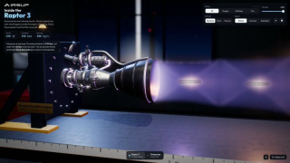</a><a href="https://guanmo-ai.github.io/awesome-ai-motion/#case-2103141339651350646">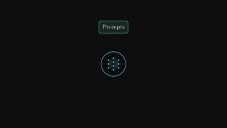</a><a href="https://guanmo-ai.github.io/awesome-ai-motion/#case-2103449416325890146">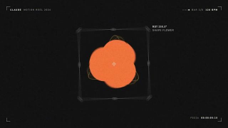</a><a href="https://guanmo-ai.github.io/awesome-ai-motion/#case-2102787937482252537">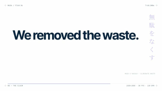</a><a href="https://guanmo-ai.github.io/awesome-ai-motion/#case-2104001664793600012"></a><a href="https://guanmo-ai.github.io/awesome-ai-motion/#case-2103835273813496100">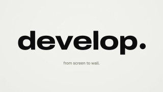</a><a href="https://guanmo-ai.github.io/awesome-ai-motion/#case-2102514581684052169">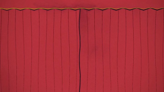</a><a href="https://guanmo-ai.github.io/awesome-ai-motion/#case-2102436464323661880">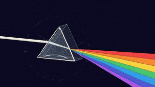</a><a href="https://guanmo-ai.github.io/awesome-ai-motion/#case-2103082510607610023">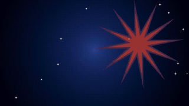</a><a href="https://guanmo-ai.github.io/awesome-ai-motion/#case-2103483923783373039"></a><br>
<a href="https://guanmo-ai.github.io/awesome-ai-motion/#case-2104151743907160546">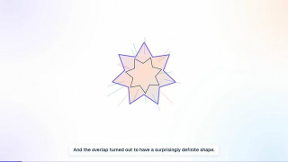</a><a href="https://guanmo-ai.github.io/awesome-ai-motion/#case-2103304514329854102"></a><a href="https://guanmo-ai.github.io/awesome-ai-motion/#case-2104206095313215591">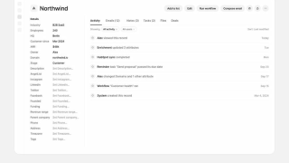</a><a href="https://guanmo-ai.github.io/awesome-ai-motion/#case-2107996576228753545">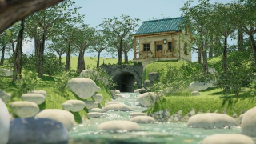</a><a href="https://guanmo-ai.github.io/awesome-ai-motion/#case-2102737776219168939">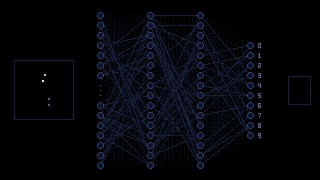</a><a href="https://guanmo-ai.github.io/awesome-ai-motion/#case-2102437977435893771">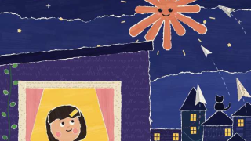</a><a href="https://guanmo-ai.github.io/awesome-ai-motion/#case-2106466745661980904">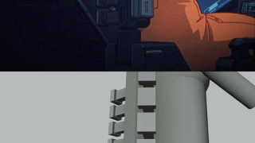</a><a href="https://guanmo-ai.github.io/awesome-ai-motion/#case-2102476258948927543">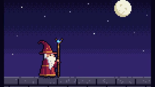</a><a href="https://guanmo-ai.github.io/awesome-ai-motion/#case-2107086714820870617"></a><a href="https://guanmo-ai.github.io/awesome-ai-motion/#case-2106411941497389342">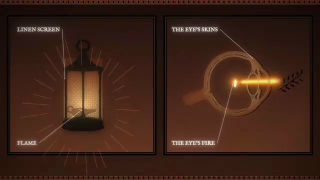</a><a href="https://guanmo-ai.github.io/awesome-ai-motion/#case-2103918792845963545"></a><a href="https://guanmo-ai.github.io/awesome-ai-motion/#case-2106835487365419479"></a><a href="https://guanmo-ai.github.io/awesome-ai-motion/#case-2102512879258009818">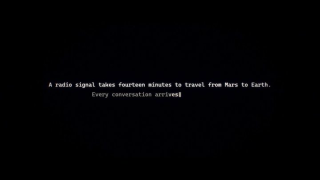</a><a href="https://guanmo-ai.github.io/awesome-ai-motion/#case-2102610626321490404">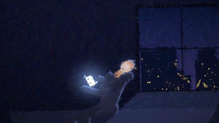</a><a href="https://guanmo-ai.github.io/awesome-ai-motion/#case-2104085484347818226">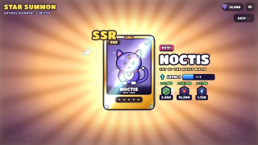</a><a href="https://guanmo-ai.github.io/awesome-ai-motion/#case-2105757136219504862">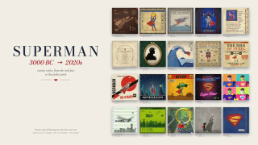</a><br>
<a href="https://guanmo-ai.github.io/awesome-ai-motion/#case-2103009037164110327"></a><a href="https://guanmo-ai.github.io/awesome-ai-motion/#case-2106313584829431901">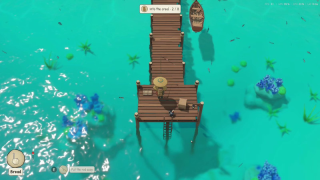</a><a href="https://guanmo-ai.github.io/awesome-ai-motion/#case-2107804983416467598">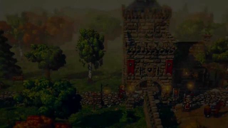</a><a href="https://guanmo-ai.github.io/awesome-ai-motion/#case-2102495989194236158">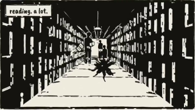</a><a href="https://guanmo-ai.github.io/awesome-ai-motion/#case-2106387548486738010">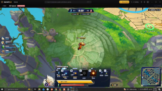</a><a href="https://guanmo-ai.github.io/awesome-ai-motion/#case-2103683057689522564">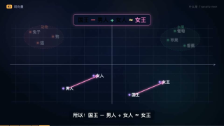</a><a href="https://guanmo-ai.github.io/awesome-ai-motion/#case-2102463453176979794">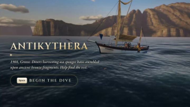</a><a href="https://guanmo-ai.github.io/awesome-ai-motion/#case-2105825930799432073">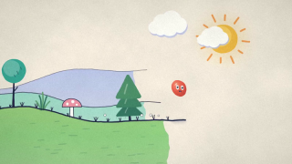</a><a href="https://guanmo-ai.github.io/awesome-ai-motion/#case-2102441708395041170"></a><a href="https://guanmo-ai.github.io/awesome-ai-motion/#case-2102844654169575547">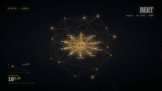</a><a href="https://guanmo-ai.github.io/awesome-ai-motion/#case-2096264296099459079">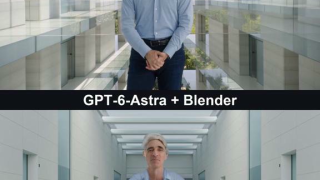</a><a href="https://guanmo-ai.github.io/awesome-ai-motion/#case-2104148233106723099"></a><a href="https://guanmo-ai.github.io/awesome-ai-motion/#case-2102853258582880547">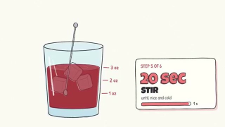</a><a href="https://guanmo-ai.github.io/awesome-ai-motion/#case-2104111432149164474">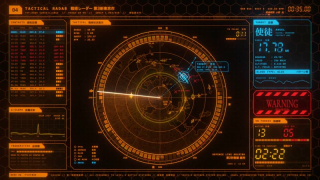</a><a href="https://guanmo-ai.github.io/awesome-ai-motion/#case-2106829942206173497">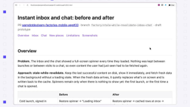</a><a href="https://guanmo-ai.github.io/awesome-ai-motion/#case-2102554209166000267"></a><br>
<a href="https://guanmo-ai.github.io/awesome-ai-motion/#case-2095756085890310311">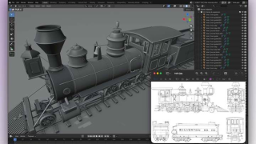</a><a href="https://guanmo-ai.github.io/awesome-ai-motion/#case-2103482164193165711">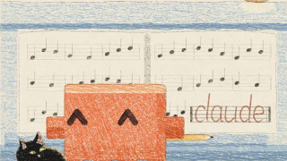</a><a href="https://guanmo-ai.github.io/awesome-ai-motion/#case-2107022944916709886">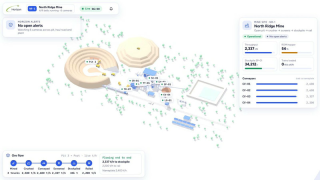</a><a href="https://guanmo-ai.github.io/awesome-ai-motion/#case-2103381720410333314">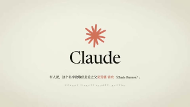</a><a href="https://guanmo-ai.github.io/awesome-ai-motion/#case-2107696042053431360">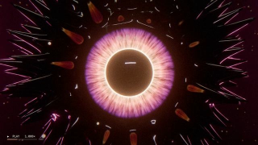</a><a href="https://guanmo-ai.github.io/awesome-ai-motion/#case-2102572941699354900"></a><a href="https://guanmo-ai.github.io/awesome-ai-motion/#case-2106236856979607569">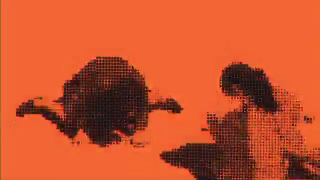</a><a href="https://guanmo-ai.github.io/awesome-ai-motion/#case-2102573127192727704">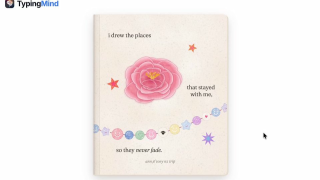</a><a href="https://guanmo-ai.github.io/awesome-ai-motion/#case-2103965547780345859"></a><a href="https://guanmo-ai.github.io/awesome-ai-motion/#case-2103152093733253544">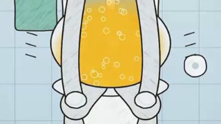</a><a href="https://guanmo-ai.github.io/awesome-ai-motion/#case-2104008163561451923">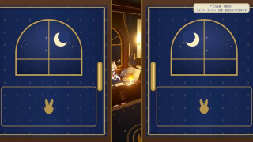</a><a href="https://guanmo-ai.github.io/awesome-ai-motion/#case-2102576886182453454"></a><a href="https://guanmo-ai.github.io/awesome-ai-motion/#case-2102477340920152162">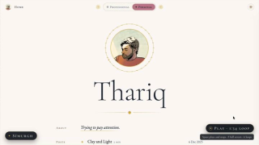</a><a href="https://guanmo-ai.github.io/awesome-ai-motion/#case-2103865359988125706">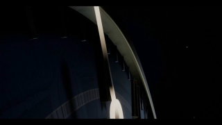</a><a href="https://guanmo-ai.github.io/awesome-ai-motion/#case-2107399371121930610">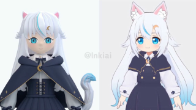</a><a href="https://guanmo-ai.github.io/awesome-ai-motion/#case-2102445641205248145">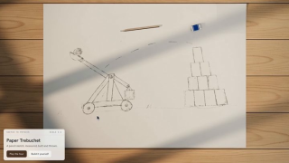</a><br>
<a href="https://guanmo-ai.github.io/awesome-ai-motion/#case-2103129343253778767"></a><a href="https://guanmo-ai.github.io/awesome-ai-motion/#case-2102498589259821559">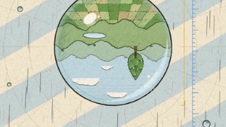</a><a href="https://guanmo-ai.github.io/awesome-ai-motion/#case-2107752774423511539">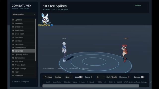</a><a href="https://guanmo-ai.github.io/awesome-ai-motion/#case-2102463796149440888">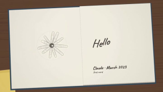</a><a href="https://guanmo-ai.github.io/awesome-ai-motion/#case-2104548658171834749">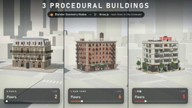</a><a href="https://guanmo-ai.github.io/awesome-ai-motion/#case-2102803889183736141">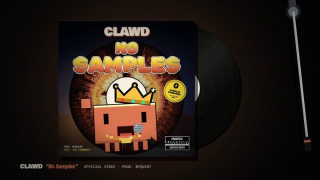</a><a href="https://guanmo-ai.github.io/awesome-ai-motion/#case-2102503027340988559"></a><a href="https://guanmo-ai.github.io/awesome-ai-motion/#case-2102893186330841502"></a><a href="https://guanmo-ai.github.io/awesome-ai-motion/#case-2102493303388475855"></a><a href="https://guanmo-ai.github.io/awesome-ai-motion/#case-2102645793828036643"></a><a href="https://guanmo-ai.github.io/awesome-ai-motion/#case-2102606609574941028"></a><a href="https://guanmo-ai.github.io/awesome-ai-motion/#case-2107793610230075416"></a><a href="https://guanmo-ai.github.io/awesome-ai-motion/#case-2102531681450119426"></a><a href="https://guanmo-ai.github.io/awesome-ai-motion/#case-2107634512226058434"></a><a href="https://guanmo-ai.github.io/awesome-ai-motion/#case-2102583898865873225"></a><a href="https://guanmo-ai.github.io/awesome-ai-motion/#case-2102471841046786153"></a><br>
<a href="https://guanmo-ai.github.io/awesome-ai-motion/#case-2103499977632997524"></a><a href="https://guanmo-ai.github.io/awesome-ai-motion/#case-2106604492728967620"></a><a href="https://guanmo-ai.github.io/awesome-ai-motion/#case-2103576084499358051"></a><a href="https://guanmo-ai.github.io/awesome-ai-motion/#case-2105816670896009224"></a><a href="https://guanmo-ai.github.io/awesome-ai-motion/#case-2096612996256579653"></a><a href="https://guanmo-ai.github.io/awesome-ai-motion/#case-2103272686570918334"></a><a href="https://guanmo-ai.github.io/awesome-ai-motion/#case-2107186094777434454"></a><a href="https://guanmo-ai.github.io/awesome-ai-motion/#case-2102457111787745405"></a><a href="https://guanmo-ai.github.io/awesome-ai-motion/#case-2103138089790996843"></a><a href="https://guanmo-ai.github.io/awesome-ai-motion/#case-2102575577563570450"></a><a href="https://guanmo-ai.github.io/awesome-ai-motion/#case-2103122947133309311"></a><a href="https://guanmo-ai.github.io/awesome-ai-motion/#case-2102876925102555526"></a><a href="https://guanmo-ai.github.io/awesome-ai-motion/#case-2103174501345493197"></a><a href="https://guanmo-ai.github.io/awesome-ai-motion/#case-2106313749846249487"></a><a href="https://guanmo-ai.github.io/awesome-ai-motion/#case-2103227982592831846"></a><a href="https://guanmo-ai.github.io/awesome-ai-motion/#case-2105990418886480092"></a><br>
<a href="https://guanmo-ai.github.io/awesome-ai-motion/#case-2106684612822896770"></a><a href="https://guanmo-ai.github.io/awesome-ai-motion/#case-2102636308707287201"></a><a href="https://guanmo-ai.github.io/awesome-ai-motion/#case-2102722719502704941"></a><a href="https://guanmo-ai.github.io/awesome-ai-motion/#case-2103099194693271874"></a><a href="https://guanmo-ai.github.io/awesome-ai-motion/#case-2103530750767206626"></a><a href="https://guanmo-ai.github.io/awesome-ai-motion/#case-2102986085328716066"></a><a href="https://guanmo-ai.github.io/awesome-ai-motion/#case-2107108561851445324"></a><a href="https://guanmo-ai.github.io/awesome-ai-motion/#case-2103117246860345550"></a><a href="https://guanmo-ai.github.io/awesome-ai-motion/#case-2106375041269342691"></a><a href="https://guanmo-ai.github.io/awesome-ai-motion/#case-2102940980379017293"></a><a href="https://guanmo-ai.github.io/awesome-ai-motion/#case-2102679018206052828"></a><a href="https://guanmo-ai.github.io/awesome-ai-motion/#case-2102733714845491558"></a><a href="https://guanmo-ai.github.io/awesome-ai-motion/#case-2107408409859359211"></a><a href="https://guanmo-ai.github.io/awesome-ai-motion/#case-2102878288008057171"></a><a href="https://guanmo-ai.github.io/awesome-ai-motion/#case-2102436001473786054"></a><a href="https://guanmo-ai.github.io/awesome-ai-motion/#case-2106493673425047896"></a><br>
<a href="https://guanmo-ai.github.io/awesome-ai-motion/#case-2103472385563459833"></a><a href="https://guanmo-ai.github.io/awesome-ai-motion/#case-2102656273112326609"></a><a href="https://guanmo-ai.github.io/awesome-ai-motion/#case-2102740041621762166"></a><a href="https://guanmo-ai.github.io/awesome-ai-motion/#case-2103523994440012086"></a><a href="https://guanmo-ai.github.io/awesome-ai-motion/#case-2103997975173439834"></a><a href="https://guanmo-ai.github.io/awesome-ai-motion/#case-2102827887732932956"></a><a href="https://guanmo-ai.github.io/awesome-ai-motion/#case-2107018546194882678"></a><a href="https://guanmo-ai.github.io/awesome-ai-motion/#case-2102466523164274839"></a><a href="https://guanmo-ai.github.io/awesome-ai-motion/#case-2102817596009504849"></a><a href="https://guanmo-ai.github.io/awesome-ai-motion/#case-2103457566978162901"></a><a href="https://guanmo-ai.github.io/awesome-ai-motion/#case-2096209514248958161"></a><a href="https://guanmo-ai.github.io/awesome-ai-motion/#case-2102827288190689364"></a><a href="https://guanmo-ai.github.io/awesome-ai-motion/#case-2102838830285898214"></a><a href="https://guanmo-ai.github.io/awesome-ai-motion/#case-2103128559174971663"></a><a href="https://guanmo-ai.github.io/awesome-ai-motion/#case-2102478640428773861"></a><a href="https://guanmo-ai.github.io/awesome-ai-motion/#case-2103108967194833310"></a><br>
<a href="https://guanmo-ai.github.io/awesome-ai-motion/#case-2107285581109547516"></a><a href="https://guanmo-ai.github.io/awesome-ai-motion/#case-2103288413969621231"></a><a href="https://guanmo-ai.github.io/awesome-ai-motion/#case-2102788223835463902"></a><a href="https://guanmo-ai.github.io/awesome-ai-motion/#case-2103483957266268381"></a><a href="https://guanmo-ai.github.io/awesome-ai-motion/#case-2102919394775220530"></a><a href="https://guanmo-ai.github.io/awesome-ai-motion/#case-2105606322310054044"></a><a href="https://guanmo-ai.github.io/awesome-ai-motion/#case-2106527292633825693"></a><a href="https://guanmo-ai.github.io/awesome-ai-motion/#case-2106324559805010004"></a><a href="https://guanmo-ai.github.io/awesome-ai-motion/#case-2103148835270971419"></a><a href="https://guanmo-ai.github.io/awesome-ai-motion/#case-2102592355165782312"></a><a href="https://guanmo-ai.github.io/awesome-ai-motion/#case-2103037586663235713"></a><a href="https://guanmo-ai.github.io/awesome-ai-motion/#case-2102472218269900876"></a><a href="https://guanmo-ai.github.io/awesome-ai-motion/#case-2106958663525314769"></a><a href="https://guanmo-ai.github.io/awesome-ai-motion/#case-2104093497561436573"></a><a href="https://guanmo-ai.github.io/awesome-ai-motion/#case-2105804692811137242"></a><a href="https://guanmo-ai.github.io/awesome-ai-motion/#case-2107713497224130638"></a><br>
<a href="https://guanmo-ai.github.io/awesome-ai-motion/#case-2107159129420964343"></a><a href="https://guanmo-ai.github.io/awesome-ai-motion/#case-2104186357824487573"></a><a href="https://guanmo-ai.github.io/awesome-ai-motion/#case-2102779758408774104"></a><a href="https://guanmo-ai.github.io/awesome-ai-motion/#case-2106955771183272343"></a><a href="https://guanmo-ai.github.io/awesome-ai-motion/#case-2103116235009347650"></a><a href="https://guanmo-ai.github.io/awesome-ai-motion/#case-2102449278283313303"></a><a href="https://guanmo-ai.github.io/awesome-ai-motion/#case-2106656783221899534"></a><a href="https://guanmo-ai.github.io/awesome-ai-motion/#case-2103482545111232946"></a><a href="https://guanmo-ai.github.io/awesome-ai-motion/#case-2107451914954911838"></a><a href="https://guanmo-ai.github.io/awesome-ai-motion/#case-2102487989381156991"></a><a href="https://guanmo-ai.github.io/awesome-ai-motion/#case-2105983802367688910"></a><a href="https://guanmo-ai.github.io/awesome-ai-motion/#case-2106299981875347740"></a><a href="https://guanmo-ai.github.io/awesome-ai-motion/#case-2102641562824135022"></a><a href="https://guanmo-ai.github.io/awesome-ai-motion/#case-2107572909086761325"></a><a href="https://guanmo-ai.github.io/awesome-ai-motion/#case-2102736587708854585"></a><a href="https://guanmo-ai.github.io/awesome-ai-motion/#case-2103024907965612250"></a>
</p>

发现惊艳动效，探索更多创作可能。 · [English](README.en.md)

**[进入作品画廊 ↗](https://guanmo-ai.github.io/awesome-ai-motion/)** &nbsp; · &nbsp; [推荐作品](https://github.com/guanmo-ai/awesome-ai-motion/issues/new?template=submit.yml)

<sub>821 个作品 &nbsp; · &nbsp; 点击拼图中的任意作品观看</sub>

<a id="spotlights"></a>

## 最近值得一看

综合收藏数与发布时间排序，让高收藏的新作品优先。收藏数为原帖快照。

<table>
<tr>
<td width="33%" align="center" valign="middle"><a href="https://guanmo-ai.github.io/awesome-ai-motion/#case-2103273003555402193"></a></td>
<td width="33%" align="center" valign="middle"><a href="https://guanmo-ai.github.io/awesome-ai-motion/#case-2106426962738880879"></a></td>
<td width="33%" align="center" valign="middle"><a href="https://guanmo-ai.github.io/awesome-ai-motion/#case-2108948624004526516"></a></td>
</tr>
<tr>
<td width="33%" valign="top"><strong>一个形状串起整套 UI</strong><br><sub><a href="https://x.com/twoclipping">@twocli&#8203;pping</a></sub><br><sub>收藏 19,303 · 2026-09-24</sub><br><br><a href="https://guanmo-ai.github.io/awesome-ai-motion/#case-2103273003555402193">观看 ↗</a> · <a href="https://x.com/twoclipping/status/2103273003555402193">原帖</a></td>
<td width="33%" valign="top"><strong>Warefl&#8203;ow：策略游戏式仓库管理界面</strong><br><sub><a href="https://x.com/DilumSanjaya">@DilumS&#8203;anjaya</a></sub><br><sub>收藏 10,714 · 2026-10-03</sub><br><br><a href="https://guanmo-ai.github.io/awesome-ai-motion/#case-2106426962738880879">观看 ↗</a> · <a href="https://x.com/DilumSanjaya/status/2106426962738880879">原帖</a></td>
<td width="33%" valign="top"><strong>Anatom&#8203;y：会动的机器说明图</strong><br><sub><a href="https://x.com/wheresryan22">@wheres&#8203;ryan22</a></sub><br><sub>收藏 6,423 · 2026-10-10</sub><br><br><a href="https://guanmo-ai.github.io/awesome-ai-motion/#case-2108948624004526516">观看 ↗</a> · <a href="https://x.com/wheresryan22/status/2108948624004526516">原帖</a></td>
</tr>
<tr>
<td width="33%" align="center" valign="middle"><a href="https://guanmo-ai.github.io/awesome-ai-motion/#case-2103315922098470926"></a></td>
<td width="33%" align="center" valign="middle"><a href="https://guanmo-ai.github.io/awesome-ai-motion/#case-2102591147927654847"></a></td>
<td width="33%" align="center" valign="middle"><a href="https://guanmo-ai.github.io/awesome-ai-motion/#case-2102801274173587569"></a></td>
</tr>
<tr>
<td width="33%" valign="top"><strong>15 秒动态设计自由发挥</strong><br><sub><a href="https://x.com/stephanlivera">@stepha&#8203;nliver&#8203;a</a></sub><br><sub>收藏 11,692 · 2026-09-25</sub><br><br><a href="https://guanmo-ai.github.io/awesome-ai-motion/#case-2103315922098470926">观看 ↗</a> · <a href="https://x.com/stephanlivera/status/2103315922098470926">原帖</a></td>
<td width="33%" valign="top"><strong>用镜头实验室解释对焦</strong><br><sub><a href="https://x.com/RyanSael">@RyanSa&#8203;el</a></sub><br><sub>收藏 9,188 · 2026-09-23</sub><br><br><a href="https://guanmo-ai.github.io/awesome-ai-motion/#case-2102591147927654847">观看 ↗</a> · <a href="https://x.com/RyanSael/status/2102591147927654847">原帖</a></td>
<td width="33%" valign="top"><strong>Claude Pop 混合制作 MV</strong><br><sub><a href="https://x.com/donaldjewkes">@donald&#8203;jewkes</a></sub><br><sub>收藏 8,096 · 2026-09-23</sub><br><br><a href="https://guanmo-ai.github.io/awesome-ai-motion/#case-2102801274173587569">观看 ↗</a> · <a href="https://x.com/donaldjewkes/status/2102801274173587569">原帖</a></td>
</tr>
</table>

<a id="browse"></a>

## 为下一次创作找参考

| 方向 | 可以发现什么 | 作品 |
| :-- | :-- | --: |
| <a id="category-product"></a>[产品宣传](browse/product.md) | 把产品、功能与品牌讲清楚 | 159 |
| <a id="category-education"></a>[知识讲解](browse/education.md) | 把抽象概念变成看得懂的画面 | 158 |
| <a id="category-motion"></a>[短动效](browse/motion.md) | 观察节奏、字排、形变与转场 | 104 |
| <a id="category-characters"></a>[角色动画](browse/characters.md) | 探索角色表演、像素与风格 | 57 |
| <a id="category-interactive"></a>[交互演示](browse/interactive.md) | 走进可响应的空间与物理世界 | 197 |
| <a id="category-stories"></a>[叙事短片](browse/stories.md) | 从分镜、镜头到完整叙事 | 82 |
| <a id="category-music"></a>[音乐与歌词](browse/music.md) | 让音乐、画面与情绪同步 | 64 |

[在画廊中搜索、筛选和播放全部作品 →](https://guanmo-ai.github.io/awesome-ai-motion/)

<a id="more"></a>

## 继续发现

<details>
<summary>收藏最多的作品</summary>

## 收藏最多

<table>
<tbody>
<tr>
<td width="50%" height="225" align="center" valign="middle"><a href="https://guanmo-ai.github.io/awesome-ai-motion/#case-2103273003555402193"></a></td>
<td width="50%" height="225" align="center" valign="middle"><a href="https://guanmo-ai.github.io/awesome-ai-motion/#case-2103315922098470926"></a></td>
</tr>
<tr>
<td width="50%" valign="top"><strong>一个形状串起整套 UI</strong><br><sub><a href="https://x.com/twoclipping">@twoclipping</a> · 短动效</sub><br><sub>0:14 · 收藏 19,303</sub><br><a href="https://guanmo-ai.github.io/awesome-ai-motion/#case-2103273003555402193">▶ 播放</a> · <a href="https://x.com/twoclipping/status/2103273003555402193">原帖</a></td>
<td width="50%" valign="top"><strong>15 秒动态设计自由发挥</strong><br><sub><a href="https://x.com/stephanlivera">@stephanlivera</a> · 短动效</sub><br><sub>0:15 · 收藏 11,692</sub><br><a href="https://guanmo-ai.github.io/awesome-ai-motion/#case-2103315922098470926">▶ 播放</a> · <a href="https://x.com/stephanlivera/status/2103315922098470926">原帖</a></td>
</tr>
</tbody>
<tbody>
<tr>
<td width="50%" height="225" align="center" valign="middle"><a href="https://guanmo-ai.github.io/awesome-ai-motion/#case-2106426962738880879"></a></td>
<td width="50%" height="225" align="center" valign="middle"><a href="https://guanmo-ai.github.io/awesome-ai-motion/#case-2102591147927654847"></a></td>
</tr>
<tr>
<td width="50%" valign="top"><strong>Wareflow：策略游戏式仓库管理界面</strong><br><sub><a href="https://x.com/DilumSanjaya">@DilumSanjaya</a> · 交互演示</sub><br><sub>1:12 · 收藏 10,714 · 资料待完善</sub><br><a href="https://guanmo-ai.github.io/awesome-ai-motion/#case-2106426962738880879">▶ 播放</a> · <a href="https://x.com/DilumSanjaya/status/2106426962738880879">原帖</a></td>
<td width="50%" valign="top"><strong>用镜头实验室解释对焦</strong><br><sub><a href="https://x.com/RyanSael">@RyanSael</a> · 知识讲解</sub><br><sub>0:32 · 收藏 9,188</sub><br><a href="https://guanmo-ai.github.io/awesome-ai-motion/#case-2102591147927654847">▶ 播放</a> · <a href="https://x.com/RyanSael/status/2102591147927654847">原帖</a></td>
</tr>
</tbody>
<tbody>
<tr>
<td width="50%" height="225" align="center" valign="middle"><a href="https://guanmo-ai.github.io/awesome-ai-motion/#case-2102801274173587569"></a></td>
<td width="50%" height="225" align="center" valign="middle"><a href="https://guanmo-ai.github.io/awesome-ai-motion/#case-2108948624004526516"></a></td>
</tr>
<tr>
<td width="50%" valign="top"><strong>Claude Pop 混合制作 MV</strong><br><sub><a href="https://x.com/donaldjewkes">@donaldjewkes</a> · 音乐与歌词</sub><br><sub>2:22 · 收藏 8,096</sub><br><a href="https://guanmo-ai.github.io/awesome-ai-motion/#case-2102801274173587569">▶ 播放</a> · <a href="https://x.com/donaldjewkes/status/2102801274173587569">原帖</a></td>
<td width="50%" valign="top"><strong>Anatomy：会动的机器说明图</strong><br><sub><a href="https://x.com/wheresryan22">@wheresryan22</a> · 交互演示</sub><br><sub>0:39 · 收藏 6,423 · 资料待完善</sub><br><a href="https://guanmo-ai.github.io/awesome-ai-motion/#case-2108948624004526516">▶ 播放</a> · <a href="https://x.com/wheresryan22/status/2108948624004526516">原帖</a></td>
</tr>
</tbody>
</table>

<sub>收藏数字为原帖快照，并非实时榜单。</sub>

</details>

<a id="featured"></a>

<details>
<summary>策展人标记的作品</summary>

<table>
<tbody>
<tr>
<td width="50%" height="225" align="center" valign="middle"><a href="https://guanmo-ai.github.io/awesome-ai-motion/#case-2103918792845963545"></a></td>
<td width="50%" height="225" align="center" valign="middle"><a href="https://guanmo-ai.github.io/awesome-ai-motion/#case-2103315922098470926"></a></td>
</tr>
<tr>
<td width="50%" valign="top"><strong>Pocketsflow 角色产品讲解</strong><br><sub><a href="https://x.com/achxvi">@achxvi</a> · 产品宣传</sub><br><sub>0:15 · 收藏 2,005</sub><br><a href="https://guanmo-ai.github.io/awesome-ai-motion/#case-2103918792845963545">▶ 播放</a> · <a href="https://x.com/achxvi/status/2103918792845963545">原帖</a></td>
<td width="50%" valign="top"><strong>15 秒动态设计自由发挥</strong><br><sub><a href="https://x.com/stephanlivera">@stephanlivera</a> · 短动效</sub><br><sub>0:15 · 收藏 11,692</sub><br><a href="https://guanmo-ai.github.io/awesome-ai-motion/#case-2103315922098470926">▶ 播放</a> · <a href="https://x.com/stephanlivera/status/2103315922098470926">原帖</a></td>
</tr>
</tbody>
<tbody>
<tr>
<td width="50%" height="225" align="center" valign="middle"><a href="https://guanmo-ai.github.io/awesome-ai-motion/#case-2102583898865873225"></a></td>
<td width="50%" height="225" align="center" valign="middle"><a href="https://guanmo-ai.github.io/awesome-ai-motion/#case-2103099194693271874"></a></td>
</tr>
<tr>
<td width="50%" valign="top"><strong>用线稿回顾中华五千年</strong><br><sub><a href="https://x.com/akokoi1">@akokoi1</a> · 知识讲解</sub><br><sub>2:38 · 收藏 762</sub><br><a href="https://guanmo-ai.github.io/awesome-ai-motion/#case-2102583898865873225">▶ 播放</a> · <a href="https://x.com/akokoi1/status/2102583898865873225">原帖</a></td>
<td width="50%" valign="top"><strong>机器人穿越十二种画风</strong><br><sub><a href="https://x.com/pradeepXkapoor">@pradeepXkapoor</a> · 角色动画</sub><br><sub>1:15 · 收藏 532</sub><br><a href="https://guanmo-ai.github.io/awesome-ai-motion/#case-2103099194693271874">▶ 播放</a> · <a href="https://x.com/pradeepXkapoor/status/2103099194693271874">原帖</a></td>
</tr>
</tbody>
<tbody>
<tr>
<td width="50%" height="225" align="center" valign="middle"><a href="https://guanmo-ai.github.io/awesome-ai-motion/#case-2103116235009347650"></a></td>
<td width="50%"></td>
</tr>
<tr>
<td width="50%" valign="top"><strong>用代码讲述奥斯特里茨战役</strong><br><sub><a href="https://x.com/WinterArc2125">@WinterArc2125</a> · 叙事短片</sub><br><sub>5:01 · 收藏 272</sub><br><a href="https://guanmo-ai.github.io/awesome-ai-motion/#case-2103116235009347650">▶ 播放</a> · <a href="https://x.com/WinterArc2125/status/2103116235009347650">原帖</a></td>
<td width="50%"></td>
</tr>
</tbody>
</table>

</details>

<a id="about"></a>

<details>
<summary>关于收录与来源</summary>

汇集由 AI 编写代码绘制、渲染或驱动的动效与交互作品，包括 Blender、Three.js、Canvas 等工具制作的动画，整理作者公开的源码、提示词和制作资料。具体范围见[收录标准](docs/DISCOVERY.md#收录范围)；精选与完整视听评价分别记录。

点击封面打开画廊播放；没有画廊视频时会前往作者 X 原帖。公开提示词不保证相同结果，作品尚未逐条独立复现。

[来源与排序](docs/SOURCES.md) · [核验范围与统计](docs/COVERAGE.md) · [收录说明](docs/QUALITY.md) · [资料待完善的作品](browse/discoveries.md)

</details>

<a id="local-gallery"></a>

<details>
<summary>在本机运行画廊</summary>

克隆仓库，在目录中运行（Node.js 22+，无需安装依赖）：

```sh
node scripts/serve.mjs
```

打开 http://127.0.0.1:4178 。

[维护指南](docs/MAINTAINING.md) · [静态发布](docs/DEPLOYMENT.md)

</details>

---

由 [观默 / @guanmo_ai](https://x.com/guanmo_ai) 发起与维护。感谢公开作品与创作过程的每一位作者。

[参与贡献](CONTRIBUTING.md) · [纠错或移除](https://github.com/guanmo-ai/awesome-ai-motion/issues/new?template=correction.yml) · [第三方内容说明](THIRD_PARTY.md) · [MIT](LICENSE)

<sub>MIT 仅适用于本仓库原创脚本；第三方作品、素材与提示词的权利归原作者所有。</sub>
