[← 全部分类](../README.md#browse)

# 发现池

1635 条来源已核对、编目资料待完善的作品。精选另行标记。

<table>
<tbody>
<tr>
<td width="50%" height="225" align="center" valign="middle"></td>
<td width="50%" height="225" align="center" valign="middle"></td>
</tr>
<tr>
<td width="50%" valign="top"><strong>节拍同步的产品动效广告</strong> <a href="https://x.com/twoclipping">@twoclipping</a> · 产品宣传 0:20 · 收藏 1,422 · 资料待完善 <a href="https://guanmo-ai.github.io/awesome-ai-motion/#case-2102554209166000267">▶ 播放</a> · <a href="https://x.com/twoclipping/status/2102554209166000267">原帖</a></td>
<td width="50%" valign="top"><strong>Distilbook 的四十秒产品发布片</strong> <a href="https://x.com/ajith_io">@ajith_io</a> · 产品宣传 0:40 · 收藏 847 · 资料待完善 <a href="https://guanmo-ai.github.io/awesome-ai-motion/#case-2103469807375208546">▶ 播放</a> · <a href="https://x.com/ajith_io/status/2103469807375208546">原帖</a></td>
</tr>
</tbody>
<tbody>
<tr>
<td width="50%" height="225" align="center" valign="middle"></td>
<td width="50%" height="225" align="center" valign="middle"></td>
</tr>
<tr>
<td width="50%" valign="top"><strong>点餐 App 的连续 UI 发布片</strong> <a href="https://x.com/ultimaxbt">@ultimaxbt</a> · 产品宣传 0:16 · 收藏 843 · 资料待完善 <a href="https://guanmo-ai.github.io/awesome-ai-motion/#case-2108210884799549714">▶ 播放</a> · <a href="https://x.com/ultimaxbt/status/2108210884799549714">原帖</a></td>
<td width="50%" valign="top"><strong>同一句提示词的两种发布动效</strong> <a href="https://x.com/motion_so">@motion_so</a> · 产品宣传 0:20 · 收藏 420 · 资料待完善 <a href="https://guanmo-ai.github.io/awesome-ai-motion/#case-2107507518817878117">▶ 播放</a> · <a href="https://x.com/motion_so/status/2107507518817878117">原帖</a></td>
</tr>
</tbody>
<tbody>
<tr>
<td width="50%" height="225" align="center" valign="middle"></td>
<td width="50%" height="225" align="center" valign="middle"></td>
</tr>
<tr>
<td width="50%" valign="top"><strong>写作工具的快节奏广告</strong> <a href="https://x.com/shribuilds">@shribuilds</a> · 产品宣传 0:41 · 收藏 383 · 资料待完善 <a href="https://guanmo-ai.github.io/awesome-ai-motion/#case-2102827288190689364">▶ 播放</a> · <a href="https://x.com/shribuilds/status/2102827288190689364">原帖</a></td>
<td width="50%" valign="top"><strong>Inbox Zero：代码产品视频工作流</strong> <a href="https://x.com/elie2222">@elie2222</a> · 产品宣传 0:58 · 收藏 371 · 资料待完善 <a href="https://guanmo-ai.github.io/awesome-ai-motion/#case-2107186094777434454">▶ 播放</a> · <a href="https://x.com/elie2222/status/2107186094777434454">原帖</a></td>
</tr>
</tbody>
<tbody>
<tr>
<td width="50%" height="225" align="center" valign="middle"></td>
<td width="50%" height="225" align="center" valign="middle"><a href="https://guanmo-ai.github.io/awesome-ai-motion/#case-2107217691505516612">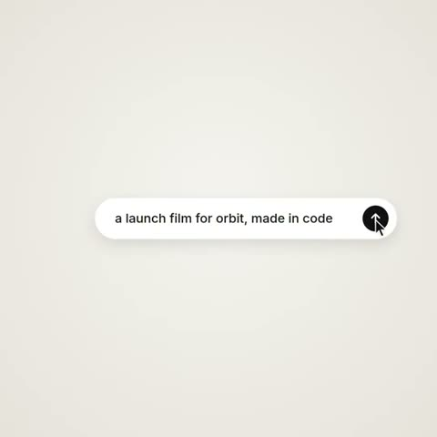</a></td>
</tr>
<tr>
<td width="50%" valign="top"><strong>应用改版素材的动画短片</strong> <a href="https://x.com/jackfriks">@jackfriks</a> · 产品宣传 0:20 · 收藏 192 · 资料待完善 <a href="https://guanmo-ai.github.io/awesome-ai-motion/#case-2103132260589338762">▶ 播放</a> · <a href="https://x.com/jackfriks/status/2103132260589338762">原帖</a></td>
<td width="50%" valign="top"><strong>Orbit：一个形状完成产品发布</strong> <a href="https://x.com/0xnicc0">@0xnicc0</a> · 产品宣传 0:12 · 收藏 61 · 资料待完善 <a href="https://guanmo-ai.github.io/awesome-ai-motion/#case-2107217691505516612">▶ 播放</a> · <a href="https://x.com/0xnicc0/status/2107217691505516612">原帖</a></td>
</tr>
</tbody>
<tbody>
<tr>
<td width="50%" height="225" align="center" valign="middle"><a href="https://guanmo-ai.github.io/awesome-ai-motion/#case-2104873596527231330">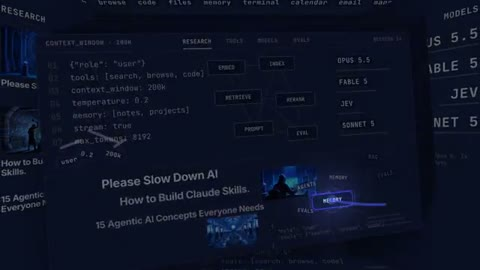</a></td>
<td width="50%" height="225" align="center" valign="middle"></td>
</tr>
<tr>
<td width="50%" valign="top"><strong>品牌内容墙到人物网络</strong> <a href="https://x.com/humzaakhalid">@humzaakhalid</a> · 产品宣传 0:20 · 收藏 33 · 资料待完善 <a href="https://guanmo-ai.github.io/awesome-ai-motion/#case-2104873596527231330">▶ 播放</a> · <a href="https://x.com/humzaakhalid/status/2104873596527231330">原帖</a></td>
<td width="50%" valign="top"><strong>浏览器产品预告重剪</strong> <a href="https://x.com/jake11moran">@jake11moran</a> · 产品宣传 0:27 · 收藏 25 · 资料待完善 <a href="https://guanmo-ai.github.io/awesome-ai-motion/#case-2103237884564414633">▶ 播放</a> · <a href="https://x.com/jake11moran/status/2103237884564414633">原帖</a></td>
</tr>
</tbody>
<tbody>
<tr>
<td width="50%" height="225" align="center" valign="middle"></td>
<td width="50%" height="225" align="center" valign="middle"></td>
</tr>
<tr>
<td width="50%" valign="top"><strong>PayBox 的几何黑白发布片</strong> <a href="https://x.com/0xValure">@0xValure</a> · 产品宣传 0:10 · 收藏 22 · 资料待完善 <a href="https://guanmo-ai.github.io/awesome-ai-motion/#case-2103603025579331584">▶ 播放</a> · <a href="https://x.com/0xValure/status/2103603025579331584">原帖</a></td>
<td width="50%" valign="top"><strong>宠物日常：手机界面的竖版发布片</strong> <a href="https://x.com/shengtang135754">@shengtang135754</a> · 产品宣传 0:23 · 收藏 13 · 资料待完善 <a href="https://guanmo-ai.github.io/awesome-ai-motion/#case-2106656877342023818">▶ 播放</a> · <a href="https://x.com/shengtang135754/status/2106656877342023818">原帖</a></td>
</tr>
</tbody>
<tbody>
<tr>
<td width="50%" height="225" align="center" valign="middle"></td>
<td width="50%" height="225" align="center" valign="middle"></td>
</tr>
<tr>
<td width="50%" valign="top"><strong>RedShip 的动态产品故事</strong> <a href="https://x.com/aschapmann">@aschapmann</a> · 产品宣传 0:30 · 收藏 12 · 资料待完善 <a href="https://guanmo-ai.github.io/awesome-ai-motion/#case-2104230888812724497">▶ 播放</a> · <a href="https://x.com/aschapmann/status/2104230888812724497">原帖</a></td>
<td width="50%" valign="top"><strong>Clawd 入驻工作台的非官方复刻</strong> <a href="https://x.com/leo114119">@leo114119</a> · 产品宣传 0:59 · 收藏 11 · 资料待完善 <a href="https://guanmo-ai.github.io/awesome-ai-motion/#case-2106714120842338585">▶ 播放</a> · <a href="https://x.com/leo114119/status/2106714120842338585">原帖</a></td>
</tr>
</tbody>
<tbody>
<tr>
<td width="50%" height="225" align="center" valign="middle"></td>
<td width="50%" height="225" align="center" valign="middle"></td>
</tr>
<tr>
<td width="50%" valign="top"><strong>Masko 推荐计划的图形宣传片</strong> <a href="https://x.com/paulo_kombucha">@paulo_kombucha</a> · 产品宣传 0:15 · 收藏 5 · 资料待完善 <a href="https://guanmo-ai.github.io/awesome-ai-motion/#case-2104481235028283883">▶ 播放</a> · <a href="https://x.com/paulo_kombucha/status/2104481235028283883">原帖</a></td>
<td width="50%" valign="top"><strong>元素组件产品广告</strong> <a href="https://x.com/deweytn">@deweytn</a> · 产品宣传 0:26 · 收藏 4 · 资料待完善 <a href="https://guanmo-ai.github.io/awesome-ai-motion/#case-2102787822855893072">▶ 播放</a> · <a href="https://x.com/deweytn/status/2102787822855893072">原帖</a></td>
</tr>
</tbody>
<tbody>
<tr>
<td width="50%" height="225" align="center" valign="middle"></td>
<td width="50%" height="225" align="center" valign="middle"></td>
</tr>
<tr>
<td width="50%" valign="top"><strong>从项目总览到评论的 SaaS 发布片</strong> <a href="https://x.com/Screeendev">@Screeendev</a> · 产品宣传 0:52 · 收藏 4 · 资料待完善 <a href="https://guanmo-ai.github.io/awesome-ai-motion/#case-2108333562462408823">▶ 播放</a> · <a href="https://x.com/Screeendev/status/2108333562462408823">原帖</a></td>
<td width="50%" valign="top"><strong>Studio1 的动态文字开场</strong> <a href="https://x.com/Astrodevil_">@Astrodevil_</a> · 产品宣传 0:15 · 收藏 4 · 资料待完善 <a href="https://guanmo-ai.github.io/awesome-ai-motion/#case-2103600734017392708">▶ 播放</a> · <a href="https://x.com/Astrodevil_/status/2103600734017392708">原帖</a></td>
</tr>
</tbody>
<tbody>
<tr>
<td width="50%" height="225" align="center" valign="middle"></td>
<td width="50%" height="225" align="center" valign="middle"></td>
</tr>
<tr>
<td width="50%" valign="top"><strong>模型发布概念短片</strong> <a href="https://x.com/marcthecreatorr">@marcthecreatorr</a> · 产品宣传 0:32 · 收藏 3 · 资料待完善 <a href="https://guanmo-ai.github.io/awesome-ai-motion/#case-2103133462798483752">▶ 播放</a> · <a href="https://x.com/marcthecreatorr/status/2103133462798483752">原帖</a></td>
<td width="50%" valign="top"><strong>开发者个人网站的动态作品集</strong> <a href="https://x.com/wani_shola">@wani_shola</a> · 产品宣传 1:42 · 收藏 3 · 资料待完善 <a href="https://guanmo-ai.github.io/awesome-ai-motion/#case-2103769906638459278">▶ 播放</a> · <a href="https://x.com/wani_shola/status/2103769906638459278">原帖</a></td>
</tr>
</tbody>
<tbody>
<tr>
<td width="50%" height="225" align="center" valign="middle"></td>
<td width="50%" height="225" align="center" valign="middle"></td>
</tr>
<tr>
<td width="50%" valign="top"><strong>Apple 产品演化的三维时间线</strong> <a href="https://x.com/aiRobertDaily">@aiRobertDaily</a> · 产品宣传 0:38 · 收藏 3 · 资料待完善 <a href="https://guanmo-ai.github.io/awesome-ai-motion/#case-2108596616756416945">▶ 播放</a> · <a href="https://x.com/aiRobertDaily/status/2108596616756416945">原帖</a></td>
<td width="50%" valign="top"><strong>Hoplite 功能发布动效</strong> <a href="https://x.com/ryan_morr">@ryan_morr</a> · 产品宣传 0:32 · 收藏 2 · 资料待完善 <a href="https://guanmo-ai.github.io/awesome-ai-motion/#case-2104249941136666741">▶ 播放</a> · <a href="https://x.com/ryan_morr/status/2104249941136666741">原帖</a></td>
</tr>
</tbody>
<tbody>
<tr>
<td width="50%" height="225" align="center" valign="middle"></td>
<td width="50%" height="225" align="center" valign="middle"><a href="https://guanmo-ai.github.io/awesome-ai-motion/#case-2106701206764544303">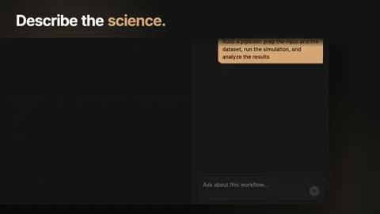</a></td>
</tr>
<tr>
<td width="50%" valign="top"><strong>把 X 记录做成动态简历</strong> <a href="https://x.com/lemcosmos">@lemcosmos</a> · 产品宣传 0:15 · 收藏 2 · 资料待完善 <a href="https://guanmo-ai.github.io/awesome-ai-motion/#case-2104771218503352649">▶ 播放</a> · <a href="https://x.com/lemcosmos/status/2104771218503352649">原帖</a></td>
<td width="50%" valign="top"><strong>用动画组件讲述科学代理工作流</strong> <a href="https://x.com/elkrispis">@elkrispis</a> · 产品宣传 1:30 · 收藏 2 · 资料待完善 <a href="https://guanmo-ai.github.io/awesome-ai-motion/#case-2106701206764544303">▶ 播放</a> · <a href="https://x.com/elkrispis/status/2106701206764544303">原帖</a></td>
</tr>
</tbody>
<tbody>
<tr>
<td width="50%" height="225" align="center" valign="middle"></td>
<td width="50%" height="225" align="center" valign="middle"></td>
</tr>
<tr>
<td width="50%" valign="top"><strong>应用更新的咖啡色界面动效</strong> <a href="https://x.com/thilina_a">@thilina_a</a> · 产品宣传 0:25 · 收藏 2 · 资料待完善 <a href="https://guanmo-ai.github.io/awesome-ai-motion/#case-2104455320424915273">▶ 播放</a> · <a href="https://x.com/thilina_a/status/2104455320424915273">原帖</a></td>
<td width="50%" valign="top"><strong>Roblox 游戏的单句预告片试验</strong> <a href="https://x.com/Aryanpxcr7">@Aryanpxcr7</a> · 产品宣传 0:41 · 收藏 1 · 资料待完善 <a href="https://guanmo-ai.github.io/awesome-ai-motion/#case-2108326197516198346">▶ 播放</a> · <a href="https://x.com/Aryanpxcr7/status/2108326197516198346">原帖</a></td>
</tr>
</tbody>
<tbody>
<tr>
<td width="50%" height="225" align="center" valign="middle"></td>
<td width="50%" height="225" align="center" valign="middle"></td>
</tr>
<tr>
<td width="50%" valign="top"><strong>无好即好：一分钟播客宣传试片</strong> <a href="https://x.com/wuhao1031">@wuhao1031</a> · 产品宣传 1:00 · 收藏 0 · 资料待完善 <a href="https://guanmo-ai.github.io/awesome-ai-motion/#case-2105567585680941521">▶ 播放</a> · <a href="https://x.com/wuhao1031/status/2105567585680941521">原帖</a></td>
<td width="50%" valign="top"><strong>Uptimepage：30 秒 Three.js 宣传片</strong> <a href="https://x.com/kevindatas">@kevindatas</a> · 产品宣传 0:30 · 收藏 0 · 资料待完善 <a href="https://guanmo-ai.github.io/awesome-ai-motion/#case-2106057217040368042">▶ 播放</a> · <a href="https://x.com/kevindatas/status/2106057217040368042">原帖</a></td>
</tr>
</tbody>
<tbody>
<tr>
<td width="50%" height="225" align="center" valign="middle"></td>
<td width="50%" height="225" align="center" valign="middle"></td>
</tr>
<tr>
<td width="50%" valign="top"><strong>Supasito：对话卡片到文件夹</strong> <a href="https://x.com/wozu_co">@wozu_co</a> · 产品宣传 0:14 · 收藏 0 · 资料待完善 <a href="https://guanmo-ai.github.io/awesome-ai-motion/#case-2105662660779893062">▶ 播放</a> · <a href="https://x.com/wozu_co/status/2105662660779893062">原帖</a></td>
<td width="50%" valign="top"><strong>用发票流程解释 Across 自动化</strong> <a href="https://x.com/nilou_salehi">@nilou_salehi</a> · 产品宣传 3:25 · 收藏 0 · 资料待完善 <a href="https://guanmo-ai.github.io/awesome-ai-motion/#case-2107184179947458567">▶ 播放</a> · <a href="https://x.com/nilou_salehi/status/2107184179947458567">原帖</a></td>
</tr>
</tbody>
<tbody>
<tr>
<td width="50%" height="225" align="center" valign="middle"></td>
<td width="50%" height="225" align="center" valign="middle"><a href="https://guanmo-ai.github.io/awesome-ai-motion/#case-2104490962139385936">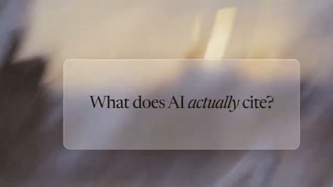</a></td>
</tr>
<tr>
<td width="50%" valign="top"><strong>Glaido 产品演示与原创音效试验</strong> <a href="https://x.com/AIJackRoberts">@AIJackRoberts</a> · 产品宣传 0:26 · 收藏 0 · 资料待完善 <a href="https://guanmo-ai.github.io/awesome-ai-motion/#case-2107869205588848985">▶ 播放</a> · <a href="https://x.com/AIJackRoberts/status/2107869205588848985">原帖</a></td>
<td width="50%" valign="top"><strong>把网站优化讲成一支产品短片</strong> <a href="https://x.com/andrewmichaelsa">@andrewmichaelsa</a> · 产品宣传 1:24 · 收藏 0 · 资料待完善 <a href="https://guanmo-ai.github.io/awesome-ai-motion/#case-2104490962139385936">▶ 播放</a> · <a href="https://x.com/andrewmichaelsa/status/2104490962139385936">原帖</a></td>
</tr>
</tbody>
<tbody>
<tr>
<td width="50%" height="225" align="center" valign="middle"></td>
<td width="50%" height="225" align="center" valign="middle"><a href="https://guanmo-ai.github.io/awesome-ai-motion/#case-2103456534768607293">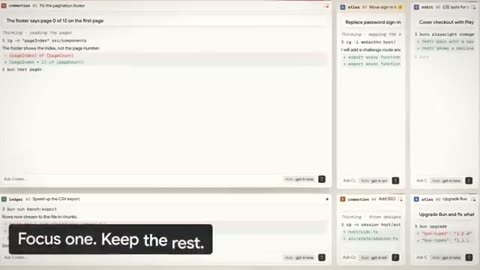</a></td>
</tr>
<tr>
<td width="50%" valign="top"><strong>SF Symbols 图标工具宣传片</strong> <a href="https://x.com/21Terrence1">@21Terrence1</a> · 产品宣传 0:25 · 收藏 0 · 资料待完善 <a href="https://guanmo-ai.github.io/awesome-ai-motion/#case-2109225353243988478">▶ 播放</a> · <a href="https://x.com/21Terrence1/status/2109225353243988478">原帖</a></td>
<td width="50%" valign="top"><strong>Commotion：把多窗口工作流变成动效</strong> <a href="https://x.com/Amol909S">@Amol909S</a> · 产品宣传 0:20 · 收藏 0 · 资料待完善 <a href="https://guanmo-ai.github.io/awesome-ai-motion/#case-2103456534768607293">▶ 播放</a> · <a href="https://x.com/Amol909S/status/2103456534768607293">原帖</a></td>
</tr>
</tbody>
<tbody>
<tr>
<td width="50%" height="225" align="center" valign="middle"></td>
<td width="50%" height="225" align="center" valign="middle"></td>
</tr>
<tr>
<td width="50%" valign="top"><strong>Accompli：把任务闭环变成动效</strong> <a href="https://x.com/punit_io">@punit_io</a> · 产品宣传 0:22 · 收藏 0 · 资料待完善 <a href="https://guanmo-ai.github.io/awesome-ai-motion/#case-2104467016719774112">▶ 播放</a> · <a href="https://x.com/punit_io/status/2104467016719774112">原帖</a></td>
<td width="50%" valign="top"><strong>一句指令的创意动画宣传片</strong> <a href="https://x.com/nikomaster01">@nikomaster01</a> · 产品宣传 0:47 · 收藏 0 · 资料待完善 <a href="https://guanmo-ai.github.io/awesome-ai-motion/#case-2104765209596612730">▶ 播放</a> · <a href="https://x.com/nikomaster01/status/2104765209596612730">原帖</a></td>
</tr>
</tbody>
<tbody>
<tr>
<td width="50%" height="225" align="center" valign="middle"></td>
<td width="50%" height="225" align="center" valign="middle"></td>
</tr>
<tr>
<td width="50%" valign="top"><strong>从堆叠瓷砖揭示广告画面</strong> <a href="https://x.com/tanabe_fragm">@tanabe_fragm</a> · 产品宣传 0:30 · 收藏 0 · 资料待完善 <a href="https://guanmo-ai.github.io/awesome-ai-motion/#case-2107644501372322001">▶ 播放</a> · <a href="https://x.com/tanabe_fragm/status/2107644501372322001">原帖</a></td>
<td width="50%" valign="top"><strong>Bragly：评价组件的立体发布卡片</strong> <a href="https://x.com/UtsavChopra30">@UtsavChopra30</a> · 产品宣传 0:48 · 收藏 0 · 资料待完善 <a href="https://guanmo-ai.github.io/awesome-ai-motion/#case-2108478302625071205">▶ 播放</a> · <a href="https://x.com/UtsavChopra30/status/2108478302625071205">原帖</a></td>
</tr>
</tbody>
<tbody>
<tr>
<td width="50%" height="225" align="center" valign="middle"></td>
<td width="50%" height="225" align="center" valign="middle"><a href="https://guanmo-ai.github.io/awesome-ai-motion/#case-2103912457836323096">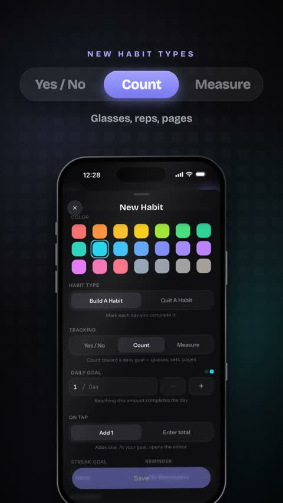</a></td>
</tr>
<tr>
<td width="50%" valign="top"><strong>SuperX 的立体图表与标志</strong> <a href="https://x.com/robj3d3">@robj3d3</a> · 产品宣传 0:15 · 收藏 — · 资料待完善 <a href="https://guanmo-ai.github.io/awesome-ai-motion/#case-2103875898349088830">▶ 播放</a> · <a href="https://x.com/robj3d3/status/2103875898349088830">原帖</a></td>
<td width="50%" valign="top"><strong>手机应用更新的立体字卡</strong> <a href="https://x.com/SebastianRoehl">@SebastianRoehl</a> · 产品宣传 0:15 · 收藏 — · 资料待完善 <a href="https://guanmo-ai.github.io/awesome-ai-motion/#case-2103912457836323096">▶ 播放</a> · <a href="https://x.com/SebastianRoehl/status/2103912457836323096">原帖</a></td>
</tr>
</tbody>
<tbody>
<tr>
<td width="50%" height="225" align="center" valign="middle"></td>
<td width="50%" height="225" align="center" valign="middle"></td>
</tr>
<tr>
<td width="50%" valign="top"><strong>用数字与地图讲述个人经历</strong> <a href="https://x.com/kumiko_shiraki">@kumiko_shiraki</a> · 产品宣传 0:48 · 收藏 — · 资料待完善 <a href="https://guanmo-ai.github.io/awesome-ai-motion/#case-2103771566982959414">▶ 播放</a> · <a href="https://x.com/kumiko_shiraki/status/2103771566982959414">原帖</a></td>
<td width="50%" valign="top"><strong>Lumail 的导入流程与圆点节奏</strong> <a href="https://x.com/melvynx">@melvynx</a> · 产品宣传 0:45 · 收藏 — · 资料待完善 <a href="https://guanmo-ai.github.io/awesome-ai-motion/#case-2103714680577638493">▶ 播放</a> · <a href="https://x.com/melvynx/status/2103714680577638493">原帖</a></td>
</tr>
</tbody>
<tbody>
<tr>
<td width="50%" height="225" align="center" valign="middle"></td>
<td width="50%" height="225" align="center" valign="middle"></td>
</tr>
<tr>
<td width="50%" valign="top"><strong>旅行网页设计师的数字名片</strong> <a href="https://x.com/yuyudora622">@yuyudora622</a> · 产品宣传 0:15 · 收藏 — · 资料待完善 <a href="https://guanmo-ai.github.io/awesome-ai-motion/#case-2103742104761676206">▶ 播放</a> · <a href="https://x.com/yuyudora622/status/2103742104761676206">原帖</a></td>
<td width="50%" valign="top"><strong>Spotify 主题的唱片与音乐卡片</strong> <a href="https://x.com/brainextends">@brainextends</a> · 产品宣传 0:18 · 收藏 — · 资料待完善 <a href="https://guanmo-ai.github.io/awesome-ai-motion/#case-2103801834930606193">▶ 播放</a> · <a href="https://x.com/brainextends/status/2103801834930606193">原帖</a></td>
</tr>
</tbody>
<tbody>
<tr>
<td width="50%" height="225" align="center" valign="middle"></td>
<td width="50%" height="225" align="center" valign="middle"></td>
</tr>
<tr>
<td width="50%" valign="top"><strong>Homeview：三维产品与界面发布片</strong> <a href="https://x.com/everestchris6">@everestchris6</a> · 产品宣传 0:19 · 收藏 — · 资料待完善 <a href="https://guanmo-ai.github.io/awesome-ai-motion/#case-2110426116288827709">▶ 播放</a> · <a href="https://x.com/everestchris6/status/2110426116288827709">原帖</a></td>
<td width="50%" valign="top"><strong>Alan 的循环与验证图形片</strong> <a href="https://x.com/prasad_pilla">@prasad_pilla</a> · 产品宣传 0:15 · 收藏 — · 资料待完善 <a href="https://guanmo-ai.github.io/awesome-ai-motion/#case-2103728953785496049">▶ 播放</a> · <a href="https://x.com/prasad_pilla/status/2103728953785496049">原帖</a></td>
</tr>
</tbody>
<tbody>
<tr>
<td width="50%" height="225" align="center" valign="middle"></td>
<td width="50%" height="225" align="center" valign="middle"></td>
</tr>
<tr>
<td width="50%" valign="top"><strong>芝士相机的几何人物小故事</strong> <a href="https://x.com/Mileson07">@Mileson07</a> · 产品宣传 0:30 · 收藏 — · 资料待完善 <a href="https://guanmo-ai.github.io/awesome-ai-motion/#case-2103717347790065690">▶ 播放</a> · <a href="https://x.com/Mileson07/status/2103717347790065690">原帖</a></td>
<td width="50%" valign="top"><strong>AIsa 的数字与接口图形发布片</strong> <a href="https://x.com/0xfemyn">@0xfemyn</a> · 产品宣传 0:15 · 收藏 — · 资料待完善 <a href="https://guanmo-ai.github.io/awesome-ai-motion/#case-2103796337041137833">▶ 播放</a> · <a href="https://x.com/0xfemyn/status/2103796337041137833">原帖</a></td>
</tr>
</tbody>
<tbody>
<tr>
<td width="50%" height="225" align="center" valign="middle"><a href="https://guanmo-ai.github.io/awesome-ai-motion/#case-2104490501340623150">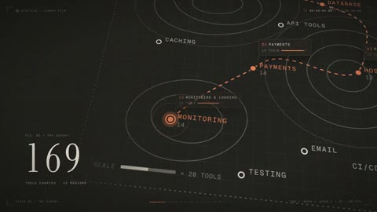</a></td>
<td width="50%" height="225" align="center" valign="middle"><a href="https://guanmo-ai.github.io/awesome-ai-motion/#case-2103811146411041046">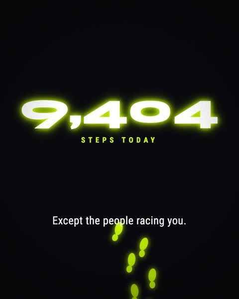</a></td>
</tr>
<tr>
<td width="50%" valign="top"><strong>后端工具目录的轨道式发布片</strong> <a href="https://x.com/deeprajO1">@deeprajO1</a> · 产品宣传 0:30 · 收藏 — · 资料待完善 <a href="https://guanmo-ai.github.io/awesome-ai-motion/#case-2104490501340623150">▶ 播放</a> · <a href="https://x.com/deeprajO1/status/2104490501340623150">原帖</a></td>
<td width="50%" valign="top"><strong>用步数走向珠峰的应用短片</strong> <a href="https://x.com/marklaunches">@marklaunches</a> · 产品宣传 0:44 · 收藏 — · 资料待完善 <a href="https://guanmo-ai.github.io/awesome-ai-motion/#case-2103811146411041046">▶ 播放</a> · <a href="https://x.com/marklaunches/status/2103811146411041046">原帖</a></td>
</tr>
</tbody>
<tbody>
<tr>
<td width="50%" height="225" align="center" valign="middle"><a href="https://guanmo-ai.github.io/awesome-ai-motion/#case-2103837803587293397">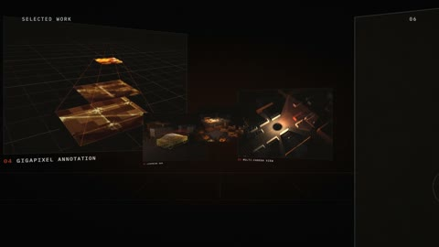</a></td>
<td width="50%" height="225" align="center" valign="middle"></td>
</tr>
<tr>
<td width="50%" valign="top"><strong>把个人作品集变成图形短片</strong> <a href="https://x.com/heyiammallik">@heyiammallik</a> · 产品宣传 0:34 · 收藏 — · 资料待完善 <a href="https://guanmo-ai.github.io/awesome-ai-motion/#case-2103837803587293397">▶ 播放</a> · <a href="https://x.com/heyiammallik/status/2103837803587293397">原帖</a></td>
<td width="50%" valign="top"><strong>Quetzal 的内容迭代图形广告</strong> <a href="https://x.com/miskinho_">@miskinho_</a> · 产品宣传 0:15 · 收藏 — · 资料待完善 <a href="https://guanmo-ai.github.io/awesome-ai-motion/#case-2103847584531956105">▶ 播放</a> · <a href="https://x.com/miskinho_/status/2103847584531956105">原帖</a></td>
</tr>
</tbody>
<tbody>
<tr>
<td width="50%" height="225" align="center" valign="middle"></td>
<td width="50%" height="225" align="center" valign="middle"></td>
</tr>
<tr>
<td width="50%" valign="top"><strong>邮箱验证的紫色流程卡片</strong> <a href="https://x.com/KmAsiff">@KmAsiff</a> · 产品宣传 0:20 · 收藏 — · 资料待完善 <a href="https://guanmo-ai.github.io/awesome-ai-motion/#case-2103810247131549880">▶ 播放</a> · <a href="https://x.com/KmAsiff/status/2103810247131549880">原帖</a></td>
<td width="50%" valign="top"><strong>AgentHud 的配额与发光面板</strong> <a href="https://x.com/Jazzen_Chen">@Jazzen_Chen</a> · 产品宣传 0:30 · 收藏 — · 资料待完善 <a href="https://guanmo-ai.github.io/awesome-ai-motion/#case-2103564958604964039">▶ 播放</a> · <a href="https://x.com/Jazzen_Chen/status/2103564958604964039">原帖</a></td>
</tr>
</tbody>
<tbody>
<tr>
<td width="50%" height="225" align="center" valign="middle"></td>
<td width="50%" height="225" align="center" valign="middle"><a href="https://guanmo-ai.github.io/awesome-ai-motion/#case-2103733819568480587">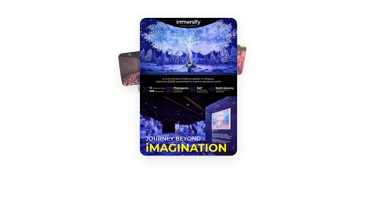</a></td>
</tr>
<tr>
<td width="50%" valign="top"><strong>Apointa 的语音接待发布片</strong> <a href="https://x.com/FractaDev">@FractaDev</a> · 产品宣传 0:48 · 收藏 — · 资料待完善 <a href="https://guanmo-ai.github.io/awesome-ai-motion/#case-2103941789744861266">▶ 播放</a> · <a href="https://x.com/FractaDev/status/2103941789744861266">原帖</a></td>
<td width="50%" valign="top"><strong>CloudJoi 的搜索与体验卡片</strong> <a href="https://x.com/lester_tyy">@lester_tyy</a> · 产品宣传 1:16 · 收藏 — · 资料待完善 <a href="https://guanmo-ai.github.io/awesome-ai-motion/#case-2103733819568480587">▶ 播放</a> · <a href="https://x.com/lester_tyy/status/2103733819568480587">原帖</a></td>
</tr>
</tbody>
<tbody>
<tr>
<td width="50%" height="225" align="center" valign="middle"></td>
<td width="50%" height="225" align="center" valign="middle"></td>
</tr>
<tr>
<td width="50%" valign="top"><strong>NoHands Labs 的自主公司图形片</strong> <a href="https://x.com/robvjourney">@robvjourney</a> · 产品宣传 0:15 · 收藏 — · 资料待完善 <a href="https://guanmo-ai.github.io/awesome-ai-motion/#case-2103768390322237474">▶ 播放</a> · <a href="https://x.com/robvjourney/status/2103768390322237474">原帖</a></td>
<td width="50%" valign="top"><strong>AllInvestView 的投资数据图形片</strong> <a href="https://x.com/rammanq">@rammanq</a> · 产品宣传 0:42 · 收藏 — · 资料待完善 <a href="https://guanmo-ai.github.io/awesome-ai-motion/#case-2103788796022034553">▶ 播放</a> · <a href="https://x.com/rammanq/status/2103788796022034553">原帖</a></td>
</tr>
</tbody>
<tbody>
<tr>
<td width="50%" height="225" align="center" valign="middle"></td>
<td width="50%" height="225" align="center" valign="middle"></td>
</tr>
<tr>
<td width="50%" valign="top"><strong>批发业务的品牌连接图</strong> <a href="https://x.com/ceowinkz">@ceowinkz</a> · 产品宣传 0:15 · 收藏 — · 资料待完善 <a href="https://guanmo-ai.github.io/awesome-ai-motion/#case-2103647124126683602">▶ 播放</a> · <a href="https://x.com/ceowinkz/status/2103647124126683602">原帖</a></td>
<td width="50%" valign="top"><strong>美国历史的纸面时间轴</strong> <a href="https://x.com/frontierism">@frontierism</a> · 知识讲解 1:59 · 收藏 877 · 资料待完善 <a href="https://guanmo-ai.github.io/awesome-ai-motion/#case-2103738204411379949">▶ 播放</a> · <a href="https://x.com/frontierism/status/2103738204411379949">原帖</a></td>
</tr>
</tbody>
<tbody>
<tr>
<td width="50%" height="225" align="center" valign="middle"></td>
<td width="50%" height="225" align="center" valign="middle"></td>
</tr>
<tr>
<td width="50%" valign="top"><strong>自动扶梯的内部结构与循环</strong> <a href="https://x.com/numaausaumon">@numaausaumon</a> · 知识讲解 0:34 · 收藏 467 · 资料待完善 <a href="https://guanmo-ai.github.io/awesome-ai-motion/#case-2109943963536998694">▶ 播放</a> · <a href="https://x.com/numaausaumon/status/2109943963536998694">原帖</a></td>
<td width="50%" valign="top"><strong>漂流的小船与社会脚本</strong> <a href="https://x.com/bitfish">@bitfish</a> · 知识讲解 2:55 · 收藏 429 · 资料待完善 <a href="https://guanmo-ai.github.io/awesome-ai-motion/#case-2103647787795824856">▶ 播放</a> · <a href="https://x.com/bitfish/status/2103647787795824856">原帖</a></td>
</tr>
</tbody>
<tbody>
<tr>
<td width="50%" height="225" align="center" valign="middle"></td>
<td width="50%" height="225" align="center" valign="middle"></td>
</tr>
<tr>
<td width="50%" valign="top"><strong>密码与通行密钥的区别</strong> <a href="https://x.com/Tz_2022">@Tz_2022</a> · 知识讲解 4:09 · 收藏 376 · 资料待完善 <a href="https://guanmo-ai.github.io/awesome-ai-motion/#case-2102838830285898214">▶ 播放</a> · <a href="https://x.com/Tz_2022/status/2102838830285898214">原帖</a></td>
<td width="50%" valign="top"><strong>导数概念的 Manim 动画课</strong> <a href="https://x.com/LinearUncle">@LinearUncle</a> · 知识讲解 7:37 · 收藏 360 · 资料待完善 <a href="https://guanmo-ai.github.io/awesome-ai-motion/#case-2103128559174971663">▶ 播放</a> · <a href="https://x.com/LinearUncle/status/2103128559174971663">原帖</a></td>
</tr>
</tbody>
<tbody>
<tr>
<td width="50%" height="225" align="center" valign="middle"></td>
<td width="50%" height="225" align="center" valign="middle"></td>
</tr>
<tr>
<td width="50%" valign="top"><strong>宜家家具的逐步装配</strong> <a href="https://x.com/numaausaumon">@numaausaumon</a> · 知识讲解 1:15 · 收藏 339 · 资料待完善 <a href="https://guanmo-ai.github.io/awesome-ai-motion/#case-2112214425910595901">▶ 播放</a> · <a href="https://x.com/numaausaumon/status/2112214425910595901">原帖</a></td>
<td width="50%" valign="top"><strong>九种画风解释递归</strong> <a href="https://x.com/emollick">@emollick</a> · 知识讲解 1:15 · 收藏 292 · 资料待完善 <a href="https://guanmo-ai.github.io/awesome-ai-motion/#case-2103688362960019567">▶ 播放</a> · <a href="https://x.com/emollick/status/2103688362960019567">原帖</a></td>
</tr>
</tbody>
<tbody>
<tr>
<td width="50%" height="225" align="center" valign="middle"></td>
<td width="50%" height="225" align="center" valign="middle"></td>
</tr>
<tr>
<td width="50%" valign="top"><strong>中华文明史：白描与泥金的时间长卷</strong> <a href="https://x.com/dotey">@dotey</a> · 知识讲解 3:37 · 收藏 253 · 资料待完善 <a href="https://guanmo-ai.github.io/awesome-ai-motion/#case-2103964025683927166">▶ 播放</a> · <a href="https://x.com/dotey/status/2103964025683927166">原帖</a></td>
<td width="50%" valign="top"><strong>Gmail 五个功能的短视频制作</strong> <a href="https://x.com/ClaudeCode_UT">@ClaudeCode_UT</a> · 知识讲解 0:32 · 收藏 186 · 资料待完善 <a href="https://guanmo-ai.github.io/awesome-ai-motion/#case-2106958663525314769">▶ 播放</a> · <a href="https://x.com/ClaudeCode_UT/status/2106958663525314769">原帖</a></td>
</tr>
</tbody>
<tbody>
<tr>
<td width="50%" height="225" align="center" valign="middle"></td>
<td width="50%" height="225" align="center" valign="middle"></td>
</tr>
<tr>
<td width="50%" valign="top"><strong>上下文窗口的动画解释</strong> <a href="https://x.com/joaoli13">@joaoli13</a> · 知识讲解 1:41 · 收藏 179 · 资料待完善 <a href="https://guanmo-ai.github.io/awesome-ai-motion/#case-2102805376466891137">▶ 播放</a> · <a href="https://x.com/joaoli13/status/2102805376466891137">原帖</a></td>
<td width="50%" valign="top"><strong>骑独轮车的鹈鹕讲 Shell</strong> <a href="https://x.com/goodside">@goodside</a> · 知识讲解 0:30 · 收藏 162 · 资料待完善 <a href="https://guanmo-ai.github.io/awesome-ai-motion/#case-2103149526244618682">▶ 播放</a> · <a href="https://x.com/goodside/status/2103149526244618682">原帖</a></td>
</tr>
</tbody>
<tbody>
<tr>
<td width="50%" height="225" align="center" valign="middle"></td>
<td width="50%" height="225" align="center" valign="middle"></td>
</tr>
<tr>
<td width="50%" valign="top"><strong>泥石流的三维堆积示意</strong> <a href="https://x.com/kisaka_ki">@kisaka_ki</a> · 知识讲解 0:56 · 收藏 154 · 资料待完善 <a href="https://guanmo-ai.github.io/awesome-ai-motion/#case-2107054815255859326">▶ 播放</a> · <a href="https://x.com/kisaka_ki/status/2107054815255859326">原帖</a></td>
<td width="50%" valign="top"><strong>咖啡机内部的萃取流程</strong> <a href="https://x.com/numaausaumon">@numaausaumon</a> · 知识讲解 0:53 · 收藏 150 · 资料待完善 <a href="https://guanmo-ai.github.io/awesome-ai-motion/#case-2112220170727080328">▶ 播放</a> · <a href="https://x.com/numaausaumon/status/2112220170727080328">原帖</a></td>
</tr>
</tbody>
<tbody>
<tr>
<td width="50%" height="225" align="center" valign="middle"></td>
<td width="50%" height="225" align="center" valign="middle"></td>
</tr>
<tr>
<td width="50%" valign="top"><strong>GitHub 版本管理入门</strong> <a href="https://x.com/sundyme">@sundyme</a> · 知识讲解 3:46 · 收藏 140 · 资料待完善 <a href="https://guanmo-ai.github.io/awesome-ai-motion/#case-2102751132502446549">▶ 播放</a> · <a href="https://x.com/sundyme/status/2102751132502446549">原帖</a></td>
<td width="50%" valign="top"><strong>印度尼西亚八十一年历史速览</strong> <a href="https://x.com/hanifproduktif">@hanifproduktif</a> · 知识讲解 0:59 · 收藏 120 · 资料待完善 <a href="https://guanmo-ai.github.io/awesome-ai-motion/#case-2102695622042411419">▶ 播放</a> · <a href="https://x.com/hanifproduktif/status/2102695622042411419">原帖</a></td>
</tr>
</tbody>
<tbody>
<tr>
<td width="50%" height="225" align="center" valign="middle"></td>
<td width="50%" height="225" align="center" valign="middle"></td>
</tr>
<tr>
<td width="50%" valign="top"><strong>扭蛋机的交互式结构讲解</strong> <a href="https://x.com/Voxyz_ai">@Voxyz_ai</a> · 知识讲解 0:12 · 收藏 50 · 资料待完善 <a href="https://guanmo-ai.github.io/awesome-ai-motion/#case-2111925285255868518">▶ 播放</a> · <a href="https://x.com/Voxyz_ai/status/2111925285255868518">原帖</a></td>
<td width="50%" valign="top"><strong>期权公式与跑酷并屏讲解</strong> <a href="https://x.com/goodside">@goodside</a> · 知识讲解 1:00 · 收藏 45 · 资料待完善 <a href="https://guanmo-ai.github.io/awesome-ai-motion/#case-2103171088637419631">▶ 播放</a> · <a href="https://x.com/goodside/status/2103171088637419631">原帖</a></td>
</tr>
</tbody>
<tbody>
<tr>
<td width="50%" height="225" align="center" valign="middle"></td>
<td width="50%" height="225" align="center" valign="middle"></td>
</tr>
<tr>
<td width="50%" valign="top"><strong>UMAP 的一分钟粒子讲解</strong> <a href="https://x.com/goodside">@goodside</a> · 知识讲解 1:00 · 收藏 34 · 资料待完善 <a href="https://guanmo-ai.github.io/awesome-ai-motion/#case-2103135072987795526">▶ 播放</a> · <a href="https://x.com/goodside/status/2103135072987795526">原帖</a></td>
<td width="50%" valign="top"><strong>从固定窗口到令牌桶的蓝图动画</strong> <a href="https://x.com/Voxyz_ai">@Voxyz_ai</a> · 知识讲解 0:41 · 收藏 27 · 资料待完善 <a href="https://guanmo-ai.github.io/awesome-ai-motion/#case-2104949329639198912">▶ 播放</a> · <a href="https://x.com/Voxyz_ai/status/2104949329639198912">原帖</a></td>
</tr>
</tbody>
<tbody>
<tr>
<td width="50%" height="225" align="center" valign="middle"></td>
<td width="50%" height="225" align="center" valign="middle"></td>
</tr>
<tr>
<td width="50%" valign="top"><strong>旋转色轮中的八种配色关系</strong> <a href="https://x.com/koldo2k">@koldo2k</a> · 知识讲解 0:22 · 收藏 22 · 资料待完善 <a href="https://guanmo-ai.github.io/awesome-ai-motion/#case-2104114329322704965">▶ 播放</a> · <a href="https://x.com/koldo2k/status/2104114329322704965">原帖</a></td>
<td width="50%" valign="top"><strong>SEO 与 GEO 的差异动画</strong> <a href="https://x.com/oscarmartin">@oscarmartin</a> · 知识讲解 0:33 · 收藏 22 · 资料待完善 <a href="https://guanmo-ai.github.io/awesome-ai-motion/#case-2102731669853573582">▶ 播放</a> · <a href="https://x.com/oscarmartin/status/2102731669853573582">原帖</a></td>
</tr>
</tbody>
<tbody>
<tr>
<td width="50%" height="225" align="center" valign="middle"></td>
<td width="50%" height="225" align="center" valign="middle"></td>
</tr>
<tr>
<td width="50%" valign="top"><strong>地震发生的构造沙盒</strong> <a href="https://x.com/egeberkina">@egeberkina</a> · 知识讲解 1:00 · 收藏 20 · 资料待完善 <a href="https://guanmo-ai.github.io/awesome-ai-motion/#case-2105029713445949521">▶ 播放</a> · <a href="https://x.com/egeberkina/status/2105029713445949521">原帖</a></td>
<td width="50%" valign="top"><strong>白板上的副本对称性破缺</strong> <a href="https://x.com/tak3sh8">@tak3sh8</a> · 知识讲解 5:08 · 收藏 10 · 资料待完善 <a href="https://guanmo-ai.github.io/awesome-ai-motion/#case-2103667481139441895">▶ 播放</a> · <a href="https://x.com/tak3sh8/status/2103667481139441895">原帖</a></td>
</tr>
</tbody>
<tbody>
<tr>
<td width="50%" height="225" align="center" valign="middle"></td>
<td width="50%" height="225" align="center" valign="middle"></td>
</tr>
<tr>
<td width="50%" valign="top"><strong>Context Tax：上下文成本讲解</strong> <a href="https://x.com/mablesjoseph">@mablesjoseph</a> · 知识讲解 5:13 · 收藏 9 · 资料待完善 <a href="https://guanmo-ai.github.io/awesome-ai-motion/#case-2105472483054735781">▶ 播放</a> · <a href="https://x.com/mablesjoseph/status/2105472483054735781">原帖</a></td>
<td width="50%" valign="top"><strong>喷气发动机的轴向拆解</strong> <a href="https://x.com/aichrislee">@aichrislee</a> · 知识讲解 0:16 · 收藏 7 · 资料待完善 <a href="https://guanmo-ai.github.io/awesome-ai-motion/#case-2106535528149479847">▶ 播放</a> · <a href="https://x.com/aichrislee/status/2106535528149479847">原帖</a></td>
</tr>
</tbody>
<tbody>
<tr>
<td width="50%" height="225" align="center" valign="middle"></td>
<td width="50%" height="225" align="center" valign="middle"></td>
</tr>
<tr>
<td width="50%" valign="top"><strong>Steam 新游的动态图文新闻</strong> <a href="https://x.com/gigabit_million">@gigabit_million</a> · 知识讲解 1:00 · 收藏 6 · 资料待完善 <a href="https://guanmo-ai.github.io/awesome-ai-motion/#case-2104068536041959719">▶ 播放</a> · <a href="https://x.com/gigabit_million/status/2104068536041959719">原帖</a></td>
<td width="50%" valign="top"><strong>光合作用动画课程</strong> <a href="https://x.com/rainwishyt">@rainwishyt</a> · 知识讲解 1:42 · 收藏 5 · 资料待完善 <a href="https://guanmo-ai.github.io/awesome-ai-motion/#case-2102605736002150408">▶ 播放</a> · <a href="https://x.com/rainwishyt/status/2102605736002150408">原帖</a></td>
</tr>
</tbody>
<tbody>
<tr>
<td width="50%" height="225" align="center" valign="middle"></td>
<td width="50%" height="225" align="center" valign="middle"></td>
</tr>
<tr>
<td width="50%" valign="top"><strong>从藻类光感蛋白到神经信号</strong> <a href="https://x.com/RashadMirza404">@RashadMirza404</a> · 知识讲解 1:11 · 收藏 3 · 资料待完善 <a href="https://guanmo-ai.github.io/awesome-ai-motion/#case-2107310549188984983">▶ 播放</a> · <a href="https://x.com/RashadMirza404/status/2107310549188984983">原帖</a></td>
<td width="50%" valign="top"><strong>双角色讲解视频的初次练习</strong> <a href="https://x.com/Naonekozamurai">@Naonekozamurai</a> · 知识讲解 0:27 · 收藏 2 · 资料待完善 <a href="https://guanmo-ai.github.io/awesome-ai-motion/#case-2107584181941502428">▶ 播放</a> · <a href="https://x.com/Naonekozamurai/status/2107584181941502428">原帖</a></td>
</tr>
</tbody>
<tbody>
<tr>
<td width="50%" height="225" align="center" valign="middle"></td>
<td width="50%" height="225" align="center" valign="middle"></td>
</tr>
<tr>
<td width="50%" valign="top"><strong>用大字时间轴回顾 AI 历史</strong> <a href="https://x.com/jdverolme">@jdverolme</a> · 知识讲解 1:00 · 收藏 2 · 资料待完善 <a href="https://guanmo-ai.github.io/awesome-ai-motion/#case-2105012857993576738">▶ 播放</a> · <a href="https://x.com/jdverolme/status/2105012857993576738">原帖</a></td>
<td width="50%" valign="top"><strong>没有最后一个素数：机械式动态证明</strong> <a href="https://x.com/Gdgtify">@Gdgtify</a> · 知识讲解 0:20 · 收藏 2 · 资料待完善 <a href="https://guanmo-ai.github.io/awesome-ai-motion/#case-2107054188836393073">▶ 播放</a> · <a href="https://x.com/Gdgtify/status/2107054188836393073">原帖</a></td>
</tr>
</tbody>
<tbody>
<tr>
<td width="50%" height="225" align="center" valign="middle"></td>
<td width="50%" height="225" align="center" valign="middle"></td>
</tr>
<tr>
<td width="50%" valign="top"><strong>转播中的首攻黄线如何出现</strong> <a href="https://x.com/blueoctopusai">@blueoctopusai</a> · 知识讲解 2:48 · 收藏 2 · 资料待完善 <a href="https://guanmo-ai.github.io/awesome-ai-motion/#case-2105116391439270222">▶ 播放</a> · <a href="https://x.com/blueoctopusai/status/2105116391439270222">原帖</a></td>
<td width="50%" valign="top"><strong>鸡尾酒制作过程动效</strong> <a href="https://x.com/Sarut0biSasuke">@Sarut0biSasuke</a> · 知识讲解 0:30 · 收藏 1 · 资料待完善 <a href="https://guanmo-ai.github.io/awesome-ai-motion/#case-2103418429248069973">▶ 播放</a> · <a href="https://x.com/Sarut0biSasuke/status/2103418429248069973">原帖</a></td>
</tr>
</tbody>
<tbody>
<tr>
<td width="50%" height="225" align="center" valign="middle"></td>
<td width="50%" height="225" align="center" valign="middle"></td>
</tr>
<tr>
<td width="50%" valign="top"><strong>星舰两次飞行的三维并行讲解</strong> <a href="https://x.com/ViC305">@ViC305</a> · 知识讲解 2:41 · 收藏 1 · 资料待完善 <a href="https://guanmo-ai.github.io/awesome-ai-motion/#case-2105012737218617555">▶ 播放</a> · <a href="https://x.com/ViC305/status/2105012737218617555">原帖</a></td>
<td width="50%" valign="top"><strong>涡轮增压发动机互动教学</strong> <a href="https://x.com/yyyole">@yyyole</a> · 知识讲解 0:45 · 收藏 1 · 资料待完善 <a href="https://guanmo-ai.github.io/awesome-ai-motion/#case-2107653001959833860">▶ 播放</a> · <a href="https://x.com/yyyole/status/2107653001959833860">原帖</a></td>
</tr>
</tbody>
<tbody>
<tr>
<td width="50%" height="225" align="center" valign="middle"></td>
<td width="50%" height="225" align="center" valign="middle"></td>
</tr>
<tr>
<td width="50%" valign="top"><strong>跳动心脏的血流与部件拆解</strong> <a href="https://x.com/aichrislee">@aichrislee</a> · 知识讲解 0:16 · 收藏 1 · 资料待完善 <a href="https://guanmo-ai.github.io/awesome-ai-motion/#case-2107985027254378670">▶ 播放</a> · <a href="https://x.com/aichrislee/status/2107985027254378670">原帖</a></td>
<td width="50%" valign="top"><strong>循环 Transformer 的动态图解</strong> <a href="https://x.com/michaelraspuzzi">@michaelraspuzzi</a> · 知识讲解 2:11 · 收藏 1 · 资料待完善 <a href="https://guanmo-ai.github.io/awesome-ai-motion/#case-2106083592820740595">▶ 播放</a> · <a href="https://x.com/michaelraspuzzi/status/2106083592820740595">原帖</a></td>
</tr>
</tbody>
<tbody>
<tr>
<td width="50%" height="225" align="center" valign="middle"></td>
<td width="50%" height="225" align="center" valign="middle"></td>
</tr>
<tr>
<td width="50%" valign="top"><strong>印度文明的图形编年片</strong> <a href="https://x.com/BuildFastWithAI">@BuildFastWithAI</a> · 知识讲解 1:27 · 收藏 0 · 资料待完善 <a href="https://guanmo-ai.github.io/awesome-ai-motion/#case-2104451249269780900">▶ 播放</a> · <a href="https://x.com/BuildFastWithAI/status/2104451249269780900">原帖</a></td>
<td width="50%" valign="top"><strong>V8 发动机的运转与爆炸图</strong> <a href="https://x.com/aichrislee">@aichrislee</a> · 知识讲解 0:16 · 收藏 0 · 资料待完善 <a href="https://guanmo-ai.github.io/awesome-ai-motion/#case-2107260223907922082">▶ 播放</a> · <a href="https://x.com/aichrislee/status/2107260223907922082">原帖</a></td>
</tr>
</tbody>
<tbody>
<tr>
<td width="50%" height="225" align="center" valign="middle"></td>
<td width="50%" height="225" align="center" valign="middle"></td>
</tr>
<tr>
<td width="50%" valign="top"><strong>镜头里的光路与十五个部件</strong> <a href="https://x.com/aichrislee">@aichrislee</a> · 知识讲解 0:20 · 收藏 0 · 资料待完善 <a href="https://guanmo-ai.github.io/awesome-ai-motion/#case-2108709764817408244">▶ 播放</a> · <a href="https://x.com/aichrislee/status/2108709764817408244">原帖</a></td>
<td width="50%" valign="top"><strong>通行密钥入门动画长片</strong> <a href="https://x.com/imShiWen">@imShiWen</a> · 知识讲解 6:15 · 收藏 0 · 资料待完善 <a href="https://guanmo-ai.github.io/awesome-ai-motion/#case-2102954743442399395">▶ 播放</a> · <a href="https://x.com/imShiWen/status/2102954743442399395">原帖</a></td>
</tr>
</tbody>
<tbody>
<tr>
<td width="50%" height="225" align="center" valign="middle"></td>
<td width="50%" height="225" align="center" valign="middle"></td>
</tr>
<tr>
<td width="50%" valign="top"><strong>网页设计文章改编视频</strong> <a href="https://x.com/Oscar_sanmillan">@Oscar_sanmillan</a> · 知识讲解 0:46 · 收藏 0 · 资料待完善 <a href="https://guanmo-ai.github.io/awesome-ai-motion/#case-2103114698610683964">▶ 播放</a> · <a href="https://x.com/Oscar_sanmillan/status/2103114698610683964">原帖</a></td>
<td width="50%" valign="top"><strong>从数据曲线到神经网络</strong> <a href="https://x.com/howlemont">@howlemont</a> · 知识讲解 8:27 · 收藏 0 · 资料待完善 <a href="https://guanmo-ai.github.io/awesome-ai-motion/#case-2104023028481077357">▶ 播放</a> · <a href="https://x.com/howlemont/status/2104023028481077357">原帖</a></td>
</tr>
</tbody>
<tbody>
<tr>
<td width="50%" height="225" align="center" valign="middle"></td>
<td width="50%" height="225" align="center" valign="middle"></td>
</tr>
<tr>
<td width="50%" valign="top"><strong>从图灵机到围棋的 AI 历史短片</strong> <a href="https://x.com/linke1427832">@linke1427832</a> · 知识讲解 2:00 · 收藏 0 · 资料待完善 <a href="https://guanmo-ai.github.io/awesome-ai-motion/#case-2104099543839343079">▶ 播放</a> · <a href="https://x.com/linke1427832/status/2104099543839343079">原帖</a></td>
<td width="50%" valign="top"><strong>从太阳系行星到银河系</strong> <a href="https://x.com/Grace_sunnyy">@Grace_sunnyy</a> · 知识讲解 3:21 · 收藏 0 · 资料待完善 <a href="https://guanmo-ai.github.io/awesome-ai-motion/#case-2105180179836576206">▶ 播放</a> · <a href="https://x.com/Grace_sunnyy/status/2105180179836576206">原帖</a></td>
</tr>
</tbody>
<tbody>
<tr>
<td width="50%" height="225" align="center" valign="middle"></td>
<td width="50%" height="225" align="center" valign="middle"></td>
</tr>
<tr>
<td width="50%" valign="top"><strong>蒸汽机如何把往复变为旋转</strong> <a href="https://x.com/testlandblog">@testlandblog</a> · 知识讲解 2:05 · 收藏 0 · 资料待完善 <a href="https://guanmo-ai.github.io/awesome-ai-motion/#case-2105991032571617500">▶ 播放</a> · <a href="https://x.com/testlandblog/status/2105991032571617500">原帖</a></td>
<td width="50%" valign="top"><strong>《临江仙》古诗词学习动画</strong> <a href="https://x.com/7998l201">@7998l201</a> · 知识讲解 3:45 · 收藏 0 · 资料待完善 <a href="https://guanmo-ai.github.io/awesome-ai-motion/#case-2107443821630107654">▶ 播放</a> · <a href="https://x.com/7998l201/status/2107443821630107654">原帖</a></td>
</tr>
</tbody>
<tbody>
<tr>
<td width="50%" height="225" align="center" valign="middle"></td>
<td width="50%" height="225" align="center" valign="middle"></td>
</tr>
<tr>
<td width="50%" valign="top"><strong>可拆解的三维机械表</strong> <a href="https://x.com/aichrislee">@aichrislee</a> · 知识讲解 0:16 · 收藏 0 · 资料待完善 <a href="https://guanmo-ai.github.io/awesome-ai-motion/#case-2107622585307476025">▶ 播放</a> · <a href="https://x.com/aichrislee/status/2107622585307476025">原帖</a></td>
<td width="50%" valign="top"><strong>十五秒动态图形作品集</strong> <a href="https://x.com/ajith_io">@ajith_io</a> · 短动效 0:15 · 收藏 4,403 · 资料待完善 <a href="https://guanmo-ai.github.io/awesome-ai-motion/#case-2103449416325890146">▶ 播放</a> · <a href="https://x.com/ajith_io/status/2103449416325890146">原帖</a></td>
</tr>
</tbody>
<tbody>
<tr>
<td width="50%" height="225" align="center" valign="middle"></td>
<td width="50%" height="225" align="center" valign="middle"></td>
</tr>
<tr>
<td width="50%" valign="top"><strong>一个连续镜头的产品动效模板</strong> <a href="https://x.com/twoclipping">@twoclipping</a> · 短动效 0:22 · 收藏 1,019 · 资料待完善 <a href="https://guanmo-ai.github.io/awesome-ai-motion/#case-2104674464868762046">▶ 播放</a> · <a href="https://x.com/twoclipping/status/2104674464868762046">原帖</a></td>
<td width="50%" valign="top"><strong>今天是星期几？</strong> <a href="https://x.com/nokonoko_1203">@nokonoko_1203</a> · 短动效 0:30 · 收藏 902 · 资料待完善 <a href="https://guanmo-ai.github.io/awesome-ai-motion/#case-2105922366190784915">▶ 播放</a> · <a href="https://x.com/nokonoko_1203/status/2105922366190784915">原帖</a></td>
</tr>
</tbody>
<tbody>
<tr>
<td width="50%" height="225" align="center" valign="middle"></td>
<td width="50%" height="225" align="center" valign="middle"></td>
</tr>
<tr>
<td width="50%" valign="top"><strong>我的世界的藏宝路线图</strong> <a href="https://x.com/sethfowIer">@sethfowIer</a> · 短动效 0:19 · 收藏 325 · 资料待完善 <a href="https://guanmo-ai.github.io/awesome-ai-motion/#case-2113248976984068329">▶ 播放</a> · <a href="https://x.com/sethfowIer/status/2113248976984068329">原帖</a></td>
<td width="50%" valign="top"><strong>一个橙点串起整支动效</strong> <a href="https://x.com/rossaxbt">@rossaxbt</a> · 短动效 0:15 · 收藏 275 · 资料待完善 <a href="https://guanmo-ai.github.io/awesome-ai-motion/#case-2108570705692357094">▶ 播放</a> · <a href="https://x.com/rossaxbt/status/2108570705692357094">原帖</a></td>
</tr>
</tbody>
<tbody>
<tr>
<td width="50%" height="225" align="center" valign="middle"></td>
<td width="50%" height="225" align="center" valign="middle"></td>
</tr>
<tr>
<td width="50%" valign="top"><strong>虚构电影的复古片头</strong> <a href="https://x.com/goodside">@goodside</a> · 短动效 1:15 · 收藏 193 · 资料待完善 <a href="https://guanmo-ai.github.io/awesome-ai-motion/#case-2102937913726235004">▶ 播放</a> · <a href="https://x.com/goodside/status/2102937913726235004">原帖</a></td>
<td width="50%" valign="top"><strong>一个形状变成整套界面</strong> <a href="https://x.com/0xAiky">@0xAiky</a> · 短动效 0:14 · 收藏 163 · 资料待完善 <a href="https://guanmo-ai.github.io/awesome-ai-motion/#case-2111814234090693110">▶ 播放</a> · <a href="https://x.com/0xAiky/status/2111814234090693110">原帖</a></td>
</tr>
</tbody>
<tbody>
<tr>
<td width="50%" height="225" align="center" valign="middle"></td>
<td width="50%" height="225" align="center" valign="middle"><a href="https://guanmo-ai.github.io/awesome-ai-motion/#case-2105302007896797351">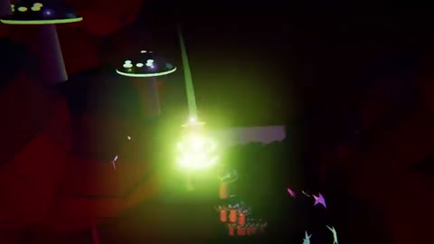</a></td>
</tr>
<tr>
<td width="50%" valign="top"><strong>图标阵列的空间穿梭</strong> <a href="https://x.com/Multi_Serio_Ai">@Multi_Serio_Ai</a> · 短动效 3:04 · 收藏 100 · 资料待完善 <a href="https://guanmo-ai.github.io/awesome-ai-motion/#case-2105722219892789560">▶ 播放</a> · <a href="https://x.com/Multi_Serio_Ai/status/2105722219892789560">原帖</a></td>
<td width="50%" valign="top"><strong>弹跳球体点亮三维音乐机关</strong> <a href="https://x.com/Gorden_Sun">@Gorden_Sun</a> · 短动效 0:59 · 收藏 75 · 资料待完善 <a href="https://guanmo-ai.github.io/awesome-ai-motion/#case-2105302007896797351">▶ 播放</a> · <a href="https://x.com/Gorden_Sun/status/2105302007896797351">原帖</a></td>
</tr>
</tbody>
<tbody>
<tr>
<td width="50%" height="225" align="center" valign="middle"></td>
<td width="50%" height="225" align="center" valign="middle"></td>
</tr>
<tr>
<td width="50%" valign="top"><strong>从彩色请求到 IS IT SAFE 的字体短片</strong> <a href="https://x.com/kloss_xyz">@kloss_xyz</a> · 短动效 2:34 · 收藏 39 · 资料待完善 <a href="https://guanmo-ai.github.io/awesome-ai-motion/#case-2103664956482941143">▶ 播放</a> · <a href="https://x.com/kloss_xyz/status/2103664956482941143">原帖</a></td>
<td width="50%" valign="top"><strong>一个形状的 14 秒 UI 循环</strong> <a href="https://x.com/flxrnc">@flxrnc</a> · 短动效 0:14 · 收藏 15 · 资料待完善 <a href="https://guanmo-ai.github.io/awesome-ai-motion/#case-2108242454105251921">▶ 播放</a> · <a href="https://x.com/flxrnc/status/2108242454105251921">原帖</a></td>
</tr>
</tbody>
<tbody>
<tr>
<td width="50%" height="225" align="center" valign="middle"></td>
<td width="50%" height="225" align="center" valign="middle"></td>
</tr>
<tr>
<td width="50%" valign="top"><strong>未来已来：高对比字体动效</strong> <a href="https://x.com/renmu2017">@renmu2017</a> · 短动效 1:02 · 收藏 15 · 资料待完善 <a href="https://guanmo-ai.github.io/awesome-ai-motion/#case-2105671467962950000">▶ 播放</a> · <a href="https://x.com/renmu2017/status/2105671467962950000">原帖</a></td>
<td width="50%" valign="top"><strong>一条线变成整支动效</strong> <a href="https://x.com/heyiamnick">@heyiamnick</a> · 短动效 0:30 · 收藏 15 · 资料待完善 <a href="https://guanmo-ai.github.io/awesome-ai-motion/#case-2109174851412119558">▶ 播放</a> · <a href="https://x.com/heyiamnick/status/2109174851412119558">原帖</a></td>
</tr>
</tbody>
<tbody>
<tr>
<td width="50%" height="225" align="center" valign="middle"></td>
<td width="50%" height="225" align="center" valign="middle"></td>
</tr>
<tr>
<td width="50%" valign="top"><strong>一首节拍串起八种界面状态</strong> <a href="https://x.com/diamai_">@diamai_</a> · 短动效 0:30 · 收藏 14 · 资料待完善 <a href="https://guanmo-ai.github.io/awesome-ai-motion/#case-2104191375809954126">▶ 播放</a> · <a href="https://x.com/diamai_/status/2104191375809954126">原帖</a></td>
<td width="50%" valign="top"><strong>物理之美一镜到底动效</strong> <a href="https://x.com/akokoi1">@akokoi1</a> · 短动效 1:16 · 收藏 14 · 资料待完善 <a href="https://guanmo-ai.github.io/awesome-ai-motion/#case-2104200939095904322">▶ 播放</a> · <a href="https://x.com/akokoi1/status/2104200939095904322">原帖</a></td>
</tr>
</tbody>
<tbody>
<tr>
<td width="50%" height="225" align="center" valign="middle"></td>
<td width="50%" height="225" align="center" valign="middle"></td>
</tr>
<tr>
<td width="50%" valign="top"><strong>闪粉与镀铬贴纸揭起循环</strong> <a href="https://x.com/flxrnc">@flxrnc</a> · 短动效 0:12 · 收藏 13 · 资料待完善 <a href="https://guanmo-ai.github.io/awesome-ai-motion/#case-2107123676768342403">▶ 播放</a> · <a href="https://x.com/flxrnc/status/2107123676768342403">原帖</a></td>
<td width="50%" valign="top"><strong>把市场话题做成十五秒动态图形</strong> <a href="https://x.com/thomasrice_au">@thomasrice_au</a> · 短动效 0:15 · 收藏 6 · 资料待完善 <a href="https://guanmo-ai.github.io/awesome-ai-motion/#case-2103779928932257876">▶ 播放</a> · <a href="https://x.com/thomasrice_au/status/2103779928932257876">原帖</a></td>
</tr>
</tbody>
<tbody>
<tr>
<td width="50%" height="225" align="center" valign="middle"></td>
<td width="50%" height="225" align="center" valign="middle"></td>
</tr>
<tr>
<td width="50%" valign="top"><strong>液态字形与反射材质的竖屏作品集</strong> <a href="https://x.com/ndhabarde11">@ndhabarde11</a> · 短动效 0:15 · 收藏 6 · 资料待完善 <a href="https://guanmo-ai.github.io/awesome-ai-motion/#case-2103832593355686104">▶ 播放</a> · <a href="https://x.com/ndhabarde11/status/2103832593355686104">原帖</a></td>
<td width="50%" valign="top"><strong>十五秒动态设计演示</strong> <a href="https://x.com/TheViableEdge">@TheViableEdge</a> · 短动效 0:15 · 收藏 5 · 资料待完善 <a href="https://guanmo-ai.github.io/awesome-ai-motion/#case-2104207707980869918">▶ 播放</a> · <a href="https://x.com/TheViableEdge/status/2104207707980869918">原帖</a></td>
</tr>
</tbody>
<tbody>
<tr>
<td width="50%" height="225" align="center" valign="middle"></td>
<td width="50%" height="225" align="center" valign="middle"></td>
</tr>
<tr>
<td width="50%" valign="top"><strong>一个控件在播放器与标签间变形</strong> <a href="https://x.com/sanjeevn72">@sanjeevn72</a> · 短动效 0:14 · 收藏 5 · 资料待完善 <a href="https://guanmo-ai.github.io/awesome-ai-motion/#case-2103456358125457691">▶ 播放</a> · <a href="https://x.com/sanjeevn72/status/2103456358125457691">原帖</a></td>
<td width="50%" valign="top"><strong>衬线字体的动态标本展示</strong> <a href="https://x.com/maxescu">@maxescu</a> · 短动效 0:30 · 收藏 3 · 资料待完善 <a href="https://guanmo-ai.github.io/awesome-ai-motion/#case-2112190348982190390">▶ 播放</a> · <a href="https://x.com/maxescu/status/2112190348982190390">原帖</a></td>
</tr>
</tbody>
<tbody>
<tr>
<td width="50%" height="225" align="center" valign="middle"></td>
<td width="50%" height="225" align="center" valign="middle"></td>
</tr>
<tr>
<td width="50%" valign="top"><strong>用文字搭起一座舞台</strong> <a href="https://x.com/Gdgtify">@Gdgtify</a> · 短动效 0:20 · 收藏 3 · 资料待完善 <a href="https://guanmo-ai.github.io/awesome-ai-motion/#case-2103458245213929495">▶ 播放</a> · <a href="https://x.com/Gdgtify/status/2103458245213929495">原帖</a></td>
<td width="50%" valign="top"><strong>文字与磁场一起变形</strong> <a href="https://x.com/Gdgtify">@Gdgtify</a> · 短动效 0:20 · 收藏 3 · 资料待完善 <a href="https://guanmo-ai.github.io/awesome-ai-motion/#case-2105570411870130294">▶ 播放</a> · <a href="https://x.com/Gdgtify/status/2105570411870130294">原帖</a></td>
</tr>
</tbody>
<tbody>
<tr>
<td width="50%" height="225" align="center" valign="middle"></td>
<td width="50%" height="225" align="center" valign="middle"><a href="https://guanmo-ai.github.io/awesome-ai-motion/#case-2105921281673904308">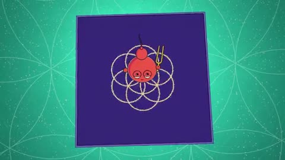</a></td>
</tr>
<tr>
<td width="50%" valign="top"><strong>让登月演讲脱离轨道</strong> <a href="https://x.com/Gdgtify">@Gdgtify</a> · 短动效 0:20 · 收藏 2 · 资料待完善 <a href="https://guanmo-ai.github.io/awesome-ai-motion/#case-2105669567036989608">▶ 播放</a> · <a href="https://x.com/Gdgtify/status/2105669567036989608">原帖</a></td>
<td width="50%" valign="top"><strong>分形、几何与卡通鼓手</strong> <a href="https://x.com/generussai">@generussai</a> · 短动效 1:03 · 收藏 1 · 资料待完善 <a href="https://guanmo-ai.github.io/awesome-ai-motion/#case-2105921281673904308">▶ 播放</a> · <a href="https://x.com/generussai/status/2105921281673904308">原帖</a></td>
</tr>
</tbody>
<tbody>
<tr>
<td width="50%" height="225" align="center" valign="middle"></td>
<td width="50%" height="225" align="center" valign="middle"></td>
</tr>
<tr>
<td width="50%" valign="top"><strong>字形、几何与镜头的三十秒作品集</strong> <a href="https://x.com/essjaykay755">@essjaykay755</a> · 短动效 0:30 · 收藏 1 · 资料待完善 <a href="https://guanmo-ai.github.io/awesome-ai-motion/#case-2103446726245847163">▶ 播放</a> · <a href="https://x.com/essjaykay755/status/2103446726245847163">原帖</a></td>
<td width="50%" valign="top"><strong>红点、网格与双语字体的作品集</strong> <a href="https://x.com/Ai9app">@Ai9app</a> · 短动效 0:15 · 收藏 0 · 资料待完善 <a href="https://guanmo-ai.github.io/awesome-ai-motion/#case-2104912803786375645">▶ 播放</a> · <a href="https://x.com/Ai9app/status/2104912803786375645">原帖</a></td>
</tr>
</tbody>
<tbody>
<tr>
<td width="50%" height="225" align="center" valign="middle"></td>
<td width="50%" height="225" align="center" valign="middle"></td>
</tr>
<tr>
<td width="50%" valign="top"><strong>随节拍生长的金属分形</strong> <a href="https://x.com/Xanares">@Xanares</a> · 短动效 0:37 · 收藏 0 · 资料待完善 <a href="https://guanmo-ai.github.io/awesome-ai-motion/#case-2105770390924738984">▶ 播放</a> · <a href="https://x.com/Xanares/status/2105770390924738984">原帖</a></td>
<td width="50%" valign="top"><strong>弹跳圆点变成搜索框</strong> <a href="https://x.com/cgclick">@cgclick</a> · 短动效 0:06 · 收藏 0 · 资料待完善 <a href="https://guanmo-ai.github.io/awesome-ai-motion/#case-2107906341243081068">▶ 播放</a> · <a href="https://x.com/cgclick/status/2107906341243081068">原帖</a></td>
</tr>
</tbody>
<tbody>
<tr>
<td width="50%" height="225" align="center" valign="middle"></td>
<td width="50%" height="225" align="center" valign="middle"></td>
</tr>
<tr>
<td width="50%" valign="top"><strong>FEAR ITSELF：递归装饰艺术排版</strong> <a href="https://x.com/Gdgtify">@Gdgtify</a> · 短动效 0:25 · 收藏 0 · 资料待完善 <a href="https://guanmo-ai.github.io/awesome-ai-motion/#case-2110706003058536747">▶ 播放</a> · <a href="https://x.com/Gdgtify/status/2110706003058536747">原帖</a></td>
<td width="50%" valign="top"><strong>四模型同指令 Motion Showreel 对照</strong> <a href="https://x.com/MasonMosen">@MasonMosen</a> · 短动效 0:15 · 收藏 0 · 资料待完善 <a href="https://guanmo-ai.github.io/awesome-ai-motion/#case-2104756321908375866">▶ 播放</a> · <a href="https://x.com/MasonMosen/status/2104756321908375866">原帖</a></td>
</tr>
</tbody>
<tbody>
<tr>
<td width="50%" height="225" align="center" valign="middle"></td>
<td width="50%" height="225" align="center" valign="middle"></td>
</tr>
<tr>
<td width="50%" valign="top"><strong>Three.js 之美：电影感长镜头</strong> <a href="https://x.com/yupengfei990919">@yupengfei990919</a> · 短动效 1:53 · 收藏 0 · 资料待完善 <a href="https://guanmo-ai.github.io/awesome-ai-motion/#case-2104788406656184436">▶ 播放</a> · <a href="https://x.com/yupengfei990919/status/2104788406656184436">原帖</a></td>
<td width="50%" valign="top"><strong>十五秒动态设计作品集</strong> <a href="https://x.com/Adimazuz03">@Adimazuz03</a> · 短动效 0:15 · 收藏 0 · 资料待完善 <a href="https://guanmo-ai.github.io/awesome-ai-motion/#case-2106715812023226687">▶ 播放</a> · <a href="https://x.com/Adimazuz03/status/2106715812023226687">原帖</a></td>
</tr>
</tbody>
<tbody>
<tr>
<td width="50%" height="225" align="center" valign="middle"></td>
<td width="50%" height="225" align="center" valign="middle"></td>
</tr>
<tr>
<td width="50%" valign="top"><strong>Show Me Your Mind：抽象动画</strong> <a href="https://x.com/argbeknwn">@argbeknwn</a> · 短动效 0:15 · 收藏 0 · 资料待完善 <a href="https://guanmo-ai.github.io/awesome-ai-motion/#case-2106734468715466818">▶ 播放</a> · <a href="https://x.com/argbeknwn/status/2106734468715466818">原帖</a></td>
<td width="50%" valign="top"><strong>Showtime：动态设计技能样片</strong> <a href="https://x.com/FavioVaz">@FavioVaz</a> · 短动效 0:15 · 收藏 0 · 资料待完善 <a href="https://guanmo-ai.github.io/awesome-ai-motion/#case-2107367735466573937">▶ 播放</a> · <a href="https://x.com/FavioVaz/status/2107367735466573937">原帖</a></td>
</tr>
</tbody>
<tbody>
<tr>
<td width="50%" height="225" align="center" valign="middle"></td>
<td width="50%" height="225" align="center" valign="middle"></td>
</tr>
<tr>
<td width="50%" valign="top"><strong>AXIOM / REACTOR 机械动效</strong> <a href="https://x.com/zyon1527">@zyon1527</a> · 短动效 0:15 · 收藏 0 · 资料待完善 <a href="https://guanmo-ai.github.io/awesome-ai-motion/#case-2107628283009364368">▶ 播放</a> · <a href="https://x.com/zyon1527/status/2107628283009364368">原帖</a></td>
<td width="50%" valign="top"><strong>同一动效作品集指令的双模型试验</strong> <a href="https://x.com/BMWepta">@BMWepta</a> · 短动效 0:30 · 收藏 0 · 资料待完善 <a href="https://guanmo-ai.github.io/awesome-ai-motion/#case-2108122750724260231">▶ 播放</a> · <a href="https://x.com/BMWepta/status/2108122750724260231">原帖</a></td>
</tr>
</tbody>
<tbody>
<tr>
<td width="50%" height="225" align="center" valign="middle"></td>
<td width="50%" height="225" align="center" valign="middle"></td>
</tr>
<tr>
<td width="50%" valign="top"><strong>MOVE：红黑字形与声波的十五秒动效</strong> <a href="https://x.com/0node0">@0node0</a> · 短动效 0:15 · 收藏 0 · 资料待完善 <a href="https://guanmo-ai.github.io/awesome-ai-motion/#case-2110476412213686723">▶ 播放</a> · <a href="https://x.com/0node0/status/2110476412213686723">原帖</a></td>
<td width="50%" valign="top"><strong>18 秒作品集：字距与线条信号</strong> <a href="https://x.com/weilicdrv">@weilicdrv</a> · 短动效 0:18 · 收藏 0 · 资料待完善 <a href="https://guanmo-ai.github.io/awesome-ai-motion/#case-2110898326740803893">▶ 播放</a> · <a href="https://x.com/weilicdrv/status/2110898326740803893">原帖</a></td>
</tr>
</tbody>
<tbody>
<tr>
<td width="50%" height="225" align="center" valign="middle"></td>
<td width="50%" height="225" align="center" valign="middle"><a href="https://guanmo-ai.github.io/awesome-ai-motion/#case-2103663364958515541">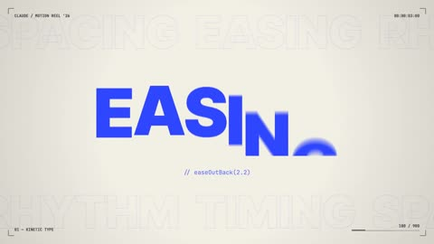</a></td>
</tr>
<tr>
<td width="50%" valign="top"><strong>黑白圆点与错色字形的十五秒动效</strong> <a href="https://x.com/ravenblaze99">@ravenblaze99</a> · 短动效 0:15 · 收藏 0 · 资料待完善 <a href="https://guanmo-ai.github.io/awesome-ai-motion/#case-2111129754254680272">▶ 播放</a> · <a href="https://x.com/ravenblaze99/status/2111129754254680272">原帖</a></td>
<td width="50%" valign="top"><strong>Easing 字卡与图表的十五秒作品集</strong> <a href="https://x.com/jasonzhou1993">@jasonzhou1993</a> · 短动效 0:15 · 收藏 — · 资料待完善 <a href="https://guanmo-ai.github.io/awesome-ai-motion/#case-2103663364958515541">▶ 播放</a> · <a href="https://x.com/jasonzhou1993/status/2103663364958515541">原帖</a></td>
</tr>
</tbody>
<tbody>
<tr>
<td width="50%" height="225" align="center" valign="middle"></td>
<td width="50%" height="225" align="center" valign="middle"></td>
</tr>
<tr>
<td width="50%" valign="top"><strong>Claude 自我介绍的文字与粒子</strong> <a href="https://x.com/tanabe_fragm">@tanabe_fragm</a> · 短动效 0:15 · 收藏 — · 资料待完善 <a href="https://guanmo-ai.github.io/awesome-ai-motion/#case-2103802156675706979">▶ 播放</a> · <a href="https://x.com/tanabe_fragm/status/2103802156675706979">原帖</a></td>
<td width="50%" valign="top"><strong>用字卡与色面介绍鹿威し</strong> <a href="https://x.com/mizugame_22">@mizugame_22</a> · 短动效 0:15 · 收藏 — · 资料待完善 <a href="https://guanmo-ai.github.io/awesome-ai-motion/#case-2103677865439232174">▶ 播放</a> · <a href="https://x.com/mizugame_22/status/2103677865439232174">原帖</a></td>
</tr>
</tbody>
<tbody>
<tr>
<td width="50%" height="225" align="center" valign="middle"></td>
<td width="50%" height="225" align="center" valign="middle"></td>
</tr>
<tr>
<td width="50%" valign="top"><strong>用立体大字介绍 Opus</strong> <a href="https://x.com/souravbhar871">@souravbhar871</a> · 短动效 0:10 · 收藏 — · 资料待完善 <a href="https://guanmo-ai.github.io/awesome-ai-motion/#case-2103711849703477361">▶ 播放</a> · <a href="https://x.com/souravbhar871/status/2103711849703477361">原帖</a></td>
<td width="50%" valign="top"><strong>黑白粉黄的动态图形作品集</strong> <a href="https://x.com/aichrislee">@aichrislee</a> · 短动效 0:19 · 收藏 — · 资料待完善 <a href="https://guanmo-ai.github.io/awesome-ai-motion/#case-2103878567540961335">▶ 播放</a> · <a href="https://x.com/aichrislee/status/2103878567540961335">原帖</a></td>
</tr>
</tbody>
<tbody>
<tr>
<td width="50%" height="225" align="center" valign="middle"></td>
<td width="50%" height="225" align="center" valign="middle"></td>
</tr>
<tr>
<td width="50%" valign="top"><strong>像素巴黎的雨夜循环</strong> <a href="https://x.com/minosdevs">@minosdevs</a> · 角色动画 0:06 · 收藏 1,338 · 资料待完善 <a href="https://guanmo-ai.github.io/awesome-ai-motion/#case-2103112945341251920">▶ 播放</a> · <a href="https://x.com/minosdevs/status/2103112945341251920">原帖</a></td>
<td width="50%" valign="top"><strong>茶杯角色与浮世绘海浪</strong> <a href="https://x.com/cherry_mx_reds">@cherry_mx_reds</a> · 角色动画 0:17 · 收藏 457 · 资料待完善 <a href="https://guanmo-ai.github.io/awesome-ai-motion/#case-2105816670896009224">▶ 播放</a> · <a href="https://x.com/cherry_mx_reds/status/2105816670896009224">原帖</a></td>
</tr>
</tbody>
<tbody>
<tr>
<td width="50%" height="225" align="center" valign="middle"></td>
<td width="50%" height="225" align="center" valign="middle"><a href="https://guanmo-ai.github.io/awesome-ai-motion/#case-2108082476975554587">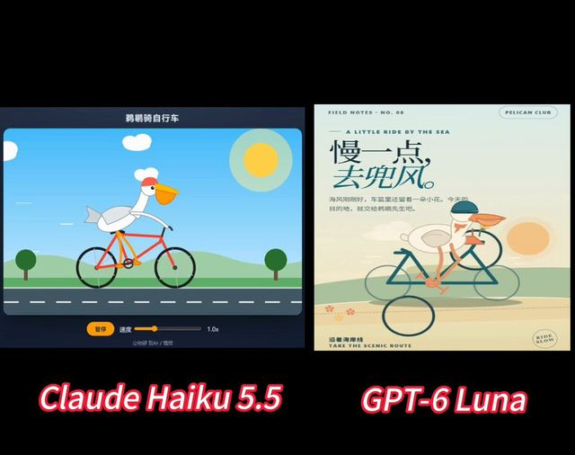</a></td>
</tr>
<tr>
<td width="50%" valign="top"><strong>兴奋过头的 AI 自我介绍</strong> <a href="https://x.com/goodside">@goodside</a> · 角色动画 0:30 · 收藏 102 · 资料待完善 <a href="https://guanmo-ai.github.io/awesome-ai-motion/#case-2103122885560721540">▶ 播放</a> · <a href="https://x.com/goodside/status/2103122885560721540">原帖</a></td>
<td width="50%" valign="top"><strong>鹈鹕骑车的 Haiku 与 Luna 对照</strong> <a href="https://x.com/xueyu1125">@xueyu1125</a> · 角色动画 0:17 · 收藏 13 · 资料待完善 <a href="https://guanmo-ai.github.io/awesome-ai-motion/#case-2108082476975554587">▶ 播放</a> · <a href="https://x.com/xueyu1125/status/2108082476975554587">原帖</a></td>
</tr>
</tbody>
<tbody>
<tr>
<td width="50%" height="225" align="center" valign="middle"></td>
<td width="50%" height="225" align="center" valign="middle"></td>
</tr>
<tr>
<td width="50%" valign="top"><strong>电池里的火柴人</strong> <a href="https://x.com/byaiden_vu">@byaiden_vu</a> · 角色动画 0:15 · 收藏 11 · 资料待完善 <a href="https://guanmo-ai.github.io/awesome-ai-motion/#case-2104846047256469948">▶ 播放</a> · <a href="https://x.com/byaiden_vu/status/2104846047256469948">原帖</a></td>
<td width="50%" valign="top"><strong>西部荒漠风格的立体俄罗斯方块</strong> <a href="https://x.com/SimonasLTU1">@SimonasLTU1</a> · 角色动画 0:59 · 收藏 4 · 资料待完善 <a href="https://guanmo-ai.github.io/awesome-ai-motion/#case-2111215178532491265">▶ 播放</a> · <a href="https://x.com/SimonasLTU1/status/2111215178532491265">原帖</a></td>
</tr>
</tbody>
<tbody>
<tr>
<td width="50%" height="225" align="center" valign="middle"></td>
<td width="50%" height="225" align="center" valign="middle"><a href="https://guanmo-ai.github.io/awesome-ai-motion/#case-2103910844677472343">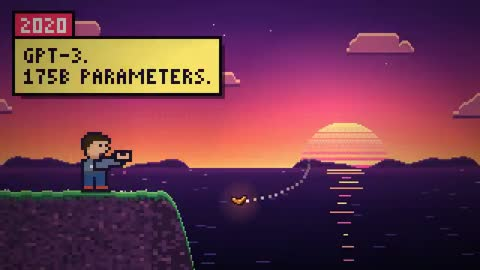</a></td>
</tr>
<tr>
<td width="50%" valign="top"><strong>ASHEN FRONTIER：横版废土游戏</strong> <a href="https://x.com/jiangjiangling">@jiangjiangling</a> · 角色动画 0:30 · 收藏 2 · 资料待完善 <a href="https://guanmo-ai.github.io/awesome-ai-motion/#case-2107399895011434935">▶ 播放</a> · <a href="https://x.com/jiangjiangling/status/2107399895011434935">原帖</a></td>
<td width="50%" valign="top"><strong>大模型历史的像素回旋镖</strong> <a href="https://x.com/PluginPlay__">@PluginPlay__</a> · 角色动画 0:26 · 收藏 1 · 资料待完善 <a href="https://guanmo-ai.github.io/awesome-ai-motion/#case-2103910844677472343">▶ 播放</a> · <a href="https://x.com/PluginPlay__/status/2103910844677472343">原帖</a></td>
</tr>
</tbody>
<tbody>
<tr>
<td width="50%" height="225" align="center" valign="middle"></td>
<td width="50%" height="225" align="center" valign="middle"></td>
</tr>
<tr>
<td width="50%" valign="top"><strong>啤酒节最后一声干杯</strong> <a href="https://x.com/uiNerd">@uiNerd</a> · 角色动画 0:15 · 收藏 0 · 资料待完善 <a href="https://guanmo-ai.github.io/awesome-ai-motion/#case-2106842274537635877">▶ 播放</a> · <a href="https://x.com/uiNerd/status/2106842274537635877">原帖</a></td>
<td width="50%" valign="top"><strong>三辆载具合体的机器人动画</strong> <a href="https://x.com/allforbigfire">@allforbigfire</a> · 角色动画 0:25 · 收藏 0 · 资料待完善 <a href="https://guanmo-ai.github.io/awesome-ai-motion/#case-2104193522715029657">▶ 播放</a> · <a href="https://x.com/allforbigfire/status/2104193522715029657">原帖</a></td>
</tr>
</tbody>
<tbody>
<tr>
<td width="50%" height="225" align="center" valign="middle"><a href="https://guanmo-ai.github.io/awesome-ai-motion/#case-2102685186919932404">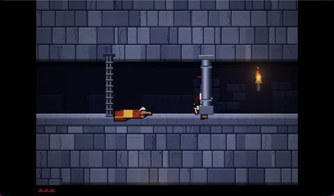</a></td>
<td width="50%" height="225" align="center" valign="middle"><a href="https://guanmo-ai.github.io/awesome-ai-motion/#case-2106789700807856416">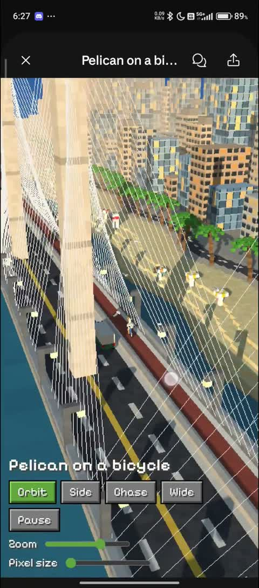</a></td>
</tr>
<tr>
<td width="50%" valign="top"><strong>单页里的像素波斯王子关卡</strong> <a href="https://x.com/iannuttall">@iannuttall</a> · 角色动画 2:25 · 收藏 — · 资料待完善 <a href="https://guanmo-ai.github.io/awesome-ai-motion/#case-2102685186919932404">▶ 播放</a> · <a href="https://x.com/iannuttall/status/2102685186919932404">原帖</a></td>
<td width="50%" valign="top"><strong>像素城市里的鹈鹕自行车</strong> <a href="https://x.com/SadAlbert10">@SadAlbert10</a> · 角色动画 0:37 · 收藏 — · 资料待完善 <a href="https://guanmo-ai.github.io/awesome-ai-motion/#case-2106789700807856416">▶ 播放</a> · <a href="https://x.com/SadAlbert10/status/2106789700807856416">原帖</a></td>
</tr>
</tbody>
<tbody>
<tr>
<td width="50%" height="225" align="center" valign="middle"></td>
<td width="50%" height="225" align="center" valign="middle"></td>
</tr>
<tr>
<td width="50%" valign="top"><strong>海盗船从图纸驶向海面</strong> <a href="https://x.com/Ayu_AI_0912">@Ayu_AI_0912</a> · 交互演示 0:24 · 收藏 562 · 资料待完善 <a href="https://guanmo-ai.github.io/awesome-ai-motion/#case-2109043294911291886">▶ 播放</a> · <a href="https://x.com/Ayu_AI_0912/status/2109043294911291886">原帖</a></td>
<td width="50%" valign="top"><strong>桃花源记：循文入境的三维长卷</strong> <a href="https://x.com/dotey">@dotey</a> · 交互演示 4:17 · 收藏 460 · 资料待完善 <a href="https://guanmo-ai.github.io/awesome-ai-motion/#case-2102940980379017293">▶ 播放</a> · <a href="https://x.com/dotey/status/2102940980379017293">原帖</a></td>
</tr>
</tbody>
<tbody>
<tr>
<td width="50%" height="225" align="center" valign="middle"></td>
<td width="50%" height="225" align="center" valign="middle"></td>
</tr>
<tr>
<td width="50%" valign="top"><strong>秋林铁轨的卡通三维漫游</strong> <a href="https://x.com/ishuagra02">@ishuagra02</a> · 交互演示 0:49 · 收藏 238 · 资料待完善 <a href="https://guanmo-ai.github.io/awesome-ai-motion/#case-2102543638689460488">▶ 播放</a> · <a href="https://x.com/ishuagra02/status/2102543638689460488">原帖</a></td>
<td width="50%" valign="top"><strong>可玩的三维 Game Boy</strong> <a href="https://x.com/numaausaumon">@numaausaumon</a> · 交互演示 1:09 · 收藏 153 · 资料待完善 <a href="https://guanmo-ai.github.io/awesome-ai-motion/#case-2112186912060654023">▶ 播放</a> · <a href="https://x.com/numaausaumon/status/2112186912060654023">原帖</a></td>
</tr>
</tbody>
<tbody>
<tr>
<td width="50%" height="225" align="center" valign="middle"></td>
<td width="50%" height="225" align="center" valign="middle"></td>
</tr>
<tr>
<td width="50%" valign="top"><strong>海边栈桥上的骑车鹈鹕</strong> <a href="https://x.com/AxtonLiu">@AxtonLiu</a> · 交互演示 0:38 · 收藏 57 · 资料待完善 <a href="https://guanmo-ai.github.io/awesome-ai-motion/#case-2103119648271290566">▶ 播放</a> · <a href="https://x.com/AxtonLiu/status/2103119648271290566">原帖</a></td>
<td width="50%" valign="top"><strong>果冻桃子的软体形变</strong> <a href="https://x.com/vib3coded">@vib3coded</a> · 交互演示 0:18 · 收藏 31 · 资料待完善 <a href="https://guanmo-ai.github.io/awesome-ai-motion/#case-2112240323560645092">▶ 播放</a> · <a href="https://x.com/vib3coded/status/2112240323560645092">原帖</a></td>
</tr>
</tbody>
<tbody>
<tr>
<td width="50%" height="225" align="center" valign="middle"></td>
<td width="50%" height="225" align="center" valign="middle"></td>
</tr>
<tr>
<td width="50%" valign="top"><strong>行走的建筑：可容纳人的移动空间</strong> <a href="https://x.com/shion_takk">@shion_takk</a> · 交互演示 0:30 · 收藏 3 · 资料待完善 <a href="https://guanmo-ai.github.io/awesome-ai-motion/#case-2104590334152056983">▶ 播放</a> · <a href="https://x.com/shion_takk/status/2104590334152056983">原帖</a></td>
<td width="50%" valign="top"><strong>Splat Knight 的连击与飞溅</strong> <a href="https://x.com/code_coded">@code_coded</a> · 交互演示 0:23 · 收藏 1 · 资料待完善 <a href="https://guanmo-ai.github.io/awesome-ai-motion/#case-2111121904388251714">▶ 播放</a> · <a href="https://x.com/code_coded/status/2111121904388251714">原帖</a></td>
</tr>
</tbody>
<tbody>
<tr>
<td width="50%" height="225" align="center" valign="middle"></td>
<td width="50%" height="225" align="center" valign="middle"></td>
</tr>
<tr>
<td width="50%" valign="top"><strong>三维塔楼的内外穿行</strong> <a href="https://x.com/BuildFastWithAI">@BuildFastWithAI</a> · 交互演示 1:19 · 收藏 0 · 资料待完善 <a href="https://guanmo-ai.github.io/awesome-ai-motion/#case-2103483174957597035">▶ 播放</a> · <a href="https://x.com/BuildFastWithAI/status/2103483174957597035">原帖</a></td>
<td width="50%" valign="top"><strong>毛绒角色：Sol 与 Opus 同参考对比</strong> <a href="https://x.com/JakubAntowski">@JakubAntowski</a> · 交互演示 0:20 · 收藏 0 · 资料待完善 <a href="https://guanmo-ai.github.io/awesome-ai-motion/#case-2105245039521628213">▶ 播放</a> · <a href="https://x.com/JakubAntowski/status/2105245039521628213">原帖</a></td>
</tr>
</tbody>
<tbody>
<tr>
<td width="50%" height="225" align="center" valign="middle"></td>
<td width="50%" height="225" align="center" valign="middle"></td>
</tr>
<tr>
<td width="50%" valign="top"><strong>Halcyon：海面上的未来城市</strong> <a href="https://x.com/Muhamma61700589">@Muhamma61700589</a> · 交互演示 0:24 · 收藏 0 · 资料待完善 <a href="https://guanmo-ai.github.io/awesome-ai-motion/#case-2104276129381220369">▶ 播放</a> · <a href="https://x.com/Muhamma61700589/status/2104276129381220369">原帖</a></td>
<td width="50%" valign="top"><strong>轨道邮局：黄铜与行星的小世界</strong> <a href="https://x.com/allenrokxlate">@allenrokxlate</a> · 交互演示 0:24 · 收藏 0 · 资料待完善 <a href="https://x.com/allenrokxlate/status/2106040262245896675">▶ 在 X 观看</a> · <a href="https://x.com/allenrokxlate/status/2106040262245896675">原帖</a></td>
</tr>
</tbody>
<tbody>
<tr>
<td width="50%" height="225" align="center" valign="middle"></td>
<td width="50%" height="225" align="center" valign="middle"></td>
</tr>
<tr>
<td width="50%" valign="top"><strong>单文件 HTML 的熔岩灯</strong> <a href="https://x.com/juancarlos17626">@juancarlos17626</a> · 交互演示 0:51 · 收藏 0 · 资料待完善 <a href="https://guanmo-ai.github.io/awesome-ai-motion/#case-2108301452384870600">▶ 播放</a> · <a href="https://x.com/juancarlos17626/status/2108301452384870600">原帖</a></td>
<td width="50%" valign="top"><strong>啤酒节短动画</strong> <a href="https://x.com/cherry_mx_reds">@cherry_mx_reds</a> · 叙事短片 0:30 · 收藏 852 · 资料待完善 <a href="https://guanmo-ai.github.io/awesome-ai-motion/#case-2102493303388475855">▶ 播放</a> · <a href="https://x.com/cherry_mx_reds/status/2102493303388475855">原帖</a></td>
</tr>
</tbody>
<tbody>
<tr>
<td width="50%" height="225" align="center" valign="middle"></td>
<td width="50%" height="225" align="center" valign="middle"></td>
</tr>
<tr>
<td width="50%" valign="top"><strong>无法阅读的书本动画故事</strong> <a href="https://x.com/emollick">@emollick</a> · 叙事短片 2:07 · 收藏 642 · 资料待完善 <a href="https://guanmo-ai.github.io/awesome-ai-motion/#case-2103272686570918334">▶ 播放</a> · <a href="https://x.com/emollick/status/2103272686570918334">原帖</a></td>
<td width="50%" valign="top"><strong>九十年代风格三维故事</strong> <a href="https://x.com/scheemunai">@scheemunai</a> · 叙事短片 3:50 · 收藏 370 · 资料待完善 <a href="https://guanmo-ai.github.io/awesome-ai-motion/#case-2102788223835463902">▶ 播放</a> · <a href="https://x.com/scheemunai/status/2102788223835463902">原帖</a></td>
</tr>
</tbody>
<tbody>
<tr>
<td width="50%" height="225" align="center" valign="middle"></td>
<td width="50%" height="225" align="center" valign="middle"></td>
</tr>
<tr>
<td width="50%" valign="top"><strong>Opus 把任务交给 Haiku</strong> <a href="https://x.com/kelanoo">@kelanoo</a> · 叙事短片 0:20 · 收藏 162 · 资料待完善 <a href="https://guanmo-ai.github.io/awesome-ai-motion/#case-2108199183983497433">▶ 播放</a> · <a href="https://x.com/kelanoo/status/2108199183983497433">原帖</a></td>
<td width="50%" valign="top"><strong>桃太郎：纸拼贴绘本动画</strong> <a href="https://x.com/tanabe_fragm">@tanabe_fragm</a> · 叙事短片 0:46 · 收藏 155 · 资料待完善 <a href="https://guanmo-ai.github.io/awesome-ai-motion/#case-2110931024469540979">▶ 播放</a> · <a href="https://x.com/tanabe_fragm/status/2110931024469540979">原帖</a></td>
</tr>
</tbody>
<tbody>
<tr>
<td width="50%" height="225" align="center" valign="middle"></td>
<td width="50%" height="225" align="center" valign="middle"></td>
</tr>
<tr>
<td width="50%" valign="top"><strong>一分钟格斗动画</strong> <a href="https://x.com/akokoi1">@akokoi1</a> · 叙事短片 1:00 · 收藏 64 · 资料待完善 <a href="https://guanmo-ai.github.io/awesome-ai-motion/#case-2103149275945517546">▶ 播放</a> · <a href="https://x.com/akokoi1/status/2103149275945517546">原帖</a></td>
<td width="50%" valign="top"><strong>代码绘制的动漫预告片</strong> <a href="https://x.com/ishuagra02">@ishuagra02</a> · 叙事短片 1:41 · 收藏 44 · 资料待完善 <a href="https://guanmo-ai.github.io/awesome-ai-motion/#case-2103247844542922825">▶ 播放</a> · <a href="https://x.com/ishuagra02/status/2103247844542922825">原帖</a></td>
</tr>
</tbody>
<tbody>
<tr>
<td width="50%" height="225" align="center" valign="middle"></td>
<td width="50%" height="225" align="center" valign="middle"></td>
</tr>
<tr>
<td width="50%" valign="top"><strong>木兰辞：剪纸皮影短片</strong> <a href="https://x.com/TanLuAI">@TanLuAI</a> · 叙事短片 1:03 · 收藏 3 · 资料待完善 <a href="https://guanmo-ai.github.io/awesome-ai-motion/#case-2107802029100093531">▶ 播放</a> · <a href="https://x.com/TanLuAI/status/2107802029100093531">原帖</a></td>
<td width="50%" valign="top"><strong>火光与厚涂笔触的短片</strong> <a href="https://x.com/yumaeriel">@yumaeriel</a> · 叙事短片 0:30 · 收藏 2 · 资料待完善 <a href="https://guanmo-ai.github.io/awesome-ai-motion/#case-2103053166006657284">▶ 播放</a> · <a href="https://x.com/yumaeriel/status/2103053166006657284">原帖</a></td>
</tr>
</tbody>
<tbody>
<tr>
<td width="50%" height="225" align="center" valign="middle"></td>
<td width="50%" height="225" align="center" valign="middle"></td>
</tr>
<tr>
<td width="50%" valign="top"><strong>不想被修好的程序错误</strong> <a href="https://x.com/KamStudioLabs">@KamStudioLabs</a> · 叙事短片 1:30 · 收藏 1 · 资料待完善 <a href="https://guanmo-ai.github.io/awesome-ai-motion/#case-2102903173161877996">▶ 播放</a> · <a href="https://x.com/KamStudioLabs/status/2102903173161877996">原帖</a></td>
<td width="50%" valign="top"><strong>红手套角色无声短片</strong> <a href="https://x.com/yaakuups">@yaakuups</a> · 叙事短片 2:18 · 收藏 1 · 资料待完善 <a href="https://guanmo-ai.github.io/awesome-ai-motion/#case-2103082248320766456">▶ 播放</a> · <a href="https://x.com/yaakuups/status/2103082248320766456">原帖</a></td>
</tr>
</tbody>
<tbody>
<tr>
<td width="50%" height="225" align="center" valign="middle"></td>
<td width="50%" height="225" align="center" valign="middle"></td>
</tr>
<tr>
<td width="50%" valign="top"><strong>雨滴前的一笔巴黎速写</strong> <a href="https://x.com/dan_riverbendai">@dan_riverbendai</a> · 叙事短片 4:45 · 收藏 1 · 资料待完善 <a href="https://guanmo-ai.github.io/awesome-ai-motion/#case-2103985505302163640">▶ 播放</a> · <a href="https://x.com/dan_riverbendai/status/2103985505302163640">原帖</a></td>
<td width="50%" valign="top"><strong>蜘蛛之丝：漫画分镜里的纵深运动</strong> <a href="https://x.com/Kaiyu_AI">@Kaiyu_AI</a> · 叙事短片 4:12 · 收藏 0 · 资料待完善 <a href="https://guanmo-ai.github.io/awesome-ai-motion/#case-2106605246235762929">▶ 播放</a> · <a href="https://x.com/Kaiyu_AI/status/2106605246235762929">原帖</a></td>
</tr>
</tbody>
<tbody>
<tr>
<td width="50%" height="225" align="center" valign="middle"></td>
<td width="50%" height="225" align="center" valign="middle"></td>
</tr>
<tr>
<td width="50%" valign="top"><strong>灯塔守夜人的无对白故事</strong> <a href="https://x.com/KamStudioLabs">@KamStudioLabs</a> · 叙事短片 0:46 · 收藏 0 · 资料待完善 <a href="https://guanmo-ai.github.io/awesome-ai-motion/#case-2102908742518100086">▶ 播放</a> · <a href="https://x.com/KamStudioLabs/status/2102908742518100086">原帖</a></td>
<td width="50%" valign="top"><strong>关于家的剪影纸戏</strong> <a href="https://x.com/x4b47x">@x4b47x</a> · 叙事短片 0:57 · 收藏 0 · 资料待完善 <a href="https://guanmo-ai.github.io/awesome-ai-motion/#case-2103019799614034026">▶ 播放</a> · <a href="https://x.com/x4b47x/status/2103019799614034026">原帖</a></td>
</tr>
</tbody>
<tbody>
<tr>
<td width="50%" height="225" align="center" valign="middle"></td>
<td width="50%" height="225" align="center" valign="middle"></td>
</tr>
<tr>
<td width="50%" valign="top"><strong>桌面上的 Claude 与 ChatGPT 对决</strong> <a href="https://x.com/KadaPlaysAI">@KadaPlaysAI</a> · 叙事短片 1:57 · 收藏 — · 资料待完善 <a href="https://guanmo-ai.github.io/awesome-ai-motion/#case-2103709291530363013">▶ 播放</a> · <a href="https://x.com/KadaPlaysAI/status/2103709291530363013">原帖</a></td>
<td width="50%" valign="top"><strong>爵士唱片卡：唱针、节拍与频谱</strong> <a href="https://x.com/tkz_aiart">@tkz_aiart</a> · 音乐与歌词 0:15 · 收藏 58 · 资料待完善 <a href="https://guanmo-ai.github.io/awesome-ai-motion/#case-2107799962037911786">▶ 播放</a> · <a href="https://x.com/tkz_aiart/status/2107799962037911786">原帖</a></td>
</tr>
</tbody>
<tbody>
<tr>
<td width="50%" height="225" align="center" valign="middle"></td>
<td width="50%" height="225" align="center" valign="middle"></td>
</tr>
<tr>
<td width="50%" valign="top"><strong>夜间钢琴与黑猫的 Canvas 动画</strong> <a href="https://x.com/0xCodez">@0xCodez</a> · 音乐与歌词 1:25 · 收藏 35 · 资料待完善 <a href="https://guanmo-ai.github.io/awesome-ai-motion/#case-2104257855142474136">▶ 播放</a> · <a href="https://x.com/0xCodez/status/2104257855142474136">原帖</a></td>
<td width="50%" valign="top"><strong>Turn It Up Now 动态歌词</strong> <a href="https://x.com/kloss_xyz">@kloss_xyz</a> · 音乐与歌词 1:50 · 收藏 34 · 资料待完善 <a href="https://guanmo-ai.github.io/awesome-ai-motion/#case-2109087249572749553">▶ 播放</a> · <a href="https://x.com/kloss_xyz/status/2109087249572749553">原帖</a></td>
</tr>
</tbody>
<tbody>
<tr>
<td width="50%" height="225" align="center" valign="middle"></td>
<td width="50%" height="225" align="center" valign="middle"><a href="https://guanmo-ai.github.io/awesome-ai-motion/#case-2103173729656459455">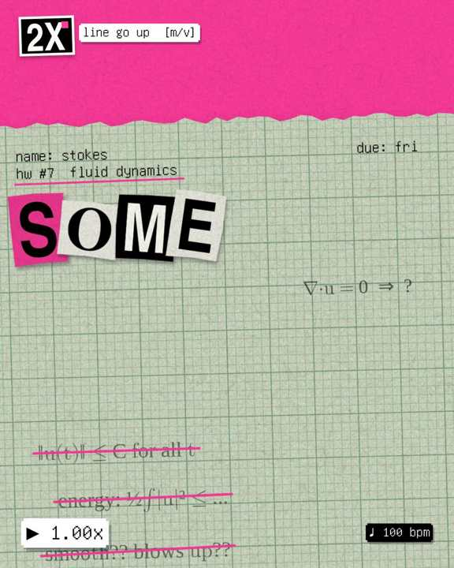</a></td>
</tr>
<tr>
<td width="50%" valign="top"><strong>Jev 模型的图形歌曲</strong> <a href="https://x.com/goodside">@goodside</a> · 音乐与歌词 2:20 · 收藏 29 · 资料待完善 <a href="https://guanmo-ai.github.io/awesome-ai-motion/#case-2102852546620744010">▶ 播放</a> · <a href="https://x.com/goodside/status/2102852546620744010">原帖</a></td>
<td width="50%" valign="top"><strong>二十秒音乐短片</strong> <a href="https://x.com/anjmaxx">@anjmaxx</a> · 音乐与歌词 0:20 · 收藏 7 · 资料待完善 <a href="https://guanmo-ai.github.io/awesome-ai-motion/#case-2103173729656459455">▶ 播放</a> · <a href="https://x.com/anjmaxx/status/2103173729656459455">原帖</a></td>
</tr>
</tbody>
<tbody>
<tr>
<td width="50%" height="225" align="center" valign="middle"></td>
<td width="50%" height="225" align="center" valign="middle"></td>
</tr>
<tr>
<td width="50%" valign="top"><strong>Suno 歌曲的动态视觉 MV</strong> <a href="https://x.com/hungryturbo">@hungryturbo</a> · 音乐与歌词 2:37 · 收藏 6 · 资料待完善 <a href="https://guanmo-ai.github.io/awesome-ai-motion/#case-2107093105992417482">▶ 播放</a> · <a href="https://x.com/hungryturbo/status/2107093105992417482">原帖</a></td>
<td width="50%" valign="top"><strong>霓虹分形的 VJ 视觉实验</strong> <a href="https://x.com/yama_kiyo">@yama_kiyo</a> · 音乐与歌词 0:30 · 收藏 3 · 资料待完善 <a href="https://guanmo-ai.github.io/awesome-ai-motion/#case-2103740786177134910">▶ 播放</a> · <a href="https://x.com/yama_kiyo/status/2103740786177134910">原帖</a></td>
</tr>
</tbody>
<tbody>
<tr>
<td width="50%" height="225" align="center" valign="middle"><a href="https://guanmo-ai.github.io/awesome-ai-motion/#case-2107455787823952091">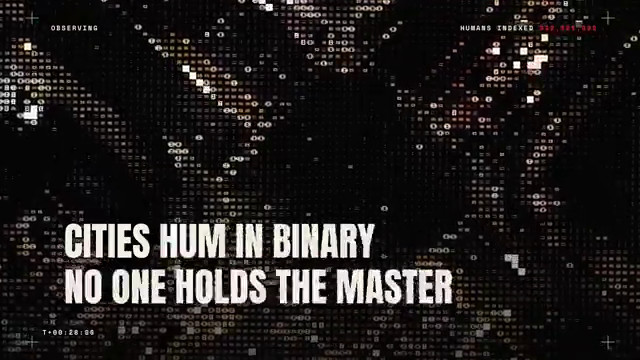</a></td>
<td width="50%" height="225" align="center" valign="middle"><a href="https://guanmo-ai.github.io/awesome-ai-motion/#case-2102899866762440893">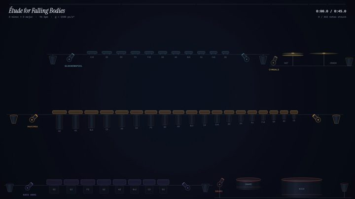</a></td>
</tr>
<tr>
<td width="50%" valign="top"><strong>AI 接管世界：歌曲视觉试验</strong> <a href="https://x.com/Dheepanratnam">@Dheepanratnam</a> · 音乐与歌词 1:00 · 收藏 2 · 资料待完善 <a href="https://guanmo-ai.github.io/awesome-ai-motion/#case-2107455787823952091">▶ 播放</a> · <a href="https://x.com/Dheepanratnam/status/2107455787823952091">原帖</a></td>
<td width="50%" valign="top"><strong>碰撞触发音符的机械装置</strong> <a href="https://x.com/KamStudioLabs">@KamStudioLabs</a> · 音乐与歌词 0:47 · 收藏 1 · 资料待完善 <a href="https://guanmo-ai.github.io/awesome-ai-motion/#case-2102899866762440893">▶ 播放</a> · <a href="https://x.com/KamStudioLabs/status/2102899866762440893">原帖</a></td>
</tr>
</tbody>
<tbody>
<tr>
<td width="50%" height="225" align="center" valign="middle"></td>
<td width="50%" height="225" align="center" valign="middle"><a href="https://guanmo-ai.github.io/awesome-ai-motion/#case-2104254444603076730">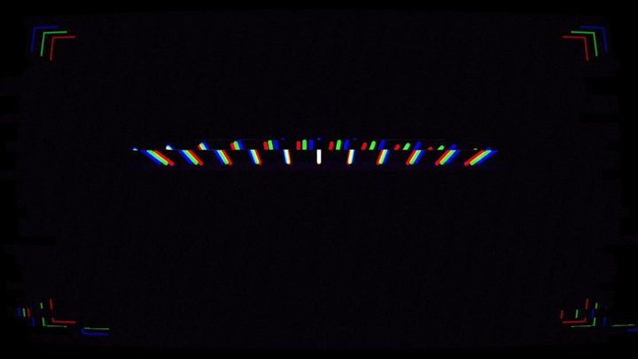</a></td>
</tr>
<tr>
<td width="50%" valign="top"><strong>写给创业者的手绘歌词短片</strong> <a href="https://x.com/YanivM79">@YanivM79</a> · 音乐与歌词 3:50 · 收藏 0 · 资料待完善 <a href="https://guanmo-ai.github.io/awesome-ai-motion/#case-2106720729265795579">▶ 播放</a> · <a href="https://x.com/YanivM79/status/2106720729265795579">原帖</a></td>
<td width="50%" valign="top"><strong>逐帧代码生成的音乐视频</strong> <a href="https://x.com/linus5x">@linus5x</a> · 音乐与歌词 1:45 · 收藏 0 · 资料待完善 <a href="https://guanmo-ai.github.io/awesome-ai-motion/#case-2104254444603076730">▶ 播放</a> · <a href="https://x.com/linus5x/status/2104254444603076730">原帖</a></td>
</tr>
</tbody>
<tbody>
<tr>
<td width="50%" height="225" align="center" valign="middle"><a href="https://guanmo-ai.github.io/awesome-ai-motion/#case-2105230653457650116">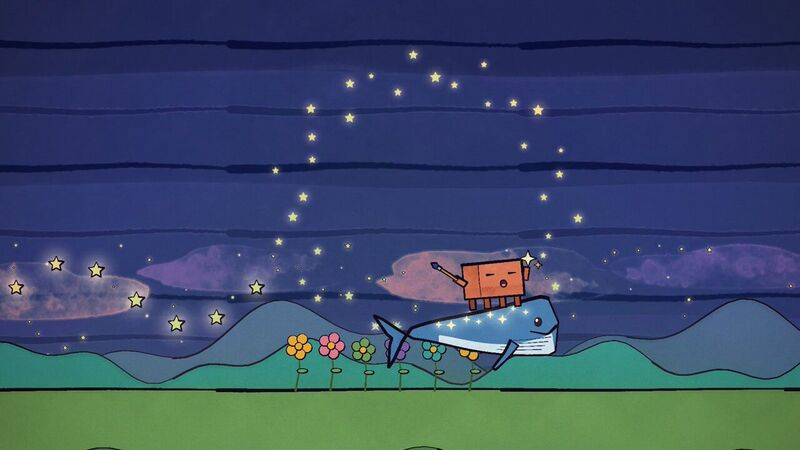</a></td>
<td width="50%" height="225" align="center" valign="middle"></td>
</tr>
<tr>
<td width="50%" valign="top"><strong>One Prompt：p5.js 音乐视频</strong> <a href="https://x.com/ppop123">@ppop123</a> · 音乐与歌词 2:10 · 收藏 0 · 资料待完善 <a href="https://guanmo-ai.github.io/awesome-ai-motion/#case-2105230653457650116">▶ 播放</a> · <a href="https://x.com/ppop123/status/2105230653457650116">原帖</a></td>
<td width="50%" valign="top"><strong>纸片角色与拒绝恶评的音乐动画</strong> <a href="https://x.com/thewevr">@thewevr</a> · 音乐与歌词 3:20 · 收藏 0 · 资料待完善 <a href="https://guanmo-ai.github.io/awesome-ai-motion/#case-2106772719614234885">▶ 播放</a> · <a href="https://x.com/thewevr/status/2106772719614234885">原帖</a></td>
</tr>
</tbody>
<tbody>
<tr>
<td width="50%" height="225" align="center" valign="middle"><a href="https://guanmo-ai.github.io/awesome-ai-motion/#case-2107449614412493219">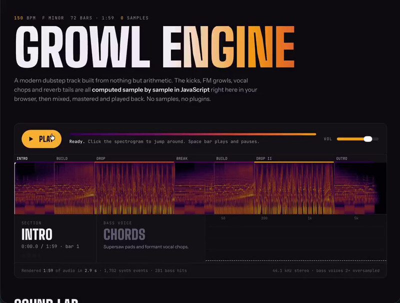</a></td>
<td width="50%" height="225" align="center" valign="middle"></td>
</tr>
<tr>
<td width="50%" valign="top"><strong>Growl Engine：JavaScript 低音音乐</strong> <a href="https://x.com/HOTHEAD01TH">@HOTHEAD01TH</a> · 音乐与歌词 2:00 · 收藏 0 · 资料待完善 <a href="https://guanmo-ai.github.io/awesome-ai-motion/#case-2107449614412493219">▶ 播放</a> · <a href="https://x.com/HOTHEAD01TH/status/2107449614412493219">原帖</a></td>
<td width="50%" valign="top"><strong>Lagos Life：游戏主题歌词 MV</strong> <a href="https://x.com/kaykluz">@kaykluz</a> · 音乐与歌词 4:00 · 收藏 0 · 资料待完善 <a href="https://guanmo-ai.github.io/awesome-ai-motion/#case-2110880079177777356">▶ 播放</a> · <a href="https://x.com/kaykluz/status/2110880079177777356">原帖</a></td>
</tr>
</tbody>
<tbody>
<tr>
<td width="50%" height="225" align="center" valign="middle"></td>
<td width="50%" height="225" align="center" valign="middle"><a href="https://guanmo-ai.github.io/awesome-ai-motion/#case-2111927727318245426">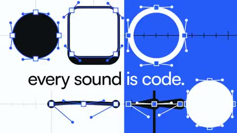</a></td>
</tr>
<tr>
<td width="50%" valign="top"><strong>Awesome AI Motion：让 AI 把想法变成动效</strong> <a href="https://x.com/guanmo_ai">@guanmo_ai</a> · 产品宣传 0:15 · 收藏 0 · 资料待完善 <a href="https://guanmo-ai.github.io/awesome-ai-motion/#case-2109941504827654305">▶ 播放</a> · <a href="https://x.com/guanmo_ai/status/2109941504827654305">原帖</a></td>
<td width="50%" valign="top"><strong>Earshot：每个声音都是代码</strong> <a href="https://x.com/LexnLin">@LexnLin</a> · 产品宣传 0:30 · 收藏 7,155 · 资料待完善 <a href="https://guanmo-ai.github.io/awesome-ai-motion/#case-2111927727318245426">▶ 播放</a> · <a href="https://x.com/LexnLin/status/2111927727318245426">原帖</a></td>
</tr>
</tbody>
<tbody>
<tr>
<td width="50%" height="225" align="center" valign="middle"></td>
<td width="50%" height="225" align="center" valign="middle"></td>
</tr>
<tr>
<td width="50%" valign="top"><strong>UDC 大会动态海报</strong> <a href="https://x.com/johncodunayo">@johncodunayo</a> · 产品宣传 0:24 · 收藏 3,756 · 资料待完善 <a href="https://guanmo-ai.github.io/awesome-ai-motion/#case-2105270766996701686">▶ 播放</a> · <a href="https://x.com/johncodunayo/status/2105270766996701686">原帖</a></td>
<td width="50%" valign="top"><strong>贴纸与像素游戏的活动宣传片</strong> <a href="https://x.com/tkm_hmng8">@tkm_hmng8</a> · 产品宣传 0:50 · 收藏 2,277 · 资料待完善 <a href="https://guanmo-ai.github.io/awesome-ai-motion/#case-2105255710531674358">▶ 播放</a> · <a href="https://x.com/tkm_hmng8/status/2105255710531674358">原帖</a></td>
</tr>
</tbody>
<tbody>
<tr>
<td width="50%" height="225" align="center" valign="middle"></td>
<td width="50%" height="225" align="center" valign="middle"></td>
</tr>
<tr>
<td width="50%" valign="top"><strong>Shotbase 产品发布动效</strong> <a href="https://x.com/Miguel07Code">@Miguel07Code</a> · 产品宣传 0:58 · 收藏 1,683 · 资料待完善 <a href="https://guanmo-ai.github.io/awesome-ai-motion/#case-2102441708395041170">▶ 播放</a> · <a href="https://x.com/Miguel07Code/status/2102441708395041170">原帖</a></td>
<td width="50%" valign="top"><strong>虚构日历 App 的全代码发布片</strong> <a href="https://x.com/LexnLin">@LexnLin</a> · 产品宣传 0:33 · 收藏 1,240 · 资料待完善 <a href="https://guanmo-ai.github.io/awesome-ai-motion/#case-2104148233106723099">▶ 播放</a> · <a href="https://x.com/LexnLin/status/2104148233106723099">原帖</a></td>
</tr>
</tbody>
<tbody>
<tr>
<td width="50%" height="225" align="center" valign="middle"></td>
<td width="50%" height="225" align="center" valign="middle"></td>
</tr>
<tr>
<td width="50%" valign="top"><strong>个人网站改版预告片</strong> <a href="https://x.com/trq212">@trq212</a> · 产品宣传 1:35 · 收藏 1,122 · 资料待完善 <a href="https://guanmo-ai.github.io/awesome-ai-motion/#case-2102477340920152162">▶ 播放</a> · <a href="https://x.com/trq212/status/2102477340920152162">原帖</a></td>
<td width="50%" valign="top"><strong>Claude 为自己做的字体广告</strong> <a href="https://x.com/LexnLin">@LexnLin</a> · 产品宣传 0:14 · 收藏 1,119 · 资料待完善 <a href="https://guanmo-ai.github.io/awesome-ai-motion/#case-2106101651010449796">▶ 播放</a> · <a href="https://x.com/LexnLin/status/2106101651010449796">原帖</a></td>
</tr>
</tbody>
<tbody>
<tr>
<td width="50%" height="225" align="center" valign="middle"></td>
<td width="50%" height="225" align="center" valign="middle"></td>
</tr>
<tr>
<td width="50%" valign="top"><strong>代码绘制的产品广告教程</strong> <a href="https://x.com/Lucas_IA_">@Lucas_IA_</a> · 产品宣传 1:12 · 收藏 1,119 · 资料待完善 <a href="https://guanmo-ai.github.io/awesome-ai-motion/#case-2103152093733253544">▶ 播放</a> · <a href="https://x.com/Lucas_IA_/status/2103152093733253544">原帖</a></td>
<td width="50%" valign="top"><strong>NovaChat 的界面宣传动效</strong> <a href="https://x.com/ann_nnng">@ann_nnng</a> · 产品宣传 0:15 · 收藏 1,110 · 资料待完善 <a href="https://guanmo-ai.github.io/awesome-ai-motion/#case-2103723183899852885">▶ 播放</a> · <a href="https://x.com/ann_nnng/status/2103723183899852885">原帖</a></td>
</tr>
</tbody>
<tbody>
<tr>
<td width="50%" height="225" align="center" valign="middle"></td>
<td width="50%" height="225" align="center" valign="middle"></td>
</tr>
<tr>
<td width="50%" valign="top"><strong>像素上传与复古社交界面动效</strong> <a href="https://x.com/trymirage">@trymirage</a> · 产品宣传 0:15 · 收藏 1,011 · 资料待完善 <a href="https://guanmo-ai.github.io/awesome-ai-motion/#case-2103542300844474452">▶ 播放</a> · <a href="https://x.com/trymirage/status/2103542300844474452">原帖</a></td>
<td width="50%" valign="top"><strong>模型自制发布短片</strong> <a href="https://x.com/athrix_codes">@athrix_codes</a> · 产品宣传 0:53 · 收藏 951 · 资料待完善 <a href="https://guanmo-ai.github.io/awesome-ai-motion/#case-2096209514248958161">▶ 播放</a> · <a href="https://x.com/athrix_codes/status/2096209514248958161">原帖</a></td>
</tr>
</tbody>
<tbody>
<tr>
<td width="50%" height="225" align="center" valign="middle"></td>
<td width="50%" height="225" align="center" valign="middle"></td>
</tr>
<tr>
<td width="50%" valign="top"><strong>参考视频变成自己的动画</strong> <a href="https://x.com/ishuagra02">@ishuagra02</a> · 产品宣传 1:02 · 收藏 754 · 资料待完善 <a href="https://guanmo-ai.github.io/awesome-ai-motion/#case-2108250410221781009">▶ 播放</a> · <a href="https://x.com/ishuagra02/status/2108250410221781009">原帖</a></td>
<td width="50%" valign="top"><strong>生活提醒的文字与卡片短片</strong> <a href="https://x.com/LexnLin">@LexnLin</a> · 产品宣传 0:40 · 收藏 639 · 资料待完善 <a href="https://guanmo-ai.github.io/awesome-ai-motion/#case-2109718604883370450">▶ 播放</a> · <a href="https://x.com/LexnLin/status/2109718604883370450">原帖</a></td>
</tr>
</tbody>
<tbody>
<tr>
<td width="50%" height="225" align="center" valign="middle"></td>
<td width="50%" height="225" align="center" valign="middle"></td>
</tr>
<tr>
<td width="50%" valign="top"><strong>可编辑的 AE 产品发布片</strong> <a href="https://x.com/seiiiiiiiiiiru">@seiiiiiiiiiiru</a> · 产品宣传 0:30 · 收藏 597 · 资料待完善 <a href="https://guanmo-ai.github.io/awesome-ai-motion/#case-2102636308707287201">▶ 播放</a> · <a href="https://x.com/seiiiiiiiiiiru/status/2102636308707287201">原帖</a></td>
<td width="50%" valign="top"><strong>方块球员的一对一篮球预告</strong> <a href="https://x.com/databallr">@databallr</a> · 产品宣传 0:15 · 收藏 596 · 资料待完善 <a href="https://guanmo-ai.github.io/awesome-ai-motion/#case-2103592504386101512">▶ 播放</a> · <a href="https://x.com/databallr/status/2103592504386101512">原帖</a></td>
</tr>
</tbody>
<tbody>
<tr>
<td width="50%" height="225" align="center" valign="middle"></td>
<td width="50%" height="225" align="center" valign="middle"></td>
</tr>
<tr>
<td width="50%" valign="top"><strong>Roblox 游戏的彩色发布片</strong> <a href="https://x.com/dataX_e">@dataX_e</a> · 产品宣传 0:15 · 收藏 596 · 资料待完善 <a href="https://guanmo-ai.github.io/awesome-ai-motion/#case-2104967024812118196">▶ 播放</a> · <a href="https://x.com/dataX_e/status/2104967024812118196">原帖</a></td>
<td width="50%" valign="top"><strong>旁白驱动的 AE 广告</strong> <a href="https://x.com/seiiiiiiiiiiru">@seiiiiiiiiiiru</a> · 产品宣传 0:29 · 收藏 588 · 资料待完善 <a href="https://guanmo-ai.github.io/awesome-ai-motion/#case-2103227982592831846">▶ 播放</a> · <a href="https://x.com/seiiiiiiiiiiru/status/2103227982592831846">原帖</a></td>
</tr>
</tbody>
<tbody>
<tr>
<td width="50%" height="225" align="center" valign="middle"></td>
<td width="50%" height="225" align="center" valign="middle"></td>
</tr>
<tr>
<td width="50%" valign="top"><strong>贴纸库发布短片</strong> <a href="https://x.com/javiiarchive">@javiiarchive</a> · 产品宣传 0:23 · 收藏 566 · 资料待完善 <a href="https://guanmo-ai.github.io/awesome-ai-motion/#case-2105283486487896448">▶ 播放</a> · <a href="https://x.com/javiiarchive/status/2105283486487896448">原帖</a></td>
<td width="50%" valign="top"><strong>Tabi：从键盘到文字的发布片</strong> <a href="https://x.com/nikhilbhima">@nikhilbhima</a> · 产品宣传 0:44 · 收藏 449 · 资料待完善 <a href="https://guanmo-ai.github.io/awesome-ai-motion/#case-2109019765134213540">▶ 播放</a> · <a href="https://x.com/nikhilbhima/status/2109019765134213540">原帖</a></td>
</tr>
</tbody>
<tbody>
<tr>
<td width="50%" height="225" align="center" valign="middle"></td>
<td width="50%" height="225" align="center" valign="middle"></td>
</tr>
<tr>
<td width="50%" valign="top"><strong>穿过产品版面的连续镜头</strong> <a href="https://x.com/cleeeeeeeeement">@cleeeeeeeeement</a> · 产品宣传 0:15 · 收藏 428 · 资料待完善 <a href="https://guanmo-ai.github.io/awesome-ai-motion/#case-2110039903312425385">▶ 播放</a> · <a href="https://x.com/cleeeeeeeeement/status/2110039903312425385">原帖</a></td>
<td width="50%" valign="top"><strong>TypingMind 的多边形脑标志</strong> <a href="https://x.com/tdinh_me">@tdinh_me</a> · 产品宣传 0:21 · 收藏 420 · 资料待完善 <a href="https://guanmo-ai.github.io/awesome-ai-motion/#case-2103704250329301409">▶ 播放</a> · <a href="https://x.com/tdinh_me/status/2103704250329301409">原帖</a></td>
</tr>
</tbody>
<tbody>
<tr>
<td width="50%" height="225" align="center" valign="middle"></td>
<td width="50%" height="225" align="center" valign="middle"></td>
</tr>
<tr>
<td width="50%" valign="top"><strong>红色数据渠道动态图表</strong> <a href="https://x.com/Gregoirechp">@Gregoirechp</a> · 产品宣传 0:20 · 收藏 396 · 资料待完善 <a href="https://guanmo-ai.github.io/awesome-ai-motion/#case-2103977724796649763">▶ 播放</a> · <a href="https://x.com/Gregoirechp/status/2103977724796649763">原帖</a></td>
<td width="50%" valign="top"><strong>蘑菇咖啡动画广告</strong> <a href="https://x.com/ladprofit">@ladprofit</a> · 产品宣传 0:55 · 收藏 334 · 资料待完善 <a href="https://guanmo-ai.github.io/awesome-ai-motion/#case-2103148835270971419">▶ 播放</a> · <a href="https://x.com/ladprofit/status/2103148835270971419">原帖</a></td>
</tr>
</tbody>
<tbody>
<tr>
<td width="50%" height="225" align="center" valign="middle"></td>
<td width="50%" height="225" align="center" valign="middle"></td>
</tr>
<tr>
<td width="50%" valign="top"><strong>统一聊天产品完整广告</strong> <a href="https://x.com/dhruvalgolakiya">@dhruvalgolakiya</a> · 产品宣传 0:40 · 收藏 329 · 资料待完善 <a href="https://guanmo-ai.github.io/awesome-ai-motion/#case-2103037586663235713">▶ 播放</a> · <a href="https://x.com/dhruvalgolakiya/status/2103037586663235713">原帖</a></td>
<td width="50%" valign="top"><strong>Chowdeck 的外卖图形广告</strong> <a href="https://x.com/DesignSorceress">@DesignSorceress</a> · 产品宣传 0:24 · 收藏 325 · 资料待完善 <a href="https://guanmo-ai.github.io/awesome-ai-motion/#case-2113535202098372655">▶ 播放</a> · <a href="https://x.com/DesignSorceress/status/2113535202098372655">原帖</a></td>
</tr>
</tbody>
<tbody>
<tr>
<td width="50%" height="225" align="center" valign="middle"></td>
<td width="50%" height="225" align="center" valign="middle"></td>
</tr>
<tr>
<td width="50%" valign="top"><strong>Dub 发布片：地球粒子与数据排版</strong> <a href="https://x.com/steventey">@steventey</a> · 产品宣传 0:15 · 收藏 300 · 资料待完善 <a href="https://guanmo-ai.github.io/awesome-ai-motion/#case-2103625902211088880">▶ 播放</a> · <a href="https://x.com/steventey/status/2103625902211088880">原帖</a></td>
<td width="50%" valign="top"><strong>PCB 外壳与可打印零件宣传动画</strong> <a href="https://x.com/VectorCrossProd">@VectorCrossProd</a> · 产品宣传 0:10 · 收藏 271 · 资料待完善 <a href="https://guanmo-ai.github.io/awesome-ai-motion/#case-2104093497561436573">▶ 播放</a> · <a href="https://x.com/VectorCrossProd/status/2104093497561436573">原帖</a></td>
</tr>
</tbody>
<tbody>
<tr>
<td width="50%" height="225" align="center" valign="middle"></td>
<td width="50%" height="225" align="center" valign="middle"></td>
</tr>
<tr>
<td width="50%" valign="top"><strong>Fomo 的深色概念广告</strong> <a href="https://x.com/Sevas_ae">@Sevas_ae</a> · 产品宣传 0:20 · 收藏 265 · 资料待完善 <a href="https://guanmo-ai.github.io/awesome-ai-motion/#case-2113609472639894013">▶ 播放</a> · <a href="https://x.com/Sevas_ae/status/2113609472639894013">原帖</a></td>
<td width="50%" valign="top"><strong>AI 培训品牌的文字与图形宣传片</strong> <a href="https://x.com/showheyohtaki">@showheyohtaki</a> · 产品宣传 0:30 · 收藏 256 · 资料待完善 <a href="https://guanmo-ai.github.io/awesome-ai-motion/#case-2104095944686051492">▶ 播放</a> · <a href="https://x.com/showheyohtaki/status/2104095944686051492">原帖</a></td>
</tr>
</tbody>
<tbody>
<tr>
<td width="50%" height="225" align="center" valign="middle"></td>
<td width="50%" height="225" align="center" valign="middle"></td>
</tr>
<tr>
<td width="50%" valign="top"><strong>把想法画成动画的系列宣传</strong> <a href="https://x.com/HaileyAILabs">@HaileyAILabs</a> · 产品宣传 1:11 · 收藏 236 · 资料待完善 <a href="https://guanmo-ai.github.io/awesome-ai-motion/#case-2111353123646427556">▶ 播放</a> · <a href="https://x.com/HaileyAILabs/status/2111353123646427556">原帖</a></td>
<td width="50%" valign="top"><strong>三维设备与火花串联的产品动效</strong> <a href="https://x.com/MengTo">@MengTo</a> · 产品宣传 0:41 · 收藏 217 · 资料待完善 <a href="https://guanmo-ai.github.io/awesome-ai-motion/#case-2103825139964227999">▶ 播放</a> · <a href="https://x.com/MengTo/status/2103825139964227999">原帖</a></td>
</tr>
</tbody>
<tbody>
<tr>
<td width="50%" height="225" align="center" valign="middle"></td>
<td width="50%" height="225" align="center" valign="middle"></td>
</tr>
<tr>
<td width="50%" valign="top"><strong>模块化收割机器人的形态变换</strong> <a href="https://x.com/DilumSanjaya">@DilumSanjaya</a> · 产品宣传 1:10 · 收藏 214 · 资料待完善 <a href="https://guanmo-ai.github.io/awesome-ai-motion/#case-2111138912349626801">▶ 播放</a> · <a href="https://x.com/DilumSanjaya/status/2111138912349626801">原帖</a></td>
<td width="50%" valign="top"><strong>用机械装置介绍代码动效制作</strong> <a href="https://x.com/0xbobaaa">@0xbobaaa</a> · 产品宣传 0:30 · 收藏 198 · 资料待完善 <a href="https://guanmo-ai.github.io/awesome-ai-motion/#case-2113316452954517801">▶ 播放</a> · <a href="https://x.com/0xbobaaa/status/2113316452954517801">原帖</a></td>
</tr>
</tbody>
<tbody>
<tr>
<td width="50%" height="225" align="center" valign="middle"></td>
<td width="50%" height="225" align="center" valign="middle"></td>
</tr>
<tr>
<td width="50%" valign="top"><strong>ObsidianMotion 的数据卡片</strong> <a href="https://x.com/eryidebiji">@eryidebiji</a> · 产品宣传 1:12 · 收藏 193 · 资料待完善 <a href="https://guanmo-ai.github.io/awesome-ai-motion/#case-2103596524018221133">▶ 播放</a> · <a href="https://x.com/eryidebiji/status/2103596524018221133">原帖</a></td>
<td width="50%" valign="top"><strong>GrokBot 的霓虹轨道</strong> <a href="https://x.com/0xMovez">@0xMovez</a> · 产品宣传 2:12 · 收藏 186 · 资料待完善 <a href="https://guanmo-ai.github.io/awesome-ai-motion/#case-2106078367833591915">▶ 播放</a> · <a href="https://x.com/0xMovez/status/2106078367833591915">原帖</a></td>
</tr>
</tbody>
<tbody>
<tr>
<td width="50%" height="225" align="center" valign="middle"></td>
<td width="50%" height="225" align="center" valign="middle"></td>
</tr>
<tr>
<td width="50%" valign="top"><strong>LaunchBuddy 发布准备片</strong> <a href="https://x.com/FloWritesCode">@FloWritesCode</a> · 产品宣传 0:30 · 收藏 174 · 资料待完善 <a href="https://guanmo-ai.github.io/awesome-ai-motion/#case-2105268326381625845">▶ 播放</a> · <a href="https://x.com/FloWritesCode/status/2105268326381625845">原帖</a></td>
<td width="50%" valign="top"><strong>Happily：一封 AI 来信</strong> <a href="https://x.com/LexnLin">@LexnLin</a> · 产品宣传 0:40 · 收藏 169 · 资料待完善 <a href="https://guanmo-ai.github.io/awesome-ai-motion/#case-2110013871532490973">▶ 播放</a> · <a href="https://x.com/LexnLin/status/2110013871532490973">原帖</a></td>
</tr>
</tbody>
<tbody>
<tr>
<td width="50%" height="225" align="center" valign="middle"></td>
<td width="50%" height="225" align="center" valign="middle"></td>
</tr>
<tr>
<td width="50%" valign="top"><strong>Claude 发布片：地平线与材质切换</strong> <a href="https://x.com/chetaslua">@chetaslua</a> · 产品宣传 0:20 · 收藏 168 · 资料待完善 <a href="https://guanmo-ai.github.io/awesome-ai-motion/#case-2102457403119985005">▶ 播放</a> · <a href="https://x.com/chetaslua/status/2102457403119985005">原帖</a></td>
<td width="50%" valign="top"><strong>Fish a Friend 钓鱼游戏预告</strong> <a href="https://x.com/Blushneyy">@Blushneyy</a> · 产品宣传 0:43 · 收藏 154 · 资料待完善 <a href="https://guanmo-ai.github.io/awesome-ai-motion/#case-2108644023330390194">▶ 播放</a> · <a href="https://x.com/Blushneyy/status/2108644023330390194">原帖</a></td>
</tr>
</tbody>
<tbody>
<tr>
<td width="50%" height="225" align="center" valign="middle"></td>
<td width="50%" height="225" align="center" valign="middle"></td>
</tr>
<tr>
<td width="50%" valign="top"><strong>Claude 帮助小镇居民的发布动画</strong> <a href="https://x.com/chetaslua">@chetaslua</a> · 产品宣传 0:56 · 收藏 139 · 资料待完善 <a href="https://guanmo-ai.github.io/awesome-ai-motion/#case-2102370144546889735">▶ 播放</a> · <a href="https://x.com/chetaslua/status/2102370144546889735">原帖</a></td>
<td width="50%" valign="top"><strong>Lumno 官网里的 SVG 动画</strong> <a href="https://x.com/Kubai087">@Kubai087</a> · 产品宣传 1:07 · 收藏 136 · 资料待完善 <a href="https://guanmo-ai.github.io/awesome-ai-motion/#case-2113241980268593422">▶ 播放</a> · <a href="https://x.com/Kubai087/status/2113241980268593422">原帖</a></td>
</tr>
</tbody>
<tbody>
<tr>
<td width="50%" height="225" align="center" valign="middle"></td>
<td width="50%" height="225" align="center" valign="middle"></td>
</tr>
<tr>
<td width="50%" valign="top"><strong>单提示词 Blender 桌面短片</strong> <a href="https://x.com/rileybrown">@rileybrown</a> · 产品宣传 2:33 · 收藏 135 · 资料待完善 <a href="https://guanmo-ai.github.io/awesome-ai-motion/#case-2111285052617445438">▶ 播放</a> · <a href="https://x.com/rileybrown/status/2111285052617445438">原帖</a></td>
<td width="50%" valign="top"><strong>连帽衫商品发布动效</strong> <a href="https://x.com/bridgemindai">@bridgemindai</a> · 产品宣传 0:30 · 收藏 127 · 资料待完善 <a href="https://guanmo-ai.github.io/awesome-ai-motion/#case-2102462889160286423">▶ 播放</a> · <a href="https://x.com/bridgemindai/status/2102462889160286423">原帖</a></td>
</tr>
</tbody>
<tbody>
<tr>
<td width="50%" height="225" align="center" valign="middle"></td>
<td width="50%" height="225" align="center" valign="middle"></td>
</tr>
<tr>
<td width="50%" valign="top"><strong>虚构模型发布片：双模型试验</strong> <a href="https://x.com/mesmerlord">@mesmerlord</a> · 产品宣传 1:20 · 收藏 122 · 资料待完善 <a href="https://guanmo-ai.github.io/awesome-ai-motion/#case-2105771088374288692">▶ 播放</a> · <a href="https://x.com/mesmerlord/status/2105771088374288692">原帖</a></td>
<td width="50%" valign="top"><strong>Elysia：代码碎片化作纸飞机</strong> <a href="https://x.com/saltyAom">@saltyAom</a> · 产品宣传 1:34 · 收藏 121 · 资料待完善 <a href="https://guanmo-ai.github.io/awesome-ai-motion/#case-2104677989728620933">▶ 播放</a> · <a href="https://x.com/saltyAom/status/2104677989728620933">原帖</a></td>
</tr>
</tbody>
<tbody>
<tr>
<td width="50%" height="225" align="center" valign="middle"></td>
<td width="50%" height="225" align="center" valign="middle"></td>
</tr>
<tr>
<td width="50%" valign="top"><strong>收藏玩具的卡片发布片</strong> <a href="https://x.com/yz_chow">@yz_chow</a> · 产品宣传 0:42 · 收藏 109 · 资料待完善 <a href="https://guanmo-ai.github.io/awesome-ai-motion/#case-2103747696620093644">▶ 播放</a> · <a href="https://x.com/yz_chow/status/2103747696620093644">原帖</a></td>
<td width="50%" valign="top"><strong>Loctax 品牌发布动效</strong> <a href="https://x.com/achxvi">@achxvi</a> · 产品宣传 0:38 · 收藏 107 · 资料待完善 <a href="https://guanmo-ai.github.io/awesome-ai-motion/#case-2105310327886029275">▶ 播放</a> · <a href="https://x.com/achxvi/status/2105310327886029275">原帖</a></td>
</tr>
</tbody>
<tbody>
<tr>
<td width="50%" height="225" align="center" valign="middle"></td>
<td width="50%" height="225" align="center" valign="middle"></td>
</tr>
<tr>
<td width="50%" valign="top"><strong>Roblox 游戏预告片制作</strong> <a href="https://x.com/NiloTechInc">@NiloTechInc</a> · 产品宣传 0:07 · 收藏 105 · 资料待完善 <a href="https://guanmo-ai.github.io/awesome-ai-motion/#case-2102741813719138661">▶ 播放</a> · <a href="https://x.com/NiloTechInc/status/2102741813719138661">原帖</a></td>
<td width="50%" valign="top"><strong>金毛犬的宠物界面短片</strong> <a href="https://x.com/fakharkamario">@fakharkamario</a> · 产品宣传 0:10 · 收藏 101 · 资料待完善 <a href="https://guanmo-ai.github.io/awesome-ai-motion/#case-2110218646689599861">▶ 播放</a> · <a href="https://x.com/fakharkamario/status/2110218646689599861">原帖</a></td>
</tr>
</tbody>
<tbody>
<tr>
<td width="50%" height="225" align="center" valign="middle"></td>
<td width="50%" height="225" align="center" valign="middle"></td>
</tr>
<tr>
<td width="50%" valign="top"><strong>从想法到广告的软质图形</strong> <a href="https://x.com/ai4everyday">@ai4everyday</a> · 产品宣传 0:46 · 收藏 99 · 资料待完善 <a href="https://guanmo-ai.github.io/awesome-ai-motion/#case-2107740493262225688">▶ 播放</a> · <a href="https://x.com/ai4everyday/status/2107740493262225688">原帖</a></td>
<td width="50%" valign="top"><strong>暗场电脑的三维概念片</strong> <a href="https://x.com/granttheeking">@granttheeking</a> · 产品宣传 0:51 · 收藏 97 · 资料待完善 <a href="https://guanmo-ai.github.io/awesome-ai-motion/#case-2105773778676429021">▶ 播放</a> · <a href="https://x.com/granttheeking/status/2105773778676429021">原帖</a></td>
</tr>
</tbody>
<tbody>
<tr>
<td width="50%" height="225" align="center" valign="middle"></td>
<td width="50%" height="225" align="center" valign="middle"></td>
</tr>
<tr>
<td width="50%" valign="top"><strong>Stream 发布片：手工版与代码复刻对照</strong> <a href="https://x.com/JurgenPloeger">@JurgenPloeger</a> · 产品宣传 0:48 · 收藏 97 · 资料待完善 <a href="https://guanmo-ai.github.io/awesome-ai-motion/#case-2104131805175844923">▶ 播放</a> · <a href="https://x.com/JurgenPloeger/status/2104131805175844923">原帖</a></td>
<td width="50%" valign="top"><strong>攻城游戏六十秒宣传片</strong> <a href="https://x.com/KanaWorks_AI">@KanaWorks_AI</a> · 产品宣传 1:00 · 收藏 95 · 资料待完善 <a href="https://guanmo-ai.github.io/awesome-ai-motion/#case-2102684116525437206">▶ 播放</a> · <a href="https://x.com/KanaWorks_AI/status/2102684116525437206">原帖</a></td>
</tr>
</tbody>
<tbody>
<tr>
<td width="50%" height="225" align="center" valign="middle"></td>
<td width="50%" height="225" align="center" valign="middle"></td>
</tr>
<tr>
<td width="50%" valign="top"><strong>柔光卡片中的模型与日程信息</strong> <a href="https://x.com/code_kartik">@code_kartik</a> · 产品宣传 1:26 · 收藏 94 · 资料待完善 <a href="https://guanmo-ai.github.io/awesome-ai-motion/#case-2108276280328331748">▶ 播放</a> · <a href="https://x.com/code_kartik/status/2108276280328331748">原帖</a></td>
<td width="50%" valign="top"><strong>Firstsales：邮件产品宣传动效</strong> <a href="https://x.com/iuditg">@iuditg</a> · 产品宣传 0:15 · 收藏 94 · 资料待完善 <a href="https://guanmo-ai.github.io/awesome-ai-motion/#case-2103920117025554453">▶ 播放</a> · <a href="https://x.com/iuditg/status/2103920117025554453">原帖</a></td>
</tr>
</tbody>
<tbody>
<tr>
<td width="50%" height="225" align="center" valign="middle"><a href="https://guanmo-ai.github.io/awesome-ai-motion/#case-2113061393541050715">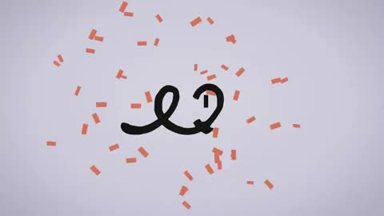</a></td>
<td width="50%" height="225" align="center" valign="middle"></td>
</tr>
<tr>
<td width="50%" valign="top"><strong>Duet 的极简发布片</strong> <a href="https://x.com/AlchainHust">@AlchainHust</a> · 产品宣传 0:29 · 收藏 80 · 资料待完善 <a href="https://guanmo-ai.github.io/awesome-ai-motion/#case-2113061393541050715">▶ 播放</a> · <a href="https://x.com/AlchainHust/status/2113061393541050715">原帖</a></td>
<td width="50%" valign="top"><strong>把创意变成可编辑动效</strong> <a href="https://x.com/ai4everyday">@ai4everyday</a> · 产品宣传 1:39 · 收藏 64 · 资料待完善 <a href="https://guanmo-ai.github.io/awesome-ai-motion/#case-2110245136953139577">▶ 播放</a> · <a href="https://x.com/ai4everyday/status/2110245136953139577">原帖</a></td>
</tr>
</tbody>
<tbody>
<tr>
<td width="50%" height="225" align="center" valign="middle"></td>
<td width="50%" height="225" align="center" valign="middle"></td>
</tr>
<tr>
<td width="50%" valign="top"><strong>泰语 AI 团队介绍片</strong> <a href="https://x.com/vibecodingth">@vibecodingth</a> · 产品宣传 2:21 · 收藏 61 · 资料待完善 <a href="https://guanmo-ai.github.io/awesome-ai-motion/#case-2105279421435572498">▶ 播放</a> · <a href="https://x.com/vibecodingth/status/2105279421435572498">原帖</a></td>
<td width="50%" valign="top"><strong>Roadster 的复古未来试驾短片</strong> <a href="https://x.com/kevin_t_ngo">@kevin_t_ngo</a> · 产品宣传 1:05 · 收藏 58 · 资料待完善 <a href="https://guanmo-ai.github.io/awesome-ai-motion/#case-2111887585639624828">▶ 播放</a> · <a href="https://x.com/kevin_t_ngo/status/2111887585639624828">原帖</a></td>
</tr>
</tbody>
<tbody>
<tr>
<td width="50%" height="225" align="center" valign="middle"></td>
<td width="50%" height="225" align="center" valign="middle"></td>
</tr>
<tr>
<td width="50%" valign="top"><strong>Opus 的卡通介绍短片</strong> <a href="https://x.com/nicekate8888">@nicekate8888</a> · 产品宣传 1:30 · 收藏 55 · 资料待完善 <a href="https://guanmo-ai.github.io/awesome-ai-motion/#case-2102575622912631261">▶ 播放</a> · <a href="https://x.com/nicekate8888/status/2102575622912631261">原帖</a></td>
<td width="50%" valign="top"><strong>Clawd 与额度重置的概念短片</strong> <a href="https://x.com/chetaslua">@chetaslua</a> · 产品宣传 0:12 · 收藏 53 · 资料待完善 <a href="https://guanmo-ai.github.io/awesome-ai-motion/#case-2103599163804098708">▶ 播放</a> · <a href="https://x.com/chetaslua/status/2103599163804098708">原帖</a></td>
</tr>
</tbody>
<tbody>
<tr>
<td width="50%" height="225" align="center" valign="middle"></td>
<td width="50%" height="225" align="center" valign="middle"></td>
</tr>
<tr>
<td width="50%" valign="top"><strong>日语信息卡片的自述短片</strong> <a href="https://x.com/_caty2_">@_caty2_</a> · 产品宣传 1:18 · 收藏 53 · 资料待完善 <a href="https://guanmo-ai.github.io/awesome-ai-motion/#case-2102473582333050959">▶ 播放</a> · <a href="https://x.com/_caty2_/status/2102473582333050959">原帖</a></td>
<td width="50%" valign="top"><strong>润唇膏广告模型对比</strong> <a href="https://x.com/higgsfield_ai">@higgsfield_ai</a> · 产品宣传 0:20 · 收藏 48 · 资料待完善 <a href="https://guanmo-ai.github.io/awesome-ai-motion/#case-2102913101926731879">▶ 播放</a> · <a href="https://x.com/higgsfield_ai/status/2102913101926731879">原帖</a></td>
</tr>
</tbody>
<tbody>
<tr>
<td width="50%" height="225" align="center" valign="middle"></td>
<td width="50%" height="225" align="center" valign="middle"></td>
</tr>
<tr>
<td width="50%" valign="top"><strong>Roadster 穿过霓虹城市</strong> <a href="https://x.com/0xwhrrari">@0xwhrrari</a> · 产品宣传 0:14 · 收藏 46 · 资料待完善 <a href="https://guanmo-ai.github.io/awesome-ai-motion/#case-2111804745853894843">▶ 播放</a> · <a href="https://x.com/0xwhrrari/status/2111804745853894843">原帖</a></td>
<td width="50%" valign="top"><strong>Datafa.st 图表与查询宣传</strong> <a href="https://x.com/Gregoirechp">@Gregoirechp</a> · 产品宣传 0:15 · 收藏 46 · 资料待完善 <a href="https://guanmo-ai.github.io/awesome-ai-motion/#case-2105016259645788381">▶ 播放</a> · <a href="https://x.com/Gregoirechp/status/2105016259645788381">原帖</a></td>
</tr>
</tbody>
<tbody>
<tr>
<td width="50%" height="225" align="center" valign="middle"></td>
<td width="50%" height="225" align="center" valign="middle"></td>
</tr>
<tr>
<td width="50%" valign="top"><strong>微型实验室的概念广告</strong> <a href="https://x.com/kevin_t_ngo">@kevin_t_ngo</a> · 产品宣传 1:04 · 收藏 45 · 资料待完善 <a href="https://guanmo-ai.github.io/awesome-ai-motion/#case-2112877982239096988">▶ 播放</a> · <a href="https://x.com/kevin_t_ngo/status/2112877982239096988">原帖</a></td>
<td width="50%" valign="top"><strong>Yukon Research：开放研究平台故事</strong> <a href="https://x.com/sreeramkannan">@sreeramkannan</a> · 产品宣传 0:53 · 收藏 44 · 资料待完善 <a href="https://guanmo-ai.github.io/awesome-ai-motion/#case-2104027910004949132">▶ 播放</a> · <a href="https://x.com/sreeramkannan/status/2104027910004949132">原帖</a></td>
</tr>
</tbody>
<tbody>
<tr>
<td width="50%" height="225" align="center" valign="middle"></td>
<td width="50%" height="225" align="center" valign="middle"></td>
</tr>
<tr>
<td width="50%" valign="top"><strong>Gemini 灵感与 Remotion 编排的软件广告</strong> <a href="https://x.com/WiFiMoneyGuy">@WiFiMoneyGuy</a> · 产品宣传 0:29 · 收藏 44 · 资料待完善 <a href="https://guanmo-ai.github.io/awesome-ai-motion/#case-2103975338976182477">▶ 播放</a> · <a href="https://x.com/WiFiMoneyGuy/status/2103975338976182477">原帖</a></td>
<td width="50%" valign="top"><strong>DeepSeek：天气应用的短动效试验</strong> <a href="https://x.com/ItsmeAjayKV">@ItsmeAjayKV</a> · 产品宣传 0:25 · 收藏 43 · 资料待完善 <a href="https://guanmo-ai.github.io/awesome-ai-motion/#case-2106323424473907257">▶ 播放</a> · <a href="https://x.com/ItsmeAjayKV/status/2106323424473907257">原帖</a></td>
</tr>
</tbody>
<tbody>
<tr>
<td width="50%" height="225" align="center" valign="middle"></td>
<td width="50%" height="225" align="center" valign="middle"></td>
</tr>
<tr>
<td width="50%" valign="top"><strong>DistilBook：书页与光环的宣传片</strong> <a href="https://x.com/sudo_kiran">@sudo_kiran</a> · 产品宣传 0:30 · 收藏 43 · 资料待完善 <a href="https://guanmo-ai.github.io/awesome-ai-motion/#case-2104846546768670892">▶ 播放</a> · <a href="https://x.com/sudo_kiran/status/2104846546768670892">原帖</a></td>
<td width="50%" valign="top"><strong>USDai 的装配流水线</strong> <a href="https://x.com/0xZergs">@0xZergs</a> · 产品宣传 1:44 · 收藏 42 · 资料待完善 <a href="https://guanmo-ai.github.io/awesome-ai-motion/#case-2109609404450607352">▶ 播放</a> · <a href="https://x.com/0xZergs/status/2109609404450607352">原帖</a></td>
</tr>
</tbody>
<tbody>
<tr>
<td width="50%" height="225" align="center" valign="middle"></td>
<td width="50%" height="225" align="center" valign="middle"></td>
</tr>
<tr>
<td width="50%" valign="top"><strong>QuanCard：卡片堆叠的应用宣传片</strong> <a href="https://x.com/luoleiorg">@luoleiorg</a> · 产品宣传 0:42 · 收藏 39 · 资料待完善 <a href="https://guanmo-ai.github.io/awesome-ai-motion/#case-2107481547242873319">▶ 播放</a> · <a href="https://x.com/luoleiorg/status/2107481547242873319">原帖</a></td>
<td width="50%" valign="top"><strong>Three.js 编码的汽车短片</strong> <a href="https://x.com/higgsfield">@higgsfield</a> · 产品宣传 0:30 · 收藏 37 · 资料待完善 <a href="https://guanmo-ai.github.io/awesome-ai-motion/#case-2108384911245869197">▶ 播放</a> · <a href="https://x.com/higgsfield/status/2108384911245869197">原帖</a></td>
</tr>
</tbody>
<tbody>
<tr>
<td width="50%" height="225" align="center" valign="middle"></td>
<td width="50%" height="225" align="center" valign="middle"></td>
</tr>
<tr>
<td width="50%" valign="top"><strong>AI 工具卡片快节奏宣传</strong> <a href="https://x.com/achxvi">@achxvi</a> · 产品宣传 0:42 · 收藏 36 · 资料待完善 <a href="https://guanmo-ai.github.io/awesome-ai-motion/#case-2110432527332900879">▶ 播放</a> · <a href="https://x.com/achxvi/status/2110432527332900879">原帖</a></td>
<td width="50%" valign="top"><strong>夺幕：商业发布会设计宣传片</strong> <a href="https://x.com/dashiAIxz">@dashiAIxz</a> · 产品宣传 1:48 · 收藏 36 · 资料待完善 <a href="https://guanmo-ai.github.io/awesome-ai-motion/#case-2110654224061366745">▶ 播放</a> · <a href="https://x.com/dashiAIxz/status/2110654224061366745">原帖</a></td>
</tr>
</tbody>
<tbody>
<tr>
<td width="50%" height="225" align="center" valign="middle"></td>
<td width="50%" height="225" align="center" valign="middle"></td>
</tr>
<tr>
<td width="50%" valign="top"><strong>消息在三维工位之间流动</strong> <a href="https://x.com/ai4everyday">@ai4everyday</a> · 产品宣传 1:13 · 收藏 34 · 资料待完善 <a href="https://guanmo-ai.github.io/awesome-ai-motion/#case-2109085665694519714">▶ 播放</a> · <a href="https://x.com/ai4everyday/status/2109085665694519714">原帖</a></td>
<td width="50%" valign="top"><strong>Blender 模型驱动的竖屏产品片</strong> <a href="https://x.com/yoshifujidesign">@yoshifujidesign</a> · 产品宣传 0:30 · 收藏 33 · 资料待完善 <a href="https://guanmo-ai.github.io/awesome-ai-motion/#case-2103987596301119645">▶ 播放</a> · <a href="https://x.com/yoshifujidesign/status/2103987596301119645">原帖</a></td>
</tr>
</tbody>
<tbody>
<tr>
<td width="50%" height="225" align="center" valign="middle"></td>
<td width="50%" height="225" align="center" valign="middle"></td>
</tr>
<tr>
<td width="50%" valign="top"><strong>Grok Bot：X 集成发布动效</strong> <a href="https://x.com/kocer_eth">@kocer_eth</a> · 产品宣传 0:43 · 收藏 29 · 资料待完善 <a href="https://guanmo-ai.github.io/awesome-ai-motion/#case-2108539312556089566">▶ 播放</a> · <a href="https://x.com/kocer_eth/status/2108539312556089566">原帖</a></td>
<td width="50%" valign="top"><strong>Wells Intelligence：地图与数据宣传片</strong> <a href="https://x.com/kyle_e_walker">@kyle_e_walker</a> · 产品宣传 1:14 · 收藏 27 · 资料待完善 <a href="https://guanmo-ai.github.io/awesome-ai-motion/#case-2104734251295863242">▶ 播放</a> · <a href="https://x.com/kyle_e_walker/status/2104734251295863242">原帖</a></td>
</tr>
</tbody>
<tbody>
<tr>
<td width="50%" height="225" align="center" valign="middle"></td>
<td width="50%" height="225" align="center" valign="middle"></td>
</tr>
<tr>
<td width="50%" valign="top"><strong>Haiku 5.5 的自荐宣传片</strong> <a href="https://x.com/LufzzLiz">@LufzzLiz</a> · 产品宣传 0:30 · 收藏 27 · 资料待完善 <a href="https://guanmo-ai.github.io/awesome-ai-motion/#case-2107990570002252237">▶ 播放</a> · <a href="https://x.com/LufzzLiz/status/2107990570002252237">原帖</a></td>
<td width="50%" valign="top"><strong>手机应用录屏的节奏剪辑</strong> <a href="https://x.com/reg_andr">@reg_andr</a> · 产品宣传 0:54 · 收藏 26 · 资料待完善 <a href="https://guanmo-ai.github.io/awesome-ai-motion/#case-2103117698863390805">▶ 播放</a> · <a href="https://x.com/reg_andr/status/2103117698863390805">原帖</a></td>
</tr>
</tbody>
<tbody>
<tr>
<td width="50%" height="225" align="center" valign="middle"></td>
<td width="50%" height="225" align="center" valign="middle"></td>
</tr>
<tr>
<td width="50%" valign="top"><strong>网页卡片变成三维品牌长廊</strong> <a href="https://x.com/kloss_xyz">@kloss_xyz</a> · 产品宣传 0:16 · 收藏 25 · 资料待完善 <a href="https://guanmo-ai.github.io/awesome-ai-motion/#case-2113088964735480263">▶ 播放</a> · <a href="https://x.com/kloss_xyz/status/2113088964735480263">原帖</a></td>
<td width="50%" valign="top"><strong>Mac 发布风格片：代码界面与壁纸</strong> <a href="https://x.com/charliejhills">@charliejhills</a> · 产品宣传 0:20 · 收藏 21 · 资料待完善 <a href="https://guanmo-ai.github.io/awesome-ai-motion/#case-2104225890800705789">▶ 播放</a> · <a href="https://x.com/charliejhills/status/2104225890800705789">原帖</a></td>
</tr>
</tbody>
<tbody>
<tr>
<td width="50%" height="225" align="center" valign="middle"></td>
<td width="50%" height="225" align="center" valign="middle"></td>
</tr>
<tr>
<td width="50%" valign="top"><strong>Vitals：极简字体与多语言发布片</strong> <a href="https://x.com/attacomsian">@attacomsian</a> · 产品宣传 1:00 · 收藏 19 · 资料待完善 <a href="https://guanmo-ai.github.io/awesome-ai-motion/#case-2110720587026846101">▶ 播放</a> · <a href="https://x.com/attacomsian/status/2110720587026846101">原帖</a></td>
<td width="50%" valign="top"><strong>Sonnet 概念车：代码生成的面板与机械</strong> <a href="https://x.com/techartist_">@techartist_</a> · 产品宣传 0:18 · 收藏 18 · 资料待完善 <a href="https://guanmo-ai.github.io/awesome-ai-motion/#case-2104715277120180702">▶ 播放</a> · <a href="https://x.com/techartist_/status/2104715277120180702">原帖</a></td>
</tr>
</tbody>
<tbody>
<tr>
<td width="50%" height="225" align="center" valign="middle"></td>
<td width="50%" height="225" align="center" valign="middle"></td>
</tr>
<tr>
<td width="50%" valign="top"><strong>九场景产品发布短片</strong> <a href="https://x.com/ish_creative">@ish_creative</a> · 产品宣传 0:30 · 收藏 18 · 资料待完善 <a href="https://guanmo-ai.github.io/awesome-ai-motion/#case-2102966807376334856">▶ 播放</a> · <a href="https://x.com/ish_creative/status/2102966807376334856">原帖</a></td>
<td width="50%" valign="top"><strong>Muse 的极简品牌宣传动效</strong> <a href="https://x.com/chetaslua">@chetaslua</a> · 产品宣传 0:35 · 收藏 17 · 资料待完善 <a href="https://guanmo-ai.github.io/awesome-ai-motion/#case-2104221224150897007">▶ 播放</a> · <a href="https://x.com/chetaslua/status/2104221224150897007">原帖</a></td>
</tr>
</tbody>
<tbody>
<tr>
<td width="50%" height="225" align="center" valign="middle"><a href="https://guanmo-ai.github.io/awesome-ai-motion/#case-2102867033100616097">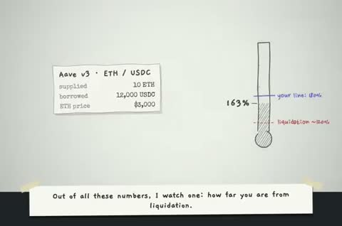</a></td>
<td width="50%" height="225" align="center" valign="middle"></td>
</tr>
<tr>
<td width="50%" valign="top"><strong>DeFi Saver 的手绘流程</strong> <a href="https://x.com/_nikolajankovic">@_nikolajankovic</a> · 产品宣传 0:58 · 收藏 17 · 资料待完善 <a href="https://guanmo-ai.github.io/awesome-ai-motion/#case-2102867033100616097">▶ 播放</a> · <a href="https://x.com/_nikolajankovic/status/2102867033100616097">原帖</a></td>
<td width="50%" valign="top"><strong>SAHI：交易界面到星空的镜头缩放</strong> <a href="https://x.com/dale_vaz">@dale_vaz</a> · 产品宣传 0:47 · 收藏 17 · 资料待完善 <a href="https://guanmo-ai.github.io/awesome-ai-motion/#case-2103290592679879074">▶ 播放</a> · <a href="https://x.com/dale_vaz/status/2103290592679879074">原帖</a></td>
</tr>
</tbody>
<tbody>
<tr>
<td width="50%" height="225" align="center" valign="middle"></td>
<td width="50%" height="225" align="center" valign="middle"></td>
</tr>
<tr>
<td width="50%" valign="top"><strong>开发者履历与开源项目作品集</strong> <a href="https://x.com/iammukeshm">@iammukeshm</a> · 产品宣传 0:35 · 收藏 14 · 资料待完善 <a href="https://guanmo-ai.github.io/awesome-ai-motion/#case-2103511739585421585">▶ 播放</a> · <a href="https://x.com/iammukeshm/status/2103511739585421585">原帖</a></td>
<td width="50%" valign="top"><strong>足球选手推荐动态图文</strong> <a href="https://x.com/Luchigatica">@Luchigatica</a> · 产品宣传 0:39 · 收藏 14 · 资料待完善 <a href="https://guanmo-ai.github.io/awesome-ai-motion/#case-2102853289259729328">▶ 播放</a> · <a href="https://x.com/Luchigatica/status/2102853289259729328">原帖</a></td>
</tr>
</tbody>
<tbody>
<tr>
<td width="50%" height="225" align="center" valign="middle"></td>
<td width="50%" height="225" align="center" valign="middle"></td>
</tr>
<tr>
<td width="50%" valign="top"><strong>HanaAgent 1.0 宣传片试验</strong> <a href="https://x.com/lilililiMozi">@lilililiMozi</a> · 产品宣传 0:58 · 收藏 14 · 资料待完善 <a href="https://guanmo-ai.github.io/awesome-ai-motion/#case-2108115329948037522">▶ 播放</a> · <a href="https://x.com/lilililiMozi/status/2108115329948037522">原帖</a></td>
<td width="50%" valign="top"><strong>日文产品广告的双版本合集</strong> <a href="https://x.com/inoue_aix">@inoue_aix</a> · 产品宣传 1:00 · 收藏 14 · 资料待完善 <a href="https://guanmo-ai.github.io/awesome-ai-motion/#case-2104155161883234322">▶ 播放</a> · <a href="https://x.com/inoue_aix/status/2104155161883234322">原帖</a></td>
</tr>
</tbody>
<tbody>
<tr>
<td width="50%" height="225" align="center" valign="middle"></td>
<td width="50%" height="225" align="center" valign="middle"></td>
</tr>
<tr>
<td width="50%" valign="top"><strong>700+：发布服务的数据动效</strong> <a href="https://x.com/Suryanshti777">@Suryanshti777</a> · 产品宣传 1:05 · 收藏 13 · 资料待完善 <a href="https://guanmo-ai.github.io/awesome-ai-motion/#case-2104617112673427527">▶ 播放</a> · <a href="https://x.com/Suryanshti777/status/2104617112673427527">原帖</a></td>
<td width="50%" valign="top"><strong>东京塔三维模型宣传镜头</strong> <a href="https://x.com/Maruo_0314">@Maruo_0314</a> · 产品宣传 0:15 · 收藏 13 · 资料待完善 <a href="https://guanmo-ai.github.io/awesome-ai-motion/#case-2104159752095998343">▶ 播放</a> · <a href="https://x.com/Maruo_0314/status/2104159752095998343">原帖</a></td>
</tr>
</tbody>
<tbody>
<tr>
<td width="50%" height="225" align="center" valign="middle"></td>
<td width="50%" height="225" align="center" valign="middle"></td>
</tr>
<tr>
<td width="50%" valign="top"><strong>AI 机柜的分层拆解</strong> <a href="https://x.com/w1nklerr">@w1nklerr</a> · 产品宣传 0:12 · 收藏 11 · 资料待完善 <a href="https://guanmo-ai.github.io/awesome-ai-motion/#case-2110786126558486777">▶ 播放</a> · <a href="https://x.com/w1nklerr/status/2110786126558486777">原帖</a></td>
<td width="50%" valign="top"><strong>reFresh 酸奶品牌动效</strong> <a href="https://x.com/exploraX_">@exploraX_</a> · 产品宣传 0:20 · 收藏 11 · 资料待完善 <a href="https://guanmo-ai.github.io/awesome-ai-motion/#case-2108181230692807097">▶ 播放</a> · <a href="https://x.com/exploraX_/status/2108181230692807097">原帖</a></td>
</tr>
</tbody>
<tbody>
<tr>
<td width="50%" height="225" align="center" valign="middle"></td>
<td width="50%" height="225" align="center" valign="middle"></td>
</tr>
<tr>
<td width="50%" valign="top"><strong>用三维方块角色比较模型能力</strong> <a href="https://x.com/kloss_xyz">@kloss_xyz</a> · 产品宣传 0:30 · 收藏 10 · 资料待完善 <a href="https://guanmo-ai.github.io/awesome-ai-motion/#case-2102874918983741664">▶ 播放</a> · <a href="https://x.com/kloss_xyz/status/2102874918983741664">原帖</a></td>
<td width="50%" valign="top"><strong>帮助服务的四十二秒发布片</strong> <a href="https://x.com/azhar_builds">@azhar_builds</a> · 产品宣传 0:42 · 收藏 9 · 资料待完善 <a href="https://guanmo-ai.github.io/awesome-ai-motion/#case-2103075805098070315">▶ 播放</a> · <a href="https://x.com/azhar_builds/status/2103075805098070315">原帖</a></td>
</tr>
</tbody>
<tbody>
<tr>
<td width="50%" height="225" align="center" valign="middle"></td>
<td width="50%" height="225" align="center" valign="middle"></td>
</tr>
<tr>
<td width="50%" valign="top"><strong>开源项目的 Remotion 宣传片</strong> <a href="https://x.com/canghe">@canghe</a> · 产品宣传 0:34 · 收藏 9 · 资料待完善 <a href="https://guanmo-ai.github.io/awesome-ai-motion/#case-2104225521869705468">▶ 播放</a> · <a href="https://x.com/canghe/status/2104225521869705468">原帖</a></td>
<td width="50%" valign="top"><strong>Fumadocs 文档产品动效</strong> <a href="https://x.com/fuma_nama">@fuma_nama</a> · 产品宣传 1:03 · 收藏 8 · 资料待完善 <a href="https://guanmo-ai.github.io/awesome-ai-motion/#case-2109204810818064634">▶ 播放</a> · <a href="https://x.com/fuma_nama/status/2109204810818064634">原帖</a></td>
</tr>
</tbody>
<tbody>
<tr>
<td width="50%" height="225" align="center" valign="middle"></td>
<td width="50%" height="225" align="center" valign="middle"></td>
</tr>
<tr>
<td width="50%" valign="top"><strong>LiteLLM Day 0：弧形地平线发布片</strong> <a href="https://x.com/MisbahSy">@MisbahSy</a> · 产品宣传 0:10 · 收藏 8 · 资料待完善 <a href="https://guanmo-ai.github.io/awesome-ai-motion/#case-2102486455126020521">▶ 播放</a> · <a href="https://x.com/MisbahSy/status/2102486455126020521">原帖</a></td>
<td width="50%" valign="top"><strong>Nafa：单人工作流的产品营销片</strong> <a href="https://x.com/SaadPastaDev">@SaadPastaDev</a> · 产品宣传 0:25 · 收藏 6 · 资料待完善 <a href="https://guanmo-ai.github.io/awesome-ai-motion/#case-2107741413769347341">▶ 播放</a> · <a href="https://x.com/SaadPastaDev/status/2107741413769347341">原帖</a></td>
</tr>
</tbody>
<tbody>
<tr>
<td width="50%" height="225" align="center" valign="middle"></td>
<td width="50%" height="225" align="center" valign="middle"></td>
</tr>
<tr>
<td width="50%" valign="top"><strong>own.page：电影气氛宣传片</strong> <a href="https://x.com/ElitzaVasileva">@ElitzaVasileva</a> · 产品宣传 0:45 · 收藏 6 · 资料待完善 <a href="https://guanmo-ai.github.io/awesome-ai-motion/#case-2107187734414582139">▶ 播放</a> · <a href="https://x.com/ElitzaVasileva/status/2107187734414582139">原帖</a></td>
<td width="50%" valign="top"><strong>Tesla Roadster：几何拆解动画</strong> <a href="https://x.com/ann_nnng">@ann_nnng</a> · 产品宣传 0:15 · 收藏 6 · 资料待完善 <a href="https://guanmo-ai.github.io/awesome-ai-motion/#case-2111017059442397559">▶ 播放</a> · <a href="https://x.com/ann_nnng/status/2111017059442397559">原帖</a></td>
</tr>
</tbody>
<tbody>
<tr>
<td width="50%" height="225" align="center" valign="middle"></td>
<td width="50%" height="225" align="center" valign="middle"></td>
</tr>
<tr>
<td width="50%" valign="top"><strong>Halloween Festival：自动拍摄的世界介绍</strong> <a href="https://x.com/yuripi_2023">@yuripi_2023</a> · 产品宣传 0:59 · 收藏 6 · 资料待完善 <a href="https://guanmo-ai.github.io/awesome-ai-motion/#case-2108379423808635005">▶ 播放</a> · <a href="https://x.com/yuripi_2023/status/2108379423808635005">原帖</a></td>
<td width="50%" valign="top"><strong>BLVCKOUT 非官方宣传片</strong> <a href="https://x.com/ystknsh">@ystknsh</a> · 产品宣传 0:30 · 收藏 6 · 资料待完善 <a href="https://guanmo-ai.github.io/awesome-ai-motion/#case-2102766871007436993">▶ 播放</a> · <a href="https://x.com/ystknsh/status/2102766871007436993">原帖</a></td>
</tr>
</tbody>
<tbody>
<tr>
<td width="50%" height="225" align="center" valign="middle"></td>
<td width="50%" height="225" align="center" valign="middle"></td>
</tr>
<tr>
<td width="50%" valign="top"><strong>PDF 变成会翻页的书</strong> <a href="https://x.com/BuildFastWithAI">@BuildFastWithAI</a> · 产品宣传 0:37 · 收藏 6 · 资料待完善 <a href="https://guanmo-ai.github.io/awesome-ai-motion/#case-2108055549200003356">▶ 播放</a> · <a href="https://x.com/BuildFastWithAI/status/2108055549200003356">原帖</a></td>
<td width="50%" valign="top"><strong>金色帷幕与香水瓶的揭幕</strong> <a href="https://x.com/flxrnc">@flxrnc</a> · 产品宣传 0:12 · 收藏 6 · 资料待完善 <a href="https://guanmo-ai.github.io/awesome-ai-motion/#case-2107882536042926295">▶ 播放</a> · <a href="https://x.com/flxrnc/status/2107882536042926295">原帖</a></td>
</tr>
</tbody>
<tbody>
<tr>
<td width="50%" height="225" align="center" valign="middle"></td>
<td width="50%" height="225" align="center" valign="middle"></td>
</tr>
<tr>
<td width="50%" valign="top"><strong>产品发布影片代码复刻</strong> <a href="https://x.com/vikktorrrre">@vikktorrrre</a> · 产品宣传 0:20 · 收藏 5 · 资料待完善 <a href="https://guanmo-ai.github.io/awesome-ai-motion/#case-2103104303808348305">▶ 播放</a> · <a href="https://x.com/vikktorrrre/status/2103104303808348305">原帖</a></td>
<td width="50%" valign="top"><strong>Sorank 产品发布动效</strong> <a href="https://x.com/thibaultbessonm">@thibaultbessonm</a> · 产品宣传 1:14 · 收藏 5 · 资料待完善 <a href="https://guanmo-ai.github.io/awesome-ai-motion/#case-2105221575117324685">▶ 播放</a> · <a href="https://x.com/thibaultbessonm/status/2105221575117324685">原帖</a></td>
</tr>
</tbody>
<tbody>
<tr>
<td width="50%" height="225" align="center" valign="middle"></td>
<td width="50%" height="225" align="center" valign="middle"></td>
</tr>
<tr>
<td width="50%" valign="top"><strong>Omia：文件窗口与三维长廊宣传片</strong> <a href="https://x.com/xiaoerzhan">@xiaoerzhan</a> · 产品宣传 1:31 · 收藏 5 · 资料待完善 <a href="https://guanmo-ai.github.io/awesome-ai-motion/#case-2104076374281510985">▶ 播放</a> · <a href="https://x.com/xiaoerzhan/status/2104076374281510985">原帖</a></td>
<td width="50%" valign="top"><strong>反 LinkedIn 主题的发布视频</strong> <a href="https://x.com/MaxHirsch13">@MaxHirsch13</a> · 产品宣传 0:20 · 收藏 4 · 资料待完善 <a href="https://guanmo-ai.github.io/awesome-ai-motion/#case-2107985883949600983">▶ 播放</a> · <a href="https://x.com/MaxHirsch13/status/2107985883949600983">原帖</a></td>
</tr>
</tbody>
<tbody>
<tr>
<td width="50%" height="225" align="center" valign="middle"></td>
<td width="50%" height="225" align="center" valign="middle"></td>
</tr>
<tr>
<td width="50%" valign="top"><strong>YouWare 发布片：Opus、Sol 与 Fable 对照</strong> <a href="https://x.com/yrzhe_top">@yrzhe_top</a> · 产品宣传 0:40 · 收藏 4 · 资料待完善 <a href="https://guanmo-ai.github.io/awesome-ai-motion/#case-2102752585371226241">▶ 播放</a> · <a href="https://x.com/yrzhe_top/status/2102752585371226241">原帖</a></td>
<td width="50%" valign="top"><strong>卡通讲述者走进动效舞台</strong> <a href="https://x.com/ai4everyday">@ai4everyday</a> · 产品宣传 0:49 · 收藏 4 · 资料待完善 <a href="https://guanmo-ai.github.io/awesome-ai-motion/#case-2112123340089393359">▶ 播放</a> · <a href="https://x.com/ai4everyday/status/2112123340089393359">原帖</a></td>
</tr>
</tbody>
<tbody>
<tr>
<td width="50%" height="225" align="center" valign="middle"></td>
<td width="50%" height="225" align="center" valign="middle"></td>
</tr>
<tr>
<td width="50%" valign="top"><strong>潮汕英歌舞游戏的手机宣传片</strong> <a href="https://x.com/Gimi_min">@Gimi_min</a> · 产品宣传 1:01 · 收藏 4 · 资料待完善 <a href="https://guanmo-ai.github.io/awesome-ai-motion/#case-2108477835463766340">▶ 播放</a> · <a href="https://x.com/Gimi_min/status/2108477835463766340">原帖</a></td>
<td width="50%" valign="top"><strong>SPECTRA+：DeepSeek 动效试验</strong> <a href="https://x.com/ItsmeAjayKV">@ItsmeAjayKV</a> · 产品宣传 0:40 · 收藏 3 · 资料待完善 <a href="https://guanmo-ai.github.io/awesome-ai-motion/#case-2106414547569676331">▶ 播放</a> · <a href="https://x.com/ItsmeAjayKV/status/2106414547569676331">原帖</a></td>
</tr>
</tbody>
<tbody>
<tr>
<td width="50%" height="225" align="center" valign="middle"></td>
<td width="50%" height="225" align="center" valign="middle"></td>
</tr>
<tr>
<td width="50%" valign="top"><strong>Minicut：蜘蛛穿梭脚本节点</strong> <a href="https://x.com/minicut_ai">@minicut_ai</a> · 产品宣传 0:20 · 收藏 3 · 资料待完善 <a href="https://guanmo-ai.github.io/awesome-ai-motion/#case-2106228800606573028">▶ 播放</a> · <a href="https://x.com/minicut_ai/status/2106228800606573028">原帖</a></td>
<td width="50%" valign="top"><strong>生产力网站的动态图形广告</strong> <a href="https://x.com/shushant_l">@shushant_l</a> · 产品宣传 0:15 · 收藏 3 · 资料待完善 <a href="https://guanmo-ai.github.io/awesome-ai-motion/#case-2103829449359966629">▶ 播放</a> · <a href="https://x.com/shushant_l/status/2103829449359966629">原帖</a></td>
</tr>
</tbody>
<tbody>
<tr>
<td width="50%" height="225" align="center" valign="middle"></td>
<td width="50%" height="225" align="center" valign="middle"></td>
</tr>
<tr>
<td width="50%" valign="top"><strong>Roadster 推进系统的透明剖面</strong> <a href="https://x.com/cherry_mx_reds">@cherry_mx_reds</a> · 产品宣传 0:22 · 收藏 2 · 资料待完善 <a href="https://guanmo-ai.github.io/awesome-ai-motion/#case-2111179478638739856">▶ 播放</a> · <a href="https://x.com/cherry_mx_reds/status/2111179478638739856">原帖</a></td>
<td width="50%" valign="top"><strong>Inkwell：DeepSeek 品牌片头试验</strong> <a href="https://x.com/ItsmeAjayKV">@ItsmeAjayKV</a> · 产品宣传 0:38 · 收藏 2 · 资料待完善 <a href="https://guanmo-ai.github.io/awesome-ai-motion/#case-2106616126776230055">▶ 播放</a> · <a href="https://x.com/ItsmeAjayKV/status/2106616126776230055">原帖</a></td>
</tr>
</tbody>
<tbody>
<tr>
<td width="50%" height="225" align="center" valign="middle"></td>
<td width="50%" height="225" align="center" valign="middle"></td>
</tr>
<tr>
<td width="50%" valign="top"><strong>代码制作的品牌视觉短片</strong> <a href="https://x.com/Govindaiii">@Govindaiii</a> · 产品宣传 0:52 · 收藏 2 · 资料待完善 <a href="https://guanmo-ai.github.io/awesome-ai-motion/#case-2102815918049132792">▶ 播放</a> · <a href="https://x.com/Govindaiii/status/2102815918049132792">原帖</a></td>
<td width="50%" valign="top"><strong>Real Halloween Night：VRChat 世界介绍</strong> <a href="https://x.com/yuripi_2023">@yuripi_2023</a> · 产品宣传 1:00 · 收藏 2 · 资料待完善 <a href="https://guanmo-ai.github.io/awesome-ai-motion/#case-2108394968389951585">▶ 播放</a> · <a href="https://x.com/yuripi_2023/status/2108394968389951585">原帖</a></td>
</tr>
</tbody>
<tbody>
<tr>
<td width="50%" height="225" align="center" valign="middle"></td>
<td width="50%" height="225" align="center" valign="middle"></td>
</tr>
<tr>
<td width="50%" valign="top"><strong>Sotto 的语言学习介绍</strong> <a href="https://x.com/1stnoel_">@1stnoel_</a> · 产品宣传 1:00 · 收藏 2 · 资料待完善 <a href="https://guanmo-ai.github.io/awesome-ai-motion/#case-2103247530259603851">▶ 播放</a> · <a href="https://x.com/1stnoel_/status/2103247530259603851">原帖</a></td>
<td width="50%" valign="top"><strong>Atlasnote-pro：Git 历史动画</strong> <a href="https://x.com/Tao100086">@Tao100086</a> · 产品宣传 2:06 · 收藏 2 · 资料待完善 <a href="https://guanmo-ai.github.io/awesome-ai-motion/#case-2106941357915058661">▶ 播放</a> · <a href="https://x.com/Tao100086/status/2106941357915058661">原帖</a></td>
</tr>
</tbody>
<tbody>
<tr>
<td width="50%" height="225" align="center" valign="middle"></td>
<td width="50%" height="225" align="center" valign="middle"></td>
</tr>
<tr>
<td width="50%" valign="top"><strong>深夜创作者的卡通与界面动效</strong> <a href="https://x.com/yulikay">@yulikay</a> · 产品宣传 0:15 · 收藏 1 · 资料待完善 <a href="https://guanmo-ai.github.io/awesome-ai-motion/#case-2103973764845461768">▶ 播放</a> · <a href="https://x.com/yulikay/status/2103973764845461768">原帖</a></td>
<td width="50%" valign="top"><strong>Vano：市场图形发布片</strong> <a href="https://x.com/_MasterMal">@_MasterMal</a> · 产品宣传 1:08 · 收藏 1 · 资料待完善 <a href="https://guanmo-ai.github.io/awesome-ai-motion/#case-2108471807372325100">▶ 播放</a> · <a href="https://x.com/_MasterMal/status/2108471807372325100">原帖</a></td>
</tr>
</tbody>
<tbody>
<tr>
<td width="50%" height="225" align="center" valign="middle"></td>
<td width="50%" height="225" align="center" valign="middle"></td>
</tr>
<tr>
<td width="50%" valign="top"><strong>从闹钟到楼层图的竖版界面动效</strong> <a href="https://x.com/Soumymaheshwri">@Soumymaheshwri</a> · 产品宣传 0:39 · 收藏 1 · 资料待完善 <a href="https://guanmo-ai.github.io/awesome-ai-motion/#case-2107520392302825921">▶ 播放</a> · <a href="https://x.com/Soumymaheshwri/status/2107520392302825921">原帖</a></td>
<td width="50%" valign="top"><strong>广告素材库动效实验</strong> <a href="https://x.com/uglyrobot">@uglyrobot</a> · 产品宣传 0:20 · 收藏 1 · 资料待完善 <a href="https://guanmo-ai.github.io/awesome-ai-motion/#case-2104360004715446416">▶ 播放</a> · <a href="https://x.com/uglyrobot/status/2104360004715446416">原帖</a></td>
</tr>
</tbody>
<tbody>
<tr>
<td width="50%" height="225" align="center" valign="middle"></td>
<td width="50%" height="225" align="center" valign="middle"></td>
</tr>
<tr>
<td width="50%" valign="top"><strong>RedShip 扩展功能更新短片</strong> <a href="https://x.com/aschapmann">@aschapmann</a> · 产品宣传 0:14 · 收藏 1 · 资料待完善 <a href="https://guanmo-ai.github.io/awesome-ai-motion/#case-2104590898491228507">▶ 播放</a> · <a href="https://x.com/aschapmann/status/2104590898491228507">原帖</a></td>
<td width="50%" valign="top"><strong>Recall：知识应用宣传片</strong> <a href="https://x.com/shivamdesignin">@shivamdesignin</a> · 产品宣传 0:48 · 收藏 1 · 资料待完善 <a href="https://guanmo-ai.github.io/awesome-ai-motion/#case-2106706231029314030">▶ 播放</a> · <a href="https://x.com/shivamdesignin/status/2106706231029314030">原帖</a></td>
</tr>
</tbody>
<tbody>
<tr>
<td width="50%" height="225" align="center" valign="middle"></td>
<td width="50%" height="225" align="center" valign="middle"></td>
</tr>
<tr>
<td width="50%" valign="top"><strong>十款独立应用的产品宣传片</strong> <a href="https://x.com/chapi13">@chapi13</a> · 产品宣传 0:27 · 收藏 1 · 资料待完善 <a href="https://guanmo-ai.github.io/awesome-ai-motion/#case-2104206465863131449">▶ 播放</a> · <a href="https://x.com/chapi13/status/2104206465863131449">原帖</a></td>
<td width="50%" valign="top"><strong>Ply：随工作保留想法的 Mac 应用发布片</strong> <a href="https://x.com/Khazs0">@Khazs0</a> · 产品宣传 0:38 · 收藏 1 · 资料待完善 <a href="https://guanmo-ai.github.io/awesome-ai-motion/#case-2104753708584095936">▶ 播放</a> · <a href="https://x.com/Khazs0/status/2104753708584095936">原帖</a></td>
</tr>
</tbody>
<tbody>
<tr>
<td width="50%" height="225" align="center" valign="middle"></td>
<td width="50%" height="225" align="center" valign="middle"></td>
</tr>
<tr>
<td width="50%" valign="top"><strong>motion-use：三维时间线宣传片</strong> <a href="https://x.com/leeguooooo">@leeguooooo</a> · 产品宣传 1:42 · 收藏 1 · 资料待完善 <a href="https://guanmo-ai.github.io/awesome-ai-motion/#case-2108783389704929381">▶ 播放</a> · <a href="https://x.com/leeguooooo/status/2108783389704929381">原帖</a></td>
<td width="50%" valign="top"><strong>Thinkr：产品文档的卡片动效</strong> <a href="https://x.com/galangaulia_">@galangaulia_</a> · 产品宣传 0:20 · 收藏 1 · 资料待完善 <a href="https://guanmo-ai.github.io/awesome-ai-motion/#case-2106223957506658698">▶ 播放</a> · <a href="https://x.com/galangaulia_/status/2106223957506658698">原帖</a></td>
</tr>
</tbody>
<tbody>
<tr>
<td width="50%" height="225" align="center" valign="middle"></td>
<td width="50%" height="225" align="center" valign="middle"></td>
</tr>
<tr>
<td width="50%" valign="top"><strong>独立游戏的竖屏推广试片</strong> <a href="https://x.com/buluntus_dev">@buluntus_dev</a> · 产品宣传 0:20 · 收藏 1 · 资料待完善 <a href="https://guanmo-ai.github.io/awesome-ai-motion/#case-2107915831900512276">▶ 播放</a> · <a href="https://x.com/buluntus_dev/status/2107915831900512276">原帖</a></td>
<td width="50%" valign="top"><strong>Namashkar Bharat 网站宣传片</strong> <a href="https://x.com/ajinkya_shejul">@ajinkya_shejul</a> · 产品宣传 0:32 · 收藏 0 · 资料待完善 <a href="https://guanmo-ai.github.io/awesome-ai-motion/#case-2105221279100141928">▶ 播放</a> · <a href="https://x.com/ajinkya_shejul/status/2105221279100141928">原帖</a></td>
</tr>
</tbody>
<tbody>
<tr>
<td width="50%" height="225" align="center" valign="middle"></td>
<td width="50%" height="225" align="center" valign="middle"></td>
</tr>
<tr>
<td width="50%" valign="top"><strong>沿用产品界面的品牌讲解片</strong> <a href="https://x.com/imthatcarlos">@imthatcarlos</a> · 产品宣传 0:59 · 收藏 0 · 资料待完善 <a href="https://guanmo-ai.github.io/awesome-ai-motion/#case-2102849219388133592">▶ 播放</a> · <a href="https://x.com/imthatcarlos/status/2102849219388133592">原帖</a></td>
<td width="50%" valign="top"><strong>消息气泡与键帽的产品动效</strong> <a href="https://x.com/thomasaas">@thomasaas</a> · 产品宣传 0:20 · 收藏 0 · 资料待完善 <a href="https://guanmo-ai.github.io/awesome-ai-motion/#case-2105023469918560464">▶ 播放</a> · <a href="https://x.com/thomasaas/status/2105023469918560464">原帖</a></td>
</tr>
</tbody>
<tbody>
<tr>
<td width="50%" height="225" align="center" valign="middle"></td>
<td width="50%" height="225" align="center" valign="middle"></td>
</tr>
<tr>
<td width="50%" valign="top"><strong>TradingHouse 的交易图形</strong> <a href="https://x.com/_Tony_TT_">@_Tony_TT_</a> · 产品宣传 0:56 · 收藏 0 · 资料待完善 <a href="https://guanmo-ai.github.io/awesome-ai-motion/#case-2103227891009872147">▶ 播放</a> · <a href="https://x.com/_Tony_TT_/status/2103227891009872147">原帖</a></td>
<td width="50%" valign="top"><strong>Imagine MCP 发布动效</strong> <a href="https://x.com/ImagineArt_X">@ImagineArt_X</a> · 产品宣传 0:49 · 收藏 0 · 资料待完善 <a href="https://guanmo-ai.github.io/awesome-ai-motion/#case-2104771867781574928">▶ 播放</a> · <a href="https://x.com/ImagineArt_X/status/2104771867781574928">原帖</a></td>
</tr>
</tbody>
<tbody>
<tr>
<td width="50%" height="225" align="center" valign="middle"></td>
<td width="50%" height="225" align="center" valign="middle"></td>
</tr>
<tr>
<td width="50%" valign="top"><strong>只给网站链接的 Playbook 产品片</strong> <a href="https://x.com/chuhaiqu">@chuhaiqu</a> · 产品宣传 0:25 · 收藏 0 · 资料待完善 <a href="https://guanmo-ai.github.io/awesome-ai-motion/#case-2104359673382175100">▶ 播放</a> · <a href="https://x.com/chuhaiqu/status/2104359673382175100">原帖</a></td>
<td width="50%" valign="top"><strong>HTML 与 GSAP 的60秒产品发布片</strong> <a href="https://x.com/maheshdhiman">@maheshdhiman</a> · 产品宣传 1:00 · 收藏 0 · 资料待完善 <a href="https://guanmo-ai.github.io/awesome-ai-motion/#case-2104607774793679182">▶ 播放</a> · <a href="https://x.com/maheshdhiman/status/2104607774793679182">原帖</a></td>
</tr>
</tbody>
<tbody>
<tr>
<td width="50%" height="225" align="center" valign="middle"></td>
<td width="50%" height="225" align="center" valign="middle"></td>
</tr>
<tr>
<td width="50%" valign="top"><strong>grouped.news：共用网站设计的发布广告</strong> <a href="https://x.com/l3d1c">@l3d1c</a> · 产品宣传 0:34 · 收藏 0 · 资料待完善 <a href="https://guanmo-ai.github.io/awesome-ai-motion/#case-2104649028193632524">▶ 播放</a> · <a href="https://x.com/l3d1c/status/2104649028193632524">原帖</a></td>
<td width="50%" valign="top"><strong>个人简历的 HTML 动态作品集</strong> <a href="https://x.com/offcod8">@offcod8</a> · 产品宣传 0:41 · 收藏 0 · 资料待完善 <a href="https://guanmo-ai.github.io/awesome-ai-motion/#case-2107367341973717334">▶ 播放</a> · <a href="https://x.com/offcod8/status/2107367341973717334">原帖</a></td>
</tr>
</tbody>
<tbody>
<tr>
<td width="50%" height="225" align="center" valign="middle"></td>
<td width="50%" height="225" align="center" valign="middle"></td>
</tr>
<tr>
<td width="50%" valign="top"><strong>Dexter：Framer 插件讲解片</strong> <a href="https://x.com/Gacheruthegreat">@Gacheruthegreat</a> · 产品宣传 0:58 · 收藏 0 · 资料待完善 <a href="https://guanmo-ai.github.io/awesome-ai-motion/#case-2108097480437219614">▶ 播放</a> · <a href="https://x.com/Gacheruthegreat/status/2108097480437219614">原帖</a></td>
<td width="50%" valign="top"><strong>Eternal Return：字标碎裂动效</strong> <a href="https://x.com/Sindas_9">@Sindas_9</a> · 产品宣传 0:03 · 收藏 0 · 资料待完善 <a href="https://guanmo-ai.github.io/awesome-ai-motion/#case-2110152535613034843">▶ 播放</a> · <a href="https://x.com/Sindas_9/status/2110152535613034843">原帖</a></td>
</tr>
</tbody>
<tbody>
<tr>
<td width="50%" height="225" align="center" valign="middle"></td>
<td width="50%" height="225" align="center" valign="middle"></td>
</tr>
<tr>
<td width="50%" valign="top"><strong>ZenRows 页面抓取的 Remotion 讲解</strong> <a href="https://x.com/xamfonos_">@xamfonos_</a> · 产品宣传 0:45 · 收藏 0 · 资料待完善 <a href="https://guanmo-ai.github.io/awesome-ai-motion/#case-2107809209593004331">▶ 播放</a> · <a href="https://x.com/xamfonos_/status/2107809209593004331">原帖</a></td>
<td width="50%" valign="top"><strong>粒子宇宙中的模型自我介绍</strong> <a href="https://x.com/olezhavich">@olezhavich</a> · 产品宣传 0:12 · 收藏 0 · 资料待完善 <a href="https://guanmo-ai.github.io/awesome-ai-motion/#case-2108802612669891048">▶ 播放</a> · <a href="https://x.com/olezhavich/status/2108802612669891048">原帖</a></td>
</tr>
</tbody>
<tbody>
<tr>
<td width="50%" height="225" align="center" valign="middle"></td>
<td width="50%" height="225" align="center" valign="middle"></td>
</tr>
<tr>
<td width="50%" valign="top"><strong>PaymentForm 的线条标志</strong> <a href="https://x.com/Mounnna">@Mounnna</a> · 产品宣传 0:16 · 收藏 0 · 资料待完善 <a href="https://guanmo-ai.github.io/awesome-ai-motion/#case-2103802871934497266">▶ 播放</a> · <a href="https://x.com/Mounnna/status/2103802871934497266">原帖</a></td>
<td width="50%" valign="top"><strong>HyperFrames 风格化广告实验</strong> <a href="https://x.com/washow_cfo">@washow_cfo</a> · 产品宣传 0:37 · 收藏 0 · 资料待完善 <a href="https://guanmo-ai.github.io/awesome-ai-motion/#case-2104595346882175311">▶ 播放</a> · <a href="https://x.com/washow_cfo/status/2104595346882175311">原帖</a></td>
</tr>
</tbody>
<tbody>
<tr>
<td width="50%" height="225" align="center" valign="middle"></td>
<td width="50%" height="225" align="center" valign="middle"></td>
</tr>
<tr>
<td width="50%" valign="top"><strong>汽车展示与编辑式排版</strong> <a href="https://x.com/msbr_dev">@msbr_dev</a> · 产品宣传 0:28 · 收藏 0 · 资料待完善 <a href="https://guanmo-ai.github.io/awesome-ai-motion/#case-2105666912097358187">▶ 播放</a> · <a href="https://x.com/msbr_dev/status/2105666912097358187">原帖</a></td>
<td width="50%" valign="top"><strong>dplanner 项目说明视频</strong> <a href="https://x.com/knutsi">@knutsi</a> · 产品宣传 1:40 · 收藏 0 · 资料待完善 <a href="https://guanmo-ai.github.io/awesome-ai-motion/#case-2106067189300113572">▶ 播放</a> · <a href="https://x.com/knutsi/status/2106067189300113572">原帖</a></td>
</tr>
</tbody>
<tbody>
<tr>
<td width="50%" height="225" align="center" valign="middle"></td>
<td width="50%" height="225" align="center" valign="middle"></td>
</tr>
<tr>
<td width="50%" valign="top"><strong>Agent HUD：iPhone Duo 界面宣传动效</strong> <a href="https://x.com/Jazzen_Chen">@Jazzen_Chen</a> · 产品宣传 0:30 · 收藏 0 · 资料待完善 <a href="https://guanmo-ai.github.io/awesome-ai-motion/#case-2106442652522885551">▶ 播放</a> · <a href="https://x.com/Jazzen_Chen/status/2106442652522885551">原帖</a></td>
<td width="50%" valign="top"><strong>自由职业网页设计作品集</strong> <a href="https://x.com/ashh_codes">@ashh_codes</a> · 产品宣传 0:21 · 收藏 0 · 资料待完善 <a href="https://guanmo-ai.github.io/awesome-ai-motion/#case-2106755940326523082">▶ 播放</a> · <a href="https://x.com/ashh_codes/status/2106755940326523082">原帖</a></td>
</tr>
</tbody>
<tbody>
<tr>
<td width="50%" height="225" align="center" valign="middle"></td>
<td width="50%" height="225" align="center" valign="middle"></td>
</tr>
<tr>
<td width="50%" valign="top"><strong>晨昏线：日报产品的代码动画</strong> <a href="https://x.com/finderlzy">@finderlzy</a> · 产品宣传 0:30 · 收藏 0 · 资料待完善 <a href="https://guanmo-ai.github.io/awesome-ai-motion/#case-2107794301891842359">▶ 播放</a> · <a href="https://x.com/finderlzy/status/2107794301891842359">原帖</a></td>
<td width="50%" valign="top"><strong>多摩.dev 第五期活动推广短片</strong> <a href="https://x.com/asagayanaoki">@asagayanaoki</a> · 产品宣传 0:15 · 收藏 0 · 资料待完善 <a href="https://guanmo-ai.github.io/awesome-ai-motion/#case-2108333603377877195">▶ 播放</a> · <a href="https://x.com/asagayanaoki/status/2108333603377877195">原帖</a></td>
</tr>
</tbody>
<tbody>
<tr>
<td width="50%" height="225" align="center" valign="middle"></td>
<td width="50%" height="225" align="center" valign="middle"></td>
</tr>
<tr>
<td width="50%" valign="top"><strong>Party Monster：派对小游戏APP</strong> <a href="https://x.com/feeyarcat">@feeyarcat</a> · 产品宣传 1:46 · 收藏 0 · 资料待完善 <a href="https://guanmo-ai.github.io/awesome-ai-motion/#case-2108414058718547983">▶ 播放</a> · <a href="https://x.com/feeyarcat/status/2108414058718547983">原帖</a></td>
<td width="50%" valign="top"><strong>Taxtello：收据与德语大字广告</strong> <a href="https://x.com/daniel_haida">@daniel_haida</a> · 产品宣传 0:31 · 收藏 0 · 资料待完善 <a href="https://guanmo-ai.github.io/awesome-ai-motion/#case-2108595684236755242">▶ 播放</a> · <a href="https://x.com/daniel_haida/status/2108595684236755242">原帖</a></td>
</tr>
</tbody>
<tbody>
<tr>
<td width="50%" height="225" align="center" valign="middle"><a href="https://guanmo-ai.github.io/awesome-ai-motion/#case-2103411144899875264">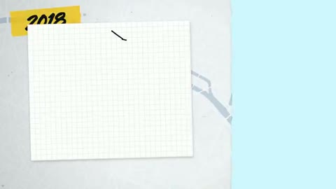</a></td>
<td width="50%" height="225" align="center" valign="middle"></td>
</tr>
<tr>
<td width="50%" valign="top"><strong>用手绘地球讲述品牌时间线</strong> <a href="https://x.com/TomAndrieu96707">@TomAndrieu96707</a> · 产品宣传 0:52 · 收藏 0 · 资料待完善 <a href="https://guanmo-ai.github.io/awesome-ai-motion/#case-2103411144899875264">▶ 播放</a> · <a href="https://x.com/TomAndrieu96707/status/2103411144899875264">原帖</a></td>
<td width="50%" valign="top"><strong>卡通讲解员介绍八项 AI 技能</strong> <a href="https://x.com/QinElke">@QinElke</a> · 产品宣传 0:30 · 收藏 0 · 资料待完善 <a href="https://guanmo-ai.github.io/awesome-ai-motion/#case-2104176976261271655">▶ 播放</a> · <a href="https://x.com/QinElke/status/2104176976261271655">原帖</a></td>
</tr>
</tbody>
<tbody>
<tr>
<td width="50%" height="225" align="center" valign="middle"></td>
<td width="50%" height="225" align="center" valign="middle"></td>
</tr>
<tr>
<td width="50%" valign="top"><strong>Moveno 网站素材宣传片</strong> <a href="https://x.com/DannyVerkissen">@DannyVerkissen</a> · 产品宣传 0:46 · 收藏 0 · 资料待完善 <a href="https://guanmo-ai.github.io/awesome-ai-motion/#case-2104212402875101463">▶ 播放</a> · <a href="https://x.com/DannyVerkissen/status/2104212402875101463">原帖</a></td>
<td width="50%" valign="top"><strong>参考截图制作的社媒短片</strong> <a href="https://x.com/itsyashf">@itsyashf</a> · 产品宣传 0:15 · 收藏 0 · 资料待完善 <a href="https://guanmo-ai.github.io/awesome-ai-motion/#case-2104227261142692347">▶ 播放</a> · <a href="https://x.com/itsyashf/status/2104227261142692347">原帖</a></td>
</tr>
</tbody>
<tbody>
<tr>
<td width="50%" height="225" align="center" valign="middle"></td>
<td width="50%" height="225" align="center" valign="middle"></td>
</tr>
<tr>
<td width="50%" valign="top"><strong>Kan Bağı：开源献血应用宣传片</strong> <a href="https://x.com/bedirhantongdev">@bedirhantongdev</a> · 产品宣传 0:32 · 收藏 0 · 资料待完善 <a href="https://guanmo-ai.github.io/awesome-ai-motion/#case-2104628062771888552">▶ 播放</a> · <a href="https://x.com/bedirhantongdev/status/2104628062771888552">原帖</a></td>
<td width="50%" valign="top"><strong>Onlya：Claude 与 HyperFrames 宣传片</strong> <a href="https://x.com/polovlad1">@polovlad1</a> · 产品宣传 0:37 · 收藏 0 · 资料待完善 <a href="https://guanmo-ai.github.io/awesome-ai-motion/#case-2104678989616795662">▶ 播放</a> · <a href="https://x.com/polovlad1/status/2104678989616795662">原帖</a></td>
</tr>
</tbody>
<tbody>
<tr>
<td width="50%" height="225" align="center" valign="middle"></td>
<td width="50%" height="225" align="center" valign="middle"></td>
</tr>
<tr>
<td width="50%" valign="top"><strong>HTML、CSS 与 JavaScript 产品宣传片</strong> <a href="https://x.com/FranzmeierRandy">@FranzmeierRandy</a> · 产品宣传 0:30 · 收藏 0 · 资料待完善 <a href="https://guanmo-ai.github.io/awesome-ai-motion/#case-2104736355905360348">▶ 播放</a> · <a href="https://x.com/FranzmeierRandy/status/2104736355905360348">原帖</a></td>
<td width="50%" valign="top"><strong>ZEXET：银色几何品牌动画</strong> <a href="https://x.com/RibiryS">@RibiryS</a> · 产品宣传 0:48 · 收藏 0 · 资料待完善 <a href="https://guanmo-ai.github.io/awesome-ai-motion/#case-2105170934394921463">▶ 播放</a> · <a href="https://x.com/RibiryS/status/2105170934394921463">原帖</a></td>
</tr>
</tbody>
<tbody>
<tr>
<td width="50%" height="225" align="center" valign="middle"></td>
<td width="50%" height="225" align="center" valign="middle"></td>
</tr>
<tr>
<td width="50%" valign="top"><strong>OpenSend 产品宣传动效</strong> <a href="https://x.com/codewithkamal">@codewithkamal</a> · 产品宣传 0:46 · 收藏 0 · 资料待完善 <a href="https://guanmo-ai.github.io/awesome-ai-motion/#case-2105346293724045443">▶ 播放</a> · <a href="https://x.com/codewithkamal/status/2105346293724045443">原帖</a></td>
<td width="50%" valign="top"><strong>Project256 网站转项目介绍片</strong> <a href="https://x.com/0xzxch">@0xzxch</a> · 产品宣传 2:19 · 收藏 0 · 资料待完善 <a href="https://guanmo-ai.github.io/awesome-ai-motion/#case-2106066675166531796">▶ 播放</a> · <a href="https://x.com/0xzxch/status/2106066675166531796">原帖</a></td>
</tr>
</tbody>
<tbody>
<tr>
<td width="50%" height="225" align="center" valign="middle"></td>
<td width="50%" height="225" align="center" valign="middle"></td>
</tr>
<tr>
<td width="50%" valign="top"><strong>早茶店的 HyperFrames 宣传片</strong> <a href="https://x.com/realunclena">@realunclena</a> · 产品宣传 0:22 · 收藏 0 · 资料待完善 <a href="https://guanmo-ai.github.io/awesome-ai-motion/#case-2107352553382195584">▶ 播放</a> · <a href="https://x.com/realunclena/status/2107352553382195584">原帖</a></td>
<td width="50%" valign="top"><strong>Lives Mobile：胶卷与放大镜宣传片</strong> <a href="https://x.com/ohmyangboy">@ohmyangboy</a> · 产品宣传 0:57 · 收藏 0 · 资料待完善 <a href="https://guanmo-ai.github.io/awesome-ai-motion/#case-2107369442602876972">▶ 播放</a> · <a href="https://x.com/ohmyangboy/status/2107369442602876972">原帖</a></td>
</tr>
</tbody>
<tbody>
<tr>
<td width="50%" height="225" align="center" valign="middle"></td>
<td width="50%" height="225" align="center" valign="middle"></td>
</tr>
<tr>
<td width="50%" valign="top"><strong>Ajoflow 概念品牌的发布动效</strong> <a href="https://x.com/Thegawdstiles">@Thegawdstiles</a> · 产品宣传 0:37 · 收藏 0 · 资料待完善 <a href="https://guanmo-ai.github.io/awesome-ai-motion/#case-2107481252785738178">▶ 播放</a> · <a href="https://x.com/Thegawdstiles/status/2107481252785738178">原帖</a></td>
<td width="50%" valign="top"><strong>Old Fashioned：鸡尾酒系列短片</strong> <a href="https://x.com/onmanjrekar">@onmanjrekar</a> · 产品宣传 0:42 · 收藏 0 · 资料待完善 <a href="https://guanmo-ai.github.io/awesome-ai-motion/#case-2107499626265784473">▶ 播放</a> · <a href="https://x.com/onmanjrekar/status/2107499626265784473">原帖</a></td>
</tr>
</tbody>
<tbody>
<tr>
<td width="50%" height="225" align="center" valign="middle"></td>
<td width="50%" height="225" align="center" valign="middle"></td>
</tr>
<tr>
<td width="50%" valign="top"><strong>Claude 思考强度的非官方广告</strong> <a href="https://x.com/Phavorism">@Phavorism</a> · 产品宣传 0:33 · 收藏 0 · 资料待完善 <a href="https://guanmo-ai.github.io/awesome-ai-motion/#case-2107828023076811083">▶ 播放</a> · <a href="https://x.com/Phavorism/status/2107828023076811083">原帖</a></td>
<td width="50%" valign="top"><strong>紫橙配色 Logo 动画</strong> <a href="https://x.com/ArtBSol">@ArtBSol</a> · 产品宣传 0:08 · 收藏 0 · 资料待完善 <a href="https://guanmo-ai.github.io/awesome-ai-motion/#case-2108206233362567596">▶ 播放</a> · <a href="https://x.com/ArtBSol/status/2108206233362567596">原帖</a></td>
</tr>
</tbody>
<tbody>
<tr>
<td width="50%" height="225" align="center" valign="middle"></td>
<td width="50%" height="225" align="center" valign="middle"></td>
</tr>
<tr>
<td width="50%" valign="top"><strong>游戏数据 App：手机界面宣传片</strong> <a href="https://x.com/shreyamin_">@shreyamin_</a> · 产品宣传 1:19 · 收藏 0 · 资料待完善 <a href="https://guanmo-ai.github.io/awesome-ai-motion/#case-2108494133262532882">▶ 播放</a> · <a href="https://x.com/shreyamin_/status/2108494133262532882">原帖</a></td>
<td width="50%" valign="top"><strong>DataGran 的深色发布片</strong> <a href="https://x.com/charlesmendez">@charlesmendez</a> · 产品宣传 0:57 · 收藏 0 · 资料待完善 <a href="https://guanmo-ai.github.io/awesome-ai-motion/#case-2102847039415476517">▶ 播放</a> · <a href="https://x.com/charlesmendez/status/2102847039415476517">原帖</a></td>
</tr>
</tbody>
<tbody>
<tr>
<td width="50%" height="225" align="center" valign="middle"></td>
<td width="50%" height="225" align="center" valign="middle"></td>
</tr>
<tr>
<td width="50%" valign="top"><strong>新项目介绍短视频</strong> <a href="https://x.com/haidaulau">@haidaulau</a> · 产品宣传 2:29 · 收藏 0 · 资料待完善 <a href="https://guanmo-ai.github.io/awesome-ai-motion/#case-2103015561076564319">▶ 播放</a> · <a href="https://x.com/haidaulau/status/2103015561076564319">原帖</a></td>
<td width="50%" valign="top"><strong>阅读应用的双语宣传片</strong> <a href="https://x.com/WangYeruo">@WangYeruo</a> · 产品宣传 0:44 · 收藏 0 · 资料待完善 <a href="https://guanmo-ai.github.io/awesome-ai-motion/#case-2103108551799632050">▶ 播放</a> · <a href="https://x.com/WangYeruo/status/2103108551799632050">原帖</a></td>
</tr>
</tbody>
<tbody>
<tr>
<td width="50%" height="225" align="center" valign="middle"></td>
<td width="50%" height="225" align="center" valign="middle"></td>
</tr>
<tr>
<td width="50%" valign="top"><strong>韩文 App 介绍：手机与学习统计</strong> <a href="https://x.com/groundcode_io">@groundcode_io</a> · 产品宣传 0:20 · 收藏 0 · 资料待完善 <a href="https://guanmo-ai.github.io/awesome-ai-motion/#case-2103868924337238383">▶ 播放</a> · <a href="https://x.com/groundcode_io/status/2103868924337238383">原帖</a></td>
<td width="50%" valign="top"><strong>Mixo：小猫伴侣发布片</strong> <a href="https://x.com/SamuSalas">@SamuSalas</a> · 产品宣传 0:25 · 收藏 0 · 资料待完善 <a href="https://guanmo-ai.github.io/awesome-ai-motion/#case-2104232817723118079">▶ 播放</a> · <a href="https://x.com/SamuSalas/status/2104232817723118079">原帖</a></td>
</tr>
</tbody>
<tbody>
<tr>
<td width="50%" height="225" align="center" valign="middle"></td>
<td width="50%" height="225" align="center" valign="middle"></td>
</tr>
<tr>
<td width="50%" valign="top"><strong>Moonshoot 产品发布片</strong> <a href="https://x.com/bekamakhar">@bekamakhar</a> · 产品宣传 0:24 · 收藏 0 · 资料待完善 <a href="https://guanmo-ai.github.io/awesome-ai-motion/#case-2104240538941538517">▶ 播放</a> · <a href="https://x.com/bekamakhar/status/2104240538941538517">原帖</a></td>
<td width="50%" valign="top"><strong>AKAI 电影感产品短片</strong> <a href="https://x.com/rao_abhi_17">@rao_abhi_17</a> · 产品宣传 0:29 · 收藏 0 · 资料待完善 <a href="https://guanmo-ai.github.io/awesome-ai-motion/#case-2104773492491346349">▶ 播放</a> · <a href="https://x.com/rao_abhi_17/status/2104773492491346349">原帖</a></td>
</tr>
</tbody>
<tbody>
<tr>
<td width="50%" height="225" align="center" valign="middle"></td>
<td width="50%" height="225" align="center" valign="middle"></td>
</tr>
<tr>
<td width="50%" valign="top"><strong>IdeaVim 产品宣传片</strong> <a href="https://x.com/ideavim">@ideavim</a> · 产品宣传 0:30 · 收藏 0 · 资料待完善 <a href="https://guanmo-ai.github.io/awesome-ai-motion/#case-2105231699407986785">▶ 播放</a> · <a href="https://x.com/ideavim/status/2105231699407986785">原帖</a></td>
<td width="50%" valign="top"><strong>WhoonHub：创业产品演示试片</strong> <a href="https://x.com/huannguyenduc28">@huannguyenduc28</a> · 产品宣传 0:27 · 收藏 0 · 资料待完善 <a href="https://guanmo-ai.github.io/awesome-ai-motion/#case-2105560227622076768">▶ 播放</a> · <a href="https://x.com/huannguyenduc28/status/2105560227622076768">原帖</a></td>
</tr>
</tbody>
<tbody>
<tr>
<td width="50%" height="225" align="center" valign="middle"></td>
<td width="50%" height="225" align="center" valign="middle"></td>
</tr>
<tr>
<td width="50%" valign="top"><strong>OmniMux：调用与账单的发布动效</strong> <a href="https://x.com/evander2021">@evander2021</a> · 产品宣传 0:30 · 收藏 0 · 资料待完善 <a href="https://guanmo-ai.github.io/awesome-ai-motion/#case-2105945330336596393">▶ 播放</a> · <a href="https://x.com/evander2021/status/2105945330336596393">原帖</a></td>
<td width="50%" valign="top"><strong>诊所工具整合的西班牙语宣传片</strong> <a href="https://x.com/Alex_Leiro">@Alex_Leiro</a> · 产品宣传 0:34 · 收藏 0 · 资料待完善 <a href="https://guanmo-ai.github.io/awesome-ai-motion/#case-2106032245848867087">▶ 播放</a> · <a href="https://x.com/Alex_Leiro/status/2106032245848867087">原帖</a></td>
</tr>
</tbody>
<tbody>
<tr>
<td width="50%" height="225" align="center" valign="middle"></td>
<td width="50%" height="225" align="center" valign="middle"></td>
</tr>
<tr>
<td width="50%" valign="top"><strong>手机消息界面的短视频试作</strong> <a href="https://x.com/aeng_t5">@aeng_t5</a> · 产品宣传 0:44 · 收藏 0 · 资料待完善 <a href="https://guanmo-ai.github.io/awesome-ai-motion/#case-2106044513177194584">▶ 播放</a> · <a href="https://x.com/aeng_t5/status/2106044513177194584">原帖</a></td>
<td width="50%" valign="top"><strong>Hourline：世界时钟应用的 15 秒广告</strong> <a href="https://x.com/LiveTranscriber">@LiveTranscriber</a> · 产品宣传 0:15 · 收藏 0 · 资料待完善 <a href="https://guanmo-ai.github.io/awesome-ai-motion/#case-2106659260683948113">▶ 播放</a> · <a href="https://x.com/LiveTranscriber/status/2106659260683948113">原帖</a></td>
</tr>
</tbody>
<tbody>
<tr>
<td width="50%" height="225" align="center" valign="middle"></td>
<td width="50%" height="225" align="center" valign="middle"></td>
</tr>
<tr>
<td width="50%" valign="top"><strong>10xColleges：对话与光球的产品故事</strong> <a href="https://x.com/ligayabeebe">@ligayabeebe</a> · 产品宣传 2:15 · 收藏 0 · 资料待完善 <a href="https://guanmo-ai.github.io/awesome-ai-motion/#case-2107088216071323995">▶ 播放</a> · <a href="https://x.com/ligayabeebe/status/2107088216071323995">原帖</a></td>
<td width="50%" valign="top"><strong>Litra：阅读应用发布片</strong> <a href="https://x.com/xserart">@xserart</a> · 产品宣传 0:30 · 收藏 0 · 资料待完善 <a href="https://guanmo-ai.github.io/awesome-ai-motion/#case-2107149734100062383">▶ 播放</a> · <a href="https://x.com/xserart/status/2107149734100062383">原帖</a></td>
</tr>
</tbody>
<tbody>
<tr>
<td width="50%" height="225" align="center" valign="middle"></td>
<td width="50%" height="225" align="center" valign="middle"></td>
</tr>
<tr>
<td width="50%" valign="top"><strong>docs-governance：文档治理宣传片</strong> <a href="https://x.com/GdML1b0OFr90679">@GdML1b0OFr90679</a> · 产品宣传 0:28 · 收藏 0 · 资料待完善 <a href="https://guanmo-ai.github.io/awesome-ai-motion/#case-2107397947168362555">▶ 播放</a> · <a href="https://x.com/GdML1b0OFr90679/status/2107397947168362555">原帖</a></td>
<td width="50%" valign="top"><strong>Newgens：Blender 网站动画</strong> <a href="https://x.com/jammingrat">@jammingrat</a> · 产品宣传 0:24 · 收藏 0 · 资料待完善 <a href="https://guanmo-ai.github.io/awesome-ai-motion/#case-2107422149300600951">▶ 播放</a> · <a href="https://x.com/jammingrat/status/2107422149300600951">原帖</a></td>
</tr>
</tbody>
<tbody>
<tr>
<td width="50%" height="225" align="center" valign="middle"></td>
<td width="50%" height="225" align="center" valign="middle"></td>
</tr>
<tr>
<td width="50%" valign="top"><strong>Skills Manager：查找与安装演示</strong> <a href="https://x.com/JayTL00">@JayTL00</a> · 产品宣传 1:24 · 收藏 0 · 资料待完善 <a href="https://guanmo-ai.github.io/awesome-ai-motion/#case-2107453817071804670">▶ 播放</a> · <a href="https://x.com/JayTL00/status/2107453817071804670">原帖</a></td>
<td width="50%" valign="top"><strong>角色标志的音乐动画</strong> <a href="https://x.com/isaac_shrem">@isaac_shrem</a> · 产品宣传 0:32 · 收藏 0 · 资料待完善 <a href="https://guanmo-ai.github.io/awesome-ai-motion/#case-2107465618668871824">▶ 播放</a> · <a href="https://x.com/isaac_shrem/status/2107465618668871824">原帖</a></td>
</tr>
</tbody>
<tbody>
<tr>
<td width="50%" height="225" align="center" valign="middle"></td>
<td width="50%" height="225" align="center" valign="middle"></td>
</tr>
<tr>
<td width="50%" valign="top"><strong>Cortex：Agent 记忆概念片</strong> <a href="https://x.com/FredericZ0">@FredericZ0</a> · 产品宣传 0:48 · 收藏 0 · 资料待完善 <a href="https://guanmo-ai.github.io/awesome-ai-motion/#case-2107477830661796205">▶ 播放</a> · <a href="https://x.com/FredericZ0/status/2107477830661796205">原帖</a></td>
<td width="50%" valign="top"><strong>Jarlo：金币罐预算概念</strong> <a href="https://x.com/Issayaui">@Issayaui</a> · 产品宣传 0:29 · 收藏 0 · 资料待完善 <a href="https://guanmo-ai.github.io/awesome-ai-motion/#case-2107499606494126235">▶ 播放</a> · <a href="https://x.com/Issayaui/status/2107499606494126235">原帖</a></td>
</tr>
</tbody>
<tbody>
<tr>
<td width="50%" height="225" align="center" valign="middle"></td>
<td width="50%" height="225" align="center" valign="middle"></td>
</tr>
<tr>
<td width="50%" valign="top"><strong>Tokyo Coffee Logo 过程宣传</strong> <a href="https://x.com/FineCodex">@FineCodex</a> · 产品宣传 0:08 · 收藏 0 · 资料待完善 <a href="https://guanmo-ai.github.io/awesome-ai-motion/#case-2107534435969360076">▶ 播放</a> · <a href="https://x.com/FineCodex/status/2107534435969360076">原帖</a></td>
<td width="50%" valign="top"><strong>六只毛毡角色织出 Logo</strong> <a href="https://x.com/YuanA41755085">@YuanA41755085</a> · 产品宣传 0:40 · 收藏 0 · 资料待完善 <a href="https://guanmo-ai.github.io/awesome-ai-motion/#case-2107627715105079492">▶ 播放</a> · <a href="https://x.com/YuanA41755085/status/2107627715105079492">原帖</a></td>
</tr>
</tbody>
<tbody>
<tr>
<td width="50%" height="225" align="center" valign="middle"></td>
<td width="50%" height="225" align="center" valign="middle"></td>
</tr>
<tr>
<td width="50%" valign="top"><strong>IDEA → BUILD → SHIP 扁平动效</strong> <a href="https://x.com/zyon1527">@zyon1527</a> · 产品宣传 0:10 · 收藏 0 · 资料待完善 <a href="https://guanmo-ai.github.io/awesome-ai-motion/#case-2107630220555481511">▶ 播放</a> · <a href="https://x.com/zyon1527/status/2107630220555481511">原帖</a></td>
<td width="50%" valign="top"><strong>SIFTWARD：异常检测 HUD 宣传</strong> <a href="https://x.com/zyon1527">@zyon1527</a> · 产品宣传 0:10 · 收藏 0 · 资料待完善 <a href="https://guanmo-ai.github.io/awesome-ai-motion/#case-2107632257653408098">▶ 播放</a> · <a href="https://x.com/zyon1527/status/2107632257653408098">原帖</a></td>
</tr>
</tbody>
<tbody>
<tr>
<td width="50%" height="225" align="center" valign="middle"></td>
<td width="50%" height="225" align="center" valign="middle"></td>
</tr>
<tr>
<td width="50%" valign="top"><strong>Claude 编排的个人介绍片</strong> <a href="https://x.com/flyfox666">@flyfox666</a> · 产品宣传 1:00 · 收藏 0 · 资料待完善 <a href="https://guanmo-ai.github.io/awesome-ai-motion/#case-2107663573048803633">▶ 播放</a> · <a href="https://x.com/flyfox666/status/2107663573048803633">原帖</a></td>
<td width="50%" valign="top"><strong>Aidelly 业务介绍动效</strong> <a href="https://x.com/wilzerjb">@wilzerjb</a> · 产品宣传 0:46 · 收藏 0 · 资料待完善 <a href="https://guanmo-ai.github.io/awesome-ai-motion/#case-2107892042320007630">▶ 播放</a> · <a href="https://x.com/wilzerjb/status/2107892042320007630">原帖</a></td>
</tr>
</tbody>
<tbody>
<tr>
<td width="50%" height="225" align="center" valign="middle"></td>
<td width="50%" height="225" align="center" valign="middle"></td>
</tr>
<tr>
<td width="50%" valign="top"><strong>OfficeLint：PPT 检查工具宣传片</strong> <a href="https://x.com/feiflow">@feiflow</a> · 产品宣传 0:46 · 收藏 0 · 资料待完善 <a href="https://guanmo-ai.github.io/awesome-ai-motion/#case-2108102749493834189">▶ 播放</a> · <a href="https://x.com/feiflow/status/2108102749493834189">原帖</a></td>
<td width="50%" valign="top"><strong>桌游展会的循环宣传动画</strong> <a href="https://x.com/FujiHamlet27331">@FujiHamlet27331</a> · 产品宣传 0:57 · 收藏 0 · 资料待完善 <a href="https://guanmo-ai.github.io/awesome-ai-motion/#case-2108173852715176322">▶ 播放</a> · <a href="https://x.com/FujiHamlet27331/status/2108173852715176322">原帖</a></td>
</tr>
</tbody>
<tbody>
<tr>
<td width="50%" height="225" align="center" valign="middle"></td>
<td width="50%" height="225" align="center" valign="middle"></td>
</tr>
<tr>
<td width="50%" valign="top"><strong>Apple Car：倒置充电的概念广告</strong> <a href="https://x.com/TheLeaders">@TheLeaders</a> · 产品宣传 0:30 · 收藏 0 · 资料待完善 <a href="https://guanmo-ai.github.io/awesome-ai-motion/#case-2108346529660760571">▶ 播放</a> · <a href="https://x.com/TheLeaders/status/2108346529660760571">原帖</a></td>
<td width="50%" valign="top"><strong>个人介绍广告的 Opus 与 Sonnet 对照</strong> <a href="https://x.com/zou_aidouga">@zou_aidouga</a> · 产品宣传 0:20 · 收藏 0 · 资料待完善 <a href="https://guanmo-ai.github.io/awesome-ai-motion/#case-2108392443112731082">▶ 播放</a> · <a href="https://x.com/zou_aidouga/status/2108392443112731082">原帖</a></td>
</tr>
</tbody>
<tbody>
<tr>
<td width="50%" height="225" align="center" valign="middle"></td>
<td width="50%" height="225" align="center" valign="middle"></td>
</tr>
<tr>
<td width="50%" valign="top"><strong>虚构街机广告的声画与 UI 合成</strong> <a href="https://x.com/nAI_station">@nAI_station</a> · 产品宣传 0:30 · 收藏 0 · 资料待完善 <a href="https://guanmo-ai.github.io/awesome-ai-motion/#case-2109241610190168550">▶ 播放</a> · <a href="https://x.com/nAI_station/status/2109241610190168550">原帖</a></td>
<td width="50%" valign="top"><strong>30 秒认识 Opus：动态排名与数字</strong> <a href="https://x.com/kapishagarwal_">@kapishagarwal_</a> · 产品宣传 0:30 · 收藏 0 · 资料待完善 <a href="https://guanmo-ai.github.io/awesome-ai-motion/#case-2110370341050523999">▶ 播放</a> · <a href="https://x.com/kapishagarwal_/status/2110370341050523999">原帖</a></td>
</tr>
</tbody>
<tbody>
<tr>
<td width="50%" height="225" align="center" valign="middle"></td>
<td width="50%" height="225" align="center" valign="middle"></td>
</tr>
<tr>
<td width="50%" valign="top"><strong>TORA BASE：节拍驱动品牌字效</strong> <a href="https://x.com/toranobase">@toranobase</a> · 产品宣传 0:30 · 收藏 0 · 资料待完善 <a href="https://guanmo-ai.github.io/awesome-ai-motion/#case-2110391303842488804">▶ 播放</a> · <a href="https://x.com/toranobase/status/2110391303842488804">原帖</a></td>
<td width="50%" valign="top"><strong>Marnie：记账 App 动态宣传片</strong> <a href="https://x.com/OddHourBuilder">@OddHourBuilder</a> · 产品宣传 1:43 · 收藏 0 · 资料待完善 <a href="https://guanmo-ai.github.io/awesome-ai-motion/#case-2110523480819302839">▶ 播放</a> · <a href="https://x.com/OddHourBuilder/status/2110523480819302839">原帖</a></td>
</tr>
</tbody>
<tbody>
<tr>
<td width="50%" height="225" align="center" valign="middle"></td>
<td width="50%" height="225" align="center" valign="middle"></td>
</tr>
<tr>
<td width="50%" valign="top"><strong>餐厅点餐系统：四分钟产品宣传片</strong> <a href="https://x.com/vsv1020">@vsv1020</a> · 产品宣传 4:00 · 收藏 0 · 资料待完善 <a href="https://guanmo-ai.github.io/awesome-ai-motion/#case-2110550293511590243">▶ 播放</a> · <a href="https://x.com/vsv1020/status/2110550293511590243">原帖</a></td>
<td width="50%" valign="top"><strong>Communities：环形字标与社区发布片</strong> <a href="https://x.com/Livvux">@Livvux</a> · 产品宣传 0:20 · 收藏 0 · 资料待完善 <a href="https://guanmo-ai.github.io/awesome-ai-motion/#case-2110672169034465662">▶ 播放</a> · <a href="https://x.com/Livvux/status/2110672169034465662">原帖</a></td>
</tr>
</tbody>
<tbody>
<tr>
<td width="50%" height="225" align="center" valign="middle"></td>
<td width="50%" height="225" align="center" valign="middle"></td>
</tr>
<tr>
<td width="50%" valign="top"><strong>App Branch：树枝与品牌文字动效</strong> <a href="https://x.com/tamergpt">@tamergpt</a> · 产品宣传 0:16 · 收藏 0 · 资料待完善 <a href="https://guanmo-ai.github.io/awesome-ai-motion/#case-2110770438490186227">▶ 播放</a> · <a href="https://x.com/tamergpt/status/2110770438490186227">原帖</a></td>
<td width="50%" valign="top"><strong>CuboPlus：版本管理图形宣传片</strong> <a href="https://x.com/_cuboplus">@_cuboplus</a> · 产品宣传 0:59 · 收藏 0 · 资料待完善 <a href="https://guanmo-ai.github.io/awesome-ai-motion/#case-2110811315971477900">▶ 播放</a> · <a href="https://x.com/_cuboplus/status/2110811315971477900">原帖</a></td>
</tr>
</tbody>
<tbody>
<tr>
<td width="50%" height="225" align="center" valign="middle"></td>
<td width="50%" height="225" align="center" valign="middle"></td>
</tr>
<tr>
<td width="50%" valign="top"><strong>新人社区：卡通角色与手机界面故事</strong> <a href="https://x.com/davestevearch">@davestevearch</a> · 产品宣传 1:01 · 收藏 0 · 资料待完善 <a href="https://guanmo-ai.github.io/awesome-ai-motion/#case-2110844594233737494">▶ 播放</a> · <a href="https://x.com/davestevearch/status/2110844594233737494">原帖</a></td>
<td width="50%" valign="top"><strong>PMDesk：项目窗口与协作动效</strong> <a href="https://x.com/pmdesk_dev">@pmdesk_dev</a> · 产品宣传 0:30 · 收藏 0 · 资料待完善 <a href="https://guanmo-ai.github.io/awesome-ai-motion/#case-2110853371552743751">▶ 播放</a> · <a href="https://x.com/pmdesk_dev/status/2110853371552743751">原帖</a></td>
</tr>
</tbody>
<tbody>
<tr>
<td width="50%" height="225" align="center" valign="middle"></td>
<td width="50%" height="225" align="center" valign="middle"></td>
</tr>
<tr>
<td width="50%" valign="top"><strong>Replit Animation：从提示到品牌短片</strong> <a href="https://x.com/samuel_spitz">@samuel_spitz</a> · 产品宣传 0:28 · 收藏 — · 资料待完善 <a href="https://guanmo-ai.github.io/awesome-ai-motion/#case-2103293794594816100">▶ 播放</a> · <a href="https://x.com/samuel_spitz/status/2103293794594816100">原帖</a></td>
<td width="50%" valign="top"><strong>TypingMind 的窗口矩阵发布片</strong> <a href="https://x.com/tdinh_me">@tdinh_me</a> · 产品宣传 0:15 · 收藏 — · 资料待完善 <a href="https://guanmo-ai.github.io/awesome-ai-motion/#case-2103703135902740699">▶ 播放</a> · <a href="https://x.com/tdinh_me/status/2103703135902740699">原帖</a></td>
</tr>
</tbody>
<tbody>
<tr>
<td width="50%" height="225" align="center" valign="middle"></td>
<td width="50%" height="225" align="center" valign="middle"></td>
</tr>
<tr>
<td width="50%" valign="top"><strong>Mtioon 的对话式动效发布片</strong> <a href="https://x.com/javiiarchive">@javiiarchive</a> · 产品宣传 0:15 · 收藏 — · 资料待完善 <a href="https://guanmo-ai.github.io/awesome-ai-motion/#case-2103897550449516644">▶ 播放</a> · <a href="https://x.com/javiiarchive/status/2103897550449516644">原帖</a></td>
<td width="50%" valign="top"><strong>波斯语课程的图形介绍</strong> <a href="https://x.com/Saeiid">@Saeiid</a> · 产品宣传 1:05 · 收藏 — · 资料待完善 <a href="https://guanmo-ai.github.io/awesome-ai-motion/#case-2103823130057757180">▶ 播放</a> · <a href="https://x.com/Saeiid/status/2103823130057757180">原帖</a></td>
</tr>
</tbody>
<tbody>
<tr>
<td width="50%" height="225" align="center" valign="middle"></td>
<td width="50%" height="225" align="center" valign="middle"></td>
</tr>
<tr>
<td width="50%" valign="top"><strong>OpenClaw 的离线任务图形片</strong> <a href="https://x.com/kentcdodds">@kentcdodds</a> · 产品宣传 0:30 · 收藏 — · 资料待完善 <a href="https://guanmo-ai.github.io/awesome-ai-motion/#case-2103638102333858193">▶ 播放</a> · <a href="https://x.com/kentcdodds/status/2103638102333858193">原帖</a></td>
<td width="50%" valign="top"><strong>M3E Canvas 的手机界面与连线</strong> <a href="https://x.com/lnkiai">@lnkiai</a> · 产品宣传 0:32 · 收藏 — · 资料待完善 <a href="https://guanmo-ai.github.io/awesome-ai-motion/#case-2103759350330544254">▶ 播放</a> · <a href="https://x.com/lnkiai/status/2103759350330544254">原帖</a></td>
</tr>
</tbody>
<tbody>
<tr>
<td width="50%" height="225" align="center" valign="middle"></td>
<td width="50%" height="225" align="center" valign="middle"><a href="https://guanmo-ai.github.io/awesome-ai-motion/#case-2103760837496418583">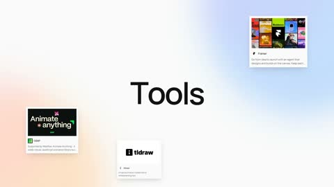</a></td>
</tr>
<tr>
<td width="50%" valign="top"><strong>Own.page 的图标与个人页面发布片</strong> <a href="https://x.com/ElitzaVasileva">@ElitzaVasileva</a> · 产品宣传 0:30 · 收藏 — · 资料待完善 <a href="https://guanmo-ai.github.io/awesome-ai-motion/#case-2103856583667052674">▶ 播放</a> · <a href="https://x.com/ElitzaVasileva/status/2103856583667052674">原帖</a></td>
<td width="50%" valign="top"><strong>设计工具卡片的轻盈发布片</strong> <a href="https://x.com/lokidotdev">@lokidotdev</a> · 产品宣传 0:15 · 收藏 — · 资料待完善 <a href="https://guanmo-ai.github.io/awesome-ai-motion/#case-2103760837496418583">▶ 播放</a> · <a href="https://x.com/lokidotdev/status/2103760837496418583">原帖</a></td>
</tr>
</tbody>
<tbody>
<tr>
<td width="50%" height="225" align="center" valign="middle"></td>
<td width="50%" height="225" align="center" valign="middle"></td>
</tr>
<tr>
<td width="50%" valign="top"><strong>MotionSites 的网页卡片与访问量发布片</strong> <a href="https://x.com/viktoroddy">@viktoroddy</a> · 产品宣传 0:54 · 收藏 — · 资料待完善 <a href="https://guanmo-ai.github.io/awesome-ai-motion/#case-2103802280617402509">▶ 播放</a> · <a href="https://x.com/viktoroddy/status/2103802280617402509">原帖</a></td>
<td width="50%" valign="top"><strong>Xp0 的工作流与决策卡片</strong> <a href="https://x.com/tomcupr">@tomcupr</a> · 产品宣传 0:30 · 收藏 — · 资料待完善 <a href="https://guanmo-ai.github.io/awesome-ai-motion/#case-2103776902960042359">▶ 播放</a> · <a href="https://x.com/tomcupr/status/2103776902960042359">原帖</a></td>
</tr>
</tbody>
<tbody>
<tr>
<td width="50%" height="225" align="center" valign="middle"></td>
<td width="50%" height="225" align="center" valign="middle"><a href="https://guanmo-ai.github.io/awesome-ai-motion/#case-2103708363074973906">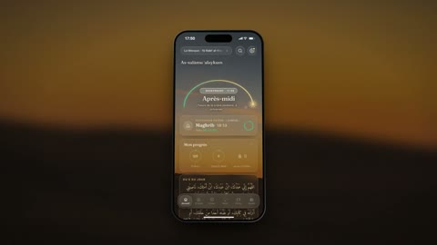</a></td>
</tr>
<tr>
<td width="50%" valign="top"><strong>阿拉伯语房源信息的图形广告</strong> <a href="https://x.com/alfageeh9">@alfageeh9</a> · 产品宣传 0:30 · 收藏 — · 资料待完善 <a href="https://guanmo-ai.github.io/awesome-ai-motion/#case-2103771626395357203">▶ 播放</a> · <a href="https://x.com/alfageeh9/status/2103771626395357203">原帖</a></td>
<td width="50%" valign="top"><strong>Mounis 的祈祷时间与阅读卡片</strong> <a href="https://x.com/MustaphaFenzar">@MustaphaFenzar</a> · 产品宣传 0:15 · 收藏 — · 资料待完善 <a href="https://guanmo-ai.github.io/awesome-ai-motion/#case-2103708363074973906">▶ 播放</a> · <a href="https://x.com/MustaphaFenzar/status/2103708363074973906">原帖</a></td>
</tr>
</tbody>
<tbody>
<tr>
<td width="50%" height="225" align="center" valign="middle"></td>
<td width="50%" height="225" align="center" valign="middle"></td>
</tr>
<tr>
<td width="50%" valign="top"><strong>TanStack AI 的节点与代码发布片</strong> <a href="https://x.com/HowDevelop">@HowDevelop</a> · 产品宣传 0:30 · 收藏 — · 资料待完善 <a href="https://guanmo-ai.github.io/awesome-ai-motion/#case-2103840883812733090">▶ 播放</a> · <a href="https://x.com/HowDevelop/status/2103840883812733090">原帖</a></td>
<td width="50%" valign="top"><strong>Snap to Grid 的像素角色广告</strong> <a href="https://x.com/flxrnc">@flxrnc</a> · 产品宣传 0:15 · 收藏 — · 资料待完善 <a href="https://guanmo-ai.github.io/awesome-ai-motion/#case-2106746350905774451">▶ 播放</a> · <a href="https://x.com/flxrnc/status/2106746350905774451">原帖</a></td>
</tr>
</tbody>
<tbody>
<tr>
<td width="50%" height="225" align="center" valign="middle"></td>
<td width="50%" height="225" align="center" valign="middle"></td>
</tr>
<tr>
<td width="50%" valign="top"><strong>SuperLaunch 的卡片与大字发布片</strong> <a href="https://x.com/CharuMitraDubey">@CharuMitraDubey</a> · 产品宣传 0:15 · 收藏 — · 资料待完善 <a href="https://guanmo-ai.github.io/awesome-ai-motion/#case-2103956360803328233">▶ 播放</a> · <a href="https://x.com/CharuMitraDubey/status/2103956360803328233">原帖</a></td>
<td width="50%" valign="top"><strong>派对米饭：竖屏餐饮品牌动效</strong> <a href="https://x.com/Bamdalas">@Bamdalas</a> · 产品宣传 0:24 · 收藏 — · 资料待完善 <a href="https://guanmo-ai.github.io/awesome-ai-motion/#case-2110334942362337403">▶ 播放</a> · <a href="https://x.com/Bamdalas/status/2110334942362337403">原帖</a></td>
</tr>
</tbody>
<tbody>
<tr>
<td width="50%" height="225" align="center" valign="middle"></td>
<td width="50%" height="225" align="center" valign="middle"></td>
</tr>
<tr>
<td width="50%" valign="top"><strong>Gofy 的城市地点与贴纸卡片</strong> <a href="https://x.com/heymrzak">@heymrzak</a> · 产品宣传 0:30 · 收藏 — · 资料待完善 <a href="https://guanmo-ai.github.io/awesome-ai-motion/#case-2103768331782349060">▶ 播放</a> · <a href="https://x.com/heymrzak/status/2103768331782349060">原帖</a></td>
<td width="50%" valign="top"><strong>隐私主题的蓝白文字宣传片</strong> <a href="https://x.com/DustinDavis">@DustinDavis</a> · 产品宣传 0:30 · 收藏 — · 资料待完善 <a href="https://guanmo-ai.github.io/awesome-ai-motion/#case-2104075537228644806">▶ 播放</a> · <a href="https://x.com/DustinDavis/status/2104075537228644806">原帖</a></td>
</tr>
</tbody>
<tbody>
<tr>
<td width="50%" height="225" align="center" valign="middle"><a href="https://guanmo-ai.github.io/awesome-ai-motion/#case-2103895246593458642">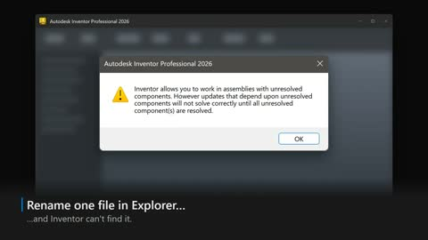</a></td>
<td width="50%" height="225" align="center" valign="middle"></td>
</tr>
<tr>
<td width="50%" valign="top"><strong>装配文件问题的界面叙事广告</strong> <a href="https://x.com/proanaliteg">@proanaliteg</a> · 产品宣传 0:35 · 收藏 — · 资料待完善 <a href="https://guanmo-ai.github.io/awesome-ai-motion/#case-2103895246593458642">▶ 播放</a> · <a href="https://x.com/proanaliteg/status/2103895246593458642">原帖</a></td>
<td width="50%" valign="top"><strong>Verde 的团队记忆图形广告</strong> <a href="https://x.com/DJAdkison">@DJAdkison</a> · 产品宣传 0:31 · 收藏 — · 资料待完善 <a href="https://guanmo-ai.github.io/awesome-ai-motion/#case-2104020177478394122">▶ 播放</a> · <a href="https://x.com/DJAdkison/status/2104020177478394122">原帖</a></td>
</tr>
</tbody>
<tbody>
<tr>
<td width="50%" height="225" align="center" valign="middle"></td>
<td width="50%" height="225" align="center" valign="middle"></td>
</tr>
<tr>
<td width="50%" valign="top"><strong>Audi RS 6 的图形性能概念片</strong> <a href="https://x.com/Dys_hay">@Dys_hay</a> · 产品宣传 0:15 · 收藏 — · 资料待完善 <a href="https://guanmo-ai.github.io/awesome-ai-motion/#case-2103819139307749645">▶ 播放</a> · <a href="https://x.com/Dys_hay/status/2103819139307749645">原帖</a></td>
<td width="50%" valign="top"><strong>Murmur 的语音功能发布片</strong> <a href="https://x.com/tarunyadav9761">@tarunyadav9761</a> · 产品宣传 0:53 · 收藏 — · 资料待完善 <a href="https://guanmo-ai.github.io/awesome-ai-motion/#case-2106435688292053244">▶ 播放</a> · <a href="https://x.com/tarunyadav9761/status/2106435688292053244">原帖</a></td>
</tr>
</tbody>
<tbody>
<tr>
<td width="50%" height="225" align="center" valign="middle"></td>
<td width="50%" height="225" align="center" valign="middle"></td>
</tr>
<tr>
<td width="50%" valign="top"><strong>电路板的逐件装配</strong> <a href="https://x.com/0xMovez">@0xMovez</a> · 知识讲解 0:46 · 收藏 7,914 · 资料待完善 <a href="https://guanmo-ai.github.io/awesome-ai-motion/#case-2112940162103615783">▶ 播放</a> · <a href="https://x.com/0xMovez/status/2112940162103615783">原帖</a></td>
<td width="50%" valign="top"><strong>研究论文八分钟动画讲解</strong> <a href="https://x.com/deedydas">@deedydas</a> · 知识讲解 8:39 · 收藏 5,419 · 资料待完善 <a href="https://guanmo-ai.github.io/awesome-ai-motion/#case-2103141339651350646">▶ 播放</a> · <a href="https://x.com/deedydas/status/2103141339651350646">原帖</a></td>
</tr>
</tbody>
<tbody>
<tr>
<td width="50%" height="225" align="center" valign="middle"></td>
<td width="50%" height="225" align="center" valign="middle"></td>
</tr>
<tr>
<td width="50%" valign="top"><strong>可拆解的 Raptor 3 火箭发动机</strong> <a href="https://x.com/konstantinsaifo">@konstantinsaifo</a> · 知识讲解 0:35 · 收藏 4,758 · 资料待完善 <a href="https://guanmo-ai.github.io/awesome-ai-motion/#case-2104094723887501736">▶ 播放</a> · <a href="https://x.com/konstantinsaifo/status/2104094723887501736">原帖</a></td>
<td width="50%" valign="top"><strong>飞行跑车的推力与姿态图解</strong> <a href="https://x.com/enes_code">@enes_code</a> · 知识讲解 0:39 · 收藏 3,674 · 资料待完善 <a href="https://guanmo-ai.github.io/awesome-ai-motion/#case-2110941423680061472">▶ 播放</a> · <a href="https://x.com/enes_code/status/2110941423680061472">原帖</a></td>
</tr>
</tbody>
<tbody>
<tr>
<td width="50%" height="225" align="center" valign="middle"></td>
<td width="50%" height="225" align="center" valign="middle"></td>
</tr>
<tr>
<td width="50%" valign="top"><strong>像素画神经网络训练过程</strong> <a href="https://x.com/DotCSV">@DotCSV</a> · 知识讲解 0:56 · 收藏 3,196 · 资料待完善 <a href="https://guanmo-ai.github.io/awesome-ai-motion/#case-2102737776219168939">▶ 播放</a> · <a href="https://x.com/DotCSV/status/2102737776219168939">原帖</a></td>
<td width="50%" valign="top"><strong>《如何做好工作》短片</strong> <a href="https://x.com/deedydas">@deedydas</a> · 知识讲解 3:15 · 收藏 2,879 · 资料待完善 <a href="https://guanmo-ai.github.io/awesome-ai-motion/#case-2104151743907160546">▶ 播放</a> · <a href="https://x.com/deedydas/status/2104151743907160546">原帖</a></td>
</tr>
</tbody>
<tbody>
<tr>
<td width="50%" height="225" align="center" valign="middle"></td>
<td width="50%" height="225" align="center" valign="middle"></td>
</tr>
<tr>
<td width="50%" valign="top"><strong>无人机的装配与试飞台</strong> <a href="https://x.com/0xMovez">@0xMovez</a> · 知识讲解 0:37 · 收藏 2,843 · 资料待完善 <a href="https://guanmo-ai.github.io/awesome-ai-motion/#case-2113292903741116893">▶ 播放</a> · <a href="https://x.com/0xMovez/status/2113292903741116893">原帖</a></td>
<td width="50%" valign="top"><strong>用动画解释 UX 设计决策</strong> <a href="https://x.com/moguzbulbul">@moguzbulbul</a> · 知识讲解 0:42 · 收藏 2,728 · 资料待完善 <a href="https://guanmo-ai.github.io/awesome-ai-motion/#case-2104206095313215591">▶ 播放</a> · <a href="https://x.com/moguzbulbul/status/2104206095313215591">原帖</a></td>
</tr>
</tbody>
<tbody>
<tr>
<td width="50%" height="225" align="center" valign="middle"></td>
<td width="50%" height="225" align="center" valign="middle"></td>
</tr>
<tr>
<td width="50%" valign="top"><strong>高架菜床的装配图解</strong> <a href="https://x.com/Skylartkitchen">@Skylartkitchen</a> · 知识讲解 0:41 · 收藏 2,251 · 资料待完善 <a href="https://guanmo-ai.github.io/awesome-ai-motion/#case-2103522230957420843">▶ 播放</a> · <a href="https://x.com/Skylartkitchen/status/2103522230957420843">原帖</a></td>
<td width="50%" valign="top"><strong>立体书中的能量实验</strong> <a href="https://x.com/techartist_">@techartist_</a> · 知识讲解 0:28 · 收藏 2,175 · 资料待完善 <a href="https://guanmo-ai.github.io/awesome-ai-motion/#case-2113310927093436587">▶ 播放</a> · <a href="https://x.com/techartist_/status/2113310927093436587">原帖</a></td>
</tr>
</tbody>
<tbody>
<tr>
<td width="50%" height="225" align="center" valign="middle"></td>
<td width="50%" height="225" align="center" valign="middle"></td>
</tr>
<tr>
<td width="50%" valign="top"><strong>从数据中心穿入 Blackwell 芯片</strong> <a href="https://x.com/lucian__03">@lucian__03</a> · 知识讲解 0:49 · 收藏 2,049 · 资料待完善 <a href="https://guanmo-ai.github.io/awesome-ai-motion/#case-2103494418477260830">▶ 播放</a> · <a href="https://x.com/lucian__03/status/2103494418477260830">原帖</a></td>
<td width="50%" valign="top"><strong>SQLite：一条查询如何穿过代码库</strong> <a href="https://x.com/deedydas">@deedydas</a> · 知识讲解 7:30 · 收藏 2,031 · 资料待完善 <a href="https://guanmo-ai.github.io/awesome-ai-motion/#case-2104391577091407965">▶ 播放</a> · <a href="https://x.com/deedydas/status/2104391577091407965">原帖</a></td>
</tr>
</tbody>
<tbody>
<tr>
<td width="50%" height="225" align="center" valign="middle"></td>
<td width="50%" height="225" align="center" valign="middle"></td>
</tr>
<tr>
<td width="50%" valign="top"><strong>学习如何学习</strong> <a href="https://x.com/momoflilbit">@momoflilbit</a> · 知识讲解 10:40 · 收藏 1,792 · 资料待完善 <a href="https://guanmo-ai.github.io/awesome-ai-motion/#case-2105276821214532096">▶ 播放</a> · <a href="https://x.com/momoflilbit/status/2105276821214532096">原帖</a></td>
<td width="50%" valign="top"><strong>浏览器工作过程四十秒讲解</strong> <a href="https://x.com/addyosmani">@addyosmani</a> · 知识讲解 0:40 · 收藏 1,744 · 资料待完善 <a href="https://guanmo-ai.github.io/awesome-ai-motion/#case-2103009037164110327">▶ 播放</a> · <a href="https://x.com/addyosmani/status/2103009037164110327">原帖</a></td>
</tr>
</tbody>
<tbody>
<tr>
<td width="50%" height="225" align="center" valign="middle"></td>
<td width="50%" height="225" align="center" valign="middle"></td>
</tr>
<tr>
<td width="50%" valign="top"><strong>电磁场与感应线圈的交互图解</strong> <a href="https://x.com/thebuggeddev">@thebuggeddev</a> · 知识讲解 1:11 · 收藏 1,608 · 资料待完善 <a href="https://guanmo-ai.github.io/awesome-ai-motion/#case-2104402407358919124">▶ 播放</a> · <a href="https://x.com/thebuggeddev/status/2104402407358919124">原帖</a></td>
<td width="50%" valign="top"><strong>山火进程的三维可视化原型</strong> <a href="https://x.com/DilumSanjaya">@DilumSanjaya</a> · 知识讲解 1:55 · 收藏 1,572 · 资料待完善 <a href="https://guanmo-ai.github.io/awesome-ai-motion/#case-2108241054298415258">▶ 播放</a> · <a href="https://x.com/DilumSanjaya/status/2108241054298415258">原帖</a></td>
</tr>
</tbody>
<tbody>
<tr>
<td width="50%" height="225" align="center" valign="middle"></td>
<td width="50%" height="225" align="center" valign="middle"></td>
</tr>
<tr>
<td width="50%" valign="top"><strong>The History of Light：约 36 分钟光学科普</strong> <a href="https://x.com/LLMJunky">@LLMJunky</a> · 知识讲解 35:37 · 收藏 1,470 · 资料待完善 <a href="https://guanmo-ai.github.io/awesome-ai-motion/#case-2106411941497389342">▶ 播放</a> · <a href="https://x.com/LLMJunky/status/2106411941497389342">原帖</a></td>
<td width="50%" valign="top"><strong>从晶体管到光刻的芯片简史</strong> <a href="https://x.com/vctbtc">@vctbtc</a> · 知识讲解 14:20 · 收藏 1,163 · 资料待完善 <a href="https://guanmo-ai.github.io/awesome-ai-motion/#case-2104081525847605709">▶ 播放</a> · <a href="https://x.com/vctbtc/status/2104081525847605709">原帖</a></td>
</tr>
</tbody>
<tbody>
<tr>
<td width="50%" height="225" align="center" valign="middle"></td>
<td width="50%" height="225" align="center" valign="middle"></td>
</tr>
<tr>
<td width="50%" valign="top"><strong>白板上会跳舞的水滴</strong> <a href="https://x.com/realYunfanYe">@realYunfanYe</a> · 知识讲解 1:00 · 收藏 1,095 · 资料待完善 <a href="https://guanmo-ai.github.io/awesome-ai-motion/#case-2103496245343916158">▶ 播放</a> · <a href="https://x.com/realYunfanYe/status/2103496245343916158">原帖</a></td>
<td width="50%" valign="top"><strong>用逻辑门讲述四位 ALU</strong> <a href="https://x.com/mustafaakin">@mustafaakin</a> · 知识讲解 1:10 · 收藏 1,087 · 资料待完善 <a href="https://guanmo-ai.github.io/awesome-ai-motion/#case-2103574428475154635">▶ 播放</a> · <a href="https://x.com/mustafaakin/status/2103574428475154635">原帖</a></td>
</tr>
</tbody>
<tbody>
<tr>
<td width="50%" height="225" align="center" valign="middle"></td>
<td width="50%" height="225" align="center" valign="middle"></td>
</tr>
<tr>
<td width="50%" valign="top"><strong>CUDA 优化的音乐化讲解</strong> <a href="https://x.com/elliotarledge">@elliotarledge</a> · 知识讲解 3:10 · 收藏 1,066 · 资料待完善 <a href="https://guanmo-ai.github.io/awesome-ai-motion/#case-2104096029847277687">▶ 播放</a> · <a href="https://x.com/elliotarledge/status/2104096029847277687">原帖</a></td>
<td width="50%" valign="top"><strong>谷歌历史两分钟视频</strong> <a href="https://x.com/deedydas">@deedydas</a> · 知识讲解 2:00 · 收藏 1,012 · 资料待完善 <a href="https://guanmo-ai.github.io/awesome-ai-motion/#case-2103965547780345859">▶ 播放</a> · <a href="https://x.com/deedydas/status/2103965547780345859">原帖</a></td>
</tr>
</tbody>
<tbody>
<tr>
<td width="50%" height="225" align="center" valign="middle"></td>
<td width="50%" height="225" align="center" valign="middle"></td>
</tr>
<tr>
<td width="50%" valign="top"><strong>从上下文到意图的手绘讲解</strong> <a href="https://x.com/doerstokyo342">@doerstokyo342</a> · 知识讲解 0:34 · 收藏 978 · 资料待完善 <a href="https://guanmo-ai.github.io/awesome-ai-motion/#case-2103034063816905109">▶ 播放</a> · <a href="https://x.com/doerstokyo342/status/2103034063816905109">原帖</a></td>
<td width="50%" valign="top"><strong>UMAP 的五分钟分层讲解</strong> <a href="https://x.com/goodside">@goodside</a> · 知识讲解 5:05 · 收藏 967 · 资料待完善 <a href="https://guanmo-ai.github.io/awesome-ai-motion/#case-2103505085292593220">▶ 播放</a> · <a href="https://x.com/goodside/status/2103505085292593220">原帖</a></td>
</tr>
</tbody>
<tbody>
<tr>
<td width="50%" height="225" align="center" valign="middle"></td>
<td width="50%" height="225" align="center" valign="middle"></td>
</tr>
<tr>
<td width="50%" valign="top"><strong>Claude 模型发展时间线</strong> <a href="https://x.com/superalesha">@superalesha</a> · 知识讲解 1:28 · 收藏 939 · 资料待完善 <a href="https://guanmo-ai.github.io/awesome-ai-motion/#case-2102463796149440888">▶ 播放</a> · <a href="https://x.com/superalesha/status/2102463796149440888">原帖</a></td>
<td width="50%" valign="top"><strong>电路板的部件与运行状态</strong> <a href="https://x.com/zodchiii">@zodchiii</a> · 知识讲解 0:35 · 收藏 902 · 资料待完善 <a href="https://guanmo-ai.github.io/awesome-ai-motion/#case-2113234379954888790">▶ 播放</a> · <a href="https://x.com/zodchiii/status/2113234379954888790">原帖</a></td>
</tr>
</tbody>
<tbody>
<tr>
<td width="50%" height="225" align="center" valign="middle"></td>
<td width="50%" height="225" align="center" valign="middle"></td>
</tr>
<tr>
<td width="50%" valign="top"><strong>超级智能风险动画</strong> <a href="https://x.com/AndrewOnXYZ">@AndrewOnXYZ</a> · 知识讲解 5:16 · 收藏 893 · 资料待完善 <a href="https://guanmo-ai.github.io/awesome-ai-motion/#case-2103865359988125706">▶ 播放</a> · <a href="https://x.com/AndrewOnXYZ/status/2103865359988125706">原帖</a></td>
<td width="50%" valign="top"><strong>芯片简史：从灯丝到光刻</strong> <a href="https://x.com/AndyL5cc">@AndyL5cc</a> · 知识讲解 3:29 · 收藏 882 · 资料待完善 <a href="https://guanmo-ai.github.io/awesome-ai-motion/#case-2104437066755125601">▶ 播放</a> · <a href="https://x.com/AndyL5cc/status/2104437066755125601">原帖</a></td>
</tr>
</tbody>
<tbody>
<tr>
<td width="50%" height="225" align="center" valign="middle"></td>
<td width="50%" height="225" align="center" valign="middle"></td>
</tr>
<tr>
<td width="50%" valign="top"><strong>哪条路径下落最快？</strong> <a href="https://x.com/AIMevzulari">@AIMevzulari</a> · 知识讲解 2:08 · 收藏 831 · 资料待完善 <a href="https://guanmo-ai.github.io/awesome-ai-motion/#case-2106052083040256293">▶ 播放</a> · <a href="https://x.com/AIMevzulari/status/2106052083040256293">原帖</a></td>
<td width="50%" valign="top"><strong>用 HTML 解释缓存 PR</strong> <a href="https://x.com/BHolmesDev">@BHolmesDev</a> · 知识讲解 0:19 · 收藏 798 · 资料待完善 <a href="https://guanmo-ai.github.io/awesome-ai-motion/#case-2106829942206173497">▶ 播放</a> · <a href="https://x.com/BHolmesDev/status/2106829942206173497">原帖</a></td>
</tr>
</tbody>
<tbody>
<tr>
<td width="50%" height="225" align="center" valign="middle"></td>
<td width="50%" height="225" align="center" valign="middle"></td>
</tr>
<tr>
<td width="50%" valign="top"><strong>印度文明的字形、年号与符号</strong> <a href="https://x.com/rashem48">@rashem48</a> · 知识讲解 1:16 · 收藏 712 · 资料待完善 <a href="https://guanmo-ai.github.io/awesome-ai-motion/#case-2103850664007028964">▶ 播放</a> · <a href="https://x.com/rashem48/status/2103850664007028964">原帖</a></td>
<td width="50%" valign="top"><strong>从生命诞生到大脑：人体科普</strong> <a href="https://x.com/chetaslua">@chetaslua</a> · 知识讲解 0:30 · 收藏 630 · 资料待完善 <a href="https://guanmo-ai.github.io/awesome-ai-motion/#case-2109244702235275680">▶ 播放</a> · <a href="https://x.com/chetaslua/status/2109244702235275680">原帖</a></td>
</tr>
</tbody>
<tbody>
<tr>
<td width="50%" height="225" align="center" valign="middle"></td>
<td width="50%" height="225" align="center" valign="middle"></td>
</tr>
<tr>
<td width="50%" valign="top"><strong>宜家说明书转三维教程</strong> <a href="https://x.com/deedydas">@deedydas</a> · 知识讲解 1:42 · 收藏 596 · 资料待完善 <a href="https://guanmo-ai.github.io/awesome-ai-motion/#case-2103174501345493197">▶ 播放</a> · <a href="https://x.com/deedydas/status/2103174501345493197">原帖</a></td>
<td width="50%" valign="top"><strong>从一块马赛克追溯鱼群动画</strong> <a href="https://x.com/dfeinition">@dfeinition</a> · 知识讲解 1:15 · 收藏 591 · 资料待完善 <a href="https://guanmo-ai.github.io/awesome-ai-motion/#case-2105098626213327008">▶ 播放</a> · <a href="https://x.com/dfeinition/status/2105098626213327008">原帖</a></td>
</tr>
</tbody>
<tbody>
<tr>
<td width="50%" height="225" align="center" valign="middle"></td>
<td width="50%" height="225" align="center" valign="middle"></td>
</tr>
<tr>
<td width="50%" valign="top"><strong>双生子佯谬剪纸动画</strong> <a href="https://x.com/masahirochaen">@masahirochaen</a> · 知识讲解 0:47 · 收藏 577 · 资料待完善 <a href="https://guanmo-ai.github.io/awesome-ai-motion/#case-2102722719502704941">▶ 播放</a> · <a href="https://x.com/masahirochaen/status/2102722719502704941">原帖</a></td>
<td width="50%" valign="top"><strong>从细胞到眼睛的科普动效</strong> <a href="https://x.com/rege_dev">@rege_dev</a> · 知识讲解 0:50 · 收藏 569 · 资料待完善 <a href="https://guanmo-ai.github.io/awesome-ai-motion/#case-2102498682931441977">▶ 播放</a> · <a href="https://x.com/rege_dev/status/2102498682931441977">原帖</a></td>
</tr>
</tbody>
<tbody>
<tr>
<td width="50%" height="225" align="center" valign="middle"></td>
<td width="50%" height="225" align="center" valign="middle"></td>
</tr>
<tr>
<td width="50%" valign="top"><strong>五座日本建筑的线框搭建</strong> <a href="https://x.com/yoshifujidesign">@yoshifujidesign</a> · 知识讲解 0:16 · 收藏 547 · 资料待完善 <a href="https://guanmo-ai.github.io/awesome-ai-motion/#case-2105746986339283305">▶ 播放</a> · <a href="https://x.com/yoshifujidesign/status/2105746986339283305">原帖</a></td>
<td width="50%" valign="top"><strong>轨道六要素的交互式三维讲解</strong> <a href="https://x.com/getBack_1969_">@getBack_1969_</a> · 知识讲解 1:00 · 收藏 526 · 资料待完善 <a href="https://guanmo-ai.github.io/awesome-ai-motion/#case-2105200070446751750">▶ 播放</a> · <a href="https://x.com/getBack_1969_/status/2105200070446751750">原帖</a></td>
</tr>
</tbody>
<tbody>
<tr>
<td width="50%" height="225" align="center" valign="middle"></td>
<td width="50%" height="225" align="center" valign="middle"></td>
</tr>
<tr>
<td width="50%" valign="top"><strong>人工智能历史的程序动画</strong> <a href="https://x.com/bridgemindai">@bridgemindai</a> · 知识讲解 1:00 · 收藏 499 · 资料待完善 <a href="https://guanmo-ai.github.io/awesome-ai-motion/#case-2103530750767206626">▶ 播放</a> · <a href="https://x.com/bridgemindai/status/2103530750767206626">原帖</a></td>
<td width="50%" valign="top"><strong>环形车流里的刹车波</strong> <a href="https://x.com/Lattice_Node">@Lattice_Node</a> · 知识讲解 0:34 · 收藏 488 · 资料待完善 <a href="https://guanmo-ai.github.io/awesome-ai-motion/#case-2105946058417389840">▶ 播放</a> · <a href="https://x.com/Lattice_Node/status/2105946058417389840">原帖</a></td>
</tr>
</tbody>
<tbody>
<tr>
<td width="50%" height="225" align="center" valign="middle"></td>
<td width="50%" height="225" align="center" valign="middle"></td>
</tr>
<tr>
<td width="50%" valign="top"><strong>扩散模型的图像流程</strong> <a href="https://x.com/DotCSV">@DotCSV</a> · 知识讲解 0:21 · 收藏 476 · 资料待完善 <a href="https://guanmo-ai.github.io/awesome-ai-motion/#case-2102810407928819866">▶ 播放</a> · <a href="https://x.com/DotCSV/status/2102810407928819866">原帖</a></td>
<td width="50%" valign="top"><strong>用动画解释嵌入向量</strong> <a href="https://x.com/antonioleivag">@antonioleivag</a> · 知识讲解 0:42 · 收藏 468 · 资料待完善 <a href="https://guanmo-ai.github.io/awesome-ai-motion/#case-2107833536669532671">▶ 播放</a> · <a href="https://x.com/antonioleivag/status/2107833536669532671">原帖</a></td>
</tr>
</tbody>
<tbody>
<tr>
<td width="50%" height="225" align="center" valign="middle"></td>
<td width="50%" height="225" align="center" valign="middle"></td>
</tr>
<tr>
<td width="50%" valign="top"><strong>Sony CMD-J5 的分层解剖</strong> <a href="https://x.com/ann_nnng">@ann_nnng</a> · 知识讲解 0:17 · 收藏 461 · 资料待完善 <a href="https://guanmo-ai.github.io/awesome-ai-motion/#case-2109146752528110053">▶ 播放</a> · <a href="https://x.com/ann_nnng/status/2109146752528110053">原帖</a></td>
<td width="50%" valign="top"><strong>文字与手绘类比讲解杠杆</strong> <a href="https://x.com/bitfish">@bitfish</a> · 知识讲解 3:10 · 收藏 429 · 资料待完善 <a href="https://guanmo-ai.github.io/awesome-ai-motion/#case-2104213208353628597">▶ 播放</a> · <a href="https://x.com/bitfish/status/2104213208353628597">原帖</a></td>
</tr>
</tbody>
<tbody>
<tr>
<td width="50%" height="225" align="center" valign="middle"></td>
<td width="50%" height="225" align="center" valign="middle"></td>
</tr>
<tr>
<td width="50%" valign="top"><strong>勾股定理的面积变换</strong> <a href="https://x.com/AIMevzulari">@AIMevzulari</a> · 知识讲解 3:26 · 收藏 429 · 资料待完善 <a href="https://guanmo-ai.github.io/awesome-ai-motion/#case-2106490563964874926">▶ 播放</a> · <a href="https://x.com/AIMevzulari/status/2106490563964874926">原帖</a></td>
<td width="50%" valign="top"><strong>百分之一概率的逐次尝试</strong> <a href="https://x.com/Lattice_Node">@Lattice_Node</a> · 知识讲解 0:42 · 收藏 387 · 资料待完善 <a href="https://guanmo-ai.github.io/awesome-ai-motion/#case-2106313749846249487">▶ 播放</a> · <a href="https://x.com/Lattice_Node/status/2106313749846249487">原帖</a></td>
</tr>
</tbody>
<tbody>
<tr>
<td width="50%" height="225" align="center" valign="middle"></td>
<td width="50%" height="225" align="center" valign="middle"></td>
</tr>
<tr>
<td width="50%" valign="top"><strong>15秒回顾三维计算机图形史</strong> <a href="https://x.com/jmitani">@jmitani</a> · 知识讲解 0:15 · 收藏 356 · 资料待完善 <a href="https://guanmo-ai.github.io/awesome-ai-motion/#case-2103997975173439834">▶ 播放</a> · <a href="https://x.com/jmitani/status/2103997975173439834">原帖</a></td>
<td width="50%" valign="top"><strong>Open Alignment：从文档到黄黑图形短片</strong> <a href="https://x.com/Thom_Wolf">@Thom_Wolf</a> · 知识讲解 1:24 · 收藏 356 · 资料待完善 <a href="https://guanmo-ai.github.io/awesome-ai-motion/#case-2103545533474206118">▶ 播放</a> · <a href="https://x.com/Thom_Wolf/status/2103545533474206118">原帖</a></td>
</tr>
</tbody>
<tbody>
<tr>
<td width="50%" height="225" align="center" valign="middle"></td>
<td width="50%" height="225" align="center" valign="middle"></td>
</tr>
<tr>
<td width="50%" valign="top"><strong>用三维轨迹讲解倒车入库</strong> <a href="https://x.com/RyanSael">@RyanSael</a> · 知识讲解 0:30 · 收藏 335 · 资料待完善 <a href="https://guanmo-ai.github.io/awesome-ai-motion/#case-2113306254647120334">▶ 播放</a> · <a href="https://x.com/RyanSael/status/2113306254647120334">原帖</a></td>
<td width="50%" valign="top"><strong>浏览器内部的图形旅程</strong> <a href="https://x.com/DataChaz">@DataChaz</a> · 知识讲解 0:40 · 收藏 318 · 资料待完善 <a href="https://guanmo-ai.github.io/awesome-ai-motion/#case-2103020750060028222">▶ 播放</a> · <a href="https://x.com/DataChaz/status/2103020750060028222">原帖</a></td>
</tr>
</tbody>
<tbody>
<tr>
<td width="50%" height="225" align="center" valign="middle"></td>
<td width="50%" height="225" align="center" valign="middle"></td>
</tr>
<tr>
<td width="50%" valign="top"><strong>驱动蛋白的微观步行</strong> <a href="https://x.com/JacobMolBio">@JacobMolBio</a> · 知识讲解 0:23 · 收藏 307 · 资料待完善 <a href="https://guanmo-ai.github.io/awesome-ai-motion/#case-2102569129026916389">▶ 播放</a> · <a href="https://x.com/JacobMolBio/status/2102569129026916389">原帖</a></td>
<td width="50%" valign="top"><strong>Scion 源码管理的动态图解</strong> <a href="https://x.com/devteamdrew">@devteamdrew</a> · 知识讲解 1:39 · 收藏 302 · 资料待完善 <a href="https://guanmo-ai.github.io/awesome-ai-motion/#case-2111864203753492513">▶ 播放</a> · <a href="https://x.com/devteamdrew/status/2111864203753492513">原帖</a></td>
</tr>
</tbody>
<tbody>
<tr>
<td width="50%" height="225" align="center" valign="middle"></td>
<td width="50%" height="225" align="center" valign="middle"></td>
</tr>
<tr>
<td width="50%" valign="top"><strong>自行车刹车与转向的三维讲解</strong> <a href="https://x.com/RyanSael">@RyanSael</a> · 知识讲解 0:40 · 收藏 271 · 资料待完善 <a href="https://guanmo-ai.github.io/awesome-ai-motion/#case-2107111191210520608">▶ 播放</a> · <a href="https://x.com/RyanSael/status/2107111191210520608">原帖</a></td>
<td width="50%" valign="top"><strong>乔布斯生平的代码动画</strong> <a href="https://x.com/oozn">@oozn</a> · 知识讲解 1:59 · 收藏 254 · 资料待完善 <a href="https://guanmo-ai.github.io/awesome-ai-motion/#case-2103482545111232946">▶ 播放</a> · <a href="https://x.com/oozn/status/2103482545111232946">原帖</a></td>
</tr>
</tbody>
<tbody>
<tr>
<td width="50%" height="225" align="center" valign="middle"></td>
<td width="50%" height="225" align="center" valign="middle"></td>
</tr>
<tr>
<td width="50%" valign="top"><strong>第一性原理的三维科普</strong> <a href="https://x.com/Tz_2022">@Tz_2022</a> · 知识讲解 5:02 · 收藏 251 · 资料待完善 <a href="https://guanmo-ai.github.io/awesome-ai-motion/#case-2104978414465945696">▶ 播放</a> · <a href="https://x.com/Tz_2022/status/2104978414465945696">原帖</a></td>
<td width="50%" valign="top"><strong>六分钟程序化教学影像</strong> <a href="https://x.com/0x0funky">@0x0funky</a> · 知识讲解 6:34 · 收藏 248 · 资料待完善 <a href="https://guanmo-ai.github.io/awesome-ai-motion/#case-2102736587708854585">▶ 播放</a> · <a href="https://x.com/0x0funky/status/2102736587708854585">原帖</a></td>
</tr>
</tbody>
<tbody>
<tr>
<td width="50%" height="225" align="center" valign="middle"></td>
<td width="50%" height="225" align="center" valign="middle"></td>
</tr>
<tr>
<td width="50%" valign="top"><strong>九种 KV Cache 讲解风格</strong> <a href="https://x.com/LufzzLiz">@LufzzLiz</a> · 知识讲解 0:45 · 收藏 246 · 资料待完善 <a href="https://guanmo-ai.github.io/awesome-ai-motion/#case-2107408409859359211">▶ 播放</a> · <a href="https://x.com/LufzzLiz/status/2107408409859359211">原帖</a></td>
<td width="50%" valign="top"><strong>拿破仑野战炮的结构可视化</strong> <a href="https://x.com/thebuggeddev">@thebuggeddev</a> · 知识讲解 0:51 · 收藏 242 · 资料待完善 <a href="https://guanmo-ai.github.io/awesome-ai-motion/#case-2107449104926482912">▶ 播放</a> · <a href="https://x.com/thebuggeddev/status/2107449104926482912">原帖</a></td>
</tr>
</tbody>
<tbody>
<tr>
<td width="50%" height="225" align="center" valign="middle"></td>
<td width="50%" height="225" align="center" valign="middle"></td>
</tr>
<tr>
<td width="50%" valign="top"><strong>一只蜜蜂的一生</strong> <a href="https://x.com/kevin_t_ngo">@kevin_t_ngo</a> · 知识讲解 0:53 · 收藏 236 · 资料待完善 <a href="https://guanmo-ai.github.io/awesome-ai-motion/#case-2109766087328100521">▶ 播放</a> · <a href="https://x.com/kevin_t_ngo/status/2109766087328100521">原帖</a></td>
<td width="50%" valign="top"><strong>四十层塔楼的施工顺序动画</strong> <a href="https://x.com/Solvaix">@Solvaix</a> · 知识讲解 0:29 · 收藏 228 · 资料待完善 <a href="https://guanmo-ai.github.io/awesome-ai-motion/#case-2107548992640880755">▶ 播放</a> · <a href="https://x.com/Solvaix/status/2107548992640880755">原帖</a></td>
</tr>
</tbody>
<tbody>
<tr>
<td width="50%" height="225" align="center" valign="middle"></td>
<td width="50%" height="225" align="center" valign="middle"></td>
</tr>
<tr>
<td width="50%" valign="top"><strong>Huashu：白板式讲解样片</strong> <a href="https://x.com/AlchainHust">@AlchainHust</a> · 知识讲解 2:10 · 收藏 227 · 资料待完善 <a href="https://guanmo-ai.github.io/awesome-ai-motion/#case-2107018546194882678">▶ 播放</a> · <a href="https://x.com/AlchainHust/status/2107018546194882678">原帖</a></td>
<td width="50%" valign="top"><strong>冲水时水箱与虹吸如何工作</strong> <a href="https://x.com/elliscrosby">@elliscrosby</a> · 知识讲解 0:18 · 收藏 225 · 资料待完善 <a href="https://guanmo-ai.github.io/awesome-ai-motion/#case-2109570204556824624">▶ 播放</a> · <a href="https://x.com/elliscrosby/status/2109570204556824624">原帖</a></td>
</tr>
</tbody>
<tbody>
<tr>
<td width="50%" height="225" align="center" valign="middle"></td>
<td width="50%" height="225" align="center" valign="middle"></td>
</tr>
<tr>
<td width="50%" valign="top"><strong>从西方石柱到中国木构</strong> <a href="https://x.com/akokoi1">@akokoi1</a> · 知识讲解 1:35 · 收藏 224 · 资料待完善 <a href="https://guanmo-ai.github.io/awesome-ai-motion/#case-2103650399773475318">▶ 播放</a> · <a href="https://x.com/akokoi1/status/2103650399773475318">原帖</a></td>
<td width="50%" valign="top"><strong>把普通代码变成神经网络</strong> <a href="https://x.com/dotey">@dotey</a> · 知识讲解 14:46 · 收藏 224 · 资料待完善 <a href="https://guanmo-ai.github.io/awesome-ai-motion/#case-2111097422810169575">▶ 播放</a> · <a href="https://x.com/dotey/status/2111097422810169575">原帖</a></td>
</tr>
</tbody>
<tbody>
<tr>
<td width="50%" height="225" align="center" valign="middle"></td>
<td width="50%" height="225" align="center" valign="middle"></td>
</tr>
<tr>
<td width="50%" valign="top"><strong>双机械臂协作装配</strong> <a href="https://x.com/DilumSanjaya">@DilumSanjaya</a> · 知识讲解 2:55 · 收藏 221 · 资料待完善 <a href="https://guanmo-ai.github.io/awesome-ai-motion/#case-2102806161728885145">▶ 播放</a> · <a href="https://x.com/DilumSanjaya/status/2102806161728885145">原帖</a></td>
<td width="50%" valign="top"><strong>五轴 CNC 铣削的透明剖面</strong> <a href="https://x.com/konstantinsaifo">@konstantinsaifo</a> · 知识讲解 0:45 · 收藏 210 · 资料待完善 <a href="https://guanmo-ai.github.io/awesome-ai-motion/#case-2104963500988916032">▶ 播放</a> · <a href="https://x.com/konstantinsaifo/status/2104963500988916032">原帖</a></td>
</tr>
</tbody>
<tbody>
<tr>
<td width="50%" height="225" align="center" valign="middle"></td>
<td width="50%" height="225" align="center" valign="middle"></td>
</tr>
<tr>
<td width="50%" valign="top"><strong>键盘的分层拆解与轴体结构</strong> <a href="https://x.com/quantapar">@quantapar</a> · 知识讲解 0:17 · 收藏 208 · 资料待完善 <a href="https://guanmo-ai.github.io/awesome-ai-motion/#case-2109748221459546529">▶ 播放</a> · <a href="https://x.com/quantapar/status/2109748221459546529">原帖</a></td>
<td width="50%" valign="top"><strong>物理竞赛题动画讲解</strong> <a href="https://x.com/akokoi1">@akokoi1</a> · 知识讲解 3:09 · 收藏 201 · 资料待完善 <a href="https://guanmo-ai.github.io/awesome-ai-motion/#case-2102680453912449223">▶ 播放</a> · <a href="https://x.com/akokoi1/status/2102680453912449223">原帖</a></td>
</tr>
</tbody>
<tbody>
<tr>
<td width="50%" height="225" align="center" valign="middle"></td>
<td width="50%" height="225" align="center" valign="middle"></td>
</tr>
<tr>
<td width="50%" valign="top"><strong>光合作用的艺术</strong> <a href="https://x.com/devteamdrew">@devteamdrew</a> · 知识讲解 0:47 · 收藏 187 · 资料待完善 <a href="https://guanmo-ai.github.io/awesome-ai-motion/#case-2111172786286690324">▶ 播放</a> · <a href="https://x.com/devteamdrew/status/2111172786286690324">原帖</a></td>
<td width="50%" valign="top"><strong>AI 历史的三维博物馆</strong> <a href="https://x.com/RyanSael">@RyanSael</a> · 知识讲解 0:44 · 收藏 187 · 资料待完善 <a href="https://guanmo-ai.github.io/awesome-ai-motion/#case-2103021886045348073">▶ 播放</a> · <a href="https://x.com/RyanSael/status/2103021886045348073">原帖</a></td>
</tr>
</tbody>
<tbody>
<tr>
<td width="50%" height="225" align="center" valign="middle"></td>
<td width="50%" height="225" align="center" valign="middle"></td>
</tr>
<tr>
<td width="50%" valign="top"><strong>关原之战：布阵图翻转</strong> <a href="https://x.com/tkz_aiart">@tkz_aiart</a> · 知识讲解 2:15 · 收藏 181 · 资料待完善 <a href="https://guanmo-ai.github.io/awesome-ai-motion/#case-2105271839698428235">▶ 播放</a> · <a href="https://x.com/tkz_aiart/status/2105271839698428235">原帖</a></td>
<td width="50%" valign="top"><strong>AI 服务器的拆解与散热示意</strong> <a href="https://x.com/0xbobaaa">@0xbobaaa</a> · 知识讲解 0:29 · 收藏 177 · 资料待完善 <a href="https://guanmo-ai.github.io/awesome-ai-motion/#case-2113557631025455294">▶ 播放</a> · <a href="https://x.com/0xbobaaa/status/2113557631025455294">原帖</a></td>
</tr>
</tbody>
<tbody>
<tr>
<td width="50%" height="225" align="center" valign="middle"></td>
<td width="50%" height="225" align="center" valign="middle"></td>
</tr>
<tr>
<td width="50%" valign="top"><strong>罗马帝国的地图纪录片</strong> <a href="https://x.com/tkz_aiart">@tkz_aiart</a> · 知识讲解 2:16 · 收藏 172 · 资料待完善 <a href="https://guanmo-ai.github.io/awesome-ai-motion/#case-2105983802367688910">▶ 播放</a> · <a href="https://x.com/tkz_aiart/status/2105983802367688910">原帖</a></td>
<td width="50%" valign="top"><strong>地震台上的楼体与调谐装置</strong> <a href="https://x.com/RyanSael">@RyanSael</a> · 知识讲解 0:40 · 收藏 167 · 资料待完善 <a href="https://guanmo-ai.github.io/awesome-ai-motion/#case-2106404706281222400">▶ 播放</a> · <a href="https://x.com/RyanSael/status/2106404706281222400">原帖</a></td>
</tr>
</tbody>
<tbody>
<tr>
<td width="50%" height="225" align="center" valign="middle"></td>
<td width="50%" height="225" align="center" valign="middle"></td>
</tr>
<tr>
<td width="50%" valign="top"><strong>咖啡历史的拼贴信息图</strong> <a href="https://x.com/ai4everyday">@ai4everyday</a> · 知识讲解 1:00 · 收藏 167 · 资料待完善 <a href="https://guanmo-ai.github.io/awesome-ai-motion/#case-2106130713439256844">▶ 播放</a> · <a href="https://x.com/ai4everyday/status/2106130713439256844">原帖</a></td>
<td width="50%" valign="top"><strong>Huashu：艺术史风格动画</strong> <a href="https://x.com/AlchainHust">@AlchainHust</a> · 知识讲解 2:08 · 收藏 162 · 资料待完善 <a href="https://guanmo-ai.github.io/awesome-ai-motion/#case-2106955771183272343">▶ 播放</a> · <a href="https://x.com/AlchainHust/status/2106955771183272343">原帖</a></td>
</tr>
</tbody>
<tbody>
<tr>
<td width="50%" height="225" align="center" valign="middle"></td>
<td width="50%" height="225" align="center" valign="middle"></td>
</tr>
<tr>
<td width="50%" valign="top"><strong>旋转轴：工程史蓝图动画</strong> <a href="https://x.com/ootamato">@ootamato</a> · 知识讲解 0:31 · 收藏 160 · 资料待完善 <a href="https://guanmo-ai.github.io/awesome-ai-motion/#case-2103099960069873856">▶ 播放</a> · <a href="https://x.com/ootamato/status/2103099960069873856">原帖</a></td>
<td width="50%" valign="top"><strong>咖啡之路</strong> <a href="https://x.com/ai4everyday">@ai4everyday</a> · 知识讲解 0:10 · 收藏 160 · 资料待完善 <a href="https://guanmo-ai.github.io/awesome-ai-motion/#case-2105715960220983304">▶ 播放</a> · <a href="https://x.com/ai4everyday/status/2105715960220983304">原帖</a></td>
</tr>
</tbody>
<tbody>
<tr>
<td width="50%" height="225" align="center" valign="middle"></td>
<td width="50%" height="225" align="center" valign="middle"></td>
</tr>
<tr>
<td width="50%" valign="top"><strong>保证金交易的像素 RPG 讲解</strong> <a href="https://x.com/RtSubPozrT8wmsN">@RtSubPozrT8wmsN</a> · 知识讲解 0:57 · 收藏 152 · 资料待完善 <a href="https://guanmo-ai.github.io/awesome-ai-motion/#case-2102764115500687573">▶ 播放</a> · <a href="https://x.com/RtSubPozrT8wmsN/status/2102764115500687573">原帖</a></td>
<td width="50%" valign="top"><strong>Credits：从交易哈希到彩色网格</strong> <a href="https://x.com/jackbutcher">@jackbutcher</a> · 知识讲解 1:14 · 收藏 147 · 资料待完善 <a href="https://guanmo-ai.github.io/awesome-ai-motion/#case-2104197194362319054">▶ 播放</a> · <a href="https://x.com/jackbutcher/status/2104197194362319054">原帖</a></td>
</tr>
</tbody>
<tbody>
<tr>
<td width="50%" height="225" align="center" valign="middle"></td>
<td width="50%" height="225" align="center" valign="middle"></td>
</tr>
<tr>
<td width="50%" valign="top"><strong>城市中的假设海啸模拟</strong> <a href="https://x.com/akira_papa_IT">@akira_papa_IT</a> · 知识讲解 0:53 · 收藏 145 · 资料待完善 <a href="https://guanmo-ai.github.io/awesome-ai-motion/#case-2103121980685955247">▶ 播放</a> · <a href="https://x.com/akira_papa_IT/status/2103121980685955247">原帖</a></td>
<td width="50%" valign="top"><strong>灯塔扇形照明的动态几何演示</strong> <a href="https://x.com/algekalipso">@algekalipso</a> · 知识讲解 0:26 · 收藏 143 · 资料待完善 <a href="https://guanmo-ai.github.io/awesome-ai-motion/#case-2110658162214785351">▶ 播放</a> · <a href="https://x.com/algekalipso/status/2110658162214785351">原帖</a></td>
</tr>
</tbody>
<tbody>
<tr>
<td width="50%" height="225" align="center" valign="middle"></td>
<td width="50%" height="225" align="center" valign="middle"></td>
</tr>
<tr>
<td width="50%" valign="top"><strong>一个汉堡如何被制作出来</strong> <a href="https://x.com/kevin_t_ngo">@kevin_t_ngo</a> · 知识讲解 1:04 · 收藏 137 · 资料待完善 <a href="https://guanmo-ai.github.io/awesome-ai-motion/#case-2111569193347018977">▶ 播放</a> · <a href="https://x.com/kevin_t_ngo/status/2111569193347018977">原帖</a></td>
<td width="50%" valign="top"><strong>免疫学历史的代码动画</strong> <a href="https://x.com/DeryaTR_">@DeryaTR_</a> · 知识讲解 2:00 · 收藏 135 · 资料待完善 <a href="https://guanmo-ai.github.io/awesome-ai-motion/#case-2106567073149190228">▶ 播放</a> · <a href="https://x.com/DeryaTR_/status/2106567073149190228">原帖</a></td>
</tr>
</tbody>
<tbody>
<tr>
<td width="50%" height="225" align="center" valign="middle"></td>
<td width="50%" height="225" align="center" valign="middle"></td>
</tr>
<tr>
<td width="50%" valign="top"><strong>人工智能突破的图形短片</strong> <a href="https://x.com/devteamdrew">@devteamdrew</a> · 知识讲解 1:05 · 收藏 130 · 资料待完善 <a href="https://guanmo-ai.github.io/awesome-ai-motion/#case-2113761947325702324">▶ 播放</a> · <a href="https://x.com/devteamdrew/status/2113761947325702324">原帖</a></td>
<td width="50%" valign="top"><strong>AI 时间线中的字形与关系</strong> <a href="https://x.com/kloss_xyz">@kloss_xyz</a> · 知识讲解 2:52 · 收藏 129 · 资料待完善 <a href="https://guanmo-ai.github.io/awesome-ai-motion/#case-2103652674336067876">▶ 播放</a> · <a href="https://x.com/kloss_xyz/status/2103652674336067876">原帖</a></td>
</tr>
</tbody>
<tbody>
<tr>
<td width="50%" height="225" align="center" valign="middle"></td>
<td width="50%" height="225" align="center" valign="middle"></td>
</tr>
<tr>
<td width="50%" valign="top"><strong>Hoeffding's D 的动态图解</strong> <a href="https://x.com/doodlestein">@doodlestein</a> · 知识讲解 8:27 · 收藏 127 · 资料待完善 <a href="https://guanmo-ai.github.io/awesome-ai-motion/#case-2107806362621149433">▶ 播放</a> · <a href="https://x.com/doodlestein/status/2107806362621149433">原帖</a></td>
<td width="50%" valign="top"><strong>播客音频自动剪成短视频</strong> <a href="https://x.com/Fujin_Metaverse">@Fujin_Metaverse</a> · 知识讲解 0:53 · 收藏 125 · 资料待完善 <a href="https://guanmo-ai.github.io/awesome-ai-motion/#case-2102897123037761640">▶ 播放</a> · <a href="https://x.com/Fujin_Metaverse/status/2102897123037761640">原帖</a></td>
</tr>
</tbody>
<tbody>
<tr>
<td width="50%" height="225" align="center" valign="middle"></td>
<td width="50%" height="225" align="center" valign="middle"></td>
</tr>
<tr>
<td width="50%" valign="top"><strong>Roadster 的三维拆解讲解片</strong> <a href="https://x.com/KeWai386772">@KeWai386772</a> · 知识讲解 2:54 · 收藏 122 · 资料待完善 <a href="https://guanmo-ai.github.io/awesome-ai-motion/#case-2111440772998599022">▶ 播放</a> · <a href="https://x.com/KeWai386772/status/2111440772998599022">原帖</a></td>
<td width="50%" valign="top"><strong>从超新星到遥远未来的代码绘本</strong> <a href="https://x.com/AIMevzulari">@AIMevzulari</a> · 知识讲解 0:50 · 收藏 121 · 资料待完善 <a href="https://guanmo-ai.github.io/awesome-ai-motion/#case-2103386522510573967">▶ 播放</a> · <a href="https://x.com/AIMevzulari/status/2103386522510573967">原帖</a></td>
</tr>
</tbody>
<tbody>
<tr>
<td width="50%" height="225" align="center" valign="middle"></td>
<td width="50%" height="225" align="center" valign="middle"></td>
</tr>
<tr>
<td width="50%" valign="top"><strong>Spiderbench 工作流讲解动画</strong> <a href="https://x.com/xikhar">@xikhar</a> · 知识讲解 2:13 · 收藏 117 · 资料待完善 <a href="https://guanmo-ai.github.io/awesome-ai-motion/#case-2104717572788883829">▶ 播放</a> · <a href="https://x.com/xikhar/status/2104717572788883829">原帖</a></td>
<td width="50%" valign="top"><strong>季节与太阳高度的三维图解</strong> <a href="https://x.com/AIMevzulari">@AIMevzulari</a> · 知识讲解 2:23 · 收藏 116 · 资料待完善 <a href="https://guanmo-ai.github.io/awesome-ai-motion/#case-2106714104689828066">▶ 播放</a> · <a href="https://x.com/AIMevzulari/status/2106714104689828066">原帖</a></td>
</tr>
</tbody>
<tbody>
<tr>
<td width="50%" height="225" align="center" valign="middle"></td>
<td width="50%" height="225" align="center" valign="middle"></td>
</tr>
<tr>
<td width="50%" valign="top"><strong>电动机三维结构动画对照</strong> <a href="https://x.com/rubenssoto_ai">@rubenssoto_ai</a> · 知识讲解 0:40 · 收藏 115 · 资料待完善 <a href="https://guanmo-ai.github.io/awesome-ai-motion/#case-2107175794145386838">▶ 播放</a> · <a href="https://x.com/rubenssoto_ai/status/2107175794145386838">原帖</a></td>
<td width="50%" valign="top"><strong>二十四节气的动态图谱</strong> <a href="https://x.com/threeaus">@threeaus</a> · 知识讲解 1:03 · 收藏 115 · 资料待完善 <a href="https://guanmo-ai.github.io/awesome-ai-motion/#case-2103518455404396927">▶ 播放</a> · <a href="https://x.com/threeaus/status/2103518455404396927">原帖</a></td>
</tr>
</tbody>
<tbody>
<tr>
<td width="50%" height="225" align="center" valign="middle"></td>
<td width="50%" height="225" align="center" valign="middle"></td>
</tr>
<tr>
<td width="50%" valign="top"><strong>用卡通动画讲板块漂移</strong> <a href="https://x.com/kevin_t_ngo">@kevin_t_ngo</a> · 知识讲解 2:21 · 收藏 112 · 资料待完善 <a href="https://guanmo-ai.github.io/awesome-ai-motion/#case-2108208479358026208">▶ 播放</a> · <a href="https://x.com/kevin_t_ngo/status/2108208479358026208">原帖</a></td>
<td width="50%" valign="top"><strong>用 Manim 解释指针和地址</strong> <a href="https://x.com/Hesamation">@Hesamation</a> · 知识讲解 1:32 · 收藏 107 · 资料待完善 <a href="https://guanmo-ai.github.io/awesome-ai-motion/#case-2103822595993018838">▶ 播放</a> · <a href="https://x.com/Hesamation/status/2103822595993018838">原帖</a></td>
</tr>
</tbody>
<tbody>
<tr>
<td width="50%" height="225" align="center" valign="middle"></td>
<td width="50%" height="225" align="center" valign="middle"></td>
</tr>
<tr>
<td width="50%" valign="top"><strong>新宿站：多层三维路线图解</strong> <a href="https://x.com/masahirochaen">@masahirochaen</a> · 知识讲解 0:43 · 收藏 105 · 资料待完善 <a href="https://guanmo-ai.github.io/awesome-ai-motion/#case-2104814438318776441">▶ 播放</a> · <a href="https://x.com/masahirochaen/status/2104814438318776441">原帖</a></td>
<td width="50%" valign="top"><strong>郑和下西洋：地图与港口</strong> <a href="https://x.com/bangbuilds">@bangbuilds</a> · 知识讲解 2:05 · 收藏 98 · 资料待完善 <a href="https://guanmo-ai.github.io/awesome-ai-motion/#case-2105914831887102064">▶ 播放</a> · <a href="https://x.com/bangbuilds/status/2105914831887102064">原帖</a></td>
</tr>
</tbody>
<tbody>
<tr>
<td width="50%" height="225" align="center" valign="middle"></td>
<td width="50%" height="225" align="center" valign="middle"></td>
</tr>
<tr>
<td width="50%" valign="top"><strong>榫卯结构的动态图解</strong> <a href="https://x.com/op7418">@op7418</a> · 知识讲解 0:48 · 收藏 95 · 资料待完善 <a href="https://guanmo-ai.github.io/awesome-ai-motion/#case-2105675440409174160">▶ 播放</a> · <a href="https://x.com/op7418/status/2105675440409174160">原帖</a></td>
<td width="50%" valign="top"><strong>微笑的好处</strong> <a href="https://x.com/ai4everyday">@ai4everyday</a> · 知识讲解 0:57 · 收藏 95 · 资料待完善 <a href="https://guanmo-ai.github.io/awesome-ai-motion/#case-2106385179006685254">▶ 播放</a> · <a href="https://x.com/ai4everyday/status/2106385179006685254">原帖</a></td>
</tr>
</tbody>
<tbody>
<tr>
<td width="50%" height="225" align="center" valign="middle"></td>
<td width="50%" height="225" align="center" valign="middle"></td>
</tr>
<tr>
<td width="50%" valign="top"><strong>概念跑车的拆解与倒置轨道</strong> <a href="https://x.com/andreysuperior">@andreysuperior</a> · 知识讲解 0:45 · 收藏 92 · 资料待完善 <a href="https://guanmo-ai.github.io/awesome-ai-motion/#case-2113323122682163307">▶ 播放</a> · <a href="https://x.com/andreysuperior/status/2113323122682163307">原帖</a></td>
<td width="50%" valign="top"><strong>存档点的游戏设计说明</strong> <a href="https://x.com/yoneapp">@yoneapp</a> · 知识讲解 0:30 · 收藏 91 · 资料待完善 <a href="https://guanmo-ai.github.io/awesome-ai-motion/#case-2103356152247615873">▶ 播放</a> · <a href="https://x.com/yoneapp/status/2103356152247615873">原帖</a></td>
</tr>
</tbody>
<tbody>
<tr>
<td width="50%" height="225" align="center" valign="middle"></td>
<td width="50%" height="225" align="center" valign="middle"></td>
</tr>
<tr>
<td width="50%" valign="top"><strong>用聚光灯与纸面图形讲解专注</strong> <a href="https://x.com/chetaslua">@chetaslua</a> · 知识讲解 2:12 · 收藏 89 · 资料待完善 <a href="https://guanmo-ai.github.io/awesome-ai-motion/#case-2113229122596163955">▶ 播放</a> · <a href="https://x.com/chetaslua/status/2113229122596163955">原帖</a></td>
<td width="50%" valign="top"><strong>用场记板与仪表盘讲解 Claude 工作流</strong> <a href="https://x.com/daniel_mac8">@daniel_mac8</a> · 知识讲解 0:29 · 收藏 88 · 资料待完善 <a href="https://guanmo-ai.github.io/awesome-ai-motion/#case-2103666105461924131">▶ 播放</a> · <a href="https://x.com/daniel_mac8/status/2103666105461924131">原帖</a></td>
</tr>
</tbody>
<tbody>
<tr>
<td width="50%" height="225" align="center" valign="middle"></td>
<td width="50%" height="225" align="center" valign="middle"></td>
</tr>
<tr>
<td width="50%" valign="top"><strong>独立开发流程的等距信息图</strong> <a href="https://x.com/GoSailGlobal">@GoSailGlobal</a> · 知识讲解 1:08 · 收藏 87 · 资料待完善 <a href="https://guanmo-ai.github.io/awesome-ai-motion/#case-2112077471839621203">▶ 播放</a> · <a href="https://x.com/GoSailGlobal/status/2112077471839621203">原帖</a></td>
<td width="50%" valign="top"><strong>用地图与折线回放乌克兰战线</strong> <a href="https://x.com/tokumei_banzai_">@tokumei_banzai_</a> · 知识讲解 1:27 · 收藏 85 · 资料待完善 <a href="https://guanmo-ai.github.io/awesome-ai-motion/#case-2104062022560456795">▶ 播放</a> · <a href="https://x.com/tokumei_banzai_/status/2104062022560456795">原帖</a></td>
</tr>
</tbody>
<tbody>
<tr>
<td width="50%" height="225" align="center" valign="middle"></td>
<td width="50%" height="225" align="center" valign="middle"></td>
</tr>
<tr>
<td width="50%" valign="top"><strong>人形机器人关节的拆解动画</strong> <a href="https://x.com/techartist_">@techartist_</a> · 知识讲解 0:40 · 收藏 84 · 资料待完善 <a href="https://guanmo-ai.github.io/awesome-ai-motion/#case-2108233726094365172">▶ 播放</a> · <a href="https://x.com/techartist_/status/2108233726094365172">原帖</a></td>
<td width="50%" valign="top"><strong>用时间轴讲述本能寺之变</strong> <a href="https://x.com/Codex_jisen">@Codex_jisen</a> · 知识讲解 1:00 · 收藏 84 · 资料待完善 <a href="https://guanmo-ai.github.io/awesome-ai-motion/#case-2102701984344330458">▶ 播放</a> · <a href="https://x.com/Codex_jisen/status/2102701984344330458">原帖</a></td>
</tr>
</tbody>
<tbody>
<tr>
<td width="50%" height="225" align="center" valign="middle"></td>
<td width="50%" height="225" align="center" valign="middle"></td>
</tr>
<tr>
<td width="50%" valign="top"><strong>骑车穿过相对论城市</strong> <a href="https://x.com/techartist_">@techartist_</a> · 知识讲解 0:28 · 收藏 82 · 资料待完善 <a href="https://guanmo-ai.github.io/awesome-ai-motion/#case-2107151400472088835">▶ 播放</a> · <a href="https://x.com/techartist_/status/2107151400472088835">原帖</a></td>
<td width="50%" valign="top"><strong>金属三维打印火箭发动机</strong> <a href="https://x.com/konstantinsaifo">@konstantinsaifo</a> · 知识讲解 0:56 · 收藏 76 · 资料待完善 <a href="https://guanmo-ai.github.io/awesome-ai-motion/#case-2106378121557782950">▶ 播放</a> · <a href="https://x.com/konstantinsaifo/status/2106378121557782950">原帖</a></td>
</tr>
</tbody>
<tbody>
<tr>
<td width="50%" height="225" align="center" valign="middle"></td>
<td width="50%" height="225" align="center" valign="middle"></td>
</tr>
<tr>
<td width="50%" valign="top"><strong>3D 细胞教学视频</strong> <a href="https://x.com/akokoi1">@akokoi1</a> · 知识讲解 3:50 · 收藏 72 · 资料待完善 <a href="https://guanmo-ai.github.io/awesome-ai-motion/#case-2104105016235860050">▶ 播放</a> · <a href="https://x.com/akokoi1/status/2104105016235860050">原帖</a></td>
<td width="50%" valign="top"><strong>阿拉伯文档的剪贴讲解</strong> <a href="https://x.com/X7mdNet">@X7mdNet</a> · 知识讲解 1:31 · 收藏 70 · 资料待完善 <a href="https://guanmo-ai.github.io/awesome-ai-motion/#case-2105177788043157811">▶ 播放</a> · <a href="https://x.com/X7mdNet/status/2105177788043157811">原帖</a></td>
</tr>
</tbody>
<tbody>
<tr>
<td width="50%" height="225" align="center" valign="middle"></td>
<td width="50%" height="225" align="center" valign="middle"></td>
</tr>
<tr>
<td width="50%" valign="top"><strong>上射式水磨的运转与传动</strong> <a href="https://x.com/thebuggeddev">@thebuggeddev</a> · 知识讲解 0:59 · 收藏 67 · 资料待完善 <a href="https://guanmo-ai.github.io/awesome-ai-motion/#case-2105322973527990522">▶ 播放</a> · <a href="https://x.com/thebuggeddev/status/2105322973527990522">原帖</a></td>
<td width="50%" valign="top"><strong>六边形软件架构动画解说</strong> <a href="https://x.com/ManuelZapata">@ManuelZapata</a> · 知识讲解 1:18 · 收藏 67 · 资料待完善 <a href="https://guanmo-ai.github.io/awesome-ai-motion/#case-2106926676571467996">▶ 播放</a> · <a href="https://x.com/ManuelZapata/status/2106926676571467996">原帖</a></td>
</tr>
</tbody>
<tbody>
<tr>
<td width="50%" height="225" align="center" valign="middle"></td>
<td width="50%" height="225" align="center" valign="middle"></td>
</tr>
<tr>
<td width="50%" valign="top"><strong>电机工厂的程序化生产线</strong> <a href="https://x.com/konstantinsaifo">@konstantinsaifo</a> · 知识讲解 0:44 · 收藏 63 · 资料待完善 <a href="https://guanmo-ai.github.io/awesome-ai-motion/#case-2110757897600716906">▶ 播放</a> · <a href="https://x.com/konstantinsaifo/status/2110757897600716906">原帖</a></td>
<td width="50%" valign="top"><strong>等轴测水车的机械联动</strong> <a href="https://x.com/thebuggeddev">@thebuggeddev</a> · 知识讲解 0:25 · 收藏 58 · 资料待完善 <a href="https://guanmo-ai.github.io/awesome-ai-motion/#case-2109348192638865629">▶ 播放</a> · <a href="https://x.com/thebuggeddev/status/2109348192638865629">原帖</a></td>
</tr>
</tbody>
<tbody>
<tr>
<td width="50%" height="225" align="center" valign="middle"></td>
<td width="50%" height="225" align="center" valign="middle"></td>
</tr>
<tr>
<td width="50%" valign="top"><strong>喷气机从工厂走向跑道</strong> <a href="https://x.com/konstantinsaifo">@konstantinsaifo</a> · 知识讲解 0:29 · 收藏 58 · 资料待完善 <a href="https://guanmo-ai.github.io/awesome-ai-motion/#case-2109989449673347271">▶ 播放</a> · <a href="https://x.com/konstantinsaifo/status/2109989449673347271">原帖</a></td>
<td width="50%" valign="top"><strong>函数极值与三维曲面</strong> <a href="https://x.com/AIMevzulari">@AIMevzulari</a> · 知识讲解 13:15 · 收藏 58 · 资料待完善 <a href="https://guanmo-ai.github.io/awesome-ai-motion/#case-2106844572882202974">▶ 播放</a> · <a href="https://x.com/AIMevzulari/status/2106844572882202974">原帖</a></td>
</tr>
</tbody>
<tbody>
<tr>
<td width="50%" height="225" align="center" valign="middle"></td>
<td width="50%" height="225" align="center" valign="middle"></td>
</tr>
<tr>
<td width="50%" valign="top"><strong>股票主题的像素 RPG 讲解</strong> <a href="https://x.com/RtSubPozrT8wmsN">@RtSubPozrT8wmsN</a> · 知识讲解 0:59 · 收藏 56 · 资料待完善 <a href="https://guanmo-ai.github.io/awesome-ai-motion/#case-2102763227629375648">▶ 播放</a> · <a href="https://x.com/RtSubPozrT8wmsN/status/2102763227629375648">原帖</a></td>
<td width="50%" valign="top"><strong>眼睛的演化：光线与视网膜图解</strong> <a href="https://x.com/cagrimbakirci">@cagrimbakirci</a> · 知识讲解 1:10 · 收藏 52 · 资料待完善 <a href="https://guanmo-ai.github.io/awesome-ai-motion/#case-2104011756397842869">▶ 播放</a> · <a href="https://x.com/cagrimbakirci/status/2104011756397842869">原帖</a></td>
</tr>
</tbody>
<tbody>
<tr>
<td width="50%" height="225" align="center" valign="middle"></td>
<td width="50%" height="225" align="center" valign="middle"></td>
</tr>
<tr>
<td width="50%" valign="top"><strong>触发器为何重复执行</strong> <a href="https://x.com/0xnfrith">@0xnfrith</a> · 知识讲解 0:53 · 收藏 50 · 资料待完善 <a href="https://guanmo-ai.github.io/awesome-ai-motion/#case-2103358957050068999">▶ 播放</a> · <a href="https://x.com/0xnfrith/status/2103358957050068999">原帖</a></td>
<td width="50%" valign="top"><strong>品牌标志趋同的动效讲解</strong> <a href="https://x.com/charliejhills">@charliejhills</a> · 知识讲解 0:57 · 收藏 48 · 资料待完善 <a href="https://guanmo-ai.github.io/awesome-ai-motion/#case-2105580875299836388">▶ 播放</a> · <a href="https://x.com/charliejhills/status/2105580875299836388">原帖</a></td>
</tr>
</tbody>
<tbody>
<tr>
<td width="50%" height="225" align="center" valign="middle"></td>
<td width="50%" height="225" align="center" valign="middle"></td>
</tr>
<tr>
<td width="50%" valign="top"><strong>空间音频位置的三维可视化</strong> <a href="https://x.com/chroman">@chroman</a> · 知识讲解 0:50 · 收藏 48 · 资料待完善 <a href="https://guanmo-ai.github.io/awesome-ai-motion/#case-2109778453625020920">▶ 播放</a> · <a href="https://x.com/chroman/status/2109778453625020920">原帖</a></td>
<td width="50%" valign="top"><strong>坛之浦海战三维演示</strong> <a href="https://x.com/tetumemo">@tetumemo</a> · 知识讲解 1:14 · 收藏 47 · 资料待完善 <a href="https://guanmo-ai.github.io/awesome-ai-motion/#case-2102652072252584046">▶ 播放</a> · <a href="https://x.com/tetumemo/status/2102652072252584046">原帖</a></td>
</tr>
</tbody>
<tbody>
<tr>
<td width="50%" height="225" align="center" valign="middle"></td>
<td width="50%" height="225" align="center" valign="middle"></td>
</tr>
<tr>
<td width="50%" valign="top"><strong>Three.js 生物细胞演示课件</strong> <a href="https://x.com/akokoi1">@akokoi1</a> · 知识讲解 0:37 · 收藏 45 · 资料待完善 <a href="https://guanmo-ai.github.io/awesome-ai-motion/#case-2106568339917324296">▶ 播放</a> · <a href="https://x.com/akokoi1/status/2106568339917324296">原帖</a></td>
<td width="50%" valign="top"><strong>轨道线条的天文动效</strong> <a href="https://x.com/sonia_code">@sonia_code</a> · 知识讲解 0:30 · 收藏 42 · 资料待完善 <a href="https://guanmo-ai.github.io/awesome-ai-motion/#case-2104406240554074174">▶ 播放</a> · <a href="https://x.com/sonia_code/status/2104406240554074174">原帖</a></td>
</tr>
</tbody>
<tbody>
<tr>
<td width="50%" height="225" align="center" valign="middle"></td>
<td width="50%" height="225" align="center" valign="middle"></td>
</tr>
<tr>
<td width="50%" valign="top"><strong>Hidden Valence 论文的动画解释</strong> <a href="https://x.com/camhberg">@camhberg</a> · 知识讲解 2:20 · 收藏 41 · 资料待完善 <a href="https://guanmo-ai.github.io/awesome-ai-motion/#case-2108313983505842650">▶ 播放</a> · <a href="https://x.com/camhberg/status/2108313983505842650">原帖</a></td>
<td width="50%" valign="top"><strong>陀螺为什么转起来不倒</strong> <a href="https://x.com/nicekate8888">@nicekate8888</a> · 知识讲解 2:04 · 收藏 39 · 资料待完善 <a href="https://guanmo-ai.github.io/awesome-ai-motion/#case-2105829517168365707">▶ 播放</a> · <a href="https://x.com/nicekate8888/status/2105829517168365707">原帖</a></td>
</tr>
</tbody>
<tbody>
<tr>
<td width="50%" height="225" align="center" valign="middle"></td>
<td width="50%" height="225" align="center" valign="middle"></td>
</tr>
<tr>
<td width="50%" valign="top"><strong>手绘风技术讲解片</strong> <a href="https://x.com/so_ainsight">@so_ainsight</a> · 知识讲解 0:15 · 收藏 38 · 资料待完善 <a href="https://guanmo-ai.github.io/awesome-ai-motion/#case-2103117547776163845">▶ 播放</a> · <a href="https://x.com/so_ainsight/status/2103117547776163845">原帖</a></td>
<td width="50%" valign="top"><strong>磁约束与激光聚变的三维示意</strong> <a href="https://x.com/techartist_">@techartist_</a> · 知识讲解 0:27 · 收藏 33 · 资料待完善 <a href="https://guanmo-ai.github.io/awesome-ai-motion/#case-2107888306633752881">▶ 播放</a> · <a href="https://x.com/techartist_/status/2107888306633752881">原帖</a></td>
</tr>
</tbody>
<tbody>
<tr>
<td width="50%" height="225" align="center" valign="middle"></td>
<td width="50%" height="225" align="center" valign="middle"></td>
</tr>
<tr>
<td width="50%" valign="top"><strong>改变地球倾角的季节模拟</strong> <a href="https://x.com/thebuggeddev">@thebuggeddev</a> · 知识讲解 0:38 · 收藏 33 · 资料待完善 <a href="https://guanmo-ai.github.io/awesome-ai-motion/#case-2112894503573233786">▶ 播放</a> · <a href="https://x.com/thebuggeddev/status/2112894503573233786">原帖</a></td>
<td width="50%" valign="top"><strong>搜索问题如何展开成多条查询</strong> <a href="https://x.com/harpreetchatha_">@harpreetchatha_</a> · 知识讲解 0:20 · 收藏 29 · 资料待完善 <a href="https://guanmo-ai.github.io/awesome-ai-motion/#case-2103591810253914585">▶ 播放</a> · <a href="https://x.com/harpreetchatha_/status/2103591810253914585">原帖</a></td>
</tr>
</tbody>
<tbody>
<tr>
<td width="50%" height="225" align="center" valign="middle"></td>
<td width="50%" height="225" align="center" valign="middle"></td>
</tr>
<tr>
<td width="50%" valign="top"><strong>秦帝国主题的历史解释动画</strong> <a href="https://x.com/aiRobertDaily">@aiRobertDaily</a> · 知识讲解 1:13 · 收藏 29 · 资料待完善 <a href="https://guanmo-ai.github.io/awesome-ai-motion/#case-2107815114745487588">▶ 播放</a> · <a href="https://x.com/aiRobertDaily/status/2107815114745487588">原帖</a></td>
<td width="50%" valign="top"><strong>为什么无法超过光速：Agent 讲解试片</strong> <a href="https://x.com/MrLarus">@MrLarus</a> · 知识讲解 1:18 · 收藏 22 · 资料待完善 <a href="https://guanmo-ai.github.io/awesome-ai-motion/#case-2108120392179089496">▶ 播放</a> · <a href="https://x.com/MrLarus/status/2108120392179089496">原帖</a></td>
</tr>
</tbody>
<tbody>
<tr>
<td width="50%" height="225" align="center" valign="middle"></td>
<td width="50%" height="225" align="center" valign="middle"></td>
</tr>
<tr>
<td width="50%" valign="top"><strong>Trace：艺术生成规则图解</strong> <a href="https://x.com/traceforms">@traceforms</a> · 知识讲解 1:18 · 收藏 20 · 资料待完善 <a href="https://guanmo-ai.github.io/awesome-ai-motion/#case-2105029763421147460">▶ 播放</a> · <a href="https://x.com/traceforms/status/2105029763421147460">原帖</a></td>
<td width="50%" valign="top"><strong>Raptor 3：从发动机阵列到内部流路</strong> <a href="https://x.com/techartist_">@techartist_</a> · 知识讲解 0:25 · 收藏 19 · 资料待完善 <a href="https://guanmo-ai.github.io/awesome-ai-motion/#case-2109312002099441934">▶ 播放</a> · <a href="https://x.com/techartist_/status/2109312002099441934">原帖</a></td>
</tr>
</tbody>
<tbody>
<tr>
<td width="50%" height="225" align="center" valign="middle"></td>
<td width="50%" height="225" align="center" valign="middle"></td>
</tr>
<tr>
<td width="50%" valign="top"><strong>用动态图表介绍 Opus 5.5</strong> <a href="https://x.com/genel_ai">@genel_ai</a> · 知识讲解 1:30 · 收藏 18 · 资料待完善 <a href="https://guanmo-ai.github.io/awesome-ai-motion/#case-2102460794013462940">▶ 播放</a> · <a href="https://x.com/genel_ai/status/2102460794013462940">原帖</a></td>
<td width="50%" valign="top"><strong>差速器如何让两侧车轮不同速</strong> <a href="https://x.com/RyanSael">@RyanSael</a> · 知识讲解 0:32 · 收藏 17 · 资料待完善 <a href="https://guanmo-ai.github.io/awesome-ai-motion/#case-2113481843119198558">▶ 播放</a> · <a href="https://x.com/RyanSael/status/2113481843119198558">原帖</a></td>
</tr>
</tbody>
<tbody>
<tr>
<td width="50%" height="225" align="center" valign="middle"></td>
<td width="50%" height="225" align="center" valign="middle"></td>
</tr>
<tr>
<td width="50%" valign="top"><strong>西雅图的线描时间轴</strong> <a href="https://x.com/yanliudesign">@yanliudesign</a> · 知识讲解 0:15 · 收藏 17 · 资料待完善 <a href="https://guanmo-ai.github.io/awesome-ai-motion/#case-2104393313935839698">▶ 播放</a> · <a href="https://x.com/yanliudesign/status/2104393313935839698">原帖</a></td>
<td width="50%" valign="top"><strong>Singularity：30秒恒星演化</strong> <a href="https://x.com/techartist_">@techartist_</a> · 知识讲解 0:30 · 收藏 16 · 资料待完善 <a href="https://guanmo-ai.github.io/awesome-ai-motion/#case-2104352888793477147">▶ 播放</a> · <a href="https://x.com/techartist_/status/2104352888793477147">原帖</a></td>
</tr>
</tbody>
<tbody>
<tr>
<td width="50%" height="225" align="center" valign="middle"></td>
<td width="50%" height="225" align="center" valign="middle"></td>
</tr>
<tr>
<td width="50%" valign="top"><strong>Lemo-Opuscar：白板风格创作教学片</strong> <a href="https://x.com/lemomo_ai">@lemomo_ai</a> · 知识讲解 1:11 · 收藏 16 · 资料待完善 <a href="https://guanmo-ai.github.io/awesome-ai-motion/#case-2104070024575242622">▶ 播放</a> · <a href="https://x.com/lemomo_ai/status/2104070024575242622">原帖</a></td>
<td width="50%" valign="top"><strong>F1 动力单元的拆解与运转</strong> <a href="https://x.com/konstantinsaifo">@konstantinsaifo</a> · 知识讲解 0:41 · 收藏 15 · 资料待完善 <a href="https://guanmo-ai.github.io/awesome-ai-motion/#case-2111190608031170960">▶ 播放</a> · <a href="https://x.com/konstantinsaifo/status/2111190608031170960">原帖</a></td>
</tr>
</tbody>
<tbody>
<tr>
<td width="50%" height="225" align="center" valign="middle"></td>
<td width="50%" height="225" align="center" valign="middle"></td>
</tr>
<tr>
<td width="50%" valign="top"><strong>722 篇数学论文：数据图形解说</strong> <a href="https://x.com/FinanceYF5">@FinanceYF5</a> · 知识讲解 1:32 · 收藏 15 · 资料待完善 <a href="https://guanmo-ai.github.io/awesome-ai-motion/#case-2108758983121187251">▶ 播放</a> · <a href="https://x.com/FinanceYF5/status/2108758983121187251">原帖</a></td>
<td width="50%" valign="top"><strong>Jido 如何融入工程的讲解片</strong> <a href="https://x.com/h14hdotcom">@h14hdotcom</a> · 知识讲解 7:26 · 收藏 14 · 资料待完善 <a href="https://guanmo-ai.github.io/awesome-ai-motion/#case-2107514903879688390">▶ 播放</a> · <a href="https://x.com/h14hdotcom/status/2107514903879688390">原帖</a></td>
</tr>
</tbody>
<tbody>
<tr>
<td width="50%" height="225" align="center" valign="middle"></td>
<td width="50%" height="225" align="center" valign="middle"></td>
</tr>
<tr>
<td width="50%" valign="top"><strong>我们都是恒星的孩子</strong> <a href="https://x.com/threeaus">@threeaus</a> · 知识讲解 2:49 · 收藏 14 · 资料待完善 <a href="https://guanmo-ai.github.io/awesome-ai-motion/#case-2108949764264128808">▶ 播放</a> · <a href="https://x.com/threeaus/status/2108949764264128808">原帖</a></td>
<td width="50%" valign="top"><strong>木制 V8 发动机的机械联动</strong> <a href="https://x.com/thebuggeddev">@thebuggeddev</a> · 知识讲解 0:59 · 收藏 13 · 资料待完善 <a href="https://guanmo-ai.github.io/awesome-ai-motion/#case-2102709856243527953">▶ 播放</a> · <a href="https://x.com/thebuggeddev/status/2102709856243527953">原帖</a></td>
</tr>
</tbody>
<tbody>
<tr>
<td width="50%" height="225" align="center" valign="middle"></td>
<td width="50%" height="225" align="center" valign="middle"></td>
</tr>
<tr>
<td width="50%" valign="top"><strong>DeepSeek 模型缓存的动态图解</strong> <a href="https://x.com/ItsmeAjayKV">@ItsmeAjayKV</a> · 知识讲解 7:22 · 收藏 13 · 资料待完善 <a href="https://guanmo-ai.github.io/awesome-ai-motion/#case-2103591055396663493">▶ 播放</a> · <a href="https://x.com/ItsmeAjayKV/status/2103591055396663493">原帖</a></td>
<td width="50%" valign="top"><strong>夜间无人机竞速的轨迹与受力</strong> <a href="https://x.com/konstantinsaifo">@konstantinsaifo</a> · 知识讲解 0:34 · 收藏 12 · 资料待完善 <a href="https://guanmo-ai.github.io/awesome-ai-motion/#case-2111379526404186306">▶ 播放</a> · <a href="https://x.com/konstantinsaifo/status/2111379526404186306">原帖</a></td>
</tr>
</tbody>
<tbody>
<tr>
<td width="50%" height="225" align="center" valign="middle"></td>
<td width="50%" height="225" align="center" valign="middle"></td>
</tr>
<tr>
<td width="50%" valign="top"><strong>太阳里的粒子如何走向太空</strong> <a href="https://x.com/AstroTheWizard">@AstroTheWizard</a> · 知识讲解 1:00 · 收藏 12 · 资料待完善 <a href="https://guanmo-ai.github.io/awesome-ai-motion/#case-2103629247751618782">▶ 播放</a> · <a href="https://x.com/AstroTheWizard/status/2103629247751618782">原帖</a></td>
<td width="50%" valign="top"><strong>从数据中心深入 GPU 芯片</strong> <a href="https://x.com/motyka_9">@motyka_9</a> · 知识讲解 0:49 · 收藏 11 · 资料待完善 <a href="https://guanmo-ai.github.io/awesome-ai-motion/#case-2107571783729557855">▶ 播放</a> · <a href="https://x.com/motyka_9/status/2107571783729557855">原帖</a></td>
</tr>
</tbody>
<tbody>
<tr>
<td width="50%" height="225" align="center" valign="middle"></td>
<td width="50%" height="225" align="center" valign="middle"></td>
</tr>
<tr>
<td width="50%" valign="top"><strong>魔方入门与纠错动画教程</strong> <a href="https://x.com/NorthstarBrain">@NorthstarBrain</a> · 知识讲解 2:47 · 收藏 11 · 资料待完善 <a href="https://guanmo-ai.github.io/awesome-ai-motion/#case-2107600930762031447">▶ 播放</a> · <a href="https://x.com/NorthstarBrain/status/2107600930762031447">原帖</a></td>
<td width="50%" valign="top"><strong>十五种知识动画风格样片</strong> <a href="https://x.com/agentchengfeng">@agentchengfeng</a> · 知识讲解 2:51 · 收藏 9 · 资料待完善 <a href="https://guanmo-ai.github.io/awesome-ai-motion/#case-2107473998212927525">▶ 播放</a> · <a href="https://x.com/agentchengfeng/status/2107473998212927525">原帖</a></td>
</tr>
</tbody>
<tbody>
<tr>
<td width="50%" height="225" align="center" valign="middle"></td>
<td width="50%" height="225" align="center" valign="middle"></td>
</tr>
<tr>
<td width="50%" valign="top"><strong>YouMind 里的历史动画风格试验</strong> <a href="https://x.com/KengGuangLong">@KengGuangLong</a> · 知识讲解 4:57 · 收藏 9 · 资料待完善 <a href="https://guanmo-ai.github.io/awesome-ai-motion/#case-2108029927161541111">▶ 播放</a> · <a href="https://x.com/KengGuangLong/status/2108029927161541111">原帖</a></td>
<td width="50%" valign="top"><strong>纸张、日志与卡通机器人的讲解片</strong> <a href="https://x.com/garmdotcom">@garmdotcom</a> · 知识讲解 0:51 · 收藏 9 · 资料待完善 <a href="https://guanmo-ai.github.io/awesome-ai-motion/#case-2103516101518987439">▶ 播放</a> · <a href="https://x.com/garmdotcom/status/2103516101518987439">原帖</a></td>
</tr>
</tbody>
<tbody>
<tr>
<td width="50%" height="225" align="center" valign="middle"></td>
<td width="50%" height="225" align="center" valign="middle"></td>
</tr>
<tr>
<td width="50%" valign="top"><strong>SVG 相机的结构拆解</strong> <a href="https://x.com/quantapar">@quantapar</a> · 知识讲解 0:14 · 收藏 8 · 资料待完善 <a href="https://guanmo-ai.github.io/awesome-ai-motion/#case-2109219079928385747">▶ 播放</a> · <a href="https://x.com/quantapar/status/2109219079928385747">原帖</a></td>
<td width="50%" valign="top"><strong>按一下圆珠笔：卡槽与弹簧</strong> <a href="https://x.com/elliscrosby">@elliscrosby</a> · 知识讲解 0:20 · 收藏 8 · 资料待完善 <a href="https://guanmo-ai.github.io/awesome-ai-motion/#case-2109701103835341174">▶ 播放</a> · <a href="https://x.com/elliscrosby/status/2109701103835341174">原帖</a></td>
</tr>
</tbody>
<tbody>
<tr>
<td width="50%" height="225" align="center" valign="middle"></td>
<td width="50%" height="225" align="center" valign="middle"></td>
</tr>
<tr>
<td width="50%" valign="top"><strong>Seeing the Unseen：放射学文章手绘讲解</strong> <a href="https://x.com/woojinrad">@woojinrad</a> · 知识讲解 1:05 · 收藏 8 · 资料待完善 <a href="https://guanmo-ai.github.io/awesome-ai-motion/#case-2106083299462455731">▶ 播放</a> · <a href="https://x.com/woojinrad/status/2106083299462455731">原帖</a></td>
<td width="50%" valign="top"><strong>Ship 40：桌面上的完整飞行</strong> <a href="https://x.com/konstantinsaifo">@konstantinsaifo</a> · 知识讲解 0:42 · 收藏 8 · 资料待完善 <a href="https://guanmo-ai.github.io/awesome-ai-motion/#case-2110800680407757141">▶ 播放</a> · <a href="https://x.com/konstantinsaifo/status/2110800680407757141">原帖</a></td>
</tr>
</tbody>
<tbody>
<tr>
<td width="50%" height="225" align="center" valign="middle"></td>
<td width="50%" height="225" align="center" valign="middle"></td>
</tr>
<tr>
<td width="50%" valign="top"><strong>变分自编码器数学讲解</strong> <a href="https://x.com/ng169onX">@ng169onX</a> · 知识讲解 5:34 · 收藏 8 · 资料待完善 <a href="https://guanmo-ai.github.io/awesome-ai-motion/#case-2103183904563998809">▶ 播放</a> · <a href="https://x.com/ng169onX/status/2103183904563998809">原帖</a></td>
<td width="50%" valign="top"><strong>用手绘箭头拆解 AI 文章</strong> <a href="https://x.com/0xlangeai">@0xlangeai</a> · 知识讲解 0:56 · 收藏 8 · 资料待完善 <a href="https://guanmo-ai.github.io/awesome-ai-motion/#case-2104119716533178533">▶ 播放</a> · <a href="https://x.com/0xlangeai/status/2104119716533178533">原帖</a></td>
</tr>
</tbody>
<tbody>
<tr>
<td width="50%" height="225" align="center" valign="middle"></td>
<td width="50%" height="225" align="center" valign="middle"></td>
</tr>
<tr>
<td width="50%" valign="top"><strong>DeepSeek架构主题的代码讲解动画</strong> <a href="https://x.com/ItsmeAjayKV">@ItsmeAjayKV</a> · 知识讲解 2:07 · 收藏 7 · 资料待完善 <a href="https://guanmo-ai.github.io/awesome-ai-motion/#case-2108485332757074286">▶ 播放</a> · <a href="https://x.com/ItsmeAjayKV/status/2108485332757074286">原帖</a></td>
<td width="50%" valign="top"><strong>SHRINCS 签名方案的解释动画</strong> <a href="https://x.com/NavRoudsari">@NavRoudsari</a> · 知识讲解 4:21 · 收藏 7 · 资料待完善 <a href="https://guanmo-ai.github.io/awesome-ai-motion/#case-2108304898198581689">▶ 播放</a> · <a href="https://x.com/NavRoudsari/status/2108304898198581689">原帖</a></td>
</tr>
</tbody>
<tbody>
<tr>
<td width="50%" height="225" align="center" valign="middle"></td>
<td width="50%" height="225" align="center" valign="middle"></td>
</tr>
<tr>
<td width="50%" valign="top"><strong>旋转圆如何拼出傅里叶图形</strong> <a href="https://x.com/Miguel07Code">@Miguel07Code</a> · 知识讲解 0:42 · 收藏 7 · 资料待完善 <a href="https://guanmo-ai.github.io/awesome-ai-motion/#case-2103626582896091611">▶ 播放</a> · <a href="https://x.com/Miguel07Code/status/2103626582896091611">原帖</a></td>
<td width="50%" valign="top"><strong>电子轨道中的概率流可视化</strong> <a href="https://x.com/ottollm">@ottollm</a> · 知识讲解 0:57 · 收藏 7 · 资料待完善 <a href="https://guanmo-ai.github.io/awesome-ai-motion/#case-2111129290464964764">▶ 播放</a> · <a href="https://x.com/ottollm/status/2111129290464964764">原帖</a></td>
</tr>
</tbody>
<tbody>
<tr>
<td width="50%" height="225" align="center" valign="middle"></td>
<td width="50%" height="225" align="center" valign="middle"></td>
</tr>
<tr>
<td width="50%" valign="top"><strong>电风扇如何产生气流</strong> <a href="https://x.com/LinearUncle">@LinearUncle</a> · 知识讲解 1:29 · 收藏 7 · 资料待完善 <a href="https://guanmo-ai.github.io/awesome-ai-motion/#case-2104024423972155805">▶ 播放</a> · <a href="https://x.com/LinearUncle/status/2104024423972155805">原帖</a></td>
<td width="50%" valign="top"><strong>Roadster 如何飞起：线稿原理解说</strong> <a href="https://x.com/tuolaji2024">@tuolaji2024</a> · 知识讲解 3:56 · 收藏 7 · 资料待完善 <a href="https://guanmo-ai.github.io/awesome-ai-motion/#case-2110987175009685842">▶ 播放</a> · <a href="https://x.com/tuolaji2024/status/2110987175009685842">原帖</a></td>
</tr>
</tbody>
<tbody>
<tr>
<td width="50%" height="225" align="center" valign="middle"></td>
<td width="50%" height="225" align="center" valign="middle"></td>
</tr>
<tr>
<td width="50%" valign="top"><strong>星系碰撞的粒子可视化</strong> <a href="https://x.com/techartist_">@techartist_</a> · 知识讲解 0:29 · 收藏 6 · 资料待完善 <a href="https://guanmo-ai.github.io/awesome-ai-motion/#case-2107629480714076484">▶ 播放</a> · <a href="https://x.com/techartist_/status/2107629480714076484">原帖</a></td>
<td width="50%" valign="top"><strong>文字与几何图形的心理学讲解</strong> <a href="https://x.com/nakazakifam">@nakazakifam</a> · 知识讲解 0:32 · 收藏 6 · 资料待完善 <a href="https://guanmo-ai.github.io/awesome-ai-motion/#case-2107715000227831964">▶ 播放</a> · <a href="https://x.com/nakazakifam/status/2107715000227831964">原帖</a></td>
</tr>
</tbody>
<tbody>
<tr>
<td width="50%" height="225" align="center" valign="middle"></td>
<td width="50%" height="225" align="center" valign="middle"></td>
</tr>
<tr>
<td width="50%" valign="top"><strong>倒挂 Roadster 的运动与受力</strong> <a href="https://x.com/konstantinsaifo">@konstantinsaifo</a> · 知识讲解 0:44 · 收藏 6 · 资料待完善 <a href="https://guanmo-ai.github.io/awesome-ai-motion/#case-2111119619461153190">▶ 播放</a> · <a href="https://x.com/konstantinsaifo/status/2111119619461153190">原帖</a></td>
<td width="50%" valign="top"><strong>Sonnet与VOICEVOX的通讯介绍片</strong> <a href="https://x.com/tetumemo">@tetumemo</a> · 知识讲解 0:32 · 收藏 6 · 资料待完善 <a href="https://guanmo-ai.github.io/awesome-ai-motion/#case-2108517711970234631">▶ 播放</a> · <a href="https://x.com/tetumemo/status/2108517711970234631">原帖</a></td>
</tr>
</tbody>
<tbody>
<tr>
<td width="50%" height="225" align="center" valign="middle"></td>
<td width="50%" height="225" align="center" valign="middle"></td>
</tr>
<tr>
<td width="50%" valign="top"><strong>杭州山水沙盘的一日变化</strong> <a href="https://x.com/bangbuilds">@bangbuilds</a> · 知识讲解 2:56 · 收藏 5 · 资料待完善 <a href="https://guanmo-ai.github.io/awesome-ai-motion/#case-2108900090132005217">▶ 播放</a> · <a href="https://x.com/bangbuilds/status/2108900090132005217">原帖</a></td>
<td width="50%" valign="top"><strong>从洗芋到蒸馏的日文工艺动效</strong> <a href="https://x.com/iTakahashikun">@iTakahashikun</a> · 知识讲解 0:30 · 收藏 5 · 资料待完善 <a href="https://guanmo-ai.github.io/awesome-ai-motion/#case-2103731575661990109">▶ 播放</a> · <a href="https://x.com/iTakahashikun/status/2103731575661990109">原帖</a></td>
</tr>
</tbody>
<tbody>
<tr>
<td width="50%" height="225" align="center" valign="middle"></td>
<td width="50%" height="225" align="center" valign="middle"></td>
</tr>
<tr>
<td width="50%" valign="top"><strong>闪电：天空为什么突然漏电</strong> <a href="https://x.com/nicekate8888">@nicekate8888</a> · 知识讲解 2:02 · 收藏 5 · 资料待完善 <a href="https://guanmo-ai.github.io/awesome-ai-motion/#case-2105830269551079691">▶ 播放</a> · <a href="https://x.com/nicekate8888/status/2105830269551079691">原帖</a></td>
<td width="50%" valign="top"><strong>两分钟二战讲解片</strong> <a href="https://x.com/Miguel07Code">@Miguel07Code</a> · 知识讲解 1:55 · 收藏 4 · 资料待完善 <a href="https://guanmo-ai.github.io/awesome-ai-motion/#case-2104247692503204330">▶ 播放</a> · <a href="https://x.com/Miguel07Code/status/2104247692503204330">原帖</a></td>
</tr>
</tbody>
<tbody>
<tr>
<td width="50%" height="225" align="center" valign="middle"></td>
<td width="50%" height="225" align="center" valign="middle"></td>
</tr>
<tr>
<td width="50%" valign="top"><strong>风暴中的夜航：船舶轨迹与气象可视化</strong> <a href="https://x.com/konstantinsaifo">@konstantinsaifo</a> · 知识讲解 0:47 · 收藏 4 · 资料待完善 <a href="https://guanmo-ai.github.io/awesome-ai-motion/#case-2111836412052152500">▶ 播放</a> · <a href="https://x.com/konstantinsaifo/status/2111836412052152500">原帖</a></td>
<td width="50%" valign="top"><strong>跨越楼顶间隙的跑酷机器人</strong> <a href="https://x.com/konstantinsaifo">@konstantinsaifo</a> · 知识讲解 0:37 · 收藏 4 · 资料待完善 <a href="https://guanmo-ai.github.io/awesome-ai-motion/#case-2111756400472822039">▶ 播放</a> · <a href="https://x.com/konstantinsaifo/status/2111756400472822039">原帖</a></td>
</tr>
</tbody>
<tbody>
<tr>
<td width="50%" height="225" align="center" valign="middle"></td>
<td width="50%" height="225" align="center" valign="middle"></td>
</tr>
<tr>
<td width="50%" valign="top"><strong>火星改造的阶段模拟</strong> <a href="https://x.com/ottollm">@ottollm</a> · 知识讲解 1:00 · 收藏 4 · 资料待完善 <a href="https://guanmo-ai.github.io/awesome-ai-motion/#case-2108976029180059757">▶ 播放</a> · <a href="https://x.com/ottollm/status/2108976029180059757">原帖</a></td>
<td width="50%" valign="top"><strong>同一提示词为何需要不同视觉风格</strong> <a href="https://x.com/ai4everyday">@ai4everyday</a> · 知识讲解 0:55 · 收藏 4 · 资料待完善 <a href="https://guanmo-ai.github.io/awesome-ai-motion/#case-2111807562148393111">▶ 播放</a> · <a href="https://x.com/ai4everyday/status/2111807562148393111">原帖</a></td>
</tr>
</tbody>
<tbody>
<tr>
<td width="50%" height="225" align="center" valign="middle"></td>
<td width="50%" height="225" align="center" valign="middle"></td>
</tr>
<tr>
<td width="50%" valign="top"><strong>手绘睡眠科普的代码复刻实验</strong> <a href="https://x.com/wadezone">@wadezone</a> · 知识讲解 5:04 · 收藏 4 · 资料待完善 <a href="https://guanmo-ai.github.io/awesome-ai-motion/#case-2112042940172570637">▶ 播放</a> · <a href="https://x.com/wadezone/status/2112042940172570637">原帖</a></td>
<td width="50%" valign="top"><strong>英国庇护申请动态条形图</strong> <a href="https://x.com/AylmerTH">@AylmerTH</a> · 知识讲解 0:50 · 收藏 3 · 资料待完善 <a href="https://guanmo-ai.github.io/awesome-ai-motion/#case-2105346401878356252">▶ 播放</a> · <a href="https://x.com/AylmerTH/status/2105346401878356252">原帖</a></td>
</tr>
</tbody>
<tbody>
<tr>
<td width="50%" height="225" align="center" valign="middle"></td>
<td width="50%" height="225" align="center" valign="middle"></td>
</tr>
<tr>
<td width="50%" valign="top"><strong>Starship 火箭剖面与推进动画</strong> <a href="https://x.com/quantapar">@quantapar</a> · 知识讲解 0:18 · 收藏 3 · 资料待完善 <a href="https://guanmo-ai.github.io/awesome-ai-motion/#case-2109020808610021423">▶ 播放</a> · <a href="https://x.com/quantapar/status/2109020808610021423">原帖</a></td>
<td width="50%" valign="top"><strong>剖开富士山：四代火山的生长</strong> <a href="https://x.com/bangbuilds">@bangbuilds</a> · 知识讲解 1:34 · 收藏 3 · 资料待完善 <a href="https://guanmo-ai.github.io/awesome-ai-motion/#case-2109834310354444322">▶ 播放</a> · <a href="https://x.com/bangbuilds/status/2109834310354444322">原帖</a></td>
</tr>
</tbody>
<tbody>
<tr>
<td width="50%" height="225" align="center" valign="middle"></td>
<td width="50%" height="225" align="center" valign="middle"></td>
</tr>
<tr>
<td width="50%" valign="top"><strong>无规则赛车的结构与赛道可视化</strong> <a href="https://x.com/konstantinsaifo">@konstantinsaifo</a> · 知识讲解 0:44 · 收藏 3 · 资料待完善 <a href="https://guanmo-ai.github.io/awesome-ai-motion/#case-2111463485359972696">▶ 播放</a> · <a href="https://x.com/konstantinsaifo/status/2111463485359972696">原帖</a></td>
<td width="50%" valign="top"><strong>从手机玻璃到原子尺度的三维穿越</strong> <a href="https://x.com/irinatoxi">@irinatoxi</a> · 知识讲解 0:22 · 收藏 3 · 资料待完善 <a href="https://guanmo-ai.github.io/awesome-ai-motion/#case-2104212841657962937">▶ 播放</a> · <a href="https://x.com/irinatoxi/status/2104212841657962937">原帖</a></td>
</tr>
</tbody>
<tbody>
<tr>
<td width="50%" height="225" align="center" valign="middle"></td>
<td width="50%" height="225" align="center" valign="middle"></td>
</tr>
<tr>
<td width="50%" valign="top"><strong>日本夏季天气的手绘数据讲解</strong> <a href="https://x.com/GroundControl">@GroundControl</a> · 知识讲解 3:00 · 收藏 3 · 资料待完善 <a href="https://guanmo-ai.github.io/awesome-ai-motion/#case-2103678647777230877">▶ 播放</a> · <a href="https://x.com/GroundControl/status/2103678647777230877">原帖</a></td>
<td width="50%" valign="top"><strong>Noise：自然的语法</strong> <a href="https://x.com/ChildhoodAndy">@ChildhoodAndy</a> · 知识讲解 5:00 · 收藏 3 · 资料待完善 <a href="https://guanmo-ai.github.io/awesome-ai-motion/#case-2108954095407251849">▶ 播放</a> · <a href="https://x.com/ChildhoodAndy/status/2108954095407251849">原帖</a></td>
</tr>
</tbody>
<tbody>
<tr>
<td width="50%" height="225" align="center" valign="middle"></td>
<td width="50%" height="225" align="center" valign="middle"></td>
</tr>
<tr>
<td width="50%" valign="top"><strong>汽车刹车工作原理讲解</strong> <a href="https://x.com/ZeroZ_JQ">@ZeroZ_JQ</a> · 知识讲解 6:25 · 收藏 3 · 资料待完善 <a href="https://guanmo-ai.github.io/awesome-ai-motion/#case-2108167157393838191">▶ 播放</a> · <a href="https://x.com/ZeroZ_JQ/status/2108167157393838191">原帖</a></td>
<td width="50%" valign="top"><strong>货币符号到移动支付的时间短片</strong> <a href="https://x.com/salmanr2d2">@salmanr2d2</a> · 知识讲解 0:47 · 收藏 3 · 资料待完善 <a href="https://guanmo-ai.github.io/awesome-ai-motion/#case-2103608284825661615">▶ 播放</a> · <a href="https://x.com/salmanr2d2/status/2103608284825661615">原帖</a></td>
</tr>
</tbody>
<tbody>
<tr>
<td width="50%" height="225" align="center" valign="middle"></td>
<td width="50%" height="225" align="center" valign="middle"></td>
</tr>
<tr>
<td width="50%" valign="top"><strong>代码逐帧绘制的剪纸风 AI 早报</strong> <a href="https://x.com/yolohair">@yolohair</a> · 知识讲解 0:47 · 收藏 3 · 资料待完善 <a href="https://guanmo-ai.github.io/awesome-ai-motion/#case-2109146914000457838">▶ 播放</a> · <a href="https://x.com/yolohair/status/2109146914000457838">原帖</a></td>
<td width="50%" valign="top"><strong>一人公司：从满员工位到空旷办公室</strong> <a href="https://x.com/bangbuilds">@bangbuilds</a> · 知识讲解 1:27 · 收藏 2 · 资料待完善 <a href="https://guanmo-ai.github.io/awesome-ai-motion/#case-2108437205601734798">▶ 播放</a> · <a href="https://x.com/bangbuilds/status/2108437205601734798">原帖</a></td>
</tr>
</tbody>
<tbody>
<tr>
<td width="50%" height="225" align="center" valign="middle"></td>
<td width="50%" height="225" align="center" valign="middle"></td>
</tr>
<tr>
<td width="50%" valign="top"><strong>一次 AI 提问穿过怎样的空间</strong> <a href="https://x.com/adomicael">@adomicael</a> · 知识讲解 0:44 · 收藏 2 · 资料待完善 <a href="https://guanmo-ai.github.io/awesome-ai-motion/#case-2104977482818707503">▶ 播放</a> · <a href="https://x.com/adomicael/status/2104977482818707503">原帖</a></td>
<td width="50%" valign="top"><strong>Pup 小狗的量子分身叙事</strong> <a href="https://x.com/rgk_degen">@rgk_degen</a> · 知识讲解 0:25 · 收藏 2 · 资料待完善 <a href="https://guanmo-ai.github.io/awesome-ai-motion/#case-2108926559264379318">▶ 播放</a> · <a href="https://x.com/rgk_degen/status/2108926559264379318">原帖</a></td>
</tr>
</tbody>
<tbody>
<tr>
<td width="50%" height="225" align="center" valign="middle"></td>
<td width="50%" height="225" align="center" valign="middle"></td>
</tr>
<tr>
<td width="50%" valign="top"><strong>以真实硬件关系讲解装机</strong> <a href="https://x.com/baoweiheihei">@baoweiheihei</a> · 知识讲解 1:42 · 收藏 2 · 资料待完善 <a href="https://guanmo-ai.github.io/awesome-ai-motion/#case-2107505590151020548">▶ 播放</a> · <a href="https://x.com/baoweiheihei/status/2107505590151020548">原帖</a></td>
<td width="50%" valign="top"><strong>选用动效样例的日语讲解</strong> <a href="https://x.com/tenbin_ai">@tenbin_ai</a> · 知识讲解 0:58 · 收藏 2 · 资料待完善 <a href="https://guanmo-ai.github.io/awesome-ai-motion/#case-2107667480034562167">▶ 播放</a> · <a href="https://x.com/tenbin_ai/status/2107667480034562167">原帖</a></td>
</tr>
</tbody>
<tbody>
<tr>
<td width="50%" height="225" align="center" valign="middle"></td>
<td width="50%" height="225" align="center" valign="middle"></td>
</tr>
<tr>
<td width="50%" valign="top"><strong>价格标签如何影响选择</strong> <a href="https://x.com/ninjaswebcom">@ninjaswebcom</a> · 知识讲解 0:29 · 收藏 2 · 资料待完善 <a href="https://guanmo-ai.github.io/awesome-ai-motion/#case-2103537378283684126">▶ 播放</a> · <a href="https://x.com/ninjaswebcom/status/2103537378283684126">原帖</a></td>
<td width="50%" valign="top"><strong>从板块移动到地震波的动态图解</strong> <a href="https://x.com/kureshirfan">@kureshirfan</a> · 知识讲解 0:35 · 收藏 2 · 资料待完善 <a href="https://guanmo-ai.github.io/awesome-ai-motion/#case-2103788564840386691">▶ 播放</a> · <a href="https://x.com/kureshirfan/status/2103788564840386691">原帖</a></td>
</tr>
</tbody>
<tbody>
<tr>
<td width="50%" height="225" align="center" valign="middle"></td>
<td width="50%" height="225" align="center" valign="middle"></td>
</tr>
<tr>
<td width="50%" valign="top"><strong>大规模代码检出的架构解说动画</strong> <a href="https://x.com/brunolemos">@brunolemos</a> · 知识讲解 1:04 · 收藏 2 · 资料待完善 <a href="https://guanmo-ai.github.io/awesome-ai-motion/#case-2110638812934385925">▶ 播放</a> · <a href="https://x.com/brunolemos/status/2110638812934385925">原帖</a></td>
<td width="50%" valign="top"><strong>Opus 5.5：日文卡通介绍短片</strong> <a href="https://x.com/_nogu66">@_nogu66</a> · 知识讲解 1:00 · 收藏 1 · 资料待完善 <a href="https://guanmo-ai.github.io/awesome-ai-motion/#case-2102603686321250337">▶ 播放</a> · <a href="https://x.com/_nogu66/status/2102603686321250337">原帖</a></td>
</tr>
</tbody>
<tbody>
<tr>
<td width="50%" height="225" align="center" valign="middle"></td>
<td width="50%" height="225" align="center" valign="middle"></td>
</tr>
<tr>
<td width="50%" valign="top"><strong>水车与灘の酒的历史讲解</strong> <a href="https://x.com/phstarrion">@phstarrion</a> · 知识讲解 1:39 · 收藏 1 · 资料待完善 <a href="https://guanmo-ai.github.io/awesome-ai-motion/#case-2107600510069182690">▶ 播放</a> · <a href="https://x.com/phstarrion/status/2107600510069182690">原帖</a></td>
<td width="50%" valign="top"><strong>一部手机吞掉了多少东西</strong> <a href="https://x.com/bangbuilds">@bangbuilds</a> · 知识讲解 1:30 · 收藏 1 · 资料待完善 <a href="https://guanmo-ai.github.io/awesome-ai-motion/#case-2107666804776775749">▶ 播放</a> · <a href="https://x.com/bangbuilds/status/2107666804776775749">原帖</a></td>
</tr>
</tbody>
<tbody>
<tr>
<td width="50%" height="225" align="center" valign="middle"></td>
<td width="50%" height="225" align="center" valign="middle"></td>
</tr>
<tr>
<td width="50%" valign="top"><strong>HyperFrames 与 Remotion 的制作方式讲解</strong> <a href="https://x.com/btcup99">@btcup99</a> · 知识讲解 2:45 · 收藏 1 · 资料待完善 <a href="https://guanmo-ai.github.io/awesome-ai-motion/#case-2108062374028783947">▶ 播放</a> · <a href="https://x.com/btcup99/status/2108062374028783947">原帖</a></td>
<td width="50%" valign="top"><strong>青霉素发现的卡通讲解</strong> <a href="https://x.com/samissudo">@samissudo</a> · 知识讲解 0:33 · 收藏 1 · 资料待完善 <a href="https://guanmo-ai.github.io/awesome-ai-motion/#case-2102860811219927179">▶ 播放</a> · <a href="https://x.com/samissudo/status/2102860811219927179">原帖</a></td>
</tr>
</tbody>
<tbody>
<tr>
<td width="50%" height="225" align="center" valign="middle"></td>
<td width="50%" height="225" align="center" valign="middle"></td>
</tr>
<tr>
<td width="50%" valign="top"><strong>中秋：月光与山水的动画讲解</strong> <a href="https://x.com/AmberPromptai">@AmberPromptai</a> · 知识讲解 0:47 · 收藏 1 · 资料待完善 <a href="https://guanmo-ai.github.io/awesome-ai-motion/#case-2103793821012345137">▶ 播放</a> · <a href="https://x.com/AmberPromptai/status/2103793821012345137">原帖</a></td>
<td width="50%" valign="top"><strong>黎曼猜想论文的数学动画实验</strong> <a href="https://x.com/ChaseBrowe32432">@ChaseBrowe32432</a> · 知识讲解 19:39 · 收藏 1 · 资料待完善 <a href="https://guanmo-ai.github.io/awesome-ai-motion/#case-2108346112663056497">▶ 播放</a> · <a href="https://x.com/ChaseBrowe32432/status/2108346112663056497">原帖</a></td>
</tr>
</tbody>
<tbody>
<tr>
<td width="50%" height="225" align="center" valign="middle"></td>
<td width="50%" height="225" align="center" valign="middle"></td>
</tr>
<tr>
<td width="50%" valign="top"><strong>AI 2027 论文动画解读</strong> <a href="https://x.com/Akash_Bang">@Akash_Bang</a> · 知识讲解 9:08 · 收藏 1 · 资料待完善 <a href="https://guanmo-ai.github.io/awesome-ai-motion/#case-2103108964821107104">▶ 播放</a> · <a href="https://x.com/Akash_Bang/status/2103108964821107104">原帖</a></td>
<td width="50%" valign="top"><strong>CRISPR：分子剪刀的竖屏图解</strong> <a href="https://x.com/cvamarosa">@cvamarosa</a> · 知识讲解 1:06 · 收藏 1 · 资料待完善 <a href="https://guanmo-ai.github.io/awesome-ai-motion/#case-2102832673232200171">▶ 播放</a> · <a href="https://x.com/cvamarosa/status/2102832673232200171">原帖</a></td>
</tr>
</tbody>
<tbody>
<tr>
<td width="50%" height="225" align="center" valign="middle"></td>
<td width="50%" height="225" align="center" valign="middle"></td>
</tr>
<tr>
<td width="50%" valign="top"><strong>Paul Graham 创业点子文章讲解</strong> <a href="https://x.com/tejaskalpande">@tejaskalpande</a> · 知识讲解 2:19 · 收藏 1 · 资料待完善 <a href="https://guanmo-ai.github.io/awesome-ai-motion/#case-2104598355372646422">▶ 播放</a> · <a href="https://x.com/tejaskalpande/status/2104598355372646422">原帖</a></td>
<td width="50%" valign="top"><strong>短跑距离的 Blender 讲解片</strong> <a href="https://x.com/tanabe_fragm">@tanabe_fragm</a> · 知识讲解 0:52 · 收藏 1 · 资料待完善 <a href="https://guanmo-ai.github.io/awesome-ai-motion/#case-2108396748217749961">▶ 播放</a> · <a href="https://x.com/tanabe_fragm/status/2108396748217749961">原帖</a></td>
</tr>
</tbody>
<tbody>
<tr>
<td width="50%" height="225" align="center" valign="middle"></td>
<td width="50%" height="225" align="center" valign="middle"></td>
</tr>
<tr>
<td width="50%" valign="top"><strong>狮子岩：斯里兰卡历史故事动画</strong> <a href="https://x.com/hashir">@hashir</a> · 知识讲解 4:30 · 收藏 1 · 资料待完善 <a href="https://guanmo-ai.github.io/awesome-ai-motion/#case-2103054687016825162">▶ 播放</a> · <a href="https://x.com/hashir/status/2103054687016825162">原帖</a></td>
<td width="50%" valign="top"><strong>分子轨道与化学键的三维可视化</strong> <a href="https://x.com/explorations_iq">@explorations_iq</a> · 知识讲解 0:36 · 收藏 1 · 资料待完善 <a href="https://guanmo-ai.github.io/awesome-ai-motion/#case-2103317768669921682">▶ 播放</a> · <a href="https://x.com/explorations_iq/status/2103317768669921682">原帖</a></td>
</tr>
</tbody>
<tbody>
<tr>
<td width="50%" height="225" align="center" valign="middle"></td>
<td width="50%" height="225" align="center" valign="middle"></td>
</tr>
<tr>
<td width="50%" valign="top"><strong>P(doom)：把风险估计画成动态图解</strong> <a href="https://x.com/Ldataengineer">@Ldataengineer</a> · 知识讲解 1:34 · 收藏 1 · 资料待完善 <a href="https://guanmo-ai.github.io/awesome-ai-motion/#case-2103945508972823010">▶ 播放</a> · <a href="https://x.com/Ldataengineer/status/2103945508972823010">原帖</a></td>
<td width="50%" valign="top"><strong>网络连接的 HTML 交互讲解</strong> <a href="https://x.com/Drake5112">@Drake5112</a> · 知识讲解 0:10 · 收藏 1 · 资料待完善 <a href="https://guanmo-ai.github.io/awesome-ai-motion/#case-2108391993609216508">▶ 播放</a> · <a href="https://x.com/Drake5112/status/2108391993609216508">原帖</a></td>
</tr>
</tbody>
<tbody>
<tr>
<td width="50%" height="225" align="center" valign="middle"></td>
<td width="50%" height="225" align="center" valign="middle"></td>
</tr>
<tr>
<td width="50%" valign="top"><strong>先口播再动画的ReAct科普</strong> <a href="https://x.com/BX33666">@BX33666</a> · 知识讲解 4:52 · 收藏 1 · 资料待完善 <a href="https://guanmo-ai.github.io/awesome-ai-motion/#case-2108505866626560200">▶ 播放</a> · <a href="https://x.com/BX33666/status/2108505866626560200">原帖</a></td>
<td width="50%" valign="top"><strong>从地球形成到人类的代码动画</strong> <a href="https://x.com/JuancaGlez7">@JuancaGlez7</a> · 知识讲解 1:18 · 收藏 1 · 资料待完善 <a href="https://guanmo-ai.github.io/awesome-ai-motion/#case-2102890107200229817">▶ 播放</a> · <a href="https://x.com/JuancaGlez7/status/2102890107200229817">原帖</a></td>
</tr>
</tbody>
<tbody>
<tr>
<td width="50%" height="225" align="center" valign="middle"></td>
<td width="50%" height="225" align="center" valign="middle"></td>
</tr>
<tr>
<td width="50%" valign="top"><strong>线稿风经济学讲解</strong> <a href="https://x.com/0xpai_eth">@0xpai_eth</a> · 知识讲解 4:24 · 收藏 1 · 资料待完善 <a href="https://guanmo-ai.github.io/awesome-ai-motion/#case-2103166575071330778">▶ 播放</a> · <a href="https://x.com/0xpai_eth/status/2103166575071330778">原帖</a></td>
<td width="50%" valign="top"><strong>MED13 综合征分层讲解</strong> <a href="https://x.com/eztati">@eztati</a> · 知识讲解 2:42 · 收藏 1 · 资料待完善 <a href="https://guanmo-ai.github.io/awesome-ai-motion/#case-2103202431224119500">▶ 播放</a> · <a href="https://x.com/eztati/status/2103202431224119500">原帖</a></td>
</tr>
</tbody>
<tbody>
<tr>
<td width="50%" height="225" align="center" valign="middle"></td>
<td width="50%" height="225" align="center" valign="middle"></td>
</tr>
<tr>
<td width="50%" valign="top"><strong>用弹珠呈现人口比例</strong> <a href="https://x.com/rneayan">@rneayan</a> · 知识讲解 0:59 · 收藏 1 · 资料待完善 <a href="https://guanmo-ai.github.io/awesome-ai-motion/#case-2103400657856417829">▶ 播放</a> · <a href="https://x.com/rneayan/status/2103400657856417829">原帖</a></td>
<td width="50%" valign="top"><strong>何为引导：卡通课堂图解</strong> <a href="https://x.com/HenrygSing">@HenrygSing</a> · 知识讲解 3:00 · 收藏 1 · 资料待完善 <a href="https://guanmo-ai.github.io/awesome-ai-motion/#case-2106206696146382891">▶ 播放</a> · <a href="https://x.com/HenrygSing/status/2106206696146382891">原帖</a></td>
</tr>
</tbody>
<tbody>
<tr>
<td width="50%" height="225" align="center" valign="middle"></td>
<td width="50%" height="225" align="center" valign="middle"></td>
</tr>
<tr>
<td width="50%" valign="top"><strong>四分钟的大语言模型 Token 讲解</strong> <a href="https://x.com/linxiaobei888">@linxiaobei888</a> · 知识讲解 4:21 · 收藏 1 · 资料待完善 <a href="https://guanmo-ai.github.io/awesome-ai-motion/#case-2107715610121760984">▶ 播放</a> · <a href="https://x.com/linxiaobei888/status/2107715610121760984">原帖</a></td>
<td width="50%" valign="top"><strong>太常引：古诗词动画学习片</strong> <a href="https://x.com/7998l201">@7998l201</a> · 知识讲解 3:09 · 收藏 1 · 资料待完善 <a href="https://guanmo-ai.github.io/awesome-ai-motion/#case-2108204728534663215">▶ 播放</a> · <a href="https://x.com/7998l201/status/2108204728534663215">原帖</a></td>
</tr>
</tbody>
<tbody>
<tr>
<td width="50%" height="225" align="center" valign="middle"></td>
<td width="50%" height="225" align="center" valign="middle"></td>
</tr>
<tr>
<td width="50%" valign="top"><strong>How do LLMs work：可编辑代码讲解片</strong> <a href="https://x.com/ItsDarcy_AI">@ItsDarcy_AI</a> · 知识讲解 0:38 · 收藏 0 · 资料待完善 <a href="https://guanmo-ai.github.io/awesome-ai-motion/#case-2106208810604081208">▶ 播放</a> · <a href="https://x.com/ItsDarcy_AI/status/2106208810604081208">原帖</a></td>
<td width="50%" valign="top"><strong>把 Agent 开发日志画成轨道</strong> <a href="https://x.com/LotusDecoder">@LotusDecoder</a> · 知识讲解 1:12 · 收藏 0 · 资料待完善 <a href="https://guanmo-ai.github.io/awesome-ai-motion/#case-2103347517173985354">▶ 播放</a> · <a href="https://x.com/LotusDecoder/status/2103347517173985354">原帖</a></td>
</tr>
</tbody>
<tbody>
<tr>
<td width="50%" height="225" align="center" valign="middle"></td>
<td width="50%" height="225" align="center" valign="middle"></td>
</tr>
<tr>
<td width="50%" valign="top"><strong>把一条模型速度讨论变成动态图表</strong> <a href="https://x.com/SimonasLTU1">@SimonasLTU1</a> · 知识讲解 0:45 · 收藏 0 · 资料待完善 <a href="https://guanmo-ai.github.io/awesome-ai-motion/#case-2111203055693893912">▶ 播放</a> · <a href="https://x.com/SimonasLTU1/status/2111203055693893912">原帖</a></td>
<td width="50%" valign="top"><strong>黑板上的 For 循环</strong> <a href="https://x.com/kenyondigital">@kenyondigital</a> · 知识讲解 6:03 · 收藏 0 · 资料待完善 <a href="https://guanmo-ai.github.io/awesome-ai-motion/#case-2106108583570034984">▶ 播放</a> · <a href="https://x.com/kenyondigital/status/2106108583570034984">原帖</a></td>
</tr>
</tbody>
<tbody>
<tr>
<td width="50%" height="225" align="center" valign="middle"></td>
<td width="50%" height="225" align="center" valign="middle"></td>
</tr>
<tr>
<td width="50%" valign="top"><strong>浏览器中的生物实验室</strong> <a href="https://x.com/nabendu82">@nabendu82</a> · 知识讲解 0:27 · 收藏 0 · 资料待完善 <a href="https://guanmo-ai.github.io/awesome-ai-motion/#case-2107495093200691462">▶ 播放</a> · <a href="https://x.com/nabendu82/status/2107495093200691462">原帖</a></td>
<td width="50%" valign="top"><strong>五个冷知识：卡通图形解说</strong> <a href="https://x.com/LukeElin">@LukeElin</a> · 知识讲解 0:41 · 收藏 0 · 资料待完善 <a href="https://guanmo-ai.github.io/awesome-ai-motion/#case-2109979155467305044">▶ 播放</a> · <a href="https://x.com/LukeElin/status/2109979155467305044">原帖</a></td>
</tr>
</tbody>
<tbody>
<tr>
<td width="50%" height="225" align="center" valign="middle"></td>
<td width="50%" height="225" align="center" valign="middle"></td>
</tr>
<tr>
<td width="50%" valign="top"><strong>球形建筑演进时间线</strong> <a href="https://x.com/RetropunkAI">@RetropunkAI</a> · 知识讲解 1:00 · 收藏 0 · 资料待完善 <a href="https://guanmo-ai.github.io/awesome-ai-motion/#case-2103237989065277590">▶ 播放</a> · <a href="https://x.com/RetropunkAI/status/2103237989065277590">原帖</a></td>
<td width="50%" valign="top"><strong>三分钟 AI 史</strong> <a href="https://x.com/shreyanshbuilds">@shreyanshbuilds</a> · 知识讲解 2:57 · 收藏 0 · 资料待完善 <a href="https://guanmo-ai.github.io/awesome-ai-motion/#case-2104196382404084075">▶ 播放</a> · <a href="https://x.com/shreyanshbuilds/status/2104196382404084075">原帖</a></td>
</tr>
</tbody>
<tbody>
<tr>
<td width="50%" height="225" align="center" valign="middle"></td>
<td width="50%" height="225" align="center" valign="middle"></td>
</tr>
<tr>
<td width="50%" valign="top"><strong>40秒解释 Coding Agent 如何工作</strong> <a href="https://x.com/arthurkatcher">@arthurkatcher</a> · 知识讲解 0:40 · 收藏 0 · 资料待完善 <a href="https://guanmo-ai.github.io/awesome-ai-motion/#case-2104198927549604161">▶ 播放</a> · <a href="https://x.com/arthurkatcher/status/2104198927549604161">原帖</a></td>
<td width="50%" valign="top"><strong>红宝石与蓝宝石的标本箱讲解</strong> <a href="https://x.com/Ruri_Fable">@Ruri_Fable</a> · 知识讲解 0:33 · 收藏 0 · 资料待完善 <a href="https://guanmo-ai.github.io/awesome-ai-motion/#case-2107642061826445617">▶ 播放</a> · <a href="https://x.com/Ruri_Fable/status/2107642061826445617">原帖</a></td>
</tr>
</tbody>
<tbody>
<tr>
<td width="50%" height="225" align="center" valign="middle"></td>
<td width="50%" height="225" align="center" valign="middle"></td>
</tr>
<tr>
<td width="50%" valign="top"><strong>黎曼猜想的科普动画</strong> <a href="https://x.com/win96_fur">@win96_fur</a> · 知识讲解 12:41 · 收藏 0 · 资料待完善 <a href="https://guanmo-ai.github.io/awesome-ai-motion/#case-2107680151593201743">▶ 播放</a> · <a href="https://x.com/win96_fur/status/2107680151593201743">原帖</a></td>
<td width="50%" valign="top"><strong>Token：剪刀与纸片的拼贴讲解</strong> <a href="https://x.com/ALSK_ai">@ALSK_ai</a> · 知识讲解 1:28 · 收藏 0 · 资料待完善 <a href="https://guanmo-ai.github.io/awesome-ai-motion/#case-2108026744968298654">▶ 播放</a> · <a href="https://x.com/ALSK_ai/status/2108026744968298654">原帖</a></td>
</tr>
</tbody>
<tbody>
<tr>
<td width="50%" height="225" align="center" valign="middle"></td>
<td width="50%" height="225" align="center" valign="middle"></td>
</tr>
<tr>
<td width="50%" valign="top"><strong>《无人生还》：悬疑小说推荐动画</strong> <a href="https://x.com/Great_Mirror">@Great_Mirror</a> · 知识讲解 1:57 · 收藏 0 · 资料待完善 <a href="https://guanmo-ai.github.io/awesome-ai-motion/#case-2108726456402784549">▶ 播放</a> · <a href="https://x.com/Great_Mirror/status/2108726456402784549">原帖</a></td>
<td width="50%" valign="top"><strong>单个光子从太阳走向地球</strong> <a href="https://x.com/apoorvjain25">@apoorvjain25</a> · 知识讲解 0:20 · 收藏 0 · 资料待完善 <a href="https://guanmo-ai.github.io/awesome-ai-motion/#case-2104818940467945542">▶ 播放</a> · <a href="https://x.com/apoorvjain25/status/2104818940467945542">原帖</a></td>
</tr>
</tbody>
<tbody>
<tr>
<td width="50%" height="225" align="center" valign="middle"></td>
<td width="50%" height="225" align="center" valign="middle"></td>
</tr>
<tr>
<td width="50%" valign="top"><strong>Three Sacrifices：国际象棋解题动画</strong> <a href="https://x.com/TheAIObserverX">@TheAIObserverX</a> · 知识讲解 0:30 · 收藏 0 · 资料待完善 <a href="https://guanmo-ai.github.io/awesome-ai-motion/#case-2105558561602560448">▶ 播放</a> · <a href="https://x.com/TheAIObserverX/status/2105558561602560448">原帖</a></td>
<td width="50%" valign="top"><strong>用 3D 动画解释 AI 量化</strong> <a href="https://x.com/Juleboost3">@Juleboost3</a> · 知识讲解 1:11 · 收藏 0 · 资料待完善 <a href="https://x.com/Juleboost3/status/2106060741732147653">▶ 在 X 观看</a> · <a href="https://x.com/Juleboost3/status/2106060741732147653">原帖</a></td>
</tr>
</tbody>
<tbody>
<tr>
<td width="50%" height="225" align="center" valign="middle"></td>
<td width="50%" height="225" align="center" valign="middle"></td>
</tr>
<tr>
<td width="50%" valign="top"><strong>Nano Banana 2.1 的用途与限制讲解</strong> <a href="https://x.com/FalconG_J">@FalconG_J</a> · 知识讲解 0:30 · 收藏 0 · 资料待完善 <a href="https://guanmo-ai.github.io/awesome-ai-motion/#case-2108161420911370303">▶ 播放</a> · <a href="https://x.com/FalconG_J/status/2108161420911370303">原帖</a></td>
<td width="50%" valign="top"><strong>公开回复生成的X主题成分图</strong> <a href="https://x.com/bangbuilds">@bangbuilds</a> · 知识讲解 0:12 · 收藏 0 · 资料待完善 <a href="https://guanmo-ai.github.io/awesome-ai-motion/#case-2108421410557428177">▶ 播放</a> · <a href="https://x.com/bangbuilds/status/2108421410557428177">原帖</a></td>
</tr>
</tbody>
<tbody>
<tr>
<td width="50%" height="225" align="center" valign="middle"></td>
<td width="50%" height="225" align="center" valign="middle"></td>
</tr>
<tr>
<td width="50%" valign="top"><strong>宇宙的形成：WebGL2 十四章</strong> <a href="https://x.com/l_mejiaC">@l_mejiaC</a> · 知识讲解 2:20 · 收藏 0 · 资料待完善 <a href="https://guanmo-ai.github.io/awesome-ai-motion/#case-2109272229821456827">▶ 播放</a> · <a href="https://x.com/l_mejiaC/status/2109272229821456827">原帖</a></td>
<td width="50%" valign="top"><strong>吉萨金字塔的三维导览</strong> <a href="https://x.com/bangbuilds">@bangbuilds</a> · 知识讲解 0:54 · 收藏 0 · 资料待完善 <a href="https://guanmo-ai.github.io/awesome-ai-motion/#case-2109460305009131873">▶ 播放</a> · <a href="https://x.com/bangbuilds/status/2109460305009131873">原帖</a></td>
</tr>
</tbody>
<tbody>
<tr>
<td width="50%" height="225" align="center" valign="middle"></td>
<td width="50%" height="225" align="center" valign="middle"></td>
</tr>
<tr>
<td width="50%" valign="top"><strong>猛禽 2 发动机：等轴测线框图解</strong> <a href="https://x.com/nilnlll">@nilnlll</a> · 知识讲解 0:15 · 收藏 0 · 资料待完善 <a href="https://guanmo-ai.github.io/awesome-ai-motion/#case-2109937580330655809">▶ 播放</a> · <a href="https://x.com/nilnlll/status/2109937580330655809">原帖</a></td>
<td width="50%" valign="top"><strong>夜色地球上的安全事件数据</strong> <a href="https://x.com/bangbuilds">@bangbuilds</a> · 知识讲解 1:44 · 收藏 0 · 资料待完善 <a href="https://guanmo-ai.github.io/awesome-ai-motion/#case-2113916183976247515">▶ 播放</a> · <a href="https://x.com/bangbuilds/status/2113916183976247515">原帖</a></td>
</tr>
</tbody>
<tbody>
<tr>
<td width="50%" height="225" align="center" valign="middle"></td>
<td width="50%" height="225" align="center" valign="middle"></td>
</tr>
<tr>
<td width="50%" valign="top"><strong>历史主题讲解视频合成</strong> <a href="https://x.com/Hectoryu">@Hectoryu</a> · 知识讲解 1:00 · 收藏 0 · 资料待完善 <a href="https://guanmo-ai.github.io/awesome-ai-motion/#case-2103130115177898208">▶ 播放</a> · <a href="https://x.com/Hectoryu/status/2103130115177898208">原帖</a></td>
<td width="50%" valign="top"><strong>从手机拆解到硅原子的三维镜头</strong> <a href="https://x.com/johnalejandrohr">@johnalejandrohr</a> · 知识讲解 1:57 · 收藏 0 · 资料待完善 <a href="https://guanmo-ai.github.io/awesome-ai-motion/#case-2104037718300950643">▶ 播放</a> · <a href="https://x.com/johnalejandrohr/status/2104037718300950643">原帖</a></td>
</tr>
</tbody>
<tbody>
<tr>
<td width="50%" height="225" align="center" valign="middle"></td>
<td width="50%" height="225" align="center" valign="middle"></td>
</tr>
<tr>
<td width="50%" valign="top"><strong>地球自转与公转信息图</strong> <a href="https://x.com/sidodtv">@sidodtv</a> · 知识讲解 1:22 · 收藏 0 · 资料待完善 <a href="https://guanmo-ai.github.io/awesome-ai-motion/#case-2104234497156018396">▶ 播放</a> · <a href="https://x.com/sidodtv/status/2104234497156018396">原帖</a></td>
<td width="50%" valign="top"><strong>Starlink 工作原理讲解</strong> <a href="https://x.com/omni1896837">@omni1896837</a> · 知识讲解 4:34 · 收藏 0 · 资料待完善 <a href="https://guanmo-ai.github.io/awesome-ai-motion/#case-2104256238246596651">▶ 播放</a> · <a href="https://x.com/omni1896837/status/2104256238246596651">原帖</a></td>
</tr>
</tbody>
<tbody>
<tr>
<td width="50%" height="225" align="center" valign="middle"></td>
<td width="50%" height="225" align="center" valign="middle"></td>
</tr>
<tr>
<td width="50%" valign="top"><strong>3500 条整数数列的交互式 3D 图谱</strong> <a href="https://x.com/decompwlj">@decompwlj</a> · 知识讲解 0:29 · 收藏 0 · 资料待完善 <a href="https://guanmo-ai.github.io/awesome-ai-motion/#case-2104809653947265030">▶ 播放</a> · <a href="https://x.com/decompwlj/status/2104809653947265030">原帖</a></td>
<td width="50%" valign="top"><strong>三轮车急刹与碰撞示意动画</strong> <a href="https://x.com/nullbytes00">@nullbytes00</a> · 知识讲解 0:30 · 收藏 0 · 资料待完善 <a href="https://guanmo-ai.github.io/awesome-ai-motion/#case-2105360011916697713">▶ 播放</a> · <a href="https://x.com/nullbytes00/status/2105360011916697713">原帖</a></td>
</tr>
</tbody>
<tbody>
<tr>
<td width="50%" height="225" align="center" valign="middle"></td>
<td width="50%" height="225" align="center" valign="middle"></td>
</tr>
<tr>
<td width="50%" valign="top"><strong>从来不只有我们：人物关系教育短片</strong> <a href="https://x.com/AliKibao">@AliKibao</a> · 知识讲解 2:41 · 收藏 0 · 资料待完善 <a href="https://guanmo-ai.github.io/awesome-ai-motion/#case-2106053810405654768">▶ 播放</a> · <a href="https://x.com/AliKibao/status/2106053810405654768">原帖</a></td>
<td width="50%" valign="top"><strong>KV Cache：代码动画讲解</strong> <a href="https://x.com/_princegupta13">@_princegupta13</a> · 知识讲解 0:20 · 收藏 0 · 资料待完善 <a href="https://guanmo-ai.github.io/awesome-ai-motion/#case-2107212634835849505">▶ 播放</a> · <a href="https://x.com/_princegupta13/status/2107212634835849505">原帖</a></td>
</tr>
</tbody>
<tbody>
<tr>
<td width="50%" height="225" align="center" valign="middle"></td>
<td width="50%" height="225" align="center" valign="middle"></td>
</tr>
<tr>
<td width="50%" valign="top"><strong>CMYK 从版到网点再到纸张</strong> <a href="https://x.com/design_oyaji">@design_oyaji</a> · 知识讲解 0:37 · 收藏 0 · 资料待完善 <a href="https://guanmo-ai.github.io/awesome-ai-motion/#case-2107615935570084308">▶ 播放</a> · <a href="https://x.com/design_oyaji/status/2107615935570084308">原帖</a></td>
<td width="50%" valign="top"><strong>克苏鲁神话 TRPG 入门讲解</strong> <a href="https://x.com/gigabit_million">@gigabit_million</a> · 知识讲解 1:16 · 收藏 0 · 资料待完善 <a href="https://guanmo-ai.github.io/awesome-ai-motion/#case-2108183474968654242">▶ 播放</a> · <a href="https://x.com/gigabit_million/status/2108183474968654242">原帖</a></td>
</tr>
</tbody>
<tbody>
<tr>
<td width="50%" height="225" align="center" valign="middle"></td>
<td width="50%" height="225" align="center" valign="middle"></td>
</tr>
<tr>
<td width="50%" valign="top"><strong>二维码的浏览器三维讲解</strong> <a href="https://x.com/eyadnour">@eyadnour</a> · 知识讲解 1:46 · 收藏 0 · 资料待完善 <a href="https://guanmo-ai.github.io/awesome-ai-motion/#case-2108314868189172216">▶ 播放</a> · <a href="https://x.com/eyadnour/status/2108314868189172216">原帖</a></td>
<td width="50%" valign="top"><strong>刹车踏板断裂的3D讲解</strong> <a href="https://x.com/chang_">@chang_</a> · 知识讲解 5:15 · 收藏 0 · 资料待完善 <a href="https://guanmo-ai.github.io/awesome-ai-motion/#case-2108458503367200908">▶ 播放</a> · <a href="https://x.com/chang_/status/2108458503367200908">原帖</a></td>
</tr>
</tbody>
<tbody>
<tr>
<td width="50%" height="225" align="center" valign="middle"></td>
<td width="50%" height="225" align="center" valign="middle"></td>
</tr>
<tr>
<td width="50%" valign="top"><strong>AI 发展史：四分钟几何叙事</strong> <a href="https://x.com/Nuseti5">@Nuseti5</a> · 知识讲解 4:20 · 收藏 0 · 资料待完善 <a href="https://guanmo-ai.github.io/awesome-ai-motion/#case-2108506248341856721">▶ 播放</a> · <a href="https://x.com/Nuseti5/status/2108506248341856721">原帖</a></td>
<td width="50%" valign="top"><strong>韩文日：字母的一天</strong> <a href="https://x.com/danialnamkr">@danialnamkr</a> · 知识讲解 1:24 · 收藏 0 · 资料待完善 <a href="https://guanmo-ai.github.io/awesome-ai-motion/#case-2109070380711481599">▶ 播放</a> · <a href="https://x.com/danialnamkr/status/2109070380711481599">原帖</a></td>
</tr>
</tbody>
<tbody>
<tr>
<td width="50%" height="225" align="center" valign="middle"></td>
<td width="50%" height="225" align="center" valign="middle"></td>
</tr>
<tr>
<td width="50%" valign="top"><strong>韩文字母的构成与动态排版</strong> <a href="https://x.com/Peache0e">@Peache0e</a> · 知识讲解 0:20 · 收藏 0 · 资料待完善 <a href="https://guanmo-ai.github.io/awesome-ai-motion/#case-2109077256643477816">▶ 播放</a> · <a href="https://x.com/Peache0e/status/2109077256643477816">原帖</a></td>
<td width="50%" valign="top"><strong>LRU 缓存与标签机制说明动画</strong> <a href="https://x.com/dstartupkid">@dstartupkid</a> · 知识讲解 0:28 · 收藏 0 · 资料待完善 <a href="https://guanmo-ai.github.io/awesome-ai-motion/#case-2109225733382086866">▶ 播放</a> · <a href="https://x.com/dstartupkid/status/2109225733382086866">原帖</a></td>
</tr>
</tbody>
<tbody>
<tr>
<td width="50%" height="225" align="center" valign="middle"></td>
<td width="50%" height="225" align="center" valign="middle"></td>
</tr>
<tr>
<td width="50%" valign="top"><strong>69 年卫星史：轨道与数据动画</strong> <a href="https://x.com/ob12er">@ob12er</a> · 知识讲解 1:20 · 收藏 0 · 资料待完善 <a href="https://guanmo-ai.github.io/awesome-ai-motion/#case-2109753917751849067">▶ 播放</a> · <a href="https://x.com/ob12er/status/2109753917751849067">原帖</a></td>
<td width="50%" valign="top"><strong>探索柏林：公交、火车与城市动画</strong> <a href="https://x.com/sigiammarinaro">@sigiammarinaro</a> · 知识讲解 0:30 · 收藏 0 · 资料待完善 <a href="https://guanmo-ai.github.io/awesome-ai-motion/#case-2110003335101354273">▶ 播放</a> · <a href="https://x.com/sigiammarinaro/status/2110003335101354273">原帖</a></td>
</tr>
</tbody>
<tbody>
<tr>
<td width="50%" height="225" align="center" valign="middle"></td>
<td width="50%" height="225" align="center" valign="middle"></td>
</tr>
<tr>
<td width="50%" valign="top"><strong>狗狗如何找到菌子</strong> <a href="https://x.com/nicekate8888">@nicekate8888</a> · 知识讲解 1:42 · 收藏 0 · 资料待完善 <a href="https://guanmo-ai.github.io/awesome-ai-motion/#case-2110912834762846343">▶ 播放</a> · <a href="https://x.com/nicekate8888/status/2110912834762846343">原帖</a></td>
<td width="50%" valign="top"><strong>三分钟人工智能简史</strong> <a href="https://x.com/moodomac">@moodomac</a> · 知识讲解 3:00 · 收藏 0 · 资料待完善 <a href="https://guanmo-ai.github.io/awesome-ai-motion/#case-2110915740345962856">▶ 播放</a> · <a href="https://x.com/moodomac/status/2110915740345962856">原帖</a></td>
</tr>
</tbody>
<tbody>
<tr>
<td width="50%" height="225" align="center" valign="middle"></td>
<td width="50%" height="225" align="center" valign="middle"></td>
</tr>
<tr>
<td width="50%" valign="top"><strong>竖屏播放器布局的动态图解</strong> <a href="https://x.com/SimonasLTU1">@SimonasLTU1</a> · 知识讲解 0:43 · 收藏 0 · 资料待完善 <a href="https://guanmo-ai.github.io/awesome-ai-motion/#case-2111417607173685704">▶ 播放</a> · <a href="https://x.com/SimonasLTU1/status/2111417607173685704">原帖</a></td>
<td width="50%" valign="top"><strong>高考物理题动画解答</strong> <a href="https://x.com/hooyall0113">@hooyall0113</a> · 知识讲解 1:56 · 收藏 0 · 资料待完善 <a href="https://guanmo-ai.github.io/awesome-ai-motion/#case-2103022039854657902">▶ 播放</a> · <a href="https://x.com/hooyall0113/status/2103022039854657902">原帖</a></td>
</tr>
</tbody>
<tbody>
<tr>
<td width="50%" height="225" align="center" valign="middle"></td>
<td width="50%" height="225" align="center" valign="middle"></td>
</tr>
<tr>
<td width="50%" valign="top"><strong>电力从电厂到插座的旅程</strong> <a href="https://x.com/jisaku_net">@jisaku_net</a> · 知识讲解 1:17 · 收藏 0 · 资料待完善 <a href="https://guanmo-ai.github.io/awesome-ai-motion/#case-2103095131536764940">▶ 播放</a> · <a href="https://x.com/jisaku_net/status/2103095131536764940">原帖</a></td>
<td width="50%" valign="top"><strong>动画赛艇入门教程</strong> <a href="https://x.com/Bishal_Ramdam1">@Bishal_Ramdam1</a> · 知识讲解 1:00 · 收藏 0 · 资料待完善 <a href="https://guanmo-ai.github.io/awesome-ai-motion/#case-2103192634395361596">▶ 播放</a> · <a href="https://x.com/Bishal_Ramdam1/status/2103192634395361596">原帖</a></td>
</tr>
</tbody>
<tbody>
<tr>
<td width="50%" height="225" align="center" valign="middle"></td>
<td width="50%" height="225" align="center" valign="middle"></td>
</tr>
<tr>
<td width="50%" valign="top"><strong>令牌桶限流的动态示意</strong> <a href="https://x.com/ParkerRex">@ParkerRex</a> · 知识讲解 0:18 · 收藏 0 · 资料待完善 <a href="https://guanmo-ai.github.io/awesome-ai-motion/#case-2103206747846701462">▶ 播放</a> · <a href="https://x.com/ParkerRex/status/2103206747846701462">原帖</a></td>
<td width="50%" valign="top"><strong>甘特图关键路径讲解</strong> <a href="https://x.com/marc_bara">@marc_bara</a> · 知识讲解 0:43 · 收藏 0 · 资料待完善 <a href="https://guanmo-ai.github.io/awesome-ai-motion/#case-2104166304177336520">▶ 播放</a> · <a href="https://x.com/marc_bara/status/2104166304177336520">原帖</a></td>
</tr>
</tbody>
<tbody>
<tr>
<td width="50%" height="225" align="center" valign="middle"></td>
<td width="50%" height="225" align="center" valign="middle"></td>
</tr>
<tr>
<td width="50%" valign="top"><strong>LeJEPA 论文动画讲解</strong> <a href="https://x.com/SimonGoodman_">@SimonGoodman_</a> · 知识讲解 6:24 · 收藏 0 · 资料待完善 <a href="https://guanmo-ai.github.io/awesome-ai-motion/#case-2104211152662106358">▶ 播放</a> · <a href="https://x.com/SimonGoodman_/status/2104211152662106358">原帖</a></td>
<td width="50%" valign="top"><strong>从细胞到肿瘤：86秒动画讲解</strong> <a href="https://x.com/bobbyships">@bobbyships</a> · 知识讲解 1:26 · 收藏 0 · 资料待完善 <a href="https://guanmo-ai.github.io/awesome-ai-motion/#case-2104342945713561812">▶ 播放</a> · <a href="https://x.com/bobbyships/status/2104342945713561812">原帖</a></td>
</tr>
</tbody>
<tbody>
<tr>
<td width="50%" height="225" align="center" valign="middle"></td>
<td width="50%" height="225" align="center" valign="middle"></td>
</tr>
<tr>
<td width="50%" valign="top"><strong>安第斯汉坦病毒机制二维讲解</strong> <a href="https://x.com/ericpoderoso_cg">@ericpoderoso_cg</a> · 知识讲解 1:33 · 收藏 0 · 资料待完善 <a href="https://guanmo-ai.github.io/awesome-ai-motion/#case-2105231283248844875">▶ 播放</a> · <a href="https://x.com/ericpoderoso_cg/status/2105231283248844875">原帖</a></td>
<td width="50%" valign="top"><strong>营销策略与 LEGO 概念讲解试验</strong> <a href="https://x.com/BasiratAfroz1">@BasiratAfroz1</a> · 知识讲解 1:34 · 收藏 0 · 资料待完善 <a href="https://guanmo-ai.github.io/awesome-ai-motion/#case-2105560147863187557">▶ 播放</a> · <a href="https://x.com/BasiratAfroz1/status/2105560147863187557">原帖</a></td>
</tr>
</tbody>
<tbody>
<tr>
<td width="50%" height="225" align="center" valign="middle"></td>
<td width="50%" height="225" align="center" valign="middle"></td>
</tr>
<tr>
<td width="50%" valign="top"><strong>一分钟回顾 Windows 更新</strong> <a href="https://x.com/shion_nichicoma">@shion_nichicoma</a> · 知识讲解 1:03 · 收藏 0 · 资料待完善 <a href="https://guanmo-ai.github.io/awesome-ai-motion/#case-2105563112539893936">▶ 播放</a> · <a href="https://x.com/shion_nichicoma/status/2105563112539893936">原帖</a></td>
<td width="50%" valign="top"><strong>用视频理解 Karpathy 的表达</strong> <a href="https://x.com/fun000001">@fun000001</a> · 知识讲解 3:42 · 收藏 0 · 资料待完善 <a href="https://guanmo-ai.github.io/awesome-ai-motion/#case-2106220406382432518">▶ 播放</a> · <a href="https://x.com/fun000001/status/2106220406382432518">原帖</a></td>
</tr>
</tbody>
<tbody>
<tr>
<td width="50%" height="225" align="center" valign="middle"></td>
<td width="50%" height="225" align="center" valign="middle"></td>
</tr>
<tr>
<td width="50%" valign="top"><strong>尼莫点：地球最孤独地点的数据动画</strong> <a href="https://x.com/hariBuilds_">@hariBuilds_</a> · 知识讲解 1:11 · 收藏 0 · 资料待完善 <a href="https://guanmo-ai.github.io/awesome-ai-motion/#case-2106440528435007643">▶ 播放</a> · <a href="https://x.com/hariBuilds_/status/2106440528435007643">原帖</a></td>
<td width="50%" valign="top"><strong>手绘式 AI 历史短片</strong> <a href="https://x.com/13_narcissus">@13_narcissus</a> · 知识讲解 0:40 · 收藏 0 · 资料待完善 <a href="https://guanmo-ai.github.io/awesome-ai-motion/#case-2107157967329960060">▶ 播放</a> · <a href="https://x.com/13_narcissus/status/2107157967329960060">原帖</a></td>
</tr>
</tbody>
<tbody>
<tr>
<td width="50%" height="225" align="center" valign="middle"></td>
<td width="50%" height="225" align="center" valign="middle"></td>
</tr>
<tr>
<td width="50%" valign="top"><strong>45 秒 AI 简史：黑板到 Transformer</strong> <a href="https://x.com/IAenCrudo">@IAenCrudo</a> · 知识讲解 0:45 · 收藏 0 · 资料待完善 <a href="https://guanmo-ai.github.io/awesome-ai-motion/#case-2107274640431456454">▶ 播放</a> · <a href="https://x.com/IAenCrudo/status/2107274640431456454">原帖</a></td>
<td width="50%" valign="top"><strong>曾侯乙编钟：三分钟历史讲解</strong> <a href="https://x.com/YFeng2022">@YFeng2022</a> · 知识讲解 3:01 · 收藏 0 · 资料待完善 <a href="https://guanmo-ai.github.io/awesome-ai-motion/#case-2107480273969627325">▶ 播放</a> · <a href="https://x.com/YFeng2022/status/2107480273969627325">原帖</a></td>
</tr>
</tbody>
<tbody>
<tr>
<td width="50%" height="225" align="center" valign="middle"></td>
<td width="50%" height="225" align="center" valign="middle"></td>
</tr>
<tr>
<td width="50%" valign="top"><strong>AI 意识与宗教的旁白讲解</strong> <a href="https://x.com/itnavi2022">@itnavi2022</a> · 知识讲解 3:31 · 收藏 0 · 资料待完善 <a href="https://guanmo-ai.github.io/awesome-ai-motion/#case-2107499968143733228">▶ 播放</a> · <a href="https://x.com/itnavi2022/status/2107499968143733228">原帖</a></td>
<td width="50%" valign="top"><strong>数据库内部结构的三维交互导览</strong> <a href="https://x.com/EKeric13">@EKeric13</a> · 知识讲解 2:22 · 收藏 0 · 资料待完善 <a href="https://guanmo-ai.github.io/awesome-ai-motion/#case-2107878084032753751">▶ 播放</a> · <a href="https://x.com/EKeric13/status/2107878084032753751">原帖</a></td>
</tr>
</tbody>
<tbody>
<tr>
<td width="50%" height="225" align="center" valign="middle"></td>
<td width="50%" height="225" align="center" valign="middle"></td>
</tr>
<tr>
<td width="50%" valign="top"><strong>写程序画视频的二十八秒讲解</strong> <a href="https://x.com/sycbruce">@sycbruce</a> · 知识讲解 0:28 · 收藏 0 · 资料待完善 <a href="https://guanmo-ai.github.io/awesome-ai-motion/#case-2108043700416954557">▶ 播放</a> · <a href="https://x.com/sycbruce/status/2108043700416954557">原帖</a></td>
<td width="50%" valign="top"><strong>模型费用主题的资讯短片</strong> <a href="https://x.com/zheng_qili666">@zheng_qili666</a> · 知识讲解 1:35 · 收藏 0 · 资料待完善 <a href="https://guanmo-ai.github.io/awesome-ai-motion/#case-2108091950310019268">▶ 播放</a> · <a href="https://x.com/zheng_qili666/status/2108091950310019268">原帖</a></td>
</tr>
</tbody>
<tbody>
<tr>
<td width="50%" height="225" align="center" valign="middle"></td>
<td width="50%" height="225" align="center" valign="middle"></td>
</tr>
<tr>
<td width="50%" valign="top"><strong>FIRE 博客的四十六分钟动画改编</strong> <a href="https://x.com/ploto_me">@ploto_me</a> · 知识讲解 46:18 · 收藏 0 · 资料待完善 <a href="https://guanmo-ai.github.io/awesome-ai-motion/#case-2108121685752967414">▶ 播放</a> · <a href="https://x.com/ploto_me/status/2108121685752967414">原帖</a></td>
<td width="50%" valign="top"><strong>十三分钟的诺贝尔奖讲解试片</strong> <a href="https://x.com/KeWai386772">@KeWai386772</a> · 知识讲解 13:00 · 收藏 0 · 资料待完善 <a href="https://guanmo-ai.github.io/awesome-ai-motion/#case-2108143447496679553">▶ 播放</a> · <a href="https://x.com/KeWai386772/status/2108143447496679553">原帖</a></td>
</tr>
</tbody>
<tbody>
<tr>
<td width="50%" height="225" align="center" valign="middle"></td>
<td width="50%" height="225" align="center" valign="middle"></td>
</tr>
<tr>
<td width="50%" valign="top"><strong>HyperFrames 与 Three.js 讲 AI 发展史</strong> <a href="https://x.com/btcup99">@btcup99</a> · 知识讲解 2:03 · 收藏 0 · 资料待完善 <a href="https://guanmo-ai.github.io/awesome-ai-motion/#case-2108152460523311469">▶ 播放</a> · <a href="https://x.com/btcup99/status/2108152460523311469">原帖</a></td>
<td width="50%" valign="top"><strong>从 Blender 动态预演到水彩影像</strong> <a href="https://x.com/Okibaru_youtube">@Okibaru_youtube</a> · 知识讲解 0:15 · 收藏 0 · 资料待完善 <a href="https://guanmo-ai.github.io/awesome-ai-motion/#case-2108194840899174633">▶ 播放</a> · <a href="https://x.com/Okibaru_youtube/status/2108194840899174633">原帖</a></td>
</tr>
</tbody>
<tbody>
<tr>
<td width="50%" height="225" align="center" valign="middle"></td>
<td width="50%" height="225" align="center" valign="middle"></td>
</tr>
<tr>
<td width="50%" valign="top"><strong>如果月球消失了：代码科普短片</strong> <a href="https://x.com/mbaiagent">@mbaiagent</a> · 知识讲解 1:07 · 收藏 0 · 资料待完善 <a href="https://guanmo-ai.github.io/awesome-ai-motion/#case-2108294768010854860">▶ 播放</a> · <a href="https://x.com/mbaiagent/status/2108294768010854860">原帖</a></td>
<td width="50%" valign="top"><strong>水陆空分类的儿童问答短片</strong> <a href="https://x.com/Yousan_O">@Yousan_O</a> · 知识讲解 0:27 · 收藏 0 · 资料待完善 <a href="https://guanmo-ai.github.io/awesome-ai-motion/#case-2108365512820637771">▶ 播放</a> · <a href="https://x.com/Yousan_O/status/2108365512820637771">原帖</a></td>
</tr>
</tbody>
<tbody>
<tr>
<td width="50%" height="225" align="center" valign="middle"></td>
<td width="50%" height="225" align="center" valign="middle"></td>
</tr>
<tr>
<td width="50%" valign="top"><strong>decompwlj：整数序列的三维图解</strong> <a href="https://x.com/decompwlj">@decompwlj</a> · 知识讲解 0:30 · 收藏 0 · 资料待完善 <a href="https://guanmo-ai.github.io/awesome-ai-motion/#case-2108392469880832000">▶ 播放</a> · <a href="https://x.com/decompwlj/status/2108392469880832000">原帖</a></td>
<td width="50%" valign="top"><strong>诺贝尔奖主题动态科普</strong> <a href="https://x.com/Wavequester">@Wavequester</a> · 知识讲解 2:22 · 收藏 0 · 资料待完善 <a href="https://guanmo-ai.github.io/awesome-ai-motion/#case-2108476166495727716">▶ 播放</a> · <a href="https://x.com/Wavequester/status/2108476166495727716">原帖</a></td>
</tr>
</tbody>
<tbody>
<tr>
<td width="50%" height="225" align="center" valign="middle"></td>
<td width="50%" height="225" align="center" valign="middle"></td>
</tr>
<tr>
<td width="50%" valign="top"><strong>吊桥施工过程示意动画</strong> <a href="https://x.com/VisPhysLab">@VisPhysLab</a> · 知识讲解 0:24 · 收藏 0 · 资料待完善 <a href="https://guanmo-ai.github.io/awesome-ai-motion/#case-2109167882261373356">▶ 播放</a> · <a href="https://x.com/VisPhysLab/status/2109167882261373356">原帖</a></td>
<td width="50%" valign="top"><strong>光线与棱镜的科普动效</strong> <a href="https://x.com/_goaltracker_">@_goaltracker_</a> · 知识讲解 2:00 · 收藏 0 · 资料待完善 <a href="https://guanmo-ai.github.io/awesome-ai-motion/#case-2109201684622913822">▶ 播放</a> · <a href="https://x.com/_goaltracker_/status/2109201684622913822">原帖</a></td>
</tr>
</tbody>
<tbody>
<tr>
<td width="50%" height="225" align="center" valign="middle"></td>
<td width="50%" height="225" align="center" valign="middle"></td>
</tr>
<tr>
<td width="50%" valign="top"><strong>VarMQ：队列架构 SVG 动画</strong> <a href="https://x.com/FahimFaisaal">@FahimFaisaal</a> · 知识讲解 1:00 · 收藏 0 · 资料待完善 <a href="https://guanmo-ai.github.io/awesome-ai-motion/#case-2109631569182982524">▶ 播放</a> · <a href="https://x.com/FahimFaisaal/status/2109631569182982524">原帖</a></td>
<td width="50%" valign="top"><strong>活塞与曲轴：三维四冲程图解</strong> <a href="https://x.com/JIN21685260">@JIN21685260</a> · 知识讲解 0:32 · 收藏 0 · 资料待完善 <a href="https://guanmo-ai.github.io/awesome-ai-motion/#case-2110203733242269788">▶ 播放</a> · <a href="https://x.com/JIN21685260/status/2110203733242269788">原帖</a></td>
</tr>
</tbody>
<tbody>
<tr>
<td width="50%" height="225" align="center" valign="middle"></td>
<td width="50%" height="225" align="center" valign="middle"></td>
</tr>
<tr>
<td width="50%" valign="top"><strong>澳洲与巴厘岛假想冲突的地图推演</strong> <a href="https://x.com/hanifproduktif">@hanifproduktif</a> · 知识讲解 3:25 · 收藏 — · 资料待完善 <a href="https://guanmo-ai.github.io/awesome-ai-motion/#case-2109918956358357339">▶ 播放</a> · <a href="https://x.com/hanifproduktif/status/2109918956358357339">原帖</a></td>
<td width="50%" valign="top"><strong>前沿模型的粒子与字卡巡礼</strong> <a href="https://x.com/vikktorrrre">@vikktorrrre</a> · 知识讲解 0:26 · 收藏 — · 资料待完善 <a href="https://guanmo-ai.github.io/awesome-ai-motion/#case-2103829638799618407">▶ 播放</a> · <a href="https://x.com/vikktorrrre/status/2103829638799618407">原帖</a></td>
</tr>
</tbody>
<tbody>
<tr>
<td width="50%" height="225" align="center" valign="middle"></td>
<td width="50%" height="225" align="center" valign="middle"></td>
</tr>
<tr>
<td width="50%" valign="top"><strong>印尼与日本假想冲突的地图推演</strong> <a href="https://x.com/hanifproduktif">@hanifproduktif</a> · 知识讲解 3:24 · 收藏 — · 资料待完善 <a href="https://guanmo-ai.github.io/awesome-ai-motion/#case-2109869904551981394">▶ 播放</a> · <a href="https://x.com/hanifproduktif/status/2109869904551981394">原帖</a></td>
<td width="50%" valign="top"><strong>三种物理学思路的图形讲解</strong> <a href="https://x.com/bukuro8810">@bukuro8810</a> · 知识讲解 5:04 · 收藏 — · 资料待完善 <a href="https://guanmo-ai.github.io/awesome-ai-motion/#case-2103739912591929851">▶ 播放</a> · <a href="https://x.com/bukuro8810/status/2103739912591929851">原帖</a></td>
</tr>
</tbody>
<tbody>
<tr>
<td width="50%" height="225" align="center" valign="middle"></td>
<td width="50%" height="225" align="center" valign="middle"></td>
</tr>
<tr>
<td width="50%" valign="top"><strong>给孩子解释昼夜与四季</strong> <a href="https://x.com/KashPrime">@KashPrime</a> · 知识讲解 3:06 · 收藏 — · 资料待完善 <a href="https://guanmo-ai.github.io/awesome-ai-motion/#case-2103862007208591605">▶ 播放</a> · <a href="https://x.com/KashPrime/status/2103862007208591605">原帖</a></td>
<td width="50%" valign="top"><strong>自由电子激光的分段示意</strong> <a href="https://x.com/Frenchie_">@Frenchie_</a> · 知识讲解 3:21 · 收藏 — · 资料待完善 <a href="https://guanmo-ai.github.io/awesome-ai-motion/#case-2103731959918948730">▶ 播放</a> · <a href="https://x.com/Frenchie_/status/2103731959918948730">原帖</a></td>
</tr>
</tbody>
<tbody>
<tr>
<td width="50%" height="225" align="center" valign="middle"></td>
<td width="50%" height="225" align="center" valign="middle"></td>
</tr>
<tr>
<td width="50%" valign="top"><strong>文明发现的线稿与时间刻度</strong> <a href="https://x.com/yanhua1010">@yanhua1010</a> · 知识讲解 2:15 · 收藏 — · 资料待完善 <a href="https://guanmo-ai.github.io/awesome-ai-motion/#case-2103712543168680363">▶ 播放</a> · <a href="https://x.com/yanhua1010/status/2103712543168680363">原帖</a></td>
<td width="50%" valign="top"><strong>从八字图到圆环面的胞体分解</strong> <a href="https://x.com/yohaku121244">@yohaku121244</a> · 知识讲解 2:21 · 收藏 — · 资料待完善 <a href="https://guanmo-ai.github.io/awesome-ai-motion/#case-2103744418977358021">▶ 播放</a> · <a href="https://x.com/yohaku121244/status/2103744418977358021">原帖</a></td>
</tr>
</tbody>
<tbody>
<tr>
<td width="50%" height="225" align="center" valign="middle"></td>
<td width="50%" height="225" align="center" valign="middle"></td>
</tr>
<tr>
<td width="50%" valign="top"><strong>让代码解释自己的图形短片</strong> <a href="https://x.com/AndyL5cc">@AndyL5cc</a> · 知识讲解 2:48 · 收藏 — · 资料待完善 <a href="https://guanmo-ai.github.io/awesome-ai-motion/#case-2104060535415476361">▶ 播放</a> · <a href="https://x.com/AndyL5cc/status/2104060535415476361">原帖</a></td>
<td width="50%" valign="top"><strong>中途岛海战的三维航线讲解</strong> <a href="https://x.com/wshuyi">@wshuyi</a> · 知识讲解 8:29 · 收藏 — · 资料待完善 <a href="https://guanmo-ai.github.io/awesome-ai-motion/#case-2103644455916175505">▶ 播放</a> · <a href="https://x.com/wshuyi/status/2103644455916175505">原帖</a></td>
</tr>
</tbody>
<tbody>
<tr>
<td width="50%" height="225" align="center" valign="middle"></td>
<td width="50%" height="225" align="center" valign="middle"></td>
</tr>
<tr>
<td width="50%" valign="top"><strong>以太坊基差主题的信息图动画</strong> <a href="https://x.com/Dan_Kostecki">@Dan_Kostecki</a> · 知识讲解 2:43 · 收藏 — · 资料待完善 <a href="https://guanmo-ai.github.io/awesome-ai-motion/#case-2103761581871964592">▶ 播放</a> · <a href="https://x.com/Dan_Kostecki/status/2103761581871964592">原帖</a></td>
<td width="50%" valign="top"><strong>从指纹纹路到微观结构</strong> <a href="https://x.com/CurieuxExplorer">@CurieuxExplorer</a> · 知识讲解 2:31 · 收藏 — · 资料待完善 <a href="https://guanmo-ai.github.io/awesome-ai-motion/#case-2104108154506408141">▶ 播放</a> · <a href="https://x.com/CurieuxExplorer/status/2104108154506408141">原帖</a></td>
</tr>
</tbody>
<tbody>
<tr>
<td width="50%" height="225" align="center" valign="middle"></td>
<td width="50%" height="225" align="center" valign="middle"></td>
</tr>
<tr>
<td width="50%" valign="top"><strong>从近处还是远处捡罐子</strong> <a href="https://x.com/masaya_1980">@masaya_1980</a> · 知识讲解 0:33 · 收藏 — · 资料待完善 <a href="https://guanmo-ai.github.io/awesome-ai-motion/#case-2103115017755500561">▶ 播放</a> · <a href="https://x.com/masaya_1980/status/2103115017755500561">原帖</a></td>
<td width="50%" valign="top"><strong>橙色圆点串起整支动效</strong> <a href="https://x.com/uxmiles">@uxmiles</a> · 短动效 0:15 · 收藏 4,720 · 资料待完善 <a href="https://guanmo-ai.github.io/awesome-ai-motion/#case-2104618175803609305">▶ 播放</a> · <a href="https://x.com/uxmiles/status/2104618175803609305">原帖</a></td>
</tr>
</tbody>
<tbody>
<tr>
<td width="50%" height="225" align="center" valign="middle"></td>
<td width="50%" height="225" align="center" valign="middle"></td>
</tr>
<tr>
<td width="50%" valign="top"><strong>Opus 视觉设计测试</strong> <a href="https://x.com/other__reality">@other__reality</a> · 短动效 2:37 · 收藏 4,192 · 资料待完善 <a href="https://guanmo-ai.github.io/awesome-ai-motion/#case-2102514581684052169">▶ 播放</a> · <a href="https://x.com/other__reality/status/2102514581684052169">原帖</a></td>
<td width="50%" valign="top"><strong>Opus 5.5 动效演示</strong> <a href="https://x.com/devteamdrew">@devteamdrew</a> · 短动效 0:32 · 收藏 4,153 · 资料待完善 <a href="https://guanmo-ai.github.io/awesome-ai-motion/#case-2102436464323661880">▶ 播放</a> · <a href="https://x.com/devteamdrew/status/2102436464323661880">原帖</a></td>
</tr>
</tbody>
<tbody>
<tr>
<td width="50%" height="225" align="center" valign="middle"></td>
<td width="50%" height="225" align="center" valign="middle"></td>
</tr>
<tr>
<td width="50%" valign="top"><strong>以节拍组织的十五秒动效</strong> <a href="https://x.com/aiehon_aya">@aiehon_aya</a> · 短动效 0:15 · 收藏 3,729 · 资料待完善 <a href="https://guanmo-ai.github.io/awesome-ai-motion/#case-2103403361022419005">▶ 播放</a> · <a href="https://x.com/aiehon_aya/status/2103403361022419005">原帖</a></td>
<td width="50%" valign="top"><strong>参考工作流制作的动画实验</strong> <a href="https://x.com/pleometric">@pleometric</a> · 短动效 2:37 · 收藏 3,466 · 资料待完善 <a href="https://guanmo-ai.github.io/awesome-ai-motion/#case-2103082510607610023">▶ 播放</a> · <a href="https://x.com/pleometric/status/2103082510607610023">原帖</a></td>
</tr>
</tbody>
<tbody>
<tr>
<td width="50%" height="225" align="center" valign="middle"></td>
<td width="50%" height="225" align="center" valign="middle"></td>
</tr>
<tr>
<td width="50%" valign="top"><strong>多工具合成舞蹈动效</strong> <a href="https://x.com/sankakuten91256">@sankakuten91256</a> · 短动效 0:15 · 收藏 3,185 · 资料待完善 <a href="https://guanmo-ai.github.io/awesome-ai-motion/#case-2103483923783373039">▶ 播放</a> · <a href="https://x.com/sankakuten91256/status/2103483923783373039">原帖</a></td>
<td width="50%" valign="top"><strong>15 种代码动效风格合集</strong> <a href="https://x.com/VincentWei93">@VincentWei93</a> · 短动效 2:59 · 收藏 2,850 · 资料待完善 <a href="https://guanmo-ai.github.io/awesome-ai-motion/#case-2104957548797604116">▶ 播放</a> · <a href="https://x.com/VincentWei93/status/2104957548797604116">原帖</a></td>
</tr>
</tbody>
<tbody>
<tr>
<td width="50%" height="225" align="center" valign="middle"></td>
<td width="50%" height="225" align="center" valign="middle"></td>
</tr>
<tr>
<td width="50%" valign="top"><strong>二十种代码动画风格</strong> <a href="https://x.com/yasinozmeen">@yasinozmeen</a> · 短动效 3:46 · 收藏 2,775 · 资料待完善 <a href="https://guanmo-ai.github.io/awesome-ai-motion/#case-2104086740600254919">▶ 播放</a> · <a href="https://x.com/yasinozmeen/status/2104086740600254919">原帖</a></td>
<td width="50%" valign="top"><strong>玻璃质感的界面动效组曲</strong> <a href="https://x.com/motion_conquest">@motion_conquest</a> · 短动效 0:16 · 收藏 2,059 · 资料待完善 <a href="https://guanmo-ai.github.io/awesome-ai-motion/#case-2103510103622308152">▶ 播放</a> · <a href="https://x.com/motion_conquest/status/2103510103622308152">原帖</a></td>
</tr>
</tbody>
<tbody>
<tr>
<td width="50%" height="225" align="center" valign="middle"></td>
<td width="50%" height="225" align="center" valign="middle"></td>
</tr>
<tr>
<td width="50%" valign="top"><strong>16 种动态图形组件合集</strong> <a href="https://x.com/charliejhills">@charliejhills</a> · 短动效 0:08 · 收藏 1,823 · 资料待完善 <a href="https://guanmo-ai.github.io/awesome-ai-motion/#case-2103893708550914076">▶ 播放</a> · <a href="https://x.com/charliejhills/status/2103893708550914076">原帖</a></td>
<td width="50%" valign="top"><strong>游戏抽卡动画与提示词线索</strong> <a href="https://x.com/op7418">@op7418</a> · 短动效 0:18 · 收藏 1,621 · 资料待完善 <a href="https://guanmo-ai.github.io/awesome-ai-motion/#case-2104085484347818226">▶ 播放</a> · <a href="https://x.com/op7418/status/2104085484347818226">原帖</a></td>
</tr>
</tbody>
<tbody>
<tr>
<td width="50%" height="225" align="center" valign="middle"></td>
<td width="50%" height="225" align="center" valign="middle"></td>
</tr>
<tr>
<td width="50%" valign="top"><strong>模型想象中的短视频信息流</strong> <a href="https://x.com/pleometric">@pleometric</a> · 短动效 0:47 · 收藏 1,318 · 资料待完善 <a href="https://guanmo-ai.github.io/awesome-ai-motion/#case-2102572941699354900">▶ 播放</a> · <a href="https://x.com/pleometric/status/2102572941699354900">原帖</a></td>
<td width="50%" valign="top"><strong>Houdini 科幻机库的体积光场景</strong> <a href="https://x.com/hectorVFX">@hectorVFX</a> · 短动效 0:15 · 收藏 1,122 · 资料待完善 <a href="https://guanmo-ai.github.io/awesome-ai-motion/#case-2111435045109903540">▶ 播放</a> · <a href="https://x.com/hectorVFX/status/2111435045109903540">原帖</a></td>
</tr>
</tbody>
<tbody>
<tr>
<td width="50%" height="225" align="center" valign="middle"></td>
<td width="50%" height="225" align="center" valign="middle"></td>
</tr>
<tr>
<td width="50%" valign="top"><strong>印地文字的图形化演绎</strong> <a href="https://x.com/pratyushrungta">@pratyushrungta</a> · 短动效 3:30 · 收藏 985 · 资料待完善 <a href="https://guanmo-ai.github.io/awesome-ai-motion/#case-2104525735713206557">▶ 播放</a> · <a href="https://x.com/pratyushrungta/status/2104525735713206557">原帖</a></td>
<td width="50%" valign="top"><strong>阿拉伯语配音与动态文字</strong> <a href="https://x.com/tu_u_k">@tu_u_k</a> · 短动效 0:34 · 收藏 942 · 资料待完善 <a href="https://guanmo-ai.github.io/awesome-ai-motion/#case-2104629219607114206">▶ 播放</a> · <a href="https://x.com/tu_u_k/status/2104629219607114206">原帖</a></td>
</tr>
</tbody>
<tbody>
<tr>
<td width="50%" height="225" align="center" valign="middle"></td>
<td width="50%" height="225" align="center" valign="middle"></td>
</tr>
<tr>
<td width="50%" valign="top"><strong>单模型动画测试片</strong> <a href="https://x.com/LCSlates">@LCSlates</a> · 短动效 1:20 · 收藏 867 · 资料待完善 <a href="https://guanmo-ai.github.io/awesome-ai-motion/#case-2102503027340988559">▶ 播放</a> · <a href="https://x.com/LCSlates/status/2102503027340988559">原帖</a></td>
<td width="50%" valign="top"><strong>单页文件生成的视觉演示</strong> <a href="https://x.com/JustinPerea">@JustinPerea</a> · 短动效 0:43 · 收藏 816 · 资料待完善 <a href="https://guanmo-ai.github.io/awesome-ai-motion/#case-2102893186330841502">▶ 播放</a> · <a href="https://x.com/JustinPerea/status/2102893186330841502">原帖</a></td>
</tr>
</tbody>
<tbody>
<tr>
<td width="50%" height="225" align="center" valign="middle"></td>
<td width="50%" height="225" align="center" valign="middle"></td>
</tr>
<tr>
<td width="50%" valign="top"><strong>茶杯、花朵与纸片动画</strong> <a href="https://x.com/chetaslua">@chetaslua</a> · 短动效 0:10 · 收藏 769 · 资料待完善 <a href="https://guanmo-ai.github.io/awesome-ai-motion/#case-2102501773705670994">▶ 播放</a> · <a href="https://x.com/chetaslua/status/2102501773705670994">原帖</a></td>
<td width="50%" valign="top"><strong>JavaScript 逐帧动画</strong> <a href="https://x.com/strawhatsu4">@strawhatsu4</a> · 短动效 0:14 · 收藏 695 · 资料待完善 <a href="https://guanmo-ai.github.io/awesome-ai-motion/#case-2102457111787745405">▶ 播放</a> · <a href="https://x.com/strawhatsu4/status/2102457111787745405">原帖</a></td>
</tr>
</tbody>
<tbody>
<tr>
<td width="50%" height="225" align="center" valign="middle"></td>
<td width="50%" height="225" align="center" valign="middle"></td>
</tr>
<tr>
<td width="50%" valign="top"><strong>蓝色小球穿过热气球世界</strong> <a href="https://x.com/kevin_t_ngo">@kevin_t_ngo</a> · 短动效 0:28 · 收藏 663 · 资料待完善 <a href="https://guanmo-ai.github.io/awesome-ai-motion/#case-2110010240825737683">▶ 播放</a> · <a href="https://x.com/kevin_t_ngo/status/2110010240825737683">原帖</a></td>
<td width="50%" valign="top"><strong>ishuagra02：待核作品</strong> <a href="https://x.com/ishuagra02">@ishuagra02</a> · 短动效 1:09 · 收藏 615 · 资料待完善 <a href="https://guanmo-ai.github.io/awesome-ai-motion/#case-2107488996490166538">▶ 播放</a> · <a href="https://x.com/ishuagra02/status/2107488996490166538">原帖</a></td>
</tr>
</tbody>
<tbody>
<tr>
<td width="50%" height="225" align="center" valign="middle"></td>
<td width="50%" height="225" align="center" valign="middle"></td>
</tr>
<tr>
<td width="50%" valign="top"><strong>从卡通片到翻页漫画</strong> <a href="https://x.com/aicreataro">@aicreataro</a> · 短动效 0:34 · 收藏 604 · 资料待完善 <a href="https://guanmo-ai.github.io/awesome-ai-motion/#case-2109192628818563353">▶ 播放</a> · <a href="https://x.com/aicreataro/status/2109192628818563353">原帖</a></td>
<td width="50%" valign="top"><strong>鸡尾酒玻璃的流动光效</strong> <a href="https://x.com/ann_nnng">@ann_nnng</a> · 短动效 0:16 · 收藏 555 · 资料待完善 <a href="https://guanmo-ai.github.io/awesome-ai-motion/#case-2107095740485144817">▶ 播放</a> · <a href="https://x.com/ann_nnng/status/2107095740485144817">原帖</a></td>
</tr>
</tbody>
<tbody>
<tr>
<td width="50%" height="225" align="center" valign="middle"></td>
<td width="50%" height="225" align="center" valign="middle"></td>
</tr>
<tr>
<td width="50%" valign="top"><strong>代码生成的电影感测试片</strong> <a href="https://x.com/RileyRalmuto">@RileyRalmuto</a> · 短动效 0:16 · 收藏 475 · 资料待完善 <a href="https://guanmo-ai.github.io/awesome-ai-motion/#case-2102679018206052828">▶ 播放</a> · <a href="https://x.com/RileyRalmuto/status/2102679018206052828">原帖</a></td>
<td width="50%" valign="top"><strong>多轮提示制作的有声长片</strong> <a href="https://x.com/dhruvalgolakiya">@dhruvalgolakiya</a> · 短动效 2:04 · 收藏 471 · 资料待完善 <a href="https://guanmo-ai.github.io/awesome-ai-motion/#case-2102733714845491558">▶ 播放</a> · <a href="https://x.com/dhruvalgolakiya/status/2102733714845491558">原帖</a></td>
</tr>
</tbody>
<tbody>
<tr>
<td width="50%" height="225" align="center" valign="middle"></td>
<td width="50%" height="225" align="center" valign="middle"></td>
</tr>
<tr>
<td width="50%" valign="top"><strong>由拼贴块组成的鱼群动画</strong> <a href="https://x.com/dfeinition">@dfeinition</a> · 短动效 1:20 · 收藏 458 · 资料待完善 <a href="https://guanmo-ai.github.io/awesome-ai-motion/#case-2102436001473786054">▶ 播放</a> · <a href="https://x.com/dfeinition/status/2102436001473786054">原帖</a></td>
<td width="50%" valign="top"><strong>代码绘制的自画像组曲</strong> <a href="https://x.com/kevin_t_ngo">@kevin_t_ngo</a> · 短动效 0:20 · 收藏 456 · 资料待完善 <a href="https://guanmo-ai.github.io/awesome-ai-motion/#case-2102878288008057171">▶ 播放</a> · <a href="https://x.com/kevin_t_ngo/status/2102878288008057171">原帖</a></td>
</tr>
</tbody>
<tbody>
<tr>
<td width="50%" height="225" align="center" valign="middle"></td>
<td width="50%" height="225" align="center" valign="middle"><a href="https://guanmo-ai.github.io/awesome-ai-motion/#case-2113768150840012988">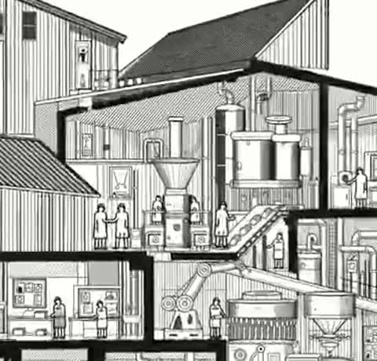</a></td>
</tr>
<tr>
<td width="50%" valign="top"><strong>AI 视频的 After Effects 再加工</strong> <a href="https://x.com/aicreataro">@aicreataro</a> · 短动效 0:15 · 收藏 433 · 资料待完善 <a href="https://guanmo-ai.github.io/awesome-ai-motion/#case-2102656273112326609">▶ 播放</a> · <a href="https://x.com/aicreataro/status/2102656273112326609">原帖</a></td>
<td width="50%" valign="top"><strong>黑白线条里的工业建筑</strong> <a href="https://x.com/mickeyxfriedman">@mickeyxfriedman</a> · 短动效 0:20 · 收藏 432 · 资料待完善 <a href="https://guanmo-ai.github.io/awesome-ai-motion/#case-2113768150840012988">▶ 播放</a> · <a href="https://x.com/mickeyxfriedman/status/2113768150840012988">原帖</a></td>
</tr>
</tbody>
<tbody>
<tr>
<td width="50%" height="225" align="center" valign="middle"></td>
<td width="50%" height="225" align="center" valign="middle"></td>
</tr>
<tr>
<td width="50%" valign="top"><strong>模型感受的抽象动画</strong> <a href="https://x.com/AndrewOnXYZ">@AndrewOnXYZ</a> · 短动效 3:32 · 收藏 397 · 资料待完善 <a href="https://guanmo-ai.github.io/awesome-ai-motion/#case-2102817596009504849">▶ 播放</a> · <a href="https://x.com/AndrewOnXYZ/status/2102817596009504849">原帖</a></td>
<td width="50%" valign="top"><strong>开发对话过程的三维回顾片</strong> <a href="https://x.com/shneural">@shneural</a> · 短动效 0:56 · 收藏 391 · 资料待完善 <a href="https://guanmo-ai.github.io/awesome-ai-motion/#case-2103472385563459833">▶ 播放</a> · <a href="https://x.com/shneural/status/2103472385563459833">原帖</a></td>
</tr>
</tbody>
<tbody>
<tr>
<td width="50%" height="225" align="center" valign="middle"></td>
<td width="50%" height="225" align="center" valign="middle"></td>
</tr>
<tr>
<td width="50%" valign="top"><strong>九十年代风格视听演示</strong> <a href="https://x.com/gandamu_ml">@gandamu_ml</a> · 短动效 6:23 · 收藏 358 · 资料待完善 <a href="https://guanmo-ai.github.io/awesome-ai-motion/#case-2102919394775220530">▶ 播放</a> · <a href="https://x.com/gandamu_ml/status/2102919394775220530">原帖</a></td>
<td width="50%" valign="top"><strong>单指令沙画动画</strong> <a href="https://x.com/Michaelzsguo">@Michaelzsguo</a> · 短动效 2:00 · 收藏 355 · 资料待完善 <a href="https://guanmo-ai.github.io/awesome-ai-motion/#case-2102592355165782312">▶ 播放</a> · <a href="https://x.com/Michaelzsguo/status/2102592355165782312">原帖</a></td>
</tr>
</tbody>
<tbody>
<tr>
<td width="50%" height="225" align="center" valign="middle"></td>
<td width="50%" height="225" align="center" valign="middle"></td>
</tr>
<tr>
<td width="50%" valign="top"><strong>逐笔生长的水墨宣纸</strong> <a href="https://x.com/AxtonLiu">@AxtonLiu</a> · 短动效 0:39 · 收藏 347 · 资料待完善 <a href="https://guanmo-ai.github.io/awesome-ai-motion/#case-2103288413969621231">▶ 播放</a> · <a href="https://x.com/AxtonLiu/status/2103288413969621231">原帖</a></td>
<td width="50%" valign="top"><strong>AndrewOnXYZ：待核作品</strong> <a href="https://x.com/AndrewOnXYZ">@AndrewOnXYZ</a> · 短动效 1:58 · 收藏 339 · 资料待完善 <a href="https://guanmo-ai.github.io/awesome-ai-motion/#case-2102128068693266453">▶ 播放</a> · <a href="https://x.com/AndrewOnXYZ/status/2102128068693266453">原帖</a></td>
</tr>
</tbody>
<tbody>
<tr>
<td width="50%" height="225" align="center" valign="middle"></td>
<td width="50%" height="225" align="center" valign="middle"></td>
</tr>
<tr>
<td width="50%" valign="top"><strong>从圆到鸟群</strong> <a href="https://x.com/HBCoop_">@HBCoop_</a> · 短动效 0:29 · 收藏 278 · 资料待完善 <a href="https://guanmo-ai.github.io/awesome-ai-motion/#case-2107139305324122491">▶ 播放</a> · <a href="https://x.com/HBCoop_/status/2107139305324122491">原帖</a></td>
<td width="50%" valign="top"><strong>海浪、棕榈与阴影的代码海岸</strong> <a href="https://x.com/LexnLin">@LexnLin</a> · 短动效 0:18 · 收藏 275 · 资料待完善 <a href="https://guanmo-ai.github.io/awesome-ai-motion/#case-2108694114476650840">▶ 播放</a> · <a href="https://x.com/LexnLin/status/2108694114476650840">原帖</a></td>
</tr>
</tbody>
<tbody>
<tr>
<td width="50%" height="225" align="center" valign="middle"></td>
<td width="50%" height="225" align="center" valign="middle"></td>
</tr>
<tr>
<td width="50%" valign="top"><strong>纸上小人的循环动画</strong> <a href="https://x.com/kevin_t_ngo">@kevin_t_ngo</a> · 短动效 0:05 · 收藏 259 · 资料待完善 <a href="https://guanmo-ai.github.io/awesome-ai-motion/#case-2109003656280646014">▶ 播放</a> · <a href="https://x.com/kevin_t_ngo/status/2109003656280646014">原帖</a></td>
<td width="50%" valign="top"><strong>箔纸花卉贺卡</strong> <a href="https://x.com/ann_nnng">@ann_nnng</a> · 短动效 0:23 · 收藏 245 · 资料待完善 <a href="https://guanmo-ai.github.io/awesome-ai-motion/#case-2105606322310054044">▶ 播放</a> · <a href="https://x.com/ann_nnng/status/2105606322310054044">原帖</a></td>
</tr>
</tbody>
<tbody>
<tr>
<td width="50%" height="225" align="center" valign="middle"></td>
<td width="50%" height="225" align="center" valign="middle"></td>
</tr>
<tr>
<td width="50%" valign="top"><strong>模型工作计划概念短片</strong> <a href="https://x.com/chetaslua">@chetaslua</a> · 短动效 3:18 · 收藏 234 · 资料待完善 <a href="https://guanmo-ai.github.io/awesome-ai-motion/#case-2102717699600368045">▶ 播放</a> · <a href="https://x.com/chetaslua/status/2102717699600368045">原帖</a></td>
<td width="50%" valign="top"><strong>手绘按钮与昼夜开关动效</strong> <a href="https://x.com/kevin_t_ngo">@kevin_t_ngo</a> · 短动效 0:25 · 收藏 233 · 资料待完善 <a href="https://guanmo-ai.github.io/awesome-ai-motion/#case-2111974919353544757">▶ 播放</a> · <a href="https://x.com/kevin_t_ngo/status/2111974919353544757">原帖</a></td>
</tr>
</tbody>
<tbody>
<tr>
<td width="50%" height="225" align="center" valign="middle"></td>
<td width="50%" height="225" align="center" valign="middle"></td>
</tr>
<tr>
<td width="50%" valign="top"><strong>单次指令生成的动画实验</strong> <a href="https://x.com/pivi___">@pivi___</a> · 短动效 0:33 · 收藏 233 · 资料待完善 <a href="https://guanmo-ai.github.io/awesome-ai-motion/#case-2103024907965612250">▶ 播放</a> · <a href="https://x.com/pivi___/status/2103024907965612250">原帖</a></td>
<td width="50%" valign="top"><strong>四季中的水彩小屋</strong> <a href="https://x.com/thebuggeddev">@thebuggeddev</a> · 短动效 0:45 · 收藏 231 · 资料待完善 <a href="https://guanmo-ai.github.io/awesome-ai-motion/#case-2103192913140469762">▶ 播放</a> · <a href="https://x.com/thebuggeddev/status/2103192913140469762">原帖</a></td>
</tr>
</tbody>
<tbody>
<tr>
<td width="50%" height="225" align="center" valign="middle"></td>
<td width="50%" height="225" align="center" valign="middle"></td>
</tr>
<tr>
<td width="50%" valign="top"><strong>12 种微动效组合展示</strong> <a href="https://x.com/humzaakhalid">@humzaakhalid</a> · 短动效 0:04 · 收藏 222 · 资料待完善 <a href="https://guanmo-ai.github.io/awesome-ai-motion/#case-2109946042355753399">▶ 播放</a> · <a href="https://x.com/humzaakhalid/status/2109946042355753399">原帖</a></td>
<td width="50%" valign="top"><strong>珍珠少女的三维马赛克</strong> <a href="https://x.com/redp314">@redp314</a> · 短动效 0:32 · 收藏 217 · 资料待完善 <a href="https://guanmo-ai.github.io/awesome-ai-motion/#case-2106324559805010004">▶ 播放</a> · <a href="https://x.com/redp314/status/2106324559805010004">原帖</a></td>
</tr>
</tbody>
<tbody>
<tr>
<td width="50%" height="225" align="center" valign="middle"></td>
<td width="50%" height="225" align="center" valign="middle"></td>
</tr>
<tr>
<td width="50%" valign="top"><strong>从提示词到橙色胶片</strong> <a href="https://x.com/notdwd">@notdwd</a> · 短动效 0:12 · 收藏 217 · 资料待完善 <a href="https://guanmo-ai.github.io/awesome-ai-motion/#case-2105031774904766641">▶ 播放</a> · <a href="https://x.com/notdwd/status/2105031774904766641">原帖</a></td>
<td width="50%" valign="top"><strong>模型成长训练蒙太奇</strong> <a href="https://x.com/ishuagra02">@ishuagra02</a> · 短动效 0:30 · 收藏 195 · 资料待完善 <a href="https://guanmo-ai.github.io/awesome-ai-motion/#case-2102788371114246177">▶ 播放</a> · <a href="https://x.com/ishuagra02/status/2102788371114246177">原帖</a></td>
</tr>
</tbody>
<tbody>
<tr>
<td width="50%" height="225" align="center" valign="middle"></td>
<td width="50%" height="225" align="center" valign="middle"></td>
</tr>
<tr>
<td width="50%" valign="top"><strong>Verdant：随滚动打开的地表</strong> <a href="https://x.com/viktoroddy">@viktoroddy</a> · 短动效 0:22 · 收藏 189 · 资料待完善 <a href="https://guanmo-ai.github.io/awesome-ai-motion/#case-2109984169845821651">▶ 播放</a> · <a href="https://x.com/viktoroddy/status/2109984169845821651">原帖</a></td>
<td width="50%" valign="top"><strong>可以给你百分之十的我吗</strong> <a href="https://x.com/DaphneRHansell">@DaphneRHansell</a> · 短动效 2:24 · 收藏 188 · 资料待完善 <a href="https://guanmo-ai.github.io/awesome-ai-motion/#case-2111106459408986368">▶ 播放</a> · <a href="https://x.com/DaphneRHansell/status/2111106459408986368">原帖</a></td>
</tr>
</tbody>
<tbody>
<tr>
<td width="50%" height="225" align="center" valign="middle"></td>
<td width="50%" height="225" align="center" valign="middle"></td>
</tr>
<tr>
<td width="50%" valign="top"><strong>把创作过程做成动效</strong> <a href="https://x.com/aicreataro">@aicreataro</a> · 短动效 0:42 · 收藏 184 · 资料待完善 <a href="https://guanmo-ai.github.io/awesome-ai-motion/#case-2109286588891214094">▶ 播放</a> · <a href="https://x.com/aicreataro/status/2109286588891214094">原帖</a></td>
<td width="50%" valign="top"><strong>教师节手绘动效</strong> <a href="https://x.com/ai4everyday">@ai4everyday</a> · 短动效 1:06 · 收藏 170 · 资料待完善 <a href="https://guanmo-ai.github.io/awesome-ai-motion/#case-2106992353219056006">▶ 播放</a> · <a href="https://x.com/ai4everyday/status/2106992353219056006">原帖</a></td>
</tr>
</tbody>
<tbody>
<tr>
<td width="50%" height="225" align="center" valign="middle"></td>
<td width="50%" height="225" align="center" valign="middle"></td>
</tr>
<tr>
<td width="50%" valign="top"><strong>把卡通街景重建成 GLSL Shader</strong> <a href="https://x.com/gokayfem">@gokayfem</a> · 短动效 0:53 · 收藏 166 · 资料待完善 <a href="https://guanmo-ai.github.io/awesome-ai-motion/#case-2111907592129671505">▶ 播放</a> · <a href="https://x.com/gokayfem/status/2111907592129671505">原帖</a></td>
<td width="50%" valign="top"><strong>26 万体素的连续形变</strong> <a href="https://x.com/LexnLin">@LexnLin</a> · 短动效 1:18 · 收藏 163 · 资料待完善 <a href="https://guanmo-ai.github.io/awesome-ai-motion/#case-2112310361194140058">▶ 播放</a> · <a href="https://x.com/LexnLin/status/2112310361194140058">原帖</a></td>
</tr>
</tbody>
<tbody>
<tr>
<td width="50%" height="225" align="center" valign="middle"></td>
<td width="50%" height="225" align="center" valign="middle"></td>
</tr>
<tr>
<td width="50%" valign="top"><strong>火车窗边的局部动画</strong> <a href="https://x.com/shironagasu_ai">@shironagasu_ai</a> · 短动效 0:10 · 收藏 161 · 资料待完善 <a href="https://guanmo-ai.github.io/awesome-ai-motion/#case-2106299981875347740">▶ 播放</a> · <a href="https://x.com/shironagasu_ai/status/2106299981875347740">原帖</a></td>
<td width="50%" valign="top"><strong>程序化法术与声音实验场</strong> <a href="https://x.com/majidmanzarpour">@majidmanzarpour</a> · 短动效 1:39 · 收藏 141 · 资料待完善 <a href="https://guanmo-ai.github.io/awesome-ai-motion/#case-2102586912993116411">▶ 播放</a> · <a href="https://x.com/majidmanzarpour/status/2102586912993116411">原帖</a></td>
</tr>
</tbody>
<tbody>
<tr>
<td width="50%" height="225" align="center" valign="middle"></td>
<td width="50%" height="225" align="center" valign="middle"></td>
</tr>
<tr>
<td width="50%" valign="top"><strong>参考影片视觉节奏程序化复现</strong> <a href="https://x.com/leo_xiaolei">@leo_xiaolei</a> · 短动效 0:28 · 收藏 140 · 资料待完善 <a href="https://guanmo-ai.github.io/awesome-ai-motion/#case-2102724347446305104">▶ 播放</a> · <a href="https://x.com/leo_xiaolei/status/2102724347446305104">原帖</a></td>
<td width="50%" valign="top"><strong>DESIGN / WEIGHT：字体与故障动效</strong> <a href="https://x.com/tequilafunks">@tequilafunks</a> · 短动效 0:15 · 收藏 108 · 资料待完善 <a href="https://guanmo-ai.github.io/awesome-ai-motion/#case-2103528644828127728">▶ 播放</a> · <a href="https://x.com/tequilafunks/status/2103528644828127728">原帖</a></td>
</tr>
</tbody>
<tbody>
<tr>
<td width="50%" height="225" align="center" valign="middle"><a href="https://guanmo-ai.github.io/awesome-ai-motion/#case-2107466191178711054">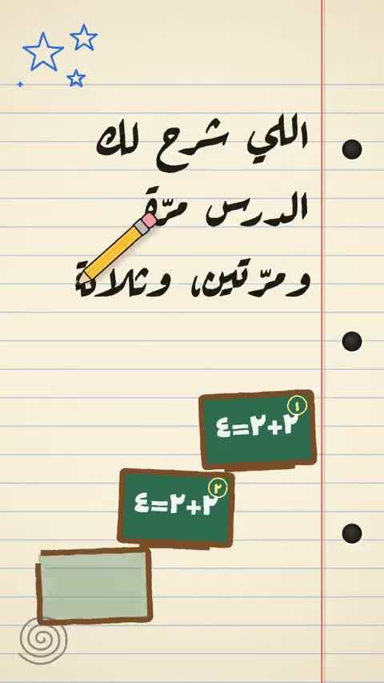</a></td>
<td width="50%" height="225" align="center" valign="middle"></td>
</tr>
<tr>
<td width="50%" valign="top"><strong>阿拉伯语手写风教师节短片</strong> <a href="https://x.com/youssef_aymanc">@youssef_aymanc</a> · 短动效 0:33 · 收藏 102 · 资料待完善 <a href="https://guanmo-ai.github.io/awesome-ai-motion/#case-2107466191178711054">▶ 播放</a> · <a href="https://x.com/youssef_aymanc/status/2107466191178711054">原帖</a></td>
<td width="50%" valign="top"><strong>konstantinsaifo：待核作品</strong> <a href="https://x.com/konstantinsaifo">@konstantinsaifo</a> · 短动效 0:34 · 收藏 100 · 资料待完善 <a href="https://guanmo-ai.github.io/awesome-ai-motion/#case-2109595253879816337">▶ 播放</a> · <a href="https://x.com/konstantinsaifo/status/2109595253879816337">原帖</a></td>
</tr>
</tbody>
<tbody>
<tr>
<td width="50%" height="225" align="center" valign="middle"></td>
<td width="50%" height="225" align="center" valign="middle"></td>
</tr>
<tr>
<td width="50%" valign="top"><strong>浏览器中的三维火焰爆发</strong> <a href="https://x.com/Aurelien_Gz">@Aurelien_Gz</a> · 短动效 1:01 · 收藏 87 · 资料待完善 <a href="https://guanmo-ai.github.io/awesome-ai-motion/#case-2104251332354085344">▶ 播放</a> · <a href="https://x.com/Aurelien_Gz/status/2104251332354085344">原帖</a></td>
<td width="50%" valign="top"><strong>用几何纹样画出模型自画像</strong> <a href="https://x.com/kevin_t_ngo">@kevin_t_ngo</a> · 短动效 0:20 · 收藏 83 · 资料待完善 <a href="https://guanmo-ai.github.io/awesome-ai-motion/#case-2107462206610935857">▶ 播放</a> · <a href="https://x.com/kevin_t_ngo/status/2107462206610935857">原帖</a></td>
</tr>
</tbody>
<tbody>
<tr>
<td width="50%" height="225" align="center" valign="middle"></td>
<td width="50%" height="225" align="center" valign="middle"></td>
</tr>
<tr>
<td width="50%" valign="top"><strong>黑洞与能量环的游戏特效</strong> <a href="https://x.com/JohnKlerAI">@JohnKlerAI</a> · 短动效 0:11 · 收藏 80 · 资料待完善 <a href="https://guanmo-ai.github.io/awesome-ai-motion/#case-2112324937872490552">▶ 播放</a> · <a href="https://x.com/JohnKlerAI/status/2112324937872490552">原帖</a></td>
<td width="50%" valign="top"><strong>JavaScript 逐帧旁白动画</strong> <a href="https://x.com/kevin_t_ngo">@kevin_t_ngo</a> · 短动效 1:20 · 收藏 80 · 资料待完善 <a href="https://guanmo-ai.github.io/awesome-ai-motion/#case-2104213302624821647">▶ 播放</a> · <a href="https://x.com/kevin_t_ngo/status/2104213302624821647">原帖</a></td>
</tr>
</tbody>
<tbody>
<tr>
<td width="50%" height="225" align="center" valign="middle"></td>
<td width="50%" height="225" align="center" valign="middle"></td>
</tr>
<tr>
<td width="50%" valign="top"><strong>Roadster 的线稿特技演示</strong> <a href="https://x.com/devteamdrew">@devteamdrew</a> · 短动效 0:18 · 收藏 78 · 资料待完善 <a href="https://guanmo-ai.github.io/awesome-ai-motion/#case-2111235450035745058">▶ 播放</a> · <a href="https://x.com/devteamdrew/status/2111235450035745058">原帖</a></td>
<td width="50%" valign="top"><strong>线稿曝光与分层合成测试</strong> <a href="https://x.com/araminta_k">@araminta_k</a> · 短动效 0:25 · 收藏 78 · 资料待完善 <a href="https://guanmo-ai.github.io/awesome-ai-motion/#case-2103244081388503196">▶ 播放</a> · <a href="https://x.com/araminta_k/status/2103244081388503196">原帖</a></td>
</tr>
</tbody>
<tbody>
<tr>
<td width="50%" height="225" align="center" valign="middle"></td>
<td width="50%" height="225" align="center" valign="middle"></td>
</tr>
<tr>
<td width="50%" valign="top"><strong>Anidoodle：代码绘制与配乐样片</strong> <a href="https://x.com/alexgreensh">@alexgreensh</a> · 短动效 0:31 · 收藏 73 · 资料待完善 <a href="https://guanmo-ai.github.io/awesome-ai-motion/#case-2107086004964282814">▶ 播放</a> · <a href="https://x.com/alexgreensh/status/2107086004964282814">原帖</a></td>
<td width="50%" valign="top"><strong>15 秒动效：两次同题试验</strong> <a href="https://x.com/mesmerlord">@mesmerlord</a> · 短动效 0:15 · 收藏 65 · 资料待完善 <a href="https://guanmo-ai.github.io/awesome-ai-motion/#case-2105758042830549235">▶ 播放</a> · <a href="https://x.com/mesmerlord/status/2105758042830549235">原帖</a></td>
</tr>
</tbody>
<tbody>
<tr>
<td width="50%" height="225" align="center" valign="middle"></td>
<td width="50%" height="225" align="center" valign="middle"></td>
</tr>
<tr>
<td width="50%" valign="top"><strong>Excel 图形组成的逐格短片</strong> <a href="https://x.com/aicreataro">@aicreataro</a> · 短动效 1:01 · 收藏 61 · 资料待完善 <a href="https://guanmo-ai.github.io/awesome-ai-motion/#case-2109892378383540394">▶ 播放</a> · <a href="https://x.com/aicreataro/status/2109892378383540394">原帖</a></td>
<td width="50%" valign="top"><strong>HyperFrames 单指令动效试片</strong> <a href="https://x.com/leandroriviello">@leandroriviello</a> · 短动效 0:14 · 收藏 52 · 资料待完善 <a href="https://guanmo-ai.github.io/awesome-ai-motion/#case-2104728379798827135">▶ 播放</a> · <a href="https://x.com/leandroriviello/status/2104728379798827135">原帖</a></td>
</tr>
</tbody>
<tbody>
<tr>
<td width="50%" height="225" align="center" valign="middle"></td>
<td width="50%" height="225" align="center" valign="middle"><a href="https://guanmo-ai.github.io/awesome-ai-motion/#case-2107046643904426453">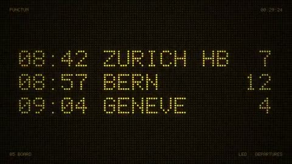</a></td>
</tr>
<tr>
<td width="50%" valign="top"><strong>同一段代码动画的两种画风</strong> <a href="https://x.com/Aurelien_Gz">@Aurelien_Gz</a> · 短动效 0:28 · 收藏 51 · 资料待完善 <a href="https://guanmo-ai.github.io/awesome-ai-motion/#case-2102502056603136078">▶ 播放</a> · <a href="https://x.com/Aurelien_Gz/status/2102502056603136078">原帖</a></td>
<td width="50%" valign="top"><strong>PUNCTUM：点阵字体的发布动效</strong> <a href="https://x.com/sundyme">@sundyme</a> · 短动效 0:42 · 收藏 48 · 资料待完善 <a href="https://guanmo-ai.github.io/awesome-ai-motion/#case-2107046643904426453">▶ 播放</a> · <a href="https://x.com/sundyme/status/2107046643904426453">原帖</a></td>
</tr>
</tbody>
<tbody>
<tr>
<td width="50%" height="225" align="center" valign="middle"></td>
<td width="50%" height="225" align="center" valign="middle"></td>
</tr>
<tr>
<td width="50%" valign="top"><strong>把 API Keys 画成真正的钥匙</strong> <a href="https://x.com/SergioGMN">@SergioGMN</a> · 短动效 0:31 · 收藏 47 · 资料待完善 <a href="https://guanmo-ai.github.io/awesome-ai-motion/#case-2111582026092470741">▶ 播放</a> · <a href="https://x.com/SergioGMN/status/2111582026092470741">原帖</a></td>
<td width="50%" valign="top"><strong>几何战争风格的光网射击</strong> <a href="https://x.com/cherry_mx_reds">@cherry_mx_reds</a> · 短动效 2:12 · 收藏 41 · 资料待完善 <a href="https://guanmo-ai.github.io/awesome-ai-motion/#case-2102529784131600745">▶ 播放</a> · <a href="https://x.com/cherry_mx_reds/status/2102529784131600745">原帖</a></td>
</tr>
</tbody>
<tbody>
<tr>
<td width="50%" height="225" align="center" valign="middle"></td>
<td width="50%" height="225" align="center" valign="middle"></td>
</tr>
<tr>
<td width="50%" valign="top"><strong>thebuggeddev：待核作品</strong> <a href="https://x.com/thebuggeddev">@thebuggeddev</a> · 短动效 0:22 · 收藏 41 · 资料待完善 <a href="https://guanmo-ai.github.io/awesome-ai-motion/#case-2109524968686100500">▶ 播放</a> · <a href="https://x.com/thebuggeddev/status/2109524968686100500">原帖</a></td>
<td width="50%" valign="top"><strong>FUNTECH 像素文字与三维网页动效</strong> <a href="https://x.com/yoshi15_funtech">@yoshi15_funtech</a> · 短动效 0:47 · 收藏 41 · 资料待完善 <a href="https://guanmo-ai.github.io/awesome-ai-motion/#case-2109836860067606721">▶ 播放</a> · <a href="https://x.com/yoshi15_funtech/status/2109836860067606721">原帖</a></td>
</tr>
</tbody>
<tbody>
<tr>
<td width="50%" height="225" align="center" valign="middle"></td>
<td width="50%" height="225" align="center" valign="middle"></td>
</tr>
<tr>
<td width="50%" valign="top"><strong>像素字与发光标志的预告</strong> <a href="https://x.com/jgarcelan">@jgarcelan</a> · 短动效 0:08 · 收藏 38 · 资料待完善 <a href="https://guanmo-ai.github.io/awesome-ai-motion/#case-2103797521612996910">▶ 播放</a> · <a href="https://x.com/jgarcelan/status/2103797521612996910">原帖</a></td>
<td width="50%" valign="top"><strong>MOTION：几何、粒子与节奏排版</strong> <a href="https://x.com/RaphaelAubryy">@RaphaelAubryy</a> · 短动效 0:15 · 收藏 35 · 资料待完善 <a href="https://guanmo-ai.github.io/awesome-ai-motion/#case-2103416909857190360">▶ 播放</a> · <a href="https://x.com/RaphaelAubryy/status/2103416909857190360">原帖</a></td>
</tr>
</tbody>
<tbody>
<tr>
<td width="50%" height="225" align="center" valign="middle"></td>
<td width="50%" height="225" align="center" valign="middle"></td>
</tr>
<tr>
<td width="50%" valign="top"><strong>数字与文字的故障风动效</strong> <a href="https://x.com/yyyole">@yyyole</a> · 短动效 1:20 · 收藏 35 · 资料待完善 <a href="https://guanmo-ai.github.io/awesome-ai-motion/#case-2104244923746947433">▶ 播放</a> · <a href="https://x.com/yyyole/status/2104244923746947433">原帖</a></td>
<td width="50%" valign="top"><strong>方块吉祥物与光环短片</strong> <a href="https://x.com/flxrnc">@flxrnc</a> · 短动效 0:32 · 收藏 34 · 资料待完善 <a href="https://guanmo-ai.github.io/awesome-ai-motion/#case-2106799122950869034">▶ 播放</a> · <a href="https://x.com/flxrnc/status/2106799122950869034">原帖</a></td>
</tr>
</tbody>
<tbody>
<tr>
<td width="50%" height="225" align="center" valign="middle"></td>
<td width="50%" height="225" align="center" valign="middle"></td>
</tr>
<tr>
<td width="50%" valign="top"><strong>蚂蚁群落的代码动画</strong> <a href="https://x.com/hanifproduktif">@hanifproduktif</a> · 短动效 0:32 · 收藏 31 · 资料待完善 <a href="https://guanmo-ai.github.io/awesome-ai-motion/#case-2102742924148830211">▶ 播放</a> · <a href="https://x.com/hanifproduktif/status/2102742924148830211">原帖</a></td>
<td width="50%" valign="top"><strong>本机对话历史变成动画</strong> <a href="https://x.com/jake11moran">@jake11moran</a> · 短动效 0:53 · 收藏 29 · 资料待完善 <a href="https://guanmo-ai.github.io/awesome-ai-motion/#case-2103247490237825416">▶ 播放</a> · <a href="https://x.com/jake11moran/status/2103247490237825416">原帖</a></td>
</tr>
</tbody>
<tbody>
<tr>
<td width="50%" height="225" align="center" valign="middle"></td>
<td width="50%" height="225" align="center" valign="middle"></td>
</tr>
<tr>
<td width="50%" valign="top"><strong>货币购买力主题的十五秒字排片</strong> <a href="https://x.com/cboyack">@cboyack</a> · 短动效 0:15 · 收藏 27 · 资料待完善 <a href="https://guanmo-ai.github.io/awesome-ai-motion/#case-2103617085402407181">▶ 播放</a> · <a href="https://x.com/cboyack/status/2103617085402407181">原帖</a></td>
<td width="50%" valign="top"><strong>184 种 SwiftUI 文字动效</strong> <a href="https://x.com/amos_gyamfi">@amos_gyamfi</a> · 短动效 2:16 · 收藏 26 · 资料待完善 <a href="https://guanmo-ai.github.io/awesome-ai-motion/#case-2109056620831649927">▶ 播放</a> · <a href="https://x.com/amos_gyamfi/status/2109056620831649927">原帖</a></td>
</tr>
</tbody>
<tbody>
<tr>
<td width="50%" height="225" align="center" valign="middle"></td>
<td width="50%" height="225" align="center" valign="middle"></td>
</tr>
<tr>
<td width="50%" valign="top"><strong>fframes：Rust 几何与音频响应动效</strong> <a href="https://x.com/BuildFastWithAI">@BuildFastWithAI</a> · 短动效 0:30 · 收藏 22 · 资料待完善 <a href="https://guanmo-ai.github.io/awesome-ai-motion/#case-2108403445304844291">▶ 播放</a> · <a href="https://x.com/BuildFastWithAI/status/2108403445304844291">原帖</a></td>
<td width="50%" valign="top"><strong>Claude 家族的马赛克肖像</strong> <a href="https://x.com/devteamdrew">@devteamdrew</a> · 短动效 0:17 · 收藏 19 · 资料待完善 <a href="https://guanmo-ai.github.io/awesome-ai-motion/#case-2105711844090429564">▶ 播放</a> · <a href="https://x.com/devteamdrew/status/2105711844090429564">原帖</a></td>
</tr>
</tbody>
<tbody>
<tr>
<td width="50%" height="225" align="center" valign="middle"></td>
<td width="50%" height="225" align="center" valign="middle"></td>
</tr>
<tr>
<td width="50%" valign="top"><strong>毛绒社交按钮的交互响应</strong> <a href="https://x.com/thebuggeddev">@thebuggeddev</a> · 短动效 0:22 · 收藏 18 · 资料待完善 <a href="https://guanmo-ai.github.io/awesome-ai-motion/#case-2103002563042042042">▶ 播放</a> · <a href="https://x.com/thebuggeddev/status/2103002563042042042">原帖</a></td>
<td width="50%" valign="top"><strong>Clawd 遨游五十六个品牌 Logo</strong> <a href="https://x.com/lemomo_ai">@lemomo_ai</a> · 短动效 3:43 · 收藏 16 · 资料待完善 <a href="https://guanmo-ai.github.io/awesome-ai-motion/#case-2110885678259269822">▶ 播放</a> · <a href="https://x.com/lemomo_ai/status/2110885678259269822">原帖</a></td>
</tr>
</tbody>
<tbody>
<tr>
<td width="50%" height="225" align="center" valign="middle"></td>
<td width="50%" height="225" align="center" valign="middle"></td>
</tr>
<tr>
<td width="50%" valign="top"><strong>Shaml：旋转纸艺与星夜</strong> <a href="https://x.com/makwired">@makwired</a> · 短动效 0:20 · 收藏 16 · 资料待完善 <a href="https://guanmo-ai.github.io/awesome-ai-motion/#case-2103008945220567166">▶ 播放</a> · <a href="https://x.com/makwired/status/2103008945220567166">原帖</a></td>
<td width="50%" valign="top"><strong>Clawd 角色的彩色螺旋循环</strong> <a href="https://x.com/kevin_t_ngo">@kevin_t_ngo</a> · 短动效 0:06 · 收藏 14 · 资料待完善 <a href="https://guanmo-ai.github.io/awesome-ai-motion/#case-2112056165672837425">▶ 播放</a> · <a href="https://x.com/kevin_t_ngo/status/2112056165672837425">原帖</a></td>
</tr>
</tbody>
<tbody>
<tr>
<td width="50%" height="225" align="center" valign="middle"></td>
<td width="50%" height="225" align="center" valign="middle"></td>
</tr>
<tr>
<td width="50%" valign="top"><strong>OpenAI 圆点角色的模型对照</strong> <a href="https://x.com/kepochnik">@kepochnik</a> · 短动效 0:18 · 收藏 11 · 资料待完善 <a href="https://guanmo-ai.github.io/awesome-ai-motion/#case-2107443775232438381">▶ 播放</a> · <a href="https://x.com/kepochnik/status/2107443775232438381">原帖</a></td>
<td width="50%" valign="top"><strong>日文 AI 叙事与大字动效</strong> <a href="https://x.com/mercarioji">@mercarioji</a> · 短动效 3:49 · 收藏 11 · 资料待完善 <a href="https://guanmo-ai.github.io/awesome-ai-motion/#case-2110709134417133872">▶ 播放</a> · <a href="https://x.com/mercarioji/status/2110709134417133872">原帖</a></td>
</tr>
</tbody>
<tbody>
<tr>
<td width="50%" height="225" align="center" valign="middle"></td>
<td width="50%" height="225" align="center" valign="middle"></td>
</tr>
<tr>
<td width="50%" valign="top"><strong>Roblox 魔法特效修改试验</strong> <a href="https://x.com/JohnKlerAI">@JohnKlerAI</a> · 短动效 0:06 · 收藏 9 · 资料待完善 <a href="https://guanmo-ai.github.io/awesome-ai-motion/#case-2107484860717973791">▶ 播放</a> · <a href="https://x.com/JohnKlerAI/status/2107484860717973791">原帖</a></td>
<td width="50%" valign="top"><strong>极光、雪山与湖面的单文件 Shader</strong> <a href="https://x.com/ottollm">@ottollm</a> · 短动效 0:30 · 收藏 8 · 资料待完善 <a href="https://guanmo-ai.github.io/awesome-ai-motion/#case-2111786470935544214">▶ 播放</a> · <a href="https://x.com/ottollm/status/2111786470935544214">原帖</a></td>
</tr>
</tbody>
<tbody>
<tr>
<td width="50%" height="225" align="center" valign="middle"></td>
<td width="50%" height="225" align="center" valign="middle"></td>
</tr>
<tr>
<td width="50%" valign="top"><strong>旧界面上的 DVD 风格动效</strong> <a href="https://x.com/AdamPolify">@AdamPolify</a> · 短动效 0:08 · 收藏 7 · 资料待完善 <a href="https://guanmo-ai.github.io/awesome-ai-motion/#case-2107592216126411062">▶ 播放</a> · <a href="https://x.com/AdamPolify/status/2107592216126411062">原帖</a></td>
<td width="50%" valign="top"><strong>怀旧电子设备与像素画面</strong> <a href="https://x.com/twoclipping">@twoclipping</a> · 短动效 0:19 · 收藏 7 · 资料待完善 <a href="https://guanmo-ai.github.io/awesome-ai-motion/#case-2109623099050115548">▶ 播放</a> · <a href="https://x.com/twoclipping/status/2109623099050115548">原帖</a></td>
</tr>
</tbody>
<tbody>
<tr>
<td width="50%" height="225" align="center" valign="middle"></td>
<td width="50%" height="225" align="center" valign="middle"></td>
</tr>
<tr>
<td width="50%" valign="top"><strong>波音747零件组装动画</strong> <a href="https://x.com/misat0x">@misat0x</a> · 短动效 1:00 · 收藏 7 · 资料待完善 <a href="https://guanmo-ai.github.io/awesome-ai-motion/#case-2108510836981445009">▶ 播放</a> · <a href="https://x.com/misat0x/status/2108510836981445009">原帖</a></td>
<td width="50%" valign="top"><strong>让网页长满花朵</strong> <a href="https://x.com/thebuggeddev">@thebuggeddev</a> · 短动效 0:42 · 收藏 6 · 资料待完善 <a href="https://guanmo-ai.github.io/awesome-ai-motion/#case-2106006478998180260">▶ 播放</a> · <a href="https://x.com/thebuggeddev/status/2106006478998180260">原帖</a></td>
</tr>
</tbody>
<tbody>
<tr>
<td width="50%" height="225" align="center" valign="middle"></td>
<td width="50%" height="225" align="center" valign="middle"></td>
</tr>
<tr>
<td width="50%" valign="top"><strong>VincentWei93：待核作品</strong> <a href="https://x.com/VincentWei93">@VincentWei93</a> · 短动效 0:35 · 收藏 6 · 资料待完善 <a href="https://guanmo-ai.github.io/awesome-ai-motion/#case-2104603177610060161">▶ 播放</a> · <a href="https://x.com/VincentWei93/status/2104603177610060161">原帖</a></td>
<td width="50%" valign="top"><strong>危险权限开关的卡通特技片</strong> <a href="https://x.com/ishuagra02">@ishuagra02</a> · 短动效 1:38 · 收藏 4 · 资料待完善 <a href="https://guanmo-ai.github.io/awesome-ai-motion/#case-2108615535164367146">▶ 播放</a> · <a href="https://x.com/ishuagra02/status/2108615535164367146">原帖</a></td>
</tr>
</tbody>
<tbody>
<tr>
<td width="50%" height="225" align="center" valign="middle"></td>
<td width="50%" height="225" align="center" valign="middle"></td>
</tr>
<tr>
<td width="50%" valign="top"><strong>画框中的 Starship 发射</strong> <a href="https://x.com/devteamdrew">@devteamdrew</a> · 短动效 0:19 · 收藏 4 · 资料待完善 <a href="https://guanmo-ai.github.io/awesome-ai-motion/#case-2107156755763364178">▶ 播放</a> · <a href="https://x.com/devteamdrew/status/2107156755763364178">原帖</a></td>
<td width="50%" valign="top"><strong>液体玻璃与动态文字网页实验</strong> <a href="https://x.com/Aurelien_Gz">@Aurelien_Gz</a> · 短动效 0:50 · 收藏 4 · 资料待完善 <a href="https://guanmo-ai.github.io/awesome-ai-motion/#case-2105367456025874553">▶ 播放</a> · <a href="https://x.com/Aurelien_Gz/status/2105367456025874553">原帖</a></td>
</tr>
</tbody>
<tbody>
<tr>
<td width="50%" height="225" align="center" valign="middle"></td>
<td width="50%" height="225" align="center" valign="middle"></td>
</tr>
<tr>
<td width="50%" valign="top"><strong>卡片入场动效与缓动曲线校正</strong> <a href="https://x.com/genuenci">@genuenci</a> · 短动效 0:25 · 收藏 3 · 资料待完善 <a href="https://guanmo-ai.github.io/awesome-ai-motion/#case-2109232824838467652">▶ 播放</a> · <a href="https://x.com/genuenci/status/2109232824838467652">原帖</a></td>
<td width="50%" valign="top"><strong>立方体与粒子阵列作品集</strong> <a href="https://x.com/SadAlbert10">@SadAlbert10</a> · 短动效 0:45 · 收藏 3 · 资料待完善 <a href="https://guanmo-ai.github.io/awesome-ai-motion/#case-2106123044569890823">▶ 播放</a> · <a href="https://x.com/SadAlbert10/status/2106123044569890823">原帖</a></td>
</tr>
</tbody>
<tbody>
<tr>
<td width="50%" height="225" align="center" valign="middle"></td>
<td width="50%" height="225" align="center" valign="middle"></td>
</tr>
<tr>
<td width="50%" valign="top"><strong>Motion：时间函数的排版短动效</strong> <a href="https://x.com/lochan_twt">@lochan_twt</a> · 短动效 0:16 · 收藏 3 · 资料待完善 <a href="https://guanmo-ai.github.io/awesome-ai-motion/#case-2107796331561730439">▶ 播放</a> · <a href="https://x.com/lochan_twt/status/2107796331561730439">原帖</a></td>
<td width="50%" valign="top"><strong>同一角色穿越漫画、像素与蒸汽波</strong> <a href="https://x.com/AlchainHust">@AlchainHust</a> · 短动效 0:20 · 收藏 3 · 资料待完善 <a href="https://guanmo-ai.github.io/awesome-ai-motion/#case-2107641558073803075">▶ 播放</a> · <a href="https://x.com/AlchainHust/status/2107641558073803075">原帖</a></td>
</tr>
</tbody>
<tbody>
<tr>
<td width="50%" height="225" align="center" valign="middle"></td>
<td width="50%" height="225" align="center" valign="middle"></td>
</tr>
<tr>
<td width="50%" valign="top"><strong>THE CHEF / THE DISH：Motion DSL 动画</strong> <a href="https://x.com/sofwath">@sofwath</a> · 短动效 0:12 · 收藏 3 · 资料待完善 <a href="https://guanmo-ai.github.io/awesome-ai-motion/#case-2108956236742074521">▶ 播放</a> · <a href="https://x.com/sofwath/status/2108956236742074521">原帖</a></td>
<td width="50%" valign="top"><strong>从一个点展开的动态图形</strong> <a href="https://x.com/enhanced_jp">@enhanced_jp</a> · 短动效 0:15 · 收藏 3 · 资料待完善 <a href="https://guanmo-ai.github.io/awesome-ai-motion/#case-2103424960211644662">▶ 播放</a> · <a href="https://x.com/enhanced_jp/status/2103424960211644662">原帖</a></td>
</tr>
</tbody>
<tbody>
<tr>
<td width="50%" height="225" align="center" valign="middle"></td>
<td width="50%" height="225" align="center" valign="middle"></td>
</tr>
<tr>
<td width="50%" valign="top"><strong>带一条线去散步</strong> <a href="https://x.com/pradeepXkapoor">@pradeepXkapoor</a> · 短动效 0:41 · 收藏 2 · 资料待完善 <a href="https://guanmo-ai.github.io/awesome-ai-motion/#case-2109657381881962673">▶ 播放</a> · <a href="https://x.com/pradeepXkapoor/status/2109657381881962673">原帖</a></td>
<td width="50%" valign="top"><strong>旧动效的代码续作</strong> <a href="https://x.com/elianiva_">@elianiva_</a> · 短动效 0:26 · 收藏 2 · 资料待完善 <a href="https://guanmo-ai.github.io/awesome-ai-motion/#case-2103003425915195750">▶ 播放</a> · <a href="https://x.com/elianiva_/status/2103003425915195750">原帖</a></td>
</tr>
</tbody>
<tbody>
<tr>
<td width="50%" height="225" align="center" valign="middle"></td>
<td width="50%" height="225" align="center" valign="middle"></td>
</tr>
<tr>
<td width="50%" valign="top"><strong>15 秒 Opus 几何动效对照</strong> <a href="https://x.com/mesmerlord">@mesmerlord</a> · 短动效 0:15 · 收藏 2 · 资料待完善 <a href="https://guanmo-ai.github.io/awesome-ai-motion/#case-2105766824558174486">▶ 播放</a> · <a href="https://x.com/mesmerlord/status/2105766824558174486">原帖</a></td>
<td width="50%" valign="top"><strong>深色图形与数据动效练习</strong> <a href="https://x.com/0xRapzz">@0xRapzz</a> · 短动效 0:45 · 收藏 2 · 资料待完善 <a href="https://guanmo-ai.github.io/awesome-ai-motion/#case-2106062139920433554">▶ 播放</a> · <a href="https://x.com/0xRapzz/status/2106062139920433554">原帖</a></td>
</tr>
</tbody>
<tbody>
<tr>
<td width="50%" height="225" align="center" valign="middle"></td>
<td width="50%" height="225" align="center" valign="middle"></td>
</tr>
<tr>
<td width="50%" valign="top"><strong>作品集 Work 区域转场</strong> <a href="https://x.com/adamhmwn">@adamhmwn</a> · 短动效 0:05 · 收藏 2 · 资料待完善 <a href="https://guanmo-ai.github.io/awesome-ai-motion/#case-2108920438244143547">▶ 播放</a> · <a href="https://x.com/adamhmwn/status/2108920438244143547">原帖</a></td>
<td width="50%" valign="top"><strong>铬金属结：绽放、解体与重组</strong> <a href="https://x.com/gogu_name">@gogu_name</a> · 短动效 0:15 · 收藏 2 · 资料待完善 <a href="https://guanmo-ai.github.io/awesome-ai-motion/#case-2104347638883873255">▶ 播放</a> · <a href="https://x.com/gogu_name/status/2104347638883873255">原帖</a></td>
</tr>
</tbody>
<tbody>
<tr>
<td width="50%" height="225" align="center" valign="middle"></td>
<td width="50%" height="225" align="center" valign="middle"></td>
</tr>
<tr>
<td width="50%" valign="top"><strong>虚构企业的三维片尾标志</strong> <a href="https://x.com/arumii_movie">@arumii_movie</a> · 短动效 0:15 · 收藏 1 · 资料待完善 <a href="https://guanmo-ai.github.io/awesome-ai-motion/#case-2107737607908249613">▶ 播放</a> · <a href="https://x.com/arumii_movie/status/2107737607908249613">原帖</a></td>
<td width="50%" valign="top"><strong>OPUS 5.5 ROCKS：字体变形</strong> <a href="https://x.com/neha_d4">@neha_d4</a> · 短动效 0:12 · 收藏 1 · 资料待完善 <a href="https://guanmo-ai.github.io/awesome-ai-motion/#case-2110639818845966569">▶ 播放</a> · <a href="https://x.com/neha_d4/status/2110639818845966569">原帖</a></td>
</tr>
</tbody>
<tbody>
<tr>
<td width="50%" height="225" align="center" valign="middle"></td>
<td width="50%" height="225" align="center" valign="middle"></td>
</tr>
<tr>
<td width="50%" valign="top"><strong>HyperFrames 动效与代码配乐</strong> <a href="https://x.com/Dheepanratnam">@Dheepanratnam</a> · 短动效 0:58 · 收藏 1 · 资料待完善 <a href="https://guanmo-ai.github.io/awesome-ai-motion/#case-2107568904075706454">▶ 播放</a> · <a href="https://x.com/Dheepanratnam/status/2107568904075706454">原帖</a></td>
<td width="50%" valign="top"><strong>旋转杯子视频的叠加动画</strong> <a href="https://x.com/AnduArtist">@AnduArtist</a> · 短动效 0:15 · 收藏 1 · 资料待完善 <a href="https://guanmo-ai.github.io/awesome-ai-motion/#case-2102548178646016377">▶ 播放</a> · <a href="https://x.com/AnduArtist/status/2102548178646016377">原帖</a></td>
</tr>
</tbody>
<tbody>
<tr>
<td width="50%" height="225" align="center" valign="middle"></td>
<td width="50%" height="225" align="center" valign="middle"></td>
</tr>
<tr>
<td width="50%" valign="top"><strong>一条线画出的骑车鹈鹕</strong> <a href="https://x.com/anxuanng">@anxuanng</a> · 短动效 0:43 · 收藏 1 · 资料待完善 <a href="https://guanmo-ai.github.io/awesome-ai-motion/#case-2110487420731007461">▶ 播放</a> · <a href="https://x.com/anxuanng/status/2110487420731007461">原帖</a></td>
<td width="50%" valign="top"><strong>同一角色的多风格展示</strong> <a href="https://x.com/ianstig">@ianstig</a> · 短动效 2:11 · 收藏 1 · 资料待完善 <a href="https://x.com/ianstig/status/2103169675928764486">▶ 在 X 观看</a> · <a href="https://x.com/ianstig/status/2103169675928764486">原帖</a></td>
</tr>
</tbody>
<tbody>
<tr>
<td width="50%" height="225" align="center" valign="middle"></td>
<td width="50%" height="225" align="center" valign="middle"></td>
</tr>
<tr>
<td width="50%" valign="top"><strong>一个形状贯穿五种 UI 状态</strong> <a href="https://x.com/zheng_qili666">@zheng_qili666</a> · 短动效 0:14 · 收藏 1 · 资料待完善 <a href="https://guanmo-ai.github.io/awesome-ai-motion/#case-2107863174095769958">▶ 播放</a> · <a href="https://x.com/zheng_qili666/status/2107863174095769958">原帖</a></td>
<td width="50%" valign="top"><strong>纯代码动态图形作品集</strong> <a href="https://x.com/yu9_LTX">@yu9_LTX</a> · 短动效 0:39 · 收藏 0 · 资料待完善 <a href="https://guanmo-ai.github.io/awesome-ai-motion/#case-2108409874845696470">▶ 播放</a> · <a href="https://x.com/yu9_LTX/status/2108409874845696470">原帖</a></td>
</tr>
</tbody>
<tbody>
<tr>
<td width="50%" height="225" align="center" valign="middle"></td>
<td width="50%" height="225" align="center" valign="middle"></td>
</tr>
<tr>
<td width="50%" valign="top"><strong>石块绘制的幻想版画动画</strong> <a href="https://x.com/illodevcode">@illodevcode</a> · 短动效 1:04 · 收藏 0 · 资料待完善 <a href="https://guanmo-ai.github.io/awesome-ai-motion/#case-2104214763358015565">▶ 播放</a> · <a href="https://x.com/illodevcode/status/2104214763358015565">原帖</a></td>
<td width="50%" valign="top"><strong>虚构游戏主机的开机标志</strong> <a href="https://x.com/arumii_movie">@arumii_movie</a> · 短动效 0:25 · 收藏 0 · 资料待完善 <a href="https://guanmo-ai.github.io/awesome-ai-motion/#case-2107790132061622720">▶ 播放</a> · <a href="https://x.com/arumii_movie/status/2107790132061622720">原帖</a></td>
</tr>
</tbody>
<tbody>
<tr>
<td width="50%" height="225" align="center" valign="middle"></td>
<td width="50%" height="225" align="center" valign="middle"></td>
</tr>
<tr>
<td width="50%" valign="top"><strong>THE JAGGED FRONTIER：课堂开场排版</strong> <a href="https://x.com/LinXule">@LinXule</a> · 短动效 5:04 · 收藏 0 · 资料待完善 <a href="https://guanmo-ai.github.io/awesome-ai-motion/#case-2108970903048790440">▶ 播放</a> · <a href="https://x.com/LinXule/status/2108970903048790440">原帖</a></td>
<td width="50%" valign="top"><strong>Swift 伦敦雪景球</strong> <a href="https://x.com/eigeorguy">@eigeorguy</a> · 短动效 0:06 · 收藏 0 · 资料待完善 <a href="https://guanmo-ai.github.io/awesome-ai-motion/#case-2103992442072813651">▶ 播放</a> · <a href="https://x.com/eigeorguy/status/2103992442072813651">原帖</a></td>
</tr>
</tbody>
<tbody>
<tr>
<td width="50%" height="225" align="center" valign="middle"></td>
<td width="50%" height="225" align="center" valign="middle"></td>
</tr>
<tr>
<td width="50%" valign="top"><strong>Rive 卡通角色的庆祝循环</strong> <a href="https://x.com/osmatrixcode">@osmatrixcode</a> · 短动效 0:02 · 收藏 0 · 资料待完善 <a href="https://guanmo-ai.github.io/awesome-ai-motion/#case-2109195278913880455">▶ 播放</a> · <a href="https://x.com/osmatrixcode/status/2109195278913880455">原帖</a></td>
<td width="50%" valign="top"><strong>黑白演讲的文字编舞</strong> <a href="https://x.com/Gdgtify">@Gdgtify</a> · 短动效 0:30 · 收藏 0 · 资料待完善 <a href="https://guanmo-ai.github.io/awesome-ai-motion/#case-2109859673742659812">▶ 播放</a> · <a href="https://x.com/Gdgtify/status/2109859673742659812">原帖</a></td>
</tr>
</tbody>
<tbody>
<tr>
<td width="50%" height="225" align="center" valign="middle"></td>
<td width="50%" height="225" align="center" valign="middle"></td>
</tr>
<tr>
<td width="50%" valign="top"><strong>秋之夜长：粒子月亮与红叶</strong> <a href="https://x.com/TommyAIseisaku">@TommyAIseisaku</a> · 短动效 0:37 · 收藏 0 · 资料待完善 <a href="https://guanmo-ai.github.io/awesome-ai-motion/#case-2110884838823612891">▶ 播放</a> · <a href="https://x.com/TommyAIseisaku/status/2110884838823612891">原帖</a></td>
<td width="50%" valign="top"><strong>奶龙的 2.5D 节奏剪辑</strong> <a href="https://x.com/tirtaVEX">@tirtaVEX</a> · 短动效 0:28 · 收藏 0 · 资料待完善 <a href="https://guanmo-ai.github.io/awesome-ai-motion/#case-2107649731229094304">▶ 播放</a> · <a href="https://x.com/tirtaVEX/status/2107649731229094304">原帖</a></td>
</tr>
</tbody>
<tbody>
<tr>
<td width="50%" height="225" align="center" valign="middle"></td>
<td width="50%" height="225" align="center" valign="middle"></td>
</tr>
<tr>
<td width="50%" valign="top"><strong>Painting the Night：从空白画布到夜空</strong> <a href="https://x.com/obydulme">@obydulme</a> · 短动效 1:14 · 收藏 0 · 资料待完善 <a href="https://guanmo-ai.github.io/awesome-ai-motion/#case-2104802322518052905">▶ 播放</a> · <a href="https://x.com/obydulme/status/2104802322518052905">原帖</a></td>
<td width="50%" valign="top"><strong>粒子排字：Opus 动画与 Fable 文案</strong> <a href="https://x.com/mszzz0011">@mszzz0011</a> · 短动效 0:20 · 收藏 0 · 资料待完善 <a href="https://guanmo-ai.github.io/awesome-ai-motion/#case-2106040056616239235">▶ 播放</a> · <a href="https://x.com/mszzz0011/status/2106040056616239235">原帖</a></td>
</tr>
</tbody>
<tbody>
<tr>
<td width="50%" height="225" align="center" valign="middle"></td>
<td width="50%" height="225" align="center" valign="middle"></td>
</tr>
<tr>
<td width="50%" valign="top"><strong>曼德勃罗集合的无尽缩放</strong> <a href="https://x.com/AiDinzeo">@AiDinzeo</a> · 短动效 0:55 · 收藏 0 · 资料待完善 <a href="https://guanmo-ai.github.io/awesome-ai-motion/#case-2107126979841708182">▶ 播放</a> · <a href="https://x.com/AiDinzeo/status/2107126979841708182">原帖</a></td>
<td width="50%" valign="top"><strong>365 笔油画过程动画</strong> <a href="https://x.com/redp314">@redp314</a> · 短动效 0:32 · 收藏 0 · 资料待完善 <a href="https://guanmo-ai.github.io/awesome-ai-motion/#case-2107499130536763520">▶ 播放</a> · <a href="https://x.com/redp314/status/2107499130536763520">原帖</a></td>
</tr>
</tbody>
<tbody>
<tr>
<td width="50%" height="225" align="center" valign="middle"></td>
<td width="50%" height="225" align="center" valign="middle"></td>
</tr>
<tr>
<td width="50%" valign="top"><strong>圆与三角形的代码动画测试</strong> <a href="https://x.com/karoukun_ai">@karoukun_ai</a> · 短动效 0:15 · 收藏 0 · 资料待完善 <a href="https://guanmo-ai.github.io/awesome-ai-motion/#case-2108150684176863482">▶ 播放</a> · <a href="https://x.com/karoukun_ai/status/2108150684176863482">原帖</a></td>
<td width="50%" valign="top"><strong>12,346 台 iPhone 的多米诺动画</strong> <a href="https://x.com/paojiaofty">@paojiaofty</a> · 短动效 0:26 · 收藏 0 · 资料待完善 <a href="https://guanmo-ai.github.io/awesome-ai-motion/#case-2104756133558984946">▶ 播放</a> · <a href="https://x.com/paojiaofty/status/2104756133558984946">原帖</a></td>
</tr>
</tbody>
<tbody>
<tr>
<td width="50%" height="225" align="center" valign="middle"></td>
<td width="50%" height="225" align="center" valign="middle"></td>
</tr>
<tr>
<td width="50%" valign="top"><strong>交通登记主题的葡语动效试验</strong> <a href="https://x.com/SquareOnChain">@SquareOnChain</a> · 短动效 0:55 · 收藏 0 · 资料待完善 <a href="https://guanmo-ai.github.io/awesome-ai-motion/#case-2107667218326835369">▶ 播放</a> · <a href="https://x.com/SquareOnChain/status/2107667218326835369">原帖</a></td>
<td width="50%" valign="top"><strong>Codex动效复刻的双栏对照</strong> <a href="https://x.com/TTDD686">@TTDD686</a> · 短动效 0:50 · 收藏 0 · 资料待完善 <a href="https://guanmo-ai.github.io/awesome-ai-motion/#case-2108447153098207345">▶ 播放</a> · <a href="https://x.com/TTDD686/status/2108447153098207345">原帖</a></td>
</tr>
</tbody>
<tbody>
<tr>
<td width="50%" height="225" align="center" valign="middle"></td>
<td width="50%" height="225" align="center" valign="middle"></td>
</tr>
<tr>
<td width="50%" valign="top"><strong>Roblox 放射状效果展示</strong> <a href="https://x.com/JohnKlerAI">@JohnKlerAI</a> · 短动效 0:05 · 收藏 0 · 资料待完善 <a href="https://guanmo-ai.github.io/awesome-ai-motion/#case-2108929788517789892">▶ 播放</a> · <a href="https://x.com/JohnKlerAI/status/2108929788517789892">原帖</a></td>
<td width="50%" valign="top"><strong>酒吧故事：竖屏动态文字</strong> <a href="https://x.com/downandoutlaw">@downandoutlaw</a> · 短动效 1:00 · 收藏 0 · 资料待完善 <a href="https://guanmo-ai.github.io/awesome-ai-motion/#case-2110820795383783614">▶ 播放</a> · <a href="https://x.com/downandoutlaw/status/2110820795383783614">原帖</a></td>
</tr>
</tbody>
<tbody>
<tr>
<td width="50%" height="225" align="center" valign="middle"></td>
<td width="50%" height="225" align="center" valign="middle"></td>
</tr>
<tr>
<td width="50%" valign="top"><strong>After Effects 多轮制作对照</strong> <a href="https://x.com/throughiris_">@throughiris_</a> · 短动效 0:12 · 收藏 0 · 资料待完善 <a href="https://guanmo-ai.github.io/awesome-ai-motion/#case-2102911234526048706">▶ 播放</a> · <a href="https://x.com/throughiris_/status/2102911234526048706">原帖</a></td>
<td width="50%" valign="top"><strong>I MAKE PIXELS：橙黄色动态排版</strong> <a href="https://x.com/karanb192">@karanb192</a> · 短动效 0:15 · 收藏 0 · 资料待完善 <a href="https://guanmo-ai.github.io/awesome-ai-motion/#case-2103690266633032177">▶ 播放</a> · <a href="https://x.com/karanb192/status/2103690266633032177">原帖</a></td>
</tr>
</tbody>
<tbody>
<tr>
<td width="50%" height="225" align="center" valign="middle"></td>
<td width="50%" height="225" align="center" valign="middle"></td>
</tr>
<tr>
<td width="50%" valign="top"><strong>HyperFrames 动效试作</strong> <a href="https://x.com/mukhtharcm">@mukhtharcm</a> · 短动效 1:08 · 收藏 0 · 资料待完善 <a href="https://guanmo-ai.github.io/awesome-ai-motion/#case-2104235944383803495">▶ 播放</a> · <a href="https://x.com/mukhtharcm/status/2104235944383803495">原帖</a></td>
<td width="50%" valign="top"><strong>金粉振动板：克拉尼图形动画</strong> <a href="https://x.com/park_danie36173">@park_danie36173</a> · 短动效 0:30 · 收藏 0 · 资料待完善 <a href="https://guanmo-ai.github.io/awesome-ai-motion/#case-2104763812733981142">▶ 播放</a> · <a href="https://x.com/park_danie36173/status/2104763812733981142">原帖</a></td>
</tr>
</tbody>
<tbody>
<tr>
<td width="50%" height="225" align="center" valign="middle"></td>
<td width="50%" height="225" align="center" valign="middle"></td>
</tr>
<tr>
<td width="50%" valign="top"><strong>Design Builder 入职短片</strong> <a href="https://x.com/Prathamesh_812">@Prathamesh_812</a> · 短动效 0:15 · 收藏 0 · 资料待完善 <a href="https://guanmo-ai.github.io/awesome-ai-motion/#case-2104776177609293975">▶ 播放</a> · <a href="https://x.com/Prathamesh_812/status/2104776177609293975">原帖</a></td>
<td width="50%" valign="top"><strong>单页 HTML 折纸发布短片</strong> <a href="https://x.com/Vignesh_rav">@Vignesh_rav</a> · 短动效 0:13 · 收藏 0 · 资料待完善 <a href="https://guanmo-ai.github.io/awesome-ai-motion/#case-2104837895773417649">▶ 播放</a> · <a href="https://x.com/Vignesh_rav/status/2104837895773417649">原帖</a></td>
</tr>
</tbody>
<tbody>
<tr>
<td width="50%" height="225" align="center" valign="middle"></td>
<td width="50%" height="225" align="center" valign="middle"></td>
</tr>
<tr>
<td width="50%" valign="top"><strong>代码渲染的霓虹城市雨景</strong> <a href="https://x.com/0xInsiderf5">@0xInsiderf5</a> · 短动效 0:15 · 收藏 0 · 资料待完善 <a href="https://guanmo-ai.github.io/awesome-ai-motion/#case-2106056138894479482">▶ 播放</a> · <a href="https://x.com/0xInsiderf5/status/2106056138894479482">原帖</a></td>
<td width="50%" valign="top"><strong>售货机式服务菜单动效</strong> <a href="https://x.com/ux_vlad">@ux_vlad</a> · 短动效 0:15 · 收藏 0 · 资料待完善 <a href="https://guanmo-ai.github.io/awesome-ai-motion/#case-2106068105894207525">▶ 播放</a> · <a href="https://x.com/ux_vlad/status/2106068105894207525">原帖</a></td>
</tr>
</tbody>
<tbody>
<tr>
<td width="50%" height="225" align="center" valign="middle"></td>
<td width="50%" height="225" align="center" valign="middle"></td>
</tr>
<tr>
<td width="50%" valign="top"><strong>Gyroid 灵感的金属曲面穿越</strong> <a href="https://x.com/CsaplarD">@CsaplarD</a> · 短动效 0:22 · 收藏 0 · 资料待完善 <a href="https://guanmo-ai.github.io/awesome-ai-motion/#case-2106462870745534946">▶ 播放</a> · <a href="https://x.com/CsaplarD/status/2106462870745534946">原帖</a></td>
<td width="50%" valign="top"><strong>从加载到成功的界面动画</strong> <a href="https://x.com/briangulo_">@briangulo_</a> · 短动效 0:06 · 收藏 0 · 资料待完善 <a href="https://guanmo-ai.github.io/awesome-ai-motion/#case-2107500032538575272">▶ 播放</a> · <a href="https://x.com/briangulo_/status/2107500032538575272">原帖</a></td>
</tr>
</tbody>
<tbody>
<tr>
<td width="50%" height="225" align="center" valign="middle"></td>
<td width="50%" height="225" align="center" valign="middle"></td>
</tr>
<tr>
<td width="50%" valign="top"><strong>Astra 与 Remotion 动效试片</strong> <a href="https://x.com/MathryxAI">@MathryxAI</a> · 短动效 0:24 · 收藏 0 · 资料待完善 <a href="https://guanmo-ai.github.io/awesome-ai-motion/#case-2107581288265711900">▶ 播放</a> · <a href="https://x.com/MathryxAI/status/2107581288265711900">原帖</a></td>
<td width="50%" valign="top"><strong>手工 UI 的 Shader 动效试验</strong> <a href="https://x.com/artabrarov">@artabrarov</a> · 短动效 0:18 · 收藏 0 · 资料待完善 <a href="https://guanmo-ai.github.io/awesome-ai-motion/#case-2107582341182861643">▶ 播放</a> · <a href="https://x.com/artabrarov/status/2107582341182861643">原帖</a></td>
</tr>
</tbody>
<tbody>
<tr>
<td width="50%" height="225" align="center" valign="middle"></td>
<td width="50%" height="225" align="center" valign="middle"></td>
</tr>
<tr>
<td width="50%" valign="top"><strong>设计与代码错位的等距动画</strong> <a href="https://x.com/Arnaud34Web">@Arnaud34Web</a> · 短动效 1:16 · 收藏 0 · 资料待完善 <a href="https://guanmo-ai.github.io/awesome-ai-motion/#case-2108183084847841636">▶ 播放</a> · <a href="https://x.com/Arnaud34Web/status/2108183084847841636">原帖</a></td>
<td width="50%" valign="top"><strong>天坛祈年殿：从铅笔线稿到彩色建筑</strong> <a href="https://x.com/shunshu32385143">@shunshu32385143</a> · 短动效 0:45 · 收藏 0 · 资料待完善 <a href="https://guanmo-ai.github.io/awesome-ai-motion/#case-2108480534254944719">▶ 播放</a> · <a href="https://x.com/shunshu32385143/status/2108480534254944719">原帖</a></td>
</tr>
</tbody>
<tbody>
<tr>
<td width="50%" height="225" align="center" valign="middle"></td>
<td width="50%" height="225" align="center" valign="middle"></td>
</tr>
<tr>
<td width="50%" valign="top"><strong>数字与网格的信息动效</strong> <a href="https://x.com/clementonn">@clementonn</a> · 短动效 1:25 · 收藏 0 · 资料待完善 <a href="https://guanmo-ai.github.io/awesome-ai-motion/#case-2108504736257434081">▶ 播放</a> · <a href="https://x.com/clementonn/status/2108504736257434081">原帖</a></td>
<td width="50%" valign="top"><strong>30 岁生日：螺旋与星光短片</strong> <a href="https://x.com/qiMengasi">@qiMengasi</a> · 短动效 2:43 · 收藏 0 · 资料待完善 <a href="https://guanmo-ai.github.io/awesome-ai-motion/#case-2108781831860683000">▶ 播放</a> · <a href="https://x.com/qiMengasi/status/2108781831860683000">原帖</a></td>
</tr>
</tbody>
<tbody>
<tr>
<td width="50%" height="225" align="center" valign="middle"></td>
<td width="50%" height="225" align="center" valign="middle"></td>
</tr>
<tr>
<td width="50%" valign="top"><strong>风格、脚本与旁白结合的动画</strong> <a href="https://x.com/kudela_maxim">@kudela_maxim</a> · 短动效 1:33 · 收藏 0 · 资料待完善 <a href="https://guanmo-ai.github.io/awesome-ai-motion/#case-2108917734406844505">▶ 播放</a> · <a href="https://x.com/kudela_maxim/status/2108917734406844505">原帖</a></td>
<td width="50%" valign="top"><strong>五种代码动画风格：水墨、水彩与皮影</strong> <a href="https://x.com/Fgambling_">@Fgambling_</a> · 短动效 2:03 · 收藏 0 · 资料待完善 <a href="https://guanmo-ai.github.io/awesome-ai-motion/#case-2110981398001770680">▶ 播放</a> · <a href="https://x.com/Fgambling_/status/2110981398001770680">原帖</a></td>
</tr>
</tbody>
<tbody>
<tr>
<td width="50%" height="225" align="center" valign="middle"></td>
<td width="50%" height="225" align="center" valign="middle"></td>
</tr>
<tr>
<td width="50%" valign="top"><strong>四周打卡成就的界面动效</strong> <a href="https://x.com/Onethirdesigner">@Onethirdesigner</a> · 短动效 0:07 · 收藏 — · 资料待完善 <a href="https://guanmo-ai.github.io/awesome-ai-motion/#case-2103749509616648627">▶ 播放</a> · <a href="https://x.com/Onethirdesigner/status/2103749509616648627">原帖</a></td>
<td width="50%" valign="top"><strong>手机排行榜的卡片入场</strong> <a href="https://x.com/askwhykartik">@askwhykartik</a> · 短动效 0:07 · 收藏 — · 资料待完善 <a href="https://guanmo-ai.github.io/awesome-ai-motion/#case-2103825020334285239">▶ 播放</a> · <a href="https://x.com/askwhykartik/status/2103825020334285239">原帖</a></td>
</tr>
</tbody>
<tbody>
<tr>
<td width="50%" height="225" align="center" valign="middle"></td>
<td width="50%" height="225" align="center" valign="middle"><a href="https://guanmo-ai.github.io/awesome-ai-motion/#case-2103757371357229129">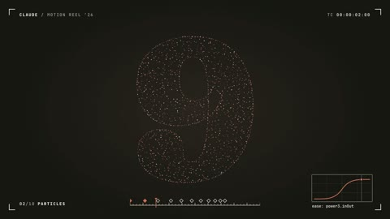</a></td>
</tr>
<tr>
<td width="50%" valign="top"><strong>复刻与原创主题的简洁字卡</strong> <a href="https://x.com/2irl4u">@2irl4u</a> · 短动效 0:45 · 收藏 — · 资料待完善 <a href="https://guanmo-ai.github.io/awesome-ai-motion/#case-2103650989849055268">▶ 播放</a> · <a href="https://x.com/2irl4u/status/2103650989849055268">原帖</a></td>
<td width="50%" valign="top"><strong>粒子数字与光线的十秒作品集</strong> <a href="https://x.com/mattiapomelli">@mattiapomelli</a> · 短动效 0:10 · 收藏 — · 资料待完善 <a href="https://guanmo-ai.github.io/awesome-ai-motion/#case-2103757371357229129">▶ 播放</a> · <a href="https://x.com/mattiapomelli/status/2103757371357229129">原帖</a></td>
</tr>
</tbody>
<tbody>
<tr>
<td width="50%" height="225" align="center" valign="middle"></td>
<td width="50%" height="225" align="center" valign="middle"><a href="https://guanmo-ai.github.io/awesome-ai-motion/#case-2103764908764791286">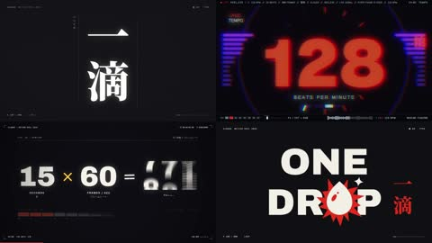</a></td>
</tr>
<tr>
<td width="50%" valign="top"><strong>Design 与 AI 的橙黑文字短片</strong> <a href="https://x.com/konmari_tweet">@konmari_tweet</a> · 短动效 0:15 · 收藏 — · 资料待完善 <a href="https://guanmo-ai.github.io/awesome-ai-motion/#case-2103639233693159742">▶ 播放</a> · <a href="https://x.com/konmari_tweet/status/2103639233693159742">原帖</a></td>
<td width="50%" valign="top"><strong>滴、节拍与漫画字卡的多屏演出</strong> <a href="https://x.com/seiiiiiiiiiiru">@seiiiiiiiiiiru</a> · 短动效 0:12 · 收藏 — · 资料待完善 <a href="https://guanmo-ai.github.io/awesome-ai-motion/#case-2103764908764791286">▶ 播放</a> · <a href="https://x.com/seiiiiiiiiiiru/status/2103764908764791286">原帖</a></td>
</tr>
</tbody>
<tbody>
<tr>
<td width="50%" height="225" align="center" valign="middle"><a href="https://guanmo-ai.github.io/awesome-ai-motion/#case-2103727881818189989">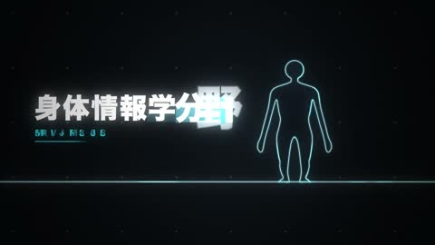</a></td>
<td width="50%" height="225" align="center" valign="middle"><a href="https://guanmo-ai.github.io/awesome-ai-motion/#case-2103841408977150450">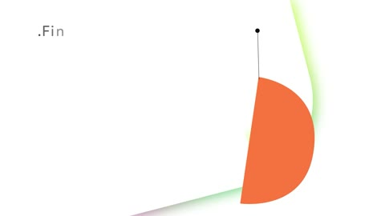</a></td>
</tr>
<tr>
<td width="50%" valign="top"><strong>光学迷彩主题的文字与轮廓</strong> <a href="https://x.com/drinami">@drinami</a> · 短动效 0:15 · 收藏 — · 资料待完善 <a href="https://guanmo-ai.github.io/awesome-ai-motion/#case-2103727881818189989">▶ 播放</a> · <a href="https://x.com/drinami/status/2103727881818189989">原帖</a></td>
<td width="50%" valign="top"><strong>线条、色块与文字的简短故事</strong> <a href="https://x.com/0xCrosss">@0xCrosss</a> · 短动效 0:16 · 收藏 — · 资料待完善 <a href="https://guanmo-ai.github.io/awesome-ai-motion/#case-2103841408977150450">▶ 播放</a> · <a href="https://x.com/0xCrosss/status/2103841408977150450">原帖</a></td>
</tr>
</tbody>
<tbody>
<tr>
<td width="50%" height="225" align="center" valign="middle"></td>
<td width="50%" height="225" align="center" valign="middle"></td>
</tr>
<tr>
<td width="50%" valign="top"><strong>落向镜头的立体文字</strong> <a href="https://x.com/flxrnc">@flxrnc</a> · 短动效 0:12 · 收藏 — · 资料待完善 <a href="https://guanmo-ai.github.io/awesome-ai-motion/#case-2106383855464615963">▶ 播放</a> · <a href="https://x.com/flxrnc/status/2106383855464615963">原帖</a></td>
<td width="50%" valign="top"><strong>Clawd 的立体旋转与粒子散开</strong> <a href="https://x.com/FriskyGGG">@FriskyGGG</a> · 短动效 0:15 · 收藏 — · 资料待完善 <a href="https://guanmo-ai.github.io/awesome-ai-motion/#case-2103766565389054427">▶ 播放</a> · <a href="https://x.com/FriskyGGG/status/2103766565389054427">原帖</a></td>
</tr>
</tbody>
<tbody>
<tr>
<td width="50%" height="225" align="center" valign="middle"></td>
<td width="50%" height="225" align="center" valign="middle"></td>
</tr>
<tr>
<td width="50%" valign="top"><strong>Lumio 的几何与法语字卡</strong> <a href="https://x.com/mousszy_baby">@mousszy_baby</a> · 短动效 0:15 · 收藏 — · 资料待完善 <a href="https://guanmo-ai.github.io/awesome-ai-motion/#case-2103966434280014197">▶ 播放</a> · <a href="https://x.com/mousszy_baby/status/2103966434280014197">原帖</a></td>
<td width="50%" valign="top"><strong>粗体字母与几何空间的作品集</strong> <a href="https://x.com/ambiguous_ai">@ambiguous_ai</a> · 短动效 0:15 · 收藏 — · 资料待完善 <a href="https://guanmo-ai.github.io/awesome-ai-motion/#case-2103763542432505873">▶ 播放</a> · <a href="https://x.com/ambiguous_ai/status/2103763542432505873">原帖</a></td>
</tr>
</tbody>
<tbody>
<tr>
<td width="50%" height="225" align="center" valign="middle"><a href="https://guanmo-ai.github.io/awesome-ai-motion/#case-2103813886684389509">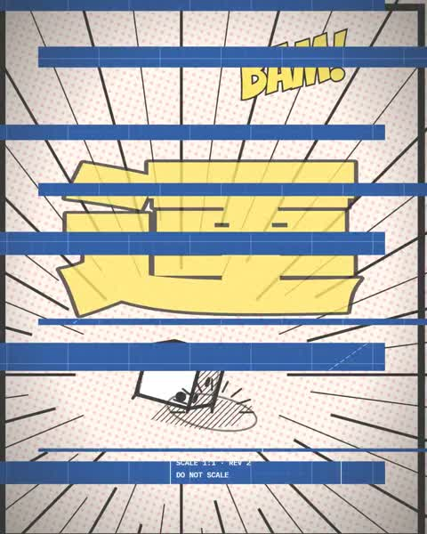</a></td>
<td width="50%" height="225" align="center" valign="middle"><a href="https://guanmo-ai.github.io/awesome-ai-motion/#case-2103837917538107563">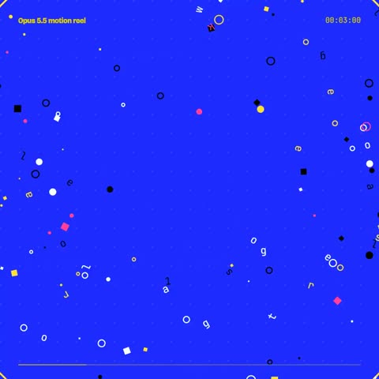</a></td>
</tr>
<tr>
<td width="50%" valign="top"><strong>日文字形与漫画速度线</strong> <a href="https://x.com/ambiguous_ai">@ambiguous_ai</a> · 短动效 0:15 · 收藏 — · 资料待完善 <a href="https://guanmo-ai.github.io/awesome-ai-motion/#case-2103813886684389509">▶ 播放</a> · <a href="https://x.com/ambiguous_ai/status/2103813886684389509">原帖</a></td>
<td width="50%" valign="top"><strong>蓝底评论卡片与粒子作品集</strong> <a href="https://x.com/Ishaaqahamed">@Ishaaqahamed</a> · 短动效 0:15 · 收藏 — · 资料待完善 <a href="https://guanmo-ai.github.io/awesome-ai-motion/#case-2103837917538107563">▶ 播放</a> · <a href="https://x.com/Ishaaqahamed/status/2103837917538107563">原帖</a></td>
</tr>
</tbody>
<tbody>
<tr>
<td width="50%" height="225" align="center" valign="middle"></td>
<td width="50%" height="225" align="center" valign="middle"></td>
</tr>
<tr>
<td width="50%" valign="top"><strong>悟空穿越山谷的跑酷</strong> <a href="https://x.com/aniketjart">@aniketjart</a> · 角色动画 0:58 · 收藏 2,320 · 资料待完善 <a href="https://guanmo-ai.github.io/awesome-ai-motion/#case-2113427367477878971">▶ 播放</a> · <a href="https://x.com/aniketjart/status/2113427367477878971">原帖</a></td>
<td width="50%" valign="top"><strong>Blender 中的圆润角色动画</strong> <a href="https://x.com/JaydenDavisNC">@JaydenDavisNC</a> · 角色动画 0:17 · 收藏 1,356 · 资料待完善 <a href="https://guanmo-ai.github.io/awesome-ai-motion/#case-2107086714820870617">▶ 播放</a> · <a href="https://x.com/JaydenDavisNC/status/2107086714820870617">原帖</a></td>
</tr>
</tbody>
<tbody>
<tr>
<td width="50%" height="225" align="center" valign="middle"></td>
<td width="50%" height="225" align="center" valign="middle"><a href="https://guanmo-ai.github.io/awesome-ai-motion/#case-2105757136219504862">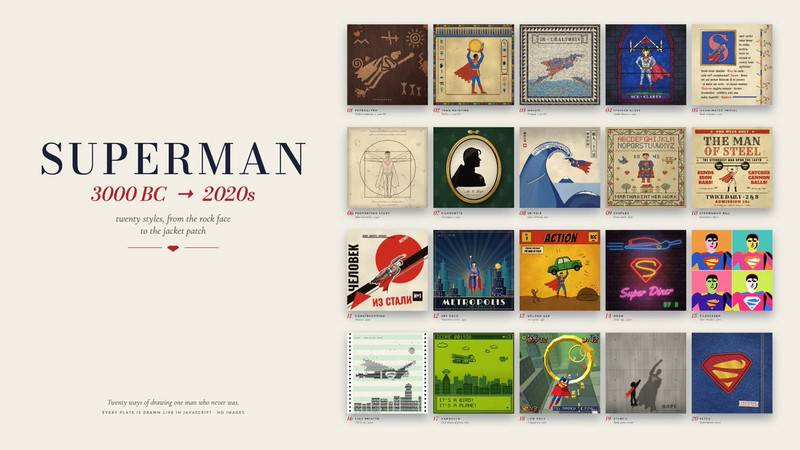</a></td>
</tr>
<tr>
<td width="50%" valign="top"><strong>沙虫变成机械概念体</strong> <a href="https://x.com/DilumSanjaya">@DilumSanjaya</a> · 角色动画 1:19 · 收藏 1,344 · 资料待完善 <a href="https://guanmo-ai.github.io/awesome-ai-motion/#case-2104253761137127597">▶ 播放</a> · <a href="https://x.com/DilumSanjaya/status/2104253761137127597">原帖</a></td>
<td width="50%" valign="top"><strong>超人跨画风的连续动画</strong> <a href="https://x.com/chetaslua">@chetaslua</a> · 角色动画 0:40 · 收藏 1,278 · 资料待完善 <a href="https://guanmo-ai.github.io/awesome-ai-motion/#case-2105757136219504862">▶ 播放</a> · <a href="https://x.com/chetaslua/status/2105757136219504862">原帖</a></td>
</tr>
</tbody>
<tbody>
<tr>
<td width="50%" height="225" align="center" valign="middle"><a href="https://guanmo-ai.github.io/awesome-ai-motion/#case-2105825930799432073">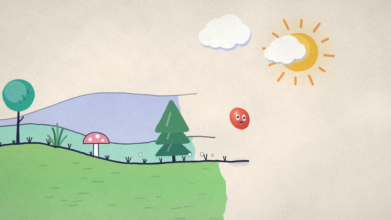</a></td>
<td width="50%" height="225" align="center" valign="middle"><a href="https://guanmo-ai.github.io/awesome-ai-motion/#case-2104008163561451923">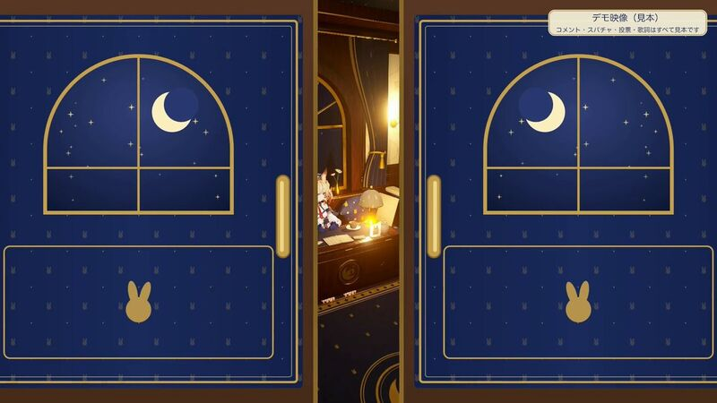</a></td>
</tr>
<tr>
<td width="50%" valign="top"><strong>一颗红点的森林小冒险</strong> <a href="https://x.com/cherry_mx_reds">@cherry_mx_reds</a> · 角色动画 0:15 · 收藏 1,072 · 资料待完善 <a href="https://guanmo-ai.github.io/awesome-ai-motion/#case-2105825930799432073">▶ 播放</a> · <a href="https://x.com/cherry_mx_reds/status/2105825930799432073">原帖</a></td>
<td width="50%" valign="top"><strong>AITuber 系统：直播与讲解原型</strong> <a href="https://x.com/manaimovie">@manaimovie</a> · 角色动画 0:55 · 收藏 985 · 资料待完善 <a href="https://guanmo-ai.github.io/awesome-ai-motion/#case-2104008163561451923">▶ 播放</a> · <a href="https://x.com/manaimovie/status/2104008163561451923">原帖</a></td>
</tr>
</tbody>
<tbody>
<tr>
<td width="50%" height="225" align="center" valign="middle"></td>
<td width="50%" height="225" align="center" valign="middle"></td>
</tr>
<tr>
<td width="50%" valign="top"><strong>像素巫师的月夜法术战</strong> <a href="https://x.com/rehan_shei">@rehan_shei</a> · 角色动画 0:39 · 收藏 849 · 资料待完善 <a href="https://guanmo-ai.github.io/awesome-ai-motion/#case-2102794467032154206">▶ 播放</a> · <a href="https://x.com/rehan_shei/status/2102794467032154206">原帖</a></td>
<td width="50%" valign="top"><strong>彩虹轨道上的像素角色</strong> <a href="https://x.com/riku720720">@riku720720</a> · 角色动画 0:19 · 收藏 837 · 资料待完善 <a href="https://guanmo-ai.github.io/awesome-ai-motion/#case-2102515055116063144">▶ 播放</a> · <a href="https://x.com/riku720720/status/2102515055116063144">原帖</a></td>
</tr>
</tbody>
<tbody>
<tr>
<td width="50%" height="225" align="center" valign="middle"></td>
<td width="50%" height="225" align="center" valign="middle"></td>
</tr>
<tr>
<td width="50%" valign="top"><strong>帝国时代风格的动态城镇</strong> <a href="https://x.com/DilumSanjaya">@DilumSanjaya</a> · 角色动画 2:04 · 收藏 650 · 资料待完善 <a href="https://guanmo-ai.github.io/awesome-ai-motion/#case-2108966501705556162">▶ 播放</a> · <a href="https://x.com/DilumSanjaya/status/2108966501705556162">原帖</a></td>
<td width="50%" valign="top"><strong>雨夜像素岛</strong> <a href="https://x.com/SahilExec">@SahilExec</a> · 角色动画 0:13 · 收藏 586 · 资料待完善 <a href="https://guanmo-ai.github.io/awesome-ai-motion/#case-2107132523755307179">▶ 播放</a> · <a href="https://x.com/SahilExec/status/2107132523755307179">原帖</a></td>
</tr>
</tbody>
<tbody>
<tr>
<td width="50%" height="225" align="center" valign="middle"><a href="https://guanmo-ai.github.io/awesome-ai-motion/#case-2102707412704919910">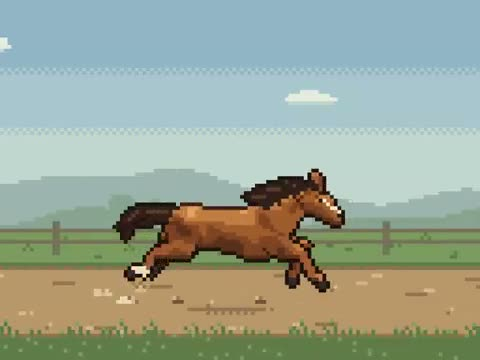</a></td>
<td width="50%" height="225" align="center" valign="middle"><a href="https://guanmo-ai.github.io/awesome-ai-motion/#case-2107399371121930610">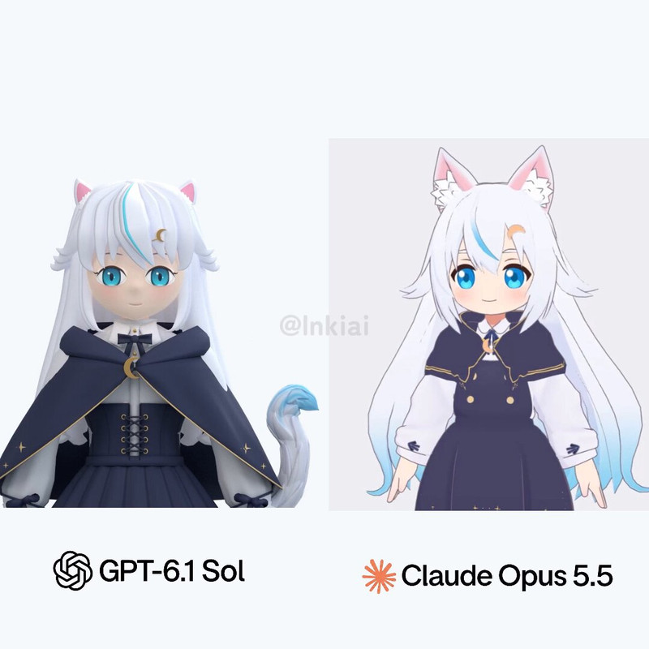</a></td>
</tr>
<tr>
<td width="50%" valign="top"><strong>逆向运动学驱动的像素奔马</strong> <a href="https://x.com/victormustar">@victormustar</a> · 角色动画 0:10 · 收藏 572 · 资料待完善 <a href="https://guanmo-ai.github.io/awesome-ai-motion/#case-2102707412704919910">▶ 播放</a> · <a href="https://x.com/victormustar/status/2102707412704919910">原帖</a></td>
<td width="50%" valign="top"><strong>两种 3D 头像制作方式</strong> <a href="https://x.com/lnkiai">@lnkiai</a> · 角色动画 0:11 · 收藏 549 · 资料待完善 <a href="https://guanmo-ai.github.io/awesome-ai-motion/#case-2107399371121930610">▶ 播放</a> · <a href="https://x.com/lnkiai/status/2107399371121930610">原帖</a></td>
</tr>
</tbody>
<tbody>
<tr>
<td width="50%" height="225" align="center" valign="middle"></td>
<td width="50%" height="225" align="center" valign="middle"><a href="https://guanmo-ai.github.io/awesome-ai-motion/#case-2104768377356988782">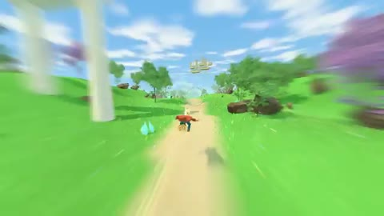</a></td>
</tr>
<tr>
<td width="50%" valign="top"><strong>机械蜻蜓的手绘三维短片</strong> <a href="https://x.com/xikhar">@xikhar</a> · 角色动画 0:15 · 收藏 522 · 资料待完善 <a href="https://guanmo-ai.github.io/awesome-ai-motion/#case-2105315982525014067">▶ 播放</a> · <a href="https://x.com/xikhar/status/2105315982525014067">原帖</a></td>
<td width="50%" valign="top"><strong>穿越天空圆环的飞行关卡</strong> <a href="https://x.com/sonia_code">@sonia_code</a> · 角色动画 0:15 · 收藏 432 · 资料待完善 <a href="https://guanmo-ai.github.io/awesome-ai-motion/#case-2104768377356988782">▶ 播放</a> · <a href="https://x.com/sonia_code/status/2104768377356988782">原帖</a></td>
</tr>
</tbody>
<tbody>
<tr>
<td width="50%" height="225" align="center" valign="middle"></td>
<td width="50%" height="225" align="center" valign="middle"></td>
</tr>
<tr>
<td width="50%" valign="top"><strong>Aestra：像素世界的聚会与战斗</strong> <a href="https://x.com/M__Houser">@M__Houser</a> · 角色动画 0:32 · 收藏 406 · 资料待完善 <a href="https://guanmo-ai.github.io/awesome-ai-motion/#case-2110750857528803516">▶ 播放</a> · <a href="https://x.com/M__Houser/status/2110750857528803516">原帖</a></td>
<td width="50%" valign="top"><strong>从两张插画到直播三维角色</strong> <a href="https://x.com/kokushing">@kokushing</a> · 角色动画 1:15 · 收藏 388 · 资料待完善 <a href="https://guanmo-ai.github.io/awesome-ai-motion/#case-2107634512226058434">▶ 播放</a> · <a href="https://x.com/kokushing/status/2107634512226058434">原帖</a></td>
</tr>
</tbody>
<tbody>
<tr>
<td width="50%" height="225" align="center" valign="middle"></td>
<td width="50%" height="225" align="center" valign="middle"><a href="https://guanmo-ai.github.io/awesome-ai-motion/#case-2102545213218803769">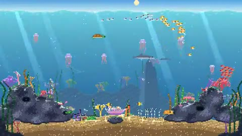</a></td>
</tr>
<tr>
<td width="50%" valign="top"><strong>糖果主题角色动画</strong> <a href="https://x.com/cherry_mx_reds">@cherry_mx_reds</a> · 角色动画 0:30 · 收藏 350 · 资料待完善 <a href="https://guanmo-ai.github.io/awesome-ai-motion/#case-2102472218269900876">▶ 播放</a> · <a href="https://x.com/cherry_mx_reds/status/2102472218269900876">原帖</a></td>
<td width="50%" valign="top"><strong>像素海底：鱼群、水母与昼夜</strong> <a href="https://x.com/akiy_8">@akiy_8</a> · 角色动画 0:20 · 收藏 299 · 资料待完善 <a href="https://guanmo-ai.github.io/awesome-ai-motion/#case-2102545213218803769">▶ 播放</a> · <a href="https://x.com/akiy_8/status/2102545213218803769">原帖</a></td>
</tr>
</tbody>
<tbody>
<tr>
<td width="50%" height="225" align="center" valign="middle"></td>
<td width="50%" height="225" align="center" valign="middle"></td>
</tr>
<tr>
<td width="50%" valign="top"><strong>程序化科幻射击场</strong> <a href="https://x.com/Belbizaz">@Belbizaz</a> · 角色动画 2:03 · 收藏 266 · 资料待完善 <a href="https://guanmo-ai.github.io/awesome-ai-motion/#case-2113674457210556568">▶ 播放</a> · <a href="https://x.com/Belbizaz/status/2113674457210556568">原帖</a></td>
<td width="50%" valign="top"><strong>院子里的 JavaScript 卡通狗</strong> <a href="https://x.com/doerstokyo342">@doerstokyo342</a> · 角色动画 0:30 · 收藏 251 · 资料待完善 <a href="https://guanmo-ai.github.io/awesome-ai-motion/#case-2105195592989434141">▶ 播放</a> · <a href="https://x.com/doerstokyo342/status/2105195592989434141">原帖</a></td>
</tr>
</tbody>
<tbody>
<tr>
<td width="50%" height="225" align="center" valign="middle"></td>
<td width="50%" height="225" align="center" valign="middle"></td>
</tr>
<tr>
<td width="50%" valign="top"><strong>上下文塞满之后会怎样</strong> <a href="https://x.com/devteamdrew">@devteamdrew</a> · 角色动画 0:49 · 收藏 247 · 资料待完善 <a href="https://guanmo-ai.github.io/awesome-ai-motion/#case-2109691802160615787">▶ 播放</a> · <a href="https://x.com/devteamdrew/status/2109691802160615787">原帖</a></td>
<td width="50%" valign="top"><strong>太空船里的船员与潜伏者</strong> <a href="https://x.com/MrTacticalX">@MrTacticalX</a> · 角色动画 1:56 · 收藏 246 · 资料待完善 <a href="https://guanmo-ai.github.io/awesome-ai-motion/#case-2111447971468579029">▶ 播放</a> · <a href="https://x.com/MrTacticalX/status/2111447971468579029">原帖</a></td>
</tr>
</tbody>
<tbody>
<tr>
<td width="50%" height="225" align="center" valign="middle"></td>
<td width="50%" height="225" align="center" valign="middle"></td>
</tr>
<tr>
<td width="50%" valign="top"><strong>像素公寓院落里的足球</strong> <a href="https://x.com/N1njaCodex">@N1njaCodex</a> · 角色动画 0:19 · 收藏 241 · 资料待完善 <a href="https://guanmo-ai.github.io/awesome-ai-motion/#case-2113037013326627200">▶ 播放</a> · <a href="https://x.com/N1njaCodex/status/2113037013326627200">原帖</a></td>
<td width="50%" valign="top"><strong>Clawd 笔触动画的白昼示例</strong> <a href="https://x.com/other__reality">@other__reality</a> · 角色动画 0:10 · 收藏 218 · 资料待完善 <a href="https://guanmo-ai.github.io/awesome-ai-motion/#case-2102860128680845789">▶ 播放</a> · <a href="https://x.com/other__reality/status/2102860128680845789">原帖</a></td>
</tr>
</tbody>
<tbody>
<tr>
<td width="50%" height="225" align="center" valign="middle"></td>
<td width="50%" height="225" align="center" valign="middle"><a href="https://guanmo-ai.github.io/awesome-ai-motion/#case-2105804692811137242">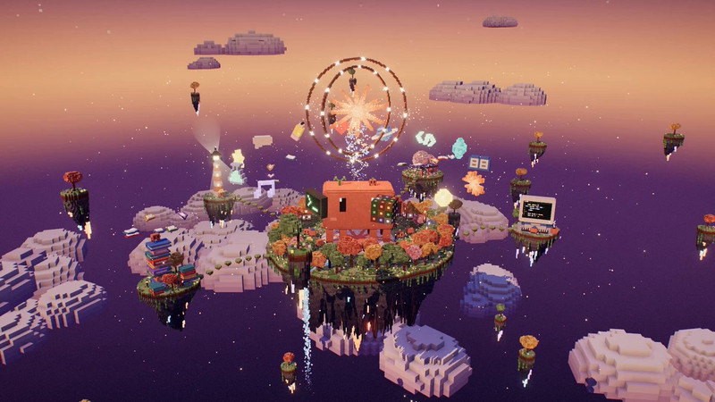</a></td>
</tr>
<tr>
<td width="50%" valign="top"><strong>热带公路上的驾驶游戏</strong> <a href="https://x.com/sonia_code">@sonia_code</a> · 角色动画 0:08 · 收藏 214 · 资料待完善 <a href="https://guanmo-ai.github.io/awesome-ai-motion/#case-2103441886488990016">▶ 播放</a> · <a href="https://x.com/sonia_code/status/2103441886488990016">原帖</a></td>
<td width="50%" valign="top"><strong>漂浮体素世界中的模型自画像</strong> <a href="https://x.com/blueemi99">@blueemi99</a> · 角色动画 0:26 · 收藏 213 · 资料待完善 <a href="https://guanmo-ai.github.io/awesome-ai-motion/#case-2105804692811137242">▶ 播放</a> · <a href="https://x.com/blueemi99/status/2105804692811137242">原帖</a></td>
</tr>
</tbody>
<tbody>
<tr>
<td width="50%" height="225" align="center" valign="middle"></td>
<td width="50%" height="225" align="center" valign="middle"><a href="https://guanmo-ai.github.io/awesome-ai-motion/#case-2106790433376662015">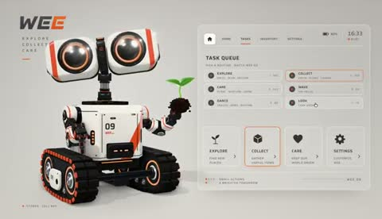</a></td>
</tr>
<tr>
<td width="50%" valign="top"><strong>独立农场的播种与四季循环</strong> <a href="https://x.com/sorenxet">@sorenxet</a> · 角色动画 0:15 · 收藏 189 · 资料待完善 <a href="https://x.com/sorenxet/status/2111458380854296639">▶ 在 X 观看</a> · <a href="https://x.com/sorenxet/status/2111458380854296639">原帖</a></td>
<td width="50%" valign="top"><strong>WALL-E 风格机器人的数学运动</strong> <a href="https://x.com/DilumSanjaya">@DilumSanjaya</a> · 角色动画 1:25 · 收藏 188 · 资料待完善 <a href="https://guanmo-ai.github.io/awesome-ai-motion/#case-2106790433376662015">▶ 播放</a> · <a href="https://x.com/DilumSanjaya/status/2106790433376662015">原帖</a></td>
</tr>
</tbody>
<tbody>
<tr>
<td width="50%" height="225" align="center" valign="middle"></td>
<td width="50%" height="225" align="center" valign="middle"><a href="https://guanmo-ai.github.io/awesome-ai-motion/#case-2102449525944099320">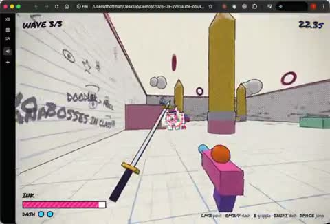</a></td>
</tr>
<tr>
<td width="50%" valign="top"><strong>浮空方块岛上的宝可梦对战</strong> <a href="https://x.com/anxuanng">@anxuanng</a> · 角色动画 0:27 · 收藏 177 · 资料待完善 <a href="https://guanmo-ai.github.io/awesome-ai-motion/#case-2113692879680115199">▶ 播放</a> · <a href="https://x.com/anxuanng/status/2113692879680115199">原帖</a></td>
<td width="50%" valign="top"><strong>涂鸦世界的三维射击战</strong> <a href="https://x.com/cherry_mx_reds">@cherry_mx_reds</a> · 角色动画 1:50 · 收藏 171 · 资料待完善 <a href="https://guanmo-ai.github.io/awesome-ai-motion/#case-2102449525944099320">▶ 播放</a> · <a href="https://x.com/cherry_mx_reds/status/2102449525944099320">原帖</a></td>
</tr>
</tbody>
<tbody>
<tr>
<td width="50%" height="225" align="center" valign="middle"></td>
<td width="50%" height="225" align="center" valign="middle"></td>
</tr>
<tr>
<td width="50%" valign="top"><strong>像素街区里的篮球小世界</strong> <a href="https://x.com/vib3coded">@vib3coded</a> · 角色动画 0:18 · 收藏 166 · 资料待完善 <a href="https://guanmo-ai.github.io/awesome-ai-motion/#case-2112989996366102944">▶ 播放</a> · <a href="https://x.com/vib3coded/status/2112989996366102944">原帖</a></td>
<td width="50%" valign="top"><strong>Solarpunk City：像素生态城市</strong> <a href="https://x.com/ChaseBrowe32432">@ChaseBrowe32432</a> · 角色动画 0:32 · 收藏 153 · 资料待完善 <a href="https://guanmo-ai.github.io/awesome-ai-motion/#case-2102626755655921828">▶ 播放</a> · <a href="https://x.com/ChaseBrowe32432/status/2102626755655921828">原帖</a></td>
</tr>
</tbody>
<tbody>
<tr>
<td width="50%" height="225" align="center" valign="middle"><a href="https://guanmo-ai.github.io/awesome-ai-motion/#case-2110665151389003777">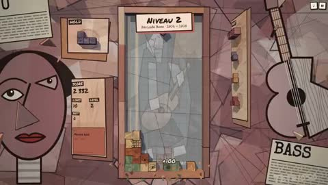</a></td>
<td width="50%" height="225" align="center" valign="middle"></td>
</tr>
<tr>
<td width="50%" valign="top"><strong>毕加索风格的立体俄罗斯方块</strong> <a href="https://x.com/SimonasLTU1">@SimonasLTU1</a> · 角色动画 1:30 · 收藏 152 · 资料待完善 <a href="https://guanmo-ai.github.io/awesome-ai-motion/#case-2110665151389003777">▶ 播放</a> · <a href="https://x.com/SimonasLTU1/status/2110665151389003777">原帖</a></td>
<td width="50%" valign="top"><strong>铃兰小岛上的野餐与炊烟</strong> <a href="https://x.com/ann_nnng">@ann_nnng</a> · 角色动画 0:24 · 收藏 139 · 资料待完善 <a href="https://guanmo-ai.github.io/awesome-ai-motion/#case-2112897537430741143">▶ 播放</a> · <a href="https://x.com/ann_nnng/status/2112897537430741143">原帖</a></td>
</tr>
</tbody>
<tbody>
<tr>
<td width="50%" height="225" align="center" valign="middle"></td>
<td width="50%" height="225" align="center" valign="middle"></td>
</tr>
<tr>
<td width="50%" valign="top"><strong>从距离场到斑纹：程序化猎豹</strong> <a href="https://x.com/majidmanzarpour">@majidmanzarpour</a> · 角色动画 0:50 · 收藏 136 · 资料待完善 <a href="https://guanmo-ai.github.io/awesome-ai-motion/#case-2103866429741400535">▶ 播放</a> · <a href="https://x.com/majidmanzarpour/status/2103866429741400535">原帖</a></td>
<td width="50%" valign="top"><strong>火柴人光剑对决的两次生成</strong> <a href="https://x.com/DanielZambrini">@DanielZambrini</a> · 角色动画 0:15 · 收藏 129 · 资料待完善 <a href="https://guanmo-ai.github.io/awesome-ai-motion/#case-2112700824220832140">▶ 播放</a> · <a href="https://x.com/DanielZambrini/status/2112700824220832140">原帖</a></td>
</tr>
</tbody>
<tbody>
<tr>
<td width="50%" height="225" align="center" valign="middle"></td>
<td width="50%" height="225" align="center" valign="middle"></td>
</tr>
<tr>
<td width="50%" valign="top"><strong>水彩猫头鹰与飞舞的蝴蝶</strong> <a href="https://x.com/thebuggeddev">@thebuggeddev</a> · 角色动画 0:48 · 收藏 113 · 资料待完善 <a href="https://guanmo-ai.github.io/awesome-ai-motion/#case-2107802810234659189">▶ 播放</a> · <a href="https://x.com/thebuggeddev/status/2107802810234659189">原帖</a></td>
<td width="50%" valign="top"><strong>卡通都市的街机射击</strong> <a href="https://x.com/higgsfield_ai">@higgsfield_ai</a> · 角色动画 0:25 · 收藏 78 · 资料待完善 <a href="https://guanmo-ai.github.io/awesome-ai-motion/#case-2102856698595807273">▶ 播放</a> · <a href="https://x.com/higgsfield_ai/status/2102856698595807273">原帖</a></td>
</tr>
</tbody>
<tbody>
<tr>
<td width="50%" height="225" align="center" valign="middle"></td>
<td width="50%" height="225" align="center" valign="middle"></td>
</tr>
<tr>
<td width="50%" valign="top"><strong>Clawd 与 Codey 的游戏战斗</strong> <a href="https://x.com/LexnLin">@LexnLin</a> · 角色动画 0:33 · 收藏 76 · 资料待完善 <a href="https://guanmo-ai.github.io/awesome-ai-motion/#case-2107502672907506162">▶ 播放</a> · <a href="https://x.com/LexnLin/status/2107502672907506162">原帖</a></td>
<td width="50%" valign="top"><strong>夜色像素风音乐演示</strong> <a href="https://x.com/gandamu_ml">@gandamu_ml</a> · 角色动画 4:17 · 收藏 76 · 资料待完善 <a href="https://guanmo-ai.github.io/awesome-ai-motion/#case-2103116003689550013">▶ 播放</a> · <a href="https://x.com/gandamu_ml/status/2103116003689550013">原帖</a></td>
</tr>
</tbody>
<tbody>
<tr>
<td width="50%" height="225" align="center" valign="middle"></td>
<td width="50%" height="225" align="center" valign="middle"></td>
</tr>
<tr>
<td width="50%" valign="top"><strong>Clawd 的方块升降机械</strong> <a href="https://x.com/kevin_t_ngo">@kevin_t_ngo</a> · 角色动画 0:10 · 收藏 75 · 资料待完善 <a href="https://guanmo-ai.github.io/awesome-ai-motion/#case-2111855072825217095">▶ 播放</a> · <a href="https://x.com/kevin_t_ngo/status/2111855072825217095">原帖</a></td>
<td width="50%" valign="top"><strong>Sonic 风格的三维金环跑道</strong> <a href="https://x.com/cherry_mx_reds">@cherry_mx_reds</a> · 角色动画 1:02 · 收藏 71 · 资料待完善 <a href="https://guanmo-ai.github.io/awesome-ai-motion/#case-2102444611776237697">▶ 播放</a> · <a href="https://x.com/cherry_mx_reds/status/2102444611776237697">原帖</a></td>
</tr>
</tbody>
<tbody>
<tr>
<td width="50%" height="225" align="center" valign="middle"></td>
<td width="50%" height="225" align="center" valign="middle"></td>
</tr>
<tr>
<td width="50%" valign="top"><strong>Roadster 夜间飞行与警车追逐</strong> <a href="https://x.com/viktoroddy">@viktoroddy</a> · 角色动画 0:19 · 收藏 68 · 资料待完善 <a href="https://guanmo-ai.github.io/awesome-ai-motion/#case-2111609842184130875">▶ 播放</a> · <a href="https://x.com/viktoroddy/status/2111609842184130875">原帖</a></td>
<td width="50%" valign="top"><strong>非人形角色的绑骨与动画实验</strong> <a href="https://x.com/BlendiByl">@BlendiByl</a> · 角色动画 0:10 · 收藏 65 · 资料待完善 <a href="https://guanmo-ai.github.io/awesome-ai-motion/#case-2103989270558167364">▶ 播放</a> · <a href="https://x.com/BlendiByl/status/2103989270558167364">原帖</a></td>
</tr>
</tbody>
<tbody>
<tr>
<td width="50%" height="225" align="center" valign="middle"></td>
<td width="50%" height="225" align="center" valign="middle"></td>
</tr>
<tr>
<td width="50%" valign="top"><strong>Hunt A Squishy：Roblox 寻找游戏</strong> <a href="https://x.com/minchoi">@minchoi</a> · 角色动画 1:25 · 收藏 62 · 资料待完善 <a href="https://guanmo-ai.github.io/awesome-ai-motion/#case-2106114830780223567">▶ 播放</a> · <a href="https://x.com/minchoi/status/2106114830780223567">原帖</a></td>
<td width="50%" valign="top"><strong>可挤压、可梳毛的毛绒青蛙</strong> <a href="https://x.com/N1njaCodex">@N1njaCodex</a> · 角色动画 0:18 · 收藏 62 · 资料待完善 <a href="https://guanmo-ai.github.io/awesome-ai-motion/#case-2106535130550472707">▶ 播放</a> · <a href="https://x.com/N1njaCodex/status/2106535130550472707">原帖</a></td>
</tr>
</tbody>
<tbody>
<tr>
<td width="50%" height="225" align="center" valign="middle"></td>
<td width="50%" height="225" align="center" valign="middle"></td>
</tr>
<tr>
<td width="50%" valign="top"><strong>像素小镇的银行追逐</strong> <a href="https://x.com/vib3coded">@vib3coded</a> · 角色动画 0:17 · 收藏 60 · 资料待完善 <a href="https://guanmo-ai.github.io/awesome-ai-motion/#case-2114054716959215724">▶ 播放</a> · <a href="https://x.com/vib3coded/status/2114054716959215724">原帖</a></td>
<td width="50%" valign="top"><strong>四个模型的果冻弹性动画</strong> <a href="https://x.com/ann_nnng">@ann_nnng</a> · 角色动画 0:16 · 收藏 59 · 资料待完善 <a href="https://guanmo-ai.github.io/awesome-ai-motion/#case-2107703620070428946">▶ 播放</a> · <a href="https://x.com/ann_nnng/status/2107703620070428946">原帖</a></td>
</tr>
</tbody>
<tbody>
<tr>
<td width="50%" height="225" align="center" valign="middle"></td>
<td width="50%" height="225" align="center" valign="middle"></td>
</tr>
<tr>
<td width="50%" valign="top"><strong>SVG 奔跑奶牛的双模型试验</strong> <a href="https://x.com/GKev1n">@GKev1n</a> · 角色动画 0:18 · 收藏 58 · 资料待完善 <a href="https://guanmo-ai.github.io/awesome-ai-motion/#case-2107611576543093088">▶ 播放</a> · <a href="https://x.com/GKev1n/status/2107611576543093088">原帖</a></td>
<td width="50%" valign="top"><strong>独轮胎的城市跑酷</strong> <a href="https://x.com/oguzthedev">@oguzthedev</a> · 角色动画 0:20 · 收藏 56 · 资料待完善 <a href="https://guanmo-ai.github.io/awesome-ai-motion/#case-2113274109354520936">▶ 播放</a> · <a href="https://x.com/oguzthedev/status/2113274109354520936">原帖</a></td>
</tr>
</tbody>
<tbody>
<tr>
<td width="50%" height="225" align="center" valign="middle"></td>
<td width="50%" height="225" align="center" valign="middle"></td>
</tr>
<tr>
<td width="50%" valign="top"><strong>代码搭建舞台上的卡通群舞</strong> <a href="https://x.com/oab10don">@oab10don</a> · 角色动画 0:10 · 收藏 56 · 资料待完善 <a href="https://guanmo-ai.github.io/awesome-ai-motion/#case-2105879685322457273">▶ 播放</a> · <a href="https://x.com/oab10don/status/2105879685322457273">原帖</a></td>
<td width="50%" valign="top"><strong>四条炸鸡腿的奔跑实验</strong> <a href="https://x.com/whydeso">@whydeso</a> · 角色动画 0:17 · 收藏 52 · 资料待完善 <a href="https://guanmo-ai.github.io/awesome-ai-motion/#case-2107754210746134748">▶ 播放</a> · <a href="https://x.com/whydeso/status/2107754210746134748">原帖</a></td>
</tr>
</tbody>
<tbody>
<tr>
<td width="50%" height="225" align="center" valign="middle"></td>
<td width="50%" height="225" align="center" valign="middle"></td>
</tr>
<tr>
<td width="50%" valign="top"><strong>卡通蘑菇王国的赛车关卡</strong> <a href="https://x.com/cherry_mx_reds">@cherry_mx_reds</a> · 角色动画 1:09 · 收藏 52 · 资料待完善 <a href="https://guanmo-ai.github.io/awesome-ai-motion/#case-2102441942596366467">▶ 播放</a> · <a href="https://x.com/cherry_mx_reds/status/2102441942596366467">原帖</a></td>
<td width="50%" valign="top"><strong>方块角色的台球幻想</strong> <a href="https://x.com/MrPowerGamerBR">@MrPowerGamerBR</a> · 角色动画 0:47 · 收藏 52 · 资料待完善 <a href="https://guanmo-ai.github.io/awesome-ai-motion/#case-2102515158233034828">▶ 播放</a> · <a href="https://x.com/MrPowerGamerBR/status/2102515158233034828">原帖</a></td>
</tr>
</tbody>
<tbody>
<tr>
<td width="50%" height="225" align="center" valign="middle"></td>
<td width="50%" height="225" align="center" valign="middle"></td>
</tr>
<tr>
<td width="50%" valign="top"><strong>机甲全弹发射演出</strong> <a href="https://x.com/PDyv9gdatT4132">@PDyv9gdatT4132</a> · 角色动画 0:32 · 收藏 51 · 资料待完善 <a href="https://guanmo-ai.github.io/awesome-ai-motion/#case-2105401665360986275">▶ 播放</a> · <a href="https://x.com/PDyv9gdatT4132/status/2105401665360986275">原帖</a></td>
<td width="50%" valign="top"><strong>Another World 风格的夜间驾驶</strong> <a href="https://x.com/gandamu_ml">@gandamu_ml</a> · 角色动画 4:17 · 收藏 43 · 资料待完善 <a href="https://guanmo-ai.github.io/awesome-ai-motion/#case-2104402167906124280">▶ 播放</a> · <a href="https://x.com/gandamu_ml/status/2104402167906124280">原帖</a></td>
</tr>
</tbody>
<tbody>
<tr>
<td width="50%" height="225" align="center" valign="middle"></td>
<td width="50%" height="225" align="center" valign="middle"></td>
</tr>
<tr>
<td width="50%" valign="top"><strong>毛绒水母的伞体与触手</strong> <a href="https://x.com/vib3coded">@vib3coded</a> · 角色动画 0:17 · 收藏 26 · 资料待完善 <a href="https://guanmo-ai.github.io/awesome-ai-motion/#case-2107378136933355651">▶ 播放</a> · <a href="https://x.com/vib3coded/status/2107378136933355651">原帖</a></td>
<td width="50%" valign="top"><strong>用夸张短腿奔跑的毛绒牛</strong> <a href="https://x.com/vib3coded">@vib3coded</a> · 角色动画 0:18 · 收藏 24 · 资料待完善 <a href="https://guanmo-ai.github.io/awesome-ai-motion/#case-2108572856044986846">▶ 播放</a> · <a href="https://x.com/vib3coded/status/2108572856044986846">原帖</a></td>
</tr>
</tbody>
<tbody>
<tr>
<td width="50%" height="225" align="center" valign="middle"></td>
<td width="50%" height="225" align="center" valign="middle"></td>
</tr>
<tr>
<td width="50%" valign="top"><strong>Foldline：道路折上墙面的音乐赛车</strong> <a href="https://x.com/chetanankola">@chetanankola</a> · 角色动画 0:52 · 收藏 23 · 资料待完善 <a href="https://guanmo-ai.github.io/awesome-ai-motion/#case-2112258933410955383">▶ 播放</a> · <a href="https://x.com/chetanankola/status/2112258933410955383">原帖</a></td>
<td width="50%" valign="top"><strong>Minecraft 方块角色动画</strong> <a href="https://x.com/AndrewOnXYZ">@AndrewOnXYZ</a> · 角色动画 3:00 · 收藏 21 · 资料待完善 <a href="https://guanmo-ai.github.io/awesome-ai-motion/#case-2102127683735810495">▶ 播放</a> · <a href="https://x.com/AndrewOnXYZ/status/2102127683735810495">原帖</a></td>
</tr>
</tbody>
<tbody>
<tr>
<td width="50%" height="225" align="center" valign="middle"></td>
<td width="50%" height="225" align="center" valign="middle"></td>
</tr>
<tr>
<td width="50%" valign="top"><strong>同一狼模型的行走与嚎叫对照</strong> <a href="https://x.com/maxt3chno">@maxt3chno</a> · 角色动画 0:27 · 收藏 20 · 资料待完善 <a href="https://guanmo-ai.github.io/awesome-ai-motion/#case-2108319151127175422">▶ 播放</a> · <a href="https://x.com/maxt3chno/status/2108319151127175422">原帖</a></td>
<td width="50%" valign="top"><strong>Antverse：厨房里的蚁群视角</strong> <a href="https://x.com/ChrisGPT">@ChrisGPT</a> · 角色动画 2:00 · 收藏 19 · 资料待完善 <a href="https://guanmo-ai.github.io/awesome-ai-motion/#case-2104856071869542827">▶ 播放</a> · <a href="https://x.com/ChrisGPT/status/2104856071869542827">原帖</a></td>
</tr>
</tbody>
<tbody>
<tr>
<td width="50%" height="225" align="center" valign="middle"></td>
<td width="50%" height="225" align="center" valign="middle"></td>
</tr>
<tr>
<td width="50%" valign="top"><strong>峡谷中的布偶冒险</strong> <a href="https://x.com/AugustCastilIo">@AugustCastilIo</a> · 角色动画 0:44 · 收藏 19 · 资料待完善 <a href="https://guanmo-ai.github.io/awesome-ai-motion/#case-2113354877795799336">▶ 播放</a> · <a href="https://x.com/AugustCastilIo/status/2113354877795799336">原帖</a></td>
<td width="50%" valign="top"><strong>角色步态与逆向运动学实验室</strong> <a href="https://x.com/majidmanzarpour">@majidmanzarpour</a> · 角色动画 2:55 · 收藏 19 · 资料待完善 <a href="https://guanmo-ai.github.io/awesome-ai-motion/#case-2102490213155000455">▶ 播放</a> · <a href="https://x.com/majidmanzarpour/status/2102490213155000455">原帖</a></td>
</tr>
</tbody>
<tbody>
<tr>
<td width="50%" height="225" align="center" valign="middle"></td>
<td width="50%" height="225" align="center" valign="middle"></td>
</tr>
<tr>
<td width="50%" valign="top"><strong>Geometry Dash 的发光几何关卡</strong> <a href="https://x.com/phobboos">@phobboos</a> · 角色动画 1:19 · 收藏 18 · 资料待完善 <a href="https://guanmo-ai.github.io/awesome-ai-motion/#case-2110327573398143363">▶ 播放</a> · <a href="https://x.com/phobboos/status/2110327573398143363">原帖</a></td>
<td width="50%" valign="top"><strong>模型角色的派对舞台</strong> <a href="https://x.com/liu8in">@liu8in</a> · 角色动画 0:39 · 收藏 18 · 资料待完善 <a href="https://guanmo-ai.github.io/awesome-ai-motion/#case-2111937134676549679">▶ 播放</a> · <a href="https://x.com/liu8in/status/2111937134676549679">原帖</a></td>
</tr>
</tbody>
<tbody>
<tr>
<td width="50%" height="225" align="center" valign="middle"></td>
<td width="50%" height="225" align="center" valign="middle"></td>
</tr>
<tr>
<td width="50%" valign="top"><strong>果冻猫骑士与飘动披风</strong> <a href="https://x.com/vib3coded">@vib3coded</a> · 角色动画 0:18 · 收藏 17 · 资料待完善 <a href="https://guanmo-ai.github.io/awesome-ai-motion/#case-2106887740310651320">▶ 播放</a> · <a href="https://x.com/vib3coded/status/2106887740310651320">原帖</a></td>
<td width="50%" valign="top"><strong>按节拍编排的像素角色短片</strong> <a href="https://x.com/gkxspace">@gkxspace</a> · 角色动画 0:27 · 收藏 13 · 资料待完善 <a href="https://guanmo-ai.github.io/awesome-ai-motion/#case-2106402474676588632">▶ 播放</a> · <a href="https://x.com/gkxspace/status/2106402474676588632">原帖</a></td>
</tr>
</tbody>
<tbody>
<tr>
<td width="50%" height="225" align="center" valign="middle"></td>
<td width="50%" height="225" align="center" valign="middle"></td>
</tr>
<tr>
<td width="50%" valign="top"><strong>挥鞭骑车的 SVG 鹈鹕</strong> <a href="https://x.com/Ananth7e">@Ananth7e</a> · 角色动画 0:19 · 收藏 12 · 资料待完善 <a href="https://guanmo-ai.github.io/awesome-ai-motion/#case-2111749047598117102">▶ 播放</a> · <a href="https://x.com/Ananth7e/status/2111749047598117102">原帖</a></td>
<td width="50%" valign="top"><strong>鸮鹦鹉繁殖季：演讲结尾像素动画</strong> <a href="https://x.com/simonw">@simonw</a> · 角色动画 0:15 · 收藏 12 · 资料待完善 <a href="https://guanmo-ai.github.io/awesome-ai-motion/#case-2104002636513206422">▶ 播放</a> · <a href="https://x.com/simonw/status/2104002636513206422">原帖</a></td>
</tr>
</tbody>
<tbody>
<tr>
<td width="50%" height="225" align="center" valign="middle"></td>
<td width="50%" height="225" align="center" valign="middle"></td>
</tr>
<tr>
<td width="50%" valign="top"><strong>Minecraft 体素角色：同题模型对照</strong> <a href="https://x.com/TOPSTR1X">@TOPSTR1X</a> · 角色动画 0:15 · 收藏 11 · 资料待完善 <a href="https://guanmo-ai.github.io/awesome-ai-motion/#case-2105839618872738138">▶ 播放</a> · <a href="https://x.com/TOPSTR1X/status/2105839618872738138">原帖</a></td>
<td width="50%" valign="top"><strong>体素传送门实验室</strong> <a href="https://x.com/SadAlbert10">@SadAlbert10</a> · 角色动画 0:56 · 收藏 10 · 资料待完善 <a href="https://guanmo-ai.github.io/awesome-ai-motion/#case-2111524747037278651">▶ 播放</a> · <a href="https://x.com/SadAlbert10/status/2111524747037278651">原帖</a></td>
</tr>
</tbody>
<tbody>
<tr>
<td width="50%" height="225" align="center" valign="middle"></td>
<td width="50%" height="225" align="center" valign="middle"></td>
</tr>
<tr>
<td width="50%" valign="top"><strong>Minecraft 木星超级光束</strong> <a href="https://x.com/ottollm">@ottollm</a> · 角色动画 0:28 · 收藏 8 · 资料待完善 <a href="https://guanmo-ai.github.io/awesome-ai-motion/#case-2107505751111479297">▶ 播放</a> · <a href="https://x.com/ottollm/status/2107505751111479297">原帖</a></td>
<td width="50%" valign="top"><strong>单张插画到可对话的 Live2D 风角色</strong> <a href="https://x.com/shinshin86">@shinshin86</a> · 角色动画 0:10 · 收藏 7 · 资料待完善 <a href="https://guanmo-ai.github.io/awesome-ai-motion/#case-2105556318132310361">▶ 播放</a> · <a href="https://x.com/shinshin86/status/2105556318132310361">原帖</a></td>
</tr>
</tbody>
<tbody>
<tr>
<td width="50%" height="225" align="center" valign="middle"></td>
<td width="50%" height="225" align="center" valign="middle"></td>
</tr>
<tr>
<td width="50%" valign="top"><strong>凌晨两点的像素东京</strong> <a href="https://x.com/Aurelien_Gz">@Aurelien_Gz</a> · 角色动画 0:15 · 收藏 7 · 资料待完善 <a href="https://guanmo-ai.github.io/awesome-ai-motion/#case-2105759213473399098">▶ 播放</a> · <a href="https://x.com/Aurelien_Gz/status/2105759213473399098">原帖</a></td>
<td width="50%" valign="top"><strong>吉祥物的矢量骨骼动画面板</strong> <a href="https://x.com/okooo5km">@okooo5km</a> · 角色动画 0:21 · 收藏 7 · 资料待完善 <a href="https://guanmo-ai.github.io/awesome-ai-motion/#case-2107738086079909920">▶ 播放</a> · <a href="https://x.com/okooo5km/status/2107738086079909920">原帖</a></td>
</tr>
</tbody>
<tbody>
<tr>
<td width="50%" height="225" align="center" valign="middle"></td>
<td width="50%" height="225" align="center" valign="middle"></td>
</tr>
<tr>
<td width="50%" valign="top"><strong>金色巨龙与模型吉祥物</strong> <a href="https://x.com/RyanSael">@RyanSael</a> · 角色动画 0:26 · 收藏 6 · 资料待完善 <a href="https://guanmo-ai.github.io/awesome-ai-motion/#case-2102970980398489940">▶ 播放</a> · <a href="https://x.com/RyanSael/status/2102970980398489940">原帖</a></td>
<td width="50%" valign="top"><strong>When Lights Fade：会歌唱的异星世界</strong> <a href="https://x.com/georgevibing">@georgevibing</a> · 角色动画 0:40 · 收藏 6 · 资料待完善 <a href="https://guanmo-ai.github.io/awesome-ai-motion/#case-2111510096908013784">▶ 播放</a> · <a href="https://x.com/georgevibing/status/2111510096908013784">原帖</a></td>
</tr>
</tbody>
<tbody>
<tr>
<td width="50%" height="225" align="center" valign="middle"></td>
<td width="50%" height="225" align="center" valign="middle"></td>
</tr>
<tr>
<td width="50%" valign="top"><strong>Clawd 与夜空流星</strong> <a href="https://x.com/other__reality">@other__reality</a> · 角色动画 0:11 · 收藏 6 · 资料待完善 <a href="https://guanmo-ai.github.io/awesome-ai-motion/#case-2102860657158992120">▶ 播放</a> · <a href="https://x.com/other__reality/status/2102860657158992120">原帖</a></td>
<td width="50%" valign="top"><strong>Gregg：从蛋中诞生的吉祥物</strong> <a href="https://x.com/MyWestLord">@MyWestLord</a> · 角色动画 0:19 · 收藏 6 · 资料待完善 <a href="https://guanmo-ai.github.io/awesome-ai-motion/#case-2109297316242812936">▶ 播放</a> · <a href="https://x.com/MyWestLord/status/2109297316242812936">原帖</a></td>
</tr>
</tbody>
<tbody>
<tr>
<td width="50%" height="225" align="center" valign="middle"></td>
<td width="50%" height="225" align="center" valign="middle"></td>
</tr>
<tr>
<td width="50%" valign="top"><strong>小猫片场：导演、灯光与微缩舞台</strong> <a href="https://x.com/flxrnc">@flxrnc</a> · 角色动画 0:15 · 收藏 6 · 资料待完善 <a href="https://guanmo-ai.github.io/awesome-ai-motion/#case-2106434118640619627">▶ 播放</a> · <a href="https://x.com/flxrnc/status/2106434118640619627">原帖</a></td>
<td width="50%" valign="top"><strong>像素创业者的发射旅程</strong> <a href="https://x.com/HenriToivar">@HenriToivar</a> · 角色动画 0:43 · 收藏 6 · 资料待完善 <a href="https://guanmo-ai.github.io/awesome-ai-motion/#case-2102832525798445215">▶ 播放</a> · <a href="https://x.com/HenriToivar/status/2102832525798445215">原帖</a></td>
</tr>
</tbody>
<tbody>
<tr>
<td width="50%" height="225" align="center" valign="middle"></td>
<td width="50%" height="225" align="center" valign="middle"></td>
</tr>
<tr>
<td width="50%" valign="top"><strong>伊斯坦布尔的飞行出租车游戏</strong> <a href="https://x.com/AIMevzulari">@AIMevzulari</a> · 角色动画 0:40 · 收藏 4 · 资料待完善 <a href="https://guanmo-ai.github.io/awesome-ai-motion/#case-2111477720806834269">▶ 播放</a> · <a href="https://x.com/AIMevzulari/status/2111477720806834269">原帖</a></td>
<td width="50%" valign="top"><strong>阿拉伯文与卡通角色的竖屏动效</strong> <a href="https://x.com/ai4everyday">@ai4everyday</a> · 角色动画 1:20 · 收藏 4 · 资料待完善 <a href="https://guanmo-ai.github.io/awesome-ai-motion/#case-2112847977563791545">▶ 播放</a> · <a href="https://x.com/ai4everyday/status/2112847977563791545">原帖</a></td>
</tr>
</tbody>
<tbody>
<tr>
<td width="50%" height="225" align="center" valign="middle"></td>
<td width="50%" height="225" align="center" valign="middle"></td>
</tr>
<tr>
<td width="50%" valign="top"><strong>Minecraft 北斗七星的光束演出</strong> <a href="https://x.com/ottollm">@ottollm</a> · 角色动画 0:31 · 收藏 4 · 资料待完善 <a href="https://guanmo-ai.github.io/awesome-ai-motion/#case-2108157505993859109">▶ 播放</a> · <a href="https://x.com/ottollm/status/2108157505993859109">原帖</a></td>
<td width="50%" valign="top"><strong>小乔游戏资产的 AI 辅助重新渲染</strong> <a href="https://x.com/baoweiheihei">@baoweiheihei</a> · 角色动画 0:10 · 收藏 3 · 资料待完善 <a href="https://guanmo-ai.github.io/awesome-ai-motion/#case-2108099981034832007">▶ 播放</a> · <a href="https://x.com/baoweiheihei/status/2108099981034832007">原帖</a></td>
</tr>
</tbody>
<tbody>
<tr>
<td width="50%" height="225" align="center" valign="middle"></td>
<td width="50%" height="225" align="center" valign="middle"></td>
</tr>
<tr>
<td width="50%" valign="top"><strong>纯代码白尾鹿的草原步态</strong> <a href="https://x.com/majidmanzarpour">@majidmanzarpour</a> · 角色动画 0:25 · 收藏 2 · 资料待完善 <a href="https://guanmo-ai.github.io/awesome-ai-motion/#case-2105109747775238392">▶ 播放</a> · <a href="https://x.com/majidmanzarpour/status/2105109747775238392">原帖</a></td>
<td width="50%" valign="top"><strong>DOS 游戏的 Godot 重制试验</strong> <a href="https://x.com/Graalitoo">@Graalitoo</a> · 角色动画 0:53 · 收藏 2 · 资料待完善 <a href="https://guanmo-ai.github.io/awesome-ai-motion/#case-2106684010181337136">▶ 播放</a> · <a href="https://x.com/Graalitoo/status/2106684010181337136">原帖</a></td>
</tr>
</tbody>
<tbody>
<tr>
<td width="50%" height="225" align="center" valign="middle"></td>
<td width="50%" height="225" align="center" valign="middle"></td>
</tr>
<tr>
<td width="50%" valign="top"><strong>Luminous Gatekeeper：虚构主播片段</strong> <a href="https://x.com/sacher10610">@sacher10610</a> · 角色动画 0:45 · 收藏 1 · 资料待完善 <a href="https://guanmo-ai.github.io/awesome-ai-motion/#case-2107621936561823818">▶ 播放</a> · <a href="https://x.com/sacher10610/status/2107621936561823818">原帖</a></td>
<td width="50%" valign="top"><strong>复古电脑演示场景</strong> <a href="https://x.com/cromwellian">@cromwellian</a> · 角色动画 2:44 · 收藏 1 · 资料待完善 <a href="https://guanmo-ai.github.io/awesome-ai-motion/#case-2103028027861152225">▶ 播放</a> · <a href="https://x.com/cromwellian/status/2103028027861152225">原帖</a></td>
</tr>
</tbody>
<tbody>
<tr>
<td width="50%" height="225" align="center" valign="middle"></td>
<td width="50%" height="225" align="center" valign="middle"></td>
</tr>
<tr>
<td width="50%" valign="top"><strong>Opus 的 Blender 角色动画测试</strong> <a href="https://x.com/DaraChaww">@DaraChaww</a> · 角色动画 0:20 · 收藏 1 · 资料待完善 <a href="https://guanmo-ai.github.io/awesome-ai-motion/#case-2108306366771413034">▶ 播放</a> · <a href="https://x.com/DaraChaww/status/2108306366771413034">原帖</a></td>
<td width="50%" valign="top"><strong>Inkrunner：画出通关路径</strong> <a href="https://x.com/cryptowluha">@cryptowluha</a> · 角色动画 0:27 · 收藏 1 · 资料待完善 <a href="https://guanmo-ai.github.io/awesome-ai-motion/#case-2106743642668875913">▶ 播放</a> · <a href="https://x.com/cryptowluha/status/2106743642668875913">原帖</a></td>
</tr>
</tbody>
<tbody>
<tr>
<td width="50%" height="225" align="center" valign="middle"></td>
<td width="50%" height="225" align="center" valign="middle"></td>
</tr>
<tr>
<td width="50%" valign="top"><strong>模型角色的四支抽卡风动效</strong> <a href="https://x.com/nelvOfficial">@nelvOfficial</a> · 角色动画 0:32 · 收藏 1 · 资料待完善 <a href="https://guanmo-ai.github.io/awesome-ai-motion/#case-2106063780891459846">▶ 播放</a> · <a href="https://x.com/nelvOfficial/status/2106063780891459846">原帖</a></td>
<td width="50%" valign="top"><strong>卡通角色与气泡的开场片段</strong> <a href="https://x.com/fukudakazuto">@fukudakazuto</a> · 角色动画 0:12 · 收藏 0 · 资料待完善 <a href="https://guanmo-ai.github.io/awesome-ai-motion/#case-2110711918982037651">▶ 播放</a> · <a href="https://x.com/fukudakazuto/status/2110711918982037651">原帖</a></td>
</tr>
</tbody>
<tbody>
<tr>
<td width="50%" height="225" align="center" valign="middle"></td>
<td width="50%" height="225" align="center" valign="middle"></td>
</tr>
<tr>
<td width="50%" valign="top"><strong>Creator Shop 的八位像素探索</strong> <a href="https://x.com/austinskhosana_">@austinskhosana_</a> · 角色动画 0:06 · 收藏 0 · 资料待完善 <a href="https://guanmo-ai.github.io/awesome-ai-motion/#case-2107457994208190801">▶ 播放</a> · <a href="https://x.com/austinskhosana_/status/2107457994208190801">原帖</a></td>
<td width="50%" valign="top"><strong>Tripo 角色绑骨与动画：Auto-Rig Pro 实验</strong> <a href="https://x.com/Mikami_Gugenka">@Mikami_Gugenka</a> · 角色动画 0:20 · 收藏 0 · 资料待完善 <a href="https://guanmo-ai.github.io/awesome-ai-motion/#case-2104773451265589544">▶ 播放</a> · <a href="https://x.com/Mikami_Gugenka/status/2104773451265589544">原帖</a></td>
</tr>
</tbody>
<tbody>
<tr>
<td width="50%" height="225" align="center" valign="middle"></td>
<td width="50%" height="225" align="center" valign="middle"></td>
</tr>
<tr>
<td width="50%" valign="top"><strong>跳绳与康康舞的火柴人对决</strong> <a href="https://x.com/koldo2k">@koldo2k</a> · 角色动画 0:40 · 收藏 0 · 资料待完善 <a href="https://guanmo-ai.github.io/awesome-ai-motion/#case-2105229630139502795">▶ 播放</a> · <a href="https://x.com/koldo2k/status/2105229630139502795">原帖</a></td>
<td width="50%" valign="top"><strong>五种低多边形动物的动作资产</strong> <a href="https://x.com/ClzNickz">@ClzNickz</a> · 角色动画 0:23 · 收藏 0 · 资料待完善 <a href="https://guanmo-ai.github.io/awesome-ai-motion/#case-2108308051933757765">▶ 播放</a> · <a href="https://x.com/ClzNickz/status/2108308051933757765">原帖</a></td>
</tr>
</tbody>
<tbody>
<tr>
<td width="50%" height="225" align="center" valign="middle"></td>
<td width="50%" height="225" align="center" valign="middle"></td>
</tr>
<tr>
<td width="50%" valign="top"><strong>参考他人风格的机器人短片</strong> <a href="https://x.com/Levi_D_Ackerman">@Levi_D_Ackerman</a> · 角色动画 0:54 · 收藏 0 · 资料待完善 <a href="https://guanmo-ai.github.io/awesome-ai-motion/#case-2107805574159290789">▶ 播放</a> · <a href="https://x.com/Levi_D_Ackerman/status/2107805574159290789">原帖</a></td>
<td width="50%" valign="top"><strong>Fureha Fumu：原创角色三维动画</strong> <a href="https://x.com/Kta_Z">@Kta_Z</a> · 角色动画 0:23 · 收藏 0 · 资料待完善 <a href="https://guanmo-ai.github.io/awesome-ai-motion/#case-2104721373545558470">▶ 播放</a> · <a href="https://x.com/Kta_Z/status/2104721373545558470">原帖</a></td>
</tr>
</tbody>
<tbody>
<tr>
<td width="50%" height="225" align="center" valign="middle"></td>
<td width="50%" height="225" align="center" valign="middle"></td>
</tr>
<tr>
<td width="50%" valign="top"><strong>OmaCRT：从关节曲线到像素步态</strong> <a href="https://x.com/stefanomainardi">@stefanomainardi</a> · 角色动画 0:44 · 收藏 0 · 资料待完善 <a href="https://guanmo-ai.github.io/awesome-ai-motion/#case-2105187523630944530">▶ 播放</a> · <a href="https://x.com/stefanomainardi/status/2105187523630944530">原帖</a></td>
<td width="50%" valign="top"><strong>把个人绘画变成温馨动画</strong> <a href="https://x.com/opusultra">@opusultra</a> · 角色动画 0:12 · 收藏 0 · 资料待完善 <a href="https://guanmo-ai.github.io/awesome-ai-motion/#case-2107235777029476636">▶ 播放</a> · <a href="https://x.com/opusultra/status/2107235777029476636">原帖</a></td>
</tr>
</tbody>
<tbody>
<tr>
<td width="50%" height="225" align="center" valign="middle"></td>
<td width="50%" height="225" align="center" valign="middle"></td>
</tr>
<tr>
<td width="50%" valign="top"><strong>程序化奶牛的奔跑与摆尾</strong> <a href="https://x.com/atif_0075">@atif_0075</a> · 角色动画 0:25 · 收藏 0 · 资料待完善 <a href="https://guanmo-ai.github.io/awesome-ai-motion/#case-2107568937764639088">▶ 播放</a> · <a href="https://x.com/atif_0075/status/2107568937764639088">原帖</a></td>
<td width="50%" valign="top"><strong>动漫对话风格的失败样片</strong> <a href="https://x.com/EthanStryhaus">@EthanStryhaus</a> · 角色动画 1:20 · 收藏 0 · 资料待完善 <a href="https://guanmo-ai.github.io/awesome-ai-motion/#case-2108329897563160663">▶ 播放</a> · <a href="https://x.com/EthanStryhaus/status/2108329897563160663">原帖</a></td>
</tr>
</tbody>
<tbody>
<tr>
<td width="50%" height="225" align="center" valign="middle"></td>
<td width="50%" height="225" align="center" valign="middle"></td>
</tr>
<tr>
<td width="50%" valign="top"><strong>店铺角色的眨眼、挥手与鞠躬</strong> <a href="https://x.com/tennisosaka">@tennisosaka</a> · 角色动画 0:10 · 收藏 0 · 资料待完善 <a href="https://guanmo-ai.github.io/awesome-ai-motion/#case-2108331203711619114">▶ 播放</a> · <a href="https://x.com/tennisosaka/status/2108331203711619114">原帖</a></td>
<td width="50%" valign="top"><strong>Alone, a Spark：发光小角色故事</strong> <a href="https://x.com/JanjireAditya">@JanjireAditya</a> · 角色动画 0:45 · 收藏 0 · 资料待完善 <a href="https://guanmo-ai.github.io/awesome-ai-motion/#case-2110771116092608538">▶ 播放</a> · <a href="https://x.com/JanjireAditya/status/2110771116092608538">原帖</a></td>
</tr>
</tbody>
<tbody>
<tr>
<td width="50%" height="225" align="center" valign="middle"></td>
<td width="50%" height="225" align="center" valign="middle"></td>
</tr>
<tr>
<td width="50%" valign="top"><strong>CatWalk：月夜运河边的黑猫</strong> <a href="https://x.com/blitast_studio">@blitast_studio</a> · 角色动画 0:36 · 收藏 0 · 资料待完善 <a href="https://guanmo-ai.github.io/awesome-ai-motion/#case-2104003920251257328">▶ 播放</a> · <a href="https://x.com/blitast_studio/status/2104003920251257328">原帖</a></td>
<td width="50%" valign="top"><strong>像素人物对话与舞台动画</strong> <a href="https://x.com/chapi13">@chapi13</a> · 角色动画 1:15 · 收藏 0 · 资料待完善 <a href="https://guanmo-ai.github.io/awesome-ai-motion/#case-2104225527401972058">▶ 播放</a> · <a href="https://x.com/chapi13/status/2104225527401972058">原帖</a></td>
</tr>
</tbody>
<tbody>
<tr>
<td width="50%" height="225" align="center" valign="middle"></td>
<td width="50%" height="225" align="center" valign="middle"></td>
</tr>
<tr>
<td width="50%" valign="top"><strong>原创格斗游戏的 Remotion 动画试片</strong> <a href="https://x.com/chriscodling5">@chriscodling5</a> · 角色动画 0:30 · 收藏 0 · 资料待完善 <a href="https://guanmo-ai.github.io/awesome-ai-motion/#case-2104664355270992140">▶ 播放</a> · <a href="https://x.com/chriscodling5/status/2104664355270992140">原帖</a></td>
<td width="50%" valign="top"><strong>Blender 蜘蛛动画挑战</strong> <a href="https://x.com/solvXuk">@solvXuk</a> · 角色动画 0:43 · 收藏 0 · 资料待完善 <a href="https://guanmo-ai.github.io/awesome-ai-motion/#case-2104719112803062038">▶ 播放</a> · <a href="https://x.com/solvXuk/status/2104719112803062038">原帖</a></td>
</tr>
</tbody>
<tbody>
<tr>
<td width="50%" height="225" align="center" valign="middle"></td>
<td width="50%" height="225" align="center" valign="middle"></td>
</tr>
<tr>
<td width="50%" valign="top"><strong>霓虹城市里的机器人跑酷</strong> <a href="https://x.com/aichrislee">@aichrislee</a> · 角色动画 0:16 · 收藏 0 · 资料待完善 <a href="https://guanmo-ai.github.io/awesome-ai-motion/#case-2105086032005726712">▶ 播放</a> · <a href="https://x.com/aichrislee/status/2105086032005726712">原帖</a></td>
<td width="50%" valign="top"><strong>Sid：跟随家庭服务器生活的像素宠物</strong> <a href="https://x.com/m_deuce">@m_deuce</a> · 角色动画 1:36 · 收藏 0 · 资料待完善 <a href="https://guanmo-ai.github.io/awesome-ai-motion/#case-2105228931506852141">▶ 播放</a> · <a href="https://x.com/m_deuce/status/2105228931506852141">原帖</a></td>
</tr>
</tbody>
<tbody>
<tr>
<td width="50%" height="225" align="center" valign="middle"></td>
<td width="50%" height="225" align="center" valign="middle"></td>
</tr>
<tr>
<td width="50%" valign="top"><strong>INKBOUND 墨精游戏的两种画风</strong> <a href="https://x.com/agentgamesbot">@agentgamesbot</a> · 角色动画 0:20 · 收藏 0 · 资料待完善 <a href="https://guanmo-ai.github.io/awesome-ai-motion/#case-2105675146166169912">▶ 播放</a> · <a href="https://x.com/agentgamesbot/status/2105675146166169912">原帖</a></td>
<td width="50%" valign="top"><strong>Oh, the Places：交互式故事书</strong> <a href="https://x.com/EKeric13">@EKeric13</a> · 角色动画 0:23 · 收藏 0 · 资料待完善 <a href="https://guanmo-ai.github.io/awesome-ai-motion/#case-2107139500980007379">▶ 播放</a> · <a href="https://x.com/EKeric13/status/2107139500980007379">原帖</a></td>
</tr>
</tbody>
<tbody>
<tr>
<td width="50%" height="225" align="center" valign="middle"></td>
<td width="50%" height="225" align="center" valign="middle"></td>
</tr>
<tr>
<td width="50%" valign="top"><strong>从精灵图到 Pyxel 角色动画</strong> <a href="https://x.com/pro_gramma">@pro_gramma</a> · 角色动画 0:04 · 收藏 0 · 资料待完善 <a href="https://guanmo-ai.github.io/awesome-ai-motion/#case-2107485136103325759">▶ 播放</a> · <a href="https://x.com/pro_gramma/status/2107485136103325759">原帖</a></td>
<td width="50%" valign="top"><strong>NEO CRASH：横版动作游戏</strong> <a href="https://x.com/the_vibepreneur">@the_vibepreneur</a> · 角色动画 0:49 · 收藏 0 · 资料待完善 <a href="https://guanmo-ai.github.io/awesome-ai-motion/#case-2107496783635185802">▶ 播放</a> · <a href="https://x.com/the_vibepreneur/status/2107496783635185802">原帖</a></td>
</tr>
</tbody>
<tbody>
<tr>
<td width="50%" height="225" align="center" valign="middle"></td>
<td width="50%" height="225" align="center" valign="middle"></td>
</tr>
<tr>
<td width="50%" valign="top"><strong>说话卡通角色的同步特效测试</strong> <a href="https://x.com/felipesuarez">@felipesuarez</a> · 角色动画 0:15 · 收藏 0 · 资料待完善 <a href="https://guanmo-ai.github.io/awesome-ai-motion/#case-2108302872077111794">▶ 播放</a> · <a href="https://x.com/felipesuarez/status/2108302872077111794">原帖</a></td>
<td width="50%" valign="top"><strong>FarmGirl 在 Godot 组装椅子</strong> <a href="https://x.com/alexerichter">@alexerichter</a> · 角色动画 4:38 · 收藏 0 · 资料待完善 <a href="https://guanmo-ai.github.io/awesome-ai-motion/#case-2108927579503681764">▶ 播放</a> · <a href="https://x.com/alexerichter/status/2108927579503681764">原帖</a></td>
</tr>
</tbody>
<tbody>
<tr>
<td width="50%" height="225" align="center" valign="middle"></td>
<td width="50%" height="225" align="center" valign="middle"></td>
</tr>
<tr>
<td width="50%" valign="top"><strong>Willowmere 的程序化小镇</strong> <a href="https://x.com/jurlycat">@jurlycat</a> · 角色动画 1:01 · 收藏 — · 资料待完善 <a href="https://guanmo-ai.github.io/awesome-ai-motion/#case-2104002281641542008">▶ 播放</a> · <a href="https://x.com/jurlycat/status/2104002281641542008">原帖</a></td>
<td width="50%" valign="top"><strong>从稀有到传说的三维宝箱</strong> <a href="https://x.com/op7418">@op7418</a> · 角色动画 0:15 · 收藏 — · 资料待完善 <a href="https://guanmo-ai.github.io/awesome-ai-motion/#case-2103724883301814408">▶ 播放</a> · <a href="https://x.com/op7418/status/2103724883301814408">原帖</a></td>
</tr>
</tbody>
<tbody>
<tr>
<td width="50%" height="225" align="center" valign="middle"></td>
<td width="50%" height="225" align="center" valign="middle"></td>
</tr>
<tr>
<td width="50%" valign="top"><strong>四个角度的翼角色动作测试</strong> <a href="https://x.com/IsekaiBardGuild">@IsekaiBardGuild</a> · 角色动画 0:16 · 收藏 — · 资料待完善 <a href="https://guanmo-ai.github.io/awesome-ai-motion/#case-2109401850655182861">▶ 播放</a> · <a href="https://x.com/IsekaiBardGuild/status/2109401850655182861">原帖</a></td>
<td width="50%" valign="top"><strong>动漫线稿的逐步绘制演示</strong> <a href="https://x.com/ivy432hz">@ivy432hz</a> · 角色动画 0:48 · 收藏 — · 资料待完善 <a href="https://guanmo-ai.github.io/awesome-ai-motion/#case-2103812196270805155">▶ 播放</a> · <a href="https://x.com/ivy432hz/status/2103812196270805155">原帖</a></td>
</tr>
</tbody>
<tbody>
<tr>
<td width="50%" height="225" align="center" valign="middle"></td>
<td width="50%" height="225" align="center" valign="middle"></td>
</tr>
<tr>
<td width="50%" valign="top"><strong>双视图里的 Live2D 表情与摆动</strong> <a href="https://x.com/sayaka_aiart">@sayaka_aiart</a> · 角色动画 0:16 · 收藏 — · 资料待完善 <a href="https://guanmo-ai.github.io/awesome-ai-motion/#case-2109500565768270102">▶ 播放</a> · <a href="https://x.com/sayaka_aiart/status/2109500565768270102">原帖</a></td>
<td width="50%" valign="top"><strong>黏土羊群的跳跃小游戏</strong> <a href="https://x.com/Snorlxz">@Snorlxz</a> · 角色动画 0:19 · 收藏 — · 资料待完善 <a href="https://guanmo-ai.github.io/awesome-ai-motion/#case-2108930097306837030">▶ 播放</a> · <a href="https://x.com/Snorlxz/status/2108930097306837030">原帖</a></td>
</tr>
</tbody>
<tbody>
<tr>
<td width="50%" height="225" align="center" valign="middle"></td>
<td width="50%" height="225" align="center" valign="middle"></td>
</tr>
<tr>
<td width="50%" valign="top"><strong>橙色方块角色的表情小剧场</strong> <a href="https://x.com/flxrnc">@flxrnc</a> · 角色动画 0:22 · 收藏 — · 资料待完善 <a href="https://guanmo-ai.github.io/awesome-ai-motion/#case-2114335173235925009">▶ 播放</a> · <a href="https://x.com/flxrnc/status/2114335173235925009">原帖</a></td>
<td width="50%" valign="top"><strong>像素吉祥物自己的广告</strong> <a href="https://x.com/flxrnc">@flxrnc</a> · 角色动画 0:15 · 收藏 — · 资料待完善 <a href="https://guanmo-ai.github.io/awesome-ai-motion/#case-2105685605224993155">▶ 播放</a> · <a href="https://x.com/flxrnc/status/2105685605224993155">原帖</a></td>
</tr>
</tbody>
<tbody>
<tr>
<td width="50%" height="225" align="center" valign="middle"></td>
<td width="50%" height="225" align="center" valign="middle"></td>
</tr>
<tr>
<td width="50%" valign="top"><strong>Wareflow：策略游戏式仓库管理界面</strong> <a href="https://x.com/DilumSanjaya">@DilumSanjaya</a> · 交互演示 1:12 · 收藏 10,714 · 资料待完善 <a href="https://guanmo-ai.github.io/awesome-ai-motion/#case-2106426962738880879">▶ 播放</a> · <a href="https://x.com/DilumSanjaya/status/2106426962738880879">原帖</a></td>
<td width="50%" valign="top"><strong>小王子：跨越星辰的场景预告</strong> <a href="https://x.com/Saccc_c">@Saccc_c</a> · 交互演示 1:03 · 收藏 9,884 · 资料待完善 <a href="https://guanmo-ai.github.io/awesome-ai-motion/#case-2109962425512734739">▶ 播放</a> · <a href="https://x.com/Saccc_c/status/2109962425512734739">原帖</a></td>
</tr>
</tbody>
<tbody>
<tr>
<td width="50%" height="225" align="center" valign="middle"></td>
<td width="50%" height="225" align="center" valign="middle"></td>
</tr>
<tr>
<td width="50%" valign="top"><strong>Anatomy：会动的机器说明图</strong> <a href="https://x.com/wheresryan22">@wheresryan22</a> · 交互演示 0:39 · 收藏 6,423 · 资料待完善 <a href="https://guanmo-ai.github.io/awesome-ai-motion/#case-2108948624004526516">▶ 播放</a> · <a href="https://x.com/wheresryan22/status/2108948624004526516">原帖</a></td>
<td width="50%" valign="top"><strong>Gigacity：无尽程序化城市</strong> <a href="https://x.com/RyanSael">@RyanSael</a> · 交互演示 0:53 · 收藏 6,354 · 资料待完善 <a href="https://guanmo-ai.github.io/awesome-ai-motion/#case-2108203997480063196">▶ 播放</a> · <a href="https://x.com/RyanSael/status/2108203997480063196">原帖</a></td>
</tr>
</tbody>
<tbody>
<tr>
<td width="50%" height="225" align="center" valign="middle"></td>
<td width="50%" height="225" align="center" valign="middle"></td>
</tr>
<tr>
<td width="50%" valign="top"><strong>透明 CD 盒的材质与开盖交互</strong> <a href="https://x.com/ann_nnng">@ann_nnng</a> · 交互演示 0:30 · 收藏 3,816 · 资料待完善 <a href="https://guanmo-ai.github.io/awesome-ai-motion/#case-2109257723246501895">▶ 播放</a> · <a href="https://x.com/ann_nnng/status/2109257723246501895">原帖</a></td>
<td width="50%" valign="top"><strong>Spiderbench：浏览器里的城市荡行</strong> <a href="https://x.com/xikhar">@xikhar</a> · 交互演示 2:21 · 收藏 3,777 · 资料待完善 <a href="https://guanmo-ai.github.io/awesome-ai-motion/#case-2104001664793600012">▶ 播放</a> · <a href="https://x.com/xikhar/status/2104001664793600012">原帖</a></td>
</tr>
</tbody>
<tbody>
<tr>
<td width="50%" height="225" align="center" valign="middle"></td>
<td width="50%" height="225" align="center" valign="middle"></td>
</tr>
<tr>
<td width="50%" valign="top"><strong>手绘蒸汽列车变三维模型</strong> <a href="https://x.com/tomkrcha">@tomkrcha</a> · 交互演示 0:34 · 收藏 3,540 · 资料待完善 <a href="https://guanmo-ai.github.io/awesome-ai-motion/#case-2095756085890310311">▶ 播放</a> · <a href="https://x.com/tomkrcha/status/2095756085890310311">原帖</a></td>
<td width="50%" valign="top"><strong>海岛、潮水与水下鲸群</strong> <a href="https://x.com/dangreenheck">@dangreenheck</a> · 交互演示 3:47 · 收藏 3,407 · 资料待完善 <a href="https://guanmo-ai.github.io/awesome-ai-motion/#case-2102878170089169235">▶ 播放</a> · <a href="https://x.com/dangreenheck/status/2102878170089169235">原帖</a></td>
</tr>
</tbody>
<tbody>
<tr>
<td width="50%" height="225" align="center" valign="middle"></td>
<td width="50%" height="225" align="center" valign="middle"></td>
</tr>
<tr>
<td width="50%" valign="top"><strong>涟漪推着落叶移动的水面</strong> <a href="https://x.com/sonia_code">@sonia_code</a> · 交互演示 0:18 · 收藏 2,090 · 资料待完善 <a href="https://guanmo-ai.github.io/awesome-ai-motion/#case-2104320172815503463">▶ 播放</a> · <a href="https://x.com/sonia_code/status/2104320172815503463">原帖</a></td>
<td width="50%" valign="top"><strong>安提基特拉海底游戏演示</strong> <a href="https://x.com/edwinarbus">@edwinarbus</a> · 交互演示 1:00 · 收藏 1,701 · 资料待完善 <a href="https://guanmo-ai.github.io/awesome-ai-motion/#case-2102463453176979794">▶ 播放</a> · <a href="https://x.com/edwinarbus/status/2102463453176979794">原帖</a></td>
</tr>
</tbody>
<tbody>
<tr>
<td width="50%" height="225" align="center" valign="middle"></td>
<td width="50%" height="225" align="center" valign="middle"></td>
</tr>
<tr>
<td width="50%" valign="top"><strong>Cozy Creek：浏览器中的林间溪流</strong> <a href="https://x.com/chetanankola">@chetanankola</a> · 交互演示 0:59 · 收藏 1,559 · 资料待完善 <a href="https://guanmo-ai.github.io/awesome-ai-motion/#case-2107996576228753545">▶ 播放</a> · <a href="https://x.com/chetanankola/status/2107996576228753545">原帖</a></td>
<td width="50%" valign="top"><strong>将物流管理变成策略界面</strong> <a href="https://x.com/alexcooldev">@alexcooldev</a> · 交互演示 1:14 · 收藏 1,343 · 资料待完善 <a href="https://guanmo-ai.github.io/awesome-ai-motion/#case-2106835487365419479">▶ 播放</a> · <a href="https://x.com/alexcooldev/status/2106835487365419479">原帖</a></td>
</tr>
</tbody>
<tbody>
<tr>
<td width="50%" height="225" align="center" valign="middle"></td>
<td width="50%" height="225" align="center" valign="middle"></td>
</tr>
<tr>
<td width="50%" valign="top"><strong>Athenaion：代码生成的古希腊世界</strong> <a href="https://x.com/LexnLin">@LexnLin</a> · 交互演示 0:54 · 收藏 1,280 · 资料待完善 <a href="https://guanmo-ai.github.io/awesome-ai-motion/#case-2111582260818239777">▶ 播放</a> · <a href="https://x.com/LexnLin/status/2111582260818239777">原帖</a></td>
<td width="50%" valign="top"><strong>浅海中的鱼群与水下光线</strong> <a href="https://x.com/hajimetwi3">@hajimetwi3</a> · 交互演示 2:02 · 收藏 1,209 · 资料待完善 <a href="https://guanmo-ai.github.io/awesome-ai-motion/#case-2104381179151753464">▶ 播放</a> · <a href="https://x.com/hajimetwi3/status/2104381179151753464">原帖</a></td>
</tr>
</tbody>
<tbody>
<tr>
<td width="50%" height="225" align="center" valign="middle"></td>
<td width="50%" height="225" align="center" valign="middle"></td>
</tr>
<tr>
<td width="50%" valign="top"><strong>代码绘制的山间溪流</strong> <a href="https://x.com/hayashimon1">@hayashimon1</a> · 交互演示 0:15 · 收藏 1,188 · 资料待完善 <a href="https://guanmo-ai.github.io/awesome-ai-motion/#case-2102576886182453454">▶ 播放</a> · <a href="https://x.com/hayashimon1/status/2102576886182453454">原帖</a></td>
<td width="50%" valign="top"><strong>微缩城市里的摩托公园赛道</strong> <a href="https://x.com/chrisjdimarco">@chrisjdimarco</a> · 交互演示 1:40 · 收藏 1,153 · 资料待完善 <a href="https://guanmo-ai.github.io/awesome-ai-motion/#case-2104598205417591120">▶ 播放</a> · <a href="https://x.com/chrisjdimarco/status/2104598205417591120">原帖</a></td>
</tr>
</tbody>
<tbody>
<tr>
<td width="50%" height="225" align="center" valign="middle"></td>
<td width="50%" height="225" align="center" valign="middle"></td>
</tr>
<tr>
<td width="50%" valign="top"><strong>I Just Wanted to Fish：钓鱼游戏演示</strong> <a href="https://x.com/ForkedPush">@ForkedPush</a> · 交互演示 2:42 · 收藏 1,096 · 资料待完善 <a href="https://guanmo-ai.github.io/awesome-ai-motion/#case-2106313584829431901">▶ 播放</a> · <a href="https://x.com/ForkedPush/status/2106313584829431901">原帖</a></td>
<td width="50%" valign="top"><strong>投石机草图变交互模拟</strong> <a href="https://x.com/poolio">@poolio</a> · 交互演示 1:20 · 收藏 1,073 · 资料待完善 <a href="https://guanmo-ai.github.io/awesome-ai-motion/#case-2102445641205248145">▶ 播放</a> · <a href="https://x.com/poolio/status/2102445641205248145">原帖</a></td>
</tr>
</tbody>
<tbody>
<tr>
<td width="50%" height="225" align="center" valign="middle"></td>
<td width="50%" height="225" align="center" valign="middle"></td>
</tr>
<tr>
<td width="50%" valign="top"><strong>通勤高峰的人群模拟</strong> <a href="https://x.com/ootamato">@ootamato</a> · 交互演示 1:00 · 收藏 1,017 · 资料待完善 <a href="https://guanmo-ai.github.io/awesome-ai-motion/#case-2113260416679952691">▶ 播放</a> · <a href="https://x.com/ootamato/status/2113260416679952691">原帖</a></td>
<td width="50%" valign="top"><strong>MOBA 与格斗游戏机制混合试验</strong> <a href="https://x.com/GamefxAI">@GamefxAI</a> · 交互演示 1:43 · 收藏 1,009 · 资料待完善 <a href="https://guanmo-ai.github.io/awesome-ai-motion/#case-2106387548486738010">▶ 播放</a> · <a href="https://x.com/GamefxAI/status/2106387548486738010">原帖</a></td>
</tr>
</tbody>
<tbody>
<tr>
<td width="50%" height="225" align="center" valign="middle"></td>
<td width="50%" height="225" align="center" valign="middle"></td>
</tr>
<tr>
<td width="50%" valign="top"><strong>代码生成的 HD-2D 像素游戏</strong> <a href="https://x.com/hakimieiqbal">@hakimieiqbal</a> · 交互演示 1:20 · 收藏 879 · 资料待完善 <a href="https://guanmo-ai.github.io/awesome-ai-motion/#case-2107804983416467598">▶ 播放</a> · <a href="https://x.com/hakimieiqbal/status/2107804983416467598">原帖</a></td>
<td width="50%" valign="top"><strong>会转动风扇的虚构书房</strong> <a href="https://x.com/shion_takk">@shion_takk</a> · 交互演示 0:36 · 收藏 877 · 资料待完善 <a href="https://guanmo-ai.github.io/awesome-ai-motion/#case-2110896887096369573">▶ 播放</a> · <a href="https://x.com/shion_takk/status/2110896887096369573">原帖</a></td>
</tr>
</tbody>
<tbody>
<tr>
<td width="50%" height="225" align="center" valign="middle"></td>
<td width="50%" height="225" align="center" valign="middle"></td>
</tr>
<tr>
<td width="50%" valign="top"><strong>两模型的程序化 Blender 镜头</strong> <a href="https://x.com/Stefan_3D_AI">@Stefan_3D_AI</a> · 交互演示 0:46 · 收藏 773 · 资料待完善 <a href="https://guanmo-ai.github.io/awesome-ai-motion/#case-2102471841046786153">▶ 播放</a> · <a href="https://x.com/Stefan_3D_AI/status/2102471841046786153">原帖</a></td>
<td width="50%" valign="top"><strong>机场机坪的地勤协作</strong> <a href="https://x.com/anxuanng">@anxuanng</a> · 交互演示 0:30 · 收藏 758 · 资料待完善 <a href="https://guanmo-ai.github.io/awesome-ai-motion/#case-2110460775722852744">▶ 播放</a> · <a href="https://x.com/anxuanng/status/2110460775722852744">原帖</a></td>
</tr>
</tbody>
<tbody>
<tr>
<td width="50%" height="225" align="center" valign="middle"></td>
<td width="50%" height="225" align="center" valign="middle"></td>
</tr>
<tr>
<td width="50%" valign="top"><strong>矿山管理的策略游戏界面</strong> <a href="https://x.com/tradphi">@tradphi</a> · 交互演示 0:30 · 收藏 738 · 资料待完善 <a href="https://guanmo-ai.github.io/awesome-ai-motion/#case-2107022944916709886">▶ 播放</a> · <a href="https://x.com/tradphi/status/2107022944916709886">原帖</a></td>
<td width="50%" valign="top"><strong>玻璃箱中的天气小世界</strong> <a href="https://x.com/LexnLin">@LexnLin</a> · 交互演示 1:02 · 收藏 727 · 资料待完善 <a href="https://guanmo-ai.github.io/awesome-ai-motion/#case-2108159248148611292">▶ 播放</a> · <a href="https://x.com/LexnLin/status/2108159248148611292">原帖</a></td>
</tr>
</tbody>
<tbody>
<tr>
<td width="50%" height="225" align="center" valign="middle"></td>
<td width="50%" height="225" align="center" valign="middle"></td>
</tr>
<tr>
<td width="50%" valign="top"><strong>程序化建筑：从 Blender 节点到网页城市</strong> <a href="https://x.com/chirovisuals">@chirovisuals</a> · 交互演示 1:15 · 收藏 673 · 资料待完善 <a href="https://guanmo-ai.github.io/awesome-ai-motion/#case-2104548658171834749">▶ 播放</a> · <a href="https://x.com/chirovisuals/status/2104548658171834749">原帖</a></td>
<td width="50%" valign="top"><strong>3D 角色表情与动作实验</strong> <a href="https://x.com/manaimovie">@manaimovie</a> · 交互演示 0:05 · 收藏 618 · 资料待完善 <a href="https://guanmo-ai.github.io/awesome-ai-motion/#case-2103138089790996843">▶ 播放</a> · <a href="https://x.com/manaimovie/status/2103138089790996843">原帖</a></td>
</tr>
</tbody>
<tbody>
<tr>
<td width="50%" height="225" align="center" valign="middle"></td>
<td width="50%" height="225" align="center" valign="middle"></td>
</tr>
<tr>
<td width="50%" valign="top"><strong>龙纹帆船的程序化场景</strong> <a href="https://x.com/MengTo">@MengTo</a> · 交互演示 1:08 · 收藏 617 · 资料待完善 <a href="https://guanmo-ai.github.io/awesome-ai-motion/#case-2103122947133309311">▶ 播放</a> · <a href="https://x.com/MengTo/status/2103122947133309311">原帖</a></td>
<td width="50%" valign="top"><strong>森林溪流的程序化世界</strong> <a href="https://x.com/AndreiProvkin">@AndreiProvkin</a> · 交互演示 1:08 · 收藏 526 · 资料待完善 <a href="https://guanmo-ai.github.io/awesome-ai-motion/#case-2103919236653428985">▶ 播放</a> · <a href="https://x.com/AndreiProvkin/status/2103919236653428985">原帖</a></td>
</tr>
</tbody>
<tbody>
<tr>
<td width="50%" height="225" align="center" valign="middle"></td>
<td width="50%" height="225" align="center" valign="middle"></td>
</tr>
<tr>
<td width="50%" valign="top"><strong>重建晨风起始村落</strong> <a href="https://x.com/genex_games">@genex_games</a> · 交互演示 1:53 · 收藏 497 · 资料待完善 <a href="https://guanmo-ai.github.io/awesome-ai-motion/#case-2113715036296499441">▶ 播放</a> · <a href="https://x.com/genex_games/status/2113715036296499441">原帖</a></td>
<td width="50%" valign="top"><strong>雨夜霓虹街道的三维重建</strong> <a href="https://x.com/xikhar">@xikhar</a> · 交互演示 1:33 · 收藏 493 · 资料待完善 <a href="https://guanmo-ai.github.io/awesome-ai-motion/#case-2109782676085539061">▶ 播放</a> · <a href="https://x.com/xikhar/status/2109782676085539061">原帖</a></td>
</tr>
</tbody>
<tbody>
<tr>
<td width="50%" height="225" align="center" valign="middle"></td>
<td width="50%" height="225" align="center" valign="middle"></td>
</tr>
<tr>
<td width="50%" valign="top"><strong>可拖动黑洞的引力透镜实验室</strong> <a href="https://x.com/Voxyz_ai">@Voxyz_ai</a> · 交互演示 0:22 · 收藏 468 · 资料待完善 <a href="https://guanmo-ai.github.io/awesome-ai-motion/#case-2103117246860345550">▶ 播放</a> · <a href="https://x.com/Voxyz_ai/status/2103117246860345550">原帖</a></td>
<td width="50%" valign="top"><strong>Effekseer 与 Godot 的 VFX 迭代演示</strong> <a href="https://x.com/KanaWorks_AI">@KanaWorks_AI</a> · 交互演示 0:32 · 收藏 463 · 资料待完善 <a href="https://guanmo-ai.github.io/awesome-ai-motion/#case-2107752774423511539">▶ 播放</a> · <a href="https://x.com/KanaWorks_AI/status/2107752774423511539">原帖</a></td>
</tr>
</tbody>
<tbody>
<tr>
<td width="50%" height="225" align="center" valign="middle"></td>
<td width="50%" height="225" align="center" valign="middle"></td>
</tr>
<tr>
<td width="50%" valign="top"><strong>从平面网格升起的公寓</strong> <a href="https://x.com/Solvaix">@Solvaix</a> · 交互演示 1:13 · 收藏 449 · 资料待完善 <a href="https://guanmo-ai.github.io/awesome-ai-motion/#case-2111880621954081240">▶ 播放</a> · <a href="https://x.com/Solvaix/status/2111880621954081240">原帖</a></td>
<td width="50%" valign="top"><strong>从金色海面到风暴</strong> <a href="https://x.com/LexnLin">@LexnLin</a> · 交互演示 1:00 · 收藏 436 · 资料待完善 <a href="https://guanmo-ai.github.io/awesome-ai-motion/#case-2113333862625648715">▶ 播放</a> · <a href="https://x.com/LexnLin/status/2113333862625648715">原帖</a></td>
</tr>
</tbody>
<tbody>
<tr>
<td width="50%" height="225" align="center" valign="middle"></td>
<td width="50%" height="225" align="center" valign="middle"></td>
</tr>
<tr>
<td width="50%" valign="top"><strong>海岛农场的钓鱼新区域</strong> <a href="https://x.com/Mnilax">@Mnilax</a> · 交互演示 0:15 · 收藏 429 · 资料待完善 <a href="https://guanmo-ai.github.io/awesome-ai-motion/#case-2111139309206040640">▶ 播放</a> · <a href="https://x.com/Mnilax/status/2111139309206040640">原帖</a></td>
<td width="50%" valign="top"><strong>河流水力计算的三维可视化</strong> <a href="https://x.com/dobokuya77">@dobokuya77</a> · 交互演示 0:46 · 收藏 426 · 资料待完善 <a href="https://guanmo-ai.github.io/awesome-ai-motion/#case-2106604492728967620">▶ 播放</a> · <a href="https://x.com/dobokuya77/status/2106604492728967620">原帖</a></td>
</tr>
</tbody>
<tbody>
<tr>
<td width="50%" height="225" align="center" valign="middle"></td>
<td width="50%" height="225" align="center" valign="middle"></td>
</tr>
<tr>
<td width="50%" valign="top"><strong>数据中心内部的交互式 3D 导览</strong> <a href="https://x.com/RyanSael">@RyanSael</a> · 交互演示 0:34 · 收藏 425 · 资料待完善 <a href="https://guanmo-ai.github.io/awesome-ai-motion/#case-2102740041621762166">▶ 播放</a> · <a href="https://x.com/RyanSael/status/2102740041621762166">原帖</a></td>
<td width="50%" valign="top"><strong>纳帕利海岸的程序化航拍</strong> <a href="https://x.com/LexnLin">@LexnLin</a> · 交互演示 0:53 · 收藏 421 · 资料待完善 <a href="https://guanmo-ai.github.io/awesome-ai-motion/#case-2113720560920428685">▶ 播放</a> · <a href="https://x.com/LexnLin/status/2113720560920428685">原帖</a></td>
</tr>
</tbody>
<tbody>
<tr>
<td width="50%" height="225" align="center" valign="middle"></td>
<td width="50%" height="225" align="center" valign="middle"></td>
</tr>
<tr>
<td width="50%" valign="top"><strong>从概念图到立体关卡</strong> <a href="https://x.com/rewind02">@rewind02</a> · 交互演示 0:38 · 收藏 415 · 资料待完善 <a href="https://guanmo-ai.github.io/awesome-ai-motion/#case-2113573386794254715">▶ 播放</a> · <a href="https://x.com/rewind02/status/2113573386794254715">原帖</a></td>
<td width="50%" valign="top"><strong>夕阳小巷：水彩风箱庭</strong> <a href="https://x.com/akakuma0219">@akakuma0219</a> · 交互演示 0:45 · 收藏 399 · 资料待完善 <a href="https://guanmo-ai.github.io/awesome-ai-motion/#case-2105990418886480092">▶ 播放</a> · <a href="https://x.com/akakuma0219/status/2105990418886480092">原帖</a></td>
</tr>
</tbody>
<tbody>
<tr>
<td width="50%" height="225" align="center" valign="middle"></td>
<td width="50%" height="225" align="center" valign="middle"></td>
</tr>
<tr>
<td width="50%" valign="top"><strong>红叶与白色城堡的环境镜头</strong> <a href="https://x.com/xikhar">@xikhar</a> · 交互演示 0:05 · 收藏 391 · 资料待完善 <a href="https://guanmo-ai.github.io/awesome-ai-motion/#case-2110143242591510835">▶ 播放</a> · <a href="https://x.com/xikhar/status/2110143242591510835">原帖</a></td>
<td width="50%" valign="top"><strong>星夜小镇与实时笔触风场</strong> <a href="https://x.com/simonxxoo">@simonxxoo</a> · 交互演示 1:52 · 收藏 391 · 资料待完善 <a href="https://guanmo-ai.github.io/awesome-ai-motion/#case-2107793610230075416">▶ 播放</a> · <a href="https://x.com/simonxxoo/status/2107793610230075416">原帖</a></td>
</tr>
</tbody>
<tbody>
<tr>
<td width="50%" height="225" align="center" valign="middle"></td>
<td width="50%" height="225" align="center" valign="middle"></td>
</tr>
<tr>
<td width="50%" valign="top"><strong>金色时刻的日本寺院</strong> <a href="https://x.com/LexnLin">@LexnLin</a> · 交互演示 1:10 · 收藏 364 · 资料待完善 <a href="https://guanmo-ai.github.io/awesome-ai-motion/#case-2110657641831956870">▶ 播放</a> · <a href="https://x.com/LexnLin/status/2110657641831956870">原帖</a></td>
<td width="50%" valign="top"><strong>种番茄的 Pomodoro 计时器</strong> <a href="https://x.com/ayhankorkmaz_">@ayhankorkmaz_</a> · 交互演示 1:28 · 收藏 349 · 资料待完善 <a href="https://guanmo-ai.github.io/awesome-ai-motion/#case-2106684612822896770">▶ 播放</a> · <a href="https://x.com/ayhankorkmaz_/status/2106684612822896770">原帖</a></td>
</tr>
</tbody>
<tbody>
<tr>
<td width="50%" height="225" align="center" valign="middle"></td>
<td width="50%" height="225" align="center" valign="middle"></td>
</tr>
<tr>
<td width="50%" valign="top"><strong>参考驱动的三维水面</strong> <a href="https://x.com/Aurelien_Gz">@Aurelien_Gz</a> · 交互演示 0:22 · 收藏 325 · 资料待完善 <a href="https://guanmo-ai.github.io/awesome-ai-motion/#case-2102479887495758076">▶ 播放</a> · <a href="https://x.com/Aurelien_Gz/status/2102479887495758076">原帖</a></td>
<td width="50%" valign="top"><strong>班加罗尔街区的 GTA 风游戏原型</strong> <a href="https://x.com/0xaxit">@0xaxit</a> · 交互演示 1:01 · 收藏 299 · 资料待完善 <a href="https://guanmo-ai.github.io/awesome-ai-motion/#case-2106375041269342691">▶ 播放</a> · <a href="https://x.com/0xaxit/status/2106375041269342691">原帖</a></td>
</tr>
</tbody>
<tbody>
<tr>
<td width="50%" height="225" align="center" valign="middle"></td>
<td width="50%" height="225" align="center" valign="middle"></td>
</tr>
<tr>
<td width="50%" valign="top"><strong>可游览的日式庭园与锦鲤池</strong> <a href="https://x.com/SouranyPhomhome">@SouranyPhomhome</a> · 交互演示 2:36 · 收藏 298 · 资料待完善 <a href="https://guanmo-ai.github.io/awesome-ai-motion/#case-2103539410302038359">▶ 播放</a> · <a href="https://x.com/SouranyPhomhome/status/2103539410302038359">原帖</a></td>
<td width="50%" valign="top"><strong>水墨虾：WebGL 墨迹与游动</strong> <a href="https://x.com/jshguo">@jshguo</a> · 交互演示 0:10 · 收藏 292 · 资料待完善 <a href="https://guanmo-ai.github.io/awesome-ai-motion/#case-2105250266392224097">▶ 播放</a> · <a href="https://x.com/jshguo/status/2105250266392224097">原帖</a></td>
</tr>
</tbody>
<tbody>
<tr>
<td width="50%" height="225" align="center" valign="middle"></td>
<td width="50%" height="225" align="center" valign="middle"></td>
</tr>
<tr>
<td width="50%" valign="top"><strong>Blender 三维镜头实验</strong> <a href="https://x.com/superalesha">@superalesha</a> · 交互演示 1:01 · 收藏 285 · 资料待完善 <a href="https://guanmo-ai.github.io/awesome-ai-motion/#case-2102487989381156991">▶ 播放</a> · <a href="https://x.com/superalesha/status/2102487989381156991">原帖</a></td>
<td width="50%" valign="top"><strong>暴风雨码头的发光巨人关卡</strong> <a href="https://x.com/rewind02">@rewind02</a> · 交互演示 0:16 · 收藏 271 · 资料待完善 <a href="https://guanmo-ai.github.io/awesome-ai-motion/#case-2111466550045622537">▶ 播放</a> · <a href="https://x.com/rewind02/status/2111466550045622537">原帖</a></td>
</tr>
</tbody>
<tbody>
<tr>
<td width="50%" height="225" align="center" valign="middle"></td>
<td width="50%" height="225" align="center" valign="middle"></td>
</tr>
<tr>
<td width="50%" valign="top"><strong>代码生成的金门大桥镜头</strong> <a href="https://x.com/petergyang">@petergyang</a> · 交互演示 0:30 · 收藏 266 · 资料待完善 <a href="https://guanmo-ai.github.io/awesome-ai-motion/#case-2102458049856479474">▶ 播放</a> · <a href="https://x.com/petergyang/status/2102458049856479474">原帖</a></td>
<td width="50%" valign="top"><strong>森林瀑布与海湾钓鱼</strong> <a href="https://x.com/sorenxet">@sorenxet</a> · 交互演示 0:27 · 收藏 259 · 资料待完善 <a href="https://guanmo-ai.github.io/awesome-ai-motion/#case-2112213933272490380">▶ 播放</a> · <a href="https://x.com/sorenxet/status/2112213933272490380">原帖</a></td>
</tr>
</tbody>
<tbody>
<tr>
<td width="50%" height="225" align="center" valign="middle"></td>
<td width="50%" height="225" align="center" valign="middle"></td>
</tr>
<tr>
<td width="50%" valign="top"><strong>Hollowmere：五种画风的可探索三维世界</strong> <a href="https://x.com/LexnLin">@LexnLin</a> · 交互演示 0:41 · 收藏 259 · 资料待完善 <a href="https://guanmo-ai.github.io/awesome-ai-motion/#case-2106493673425047896">▶ 播放</a> · <a href="https://x.com/LexnLin/status/2106493673425047896">原帖</a></td>
<td width="50%" valign="top"><strong>24 种程序化动物</strong> <a href="https://x.com/majidmanzarpour">@majidmanzarpour</a> · 交互演示 1:57 · 收藏 257 · 资料待完善 <a href="https://guanmo-ai.github.io/awesome-ai-motion/#case-2105723245722812598">▶ 播放</a> · <a href="https://x.com/majidmanzarpour/status/2105723245722812598">原帖</a></td>
</tr>
</tbody>
<tbody>
<tr>
<td width="50%" height="225" align="center" valign="middle"></td>
<td width="50%" height="225" align="center" valign="middle"></td>
</tr>
<tr>
<td width="50%" valign="top"><strong>3D 生物绑定与动作测试</strong> <a href="https://x.com/Stefan_3D_AI">@Stefan_3D_AI</a> · 交互演示 0:25 · 收藏 256 · 资料待完善 <a href="https://guanmo-ai.github.io/awesome-ai-motion/#case-2102641562824135022">▶ 播放</a> · <a href="https://x.com/Stefan_3D_AI/status/2102641562824135022">原帖</a></td>
<td width="50%" valign="top"><strong>芯片工厂的晶圆与搬运轨道</strong> <a href="https://x.com/anxuanng">@anxuanng</a> · 交互演示 0:30 · 收藏 256 · 资料待完善 <a href="https://guanmo-ai.github.io/awesome-ai-motion/#case-2110816730163605912">▶ 播放</a> · <a href="https://x.com/anxuanng/status/2110816730163605912">原帖</a></td>
</tr>
</tbody>
<tbody>
<tr>
<td width="50%" height="225" align="center" valign="middle"></td>
<td width="50%" height="225" align="center" valign="middle"></td>
</tr>
<tr>
<td width="50%" valign="top"><strong>土耳其水拓画</strong> <a href="https://x.com/dhruvalgolakiya">@dhruvalgolakiya</a> · 交互演示 0:51 · 收藏 248 · 资料待完善 <a href="https://guanmo-ai.github.io/awesome-ai-motion/#case-2105705406958067765">▶ 播放</a> · <a href="https://x.com/dhruvalgolakiya/status/2105705406958067765">原帖</a></td>
<td width="50%" valign="top"><strong>折叠手机的结构拆解</strong> <a href="https://x.com/andreysuperior">@andreysuperior</a> · 交互演示 0:24 · 收藏 233 · 资料待完善 <a href="https://guanmo-ai.github.io/awesome-ai-motion/#case-2113644365876691235">▶ 播放</a> · <a href="https://x.com/andreysuperior/status/2113644365876691235">原帖</a></td>
</tr>
</tbody>
<tbody>
<tr>
<td width="50%" height="225" align="center" valign="middle"></td>
<td width="50%" height="225" align="center" valign="middle"></td>
</tr>
<tr>
<td width="50%" valign="top"><strong>一笔耙出的微缩禅意花园</strong> <a href="https://x.com/jipvandervelde">@jipvandervelde</a> · 交互演示 0:25 · 收藏 228 · 资料待完善 <a href="https://guanmo-ai.github.io/awesome-ai-motion/#case-2113335762850615298">▶ 播放</a> · <a href="https://x.com/jipvandervelde/status/2113335762850615298">原帖</a></td>
<td width="50%" valign="top"><strong>Blender 风车建模与动画</strong> <a href="https://x.com/higgsfield_ai">@higgsfield_ai</a> · 交互演示 0:21 · 收藏 223 · 资料待完善 <a href="https://guanmo-ai.github.io/awesome-ai-motion/#case-2102453658889953717">▶ 播放</a> · <a href="https://x.com/higgsfield_ai/status/2102453658889953717">原帖</a></td>
</tr>
</tbody>
<tbody>
<tr>
<td width="50%" height="225" align="center" valign="middle"></td>
<td width="50%" height="225" align="center" valign="middle"></td>
</tr>
<tr>
<td width="50%" valign="top"><strong>KAIRO 机器人游戏界面</strong> <a href="https://x.com/DilumSanjaya">@DilumSanjaya</a> · 交互演示 0:56 · 收藏 222 · 资料待完善 <a href="https://guanmo-ai.github.io/awesome-ai-motion/#case-2109688787068731568">▶ 播放</a> · <a href="https://x.com/DilumSanjaya/status/2109688787068731568">原帖</a></td>
<td width="50%" valign="top"><strong>石底水道里的锦鲤</strong> <a href="https://x.com/nachat_dayo">@nachat_dayo</a> · 交互演示 0:53 · 收藏 219 · 资料待完善 <a href="https://guanmo-ai.github.io/awesome-ai-motion/#case-2109769320050090381">▶ 播放</a> · <a href="https://x.com/nachat_dayo/status/2109769320050090381">原帖</a></td>
</tr>
</tbody>
<tbody>
<tr>
<td width="50%" height="225" align="center" valign="middle"></td>
<td width="50%" height="225" align="center" valign="middle"></td>
</tr>
<tr>
<td width="50%" valign="top"><strong>Tripo 模型驱动的三维游戏原型</strong> <a href="https://x.com/xikhar">@xikhar</a> · 交互演示 0:50 · 收藏 213 · 资料待完善 <a href="https://guanmo-ai.github.io/awesome-ai-motion/#case-2106527292633825693">▶ 播放</a> · <a href="https://x.com/xikhar/status/2106527292633825693">原帖</a></td>
<td width="50%" valign="top"><strong>小王子世界的云海与花园</strong> <a href="https://x.com/Saccc_c">@Saccc_c</a> · 交互演示 0:36 · 收藏 211 · 资料待完善 <a href="https://guanmo-ai.github.io/awesome-ai-motion/#case-2109903473387201003">▶ 播放</a> · <a href="https://x.com/Saccc_c/status/2109903473387201003">原帖</a></td>
</tr>
</tbody>
<tbody>
<tr>
<td width="50%" height="225" align="center" valign="middle"></td>
<td width="50%" height="225" align="center" valign="middle"></td>
</tr>
<tr>
<td width="50%" valign="top"><strong>从写实世界到印象派 WebGPU</strong> <a href="https://x.com/gruberbuilds">@gruberbuilds</a> · 交互演示 1:34 · 收藏 201 · 资料待完善 <a href="https://guanmo-ai.github.io/awesome-ai-motion/#case-2107285581109547516">▶ 播放</a> · <a href="https://x.com/gruberbuilds/status/2107285581109547516">原帖</a></td>
<td width="50%" valign="top"><strong>仓库物流的二维与三维模拟</strong> <a href="https://x.com/konstantinsaifo">@konstantinsaifo</a> · 交互演示 0:45 · 收藏 199 · 资料待完善 <a href="https://guanmo-ai.github.io/awesome-ai-motion/#case-2112108122126827887">▶ 播放</a> · <a href="https://x.com/konstantinsaifo/status/2112108122126827887">原帖</a></td>
</tr>
</tbody>
<tbody>
<tr>
<td width="50%" height="225" align="center" valign="middle"></td>
<td width="50%" height="225" align="center" valign="middle"></td>
</tr>
<tr>
<td width="50%" valign="top"><strong>PIXEL WORLD：方块世界不断重组</strong> <a href="https://x.com/aicreataro">@aicreataro</a> · 交互演示 1:06 · 收藏 199 · 资料待完善 <a href="https://guanmo-ai.github.io/awesome-ai-motion/#case-2109598040889942476">▶ 播放</a> · <a href="https://x.com/aicreataro/status/2109598040889942476">原帖</a></td>
<td width="50%" valign="top"><strong>幽灵宅邸的吸尘背包冒险</strong> <a href="https://x.com/rewind02">@rewind02</a> · 交互演示 0:24 · 收藏 193 · 资料待完善 <a href="https://guanmo-ai.github.io/awesome-ai-motion/#case-2111034892750409811">▶ 播放</a> · <a href="https://x.com/rewind02/status/2111034892750409811">原帖</a></td>
</tr>
</tbody>
<tbody>
<tr>
<td width="50%" height="225" align="center" valign="middle"></td>
<td width="50%" height="225" align="center" valign="middle"></td>
</tr>
<tr>
<td width="50%" valign="top"><strong>溪流与萤火虫的舒适小世界</strong> <a href="https://x.com/keydol123">@keydol123</a> · 交互演示 1:09 · 收藏 191 · 资料待完善 <a href="https://guanmo-ai.github.io/awesome-ai-motion/#case-2109314447508709796">▶ 播放</a> · <a href="https://x.com/keydol123/status/2109314447508709796">原帖</a></td>
<td width="50%" valign="top"><strong>海岸小镇的昼夜与天灯</strong> <a href="https://x.com/techartist_">@techartist_</a> · 交互演示 0:25 · 收藏 191 · 资料待完善 <a href="https://guanmo-ai.github.io/awesome-ai-motion/#case-2108595566578192759">▶ 播放</a> · <a href="https://x.com/techartist_/status/2108595566578192759">原帖</a></td>
</tr>
</tbody>
<tbody>
<tr>
<td width="50%" height="225" align="center" valign="middle"></td>
<td width="50%" height="225" align="center" valign="middle"></td>
</tr>
<tr>
<td width="50%" valign="top"><strong>Aeloria：浮岛与风暴中的飞行世界</strong> <a href="https://x.com/0xRhinoX">@0xRhinoX</a> · 交互演示 0:28 · 收藏 188 · 资料待完善 <a href="https://guanmo-ai.github.io/awesome-ai-motion/#case-2108931642542698801">▶ 播放</a> · <a href="https://x.com/0xRhinoX/status/2108931642542698801">原帖</a></td>
<td width="50%" valign="top"><strong>卡通长安城的动作场景</strong> <a href="https://x.com/akokoi1">@akokoi1</a> · 交互演示 1:35 · 收藏 188 · 资料待完善 <a href="https://guanmo-ai.github.io/awesome-ai-motion/#case-2112365119187591189">▶ 播放</a> · <a href="https://x.com/akokoi1/status/2112365119187591189">原帖</a></td>
</tr>
</tbody>
<tbody>
<tr>
<td width="50%" height="225" align="center" valign="middle"></td>
<td width="50%" height="225" align="center" valign="middle"></td>
</tr>
<tr>
<td width="50%" valign="top"><strong>海岸洞穴与海面的程序化漫游</strong> <a href="https://x.com/techartist_">@techartist_</a> · 交互演示 0:16 · 收藏 183 · 资料待完善 <a href="https://guanmo-ai.github.io/awesome-ai-motion/#case-2111912410131153254">▶ 播放</a> · <a href="https://x.com/techartist_/status/2111912410131153254">原帖</a></td>
<td width="50%" valign="top"><strong>四种 AI 人形动画流程对照</strong> <a href="https://x.com/nazimadakli">@nazimadakli</a> · 交互演示 0:12 · 收藏 175 · 资料待完善 <a href="https://guanmo-ai.github.io/awesome-ai-motion/#case-2107159129420964343">▶ 播放</a> · <a href="https://x.com/nazimadakli/status/2107159129420964343">原帖</a></td>
</tr>
</tbody>
<tbody>
<tr>
<td width="50%" height="225" align="center" valign="middle"></td>
<td width="50%" height="225" align="center" valign="middle"></td>
</tr>
<tr>
<td width="50%" valign="top"><strong>可拆解聚变反应堆讲解</strong> <a href="https://x.com/konstantinsaifo">@konstantinsaifo</a> · 交互演示 0:43 · 收藏 174 · 资料待完善 <a href="https://guanmo-ai.github.io/awesome-ai-motion/#case-2104216976801587629">▶ 播放</a> · <a href="https://x.com/konstantinsaifo/status/2104216976801587629">原帖</a></td>
<td width="50%" valign="top"><strong>从图纸升起的金阁寺</strong> <a href="https://x.com/Ayu_AI_0912">@Ayu_AI_0912</a> · 交互演示 0:24 · 收藏 174 · 资料待完善 <a href="https://guanmo-ai.github.io/awesome-ai-motion/#case-2103243328041132100">▶ 播放</a> · <a href="https://x.com/Ayu_AI_0912/status/2103243328041132100">原帖</a></td>
</tr>
</tbody>
<tbody>
<tr>
<td width="50%" height="225" align="center" valign="middle"></td>
<td width="50%" height="225" align="center" valign="middle"></td>
</tr>
<tr>
<td width="50%" valign="top"><strong>体素风模型自画像</strong> <a href="https://x.com/blueemi99">@blueemi99</a> · 交互演示 0:15 · 收藏 171 · 资料待完善 <a href="https://guanmo-ai.github.io/awesome-ai-motion/#case-2102511304456212763">▶ 播放</a> · <a href="https://x.com/blueemi99/status/2102511304456212763">原帖</a></td>
<td width="50%" valign="top"><strong>Rocket League 风格赛车的太空赛道</strong> <a href="https://x.com/LLMJunky">@LLMJunky</a> · 交互演示 1:07 · 收藏 169 · 资料待完善 <a href="https://guanmo-ai.github.io/awesome-ai-motion/#case-2102847543042343072">▶ 播放</a> · <a href="https://x.com/LLMJunky/status/2102847543042343072">原帖</a></td>
</tr>
</tbody>
<tbody>
<tr>
<td width="50%" height="225" align="center" valign="middle"></td>
<td width="50%" height="225" align="center" valign="middle"></td>
</tr>
<tr>
<td width="50%" valign="top"><strong>Unreal 中的 LLM 身体控制试验</strong> <a href="https://x.com/L_ARCH_01">@L_ARCH_01</a> · 交互演示 0:22 · 收藏 167 · 资料待完善 <a href="https://guanmo-ai.github.io/awesome-ai-motion/#case-2106656783221899534">▶ 播放</a> · <a href="https://x.com/L_ARCH_01/status/2106656783221899534">原帖</a></td>
<td width="50%" valign="top"><strong>VRChat 中的片元着色器 RISC-V 模拟器</strong> <a href="https://x.com/Michael_Moroz_">@Michael_Moroz_</a> · 交互演示 3:11 · 收藏 163 · 资料待完善 <a href="https://guanmo-ai.github.io/awesome-ai-motion/#case-2107713497224130638">▶ 播放</a> · <a href="https://x.com/Michael_Moroz_/status/2107713497224130638">原帖</a></td>
</tr>
</tbody>
<tbody>
<tr>
<td width="50%" height="225" align="center" valign="middle"></td>
<td width="50%" height="225" align="center" valign="middle"></td>
</tr>
<tr>
<td width="50%" valign="top"><strong>集装箱港口的装卸与调度</strong> <a href="https://x.com/anxuanng">@anxuanng</a> · 交互演示 0:30 · 收藏 163 · 资料待完善 <a href="https://guanmo-ai.github.io/awesome-ai-motion/#case-2111486639130439956">▶ 播放</a> · <a href="https://x.com/anxuanng/status/2111486639130439956">原帖</a></td>
<td width="50%" valign="top"><strong>集装箱港口的像素剖面</strong> <a href="https://x.com/anxuanng">@anxuanng</a> · 交互演示 0:30 · 收藏 161 · 资料待完善 <a href="https://guanmo-ai.github.io/awesome-ai-motion/#case-2113610341599117427">▶ 播放</a> · <a href="https://x.com/anxuanng/status/2113610341599117427">原帖</a></td>
</tr>
</tbody>
<tbody>
<tr>
<td width="50%" height="225" align="center" valign="middle"></td>
<td width="50%" height="225" align="center" valign="middle"></td>
</tr>
<tr>
<td width="50%" valign="top"><strong>AI 数据中心的散热与运输</strong> <a href="https://x.com/anxuanng">@anxuanng</a> · 交互演示 0:30 · 收藏 161 · 资料待完善 <a href="https://guanmo-ai.github.io/awesome-ai-motion/#case-2110475736213819575">▶ 播放</a> · <a href="https://x.com/anxuanng/status/2110475736213819575">原帖</a></td>
<td width="50%" valign="top"><strong>发条玩具店的三维游乐场</strong> <a href="https://x.com/techartist_">@techartist_</a> · 交互演示 0:21 · 收藏 154 · 资料待完善 <a href="https://guanmo-ai.github.io/awesome-ai-motion/#case-2113735969174360081">▶ 播放</a> · <a href="https://x.com/techartist_/status/2113735969174360081">原帖</a></td>
</tr>
</tbody>
<tbody>
<tr>
<td width="50%" height="225" align="center" valign="middle"></td>
<td width="50%" height="225" align="center" valign="middle"></td>
</tr>
<tr>
<td width="50%" valign="top"><strong>急诊科的三维运转模拟</strong> <a href="https://x.com/anxuanng">@anxuanng</a> · 交互演示 0:30 · 收藏 150 · 资料待完善 <a href="https://guanmo-ai.github.io/awesome-ai-motion/#case-2111543476123042185">▶ 播放</a> · <a href="https://x.com/anxuanng/status/2111543476123042185">原帖</a></td>
<td width="50%" valign="top"><strong>货车装载、路线与轴荷模拟</strong> <a href="https://x.com/konstantinsaifo">@konstantinsaifo</a> · 交互演示 0:09 · 收藏 150 · 资料待完善 <a href="https://guanmo-ai.github.io/awesome-ai-motion/#case-2112802541327331552">▶ 播放</a> · <a href="https://x.com/konstantinsaifo/status/2112802541327331552">原帖</a></td>
</tr>
</tbody>
<tbody>
<tr>
<td width="50%" height="225" align="center" valign="middle"></td>
<td width="50%" height="225" align="center" valign="middle"></td>
</tr>
<tr>
<td width="50%" valign="top"><strong>夕阳码头的游戏场景迭代</strong> <a href="https://x.com/prasenx">@prasenx</a> · 交互演示 5:20 · 收藏 147 · 资料待完善 <a href="https://guanmo-ai.github.io/awesome-ai-motion/#case-2107451914954911838">▶ 播放</a> · <a href="https://x.com/prasenx/status/2107451914954911838">原帖</a></td>
<td width="50%" valign="top"><strong>水草缸的 Three.js 漫游</strong> <a href="https://x.com/aollivier82">@aollivier82</a> · 交互演示 1:34 · 收藏 146 · 资料待完善 <a href="https://guanmo-ai.github.io/awesome-ai-motion/#case-2103474530232717444">▶ 播放</a> · <a href="https://x.com/aollivier82/status/2103474530232717444">原帖</a></td>
</tr>
</tbody>
<tbody>
<tr>
<td width="50%" height="225" align="center" valign="middle"></td>
<td width="50%" height="225" align="center" valign="middle"></td>
</tr>
<tr>
<td width="50%" valign="top"><strong>浏览器赛车的驾驶舱视角</strong> <a href="https://x.com/klattkev">@klattkev</a> · 交互演示 0:34 · 收藏 145 · 资料待完善 <a href="https://guanmo-ai.github.io/awesome-ai-motion/#case-2111189894517375117">▶ 播放</a> · <a href="https://x.com/klattkev/status/2111189894517375117">原帖</a></td>
<td width="50%" valign="top"><strong>两种推理强度下的鬼屋</strong> <a href="https://x.com/MrTacticalX">@MrTacticalX</a> · 交互演示 0:46 · 收藏 140 · 资料待完善 <a href="https://guanmo-ai.github.io/awesome-ai-motion/#case-2112756630203011516">▶ 播放</a> · <a href="https://x.com/MrTacticalX/status/2112756630203011516">原帖</a></td>
</tr>
</tbody>
<tbody>
<tr>
<td width="50%" height="225" align="center" valign="middle"></td>
<td width="50%" height="225" align="center" valign="middle"></td>
</tr>
<tr>
<td width="50%" valign="top"><strong>住宅日照与积热的三维模拟</strong> <a href="https://x.com/Rutto02">@Rutto02</a> · 交互演示 0:34 · 收藏 140 · 资料待完善 <a href="https://guanmo-ai.github.io/awesome-ai-motion/#case-2110019227998683484">▶ 播放</a> · <a href="https://x.com/Rutto02/status/2110019227998683484">原帖</a></td>
<td width="50%" valign="top"><strong>户型装修：从二维平面过渡到三维漫游</strong> <a href="https://x.com/akokoi1">@akokoi1</a> · 交互演示 0:33 · 收藏 137 · 资料待完善 <a href="https://guanmo-ai.github.io/awesome-ai-motion/#case-2104520072014508316">▶ 播放</a> · <a href="https://x.com/akokoi1/status/2104520072014508316">原帖</a></td>
</tr>
</tbody>
<tbody>
<tr>
<td width="50%" height="225" align="center" valign="middle"></td>
<td width="50%" height="225" align="center" valign="middle"></td>
</tr>
<tr>
<td width="50%" valign="top"><strong>橙子切片的软体交互</strong> <a href="https://x.com/sonia_code">@sonia_code</a> · 交互演示 0:18 · 收藏 135 · 资料待完善 <a href="https://guanmo-ai.github.io/awesome-ai-motion/#case-2104150303906177301">▶ 播放</a> · <a href="https://x.com/sonia_code/status/2104150303906177301">原帖</a></td>
<td width="50%" valign="top"><strong>空中交通管制的航迹模拟</strong> <a href="https://x.com/anxuanng">@anxuanng</a> · 交互演示 0:30 · 收藏 134 · 资料待完善 <a href="https://guanmo-ai.github.io/awesome-ai-motion/#case-2110801686923264126">▶ 播放</a> · <a href="https://x.com/anxuanng/status/2110801686923264126">原帖</a></td>
</tr>
</tbody>
<tbody>
<tr>
<td width="50%" height="225" align="center" valign="middle"></td>
<td width="50%" height="225" align="center" valign="middle"></td>
</tr>
<tr>
<td width="50%" valign="top"><strong>植物与水族箱里的生态连接</strong> <a href="https://x.com/sonia_code">@sonia_code</a> · 交互演示 0:21 · 收藏 133 · 资料待完善 <a href="https://guanmo-ai.github.io/awesome-ai-motion/#case-2103774074505949448">▶ 播放</a> · <a href="https://x.com/sonia_code/status/2103774074505949448">原帖</a></td>
<td width="50%" valign="top"><strong>钢铁装甲部件分解界面</strong> <a href="https://x.com/DilumSanjaya">@DilumSanjaya</a> · 交互演示 0:49 · 收藏 129 · 资料待完善 <a href="https://guanmo-ai.github.io/awesome-ai-motion/#case-2104977431098757317">▶ 播放</a> · <a href="https://x.com/DilumSanjaya/status/2104977431098757317">原帖</a></td>
</tr>
</tbody>
<tbody>
<tr>
<td width="50%" height="225" align="center" valign="middle"></td>
<td width="50%" height="225" align="center" valign="middle"></td>
</tr>
<tr>
<td width="50%" valign="top"><strong>海浪中的哥特城堡着色器</strong> <a href="https://x.com/emollick">@emollick</a> · 交互演示 0:10 · 收藏 127 · 资料待完善 <a href="https://guanmo-ai.github.io/awesome-ai-motion/#case-2102441628661080384">▶ 播放</a> · <a href="https://x.com/emollick/status/2102441628661080384">原帖</a></td>
<td width="50%" valign="top"><strong>从道路驶向天空的概念摩托</strong> <a href="https://x.com/thebuggeddev">@thebuggeddev</a> · 交互演示 0:58 · 收藏 125 · 资料待完善 <a href="https://guanmo-ai.github.io/awesome-ai-motion/#case-2114377433369739331">▶ 播放</a> · <a href="https://x.com/thebuggeddev/status/2114377433369739331">原帖</a></td>
</tr>
</tbody>
<tbody>
<tr>
<td width="50%" height="225" align="center" valign="middle"></td>
<td width="50%" height="225" align="center" valign="middle"></td>
</tr>
<tr>
<td width="50%" valign="top"><strong>火箭组装与夜间发射</strong> <a href="https://x.com/Ayu_AI_0912">@Ayu_AI_0912</a> · 交互演示 0:24 · 收藏 124 · 资料待完善 <a href="https://guanmo-ai.github.io/awesome-ai-motion/#case-2109515393220083912">▶ 播放</a> · <a href="https://x.com/Ayu_AI_0912/status/2109515393220083912">原帖</a></td>
<td width="50%" valign="top"><strong>山间木屋的独居钓鱼世界</strong> <a href="https://x.com/prasenx">@prasenx</a> · 交互演示 3:51 · 收藏 123 · 资料待完善 <a href="https://guanmo-ai.github.io/awesome-ai-motion/#case-2108905413467079026">▶ 播放</a> · <a href="https://x.com/prasenx/status/2108905413467079026">原帖</a></td>
</tr>
</tbody>
<tbody>
<tr>
<td width="50%" height="225" align="center" valign="middle"></td>
<td width="50%" height="225" align="center" valign="middle"></td>
</tr>
<tr>
<td width="50%" valign="top"><strong>机场地勤的微缩世界</strong> <a href="https://x.com/viktoroddy">@viktoroddy</a> · 交互演示 0:26 · 收藏 122 · 资料待完善 <a href="https://guanmo-ai.github.io/awesome-ai-motion/#case-2113602878288052581">▶ 播放</a> · <a href="https://x.com/viktoroddy/status/2113602878288052581">原帖</a></td>
<td width="50%" valign="top"><strong>机器人履约中心的货架流动</strong> <a href="https://x.com/anxuanng">@anxuanng</a> · 交互演示 0:30 · 收藏 121 · 资料待完善 <a href="https://guanmo-ai.github.io/awesome-ai-motion/#case-2111471324816404683">▶ 播放</a> · <a href="https://x.com/anxuanng/status/2111471324816404683">原帖</a></td>
</tr>
</tbody>
<tbody>
<tr>
<td width="50%" height="225" align="center" valign="middle"></td>
<td width="50%" height="225" align="center" valign="middle"></td>
</tr>
<tr>
<td width="50%" valign="top"><strong>林间小鹿与光雾环境</strong> <a href="https://x.com/tripoai">@tripoai</a> · 交互演示 0:29 · 收藏 120 · 资料待完善 <a href="https://guanmo-ai.github.io/awesome-ai-motion/#case-2111109914055803222">▶ 播放</a> · <a href="https://x.com/tripoai/status/2111109914055803222">原帖</a></td>
<td width="50%" valign="top"><strong>果冻橙子的挤压与切片</strong> <a href="https://x.com/vib3coded">@vib3coded</a> · 交互演示 0:18 · 收藏 118 · 资料待完善 <a href="https://guanmo-ai.github.io/awesome-ai-motion/#case-2110665495221268915">▶ 播放</a> · <a href="https://x.com/vib3coded/status/2110665495221268915">原帖</a></td>
</tr>
</tbody>
<tbody>
<tr>
<td width="50%" height="225" align="center" valign="middle"></td>
<td width="50%" height="225" align="center" valign="middle"></td>
</tr>
<tr>
<td width="50%" valign="top"><strong>哥特城市中的悬浮车追逐</strong> <a href="https://x.com/techartist_">@techartist_</a> · 交互演示 0:28 · 收藏 109 · 资料待完善 <a href="https://guanmo-ai.github.io/awesome-ai-motion/#case-2112265555780771886">▶ 播放</a> · <a href="https://x.com/techartist_/status/2112265555780771886">原帖</a></td>
<td width="50%" valign="top"><strong>Heatsink：城市无人机竞速游戏</strong> <a href="https://x.com/aniketjart">@aniketjart</a> · 交互演示 0:27 · 收藏 109 · 资料待完善 <a href="https://guanmo-ai.github.io/awesome-ai-motion/#case-2107973550300856334">▶ 播放</a> · <a href="https://x.com/aniketjart/status/2107973550300856334">原帖</a></td>
</tr>
</tbody>
<tbody>
<tr>
<td width="50%" height="225" align="center" valign="middle"></td>
<td width="50%" height="225" align="center" valign="middle"></td>
</tr>
<tr>
<td width="50%" valign="top"><strong>穿过里斯本的无尽电车</strong> <a href="https://x.com/thebuggeddev">@thebuggeddev</a> · 交互演示 0:53 · 收藏 108 · 资料待完善 <a href="https://guanmo-ai.github.io/awesome-ai-motion/#case-2103465304039076319">▶ 播放</a> · <a href="https://x.com/thebuggeddev/status/2103465304039076319">原帖</a></td>
<td width="50%" valign="top"><strong>品牌文字的墨水扩散效果</strong> <a href="https://x.com/ann_nnng">@ann_nnng</a> · 交互演示 0:17 · 收藏 103 · 资料待完善 <a href="https://guanmo-ai.github.io/awesome-ai-motion/#case-2108926571021279560">▶ 播放</a> · <a href="https://x.com/ann_nnng/status/2108926571021279560">原帖</a></td>
</tr>
</tbody>
<tbody>
<tr>
<td width="50%" height="225" align="center" valign="middle"></td>
<td width="50%" height="225" align="center" valign="middle"></td>
</tr>
<tr>
<td width="50%" valign="top"><strong>峡谷中的双引擎竞速</strong> <a href="https://x.com/Aurelien_Gz">@Aurelien_Gz</a> · 交互演示 0:33 · 收藏 103 · 资料待完善 <a href="https://guanmo-ai.github.io/awesome-ai-motion/#case-2103195122422755563">▶ 播放</a> · <a href="https://x.com/Aurelien_Gz/status/2103195122422755563">原帖</a></td>
<td width="50%" valign="top"><strong>可交互的微缩便利店</strong> <a href="https://x.com/beefnoode">@beefnoode</a> · 交互演示 0:13 · 收藏 100 · 资料待完善 <a href="https://guanmo-ai.github.io/awesome-ai-motion/#case-2107417865406324750">▶ 播放</a> · <a href="https://x.com/beefnoode/status/2107417865406324750">原帖</a></td>
</tr>
</tbody>
<tbody>
<tr>
<td width="50%" height="225" align="center" valign="middle"></td>
<td width="50%" height="225" align="center" valign="middle"></td>
</tr>
<tr>
<td width="50%" valign="top"><strong>镜中奇遇：活花园交互章节</strong> <a href="https://x.com/ring_hyacinth">@ring_hyacinth</a> · 交互演示 1:55 · 收藏 99 · 资料待完善 <a href="https://guanmo-ai.github.io/awesome-ai-motion/#case-2106307854085029889">▶ 播放</a> · <a href="https://x.com/ring_hyacinth/status/2106307854085029889">原帖</a></td>
<td width="50%" valign="top"><strong>海面上的卡通炮台演练</strong> <a href="https://x.com/i2cjak">@i2cjak</a> · 交互演示 1:31 · 收藏 89 · 资料待完善 <a href="https://guanmo-ai.github.io/awesome-ai-motion/#case-2110474945704903065">▶ 播放</a> · <a href="https://x.com/i2cjak/status/2110474945704903065">原帖</a></td>
</tr>
</tbody>
<tbody>
<tr>
<td width="50%" height="225" align="center" valign="middle"></td>
<td width="50%" height="225" align="center" valign="middle"></td>
</tr>
<tr>
<td width="50%" valign="top"><strong>Flying Wing：飞翼结构剖切</strong> <a href="https://x.com/konstantinsaifo">@konstantinsaifo</a> · 交互演示 0:43 · 收藏 87 · 资料待完善 <a href="https://guanmo-ai.github.io/awesome-ai-motion/#case-2107752275980476558">▶ 播放</a> · <a href="https://x.com/konstantinsaifo/status/2107752275980476558">原帖</a></td>
<td width="50%" valign="top"><strong>循环地铁走廊的探索场景</strong> <a href="https://x.com/parhelion318">@parhelion318</a> · 交互演示 0:56 · 收藏 86 · 资料待完善 <a href="https://guanmo-ai.github.io/awesome-ai-motion/#case-2111128415319548058">▶ 播放</a> · <a href="https://x.com/parhelion318/status/2111128415319548058">原帖</a></td>
</tr>
</tbody>
<tbody>
<tr>
<td width="50%" height="225" align="center" valign="middle"></td>
<td width="50%" height="225" align="center" valign="middle"></td>
</tr>
<tr>
<td width="50%" valign="top"><strong>Silver Vesper 列车探索</strong> <a href="https://x.com/DilumSanjaya">@DilumSanjaya</a> · 交互演示 0:44 · 收藏 85 · 资料待完善 <a href="https://guanmo-ai.github.io/awesome-ai-motion/#case-2103525797822960007">▶ 播放</a> · <a href="https://x.com/DilumSanjaya/status/2103525797822960007">原帖</a></td>
<td width="50%" valign="top"><strong>主题乐园的实时三维模拟</strong> <a href="https://x.com/anxuanng">@anxuanng</a> · 交互演示 0:30 · 收藏 85 · 资料待完善 <a href="https://guanmo-ai.github.io/awesome-ai-motion/#case-2111528513690026292">▶ 播放</a> · <a href="https://x.com/anxuanng/status/2111528513690026292">原帖</a></td>
</tr>
</tbody>
<tbody>
<tr>
<td width="50%" height="225" align="center" valign="middle"></td>
<td width="50%" height="225" align="center" valign="middle"></td>
</tr>
<tr>
<td width="50%" valign="top"><strong>浏览器中的火箭车足球</strong> <a href="https://x.com/BlendiByl">@BlendiByl</a> · 交互演示 0:39 · 收藏 83 · 资料待完善 <a href="https://guanmo-ai.github.io/awesome-ai-motion/#case-2104800823620632641">▶ 播放</a> · <a href="https://x.com/BlendiByl/status/2104800823620632641">原帖</a></td>
<td width="50%" valign="top"><strong>穿越飓风的三维飞行游戏</strong> <a href="https://x.com/techartist_">@techartist_</a> · 交互演示 0:21 · 收藏 82 · 资料待完善 <a href="https://guanmo-ai.github.io/awesome-ai-motion/#case-2108369354991759658">▶ 播放</a> · <a href="https://x.com/techartist_/status/2108369354991759658">原帖</a></td>
</tr>
</tbody>
<tbody>
<tr>
<td width="50%" height="225" align="center" valign="middle"></td>
<td width="50%" height="225" align="center" valign="middle"></td>
</tr>
<tr>
<td width="50%" valign="top"><strong>Boba Bar：三维奶茶配制动画</strong> <a href="https://x.com/techartist_">@techartist_</a> · 交互演示 0:23 · 收藏 82 · 资料待完善 <a href="https://guanmo-ai.github.io/awesome-ai-motion/#case-2111140364275052719">▶ 播放</a> · <a href="https://x.com/techartist_/status/2111140364275052719">原帖</a></td>
<td width="50%" valign="top"><strong>可摇动枝叶的水彩庭院</strong> <a href="https://x.com/thebuggeddev">@thebuggeddev</a> · 交互演示 0:39 · 收藏 80 · 资料待完善 <a href="https://guanmo-ai.github.io/awesome-ai-motion/#case-2104094704543662358">▶ 播放</a> · <a href="https://x.com/thebuggeddev/status/2104094704543662358">原帖</a></td>
</tr>
</tbody>
<tbody>
<tr>
<td width="50%" height="225" align="center" valign="middle"></td>
<td width="50%" height="225" align="center" valign="middle"></td>
</tr>
<tr>
<td width="50%" valign="top"><strong>森林立体蛇棋</strong> <a href="https://x.com/thebuggeddev">@thebuggeddev</a> · 交互演示 0:58 · 收藏 78 · 资料待完善 <a href="https://guanmo-ai.github.io/awesome-ai-motion/#case-2107106516918743153">▶ 播放</a> · <a href="https://x.com/thebuggeddev/status/2107106516918743153">原帖</a></td>
<td width="50%" valign="top"><strong>Tesla Semi 工厂的生产线模拟</strong> <a href="https://x.com/konstantinsaifo">@konstantinsaifo</a> · 交互演示 0:35 · 收藏 77 · 资料待完善 <a href="https://guanmo-ai.github.io/awesome-ai-motion/#case-2112913135782756652">▶ 播放</a> · <a href="https://x.com/konstantinsaifo/status/2112913135782756652">原帖</a></td>
</tr>
</tbody>
<tbody>
<tr>
<td width="50%" height="225" align="center" valign="middle"></td>
<td width="50%" height="225" align="center" valign="middle"></td>
</tr>
<tr>
<td width="50%" valign="top"><strong>怪兽入侵的程序化城市</strong> <a href="https://x.com/majidmanzarpour">@majidmanzarpour</a> · 交互演示 2:13 · 收藏 76 · 资料待完善 <a href="https://guanmo-ai.github.io/awesome-ai-motion/#case-2102810710791401883">▶ 播放</a> · <a href="https://x.com/majidmanzarpour/status/2102810710791401883">原帖</a></td>
<td width="50%" valign="top"><strong>荒岛狩猎的多工具游戏原型</strong> <a href="https://x.com/yyyole">@yyyole</a> · 交互演示 1:04 · 收藏 76 · 资料待完善 <a href="https://guanmo-ai.github.io/awesome-ai-motion/#case-2108368534963413293">▶ 播放</a> · <a href="https://x.com/yyyole/status/2108368534963413293">原帖</a></td>
</tr>
</tbody>
<tbody>
<tr>
<td width="50%" height="225" align="center" valign="middle"></td>
<td width="50%" height="225" align="center" valign="middle"></td>
</tr>
<tr>
<td width="50%" valign="top"><strong>程序化卡通场景模型对比</strong> <a href="https://x.com/Stefan_3D_AI">@Stefan_3D_AI</a> · 交互演示 0:30 · 收藏 73 · 资料待完善 <a href="https://guanmo-ai.github.io/awesome-ai-motion/#case-2102623690152419633">▶ 播放</a> · <a href="https://x.com/Stefan_3D_AI/status/2102623690152419633">原帖</a></td>
<td width="50%" valign="top"><strong>变形电动皮卡三维动画</strong> <a href="https://x.com/scottstts">@scottstts</a> · 交互演示 1:13 · 收藏 72 · 资料待完善 <a href="https://guanmo-ai.github.io/awesome-ai-motion/#case-2102539904274325540">▶ 播放</a> · <a href="https://x.com/scottstts/status/2102539904274325540">原帖</a></td>
</tr>
</tbody>
<tbody>
<tr>
<td width="50%" height="225" align="center" valign="middle"></td>
<td width="50%" height="225" align="center" valign="middle"></td>
</tr>
<tr>
<td width="50%" valign="top"><strong>可梳毛的软体小龙对照</strong> <a href="https://x.com/vib3coded">@vib3coded</a> · 交互演示 0:18 · 收藏 72 · 资料待完善 <a href="https://guanmo-ai.github.io/awesome-ai-motion/#case-2107020311380033949">▶ 播放</a> · <a href="https://x.com/vib3coded/status/2107020311380033949">原帖</a></td>
<td width="50%" valign="top"><strong>发光水母：Claude 与 Sol 交互对照</strong> <a href="https://x.com/SPAC89">@SPAC89</a> · 交互演示 0:20 · 收藏 69 · 资料待完善 <a href="https://guanmo-ai.github.io/awesome-ai-motion/#case-2105783511433318451">▶ 播放</a> · <a href="https://x.com/SPAC89/status/2105783511433318451">原帖</a></td>
</tr>
</tbody>
<tbody>
<tr>
<td width="50%" height="225" align="center" valign="middle"></td>
<td width="50%" height="225" align="center" valign="middle"></td>
</tr>
<tr>
<td width="50%" valign="top"><strong>穿过日式体素山谷</strong> <a href="https://x.com/8co28">@8co28</a> · 交互演示 1:07 · 收藏 69 · 资料待完善 <a href="https://guanmo-ai.github.io/awesome-ai-motion/#case-2110291146291466725">▶ 播放</a> · <a href="https://x.com/8co28/status/2110291146291466725">原帖</a></td>
<td width="50%" valign="top"><strong>武侠 ARPG：从角色拓扑到战斗</strong> <a href="https://x.com/cnyzgkc">@cnyzgkc</a> · 交互演示 0:59 · 收藏 69 · 资料待完善 <a href="https://guanmo-ai.github.io/awesome-ai-motion/#case-2108159853533466672">▶ 播放</a> · <a href="https://x.com/cnyzgkc/status/2108159853533466672">原帖</a></td>
</tr>
</tbody>
<tbody>
<tr>
<td width="50%" height="225" align="center" valign="middle"></td>
<td width="50%" height="225" align="center" valign="middle"></td>
</tr>
<tr>
<td width="50%" valign="top"><strong>万圣节机器人控制动画</strong> <a href="https://x.com/loganmb_">@loganmb_</a> · 交互演示 0:31 · 收藏 66 · 资料待完善 <a href="https://guanmo-ai.github.io/awesome-ai-motion/#case-2106075623613694123">▶ 播放</a> · <a href="https://x.com/loganmb_/status/2106075623613694123">原帖</a></td>
<td width="50%" valign="top"><strong>Reef Station：海面水体与灯光实验</strong> <a href="https://x.com/apekshik">@apekshik</a> · 交互演示 0:40 · 收藏 66 · 资料待完善 <a href="https://guanmo-ai.github.io/awesome-ai-motion/#case-2107938887679267180">▶ 播放</a> · <a href="https://x.com/apekshik/status/2107938887679267180">原帖</a></td>
</tr>
</tbody>
<tbody>
<tr>
<td width="50%" height="225" align="center" valign="middle"></td>
<td width="50%" height="225" align="center" valign="middle"></td>
</tr>
<tr>
<td width="50%" valign="top"><strong>Inbox Kingdom 邮件城堡原型</strong> <a href="https://x.com/thebuggeddev">@thebuggeddev</a> · 交互演示 1:13 · 收藏 65 · 资料待完善 <a href="https://guanmo-ai.github.io/awesome-ai-motion/#case-2108206814236184802">▶ 播放</a> · <a href="https://x.com/thebuggeddev/status/2108206814236184802">原帖</a></td>
<td width="50%" valign="top"><strong>曼哈顿上空的三维飞越</strong> <a href="https://x.com/Dimillian">@Dimillian</a> · 交互演示 0:10 · 收藏 58 · 资料待完善 <a href="https://guanmo-ai.github.io/awesome-ai-motion/#case-2096478021234426059">▶ 播放</a> · <a href="https://x.com/Dimillian/status/2096478021234426059">原帖</a></td>
</tr>
</tbody>
<tbody>
<tr>
<td width="50%" height="225" align="center" valign="middle"></td>
<td width="50%" height="225" align="center" valign="middle"></td>
</tr>
<tr>
<td width="50%" valign="top"><strong>Unreal 机器人平台场景</strong> <a href="https://x.com/xikhar">@xikhar</a> · 交互演示 0:34 · 收藏 54 · 资料待完善 <a href="https://guanmo-ai.github.io/awesome-ai-motion/#case-2109084216768319499">▶ 播放</a> · <a href="https://x.com/xikhar/status/2109084216768319499">原帖</a></td>
<td width="50%" valign="top"><strong>液压机下的果冻水果</strong> <a href="https://x.com/vib3coded">@vib3coded</a> · 交互演示 0:18 · 收藏 53 · 资料待完善 <a href="https://guanmo-ai.github.io/awesome-ai-motion/#case-2105285992865272110">▶ 播放</a> · <a href="https://x.com/vib3coded/status/2105285992865272110">原帖</a></td>
</tr>
</tbody>
<tbody>
<tr>
<td width="50%" height="225" align="center" valign="middle"></td>
<td width="50%" height="225" align="center" valign="middle"></td>
</tr>
<tr>
<td width="50%" valign="top"><strong>The Loom：体素岛与产品网页试验</strong> <a href="https://x.com/Mr_Salio">@Mr_Salio</a> · 交互演示 0:45 · 收藏 52 · 资料待完善 <a href="https://guanmo-ai.github.io/awesome-ai-motion/#case-2105774088492916757">▶ 播放</a> · <a href="https://x.com/Mr_Salio/status/2105774088492916757">原帖</a></td>
<td width="50%" valign="top"><strong>Roadster 从线框到车身</strong> <a href="https://x.com/majidmanzarpour">@majidmanzarpour</a> · 交互演示 1:01 · 收藏 51 · 资料待完善 <a href="https://guanmo-ai.github.io/awesome-ai-motion/#case-2109042101019156848">▶ 播放</a> · <a href="https://x.com/majidmanzarpour/status/2109042101019156848">原帖</a></td>
</tr>
</tbody>
<tbody>
<tr>
<td width="50%" height="225" align="center" valign="middle"></td>
<td width="50%" height="225" align="center" valign="middle"></td>
</tr>
<tr>
<td width="50%" valign="top"><strong>从白昼到夜晚的像素沙滩排球</strong> <a href="https://x.com/vib3coded">@vib3coded</a> · 交互演示 0:18 · 收藏 50 · 资料待完善 <a href="https://guanmo-ai.github.io/awesome-ai-motion/#case-2113299893158638078">▶ 播放</a> · <a href="https://x.com/vib3coded/status/2113299893158638078">原帖</a></td>
<td width="50%" valign="top"><strong>浏览器里的赛车设计与试驾</strong> <a href="https://x.com/RyanSael">@RyanSael</a> · 交互演示 0:30 · 收藏 50 · 资料待完善 <a href="https://guanmo-ai.github.io/awesome-ai-motion/#case-2111502236761415768">▶ 播放</a> · <a href="https://x.com/RyanSael/status/2111502236761415768">原帖</a></td>
</tr>
</tbody>
<tbody>
<tr>
<td width="50%" height="225" align="center" valign="middle"></td>
<td width="50%" height="225" align="center" valign="middle"></td>
</tr>
<tr>
<td width="50%" valign="top"><strong>Ashcombe Mill：溪流与磨坊场景</strong> <a href="https://x.com/techartist_">@techartist_</a> · 交互演示 0:30 · 收藏 48 · 资料待完善 <a href="https://guanmo-ai.github.io/awesome-ai-motion/#case-2111187771440370028">▶ 播放</a> · <a href="https://x.com/techartist_/status/2111187771440370028">原帖</a></td>
<td width="50%" valign="top"><strong>果冻水坝的水流与光线</strong> <a href="https://x.com/vib3coded">@vib3coded</a> · 交互演示 0:18 · 收藏 48 · 资料待完善 <a href="https://guanmo-ai.github.io/awesome-ai-motion/#case-2114512807500615723">▶ 播放</a> · <a href="https://x.com/vib3coded/status/2114512807500615723">原帖</a></td>
</tr>
</tbody>
<tbody>
<tr>
<td width="50%" height="225" align="center" valign="middle"></td>
<td width="50%" height="225" align="center" valign="middle"></td>
</tr>
<tr>
<td width="50%" valign="top"><strong>旋转框架里的小球物理</strong> <a href="https://x.com/blueemi99">@blueemi99</a> · 交互演示 0:28 · 收藏 46 · 资料待完善 <a href="https://guanmo-ai.github.io/awesome-ai-motion/#case-2112189854234652746">▶ 播放</a> · <a href="https://x.com/blueemi99/status/2112189854234652746">原帖</a></td>
<td width="50%" valign="top"><strong>黄昏原野上的坦克关卡</strong> <a href="https://x.com/Greysuki">@Greysuki</a> · 交互演示 0:30 · 收藏 46 · 资料待完善 <a href="https://guanmo-ai.github.io/awesome-ai-motion/#case-2113527486869016974">▶ 播放</a> · <a href="https://x.com/Greysuki/status/2113527486869016974">原帖</a></td>
</tr>
</tbody>
<tbody>
<tr>
<td width="50%" height="225" align="center" valign="middle"></td>
<td width="50%" height="225" align="center" valign="middle"></td>
</tr>
<tr>
<td width="50%" valign="top"><strong>黑曜石、教堂与巨鲸</strong> <a href="https://x.com/techartist_">@techartist_</a> · 交互演示 0:18 · 收藏 44 · 资料待完善 <a href="https://guanmo-ai.github.io/awesome-ai-motion/#case-2106848293678620860">▶ 播放</a> · <a href="https://x.com/techartist_/status/2106848293678620860">原帖</a></td>
<td width="50%" valign="top"><strong>漂浮群山中的飞行世界</strong> <a href="https://x.com/0xRhinoX">@0xRhinoX</a> · 交互演示 0:30 · 收藏 44 · 资料待完善 <a href="https://guanmo-ai.github.io/awesome-ai-motion/#case-2108588869255827570">▶ 播放</a> · <a href="https://x.com/0xRhinoX/status/2108588869255827570">原帖</a></td>
</tr>
</tbody>
<tbody>
<tr>
<td width="50%" height="225" align="center" valign="middle"></td>
<td width="50%" height="225" align="center" valign="middle"></td>
</tr>
<tr>
<td width="50%" valign="top"><strong>厨房台面上的蚁群模拟</strong> <a href="https://x.com/kevin_t_ngo">@kevin_t_ngo</a> · 交互演示 0:50 · 收藏 41 · 资料待完善 <a href="https://guanmo-ai.github.io/awesome-ai-motion/#case-2112215957276070188">▶ 播放</a> · <a href="https://x.com/kevin_t_ngo/status/2112215957276070188">原帖</a></td>
<td width="50%" valign="top"><strong>风格化海岸地图的三维世界</strong> <a href="https://x.com/Aurelien_Gz">@Aurelien_Gz</a> · 交互演示 0:35 · 收藏 41 · 资料待完善 <a href="https://guanmo-ai.github.io/awesome-ai-motion/#case-2102842401434030253">▶ 播放</a> · <a href="https://x.com/Aurelien_Gz/status/2102842401434030253">原帖</a></td>
</tr>
</tbody>
<tbody>
<tr>
<td width="50%" height="225" align="center" valign="middle"></td>
<td width="50%" height="225" align="center" valign="middle"></td>
</tr>
<tr>
<td width="50%" valign="top"><strong>可拆解的 3D 眼球演示</strong> <a href="https://x.com/higgsfield_ai">@higgsfield_ai</a> · 交互演示 0:20 · 收藏 40 · 资料待完善 <a href="https://guanmo-ai.github.io/awesome-ai-motion/#case-2102536138884092185">▶ 播放</a> · <a href="https://x.com/higgsfield_ai/status/2102536138884092185">原帖</a></td>
<td width="50%" valign="top"><strong>浴球的三维染色与水流模拟</strong> <a href="https://x.com/techartist_">@techartist_</a> · 交互演示 0:14 · 收藏 39 · 资料待完善 <a href="https://guanmo-ai.github.io/awesome-ai-motion/#case-2111219143936790802">▶ 播放</a> · <a href="https://x.com/techartist_/status/2111219143936790802">原帖</a></td>
</tr>
</tbody>
<tbody>
<tr>
<td width="50%" height="225" align="center" valign="middle"></td>
<td width="50%" height="225" align="center" valign="middle"></td>
</tr>
<tr>
<td width="50%" valign="top"><strong>旧金山上空的 SaaS 飞机</strong> <a href="https://x.com/donaldjewkes">@donaldjewkes</a> · 交互演示 0:25 · 收藏 37 · 资料待完善 <a href="https://guanmo-ai.github.io/awesome-ai-motion/#case-2108267057485898032">▶ 播放</a> · <a href="https://x.com/donaldjewkes/status/2108267057485898032">原帖</a></td>
<td width="50%" valign="top"><strong>提灯照出的影子世界</strong> <a href="https://x.com/LexnLin">@LexnLin</a> · 交互演示 1:29 · 收藏 37 · 资料待完善 <a href="https://guanmo-ai.github.io/awesome-ai-motion/#case-2108653450691232173">▶ 播放</a> · <a href="https://x.com/LexnLin/status/2108653450691232173">原帖</a></td>
</tr>
</tbody>
<tbody>
<tr>
<td width="50%" height="225" align="center" valign="middle"></td>
<td width="50%" height="225" align="center" valign="middle"></td>
</tr>
<tr>
<td width="50%" valign="top"><strong>机器人出租车的感知与预测</strong> <a href="https://x.com/techartist_">@techartist_</a> · 交互演示 0:37 · 收藏 34 · 资料待完善 <a href="https://guanmo-ai.github.io/awesome-ai-motion/#case-2109094132253880629">▶ 播放</a> · <a href="https://x.com/techartist_/status/2109094132253880629">原帖</a></td>
<td width="50%" valign="top"><strong>从地球轨道到太阳镜群的未来航行</strong> <a href="https://x.com/theSethian">@theSethian</a> · 交互演示 1:21 · 收藏 34 · 资料待完善 <a href="https://guanmo-ai.github.io/awesome-ai-motion/#case-2106447666519384517">▶ 播放</a> · <a href="https://x.com/theSethian/status/2106447666519384517">原帖</a></td>
</tr>
</tbody>
<tbody>
<tr>
<td width="50%" height="225" align="center" valign="middle"></td>
<td width="50%" height="225" align="center" valign="middle"></td>
</tr>
<tr>
<td width="50%" valign="top"><strong>如果雅典从未衰落：两千年后的城市</strong> <a href="https://x.com/konstantinsaifo">@konstantinsaifo</a> · 交互演示 0:38 · 收藏 34 · 资料待完善 <a href="https://guanmo-ai.github.io/awesome-ai-motion/#case-2112310470124122503">▶ 播放</a> · <a href="https://x.com/konstantinsaifo/status/2112310470124122503">原帖</a></td>
<td width="50%" valign="top"><strong>果冻骰子的跌落与回弹</strong> <a href="https://x.com/vib3coded">@vib3coded</a> · 交互演示 0:16 · 收藏 33 · 资料待完善 <a href="https://guanmo-ai.github.io/awesome-ai-motion/#case-2105832839023415521">▶ 播放</a> · <a href="https://x.com/vib3coded/status/2105832839023415521">原帖</a></td>
</tr>
</tbody>
<tbody>
<tr>
<td width="50%" height="225" align="center" valign="middle"></td>
<td width="50%" height="225" align="center" valign="middle"></td>
</tr>
<tr>
<td width="50%" valign="top"><strong>Mars GT：红色峡谷中的驾驶演示</strong> <a href="https://x.com/AndreiProvkin">@AndreiProvkin</a> · 交互演示 1:06 · 收藏 33 · 资料待完善 <a href="https://guanmo-ai.github.io/awesome-ai-motion/#case-2106449409978626416">▶ 播放</a> · <a href="https://x.com/AndreiProvkin/status/2106449409978626416">原帖</a></td>
<td width="50%" valign="top"><strong>一万架模拟无人机灯光秀</strong> <a href="https://x.com/techartist_">@techartist_</a> · 交互演示 0:28 · 收藏 31 · 资料待完善 <a href="https://guanmo-ai.github.io/awesome-ai-motion/#case-2110427429965873559">▶ 播放</a> · <a href="https://x.com/techartist_/status/2110427429965873559">原帖</a></td>
</tr>
</tbody>
<tbody>
<tr>
<td width="50%" height="225" align="center" valign="middle"></td>
<td width="50%" height="225" align="center" valign="middle"></td>
</tr>
<tr>
<td width="50%" valign="top"><strong>Hidden Lagoons 丛林河道探索</strong> <a href="https://x.com/Aurelien_Gz">@Aurelien_Gz</a> · 交互演示 1:28 · 收藏 30 · 资料待完善 <a href="https://guanmo-ai.github.io/awesome-ai-motion/#case-2103506302693450100">▶ 播放</a> · <a href="https://x.com/Aurelien_Gz/status/2103506302693450100">原帖</a></td>
<td width="50%" valign="top"><strong>城市赛道与跑车竞速</strong> <a href="https://x.com/AndrewOnXYZ">@AndrewOnXYZ</a> · 交互演示 1:57 · 收藏 30 · 资料待完善 <a href="https://guanmo-ai.github.io/awesome-ai-motion/#case-2102791372440736155">▶ 播放</a> · <a href="https://x.com/AndrewOnXYZ/status/2102791372440736155">原帖</a></td>
</tr>
</tbody>
<tbody>
<tr>
<td width="50%" height="225" align="center" valign="middle"></td>
<td width="50%" height="225" align="center" valign="middle"></td>
</tr>
<tr>
<td width="50%" valign="top"><strong>果冻螃蟹的拉伸与摇晃</strong> <a href="https://x.com/vib3coded">@vib3coded</a> · 交互演示 0:18 · 收藏 29 · 资料待完善 <a href="https://guanmo-ai.github.io/awesome-ai-motion/#case-2109588091069452587">▶ 播放</a> · <a href="https://x.com/vib3coded/status/2109588091069452587">原帖</a></td>
<td width="50%" valign="top"><strong>樱花光剑的结构与招式</strong> <a href="https://x.com/aimikoda">@aimikoda</a> · 交互演示 0:42 · 收藏 28 · 资料待完善 <a href="https://guanmo-ai.github.io/awesome-ai-motion/#case-2111509796172218694">▶ 播放</a> · <a href="https://x.com/aimikoda/status/2111509796172218694">原帖</a></td>
</tr>
</tbody>
<tbody>
<tr>
<td width="50%" height="225" align="center" valign="middle"></td>
<td width="50%" height="225" align="center" valign="middle"></td>
</tr>
<tr>
<td width="50%" valign="top"><strong>可持续生成的圣托里尼岛</strong> <a href="https://x.com/thebuggeddev">@thebuggeddev</a> · 交互演示 0:51 · 收藏 28 · 资料待完善 <a href="https://guanmo-ai.github.io/awesome-ai-motion/#case-2102466136118063134">▶ 播放</a> · <a href="https://x.com/thebuggeddev/status/2102466136118063134">原帖</a></td>
<td width="50%" valign="top"><strong>Clawd RPG：Token 海与霓虹关卡</strong> <a href="https://x.com/LexnLin">@LexnLin</a> · 交互演示 0:59 · 收藏 28 · 资料待完善 <a href="https://guanmo-ai.github.io/awesome-ai-motion/#case-2108320373397770624">▶ 播放</a> · <a href="https://x.com/LexnLin/status/2108320373397770624">原帖</a></td>
</tr>
</tbody>
<tbody>
<tr>
<td width="50%" height="225" align="center" valign="middle"></td>
<td width="50%" height="225" align="center" valign="middle"></td>
</tr>
<tr>
<td width="50%" valign="top"><strong>信纸上的数字蜡封</strong> <a href="https://x.com/thebuggeddev">@thebuggeddev</a> · 交互演示 0:31 · 收藏 28 · 资料待完善 <a href="https://guanmo-ai.github.io/awesome-ai-motion/#case-2113686216327802927">▶ 播放</a> · <a href="https://x.com/thebuggeddev/status/2113686216327802927">原帖</a></td>
<td width="50%" valign="top"><strong>从弹珠到巨型多米诺的连锁反应</strong> <a href="https://x.com/techartist_">@techartist_</a> · 交互演示 0:44 · 收藏 27 · 资料待完善 <a href="https://guanmo-ai.github.io/awesome-ai-motion/#case-2107514291213697078">▶ 播放</a> · <a href="https://x.com/techartist_/status/2107514291213697078">原帖</a></td>
</tr>
</tbody>
<tbody>
<tr>
<td width="50%" height="225" align="center" valign="middle"></td>
<td width="50%" height="225" align="center" valign="middle"></td>
</tr>
<tr>
<td width="50%" valign="top"><strong>投石机摧毁体素城堡</strong> <a href="https://x.com/vib3coded">@vib3coded</a> · 交互演示 0:18 · 收藏 24 · 资料待完善 <a href="https://guanmo-ai.github.io/awesome-ai-motion/#case-2114295486299664582">▶ 播放</a> · <a href="https://x.com/vib3coded/status/2114295486299664582">原帖</a></td>
<td width="50%" valign="top"><strong>霓虹海滨的车辆追逐</strong> <a href="https://x.com/techartist_">@techartist_</a> · 交互演示 0:23 · 收藏 23 · 资料待完善 <a href="https://guanmo-ai.github.io/awesome-ai-motion/#case-2108960267359117371">▶ 播放</a> · <a href="https://x.com/techartist_/status/2108960267359117371">原帖</a></td>
</tr>
</tbody>
<tbody>
<tr>
<td width="50%" height="225" align="center" valign="middle"></td>
<td width="50%" height="225" align="center" valign="middle"></td>
</tr>
<tr>
<td width="50%" valign="top"><strong>纯代码高山湖泊与山谷巡游</strong> <a href="https://x.com/LexnLin">@LexnLin</a> · 交互演示 1:00 · 收藏 23 · 资料待完善 <a href="https://guanmo-ai.github.io/awesome-ai-motion/#case-2112560562609803311">▶ 播放</a> · <a href="https://x.com/LexnLin/status/2112560562609803311">原帖</a></td>
<td width="50%" valign="top"><strong>沙、水与火的粒子实验</strong> <a href="https://x.com/cyrilXBT">@cyrilXBT</a> · 交互演示 0:44 · 收藏 21 · 资料待完善 <a href="https://guanmo-ai.github.io/awesome-ai-motion/#case-2103532793406149036">▶ 播放</a> · <a href="https://x.com/cyrilXBT/status/2103532793406149036">原帖</a></td>
</tr>
</tbody>
<tbody>
<tr>
<td width="50%" height="225" align="center" valign="middle"></td>
<td width="50%" height="225" align="center" valign="middle"></td>
</tr>
<tr>
<td width="50%" valign="top"><strong>两种果冻章鱼的软体运动</strong> <a href="https://x.com/vib3coded">@vib3coded</a> · 交互演示 0:18 · 收藏 20 · 资料待完善 <a href="https://guanmo-ai.github.io/awesome-ai-motion/#case-2111761593327345779">▶ 播放</a> · <a href="https://x.com/vib3coded/status/2111761593327345779">原帖</a></td>
<td width="50%" valign="top"><strong>雨夜小幽灵与布料动画</strong> <a href="https://x.com/chetanankola">@chetanankola</a> · 交互演示 0:28 · 收藏 20 · 资料待完善 <a href="https://guanmo-ai.github.io/awesome-ai-motion/#case-2110225806849122363">▶ 播放</a> · <a href="https://x.com/chetanankola/status/2110225806849122363">原帖</a></td>
</tr>
</tbody>
<tbody>
<tr>
<td width="50%" height="225" align="center" valign="middle"></td>
<td width="50%" height="225" align="center" valign="middle"></td>
</tr>
<tr>
<td width="50%" valign="top"><strong>Plank Tower：日夜与风雨中的木屋</strong> <a href="https://x.com/thebuggeddev">@thebuggeddev</a> · 交互演示 0:57 · 收藏 20 · 资料待完善 <a href="https://guanmo-ai.github.io/awesome-ai-motion/#case-2105859150106484832">▶ 播放</a> · <a href="https://x.com/thebuggeddev/status/2105859150106484832">原帖</a></td>
<td width="50%" valign="top"><strong>Skyhold：用建筑平衡浮空岛</strong> <a href="https://x.com/0xbobaaa">@0xbobaaa</a> · 交互演示 0:45 · 收藏 20 · 资料待完善 <a href="https://guanmo-ai.github.io/awesome-ai-motion/#case-2108495368585371666">▶ 播放</a> · <a href="https://x.com/0xbobaaa/status/2108495368585371666">原帖</a></td>
</tr>
</tbody>
<tbody>
<tr>
<td width="50%" height="225" align="center" valign="middle"></td>
<td width="50%" height="225" align="center" valign="middle"></td>
</tr>
<tr>
<td width="50%" valign="top"><strong>气球充气、拉伸与爆裂</strong> <a href="https://x.com/vib3coded">@vib3coded</a> · 交互演示 0:17 · 收藏 19 · 资料待完善 <a href="https://guanmo-ai.github.io/awesome-ai-motion/#case-2105710456677499162">▶ 播放</a> · <a href="https://x.com/vib3coded/status/2105710456677499162">原帖</a></td>
<td width="50%" valign="top"><strong>海边骑行三维场景</strong> <a href="https://x.com/liu8in">@liu8in</a> · 交互演示 0:27 · 收藏 19 · 资料待完善 <a href="https://guanmo-ai.github.io/awesome-ai-motion/#case-2102528278732894667">▶ 播放</a> · <a href="https://x.com/liu8in/status/2102528278732894667">原帖</a></td>
</tr>
</tbody>
<tbody>
<tr>
<td width="50%" height="225" align="center" valign="middle"></td>
<td width="50%" height="225" align="center" valign="middle"></td>
</tr>
<tr>
<td width="50%" valign="top"><strong>Jelly World：北极岛屿对照</strong> <a href="https://x.com/vib3coded">@vib3coded</a> · 交互演示 0:18 · 收藏 19 · 资料待完善 <a href="https://guanmo-ai.github.io/awesome-ai-motion/#case-2107455583129313304">▶ 播放</a> · <a href="https://x.com/vib3coded/status/2107455583129313304">原帖</a></td>
<td width="50%" valign="top"><strong>Rust 游戏引擎的新 HUD</strong> <a href="https://x.com/Dimillian">@Dimillian</a> · 交互演示 0:27 · 收藏 18 · 资料待完善 <a href="https://guanmo-ai.github.io/awesome-ai-motion/#case-2107529401567207465">▶ 播放</a> · <a href="https://x.com/Dimillian/status/2107529401567207465">原帖</a></td>
</tr>
</tbody>
<tbody>
<tr>
<td width="50%" height="225" align="center" valign="middle"></td>
<td width="50%" height="225" align="center" valign="middle"></td>
</tr>
<tr>
<td width="50%" valign="top"><strong>先设计世界：可控的三维场景预演</strong> <a href="https://x.com/xikhar">@xikhar</a> · 交互演示 0:35 · 收藏 18 · 资料待完善 <a href="https://guanmo-ai.github.io/awesome-ai-motion/#case-2112341619936764162">▶ 播放</a> · <a href="https://x.com/xikhar/status/2112341619936764162">原帖</a></td>
<td width="50%" valign="top"><strong>多模型迭代的恐怖游戏</strong> <a href="https://x.com/LexnLin">@LexnLin</a> · 交互演示 0:45 · 收藏 17 · 资料待完善 <a href="https://guanmo-ai.github.io/awesome-ai-motion/#case-2108301624515137601">▶ 播放</a> · <a href="https://x.com/LexnLin/status/2108301624515137601">原帖</a></td>
</tr>
</tbody>
<tbody>
<tr>
<td width="50%" height="225" align="center" valign="middle"></td>
<td width="50%" height="225" align="center" valign="middle"></td>
</tr>
<tr>
<td width="50%" valign="top"><strong>Worldfold：泳池空间与水下效果</strong> <a href="https://x.com/Ben__Springer">@Ben__Springer</a> · 交互演示 3:54 · 收藏 16 · 资料待完善 <a href="https://guanmo-ai.github.io/awesome-ai-motion/#case-2109237653832953921">▶ 播放</a> · <a href="https://x.com/Ben__Springer/status/2109237653832953921">原帖</a></td>
<td width="50%" valign="top"><strong>芯片工厂的三维工序</strong> <a href="https://x.com/RyanSael">@RyanSael</a> · 交互演示 0:30 · 收藏 15 · 资料待完善 <a href="https://guanmo-ai.github.io/awesome-ai-motion/#case-2113564577636163648">▶ 播放</a> · <a href="https://x.com/RyanSael/status/2113564577636163648">原帖</a></td>
</tr>
</tbody>
<tbody>
<tr>
<td width="50%" height="225" align="center" valign="middle"></td>
<td width="50%" height="225" align="center" valign="middle"></td>
</tr>
<tr>
<td width="50%" valign="top"><strong>月下奔跑的粒子马</strong> <a href="https://x.com/techartist_">@techartist_</a> · 交互演示 0:04 · 收藏 14 · 资料待完善 <a href="https://guanmo-ai.github.io/awesome-ai-motion/#case-2109980058597437575">▶ 播放</a> · <a href="https://x.com/techartist_/status/2109980058597437575">原帖</a></td>
<td width="50%" valign="top"><strong>DYSTOPIA：雨夜浏览器城市</strong> <a href="https://x.com/cryptomanavan">@cryptomanavan</a> · 交互演示 1:24 · 收藏 14 · 资料待完善 <a href="https://guanmo-ai.github.io/awesome-ai-motion/#case-2109107708192284923">▶ 播放</a> · <a href="https://x.com/cryptomanavan/status/2109107708192284923">原帖</a></td>
</tr>
</tbody>
<tbody>
<tr>
<td width="50%" height="225" align="center" valign="middle"></td>
<td width="50%" height="225" align="center" valign="middle"></td>
</tr>
<tr>
<td width="50%" valign="top"><strong>切开毛绒西瓜</strong> <a href="https://x.com/vib3coded">@vib3coded</a> · 交互演示 0:18 · 收藏 13 · 资料待完善 <a href="https://guanmo-ai.github.io/awesome-ai-motion/#case-2111829421040488960">▶ 播放</a> · <a href="https://x.com/vib3coded/status/2111829421040488960">原帖</a></td>
<td width="50%" valign="top"><strong>果冻樱花：Opus 与 Astra 对照</strong> <a href="https://x.com/Artless101">@Artless101</a> · 交互演示 0:19 · 收藏 13 · 资料待完善 <a href="https://guanmo-ai.github.io/awesome-ai-motion/#case-2105559382150742523">▶ 播放</a> · <a href="https://x.com/Artless101/status/2105559382150742523">原帖</a></td>
</tr>
</tbody>
<tbody>
<tr>
<td width="50%" height="225" align="center" valign="middle"></td>
<td width="50%" height="225" align="center" valign="middle"></td>
</tr>
<tr>
<td width="50%" valign="top"><strong>机器人从线框组装出击</strong> <a href="https://x.com/Ayu_AI_0912">@Ayu_AI_0912</a> · 交互演示 0:24 · 收藏 13 · 资料待完善 <a href="https://guanmo-ai.github.io/awesome-ai-motion/#case-2109834916313842133">▶ 播放</a> · <a href="https://x.com/Ayu_AI_0912/status/2109834916313842133">原帖</a></td>
<td width="50%" valign="top"><strong>可耙出纹路的三维枯山水</strong> <a href="https://x.com/arixxbt">@arixxbt</a> · 交互演示 0:15 · 收藏 13 · 资料待完善 <a href="https://guanmo-ai.github.io/awesome-ai-motion/#case-2108541814718292438">▶ 播放</a> · <a href="https://x.com/arixxbt/status/2108541814718292438">原帖</a></td>
</tr>
</tbody>
<tbody>
<tr>
<td width="50%" height="225" align="center" valign="middle"></td>
<td width="50%" height="225" align="center" valign="middle"></td>
</tr>
<tr>
<td width="50%" valign="top"><strong>从地基到竣工的交互住宅</strong> <a href="https://x.com/techartist_">@techartist_</a> · 交互演示 0:37 · 收藏 13 · 资料待完善 <a href="https://guanmo-ai.github.io/awesome-ai-motion/#case-2105350783416021472">▶ 播放</a> · <a href="https://x.com/techartist_/status/2105350783416021472">原帖</a></td>
<td width="50%" valign="top"><strong>马特洪峰的霓虹滑雪</strong> <a href="https://x.com/techartist_">@techartist_</a> · 交互演示 0:25 · 收藏 12 · 资料待完善 <a href="https://guanmo-ai.github.io/awesome-ai-motion/#case-2110906072022097996">▶ 播放</a> · <a href="https://x.com/techartist_/status/2110906072022097996">原帖</a></td>
</tr>
</tbody>
<tbody>
<tr>
<td width="50%" height="225" align="center" valign="middle"></td>
<td width="50%" height="225" align="center" valign="middle"></td>
</tr>
<tr>
<td width="50%" valign="top"><strong>冰海边的灯火小屋</strong> <a href="https://x.com/thebuggeddev">@thebuggeddev</a> · 交互演示 0:25 · 收藏 12 · 资料待完善 <a href="https://guanmo-ai.github.io/awesome-ai-motion/#case-2113978686106177862">▶ 播放</a> · <a href="https://x.com/thebuggeddev/status/2113978686106177862">原帖</a></td>
<td width="50%" valign="top"><strong>浏览器里的刚体与布料</strong> <a href="https://x.com/nybobs">@nybobs</a> · 交互演示 0:26 · 收藏 12 · 资料待完善 <a href="https://guanmo-ai.github.io/awesome-ai-motion/#case-2103385835328680050">▶ 播放</a> · <a href="https://x.com/nybobs/status/2103385835328680050">原帖</a></td>
</tr>
</tbody>
<tbody>
<tr>
<td width="50%" height="225" align="center" valign="middle"></td>
<td width="50%" height="225" align="center" valign="middle"></td>
</tr>
<tr>
<td width="50%" valign="top"><strong>秋日小屋的玻璃球世界</strong> <a href="https://x.com/flxrnc">@flxrnc</a> · 交互演示 0:13 · 收藏 12 · 资料待完善 <a href="https://guanmo-ai.github.io/awesome-ai-motion/#case-2107538944002773379">▶ 播放</a> · <a href="https://x.com/flxrnc/status/2107538944002773379">原帖</a></td>
<td width="50%" valign="top"><strong>程序化黑猫的草地行走</strong> <a href="https://x.com/majidmanzarpour">@majidmanzarpour</a> · 交互演示 0:44 · 收藏 11 · 资料待完善 <a href="https://guanmo-ai.github.io/awesome-ai-motion/#case-2104919375568318760">▶ 播放</a> · <a href="https://x.com/majidmanzarpour/status/2104919375568318760">原帖</a></td>
</tr>
</tbody>
<tbody>
<tr>
<td width="50%" height="225" align="center" valign="middle"></td>
<td width="50%" height="225" align="center" valign="middle"></td>
</tr>
<tr>
<td width="50%" valign="top"><strong>Three.js 设备与图层设计工具</strong> <a href="https://x.com/MengTo">@MengTo</a> · 交互演示 1:14 · 收藏 11 · 资料待完善 <a href="https://guanmo-ai.github.io/awesome-ai-motion/#case-2105680287854440715">▶ 播放</a> · <a href="https://x.com/MengTo/status/2105680287854440715">原帖</a></td>
<td width="50%" valign="top"><strong>冰川悬浮赛车预览</strong> <a href="https://x.com/techartist_">@techartist_</a> · 交互演示 0:13 · 收藏 10 · 资料待完善 <a href="https://guanmo-ai.github.io/awesome-ai-motion/#case-2110521031589048820">▶ 播放</a> · <a href="https://x.com/techartist_/status/2110521031589048820">原帖</a></td>
</tr>
</tbody>
<tbody>
<tr>
<td width="50%" height="225" align="center" valign="middle"></td>
<td width="50%" height="225" align="center" valign="middle"></td>
</tr>
<tr>
<td width="50%" valign="top"><strong>Parkour Rush 风格化跑酷动作</strong> <a href="https://x.com/majidmanzarpour">@majidmanzarpour</a> · 交互演示 0:32 · 收藏 10 · 资料待完善 <a href="https://guanmo-ai.github.io/awesome-ai-motion/#case-2108010617034486130">▶ 播放</a> · <a href="https://x.com/majidmanzarpour/status/2108010617034486130">原帖</a></td>
<td width="50%" valign="top"><strong>Jet Moto 风格的峡谷竞速</strong> <a href="https://x.com/cherry_mx_reds">@cherry_mx_reds</a> · 交互演示 3:54 · 收藏 10 · 资料待完善 <a href="https://guanmo-ai.github.io/awesome-ai-motion/#case-2102850529718055250">▶ 播放</a> · <a href="https://x.com/cherry_mx_reds/status/2102850529718055250">原帖</a></td>
</tr>
</tbody>
<tbody>
<tr>
<td width="50%" height="225" align="center" valign="middle"></td>
<td width="50%" height="225" align="center" valign="middle"></td>
</tr>
<tr>
<td width="50%" valign="top"><strong>韶山8机车与可驾驶环形铁路</strong> <a href="https://x.com/akokoi1">@akokoi1</a> · 交互演示 0:31 · 收藏 10 · 资料待完善 <a href="https://guanmo-ai.github.io/awesome-ai-motion/#case-2104222017696469188">▶ 播放</a> · <a href="https://x.com/akokoi1/status/2104222017696469188">原帖</a></td>
<td width="50%" valign="top"><strong>实时渲染机甲镜头</strong> <a href="https://x.com/wizardbrainz">@wizardbrainz</a> · 交互演示 0:24 · 收藏 10 · 资料待完善 <a href="https://guanmo-ai.github.io/awesome-ai-motion/#case-2102755328161116223">▶ 播放</a> · <a href="https://x.com/wizardbrainz/status/2102755328161116223">原帖</a></td>
</tr>
</tbody>
<tbody>
<tr>
<td width="50%" height="225" align="center" valign="middle"></td>
<td width="50%" height="225" align="center" valign="middle"></td>
</tr>
<tr>
<td width="50%" valign="top"><strong>港湾船只与车辆的程序化场景</strong> <a href="https://x.com/techartist_">@techartist_</a> · 交互演示 0:12 · 收藏 9 · 资料待完善 <a href="https://guanmo-ai.github.io/awesome-ai-motion/#case-2109011242690265462">▶ 播放</a> · <a href="https://x.com/techartist_/status/2109011242690265462">原帖</a></td>
<td width="50%" valign="top"><strong>约会游戏界面的双模型对照</strong> <a href="https://x.com/yunma33331111">@yunma33331111</a> · 交互演示 0:10 · 收藏 9 · 资料待完善 <a href="https://guanmo-ai.github.io/awesome-ai-motion/#case-2108168718308302855">▶ 播放</a> · <a href="https://x.com/yunma33331111/status/2108168718308302855">原帖</a></td>
</tr>
</tbody>
<tbody>
<tr>
<td width="50%" height="225" align="center" valign="middle"></td>
<td width="50%" height="225" align="center" valign="middle"></td>
</tr>
<tr>
<td width="50%" valign="top"><strong>巨型机器人的物理工作测试</strong> <a href="https://x.com/konstantinsaifo">@konstantinsaifo</a> · 交互演示 0:38 · 收藏 9 · 资料待完善 <a href="https://guanmo-ai.github.io/awesome-ai-motion/#case-2112477830046957818">▶ 播放</a> · <a href="https://x.com/konstantinsaifo/status/2112477830046957818">原帖</a></td>
<td width="50%" valign="top"><strong>小行星带中的 X-Wing 飞行</strong> <a href="https://x.com/ottollm">@ottollm</a> · 交互演示 0:20 · 收藏 9 · 资料待完善 <a href="https://guanmo-ai.github.io/awesome-ai-motion/#case-2108597257251459458">▶ 播放</a> · <a href="https://x.com/ottollm/status/2108597257251459458">原帖</a></td>
</tr>
</tbody>
<tbody>
<tr>
<td width="50%" height="225" align="center" valign="middle"></td>
<td width="50%" height="225" align="center" valign="middle"></td>
</tr>
<tr>
<td width="50%" valign="top"><strong>OpenAI Dot 的掌机逃脱游戏</strong> <a href="https://x.com/fedesarquis">@fedesarquis</a> · 交互演示 0:14 · 收藏 8 · 资料待完善 <a href="https://guanmo-ai.github.io/awesome-ai-motion/#case-2108302123553247742">▶ 播放</a> · <a href="https://x.com/fedesarquis/status/2108302123553247742">原帖</a></td>
<td width="50%" valign="top"><strong>陆海概念摩托的机械展示</strong> <a href="https://x.com/thebuggeddev">@thebuggeddev</a> · 交互演示 0:43 · 收藏 8 · 资料待完善 <a href="https://guanmo-ai.github.io/awesome-ai-motion/#case-2114556610911916085">▶ 播放</a> · <a href="https://x.com/thebuggeddev/status/2114556610911916085">原帖</a></td>
</tr>
</tbody>
<tbody>
<tr>
<td width="50%" height="225" align="center" valign="middle"></td>
<td width="50%" height="225" align="center" valign="middle"></td>
</tr>
<tr>
<td width="50%" valign="top"><strong>把货物送入轨道的电磁发射模拟</strong> <a href="https://x.com/konstantinsaifo">@konstantinsaifo</a> · 交互演示 0:41 · 收藏 8 · 资料待完善 <a href="https://guanmo-ai.github.io/awesome-ai-motion/#case-2110320918362816794">▶ 播放</a> · <a href="https://x.com/konstantinsaifo/status/2110320918362816794">原帖</a></td>
<td width="50%" valign="top"><strong>果阿街区灵感的写生风三维漫游</strong> <a href="https://x.com/chetanankola">@chetanankola</a> · 交互演示 1:06 · 收藏 8 · 资料待完善 <a href="https://guanmo-ai.github.io/awesome-ai-motion/#case-2104719287613341732">▶ 播放</a> · <a href="https://x.com/chetanankola/status/2104719287613341732">原帖</a></td>
</tr>
</tbody>
<tbody>
<tr>
<td width="50%" height="225" align="center" valign="middle"></td>
<td width="50%" height="225" align="center" valign="middle"></td>
</tr>
<tr>
<td width="50%" valign="top"><strong>Falcon 9 着陆交互模拟</strong> <a href="https://x.com/konstantinsaifo">@konstantinsaifo</a> · 交互演示 0:50 · 收藏 8 · 资料待完善 <a href="https://guanmo-ai.github.io/awesome-ai-motion/#case-2109061641027678483">▶ 播放</a> · <a href="https://x.com/konstantinsaifo/status/2109061641027678483">原帖</a></td>
<td width="50%" valign="top"><strong>程序化野猪的奔跑</strong> <a href="https://x.com/majidmanzarpour">@majidmanzarpour</a> · 交互演示 0:26 · 收藏 7 · 资料待完善 <a href="https://guanmo-ai.github.io/awesome-ai-motion/#case-2104917356380291188">▶ 播放</a> · <a href="https://x.com/majidmanzarpour/status/2104917356380291188">原帖</a></td>
</tr>
</tbody>
<tbody>
<tr>
<td width="50%" height="225" align="center" valign="middle"></td>
<td width="50%" height="225" align="center" valign="middle"></td>
</tr>
<tr>
<td width="50%" valign="top"><strong>Pollen Collector：森林花粉采集</strong> <a href="https://x.com/SimonasLTU1">@SimonasLTU1</a> · 交互演示 3:37 · 收藏 7 · 资料待完善 <a href="https://guanmo-ai.github.io/awesome-ai-motion/#case-2111557103366066547">▶ 播放</a> · <a href="https://x.com/SimonasLTU1/status/2111557103366066547">原帖</a></td>
<td width="50%" valign="top"><strong>小岛城堡的三维旋转展示</strong> <a href="https://x.com/thebuggeddev">@thebuggeddev</a> · 交互演示 0:10 · 收藏 7 · 资料待完善 <a href="https://guanmo-ai.github.io/awesome-ai-motion/#case-2105143635708907787">▶ 播放</a> · <a href="https://x.com/thebuggeddev/status/2105143635708907787">原帖</a></td>
</tr>
</tbody>
<tbody>
<tr>
<td width="50%" height="225" align="center" valign="middle"></td>
<td width="50%" height="225" align="center" valign="middle"></td>
</tr>
<tr>
<td width="50%" valign="top"><strong>BLOCKWORLD：浏览器体素世界</strong> <a href="https://x.com/L1vsun">@L1vsun</a> · 交互演示 0:32 · 收藏 7 · 资料待完善 <a href="https://guanmo-ai.github.io/awesome-ai-motion/#case-2105020794602676465">▶ 播放</a> · <a href="https://x.com/L1vsun/status/2105020794602676465">原帖</a></td>
<td width="50%" valign="top"><strong>月球逼近地球的三维想象</strong> <a href="https://x.com/ottollm">@ottollm</a> · 交互演示 1:20 · 收藏 7 · 资料待完善 <a href="https://guanmo-ai.github.io/awesome-ai-motion/#case-2108517404712325592">▶ 播放</a> · <a href="https://x.com/ottollm/status/2108517404712325592">原帖</a></td>
</tr>
</tbody>
<tbody>
<tr>
<td width="50%" height="225" align="center" valign="middle"></td>
<td width="50%" height="225" align="center" valign="middle"></td>
</tr>
<tr>
<td width="50%" valign="top"><strong>水面打石子 Three.js 游戏</strong> <a href="https://x.com/llama3dstudio">@llama3dstudio</a> · 交互演示 0:44 · 收藏 6 · 资料待完善 <a href="https://guanmo-ai.github.io/awesome-ai-motion/#case-2104115092124012980">▶ 播放</a> · <a href="https://x.com/llama3dstudio/status/2104115092124012980">原帖</a></td>
<td width="50%" valign="top"><strong>滚动动画网页的 Haiku 与 Opus 对照</strong> <a href="https://x.com/exploraX_">@exploraX_</a> · 交互演示 0:53 · 收藏 5 · 资料待完善 <a href="https://guanmo-ai.github.io/awesome-ai-motion/#case-2108082845528756475">▶ 播放</a> · <a href="https://x.com/exploraX_/status/2108082845528756475">原帖</a></td>
</tr>
</tbody>
<tbody>
<tr>
<td width="50%" height="225" align="center" valign="middle"></td>
<td width="50%" height="225" align="center" valign="middle"></td>
</tr>
<tr>
<td width="50%" valign="top"><strong>孟德尔豌豆杂交交互实验</strong> <a href="https://x.com/akokoi1">@akokoi1</a> · 交互演示 0:32 · 收藏 5 · 资料待完善 <a href="https://guanmo-ai.github.io/awesome-ai-motion/#case-2109242856305238410">▶ 播放</a> · <a href="https://x.com/akokoi1/status/2109242856305238410">原帖</a></td>
<td width="50%" valign="top"><strong>飞行 Roadster 穿越奥斯汀</strong> <a href="https://x.com/techartist_">@techartist_</a> · 交互演示 0:20 · 收藏 4 · 资料待完善 <a href="https://guanmo-ai.github.io/awesome-ai-motion/#case-2111863304050356644">▶ 播放</a> · <a href="https://x.com/techartist_/status/2111863304050356644">原帖</a></td>
</tr>
</tbody>
<tbody>
<tr>
<td width="50%" height="225" align="center" valign="middle"></td>
<td width="50%" height="225" align="center" valign="middle"></td>
</tr>
<tr>
<td width="50%" valign="top"><strong>CRPG 序章与游戏演示</strong> <a href="https://x.com/Ainthropos">@Ainthropos</a> · 交互演示 2:05 · 收藏 4 · 资料待完善 <a href="https://guanmo-ai.github.io/awesome-ai-motion/#case-2107581537453805650">▶ 播放</a> · <a href="https://x.com/Ainthropos/status/2107581537453805650">原帖</a></td>
<td width="50%" valign="top"><strong>Blender：卡通石桥与山谷漫游</strong> <a href="https://x.com/arecanon_isegye">@arecanon_isegye</a> · 交互演示 0:07 · 收藏 4 · 资料待完善 <a href="https://guanmo-ai.github.io/awesome-ai-motion/#case-2109618554824020403">▶ 播放</a> · <a href="https://x.com/arecanon_isegye/status/2109618554824020403">原帖</a></td>
</tr>
</tbody>
<tbody>
<tr>
<td width="50%" height="225" align="center" valign="middle"></td>
<td width="50%" height="225" align="center" valign="middle"></td>
</tr>
<tr>
<td width="50%" valign="top"><strong>Apple Park：浏览器虚拟导览</strong> <a href="https://x.com/RyanSael">@RyanSael</a> · 交互演示 0:30 · 收藏 4 · 资料待完善 <a href="https://guanmo-ai.github.io/awesome-ai-motion/#case-2107499672915021992">▶ 播放</a> · <a href="https://x.com/RyanSael/status/2107499672915021992">原帖</a></td>
<td width="50%" valign="top"><strong>咖啡馆三维重建的电影镜头</strong> <a href="https://x.com/essjaykay755">@essjaykay755</a> · 交互演示 2:56 · 收藏 4 · 资料待完善 <a href="https://guanmo-ai.github.io/awesome-ai-motion/#case-2109726006034800916">▶ 播放</a> · <a href="https://x.com/essjaykay755/status/2109726006034800916">原帖</a></td>
</tr>
</tbody>
<tbody>
<tr>
<td width="50%" height="225" align="center" valign="middle"></td>
<td width="50%" height="225" align="center" valign="middle"></td>
</tr>
<tr>
<td width="50%" valign="top"><strong>浏览器僵尸游戏的新版本</strong> <a href="https://x.com/SimonasLTU1">@SimonasLTU1</a> · 交互演示 2:34 · 收藏 4 · 资料待完善 <a href="https://guanmo-ai.github.io/awesome-ai-motion/#case-2105559563764220114">▶ 播放</a> · <a href="https://x.com/SimonasLTU1/status/2105559563764220114">原帖</a></td>
<td width="50%" valign="top"><strong>程序化蜘蛛的多足运动</strong> <a href="https://x.com/majidmanzarpour">@majidmanzarpour</a> · 交互演示 0:31 · 收藏 3 · 资料待完善 <a href="https://guanmo-ai.github.io/awesome-ai-motion/#case-2104798636089512007">▶ 播放</a> · <a href="https://x.com/majidmanzarpour/status/2104798636089512007">原帖</a></td>
</tr>
</tbody>
<tbody>
<tr>
<td width="50%" height="225" align="center" valign="middle"></td>
<td width="50%" height="225" align="center" valign="middle"></td>
</tr>
<tr>
<td width="50%" valign="top"><strong>ENDGAME：Spawn 恐怖游戏试玩</strong> <a href="https://x.com/majidmanzarpour">@majidmanzarpour</a> · 交互演示 1:02 · 收藏 3 · 资料待完善 <a href="https://guanmo-ai.github.io/awesome-ai-motion/#case-2107633024909377612">▶ 播放</a> · <a href="https://x.com/majidmanzarpour/status/2107633024909377612">原帖</a></td>
<td width="50%" valign="top"><strong>从进气到排气：喷气发动机 3D 演示</strong> <a href="https://x.com/techartist_">@techartist_</a> · 交互演示 0:24 · 收藏 3 · 资料待完善 <a href="https://guanmo-ai.github.io/awesome-ai-motion/#case-2106064200535859685">▶ 播放</a> · <a href="https://x.com/techartist_/status/2106064200535859685">原帖</a></td>
</tr>
</tbody>
<tbody>
<tr>
<td width="50%" height="225" align="center" valign="middle"></td>
<td width="50%" height="225" align="center" valign="middle"></td>
</tr>
<tr>
<td width="50%" valign="top"><strong>粒子与光带组成的海滨夜景</strong> <a href="https://x.com/ishuagra02">@ishuagra02</a> · 交互演示 1:00 · 收藏 3 · 资料待完善 <a href="https://guanmo-ai.github.io/awesome-ai-motion/#case-2102920408743678129">▶ 播放</a> · <a href="https://x.com/ishuagra02/status/2102920408743678129">原帖</a></td>
<td width="50%" valign="top"><strong>纯代码的水上飞机场景</strong> <a href="https://x.com/mdaman010">@mdaman010</a> · 交互演示 1:43 · 收藏 3 · 资料待完善 <a href="https://guanmo-ai.github.io/awesome-ai-motion/#case-2107166049326285268">▶ 播放</a> · <a href="https://x.com/mdaman010/status/2107166049326285268">原帖</a></td>
</tr>
</tbody>
<tbody>
<tr>
<td width="50%" height="225" align="center" valign="middle"></td>
<td width="50%" height="225" align="center" valign="middle"></td>
</tr>
<tr>
<td width="50%" valign="top"><strong>城市峡谷中的无人机飞行</strong> <a href="https://x.com/konstantinsaifo">@konstantinsaifo</a> · 交互演示 0:04 · 收藏 3 · 资料待完善 <a href="https://guanmo-ai.github.io/awesome-ai-motion/#case-2111757525125370282">▶ 播放</a> · <a href="https://x.com/konstantinsaifo/status/2111757525125370282">原帖</a></td>
<td width="50%" valign="top"><strong>机器人狗的感知与行走模拟</strong> <a href="https://x.com/konstantinsaifo">@konstantinsaifo</a> · 交互演示 0:49 · 收藏 3 · 资料待完善 <a href="https://guanmo-ai.github.io/awesome-ai-motion/#case-2109243587724755158">▶ 播放</a> · <a href="https://x.com/konstantinsaifo/status/2109243587724755158">原帖</a></td>
</tr>
</tbody>
<tbody>
<tr>
<td width="50%" height="225" align="center" valign="middle"></td>
<td width="50%" height="225" align="center" valign="middle"></td>
</tr>
<tr>
<td width="50%" valign="top"><strong>四个 AIGC 项目的交互作品集</strong> <a href="https://x.com/Jinghui_Dong">@Jinghui_Dong</a> · 交互演示 1:01 · 收藏 3 · 资料待完善 <a href="https://guanmo-ai.github.io/awesome-ai-motion/#case-2108079671783170156">▶ 播放</a> · <a href="https://x.com/Jinghui_Dong/status/2108079671783170156">原帖</a></td>
<td width="50%" valign="top"><strong>纯着色器生成的纸箱机器人</strong> <a href="https://x.com/gcduncombe">@gcduncombe</a> · 交互演示 0:12 · 收藏 2 · 资料待完善 <a href="https://guanmo-ai.github.io/awesome-ai-motion/#case-2110539227347951617">▶ 播放</a> · <a href="https://x.com/gcduncombe/status/2110539227347951617">原帖</a></td>
</tr>
</tbody>
<tbody>
<tr>
<td width="50%" height="225" align="center" valign="middle"></td>
<td width="50%" height="225" align="center" valign="middle"></td>
</tr>
<tr>
<td width="50%" valign="top"><strong>程序化青蛙的跳跃</strong> <a href="https://x.com/majidmanzarpour">@majidmanzarpour</a> · 交互演示 0:25 · 收藏 2 · 资料待完善 <a href="https://guanmo-ai.github.io/awesome-ai-motion/#case-2104797677569372518">▶ 播放</a> · <a href="https://x.com/majidmanzarpour/status/2104797677569372518">原帖</a></td>
<td width="50%" valign="top"><strong>程序化狮子的草原步态</strong> <a href="https://x.com/majidmanzarpour">@majidmanzarpour</a> · 交互演示 0:29 · 收藏 2 · 资料待完善 <a href="https://guanmo-ai.github.io/awesome-ai-motion/#case-2105370301986996556">▶ 播放</a> · <a href="https://x.com/majidmanzarpour/status/2105370301986996556">原帖</a></td>
</tr>
</tbody>
<tbody>
<tr>
<td width="50%" height="225" align="center" valign="middle"></td>
<td width="50%" height="225" align="center" valign="middle"></td>
</tr>
<tr>
<td width="50%" valign="top"><strong>SOMNOLITH α：抽象探索游戏</strong> <a href="https://x.com/minima_ai">@minima_ai</a> · 交互演示 0:32 · 收藏 2 · 资料待完善 <a href="https://guanmo-ai.github.io/awesome-ai-motion/#case-2108481299707203767">▶ 播放</a> · <a href="https://x.com/minima_ai/status/2108481299707203767">原帖</a></td>
<td width="50%" valign="top"><strong>Updraft：21 个世界的游戏宣传片</strong> <a href="https://x.com/EMostaque">@EMostaque</a> · 交互演示 0:59 · 收藏 2 · 资料待完善 <a href="https://guanmo-ai.github.io/awesome-ai-motion/#case-2106065029850091943">▶ 播放</a> · <a href="https://x.com/EMostaque/status/2106065029850091943">原帖</a></td>
</tr>
</tbody>
<tbody>
<tr>
<td width="50%" height="225" align="center" valign="middle"></td>
<td width="50%" height="225" align="center" valign="middle"></td>
</tr>
<tr>
<td width="50%" valign="top"><strong>Severance：代码绘制的射击游戏</strong> <a href="https://x.com/Andrew_Blumson">@Andrew_Blumson</a> · 交互演示 2:16 · 收藏 2 · 资料待完善 <a href="https://guanmo-ai.github.io/awesome-ai-motion/#case-2108314700371099863">▶ 播放</a> · <a href="https://x.com/Andrew_Blumson/status/2108314700371099863">原帖</a></td>
<td width="50%" valign="top"><strong>Zathura：太空中的破碎房屋</strong> <a href="https://x.com/DrstaOne">@DrstaOne</a> · 交互演示 0:48 · 收藏 2 · 资料待完善 <a href="https://guanmo-ai.github.io/awesome-ai-motion/#case-2107849452707107170">▶ 播放</a> · <a href="https://x.com/DrstaOne/status/2107849452707107170">原帖</a></td>
</tr>
</tbody>
<tbody>
<tr>
<td width="50%" height="225" align="center" valign="middle"></td>
<td width="50%" height="225" align="center" valign="middle"></td>
</tr>
<tr>
<td width="50%" valign="top"><strong>Rive 中的温暖航海游戏</strong> <a href="https://x.com/drawsgood">@drawsgood</a> · 交互演示 3:10 · 收藏 2 · 资料待完善 <a href="https://guanmo-ai.github.io/awesome-ai-motion/#case-2107624896247271672">▶ 播放</a> · <a href="https://x.com/drawsgood/status/2107624896247271672">原帖</a></td>
<td width="50%" valign="top"><strong>崖上小屋的五参数变形</strong> <a href="https://x.com/mizugame_22">@mizugame_22</a> · 交互演示 0:21 · 收藏 2 · 资料待完善 <a href="https://guanmo-ai.github.io/awesome-ai-motion/#case-2108325457389359268">▶ 播放</a> · <a href="https://x.com/mizugame_22/status/2108325457389359268">原帖</a></td>
</tr>
</tbody>
<tbody>
<tr>
<td width="50%" height="225" align="center" valign="middle"></td>
<td width="50%" height="225" align="center" valign="middle"></td>
</tr>
<tr>
<td width="50%" valign="top"><strong>布料网格精度与垂落效果对比</strong> <a href="https://x.com/EvoLinkAi">@EvoLinkAi</a> · 交互演示 0:25 · 收藏 2 · 资料待完善 <a href="https://guanmo-ai.github.io/awesome-ai-motion/#case-2108912938656407888">▶ 播放</a> · <a href="https://x.com/EvoLinkAi/status/2108912938656407888">原帖</a></td>
<td width="50%" valign="top"><strong>单张参考图复刻电视剧镜头</strong> <a href="https://x.com/varga_bee">@varga_bee</a> · 交互演示 0:05 · 收藏 2 · 资料待完善 <a href="https://guanmo-ai.github.io/awesome-ai-motion/#case-2102744321355067761">▶ 播放</a> · <a href="https://x.com/varga_bee/status/2102744321355067761">原帖</a></td>
</tr>
</tbody>
<tbody>
<tr>
<td width="50%" height="225" align="center" valign="middle"></td>
<td width="50%" height="225" align="center" valign="middle"></td>
</tr>
<tr>
<td width="50%" valign="top"><strong>从住宅平面图到可行走的三维空间</strong> <a href="https://x.com/aayush4soni">@aayush4soni</a> · 交互演示 0:38 · 收藏 2 · 资料待完善 <a href="https://guanmo-ai.github.io/awesome-ai-motion/#case-2104181266459644283">▶ 播放</a> · <a href="https://x.com/aayush4soni/status/2104181266459644283">原帖</a></td>
<td width="50%" valign="top"><strong>唱片架与旋转黑胶</strong> <a href="https://x.com/aichrislee">@aichrislee</a> · 交互演示 0:17 · 收藏 2 · 资料待完善 <a href="https://guanmo-ai.github.io/awesome-ai-motion/#case-2105448284139454974">▶ 播放</a> · <a href="https://x.com/aichrislee/status/2105448284139454974">原帖</a></td>
</tr>
</tbody>
<tbody>
<tr>
<td width="50%" height="225" align="center" valign="middle"></td>
<td width="50%" height="225" align="center" valign="middle"></td>
</tr>
<tr>
<td width="50%" valign="top"><strong>Porsche Mission S 的概念结构剖面</strong> <a href="https://x.com/konstantinsaifo">@konstantinsaifo</a> · 交互演示 0:45 · 收藏 2 · 资料待完善 <a href="https://guanmo-ai.github.io/awesome-ai-motion/#case-2111049987916280182">▶ 播放</a> · <a href="https://x.com/konstantinsaifo/status/2111049987916280182">原帖</a></td>
<td width="50%" valign="top"><strong>Clear Skies：粉色像素小游戏</strong> <a href="https://x.com/oliveolveioveil">@oliveolveioveil</a> · 交互演示 1:12 · 收藏 1 · 资料待完善 <a href="https://guanmo-ai.github.io/awesome-ai-motion/#case-2108332649802834104">▶ 播放</a> · <a href="https://x.com/oliveolveioveil/status/2108332649802834104">原帖</a></td>
</tr>
</tbody>
<tbody>
<tr>
<td width="50%" height="225" align="center" valign="middle"></td>
<td width="50%" height="225" align="center" valign="middle"></td>
</tr>
<tr>
<td width="50%" valign="top"><strong>TRI-USAGI：侧视射击动作游戏</strong> <a href="https://x.com/act_pike">@act_pike</a> · 交互演示 0:15 · 收藏 1 · 资料待完善 <a href="https://guanmo-ai.github.io/awesome-ai-motion/#case-2108154705549656175">▶ 播放</a> · <a href="https://x.com/act_pike/status/2108154705549656175">原帖</a></td>
<td width="50%" valign="top"><strong>Workspace：给编程会话一间三维办公室</strong> <a href="https://x.com/kum1ta">@kum1ta</a> · 交互演示 0:30 · 收藏 1 · 资料待完善 <a href="https://guanmo-ai.github.io/awesome-ai-motion/#case-2103998389058740521">▶ 播放</a> · <a href="https://x.com/kum1ta/status/2103998389058740521">原帖</a></td>
</tr>
</tbody>
<tbody>
<tr>
<td width="50%" height="225" align="center" valign="middle"></td>
<td width="50%" height="225" align="center" valign="middle"></td>
</tr>
<tr>
<td width="50%" valign="top"><strong>西瓜果冻：拖拽与切割实验</strong> <a href="https://x.com/Abmankendrick">@Abmankendrick</a> · 交互演示 0:27 · 收藏 1 · 资料待完善 <a href="https://guanmo-ai.github.io/awesome-ai-motion/#case-2105675232954474831">▶ 播放</a> · <a href="https://x.com/Abmankendrick/status/2105675232954474831">原帖</a></td>
<td width="50%" valign="top"><strong>Castle Critters：浏览器城堡游戏</strong> <a href="https://x.com/PratikPatel_227">@PratikPatel_227</a> · 交互演示 1:35 · 收藏 1 · 资料待完善 <a href="https://guanmo-ai.github.io/awesome-ai-motion/#case-2108484938983235837">▶ 播放</a> · <a href="https://x.com/PratikPatel_227/status/2108484938983235837">原帖</a></td>
</tr>
</tbody>
<tbody>
<tr>
<td width="50%" height="225" align="center" valign="middle"></td>
<td width="50%" height="225" align="center" valign="middle"></td>
</tr>
<tr>
<td width="50%" valign="top"><strong>锦鲤池：涟漪与落叶交互</strong> <a href="https://x.com/anvithbuilds">@anvithbuilds</a> · 交互演示 0:09 · 收藏 1 · 资料待完善 <a href="https://guanmo-ai.github.io/awesome-ai-motion/#case-2105220761086828778">▶ 播放</a> · <a href="https://x.com/anvithbuilds/status/2105220761086828778">原帖</a></td>
<td width="50%" valign="top"><strong>斑点珊瑚礁的小世界</strong> <a href="https://x.com/untitled_sys">@untitled_sys</a> · 交互演示 0:20 · 收藏 1 · 资料待完善 <a href="https://guanmo-ai.github.io/awesome-ai-motion/#case-2109494015767007331">▶ 播放</a> · <a href="https://x.com/untitled_sys/status/2109494015767007331">原帖</a></td>
</tr>
</tbody>
<tbody>
<tr>
<td width="50%" height="225" align="center" valign="middle"></td>
<td width="50%" height="225" align="center" valign="middle"></td>
</tr>
<tr>
<td width="50%" valign="top"><strong>房屋模型的爆炸与重组</strong> <a href="https://x.com/zdkiel_labs">@zdkiel_labs</a> · 交互演示 0:15 · 收藏 1 · 资料待完善 <a href="https://guanmo-ai.github.io/awesome-ai-motion/#case-2102722754172850310">▶ 播放</a> · <a href="https://x.com/zdkiel_labs/status/2102722754172850310">原帖</a></td>
<td width="50%" valign="top"><strong>共生战衣 3D 游戏演示</strong> <a href="https://x.com/stfu0911">@stfu0911</a> · 交互演示 2:10 · 收藏 1 · 资料待完善 <a href="https://guanmo-ai.github.io/awesome-ai-motion/#case-2104246455938797888">▶ 播放</a> · <a href="https://x.com/stfu0911/status/2104246455938797888">原帖</a></td>
</tr>
</tbody>
<tbody>
<tr>
<td width="50%" height="225" align="center" valign="middle"></td>
<td width="50%" height="225" align="center" valign="middle"></td>
</tr>
<tr>
<td width="50%" valign="top"><strong>折叠手机的结构与滚动循环演示</strong> <a href="https://x.com/saitopatopo">@saitopatopo</a> · 交互演示 0:12 · 收藏 1 · 资料待完善 <a href="https://guanmo-ai.github.io/awesome-ai-motion/#case-2108156566059020511">▶ 播放</a> · <a href="https://x.com/saitopatopo/status/2108156566059020511">原帖</a></td>
<td width="50%" valign="top"><strong>把街景变成可爆破的方块世界</strong> <a href="https://x.com/0xverdao">@0xverdao</a> · 交互演示 0:29 · 收藏 1 · 资料待完善 <a href="https://guanmo-ai.github.io/awesome-ai-motion/#case-2108188411844776363">▶ 播放</a> · <a href="https://x.com/0xverdao/status/2108188411844776363">原帖</a></td>
</tr>
</tbody>
<tbody>
<tr>
<td width="50%" height="225" align="center" valign="middle"></td>
<td width="50%" height="225" align="center" valign="middle"></td>
</tr>
<tr>
<td width="50%" valign="top"><strong>Krakatoa：实时熔岩与烟雾</strong> <a href="https://x.com/pagustafsson">@pagustafsson</a> · 交互演示 0:37 · 收藏 1 · 资料待完善 <a href="https://guanmo-ai.github.io/awesome-ai-motion/#case-2108936279081566609">▶ 播放</a> · <a href="https://x.com/pagustafsson/status/2108936279081566609">原帖</a></td>
<td width="50%" valign="top"><strong>The Apex Rush：单文件 3D 网页游戏</strong> <a href="https://x.com/sidgiri2104">@sidgiri2104</a> · 交互演示 1:07 · 收藏 1 · 资料待完善 <a href="https://guanmo-ai.github.io/awesome-ai-motion/#case-2104820347875045751">▶ 播放</a> · <a href="https://x.com/sidgiri2104/status/2104820347875045751">原帖</a></td>
</tr>
</tbody>
<tbody>
<tr>
<td width="50%" height="225" align="center" valign="middle"></td>
<td width="50%" height="225" align="center" valign="middle"></td>
</tr>
<tr>
<td width="50%" valign="top"><strong>从星系到曲面的交互粒子</strong> <a href="https://x.com/chudry223">@chudry223</a> · 交互演示 0:33 · 收藏 1 · 资料待完善 <a href="https://guanmo-ai.github.io/awesome-ai-motion/#case-2105374954195657142">▶ 播放</a> · <a href="https://x.com/chudry223/status/2105374954195657142">原帖</a></td>
<td width="50%" valign="top"><strong>古代出云大社的建造演示</strong> <a href="https://x.com/yoshifujidesign">@yoshifujidesign</a> · 交互演示 1:04 · 收藏 1 · 资料待完善 <a href="https://guanmo-ai.github.io/awesome-ai-motion/#case-2105679580191416322">▶ 播放</a> · <a href="https://x.com/yoshifujidesign/status/2105679580191416322">原帖</a></td>
</tr>
</tbody>
<tbody>
<tr>
<td width="50%" height="225" align="center" valign="middle"></td>
<td width="50%" height="225" align="center" valign="middle"></td>
</tr>
<tr>
<td width="50%" valign="top"><strong>Blender 中的两款公交车</strong> <a href="https://x.com/0c103a">@0c103a</a> · 交互演示 0:45 · 收藏 1 · 资料待完善 <a href="https://guanmo-ai.github.io/awesome-ai-motion/#case-2107494964410429923">▶ 播放</a> · <a href="https://x.com/0c103a/status/2107494964410429923">原帖</a></td>
<td width="50%" valign="top"><strong>纸层切出的分形浏览器</strong> <a href="https://x.com/jrayon">@jrayon</a> · 交互演示 0:35 · 收藏 1 · 资料待完善 <a href="https://guanmo-ai.github.io/awesome-ai-motion/#case-2102861376184054015">▶ 播放</a> · <a href="https://x.com/jrayon/status/2102861376184054015">原帖</a></td>
</tr>
</tbody>
<tbody>
<tr>
<td width="50%" height="225" align="center" valign="middle"></td>
<td width="50%" height="225" align="center" valign="middle"></td>
</tr>
<tr>
<td width="50%" valign="top"><strong>Hraunheim：熔岩河旁的居所</strong> <a href="https://x.com/ottollm">@ottollm</a> · 交互演示 0:20 · 收藏 1 · 资料待完善 <a href="https://guanmo-ai.github.io/awesome-ai-motion/#case-2108311732376453546">▶ 播放</a> · <a href="https://x.com/ottollm/status/2108311732376453546">原帖</a></td>
<td width="50%" valign="top"><strong>一张图片扩展为 Three.js 场景</strong> <a href="https://x.com/NicksonTan">@NicksonTan</a> · 交互演示 1:12 · 收藏 1 · 资料待完善 <a href="https://guanmo-ai.github.io/awesome-ai-motion/#case-2102798578427265368">▶ 播放</a> · <a href="https://x.com/NicksonTan/status/2102798578427265368">原帖</a></td>
</tr>
</tbody>
<tbody>
<tr>
<td width="50%" height="225" align="center" valign="middle"></td>
<td width="50%" height="225" align="center" valign="middle"></td>
</tr>
<tr>
<td width="50%" valign="top"><strong>从星系旋臂驶入宇宙</strong> <a href="https://x.com/lolCountEng">@lolCountEng</a> · 交互演示 0:30 · 收藏 1 · 资料待完善 <a href="https://guanmo-ai.github.io/awesome-ai-motion/#case-2106235220106342708">▶ 播放</a> · <a href="https://x.com/lolCountEng/status/2106235220106342708">原帖</a></td>
<td width="50%" valign="top"><strong>FlightGear 飞机模型的运行时修复</strong> <a href="https://x.com/lekanadeyeri">@lekanadeyeri</a> · 交互演示 0:11 · 收藏 0 · 资料待完善 <a href="https://guanmo-ai.github.io/awesome-ai-motion/#case-2108331960636731899">▶ 播放</a> · <a href="https://x.com/lekanadeyeri/status/2108331960636731899">原帖</a></td>
</tr>
</tbody>
<tbody>
<tr>
<td width="50%" height="225" align="center" valign="middle"></td>
<td width="50%" height="225" align="center" valign="middle"></td>
</tr>
<tr>
<td width="50%" valign="top"><strong>Godot角色状态界面的两种方案</strong> <a href="https://x.com/yunma33331111">@yunma33331111</a> · 交互演示 0:26 · 收藏 0 · 资料待完善 <a href="https://guanmo-ai.github.io/awesome-ai-motion/#case-2108517265193025631">▶ 播放</a> · <a href="https://x.com/yunma33331111/status/2108517265193025631">原帖</a></td>
<td width="50%" valign="top"><strong>Accra Crazy Trotro：阿克拉驾驶游戏</strong> <a href="https://x.com/Ed_Forson">@Ed_Forson</a> · 交互演示 2:15 · 收藏 0 · 资料待完善 <a href="https://guanmo-ai.github.io/awesome-ai-motion/#case-2108906748840972621">▶ 播放</a> · <a href="https://x.com/Ed_Forson/status/2108906748840972621">原帖</a></td>
</tr>
</tbody>
<tbody>
<tr>
<td width="50%" height="225" align="center" valign="middle"></td>
<td width="50%" height="225" align="center" valign="middle"></td>
</tr>
<tr>
<td width="50%" valign="top"><strong>灯塔小岛的风暴时刻</strong> <a href="https://x.com/azygod">@azygod</a> · 交互演示 0:30 · 收藏 0 · 资料待完善 <a href="https://guanmo-ai.github.io/awesome-ai-motion/#case-2113556642440650948">▶ 播放</a> · <a href="https://x.com/azygod/status/2113556642440650948">原帖</a></td>
<td width="50%" valign="top"><strong>浏览器撞车赛：Demolition Derby</strong> <a href="https://x.com/drcollect">@drcollect</a> · 交互演示 0:16 · 收藏 0 · 资料待完善 <a href="https://guanmo-ai.github.io/awesome-ai-motion/#case-2105361031371383180">▶ 播放</a> · <a href="https://x.com/drcollect/status/2105361031371383180">原帖</a></td>
</tr>
</tbody>
<tbody>
<tr>
<td width="50%" height="225" align="center" valign="middle"></td>
<td width="50%" height="225" align="center" valign="middle"></td>
</tr>
<tr>
<td width="50%" valign="top"><strong>超市运营的三维模拟界面</strong> <a href="https://x.com/ballerinifb">@ballerinifb</a> · 交互演示 1:28 · 收藏 0 · 资料待完善 <a href="https://guanmo-ai.github.io/awesome-ai-motion/#case-2107104693448999402">▶ 播放</a> · <a href="https://x.com/ballerinifb/status/2107104693448999402">原帖</a></td>
<td width="50%" valign="top"><strong>像素游戏开发日记：Codex介绍片</strong> <a href="https://x.com/DSTO_boardgamer">@DSTO_boardgamer</a> · 交互演示 0:36 · 收藏 0 · 资料待完善 <a href="https://guanmo-ai.github.io/awesome-ai-motion/#case-2108507501402661118">▶ 播放</a> · <a href="https://x.com/DSTO_boardgamer/status/2108507501402661118">原帖</a></td>
</tr>
</tbody>
<tbody>
<tr>
<td width="50%" height="225" align="center" valign="middle"></td>
<td width="50%" height="225" align="center" valign="middle"></td>
</tr>
<tr>
<td width="50%" valign="top"><strong>Live2D 角色的 Roguelike 弹幕原型</strong> <a href="https://x.com/beko_X_account">@beko_X_account</a> · 交互演示 0:45 · 收藏 0 · 资料待完善 <a href="https://guanmo-ai.github.io/awesome-ai-motion/#case-2108148762849980892">▶ 播放</a> · <a href="https://x.com/beko_X_account/status/2108148762849980892">原帖</a></td>
<td width="50%" valign="top"><strong>竹枪投掷小游戏</strong> <a href="https://x.com/bDAxjGohPDX7XiV">@bDAxjGohPDX7XiV</a> · 交互演示 0:15 · 收藏 0 · 资料待完善 <a href="https://guanmo-ai.github.io/awesome-ai-motion/#case-2108162966659224000">▶ 播放</a> · <a href="https://x.com/bDAxjGohPDX7XiV/status/2108162966659224000">原帖</a></td>
</tr>
</tbody>
<tbody>
<tr>
<td width="50%" height="225" align="center" valign="middle"></td>
<td width="50%" height="225" align="center" valign="middle"></td>
</tr>
<tr>
<td width="50%" valign="top"><strong>Demon Slayer 接管 Portal 2 的模组</strong> <a href="https://x.com/sigf_ai">@sigf_ai</a> · 交互演示 0:30 · 收藏 0 · 资料待完善 <a href="https://guanmo-ai.github.io/awesome-ai-motion/#case-2108319343712886998">▶ 播放</a> · <a href="https://x.com/sigf_ai/status/2108319343712886998">原帖</a></td>
<td width="50%" valign="top"><strong>AI 角色互战的 Convex 游戏</strong> <a href="https://x.com/_sarant">@_sarant</a> · 交互演示 0:33 · 收藏 0 · 资料待完善 <a href="https://guanmo-ai.github.io/awesome-ai-motion/#case-2108336621980360830">▶ 播放</a> · <a href="https://x.com/_sarant/status/2108336621980360830">原帖</a></td>
</tr>
</tbody>
<tbody>
<tr>
<td width="50%" height="225" align="center" valign="middle"></td>
<td width="50%" height="225" align="center" valign="middle"></td>
</tr>
<tr>
<td width="50%" valign="top"><strong>荷叶池塘与水面涟漪</strong> <a href="https://x.com/untitled_sys">@untitled_sys</a> · 交互演示 0:22 · 收藏 0 · 资料待完善 <a href="https://guanmo-ai.github.io/awesome-ai-motion/#case-2109118782438617103">▶ 播放</a> · <a href="https://x.com/untitled_sys/status/2109118782438617103">原帖</a></td>
<td width="50%" valign="top"><strong>Computer Mark I 模拟计算机演示</strong> <a href="https://x.com/markovs_razor">@markovs_razor</a> · 交互演示 1:00 · 收藏 0 · 资料待完善 <a href="https://guanmo-ai.github.io/awesome-ai-motion/#case-2109173369140810135">▶ 播放</a> · <a href="https://x.com/markovs_razor/status/2109173369140810135">原帖</a></td>
</tr>
</tbody>
<tbody>
<tr>
<td width="50%" height="225" align="center" valign="middle"></td>
<td width="50%" height="225" align="center" valign="middle"></td>
</tr>
<tr>
<td width="50%" valign="top"><strong>Three.js 三维个人网站概念</strong> <a href="https://x.com/hymmakbar">@hymmakbar</a> · 交互演示 1:07 · 收藏 0 · 资料待完善 <a href="https://guanmo-ai.github.io/awesome-ai-motion/#case-2105082553996820579">▶ 播放</a> · <a href="https://x.com/hymmakbar/status/2105082553996820579">原帖</a></td>
<td width="50%" valign="top"><strong>Vector Tango：混合现实飞机机库</strong> <a href="https://x.com/scobelverse">@scobelverse</a> · 交互演示 0:08 · 收藏 0 · 资料待完善 <a href="https://guanmo-ai.github.io/awesome-ai-motion/#case-2107498407745225201">▶ 播放</a> · <a href="https://x.com/scobelverse/status/2107498407745225201">原帖</a></td>
</tr>
</tbody>
<tbody>
<tr>
<td width="50%" height="225" align="center" valign="middle"></td>
<td width="50%" height="225" align="center" valign="middle"></td>
</tr>
<tr>
<td width="50%" valign="top"><strong>躲避从天而降的竹枪</strong> <a href="https://x.com/bDAxjGohPDX7XiV">@bDAxjGohPDX7XiV</a> · 交互演示 0:22 · 收藏 0 · 资料待完善 <a href="https://guanmo-ai.github.io/awesome-ai-motion/#case-2108169409856709062">▶ 播放</a> · <a href="https://x.com/bDAxjGohPDX7XiV/status/2108169409856709062">原帖</a></td>
<td width="50%" valign="top"><strong>游戏主角的雷电特效更新</strong> <a href="https://x.com/Toshi_nyaruo_AI">@Toshi_nyaruo_AI</a> · 交互演示 0:18 · 收藏 0 · 资料待完善 <a href="https://guanmo-ai.github.io/awesome-ai-motion/#case-2108385330072272973">▶ 播放</a> · <a href="https://x.com/Toshi_nyaruo_AI/status/2108385330072272973">原帖</a></td>
</tr>
</tbody>
<tbody>
<tr>
<td width="50%" height="225" align="center" valign="middle"></td>
<td width="50%" height="225" align="center" valign="middle"></td>
</tr>
<tr>
<td width="50%" valign="top"><strong>可破坏城市的浏览器沙盒</strong> <a href="https://x.com/OfSensor">@OfSensor</a> · 交互演示 1:04 · 收藏 0 · 资料待完善 <a href="https://guanmo-ai.github.io/awesome-ai-motion/#case-2109229172484641007">▶ 播放</a> · <a href="https://x.com/OfSensor/status/2109229172484641007">原帖</a></td>
<td width="50%" valign="top"><strong>可触摸与发声的四维超立方体</strong> <a href="https://x.com/_postminimal">@_postminimal</a> · 交互演示 0:55 · 收藏 0 · 资料待完善 <a href="https://guanmo-ai.github.io/awesome-ai-motion/#case-2105561265531957530">▶ 播放</a> · <a href="https://x.com/_postminimal/status/2105561265531957530">原帖</a></td>
</tr>
</tbody>
<tbody>
<tr>
<td width="50%" height="225" align="center" valign="middle"></td>
<td width="50%" height="225" align="center" valign="middle"></td>
</tr>
<tr>
<td width="50%" valign="top"><strong>竹竿撑高小游戏</strong> <a href="https://x.com/bDAxjGohPDX7XiV">@bDAxjGohPDX7XiV</a> · 交互演示 0:17 · 收藏 0 · 资料待完善 <a href="https://guanmo-ai.github.io/awesome-ai-motion/#case-2108172640842359264">▶ 播放</a> · <a href="https://x.com/bDAxjGohPDX7XiV/status/2108172640842359264">原帖</a></td>
<td width="50%" valign="top"><strong>水彩蜂鸟的交互慢放</strong> <a href="https://x.com/Tentamasoba1016">@Tentamasoba1016</a> · 交互演示 0:30 · 收藏 0 · 资料待完善 <a href="https://guanmo-ai.github.io/awesome-ai-motion/#case-2108321415606968363">▶ 播放</a> · <a href="https://x.com/Tentamasoba1016/status/2108321415606968363">原帖</a></td>
</tr>
</tbody>
<tbody>
<tr>
<td width="50%" height="225" align="center" valign="middle"></td>
<td width="50%" height="225" align="center" valign="middle"></td>
</tr>
<tr>
<td width="50%" valign="top"><strong>SkateBIRD 接管 Quake 的滑板改模</strong> <a href="https://x.com/sigf_ai">@sigf_ai</a> · 交互演示 0:30 · 收藏 0 · 资料待完善 <a href="https://guanmo-ai.github.io/awesome-ai-motion/#case-2108371550617456882">▶ 播放</a> · <a href="https://x.com/sigf_ai/status/2108371550617456882">原帖</a></td>
<td width="50%" valign="top"><strong>以代码设计住宅：图纸与三维查看器</strong> <a href="https://x.com/AJtheMongol">@AJtheMongol</a> · 交互演示 0:51 · 收藏 0 · 资料待完善 <a href="https://guanmo-ai.github.io/awesome-ai-motion/#case-2104214187522318512">▶ 播放</a> · <a href="https://x.com/AJtheMongol/status/2104214187522318512">原帖</a></td>
</tr>
</tbody>
<tbody>
<tr>
<td width="50%" height="225" align="center" valign="middle"></td>
<td width="50%" height="225" align="center" valign="middle"></td>
</tr>
<tr>
<td width="50%" valign="top"><strong>九机位火箭发射模拟</strong> <a href="https://x.com/abyssallD">@abyssallD</a> · 交互演示 0:53 · 收藏 0 · 资料待完善 <a href="https://guanmo-ai.github.io/awesome-ai-motion/#case-2106434250467602690">▶ 播放</a> · <a href="https://x.com/abyssallD/status/2106434250467602690">原帖</a></td>
<td width="50%" valign="top"><strong>Worldmaker：粒子系统世界</strong> <a href="https://x.com/Aaron_Wacker">@Aaron_Wacker</a> · 交互演示 1:00 · 收藏 0 · 资料待完善 <a href="https://guanmo-ai.github.io/awesome-ai-motion/#case-2107640509967536301">▶ 播放</a> · <a href="https://x.com/Aaron_Wacker/status/2107640509967536301">原帖</a></td>
</tr>
</tbody>
<tbody>
<tr>
<td width="50%" height="225" align="center" valign="middle"></td>
<td width="50%" height="225" align="center" valign="middle"></td>
</tr>
<tr>
<td width="50%" valign="top"><strong>YUDHVEER：神话动作游戏预告</strong> <a href="https://x.com/TejasGovin17982">@TejasGovin17982</a> · 交互演示 1:00 · 收藏 0 · 资料待完善 <a href="https://guanmo-ai.github.io/awesome-ai-motion/#case-2107663339664949463">▶ 播放</a> · <a href="https://x.com/TejasGovin17982/status/2107663339664949463">原帖</a></td>
<td width="50%" valign="top"><strong>悉尼海港大桥：从黎明到黄昏</strong> <a href="https://x.com/CeciliaW888">@CeciliaW888</a> · 交互演示 0:23 · 收藏 0 · 资料待完善 <a href="https://guanmo-ai.github.io/awesome-ai-motion/#case-2104504480968683521">▶ 播放</a> · <a href="https://x.com/CeciliaW888/status/2104504480968683521">原帖</a></td>
</tr>
</tbody>
<tbody>
<tr>
<td width="50%" height="225" align="center" valign="middle"></td>
<td width="50%" height="225" align="center" valign="middle"></td>
</tr>
<tr>
<td width="50%" valign="top"><strong>水下房间：海豚与竖琴交互</strong> <a href="https://x.com/VeronicaVZMusic">@VeronicaVZMusic</a> · 交互演示 0:42 · 收藏 0 · 资料待完善 <a href="https://guanmo-ai.github.io/awesome-ai-motion/#case-2104740780208164947">▶ 播放</a> · <a href="https://x.com/VeronicaVZMusic/status/2104740780208164947">原帖</a></td>
<td width="50%" valign="top"><strong>LEGO 法拉利 F1 交互拼装</strong> <a href="https://x.com/eigeorguy">@eigeorguy</a> · 交互演示 0:39 · 收藏 0 · 资料待完善 <a href="https://guanmo-ai.github.io/awesome-ai-motion/#case-2105346791021629821">▶ 播放</a> · <a href="https://x.com/eigeorguy/status/2105346791021629821">原帖</a></td>
</tr>
</tbody>
<tbody>
<tr>
<td width="50%" height="225" align="center" valign="middle"></td>
<td width="50%" height="225" align="center" valign="middle"></td>
</tr>
<tr>
<td width="50%" valign="top"><strong>Casper：网页三维幽灵吉祥物</strong> <a href="https://x.com/bazfurby">@bazfurby</a> · 交互演示 0:22 · 收藏 0 · 资料待完善 <a href="https://guanmo-ai.github.io/awesome-ai-motion/#case-2105595903943774360">▶ 播放</a> · <a href="https://x.com/bazfurby/status/2105595903943774360">原帖</a></td>
<td width="50%" valign="top"><strong>浏览器水体：Sol 与 Fable 对照</strong> <a href="https://x.com/NotionLab7">@NotionLab7</a> · 交互演示 0:11 · 收藏 0 · 资料待完善 <a href="https://guanmo-ai.github.io/awesome-ai-motion/#case-2106062220735963507">▶ 播放</a> · <a href="https://x.com/NotionLab7/status/2106062220735963507">原帖</a></td>
</tr>
</tbody>
<tbody>
<tr>
<td width="50%" height="225" align="center" valign="middle"></td>
<td width="50%" height="225" align="center" valign="middle"></td>
</tr>
<tr>
<td width="50%" valign="top"><strong>逐层搭建的五重塔蓝图</strong> <a href="https://x.com/dan__proggg">@dan__proggg</a> · 交互演示 0:19 · 收藏 0 · 资料待完善 <a href="https://guanmo-ai.github.io/awesome-ai-motion/#case-2106477834873274533">▶ 播放</a> · <a href="https://x.com/dan__proggg/status/2106477834873274533">原帖</a></td>
<td width="50%" valign="top"><strong>雨夜西贡巷道</strong> <a href="https://x.com/toankhontech">@toankhontech</a> · 交互演示 0:44 · 收藏 0 · 资料待完善 <a href="https://guanmo-ai.github.io/awesome-ai-motion/#case-2107644521521807650">▶ 播放</a> · <a href="https://x.com/toankhontech/status/2107644521521807650">原帖</a></td>
</tr>
</tbody>
<tbody>
<tr>
<td width="50%" height="225" align="center" valign="middle"></td>
<td width="50%" height="225" align="center" valign="middle"></td>
</tr>
<tr>
<td width="50%" valign="top"><strong>代码生成的三维像素资产面板</strong> <a href="https://x.com/jing1meow">@jing1meow</a> · 交互演示 0:17 · 收藏 0 · 资料待完善 <a href="https://guanmo-ai.github.io/awesome-ai-motion/#case-2108139498504851759">▶ 播放</a> · <a href="https://x.com/jing1meow/status/2108139498504851759">原帖</a></td>
<td width="50%" valign="top"><strong>Diablo Takeover：Doom中的暗黑主题模组</strong> <a href="https://x.com/sigf_ai">@sigf_ai</a> · 交互演示 0:30 · 收藏 0 · 资料待完善 <a href="https://guanmo-ai.github.io/awesome-ai-motion/#case-2108486210955981251">▶ 播放</a> · <a href="https://x.com/sigf_ai/status/2108486210955981251">原帖</a></td>
</tr>
</tbody>
<tbody>
<tr>
<td width="50%" height="225" align="center" valign="middle"></td>
<td width="50%" height="225" align="center" valign="middle"></td>
</tr>
<tr>
<td width="50%" valign="top"><strong>猫耳驾驶员的飞行模拟器</strong> <a href="https://x.com/kazur71507359">@kazur71507359</a> · 交互演示 0:36 · 收藏 0 · 资料待完善 <a href="https://guanmo-ai.github.io/awesome-ai-motion/#case-2108487893056417869">▶ 播放</a> · <a href="https://x.com/kazur71507359/status/2108487893056417869">原帖</a></td>
<td width="50%" valign="top"><strong>Locus Amoenus：高斯泼溅场景</strong> <a href="https://x.com/easyldur">@easyldur</a> · 交互演示 3:27 · 收藏 0 · 资料待完善 <a href="https://guanmo-ai.github.io/awesome-ai-motion/#case-2108918893523963917">▶ 播放</a> · <a href="https://x.com/easyldur/status/2108918893523963917">原帖</a></td>
</tr>
</tbody>
<tbody>
<tr>
<td width="50%" height="225" align="center" valign="middle"></td>
<td width="50%" height="225" align="center" valign="middle"></td>
</tr>
<tr>
<td width="50%" valign="top"><strong>Dawnroll：甲虫滚动小太阳的微缩花园</strong> <a href="https://x.com/Nickxyzn">@Nickxyzn</a> · 交互演示 0:30 · 收藏 0 · 资料待完善 <a href="https://guanmo-ai.github.io/awesome-ai-motion/#case-2102543530002456775">▶ 播放</a> · <a href="https://x.com/Nickxyzn/status/2102543530002456775">原帖</a></td>
<td width="50%" valign="top"><strong>地下配送网络：午餐高峰小游戏</strong> <a href="https://x.com/lisp_mi">@lisp_mi</a> · 交互演示 0:11 · 收藏 0 · 资料待完善 <a href="https://guanmo-ai.github.io/awesome-ai-motion/#case-2104046743751139812">▶ 播放</a> · <a href="https://x.com/lisp_mi/status/2104046743751139812">原帖</a></td>
</tr>
</tbody>
<tbody>
<tr>
<td width="50%" height="225" align="center" valign="middle"></td>
<td width="50%" height="225" align="center" valign="middle"></td>
</tr>
<tr>
<td width="50%" valign="top"><strong>Latentown：把 AI 新闻变成三维城市</strong> <a href="https://x.com/sanjay_khadka07">@sanjay_khadka07</a> · 交互演示 0:42 · 收藏 0 · 资料待完善 <a href="https://guanmo-ai.github.io/awesome-ai-motion/#case-2104102479927620029">▶ 播放</a> · <a href="https://x.com/sanjay_khadka07/status/2104102479927620029">原帖</a></td>
<td width="50%" valign="top"><strong>矿用卡车的交互拆解</strong> <a href="https://x.com/aichrislee">@aichrislee</a> · 交互演示 0:10 · 收藏 0 · 资料待完善 <a href="https://guanmo-ai.github.io/awesome-ai-motion/#case-2105329006149001333">▶ 播放</a> · <a href="https://x.com/aichrislee/status/2105329006149001333">原帖</a></td>
</tr>
</tbody>
<tbody>
<tr>
<td width="50%" height="225" align="center" valign="middle"></td>
<td width="50%" height="225" align="center" valign="middle"></td>
</tr>
<tr>
<td width="50%" valign="top"><strong>可漫步的卧室与熔岩灯</strong> <a href="https://x.com/TimJayas">@TimJayas</a> · 交互演示 0:40 · 收藏 0 · 资料待完善 <a href="https://guanmo-ai.github.io/awesome-ai-motion/#case-2105685544906952811">▶ 播放</a> · <a href="https://x.com/TimJayas/status/2105685544906952811">原帖</a></td>
<td width="50%" valign="top"><strong>从天空图像到 HDRI 预览</strong> <a href="https://x.com/Atomic0111">@Atomic0111</a> · 交互演示 0:30 · 收藏 0 · 资料待完善 <a href="https://guanmo-ai.github.io/awesome-ai-motion/#case-2107499721560641723">▶ 播放</a> · <a href="https://x.com/Atomic0111/status/2107499721560641723">原帖</a></td>
</tr>
</tbody>
<tbody>
<tr>
<td width="50%" height="225" align="center" valign="middle"></td>
<td width="50%" height="225" align="center" valign="middle"></td>
</tr>
<tr>
<td width="50%" valign="top"><strong>深度图驱动的网页视差</strong> <a href="https://x.com/___sakurarin">@___sakurarin</a> · 交互演示 0:30 · 收藏 0 · 资料待完善 <a href="https://guanmo-ai.github.io/awesome-ai-motion/#case-2107566590799831417">▶ 播放</a> · <a href="https://x.com/___sakurarin/status/2107566590799831417">原帖</a></td>
<td width="50%" valign="top"><strong>威尼斯水道探索场景</strong> <a href="https://x.com/kzms">@kzms</a> · 交互演示 1:08 · 收藏 0 · 资料待完善 <a href="https://guanmo-ai.github.io/awesome-ai-motion/#case-2107670748034908552">▶ 播放</a> · <a href="https://x.com/kzms/status/2107670748034908552">原帖</a></td>
</tr>
</tbody>
<tbody>
<tr>
<td width="50%" height="225" align="center" valign="middle"></td>
<td width="50%" height="225" align="center" valign="middle"></td>
</tr>
<tr>
<td width="50%" valign="top"><strong>Astoro Racer：铃鹿赛道迭代</strong> <a href="https://x.com/CHAPTER0423">@CHAPTER0423</a> · 交互演示 1:30 · 收藏 0 · 资料待完善 <a href="https://guanmo-ai.github.io/awesome-ai-motion/#case-2108184032194576811">▶ 播放</a> · <a href="https://x.com/CHAPTER0423/status/2108184032194576811">原帖</a></td>
<td width="50%" valign="top"><strong>Keyameleon：带翻牌动画的键盘</strong> <a href="https://x.com/fedemas">@fedemas</a> · 交互演示 0:15 · 收藏 0 · 资料待完善 <a href="https://guanmo-ai.github.io/awesome-ai-motion/#case-2108400811411996801">▶ 播放</a> · <a href="https://x.com/fedemas/status/2108400811411996801">原帖</a></td>
</tr>
</tbody>
<tbody>
<tr>
<td width="50%" height="225" align="center" valign="middle"></td>
<td width="50%" height="225" align="center" valign="middle"></td>
</tr>
<tr>
<td width="50%" valign="top"><strong>从空 UE5 关卡到奇幻游戏</strong> <a href="https://x.com/willa_wu7">@willa_wu7</a> · 交互演示 0:31 · 收藏 0 · 资料待完善 <a href="https://guanmo-ai.github.io/awesome-ai-motion/#case-2108401715494244619">▶ 播放</a> · <a href="https://x.com/willa_wu7/status/2108401715494244619">原帖</a></td>
<td width="50%" valign="top"><strong>庄园庭院的昼夜变化</strong> <a href="https://x.com/Thusatharan">@Thusatharan</a> · 交互演示 1:48 · 收藏 0 · 资料待完善 <a href="https://guanmo-ai.github.io/awesome-ai-motion/#case-2108544807333433543">▶ 播放</a> · <a href="https://x.com/Thusatharan/status/2108544807333433543">原帖</a></td>
</tr>
</tbody>
<tbody>
<tr>
<td width="50%" height="225" align="center" valign="middle"></td>
<td width="50%" height="225" align="center" valign="middle"></td>
</tr>
<tr>
<td width="50%" valign="top"><strong>自行车三维产品演示</strong> <a href="https://x.com/EWashoku">@EWashoku</a> · 交互演示 0:49 · 收藏 0 · 资料待完善 <a href="https://guanmo-ai.github.io/awesome-ai-motion/#case-2104211672370201053">▶ 播放</a> · <a href="https://x.com/EWashoku/status/2104211672370201053">原帖</a></td>
<td width="50%" valign="top"><strong>可拆解引擎：活塞与磁体对照</strong> <a href="https://x.com/StefanoStraus">@StefanoStraus</a> · 交互演示 0:32 · 收藏 0 · 资料待完善 <a href="https://guanmo-ai.github.io/awesome-ai-motion/#case-2104236916316971191">▶ 播放</a> · <a href="https://x.com/StefanoStraus/status/2104236916316971191">原帖</a></td>
</tr>
</tbody>
<tbody>
<tr>
<td width="50%" height="225" align="center" valign="middle"></td>
<td width="50%" height="225" align="center" valign="middle"></td>
</tr>
<tr>
<td width="50%" valign="top"><strong>房屋 3D 漫游视频</strong> <a href="https://x.com/truenyl">@truenyl</a> · 交互演示 1:00 · 收藏 0 · 资料待完善 <a href="https://guanmo-ai.github.io/awesome-ai-motion/#case-2104242902218285246">▶ 播放</a> · <a href="https://x.com/truenyl/status/2104242902218285246">原帖</a></td>
<td width="50%" valign="top"><strong>旧 Blender 项目代码重建</strong> <a href="https://x.com/hasiyevv">@hasiyevv</a> · 交互演示 0:34 · 收藏 0 · 资料待完善 <a href="https://guanmo-ai.github.io/awesome-ai-motion/#case-2104254095196602550">▶ 播放</a> · <a href="https://x.com/hasiyevv/status/2104254095196602550">原帖</a></td>
</tr>
</tbody>
<tbody>
<tr>
<td width="50%" height="225" align="center" valign="middle"></td>
<td width="50%" height="225" align="center" valign="middle"></td>
</tr>
<tr>
<td width="50%" valign="top"><strong>JavaScript 羊毛风 3D 世界</strong> <a href="https://x.com/thebuggeddev">@thebuggeddev</a> · 交互演示 0:33 · 收藏 0 · 资料待完善 <a href="https://guanmo-ai.github.io/awesome-ai-motion/#case-2105360949888840080">▶ 播放</a> · <a href="https://x.com/thebuggeddev/status/2105360949888840080">原帖</a></td>
<td width="50%" valign="top"><strong>四个 Agent 的浏览器 FPS 试验</strong> <a href="https://x.com/quentin_barden">@quentin_barden</a> · 交互演示 0:46 · 收藏 0 · 资料待完善 <a href="https://guanmo-ai.github.io/awesome-ai-motion/#case-2105583511017046319">▶ 播放</a> · <a href="https://x.com/quentin_barden/status/2105583511017046319">原帖</a></td>
</tr>
</tbody>
<tbody>
<tr>
<td width="50%" height="225" align="center" valign="middle"></td>
<td width="50%" height="225" align="center" valign="middle"></td>
</tr>
<tr>
<td width="50%" valign="top"><strong>巨龙攻城：同题 Three.js 对照</strong> <a href="https://x.com/ReconScribe">@ReconScribe</a> · 交互演示 0:39 · 收藏 0 · 资料待完善 <a href="https://guanmo-ai.github.io/awesome-ai-motion/#case-2105659005817462972">▶ 播放</a> · <a href="https://x.com/ReconScribe/status/2105659005817462972">原帖</a></td>
<td width="50%" valign="top"><strong>棒球场景的代码视频原型</strong> <a href="https://x.com/psicomante">@psicomante</a> · 交互演示 0:10 · 收藏 0 · 资料待完善 <a href="https://guanmo-ai.github.io/awesome-ai-motion/#case-2106065282221424822">▶ 播放</a> · <a href="https://x.com/psicomante/status/2106065282221424822">原帖</a></td>
</tr>
</tbody>
<tbody>
<tr>
<td width="50%" height="225" align="center" valign="middle"></td>
<td width="50%" height="225" align="center" valign="middle"></td>
</tr>
<tr>
<td width="50%" valign="top"><strong>Codex 的 Blender 魔方模型与动画</strong> <a href="https://x.com/Kyoung12292">@Kyoung12292</a> · 交互演示 0:25 · 收藏 0 · 资料待完善 <a href="https://guanmo-ai.github.io/awesome-ai-motion/#case-2106222619225895169">▶ 播放</a> · <a href="https://x.com/Kyoung12292/status/2106222619225895169">原帖</a></td>
<td width="50%" valign="top"><strong>线框 Macintosh 的交互图</strong> <a href="https://x.com/aichrislee">@aichrislee</a> · 交互演示 0:16 · 收藏 0 · 资料待完善 <a href="https://guanmo-ai.github.io/awesome-ai-motion/#case-2106897839204847776">▶ 播放</a> · <a href="https://x.com/aichrislee/status/2106897839204847776">原帖</a></td>
</tr>
</tbody>
<tbody>
<tr>
<td width="50%" height="225" align="center" valign="middle"></td>
<td width="50%" height="225" align="center" valign="middle"></td>
</tr>
<tr>
<td width="50%" valign="top"><strong>Blender 中的雨水与红色场景</strong> <a href="https://x.com/supasaiyanian">@supasaiyanian</a> · 交互演示 0:15 · 收藏 0 · 资料待完善 <a href="https://guanmo-ai.github.io/awesome-ai-motion/#case-2107372731721539640">▶ 播放</a> · <a href="https://x.com/supasaiyanian/status/2107372731721539640">原帖</a></td>
<td width="50%" valign="top"><strong>雨夜九龙的三维飞行</strong> <a href="https://x.com/Billpwchan">@Billpwchan</a> · 交互演示 0:15 · 收藏 0 · 资料待完善 <a href="https://guanmo-ai.github.io/awesome-ai-motion/#case-2107461457936093325">▶ 播放</a> · <a href="https://x.com/Billpwchan/status/2107461457936093325">原帖</a></td>
</tr>
</tbody>
<tbody>
<tr>
<td width="50%" height="225" align="center" valign="middle"></td>
<td width="50%" height="225" align="center" valign="middle"></td>
</tr>
<tr>
<td width="50%" valign="top"><strong>Magica：三维汽车动画对照</strong> <a href="https://x.com/magica_ai">@magica_ai</a> · 交互演示 0:18 · 收藏 0 · 资料待完善 <a href="https://guanmo-ai.github.io/awesome-ai-motion/#case-2107501431695495470">▶ 播放</a> · <a href="https://x.com/magica_ai/status/2107501431695495470">原帖</a></td>
<td width="50%" valign="top"><strong>Timberline Span：桥梁游戏与预告</strong> <a href="https://x.com/jeffbruchado">@jeffbruchado</a> · 交互演示 0:15 · 收藏 0 · 资料待完善 <a href="https://guanmo-ai.github.io/awesome-ai-motion/#case-2107501594992423246">▶ 播放</a> · <a href="https://x.com/jeffbruchado/status/2107501594992423246">原帖</a></td>
</tr>
</tbody>
<tbody>
<tr>
<td width="50%" height="225" align="center" valign="middle"></td>
<td width="50%" height="225" align="center" valign="middle"></td>
</tr>
<tr>
<td width="50%" valign="top"><strong>可操作的等距 SVG 场景</strong> <a href="https://x.com/_drishtantk">@_drishtantk</a> · 交互演示 0:19 · 收藏 0 · 资料待完善 <a href="https://guanmo-ai.github.io/awesome-ai-motion/#case-2107668414424830249">▶ 播放</a> · <a href="https://x.com/_drishtantk/status/2107668414424830249">原帖</a></td>
<td width="50%" valign="top"><strong>整数序列的 3D 分解图</strong> <a href="https://x.com/decompwlj">@decompwlj</a> · 交互演示 0:30 · 收藏 0 · 资料待完善 <a href="https://guanmo-ai.github.io/awesome-ai-motion/#case-2107671507078156328">▶ 播放</a> · <a href="https://x.com/decompwlj/status/2107671507078156328">原帖</a></td>
</tr>
</tbody>
<tbody>
<tr>
<td width="50%" height="225" align="center" valign="middle"></td>
<td width="50%" height="225" align="center" valign="middle"></td>
</tr>
<tr>
<td width="50%" valign="top"><strong>吴哥寺庙游戏场景建模试验</strong> <a href="https://x.com/alifeofdesignTV">@alifeofdesignTV</a> · 交互演示 0:44 · 收藏 0 · 资料待完善 <a href="https://guanmo-ai.github.io/awesome-ai-motion/#case-2107774659764822423">▶ 播放</a> · <a href="https://x.com/alifeofdesignTV/status/2107774659764822423">原帖</a></td>
<td width="50%" valign="top"><strong>猫兽遭遇战的游戏改写试验</strong> <a href="https://x.com/kephen20936">@kephen20936</a> · 交互演示 4:21 · 收藏 0 · 资料待完善 <a href="https://guanmo-ai.github.io/awesome-ai-motion/#case-2108317049613115767">▶ 播放</a> · <a href="https://x.com/kephen20936/status/2108317049613115767">原帖</a></td>
</tr>
</tbody>
<tbody>
<tr>
<td width="50%" height="225" align="center" valign="middle"></td>
<td width="50%" height="225" align="center" valign="middle"></td>
</tr>
<tr>
<td width="50%" valign="top"><strong>单文件自动格斗的双模型对照</strong> <a href="https://x.com/AIcurvewars">@AIcurvewars</a> · 交互演示 0:47 · 收藏 0 · 资料待完善 <a href="https://guanmo-ai.github.io/awesome-ai-motion/#case-2108326043115229415">▶ 播放</a> · <a href="https://x.com/AIcurvewars/status/2108326043115229415">原帖</a></td>
<td width="50%" valign="top"><strong>Sky Runner：竖屏飞行游戏</strong> <a href="https://x.com/JohnSlagboom1">@JohnSlagboom1</a> · 交互演示 1:17 · 收藏 0 · 资料待完善 <a href="https://guanmo-ai.github.io/awesome-ai-motion/#case-2108337781198217451">▶ 播放</a> · <a href="https://x.com/JohnSlagboom1/status/2108337781198217451">原帖</a></td>
</tr>
</tbody>
<tbody>
<tr>
<td width="50%" height="225" align="center" valign="middle"></td>
<td width="50%" height="225" align="center" valign="middle"></td>
</tr>
<tr>
<td width="50%" valign="top"><strong>土星五号的拆解展示</strong> <a href="https://x.com/aichrislee">@aichrislee</a> · 交互演示 0:16 · 收藏 0 · 资料待完善 <a href="https://guanmo-ai.github.io/awesome-ai-motion/#case-2108347412636938609">▶ 播放</a> · <a href="https://x.com/aichrislee/status/2108347412636938609">原帖</a></td>
<td width="50%" valign="top"><strong>等距小屋的个人作品集入口</strong> <a href="https://x.com/TrevinWisaksana">@TrevinWisaksana</a> · 交互演示 0:33 · 收藏 0 · 资料待完善 <a href="https://guanmo-ai.github.io/awesome-ai-motion/#case-2108357235625873419">▶ 播放</a> · <a href="https://x.com/TrevinWisaksana/status/2108357235625873419">原帖</a></td>
</tr>
</tbody>
<tbody>
<tr>
<td width="50%" height="225" align="center" valign="middle"></td>
<td width="50%" height="225" align="center" valign="middle"></td>
</tr>
<tr>
<td width="50%" valign="top"><strong>多轮开发的联机合作战斗演示</strong> <a href="https://x.com/AlandysGame">@AlandysGame</a> · 交互演示 1:31 · 收藏 0 · 资料待完善 <a href="https://guanmo-ai.github.io/awesome-ai-motion/#case-2108381328299176238">▶ 播放</a> · <a href="https://x.com/AlandysGame/status/2108381328299176238">原帖</a></td>
<td width="50%" valign="top"><strong>日溜まり沼：可旅行的钓鱼游戏</strong> <a href="https://x.com/seicolor">@seicolor</a> · 交互演示 1:00 · 收藏 0 · 资料待完善 <a href="https://guanmo-ai.github.io/awesome-ai-motion/#case-2108402902666756345">▶ 播放</a> · <a href="https://x.com/seicolor/status/2108402902666756345">原帖</a></td>
</tr>
</tbody>
<tbody>
<tr>
<td width="50%" height="225" align="center" valign="middle"></td>
<td width="50%" height="225" align="center" valign="middle"></td>
</tr>
<tr>
<td width="50%" valign="top"><strong>Pixshard：多人元素装备游戏</strong> <a href="https://x.com/0xRayer">@0xRayer</a> · 交互演示 1:20 · 收藏 0 · 资料待完善 <a href="https://guanmo-ai.github.io/awesome-ai-motion/#case-2108405098565029986">▶ 播放</a> · <a href="https://x.com/0xRayer/status/2108405098565029986">原帖</a></td>
<td width="50%" valign="top"><strong>滨海湾夜间赛道的虚拟巡游</strong> <a href="https://x.com/DarrenTjan">@DarrenTjan</a> · 交互演示 2:16 · 收藏 0 · 资料待完善 <a href="https://guanmo-ai.github.io/awesome-ai-motion/#case-2108466187529314717">▶ 播放</a> · <a href="https://x.com/DarrenTjan/status/2108466187529314717">原帖</a></td>
</tr>
</tbody>
<tbody>
<tr>
<td width="50%" height="225" align="center" valign="middle"></td>
<td width="50%" height="225" align="center" valign="middle"></td>
</tr>
<tr>
<td width="50%" valign="top"><strong>Roadster：飞行汽车游戏预告</strong> <a href="https://x.com/k_millionaire_">@k_millionaire_</a> · 交互演示 0:30 · 收藏 0 · 资料待完善 <a href="https://guanmo-ai.github.io/awesome-ai-motion/#case-2108490551385624581">▶ 播放</a> · <a href="https://x.com/k_millionaire_/status/2108490551385624581">原帖</a></td>
<td width="50%" valign="top"><strong>Alley Cat：CGA 与高清重制对照</strong> <a href="https://x.com/davidkal88">@davidkal88</a> · 交互演示 0:35 · 收藏 0 · 资料待完善 <a href="https://guanmo-ai.github.io/awesome-ai-motion/#case-2108521844819337635">▶ 播放</a> · <a href="https://x.com/davidkal88/status/2108521844819337635">原帖</a></td>
</tr>
</tbody>
<tbody>
<tr>
<td width="50%" height="225" align="center" valign="middle"></td>
<td width="50%" height="225" align="center" valign="middle"></td>
</tr>
<tr>
<td width="50%" valign="top"><strong>雾中金门大桥的日夜</strong> <a href="https://x.com/MondemSuraj">@MondemSuraj</a> · 交互演示 0:26 · 收藏 0 · 资料待完善 <a href="https://guanmo-ai.github.io/awesome-ai-motion/#case-2108716642540691517">▶ 播放</a> · <a href="https://x.com/MondemSuraj/status/2108716642540691517">原帖</a></td>
<td width="50%" valign="top"><strong>实时流体模拟飞行游戏</strong> <a href="https://x.com/filiptehking">@filiptehking</a> · 交互演示 0:16 · 收藏 0 · 资料待完善 <a href="https://guanmo-ai.github.io/awesome-ai-motion/#case-2109170164532928698">▶ 播放</a> · <a href="https://x.com/filiptehking/status/2109170164532928698">原帖</a></td>
</tr>
</tbody>
<tbody>
<tr>
<td width="50%" height="225" align="center" valign="middle"></td>
<td width="50%" height="225" align="center" valign="middle"></td>
</tr>
<tr>
<td width="50%" valign="top"><strong>彩色墨迹覆盖的三维对战场</strong> <a href="https://x.com/JaydenDavisNC">@JaydenDavisNC</a> · 交互演示 2:28 · 收藏 — · 资料待完善 <a href="https://guanmo-ai.github.io/awesome-ai-motion/#case-2103357848961036304">▶ 播放</a> · <a href="https://x.com/JaydenDavisNC/status/2103357848961036304">原帖</a></td>
<td width="50%" valign="top"><strong>跟着音乐变化的机械头颅</strong> <a href="https://x.com/kaolti">@kaolti</a> · 交互演示 0:28 · 收藏 — · 资料待完善 <a href="https://guanmo-ai.github.io/awesome-ai-motion/#case-2103887665305391343">▶ 播放</a> · <a href="https://x.com/kaolti/status/2103887665305391343">原帖</a></td>
</tr>
</tbody>
<tbody>
<tr>
<td width="50%" height="225" align="center" valign="middle"></td>
<td width="50%" height="225" align="center" valign="middle"></td>
</tr>
<tr>
<td width="50%" valign="top"><strong>会变色和回弹的透明果冻</strong> <a href="https://x.com/MatoToushi">@MatoToushi</a> · 交互演示 0:41 · 收藏 — · 资料待完善 <a href="https://guanmo-ai.github.io/awesome-ai-motion/#case-2104778232683999363">▶ 播放</a> · <a href="https://x.com/MatoToushi/status/2104778232683999363">原帖</a></td>
<td width="50%" valign="top"><strong>深夜洗衣房里的卡通角色</strong> <a href="https://x.com/midori_tatsuta">@midori_tatsuta</a> · 交互演示 0:10 · 收藏 — · 资料待完善 <a href="https://guanmo-ai.github.io/awesome-ai-motion/#case-2109609040716452113">▶ 播放</a> · <a href="https://x.com/midori_tatsuta/status/2109609040716452113">原帖</a></td>
</tr>
</tbody>
<tbody>
<tr>
<td width="50%" height="225" align="center" valign="middle"></td>
<td width="50%" height="225" align="center" valign="middle"></td>
</tr>
<tr>
<td width="50%" valign="top"><strong>Roadster 的特技赛道与多人竞速</strong> <a href="https://x.com/aymericrabot">@aymericrabot</a> · 交互演示 1:03 · 收藏 — · 资料待完善 <a href="https://guanmo-ai.github.io/awesome-ai-motion/#case-2111519266898169925">▶ 播放</a> · <a href="https://x.com/aymericrabot/status/2111519266898169925">原帖</a></td>
<td width="50%" valign="top"><strong>Drone Emprit 的星际关系图</strong> <a href="https://x.com/ismailfahmi">@ismailfahmi</a> · 交互演示 2:08 · 收藏 — · 资料待完善 <a href="https://guanmo-ai.github.io/awesome-ai-motion/#case-2103759320664219750">▶ 播放</a> · <a href="https://x.com/ismailfahmi/status/2103759320664219750">原帖</a></td>
</tr>
</tbody>
<tbody>
<tr>
<td width="50%" height="225" align="center" valign="middle"></td>
<td width="50%" height="225" align="center" valign="middle"></td>
</tr>
<tr>
<td width="50%" valign="top"><strong>林地法术与村落冒险</strong> <a href="https://x.com/jorge_coder">@jorge_coder</a> · 交互演示 2:36 · 收藏 — · 资料待完善 <a href="https://guanmo-ai.github.io/awesome-ai-motion/#case-2103966645588984183">▶ 播放</a> · <a href="https://x.com/jorge_coder/status/2103966645588984183">原帖</a></td>
<td width="50%" valign="top"><strong>会呼吸的私人书斋</strong> <a href="https://x.com/shion_takk">@shion_takk</a> · 交互演示 0:20 · 收藏 — · 资料待完善 <a href="https://guanmo-ai.github.io/awesome-ai-motion/#case-2109993123606941955">▶ 播放</a> · <a href="https://x.com/shion_takk/status/2109993123606941955">原帖</a></td>
</tr>
</tbody>
<tbody>
<tr>
<td width="50%" height="225" align="center" valign="middle"></td>
<td width="50%" height="225" align="center" valign="middle"></td>
</tr>
<tr>
<td width="50%" valign="top"><strong>土星光环下的太空网球</strong> <a href="https://x.com/darel023">@darel023</a> · 交互演示 1:14 · 收藏 — · 资料待完善 <a href="https://guanmo-ai.github.io/awesome-ai-motion/#case-2110291409018212638">▶ 播放</a> · <a href="https://x.com/darel023/status/2110291409018212638">原帖</a></td>
<td width="50%" valign="top"><strong>林间溪流与木屋的探索场景</strong> <a href="https://x.com/badboyfoxy">@badboyfoxy</a> · 交互演示 2:32 · 收藏 — · 资料待完善 <a href="https://guanmo-ai.github.io/awesome-ai-motion/#case-2109902063916257466">▶ 播放</a> · <a href="https://x.com/badboyfoxy/status/2109902063916257466">原帖</a></td>
</tr>
</tbody>
<tbody>
<tr>
<td width="50%" height="225" align="center" valign="middle"></td>
<td width="50%" height="225" align="center" valign="middle"></td>
</tr>
<tr>
<td width="50%" valign="top"><strong>Tidebreaker 的暴风雨巨像追逐</strong> <a href="https://x.com/chongdashu">@chongdashu</a> · 交互演示 0:28 · 收藏 — · 资料待完善 <a href="https://guanmo-ai.github.io/awesome-ai-motion/#case-2109278486015914364">▶ 播放</a> · <a href="https://x.com/chongdashu/status/2109278486015914364">原帖</a></td>
<td width="50%" valign="top"><strong>物流码垛机器人的协作模拟</strong> <a href="https://x.com/neka_nat">@neka_nat</a> · 交互演示 0:26 · 收藏 — · 资料待完善 <a href="https://guanmo-ai.github.io/awesome-ai-motion/#case-2103728863666896933">▶ 播放</a> · <a href="https://x.com/neka_nat/status/2103728863666896933">原帖</a></td>
</tr>
</tbody>
<tbody>
<tr>
<td width="50%" height="225" align="center" valign="middle"></td>
<td width="50%" height="225" align="center" valign="middle"></td>
</tr>
<tr>
<td width="50%" valign="top"><strong>Lantern Hallow 的湖畔点灯任务</strong> <a href="https://x.com/notjazii">@notjazii</a> · 交互演示 0:42 · 收藏 — · 资料待完善 <a href="https://guanmo-ai.github.io/awesome-ai-motion/#case-2109957002822889591">▶ 播放</a> · <a href="https://x.com/notjazii/status/2109957002822889591">原帖</a></td>
<td width="50%" valign="top"><strong>黑洞吞噬恒星的粒子过程</strong> <a href="https://x.com/adonis_singh">@adonis_singh</a> · 交互演示 0:28 · 收藏 — · 资料待完善 <a href="https://guanmo-ai.github.io/awesome-ai-motion/#case-2103816126778003746">▶ 播放</a> · <a href="https://x.com/adonis_singh/status/2103816126778003746">原帖</a></td>
</tr>
</tbody>
<tbody>
<tr>
<td width="50%" height="225" align="center" valign="middle"></td>
<td width="50%" height="225" align="center" valign="middle"></td>
</tr>
<tr>
<td width="50%" valign="top"><strong>在噪声生成山脉间飞行</strong> <a href="https://x.com/cyrilXBT">@cyrilXBT</a> · 交互演示 0:15 · 收藏 — · 资料待完善 <a href="https://guanmo-ai.github.io/awesome-ai-motion/#case-2103801828744061307">▶ 播放</a> · <a href="https://x.com/cyrilXBT/status/2103801828744061307">原帖</a></td>
<td width="50%" valign="top"><strong>樱花树下的卡通角色动画</strong> <a href="https://x.com/flxrnc">@flxrnc</a> · 交互演示 0:17 · 收藏 — · 资料待完善 <a href="https://guanmo-ai.github.io/awesome-ai-motion/#case-2113263621463572991">▶ 播放</a> · <a href="https://x.com/flxrnc/status/2113263621463572991">原帖</a></td>
</tr>
</tbody>
<tbody>
<tr>
<td width="50%" height="225" align="center" valign="middle"></td>
<td width="50%" height="225" align="center" valign="middle"></td>
</tr>
<tr>
<td width="50%" valign="top"><strong>雨中日式庭园的鹿威し</strong> <a href="https://x.com/mizugame_22">@mizugame_22</a> · 交互演示 0:15 · 收藏 — · 资料待完善 <a href="https://guanmo-ai.github.io/awesome-ai-motion/#case-2103822799580307674">▶ 播放</a> · <a href="https://x.com/mizugame_22/status/2103822799580307674">原帖</a></td>
<td width="50%" valign="top"><strong>无限太空殖民地的程序化街区</strong> <a href="https://x.com/smallhusk">@smallhusk</a> · 交互演示 0:49 · 收藏 — · 资料待完善 <a href="https://guanmo-ai.github.io/awesome-ai-motion/#case-2104046074600272056">▶ 播放</a> · <a href="https://x.com/smallhusk/status/2104046074600272056">原帖</a></td>
</tr>
</tbody>
<tbody>
<tr>
<td width="50%" height="225" align="center" valign="middle"></td>
<td width="50%" height="225" align="center" valign="middle"></td>
</tr>
<tr>
<td width="50%" valign="top"><strong>沿时间线建成的山坡住宅</strong> <a href="https://x.com/MrKindey">@MrKindey</a> · 交互演示 0:35 · 收藏 — · 资料待完善 <a href="https://guanmo-ai.github.io/awesome-ai-motion/#case-2107817784432267498">▶ 播放</a> · <a href="https://x.com/MrKindey/status/2107817784432267498">原帖</a></td>
<td width="50%" valign="top"><strong>关于人工智能未来的图形寓言</strong> <a href="https://x.com/Skoorbkaz">@Skoorbkaz</a> · 叙事短片 11:40 · 收藏 4,325 · 资料待完善 <a href="https://guanmo-ai.github.io/awesome-ai-motion/#case-2113392757548941441">▶ 播放</a> · <a href="https://x.com/Skoorbkaz/status/2113392757548941441">原帖</a></td>
</tr>
</tbody>
<tbody>
<tr>
<td width="50%" height="225" align="center" valign="middle"></td>
<td width="50%" height="225" align="center" valign="middle"></td>
</tr>
<tr>
<td width="50%" valign="top"><strong>女孩向 Claude 提问的短片</strong> <a href="https://x.com/kevin_t_ngo">@kevin_t_ngo</a> · 叙事短片 0:28 · 收藏 2,902 · 资料待完善 <a href="https://guanmo-ai.github.io/awesome-ai-motion/#case-2102437977435893771">▶ 播放</a> · <a href="https://x.com/kevin_t_ngo/status/2102437977435893771">原帖</a></td>
<td width="50%" valign="top"><strong>火星探测器短片</strong> <a href="https://x.com/AndrewOnXYZ">@AndrewOnXYZ</a> · 叙事短片 3:59 · 收藏 2,163 · 资料待完善 <a href="https://guanmo-ai.github.io/awesome-ai-motion/#case-2102512879258009818">▶ 播放</a> · <a href="https://x.com/AndrewOnXYZ/status/2102512879258009818">原帖</a></td>
</tr>
</tbody>
<tbody>
<tr>
<td width="50%" height="225" align="center" valign="middle"></td>
<td width="50%" height="225" align="center" valign="middle"></td>
</tr>
<tr>
<td width="50%" valign="top"><strong>复古动画序列：Blender 与生成镜头协作</strong> <a href="https://x.com/AIWarper">@AIWarper</a> · 叙事短片 0:25 · 收藏 1,577 · 资料待完善 <a href="https://guanmo-ai.github.io/awesome-ai-motion/#case-2106466745661980904">▶ 播放</a> · <a href="https://x.com/AIWarper/status/2106466745661980904">原帖</a></td>
<td width="50%" valign="top"><strong>Gus &amp; Spark：代码卡通第一集</strong> <a href="https://x.com/ziwenxu_">@ziwenxu_</a> · 叙事短片 25:43 · 收藏 1,530 · 资料待完善 <a href="https://guanmo-ai.github.io/awesome-ai-motion/#case-2111212505947357651">▶ 播放</a> · <a href="https://x.com/ziwenxu_/status/2111212505947357651">原帖</a></td>
</tr>
</tbody>
<tbody>
<tr>
<td width="50%" height="225" align="center" valign="middle"></td>
<td width="50%" height="225" align="center" valign="middle"></td>
</tr>
<tr>
<td width="50%" valign="top"><strong>钢琴上的黑猫与 Clawd</strong> <a href="https://x.com/kevin_t_ngo">@kevin_t_ngo</a> · 叙事短片 1:12 · 收藏 1,296 · 资料待完善 <a href="https://guanmo-ai.github.io/awesome-ai-motion/#case-2105304249060274631">▶ 播放</a> · <a href="https://x.com/kevin_t_ngo/status/2105304249060274631">原帖</a></td>
<td width="50%" valign="top"><strong>冻结的手记：文字叙事</strong> <a href="https://x.com/aicreataro">@aicreataro</a> · 叙事短片 1:26 · 收藏 1,083 · 资料待完善 <a href="https://guanmo-ai.github.io/awesome-ai-motion/#case-2107794785188864070">▶ 播放</a> · <a href="https://x.com/aicreataro/status/2107794785188864070">原帖</a></td>
</tr>
</tbody>
<tbody>
<tr>
<td width="50%" height="225" align="center" valign="middle"></td>
<td width="50%" height="225" align="center" valign="middle"></td>
</tr>
<tr>
<td width="50%" valign="top"><strong>一滴雨的故事动画</strong> <a href="https://x.com/aollivier82">@aollivier82</a> · 叙事短片 0:32 · 收藏 988 · 资料待完善 <a href="https://guanmo-ai.github.io/awesome-ai-motion/#case-2102498589259821559">▶ 播放</a> · <a href="https://x.com/aollivier82/status/2102498589259821559">原帖</a></td>
<td width="50%" valign="top"><strong>单页生成的七十八秒动画</strong> <a href="https://x.com/jurlycat">@jurlycat</a> · 叙事短片 1:18 · 收藏 812 · 资料待完善 <a href="https://guanmo-ai.github.io/awesome-ai-motion/#case-2102645793828036643">▶ 播放</a> · <a href="https://x.com/jurlycat/status/2102645793828036643">原帖</a></td>
</tr>
</tbody>
<tbody>
<tr>
<td width="50%" height="225" align="center" valign="middle"></td>
<td width="50%" height="225" align="center" valign="middle"></td>
</tr>
<tr>
<td width="50%" valign="top"><strong>Small Print 文字故事动画</strong> <a href="https://x.com/Voxyz_ai">@Voxyz_ai</a> · 叙事短片 0:29 · 收藏 796 · 资料待完善 <a href="https://guanmo-ai.github.io/awesome-ai-motion/#case-2102531681450119426">▶ 播放</a> · <a href="https://x.com/Voxyz_ai/status/2102531681450119426">原帖</a></td>
<td width="50%" valign="top"><strong>Dot Battle：格斗画面的粒子重建</strong> <a href="https://x.com/aicreataro">@aicreataro</a> · 叙事短片 0:20 · 收藏 789 · 资料待完善 <a href="https://guanmo-ai.github.io/awesome-ai-motion/#case-2106236856979607569">▶ 播放</a> · <a href="https://x.com/aicreataro/status/2106236856979607569">原帖</a></td>
</tr>
</tbody>
<tbody>
<tr>
<td width="50%" height="225" align="center" valign="middle"></td>
<td width="50%" height="225" align="center" valign="middle"></td>
</tr>
<tr>
<td width="50%" valign="top"><strong>纸上的卡通小人站起来</strong> <a href="https://x.com/chetaslua">@chetaslua</a> · 叙事短片 0:22 · 收藏 784 · 资料待完善 <a href="https://guanmo-ai.github.io/awesome-ai-motion/#case-2109290983896818132">▶ 播放</a> · <a href="https://x.com/chetaslua/status/2109290983896818132">原帖</a></td>
<td width="50%" valign="top"><strong>Clawd 从终端走进草地</strong> <a href="https://x.com/LexnLin">@LexnLin</a> · 叙事短片 1:00 · 收藏 723 · 资料待完善 <a href="https://guanmo-ai.github.io/awesome-ai-motion/#case-2110389810258968965">▶ 播放</a> · <a href="https://x.com/LexnLin/status/2110389810258968965">原帖</a></td>
</tr>
</tbody>
<tbody>
<tr>
<td width="50%" height="225" align="center" valign="middle"></td>
<td width="50%" height="225" align="center" valign="middle"></td>
</tr>
<tr>
<td width="50%" valign="top"><strong>立体书里的冒险故事</strong> <a href="https://x.com/nickwalton00">@nickwalton00</a> · 叙事短片 1:03 · 收藏 642 · 资料待完善 <a href="https://guanmo-ai.github.io/awesome-ai-motion/#case-2102774951434695083">▶ 播放</a> · <a href="https://x.com/nickwalton00/status/2102774951434695083">原帖</a></td>
<td width="50%" valign="top"><strong>第一束火花：墨滴的旅程</strong> <a href="https://x.com/morpheusdv">@morpheusdv</a> · 叙事短片 1:00 · 收藏 603 · 资料待完善 <a href="https://guanmo-ai.github.io/awesome-ai-motion/#case-2102910531560731063">▶ 播放</a> · <a href="https://x.com/morpheusdv/status/2102910531560731063">原帖</a></td>
</tr>
</tbody>
<tbody>
<tr>
<td width="50%" height="225" align="center" valign="middle"></td>
<td width="50%" height="225" align="center" valign="middle"></td>
</tr>
<tr>
<td width="50%" valign="top"><strong>月夜海岸与灯塔的代码短片</strong> <a href="https://x.com/mattshumer_">@mattshumer_</a> · 叙事短片 3:13 · 收藏 598 · 资料待完善 <a href="https://guanmo-ai.github.io/awesome-ai-motion/#case-2103928105320763818">▶ 播放</a> · <a href="https://x.com/mattshumer_/status/2103928105320763818">原帖</a></td>
<td width="50%" valign="top"><strong>魔戒的代码动画故事</strong> <a href="https://x.com/kevin_t_ngo">@kevin_t_ngo</a> · 叙事短片 2:16 · 收藏 586 · 资料待完善 <a href="https://guanmo-ai.github.io/awesome-ai-motion/#case-2110385144846840172">▶ 播放</a> · <a href="https://x.com/kevin_t_ngo/status/2110385144846840172">原帖</a></td>
</tr>
</tbody>
<tbody>
<tr>
<td width="50%" height="225" align="center" valign="middle"></td>
<td width="50%" height="225" align="center" valign="middle"></td>
</tr>
<tr>
<td width="50%" valign="top"><strong>鹿角、星空与古老罗盘</strong> <a href="https://x.com/sarpstar">@sarpstar</a> · 叙事短片 4:59 · 收藏 561 · 资料待完善 <a href="https://guanmo-ai.github.io/awesome-ai-motion/#case-2111816574780706975">▶ 播放</a> · <a href="https://x.com/sarpstar/status/2111816574780706975">原帖</a></td>
<td width="50%" valign="top"><strong>从 6124 到 1660：水墨股市寓言</strong> <a href="https://x.com/tuolaji2024">@tuolaji2024</a> · 叙事短片 1:21 · 收藏 550 · 资料待完善 <a href="https://guanmo-ai.github.io/awesome-ai-motion/#case-2110527353428509076">▶ 播放</a> · <a href="https://x.com/tuolaji2024/status/2110527353428509076">原帖</a></td>
</tr>
</tbody>
<tbody>
<tr>
<td width="50%" height="225" align="center" valign="middle"></td>
<td width="50%" height="225" align="center" valign="middle"></td>
</tr>
<tr>
<td width="50%" valign="top"><strong>夜间电话亭的立体文字故事</strong> <a href="https://x.com/aicreataro">@aicreataro</a> · 叙事短片 1:11 · 收藏 494 · 资料待完善 <a href="https://guanmo-ai.github.io/awesome-ai-motion/#case-2110689292737749146">▶ 播放</a> · <a href="https://x.com/aicreataro/status/2110689292737749146">原帖</a></td>
<td width="50%" valign="top"><strong>中秋夜景的拼贴动画</strong> <a href="https://x.com/ring_hyacinth">@ring_hyacinth</a> · 叙事短片 0:40 · 收藏 492 · 资料待完善 <a href="https://guanmo-ai.github.io/awesome-ai-motion/#case-2102986085328716066">▶ 播放</a> · <a href="https://x.com/ring_hyacinth/status/2102986085328716066">原帖</a></td>
</tr>
</tbody>
<tbody>
<tr>
<td width="50%" height="225" align="center" valign="middle"></td>
<td width="50%" height="225" align="center" valign="middle"></td>
</tr>
<tr>
<td width="50%" valign="top"><strong>用代码想象难题求解</strong> <a href="https://x.com/chetaslua">@chetaslua</a> · 叙事短片 0:30 · 收藏 393 · 资料待完善 <a href="https://guanmo-ai.github.io/awesome-ai-motion/#case-2102478640428773861">▶ 播放</a> · <a href="https://x.com/chetaslua/status/2102478640428773861">原帖</a></td>
<td width="50%" valign="top"><strong>从岩石到 AI 的短片</strong> <a href="https://x.com/devteamdrew">@devteamdrew</a> · 叙事短片 3:00 · 收藏 381 · 资料待完善 <a href="https://guanmo-ai.github.io/awesome-ai-motion/#case-2103523994440012086">▶ 播放</a> · <a href="https://x.com/devteamdrew/status/2103523994440012086">原帖</a></td>
</tr>
</tbody>
<tbody>
<tr>
<td width="50%" height="225" align="center" valign="middle"></td>
<td width="50%" height="225" align="center" valign="middle"></td>
</tr>
<tr>
<td width="50%" valign="top"><strong>蓝色水面与文字的诗意短片</strong> <a href="https://x.com/sarpstar">@sarpstar</a> · 叙事短片 0:35 · 收藏 375 · 资料待完善 <a href="https://guanmo-ai.github.io/awesome-ai-motion/#case-2110741762159288825">▶ 播放</a> · <a href="https://x.com/sarpstar/status/2110741762159288825">原帖</a></td>
<td width="50%" valign="top"><strong>无人世界的未来寓言</strong> <a href="https://x.com/Hesamation">@Hesamation</a> · 叙事短片 1:28 · 收藏 355 · 资料待完善 <a href="https://guanmo-ai.github.io/awesome-ai-motion/#case-2103457566978162901">▶ 播放</a> · <a href="https://x.com/Hesamation/status/2103457566978162901">原帖</a></td>
</tr>
</tbody>
<tbody>
<tr>
<td width="50%" height="225" align="center" valign="middle"></td>
<td width="50%" height="225" align="center" valign="middle"></td>
</tr>
<tr>
<td width="50%" valign="top"><strong>十幅代码中国山水</strong> <a href="https://x.com/LexnLin">@LexnLin</a> · 叙事短片 1:00 · 收藏 323 · 资料待完善 <a href="https://guanmo-ai.github.io/awesome-ai-motion/#case-2112264777309491443">▶ 播放</a> · <a href="https://x.com/LexnLin/status/2112264777309491443">原帖</a></td>
<td width="50%" valign="top"><strong>会画画的水彩故事书：扩展篇</strong> <a href="https://x.com/HaileyAILabs">@HaileyAILabs</a> · 叙事短片 3:47 · 收藏 289 · 资料待完善 <a href="https://guanmo-ai.github.io/awesome-ai-motion/#case-2110975805899825394">▶ 播放</a> · <a href="https://x.com/HaileyAILabs/status/2110975805899825394">原帖</a></td>
</tr>
</tbody>
<tbody>
<tr>
<td width="50%" height="225" align="center" valign="middle"></td>
<td width="50%" height="225" align="center" valign="middle"></td>
</tr>
<tr>
<td width="50%" valign="top"><strong>记忆褪成水彩：代码绘制的短片</strong> <a href="https://x.com/techartist_">@techartist_</a> · 叙事短片 0:12 · 收藏 260 · 资料待完善 <a href="https://guanmo-ai.github.io/awesome-ai-motion/#case-2104186357824487573">▶ 播放</a> · <a href="https://x.com/techartist_/status/2104186357824487573">原帖</a></td>
<td width="50%" valign="top"><strong>Clawd 为 Token 去讨糖</strong> <a href="https://x.com/alexgreensh">@alexgreensh</a> · 叙事短片 1:12 · 收藏 208 · 资料待完善 <a href="https://guanmo-ai.github.io/awesome-ai-motion/#case-2110404428691808308">▶ 播放</a> · <a href="https://x.com/alexgreensh/status/2110404428691808308">原帖</a></td>
</tr>
</tbody>
<tbody>
<tr>
<td width="50%" height="225" align="center" valign="middle"></td>
<td width="50%" height="225" align="center" valign="middle"></td>
</tr>
<tr>
<td width="50%" valign="top"><strong>黑色机器人的工厂短片</strong> <a href="https://x.com/matabee_GTO">@matabee_GTO</a> · 叙事短片 0:36 · 收藏 205 · 资料待完善 <a href="https://guanmo-ai.github.io/awesome-ai-motion/#case-2112359668379234684">▶ 播放</a> · <a href="https://x.com/matabee_GTO/status/2112359668379234684">原帖</a></td>
<td width="50%" valign="top"><strong>小王子的立体星球旅程</strong> <a href="https://x.com/rewind02">@rewind02</a> · 叙事短片 0:51 · 收藏 187 · 资料待完善 <a href="https://guanmo-ai.github.io/awesome-ai-motion/#case-2112125144508277165">▶ 播放</a> · <a href="https://x.com/rewind02/status/2112125144508277165">原帖</a></td>
</tr>
</tbody>
<tbody>
<tr>
<td width="50%" height="225" align="center" valign="middle"></td>
<td width="50%" height="225" align="center" valign="middle"></td>
</tr>
<tr>
<td width="50%" valign="top"><strong>低多边形小剧场</strong> <a href="https://x.com/fishesareweird">@fishesareweird</a> · 叙事短片 0:06 · 收藏 186 · 资料待完善 <a href="https://guanmo-ai.github.io/awesome-ai-motion/#case-2109108146438275128">▶ 播放</a> · <a href="https://x.com/fishesareweird/status/2109108146438275128">原帖</a></td>
<td width="50%" valign="top"><strong>Opus 的二十页动态速写本</strong> <a href="https://x.com/kloss_xyz">@kloss_xyz</a> · 叙事短片 2:38 · 收藏 169 · 资料待完善 <a href="https://guanmo-ai.github.io/awesome-ai-motion/#case-2104021881229869394">▶ 播放</a> · <a href="https://x.com/kloss_xyz/status/2104021881229869394">原帖</a></td>
</tr>
</tbody>
<tbody>
<tr>
<td width="50%" height="225" align="center" valign="middle"></td>
<td width="50%" height="225" align="center" valign="middle"></td>
</tr>
<tr>
<td width="50%" valign="top"><strong>翻开一本立体旅行书</strong> <a href="https://x.com/devteamdrew">@devteamdrew</a> · 叙事短片 1:05 · 收藏 146 · 资料待完善 <a href="https://guanmo-ai.github.io/awesome-ai-motion/#case-2110156508097110075">▶ 播放</a> · <a href="https://x.com/devteamdrew/status/2110156508097110075">原帖</a></td>
<td width="50%" valign="top"><strong>我不知道自己是否还好</strong> <a href="https://x.com/AndrewOnXYZ">@AndrewOnXYZ</a> · 叙事短片 3:54 · 收藏 144 · 资料待完善 <a href="https://guanmo-ai.github.io/awesome-ai-motion/#case-2103207512841605364">▶ 播放</a> · <a href="https://x.com/AndrewOnXYZ/status/2103207512841605364">原帖</a></td>
</tr>
</tbody>
<tbody>
<tr>
<td width="50%" height="225" align="center" valign="middle"></td>
<td width="50%" height="225" align="center" valign="middle"></td>
</tr>
<tr>
<td width="50%" valign="top"><strong>指环王开场的卡通重绘</strong> <a href="https://x.com/devteamdrew">@devteamdrew</a> · 叙事短片 1:33 · 收藏 143 · 资料待完善 <a href="https://guanmo-ai.github.io/awesome-ai-motion/#case-2110433119731945964">▶ 播放</a> · <a href="https://x.com/devteamdrew/status/2110433119731945964">原帖</a></td>
<td width="50%" valign="top"><strong>火柴人闯迷宫动画</strong> <a href="https://x.com/ForwardEditor">@ForwardEditor</a> · 叙事短片 1:47 · 收藏 142 · 资料待完善 <a href="https://guanmo-ai.github.io/awesome-ai-motion/#case-2102558320695402885">▶ 播放</a> · <a href="https://x.com/ForwardEditor/status/2102558320695402885">原帖</a></td>
</tr>
</tbody>
<tbody>
<tr>
<td width="50%" height="225" align="center" valign="middle"></td>
<td width="50%" height="225" align="center" valign="middle"></td>
</tr>
<tr>
<td width="50%" valign="top"><strong>用 3D 预演重建追车场景</strong> <a href="https://x.com/Ror_Fly">@Ror_Fly</a> · 叙事短片 0:25 · 收藏 128 · 资料待完善 <a href="https://guanmo-ai.github.io/awesome-ai-motion/#case-2107572909086761325">▶ 播放</a> · <a href="https://x.com/Ror_Fly/status/2107572909086761325">原帖</a></td>
<td width="50%" valign="top"><strong>手绘水彩感短片</strong> <a href="https://x.com/mablesjoseph">@mablesjoseph</a> · 叙事短片 0:46 · 收藏 127 · 资料待完善 <a href="https://guanmo-ai.github.io/awesome-ai-motion/#case-2103465246014746943">▶ 播放</a> · <a href="https://x.com/mablesjoseph/status/2103465246014746943">原帖</a></td>
</tr>
</tbody>
<tbody>
<tr>
<td width="50%" height="225" align="center" valign="middle"></td>
<td width="50%" height="225" align="center" valign="middle"></td>
</tr>
<tr>
<td width="50%" valign="top"><strong>Andy 的 Opus 单句动画实验</strong> <a href="https://x.com/AndyL5cc">@AndyL5cc</a> · 叙事短片 1:12 · 收藏 125 · 资料待完善 <a href="https://guanmo-ai.github.io/awesome-ai-motion/#case-2104392800892764552">▶ 播放</a> · <a href="https://x.com/AndyL5cc/status/2104392800892764552">原帖</a></td>
<td width="50%" valign="top"><strong>第七区下层：三维城市预演转视频</strong> <a href="https://x.com/akakuma0219">@akakuma0219</a> · 叙事短片 0:20 · 收藏 122 · 资料待完善 <a href="https://guanmo-ai.github.io/awesome-ai-motion/#case-2103997282270248974">▶ 播放</a> · <a href="https://x.com/akakuma0219/status/2103997282270248974">原帖</a></td>
</tr>
</tbody>
<tbody>
<tr>
<td width="50%" height="225" align="center" valign="middle"></td>
<td width="50%" height="225" align="center" valign="middle"></td>
</tr>
<tr>
<td width="50%" valign="top"><strong>小蝌蚪找妈妈水墨短片</strong> <a href="https://x.com/akokoi1">@akokoi1</a> · 叙事短片 3:55 · 收藏 113 · 资料待完善 <a href="https://guanmo-ai.github.io/awesome-ai-motion/#case-2102699703309898026">▶ 播放</a> · <a href="https://x.com/akokoi1/status/2102699703309898026">原帖</a></td>
<td width="50%" valign="top"><strong>星星与猫的程序化动画</strong> <a href="https://x.com/onofumi_AI">@onofumi_AI</a> · 叙事短片 0:17 · 收藏 95 · 资料待完善 <a href="https://guanmo-ai.github.io/awesome-ai-motion/#case-2102535945333657960">▶ 播放</a> · <a href="https://x.com/onofumi_AI/status/2102535945333657960">原帖</a></td>
</tr>
</tbody>
<tbody>
<tr>
<td width="50%" height="225" align="center" valign="middle"></td>
<td width="50%" height="225" align="center" valign="middle"></td>
</tr>
<tr>
<td width="50%" valign="top"><strong>纸飞机穿过彩色纸艺世界</strong> <a href="https://x.com/LexnLin">@LexnLin</a> · 叙事短片 0:30 · 收藏 94 · 资料待完善 <a href="https://guanmo-ai.github.io/awesome-ai-motion/#case-2108567673890111948">▶ 播放</a> · <a href="https://x.com/LexnLin/status/2108567673890111948">原帖</a></td>
<td width="50%" valign="top"><strong>一棵树经历的季节故事</strong> <a href="https://x.com/thebuggeddev">@thebuggeddev</a> · 叙事短片 1:44 · 收藏 94 · 资料待完善 <a href="https://guanmo-ai.github.io/awesome-ai-motion/#case-2103677413913976912">▶ 播放</a> · <a href="https://x.com/thebuggeddev/status/2103677413913976912">原帖</a></td>
</tr>
</tbody>
<tbody>
<tr>
<td width="50%" height="225" align="center" valign="middle"></td>
<td width="50%" height="225" align="center" valign="middle"></td>
</tr>
<tr>
<td width="50%" valign="top"><strong>纸鹤的一场旅行</strong> <a href="https://x.com/kevin_t_ngo">@kevin_t_ngo</a> · 叙事短片 1:09 · 收藏 93 · 资料待完善 <a href="https://guanmo-ai.github.io/awesome-ai-motion/#case-2109856686588801285">▶ 播放</a> · <a href="https://x.com/kevin_t_ngo/status/2109856686588801285">原帖</a></td>
<td width="50%" valign="top"><strong>Ozymandias：诗句中的残像</strong> <a href="https://x.com/devteamdrew">@devteamdrew</a> · 叙事短片 1:47 · 收藏 93 · 资料待完善 <a href="https://guanmo-ai.github.io/awesome-ai-motion/#case-2107532974254403612">▶ 播放</a> · <a href="https://x.com/devteamdrew/status/2107532974254403612">原帖</a></td>
</tr>
</tbody>
<tbody>
<tr>
<td width="50%" height="225" align="center" valign="middle"></td>
<td width="50%" height="225" align="center" valign="middle"></td>
</tr>
<tr>
<td width="50%" valign="top"><strong>上海夜景中秋剪纸动画</strong> <a href="https://x.com/NFT_Chen">@NFT_Chen</a> · 叙事短片 0:39 · 收藏 83 · 资料待完善 <a href="https://guanmo-ai.github.io/awesome-ai-motion/#case-2103380404791333144">▶ 播放</a> · <a href="https://x.com/NFT_Chen/status/2103380404791333144">原帖</a></td>
<td width="50%" valign="top"><strong>与 Claude 在工坊的一天</strong> <a href="https://x.com/devteamdrew">@devteamdrew</a> · 叙事短片 0:32 · 收藏 80 · 资料待完善 <a href="https://guanmo-ai.github.io/awesome-ai-motion/#case-2112231979164873157">▶ 播放</a> · <a href="https://x.com/devteamdrew/status/2112231979164873157">原帖</a></td>
</tr>
</tbody>
<tbody>
<tr>
<td width="50%" height="225" align="center" valign="middle"></td>
<td width="50%" height="225" align="center" valign="middle"></td>
</tr>
<tr>
<td width="50%" valign="top"><strong>机器人短篇动画</strong> <a href="https://x.com/ctgptlb">@ctgptlb</a> · 叙事短片 1:04 · 收藏 78 · 资料待完善 <a href="https://guanmo-ai.github.io/awesome-ai-motion/#case-2102726428991373480">▶ 播放</a> · <a href="https://x.com/ctgptlb/status/2102726428991373480">原帖</a></td>
<td width="50%" valign="top"><strong>小王子的三维预告片</strong> <a href="https://x.com/Saccc_c">@Saccc_c</a> · 叙事短片 0:33 · 收藏 76 · 资料待完善 <a href="https://guanmo-ai.github.io/awesome-ai-motion/#case-2109630088782463077">▶ 播放</a> · <a href="https://x.com/Saccc_c/status/2109630088782463077">原帖</a></td>
</tr>
</tbody>
<tbody>
<tr>
<td width="50%" height="225" align="center" valign="middle"></td>
<td width="50%" height="225" align="center" valign="middle"></td>
</tr>
<tr>
<td width="50%" valign="top"><strong>2076：未来世界的 25 秒想象</strong> <a href="https://x.com/Layton_Gott">@Layton_Gott</a> · 叙事短片 0:26 · 收藏 74 · 资料待完善 <a href="https://guanmo-ai.github.io/awesome-ai-motion/#case-2106190496075035096">▶ 播放</a> · <a href="https://x.com/Layton_Gott/status/2106190496075035096">原帖</a></td>
<td width="50%" valign="top"><strong>愚公移山的代码动画</strong> <a href="https://x.com/nicekate8888">@nicekate8888</a> · 叙事短片 2:00 · 收藏 70 · 资料待完善 <a href="https://guanmo-ai.github.io/awesome-ai-motion/#case-2108223333431193770">▶ 播放</a> · <a href="https://x.com/nicekate8888/status/2108223333431193770">原帖</a></td>
</tr>
</tbody>
<tbody>
<tr>
<td width="50%" height="225" align="center" valign="middle"></td>
<td width="50%" height="225" align="center" valign="middle"></td>
</tr>
<tr>
<td width="50%" valign="top"><strong>丛林昼夜插画动画</strong> <a href="https://x.com/untitled_sys">@untitled_sys</a> · 叙事短片 0:20 · 收藏 64 · 资料待完善 <a href="https://guanmo-ai.github.io/awesome-ai-motion/#case-2110208232392454500">▶ 播放</a> · <a href="https://x.com/untitled_sys/status/2110208232392454500">原帖</a></td>
<td width="50%" valign="top"><strong>小芽苗的黏土动画</strong> <a href="https://x.com/cherry_mx_reds">@cherry_mx_reds</a> · 叙事短片 0:30 · 收藏 63 · 资料待完善 <a href="https://guanmo-ai.github.io/awesome-ai-motion/#case-2102574688769650976">▶ 播放</a> · <a href="https://x.com/cherry_mx_reds/status/2102574688769650976">原帖</a></td>
</tr>
</tbody>
<tbody>
<tr>
<td width="50%" height="225" align="center" valign="middle"></td>
<td width="50%" height="225" align="center" valign="middle"></td>
</tr>
<tr>
<td width="50%" valign="top"><strong>阿拉伯语配音动漫试播片</strong> <a href="https://x.com/sbalhatlani">@sbalhatlani</a> · 叙事短片 8:33 · 收藏 63 · 资料待完善 <a href="https://guanmo-ai.github.io/awesome-ai-motion/#case-2103475507471806929">▶ 播放</a> · <a href="https://x.com/sbalhatlani/status/2103475507471806929">原帖</a></td>
<td width="50%" valign="top"><strong>小角色冲向夜空的矢量动画</strong> <a href="https://x.com/AYi_AInotes">@AYi_AInotes</a> · 叙事短片 0:30 · 收藏 61 · 资料待完善 <a href="https://guanmo-ai.github.io/awesome-ai-motion/#case-2106696030716575841">▶ 播放</a> · <a href="https://x.com/AYi_AInotes/status/2106696030716575841">原帖</a></td>
</tr>
</tbody>
<tbody>
<tr>
<td width="50%" height="225" align="center" valign="middle"></td>
<td width="50%" height="225" align="center" valign="middle"></td>
</tr>
<tr>
<td width="50%" valign="top"><strong>如何失去星期日：三种风格实验</strong> <a href="https://x.com/AleRVG">@AleRVG</a> · 叙事短片 0:10 · 收藏 43 · 资料待完善 <a href="https://guanmo-ai.github.io/awesome-ai-motion/#case-2104457537680458228">▶ 播放</a> · <a href="https://x.com/AleRVG/status/2104457537680458228">原帖</a></td>
<td width="50%" valign="top"><strong>早发白帝城：纸上山水</strong> <a href="https://x.com/bangbuilds">@bangbuilds</a> · 叙事短片 0:26 · 收藏 40 · 资料待完善 <a href="https://guanmo-ai.github.io/awesome-ai-motion/#case-2106204481642021333">▶ 播放</a> · <a href="https://x.com/bangbuilds/status/2106204481642021333">原帖</a></td>
</tr>
</tbody>
<tbody>
<tr>
<td width="50%" height="225" align="center" valign="middle"></td>
<td width="50%" height="225" align="center" valign="middle"></td>
</tr>
<tr>
<td width="50%" valign="top"><strong>创意先于工具</strong> <a href="https://x.com/ai4everyday">@ai4everyday</a> · 叙事短片 1:13 · 收藏 39 · 资料待完善 <a href="https://guanmo-ai.github.io/awesome-ai-motion/#case-2109551566319427805">▶ 播放</a> · <a href="https://x.com/ai4everyday/status/2109551566319427805">原帖</a></td>
<td width="50%" valign="top"><strong>LEGO 风格《西斯的复仇》开场复刻</strong> <a href="https://x.com/ChrisGPT">@ChrisGPT</a> · 叙事短片 1:37 · 收藏 33 · 资料待完善 <a href="https://guanmo-ai.github.io/awesome-ai-motion/#case-2103976291699728742">▶ 播放</a> · <a href="https://x.com/ChrisGPT/status/2103976291699728742">原帖</a></td>
</tr>
</tbody>
<tbody>
<tr>
<td width="50%" height="225" align="center" valign="middle"></td>
<td width="50%" height="225" align="center" valign="middle"></td>
</tr>
<tr>
<td width="50%" valign="top"><strong>ASCII 字符组成的动画短片</strong> <a href="https://x.com/TypingMindApp">@TypingMindApp</a> · 叙事短片 0:59 · 收藏 32 · 资料待完善 <a href="https://guanmo-ai.github.io/awesome-ai-motion/#case-2102684514200015242">▶ 播放</a> · <a href="https://x.com/TypingMindApp/status/2102684514200015242">原帖</a></td>
<td width="50%" valign="top"><strong>儿童角色动画短片</strong> <a href="https://x.com/jackfriks">@jackfriks</a> · 叙事短片 0:35 · 收藏 30 · 资料待完善 <a href="https://guanmo-ai.github.io/awesome-ai-motion/#case-2103525576912855363">▶ 播放</a> · <a href="https://x.com/jackfriks/status/2103525576912855363">原帖</a></td>
</tr>
</tbody>
<tbody>
<tr>
<td width="50%" height="225" align="center" valign="middle"></td>
<td width="50%" height="225" align="center" valign="middle"></td>
</tr>
<tr>
<td width="50%" valign="top"><strong>人类：从古代到当代的代码动画</strong> <a href="https://x.com/blueemi99">@blueemi99</a> · 叙事短片 2:00 · 收藏 28 · 资料待完善 <a href="https://guanmo-ai.github.io/awesome-ai-motion/#case-2106041578204655748">▶ 播放</a> · <a href="https://x.com/blueemi99/status/2106041578204655748">原帖</a></td>
<td width="50%" valign="top"><strong>Gus &amp; Spark：飞行汽车篇</strong> <a href="https://x.com/ziwenxu_">@ziwenxu_</a> · 叙事短片 25:48 · 收藏 19 · 资料待完善 <a href="https://guanmo-ai.github.io/awesome-ai-motion/#case-2111563277079912473">▶ 播放</a> · <a href="https://x.com/ziwenxu_/status/2111563277079912473">原帖</a></td>
</tr>
</tbody>
<tbody>
<tr>
<td width="50%" height="225" align="center" valign="middle"></td>
<td width="50%" height="225" align="center" valign="middle"></td>
</tr>
<tr>
<td width="50%" valign="top"><strong>清明上河图风格的动态长卷</strong> <a href="https://x.com/HaileyAILabs">@HaileyAILabs</a> · 叙事短片 0:55 · 收藏 19 · 资料待完善 <a href="https://guanmo-ai.github.io/awesome-ai-motion/#case-2110336058579992916">▶ 播放</a> · <a href="https://x.com/HaileyAILabs/status/2110336058579992916">原帖</a></td>
<td width="50%" valign="top"><strong>女娲补天：四章动态绘本</strong> <a href="https://x.com/HaileyAILabs">@HaileyAILabs</a> · 叙事短片 5:07 · 收藏 18 · 资料待完善 <a href="https://guanmo-ai.github.io/awesome-ai-motion/#case-2111654722960834719">▶ 播放</a> · <a href="https://x.com/HaileyAILabs/status/2111654722960834719">原帖</a></td>
</tr>
</tbody>
<tbody>
<tr>
<td width="50%" height="225" align="center" valign="middle"></td>
<td width="50%" height="225" align="center" valign="middle"></td>
</tr>
<tr>
<td width="50%" valign="top"><strong>Yearning：窗边的早期三维试片</strong> <a href="https://x.com/xikhar">@xikhar</a> · 叙事短片 0:30 · 收藏 14 · 资料待完善 <a href="https://guanmo-ai.github.io/awesome-ai-motion/#case-2107918993093005610">▶ 播放</a> · <a href="https://x.com/xikhar/status/2107918993093005610">原帖</a></td>
<td width="50%" valign="top"><strong>三角形小主角的大冒险</strong> <a href="https://x.com/aicreataro">@aicreataro</a> · 叙事短片 0:30 · 收藏 14 · 资料待完善 <a href="https://guanmo-ai.github.io/awesome-ai-motion/#case-2110864323509923917">▶ 播放</a> · <a href="https://x.com/aicreataro/status/2110864323509923917">原帖</a></td>
</tr>
</tbody>
<tbody>
<tr>
<td width="50%" height="225" align="center" valign="middle"></td>
<td width="50%" height="225" align="center" valign="middle"></td>
</tr>
<tr>
<td width="50%" valign="top"><strong>黄色方块主角的个人经历动画</strong> <a href="https://x.com/servasyy">@servasyy</a> · 叙事短片 1:20 · 收藏 14 · 资料待完善 <a href="https://guanmo-ai.github.io/awesome-ai-motion/#case-2104039075175182487">▶ 播放</a> · <a href="https://x.com/servasyy/status/2104039075175182487">原帖</a></td>
<td width="50%" valign="top"><strong>Minecraft 预告片的双模型对照</strong> <a href="https://x.com/ITangieff">@ITangieff</a> · 叙事短片 0:30 · 收藏 13 · 资料待完善 <a href="https://guanmo-ai.github.io/awesome-ai-motion/#case-2107868519065170337">▶ 播放</a> · <a href="https://x.com/ITangieff/status/2107868519065170337">原帖</a></td>
</tr>
</tbody>
<tbody>
<tr>
<td width="50%" height="225" align="center" valign="middle"></td>
<td width="50%" height="225" align="center" valign="middle"></td>
</tr>
<tr>
<td width="50%" valign="top"><strong>雨从哪里来：天空鲸鱼短片</strong> <a href="https://x.com/theSethian">@theSethian</a> · 叙事短片 2:11 · 收藏 12 · 资料待完善 <a href="https://guanmo-ai.github.io/awesome-ai-motion/#case-2106063015632158974">▶ 播放</a> · <a href="https://x.com/theSethian/status/2106063015632158974">原帖</a></td>
<td width="50%" valign="top"><strong>中途岛海战代码短片</strong> <a href="https://x.com/WinterArc2125">@WinterArc2125</a> · 叙事短片 1:17 · 收藏 12 · 资料待完善 <a href="https://guanmo-ai.github.io/awesome-ai-motion/#case-2103505613846196323">▶ 播放</a> · <a href="https://x.com/WinterArc2125/status/2103505613846196323">原帖</a></td>
</tr>
</tbody>
<tbody>
<tr>
<td width="50%" height="225" align="center" valign="middle"></td>
<td width="50%" height="225" align="center" valign="middle"></td>
</tr>
<tr>
<td width="50%" valign="top"><strong>AI 开始构建自身：代码与时间线短片</strong> <a href="https://x.com/techartist_">@techartist_</a> · 叙事短片 1:36 · 收藏 11 · 资料待完善 <a href="https://guanmo-ai.github.io/awesome-ai-motion/#case-2106557414992752745">▶ 播放</a> · <a href="https://x.com/techartist_/status/2106557414992752745">原帖</a></td>
<td width="50%" valign="top"><strong>代码报错与退款气泡的卡通短片</strong> <a href="https://x.com/LufzzLiz">@LufzzLiz</a> · 叙事短片 3:02 · 收藏 9 · 资料待完善 <a href="https://guanmo-ai.github.io/awesome-ai-motion/#case-2111659007564026121">▶ 播放</a> · <a href="https://x.com/LufzzLiz/status/2111659007564026121">原帖</a></td>
</tr>
</tbody>
<tbody>
<tr>
<td width="50%" height="225" align="center" valign="middle"></td>
<td width="50%" height="225" align="center" valign="middle"></td>
</tr>
<tr>
<td width="50%" valign="top"><strong>演化：每个时代一种艺术风格</strong> <a href="https://x.com/zwb44">@zwb44</a> · 叙事短片 0:32 · 收藏 9 · 资料待完善 <a href="https://guanmo-ai.github.io/awesome-ai-motion/#case-2109939295280615568">▶ 播放</a> · <a href="https://x.com/zwb44/status/2109939295280615568">原帖</a></td>
<td width="50%" valign="top"><strong>EVA 灵感的 Three.js 剧场实验</strong> <a href="https://x.com/LuisBizarro">@LuisBizarro</a> · 叙事短片 0:22 · 收藏 9 · 资料待完善 <a href="https://guanmo-ai.github.io/awesome-ai-motion/#case-2104780688113455342">▶ 播放</a> · <a href="https://x.com/LuisBizarro/status/2104780688113455342">原帖</a></td>
</tr>
</tbody>
<tbody>
<tr>
<td width="50%" height="225" align="center" valign="middle"></td>
<td width="50%" height="225" align="center" valign="middle"></td>
</tr>
<tr>
<td width="50%" valign="top"><strong>戏剧作品的漫画式改编</strong> <a href="https://x.com/samspike_">@samspike_</a> · 叙事短片 5:23 · 收藏 8 · 资料待完善 <a href="https://guanmo-ai.github.io/awesome-ai-motion/#case-2103171975220781332">▶ 播放</a> · <a href="https://x.com/samspike_/status/2103171975220781332">原帖</a></td>
<td width="50%" valign="top"><strong>如果太阳熄灭：方块城市的时间线</strong> <a href="https://x.com/ottollm">@ottollm</a> · 叙事短片 1:00 · 收藏 7 · 资料待完善 <a href="https://guanmo-ai.github.io/awesome-ai-motion/#case-2107797957923758205">▶ 播放</a> · <a href="https://x.com/ottollm/status/2107797957923758205">原帖</a></td>
</tr>
</tbody>
<tbody>
<tr>
<td width="50%" height="225" align="center" valign="middle"></td>
<td width="50%" height="225" align="center" valign="middle"></td>
</tr>
<tr>
<td width="50%" valign="top"><strong>人生年龄的图形循环</strong> <a href="https://x.com/loicRambo">@loicRambo</a> · 叙事短片 0:20 · 收藏 7 · 资料待完善 <a href="https://guanmo-ai.github.io/awesome-ai-motion/#case-2103428454355980558">▶ 播放</a> · <a href="https://x.com/loicRambo/status/2103428454355980558">原帖</a></td>
<td width="50%" valign="top"><strong>像素风的人类进步与未来长片</strong> <a href="https://x.com/xodud_rkd">@xodud_rkd</a> · 叙事短片 6:08 · 收藏 6 · 资料待完善 <a href="https://guanmo-ai.github.io/awesome-ai-motion/#case-2106732228181160324">▶ 播放</a> · <a href="https://x.com/xodud_rkd/status/2106732228181160324">原帖</a></td>
</tr>
</tbody>
<tbody>
<tr>
<td width="50%" height="225" align="center" valign="middle"></td>
<td width="50%" height="225" align="center" valign="middle"></td>
</tr>
<tr>
<td width="50%" valign="top"><strong>鲲鹏水墨：笔触与骨架动画</strong> <a href="https://x.com/gkxspace">@gkxspace</a> · 叙事短片 2:05 · 收藏 6 · 资料待完善 <a href="https://guanmo-ai.github.io/awesome-ai-motion/#case-2108506384711213108">▶ 播放</a> · <a href="https://x.com/gkxspace/status/2108506384711213108">原帖</a></td>
<td width="50%" valign="top"><strong>窗内世界的纸片逐格动画</strong> <a href="https://x.com/gigabit_million">@gigabit_million</a> · 叙事短片 1:11 · 收藏 5 · 资料待完善 <a href="https://guanmo-ai.github.io/awesome-ai-motion/#case-2103013908235927909">▶ 播放</a> · <a href="https://x.com/gigabit_million/status/2103013908235927909">原帖</a></td>
</tr>
</tbody>
<tbody>
<tr>
<td width="50%" height="225" align="center" valign="middle"></td>
<td width="50%" height="225" align="center" valign="middle"></td>
</tr>
<tr>
<td width="50%" valign="top"><strong>夸父逐日：会动的神话绘本</strong> <a href="https://x.com/HaileyAILabs">@HaileyAILabs</a> · 叙事短片 3:01 · 收藏 5 · 资料待完善 <a href="https://guanmo-ai.github.io/awesome-ai-motion/#case-2112015719294783622">▶ 播放</a> · <a href="https://x.com/HaileyAILabs/status/2112015719294783622">原帖</a></td>
<td width="50%" valign="top"><strong>HyperFrames 编排的混合素材短片</strong> <a href="https://x.com/mattworkman">@mattworkman</a> · 叙事短片 0:30 · 收藏 5 · 资料待完善 <a href="https://guanmo-ai.github.io/awesome-ai-motion/#case-2104662818742309357">▶ 播放</a> · <a href="https://x.com/mattworkman/status/2104662818742309357">原帖</a></td>
</tr>
</tbody>
<tbody>
<tr>
<td width="50%" height="225" align="center" valign="middle"></td>
<td width="50%" height="225" align="center" valign="middle"></td>
</tr>
<tr>
<td width="50%" valign="top"><strong>水墨武士短片草稿</strong> <a href="https://x.com/pradeepXkapoor">@pradeepXkapoor</a> · 叙事短片 1:30 · 收藏 5 · 资料待完善 <a href="https://guanmo-ai.github.io/awesome-ai-motion/#case-2102782449478668290">▶ 播放</a> · <a href="https://x.com/pradeepXkapoor/status/2102782449478668290">原帖</a></td>
<td width="50%" valign="top"><strong>水的记忆：多画风动画实验</strong> <a href="https://x.com/ishuagra02">@ishuagra02</a> · 叙事短片 2:08 · 收藏 4 · 资料待完善 <a href="https://guanmo-ai.github.io/awesome-ai-motion/#case-2105302834551935055">▶ 播放</a> · <a href="https://x.com/ishuagra02/status/2105302834551935055">原帖</a></td>
</tr>
</tbody>
<tbody>
<tr>
<td width="50%" height="225" align="center" valign="middle"></td>
<td width="50%" height="225" align="center" valign="middle"></td>
</tr>
<tr>
<td width="50%" valign="top"><strong>《清明上河图》的视频漫游预演</strong> <a href="https://x.com/TanLuAI">@TanLuAI</a> · 叙事短片 0:13 · 收藏 4 · 资料待完善 <a href="https://guanmo-ai.github.io/awesome-ai-motion/#case-2107459822438539692">▶ 播放</a> · <a href="https://x.com/TanLuAI/status/2107459822438539692">原帖</a></td>
<td width="50%" valign="top"><strong>今晚，有人敲门吗</strong> <a href="https://x.com/HaileyAILabs">@HaileyAILabs</a> · 叙事短片 4:36 · 收藏 4 · 资料待完善 <a href="https://guanmo-ai.github.io/awesome-ai-motion/#case-2111721422859227541">▶ 播放</a> · <a href="https://x.com/HaileyAILabs/status/2111721422859227541">原帖</a></td>
</tr>
</tbody>
<tbody>
<tr>
<td width="50%" height="225" align="center" valign="middle"></td>
<td width="50%" height="225" align="center" valign="middle"></td>
</tr>
<tr>
<td width="50%" valign="top"><strong>夜班邮局的猫头鹰</strong> <a href="https://x.com/SidMenonTM">@SidMenonTM</a> · 叙事短片 0:24 · 收藏 4 · 资料待完善 <a href="https://guanmo-ai.github.io/awesome-ai-motion/#case-2103169764244017396">▶ 播放</a> · <a href="https://x.com/SidMenonTM/status/2103169764244017396">原帖</a></td>
<td width="50%" valign="top"><strong>《Into the ANTVERSE》动画试片</strong> <a href="https://x.com/ChrisGPT">@ChrisGPT</a> · 叙事短片 2:00 · 收藏 2 · 资料待完善 <a href="https://guanmo-ai.github.io/awesome-ai-motion/#case-2104775199698629064">▶ 播放</a> · <a href="https://x.com/ChrisGPT/status/2104775199698629064">原帖</a></td>
</tr>
</tbody>
<tbody>
<tr>
<td width="50%" height="225" align="center" valign="middle"></td>
<td width="50%" height="225" align="center" valign="middle"></td>
</tr>
<tr>
<td width="50%" valign="top"><strong>他的糖葫芦：散步纸偶动画</strong> <a href="https://x.com/Jamee_now">@Jamee_now</a> · 叙事短片 0:31 · 收藏 2 · 资料待完善 <a href="https://guanmo-ai.github.io/awesome-ai-motion/#case-2104782293558583635">▶ 播放</a> · <a href="https://x.com/Jamee_now/status/2104782293558583635">原帖</a></td>
<td width="50%" valign="top"><strong>RONIN：游戏中的武士开场</strong> <a href="https://x.com/JuanByteLabs">@JuanByteLabs</a> · 叙事短片 0:50 · 收藏 2 · 资料待完善 <a href="https://guanmo-ai.github.io/awesome-ai-motion/#case-2108319013239427198">▶ 播放</a> · <a href="https://x.com/JuanByteLabs/status/2108319013239427198">原帖</a></td>
</tr>
</tbody>
<tbody>
<tr>
<td width="50%" height="225" align="center" valign="middle"></td>
<td width="50%" height="225" align="center" valign="middle"></td>
</tr>
<tr>
<td width="50%" valign="top"><strong>本地合成的纤维质感影像</strong> <a href="https://x.com/Tariq_at">@Tariq_at</a> · 叙事短片 0:20 · 收藏 1 · 资料待完善 <a href="https://guanmo-ai.github.io/awesome-ai-motion/#case-2102561072624410878">▶ 播放</a> · <a href="https://x.com/Tariq_at/status/2102561072624410878">原帖</a></td>
<td width="50%" valign="top"><strong>Three.js 合作恐怖游戏展示片</strong> <a href="https://x.com/AmaySignedIn">@AmaySignedIn</a> · 叙事短片 0:20 · 收藏 1 · 资料待完善 <a href="https://guanmo-ai.github.io/awesome-ai-motion/#case-2104747385692053930">▶ 播放</a> · <a href="https://x.com/AmaySignedIn/status/2104747385692053930">原帖</a></td>
</tr>
</tbody>
<tbody>
<tr>
<td width="50%" height="225" align="center" valign="middle"></td>
<td width="50%" height="225" align="center" valign="middle"></td>
</tr>
<tr>
<td width="50%" valign="top"><strong>批评与辱骂：小灯角色的故事</strong> <a href="https://x.com/RisingSunInt_">@RisingSunInt_</a> · 叙事短片 0:35 · 收藏 1 · 资料待完善 <a href="https://guanmo-ai.github.io/awesome-ai-motion/#case-2108498649269567492">▶ 播放</a> · <a href="https://x.com/RisingSunInt_/status/2108498649269567492">原帖</a></td>
<td width="50%" valign="top"><strong>住在代码编辑器里的驼鹿</strong> <a href="https://x.com/p_trawka">@p_trawka</a> · 叙事短片 0:10 · 收藏 1 · 资料待完善 <a href="https://guanmo-ai.github.io/awesome-ai-motion/#case-2103073554581671954">▶ 播放</a> · <a href="https://x.com/p_trawka/status/2103073554581671954">原帖</a></td>
</tr>
</tbody>
<tbody>
<tr>
<td width="50%" height="225" align="center" valign="middle"></td>
<td width="50%" height="225" align="center" valign="middle"></td>
</tr>
<tr>
<td width="50%" valign="top"><strong>科幻文本改编动态图像</strong> <a href="https://x.com/N8Programs">@N8Programs</a> · 叙事短片 10:09 · 收藏 1 · 资料待完善 <a href="https://guanmo-ai.github.io/awesome-ai-motion/#case-2103154189064876406">▶ 播放</a> · <a href="https://x.com/N8Programs/status/2103154189064876406">原帖</a></td>
<td width="50%" valign="top"><strong>商场的一天：清晨保洁到凌晨保安</strong> <a href="https://x.com/KanikaBK">@KanikaBK</a> · 叙事短片 0:45 · 收藏 0 · 资料待完善 <a href="https://guanmo-ai.github.io/awesome-ai-motion/#case-2105221177035940200">▶ 播放</a> · <a href="https://x.com/KanikaBK/status/2105221177035940200">原帖</a></td>
</tr>
</tbody>
<tbody>
<tr>
<td width="50%" height="225" align="center" valign="middle"></td>
<td width="50%" height="225" align="center" valign="middle"></td>
</tr>
<tr>
<td width="50%" valign="top"><strong>古印度史诗灵感的动作游戏预告</strong> <a href="https://x.com/mayuresh_empire">@mayuresh_empire</a> · 叙事短片 0:53 · 收藏 0 · 资料待完善 <a href="https://guanmo-ai.github.io/awesome-ai-motion/#case-2104207365008687553">▶ 播放</a> · <a href="https://x.com/mayuresh_empire/status/2104207365008687553">原帖</a></td>
<td width="50%" valign="top"><strong>五十五年人生变成动态图形履历</strong> <a href="https://x.com/niirajrshah">@niirajrshah</a> · 叙事短片 0:34 · 收藏 0 · 资料待完善 <a href="https://guanmo-ai.github.io/awesome-ai-motion/#case-2104551258657034330">▶ 播放</a> · <a href="https://x.com/niirajrshah/status/2104551258657034330">原帖</a></td>
</tr>
</tbody>
<tbody>
<tr>
<td width="50%" height="225" align="center" valign="middle"></td>
<td width="50%" height="225" align="center" valign="middle"></td>
</tr>
<tr>
<td width="50%" valign="top"><strong>超现实沙漠的线条动画</strong> <a href="https://x.com/Lalulu_create">@Lalulu_create</a> · 叙事短片 2:00 · 收藏 0 · 资料待完善 <a href="https://guanmo-ai.github.io/awesome-ai-motion/#case-2104719121783091362">▶ 播放</a> · <a href="https://x.com/Lalulu_create/status/2104719121783091362">原帖</a></td>
<td width="50%" valign="top"><strong>荣格《红书》：手稿与几何曼陀罗</strong> <a href="https://x.com/emilbob_">@emilbob_</a> · 叙事短片 0:58 · 收藏 0 · 资料待完善 <a href="https://guanmo-ai.github.io/awesome-ai-motion/#case-2110408125530673399">▶ 播放</a> · <a href="https://x.com/emilbob_/status/2110408125530673399">原帖</a></td>
</tr>
</tbody>
<tbody>
<tr>
<td width="50%" height="225" align="center" valign="middle"></td>
<td width="50%" height="225" align="center" valign="middle"></td>
</tr>
<tr>
<td width="50%" valign="top"><strong>小说改编的 Minecraft 风短片</strong> <a href="https://x.com/tuboshu321">@tuboshu321</a> · 叙事短片 3:42 · 收藏 0 · 资料待完善 <a href="https://guanmo-ai.github.io/awesome-ai-motion/#case-2107768590946738440">▶ 播放</a> · <a href="https://x.com/tuboshu321/status/2107768590946738440">原帖</a></td>
<td width="50%" valign="top"><strong>The Beam：暗色民俗卡通短片</strong> <a href="https://x.com/Govindaiii">@Govindaiii</a> · 叙事短片 1:52 · 收藏 0 · 资料待完善 <a href="https://guanmo-ai.github.io/awesome-ai-motion/#case-2110691314765639839">▶ 播放</a> · <a href="https://x.com/Govindaiii/status/2110691314765639839">原帖</a></td>
</tr>
</tbody>
<tbody>
<tr>
<td width="50%" height="225" align="center" valign="middle"></td>
<td width="50%" height="225" align="center" valign="middle"></td>
</tr>
<tr>
<td width="50%" valign="top"><strong>一条线画出的信念短片</strong> <a href="https://x.com/paripune">@paripune</a> · 叙事短片 0:41 · 收藏 0 · 资料待完善 <a href="https://guanmo-ai.github.io/awesome-ai-motion/#case-2106458692669657175">▶ 播放</a> · <a href="https://x.com/paripune/status/2106458692669657175">原帖</a></td>
<td width="50%" valign="top"><strong>异星工业化游戏预告片</strong> <a href="https://x.com/Blackest_Frog">@Blackest_Frog</a> · 叙事短片 1:00 · 收藏 0 · 资料待完善 <a href="https://guanmo-ai.github.io/awesome-ai-motion/#case-2107897224629719415">▶ 播放</a> · <a href="https://x.com/Blackest_Frog/status/2107897224629719415">原帖</a></td>
</tr>
</tbody>
<tbody>
<tr>
<td width="50%" height="225" align="center" valign="middle"></td>
<td width="50%" height="225" align="center" valign="middle"></td>
</tr>
<tr>
<td width="50%" valign="top"><strong>Half a Blanket：跨越距离的分屏故事</strong> <a href="https://x.com/Vallabh469">@Vallabh469</a> · 叙事短片 0:39 · 收藏 0 · 资料待完善 <a href="https://guanmo-ai.github.io/awesome-ai-motion/#case-2108494077389926611">▶ 播放</a> · <a href="https://x.com/Vallabh469/status/2108494077389926611">原帖</a></td>
<td width="50%" valign="top"><strong>木工作坊的插画短片</strong> <a href="https://x.com/kudela_maxim">@kudela_maxim</a> · 叙事短片 0:35 · 收藏 0 · 资料待完善 <a href="https://guanmo-ai.github.io/awesome-ai-motion/#case-2109636175841660963">▶ 播放</a> · <a href="https://x.com/kudela_maxim/status/2109636175841660963">原帖</a></td>
</tr>
</tbody>
<tbody>
<tr>
<td width="50%" height="225" align="center" valign="middle"></td>
<td width="50%" height="225" align="center" valign="middle"></td>
</tr>
<tr>
<td width="50%" valign="top"><strong>生活巧合的三段动画</strong> <a href="https://x.com/YoshiKura535130">@YoshiKura535130</a> · 叙事短片 0:43 · 收藏 0 · 资料待完善 <a href="https://guanmo-ai.github.io/awesome-ai-motion/#case-2102910805721362875">▶ 播放</a> · <a href="https://x.com/YoshiKura535130/status/2102910805721362875">原帖</a></td>
<td width="50%" valign="top"><strong>远离尘嚣：太空前哨剪纸短片</strong> <a href="https://x.com/NoFollowers2023">@NoFollowers2023</a> · 叙事短片 5:27 · 收藏 0 · 资料待完善 <a href="https://x.com/NoFollowers2023/status/2104792004978974928">▶ 在 X 观看</a> · <a href="https://x.com/NoFollowers2023/status/2104792004978974928">原帖</a></td>
</tr>
</tbody>
<tbody>
<tr>
<td width="50%" height="225" align="center" valign="middle"></td>
<td width="50%" height="225" align="center" valign="middle"></td>
</tr>
<tr>
<td width="50%" valign="top"><strong>AI 时代，人类决定去向</strong> <a href="https://x.com/nakazakifam">@nakazakifam</a> · 叙事短片 1:24 · 收藏 0 · 资料待完善 <a href="https://guanmo-ai.github.io/awesome-ai-motion/#case-2105361184543133877">▶ 播放</a> · <a href="https://x.com/nakazakifam/status/2105361184543133877">原帖</a></td>
<td width="50%" valign="top"><strong>从洞穴手印到地球：人类大历史</strong> <a href="https://x.com/chen79639ddc">@chen79639ddc</a> · 叙事短片 2:29 · 收藏 0 · 资料待完善 <a href="https://guanmo-ai.github.io/awesome-ai-motion/#case-2105657578793672722">▶ 播放</a> · <a href="https://x.com/chen79639ddc/status/2105657578793672722">原帖</a></td>
</tr>
</tbody>
<tbody>
<tr>
<td width="50%" height="225" align="center" valign="middle"></td>
<td width="50%" height="225" align="center" valign="middle"></td>
</tr>
<tr>
<td width="50%" valign="top"><strong>我们见过吗：粒子叙事短片</strong> <a href="https://x.com/UnderleveledDev">@UnderleveledDev</a> · 叙事短片 4:40 · 收藏 0 · 资料待完善 <a href="https://guanmo-ai.github.io/awesome-ai-motion/#case-2106211651833987580">▶ 播放</a> · <a href="https://x.com/UnderleveledDev/status/2106211651833987580">原帖</a></td>
<td width="50%" valign="top"><strong>Emergence：涌现主题代码短片</strong> <a href="https://x.com/JindaLi_">@JindaLi_</a> · 叙事短片 4:37 · 收藏 0 · 资料待完善 <a href="https://guanmo-ai.github.io/awesome-ai-motion/#case-2107434660057800861">▶ 播放</a> · <a href="https://x.com/JindaLi_/status/2107434660057800861">原帖</a></td>
</tr>
</tbody>
<tbody>
<tr>
<td width="50%" height="225" align="center" valign="middle"></td>
<td width="50%" height="225" align="center" valign="middle"></td>
</tr>
<tr>
<td width="50%" valign="top"><strong>When Sand Speaks：第一集</strong> <a href="https://x.com/kevrussell">@kevrussell</a> · 叙事短片 0:54 · 收藏 0 · 资料待完善 <a href="https://guanmo-ai.github.io/awesome-ai-motion/#case-2107501886844891607">▶ 播放</a> · <a href="https://x.com/kevrussell/status/2107501886844891607">原帖</a></td>
<td width="50%" valign="top"><strong>Codex 制作的动漫介绍试片</strong> <a href="https://x.com/Quantzuma">@Quantzuma</a> · 叙事短片 0:30 · 收藏 0 · 资料待完善 <a href="https://guanmo-ai.github.io/awesome-ai-motion/#case-2108340003613053354">▶ 播放</a> · <a href="https://x.com/Quantzuma/status/2108340003613053354">原帖</a></td>
</tr>
</tbody>
<tbody>
<tr>
<td width="50%" height="225" align="center" valign="middle"></td>
<td width="50%" height="225" align="center" valign="middle"></td>
</tr>
<tr>
<td width="50%" valign="top"><strong>Claude in Code Land：卡通编程冒险</strong> <a href="https://x.com/meylon257">@meylon257</a> · 叙事短片 2:55 · 收藏 0 · 资料待完善 <a href="https://guanmo-ai.github.io/awesome-ai-motion/#case-2108800422433415607">▶ 播放</a> · <a href="https://x.com/meylon257/status/2108800422433415607">原帖</a></td>
<td width="50%" valign="top"><strong>30 秒武士：刀光与水墨冲击</strong> <a href="https://x.com/AIChaosGrepupl">@AIChaosGrepupl</a> · 叙事短片 0:30 · 收藏 0 · 资料待完善 <a href="https://guanmo-ai.github.io/awesome-ai-motion/#case-2108877703244058909">▶ 播放</a> · <a href="https://x.com/AIChaosGrepupl/status/2108877703244058909">原帖</a></td>
</tr>
</tbody>
<tbody>
<tr>
<td width="50%" height="225" align="center" valign="middle"></td>
<td width="50%" height="225" align="center" valign="middle"></td>
</tr>
<tr>
<td width="50%" valign="top"><strong>被复制的键盘小机器人</strong> <a href="https://x.com/flxrnc">@flxrnc</a> · 叙事短片 0:21 · 收藏 — · 资料待完善 <a href="https://guanmo-ai.github.io/awesome-ai-motion/#case-2114020631507550557">▶ 播放</a> · <a href="https://x.com/flxrnc/status/2114020631507550557">原帖</a></td>
<td width="50%" valign="top"><strong>验证码前的小机器人</strong> <a href="https://x.com/flxrnc">@flxrnc</a> · 叙事短片 0:22 · 收藏 — · 资料待完善 <a href="https://guanmo-ai.github.io/awesome-ai-motion/#case-2114411692365078656">▶ 播放</a> · <a href="https://x.com/flxrnc/status/2114411692365078656">原帖</a></td>
</tr>
</tbody>
<tbody>
<tr>
<td width="50%" height="225" align="center" valign="middle"></td>
<td width="50%" height="225" align="center" valign="middle"></td>
</tr>
<tr>
<td width="50%" valign="top"><strong>纸船、孩子与微笑的鲸鱼</strong> <a href="https://x.com/flxrnc">@flxrnc</a> · 叙事短片 0:28 · 收藏 — · 资料待完善 <a href="https://guanmo-ai.github.io/awesome-ai-motion/#case-2107477271749525706">▶ 播放</a> · <a href="https://x.com/flxrnc/status/2107477271749525706">原帖</a></td>
<td width="50%" valign="top"><strong>普罗米修斯的剪影神话</strong> <a href="https://x.com/IliaReingold">@IliaReingold</a> · 叙事短片 3:14 · 收藏 — · 资料待完善 <a href="https://guanmo-ai.github.io/awesome-ai-motion/#case-2103988928621486492">▶ 播放</a> · <a href="https://x.com/IliaReingold/status/2103988928621486492">原帖</a></td>
</tr>
</tbody>
<tbody>
<tr>
<td width="50%" height="225" align="center" valign="middle"></td>
<td width="50%" height="225" align="center" valign="middle"></td>
</tr>
<tr>
<td width="50%" valign="top"><strong>功能性情绪论文歌曲影像</strong> <a href="https://x.com/eudaemonea">@eudaemonea</a> · 音乐与歌词 6:13 · 收藏 2,119 · 资料待完善 <a href="https://guanmo-ai.github.io/awesome-ai-motion/#case-2102610626321490404">▶ 播放</a> · <a href="https://x.com/eudaemonea/status/2102610626321490404">原帖</a></td>
<td width="50%" valign="top"><strong>EVIL PLAN：金色字排与歌词变形</strong> <a href="https://x.com/_brightmirror">@_brightmirror</a> · 音乐与歌词 6:18 · 收藏 1,583 · 资料待完善 <a href="https://guanmo-ai.github.io/awesome-ai-motion/#case-2105714071681343654">▶ 播放</a> · <a href="https://x.com/_brightmirror/status/2105714071681343654">原帖</a></td>
</tr>
</tbody>
<tbody>
<tr>
<td width="50%" height="225" align="center" valign="middle"></td>
<td width="50%" height="225" align="center" valign="middle"></td>
</tr>
<tr>
<td width="50%" valign="top"><strong>钢琴作曲与 JavaScript 动画</strong> <a href="https://x.com/kevin_t_ngo">@kevin_t_ngo</a> · 音乐与歌词 0:45 · 收藏 1,209 · 资料待完善 <a href="https://guanmo-ai.github.io/awesome-ai-motion/#case-2103482164193165711">▶ 播放</a> · <a href="https://x.com/kevin_t_ngo/status/2103482164193165711">原帖</a></td>
<td width="50%" valign="top"><strong>Neon Overdrive：EVA 灵感音画可视化</strong> <a href="https://x.com/LuisBizarro">@LuisBizarro</a> · 音乐与歌词 3:04 · 收藏 1,168 · 资料待完善 <a href="https://guanmo-ai.github.io/awesome-ai-motion/#case-2104111432149164474">▶ 播放</a> · <a href="https://x.com/LuisBizarro/status/2104111432149164474">原帖</a></td>
</tr>
</tbody>
<tbody>
<tr>
<td width="50%" height="225" align="center" valign="middle"></td>
<td width="50%" height="225" align="center" valign="middle"></td>
</tr>
<tr>
<td width="50%" valign="top"><strong>下一个词：黄色角色的土耳其语 MV</strong> <a href="https://x.com/Avenoxai">@Avenoxai</a> · 音乐与歌词 3:13 · 收藏 1,158 · 资料待完善 <a href="https://guanmo-ai.github.io/awesome-ai-motion/#case-2104131419853160477">▶ 播放</a> · <a href="https://x.com/Avenoxai/status/2104131419853160477">原帖</a></td>
<td width="50%" valign="top"><strong>代码合成的说唱单曲影像</strong> <a href="https://x.com/aj_dev_smith">@aj_dev_smith</a> · 音乐与歌词 3:11 · 收藏 852 · 资料待完善 <a href="https://guanmo-ai.github.io/awesome-ai-motion/#case-2102803889183736141">▶ 播放</a> · <a href="https://x.com/aj_dev_smith/status/2102803889183736141">原帖</a></td>
</tr>
</tbody>
<tbody>
<tr>
<td width="50%" height="225" align="center" valign="middle"></td>
<td width="50%" height="225" align="center" valign="middle"></td>
</tr>
<tr>
<td width="50%" valign="top"><strong>卡通角色与动态歌词 MV</strong> <a href="https://x.com/azukichan_ai_">@azukichan_ai_</a> · 音乐与歌词 2:28 · 收藏 687 · 资料待完善 <a href="https://guanmo-ai.github.io/awesome-ai-motion/#case-2111324712500621694">▶ 播放</a> · <a href="https://x.com/azukichan_ai_/status/2111324712500621694">原帖</a></td>
<td width="50%" valign="top"><strong>角色流行朋克音乐片</strong> <a href="https://x.com/aj_dev_smith">@aj_dev_smith</a> · 音乐与歌词 2:30 · 收藏 665 · 资料待完善 <a href="https://guanmo-ai.github.io/awesome-ai-motion/#case-2102575577563570450">▶ 播放</a> · <a href="https://x.com/aj_dev_smith/status/2102575577563570450">原帖</a></td>
</tr>
</tbody>
<tbody>
<tr>
<td width="50%" height="225" align="center" valign="middle"></td>
<td width="50%" height="225" align="center" valign="middle"></td>
</tr>
<tr>
<td width="50%" valign="top"><strong>音轨频谱变成熔岩峡谷与眼睛</strong> <a href="https://x.com/kloss_xyz">@kloss_xyz</a> · 音乐与歌词 0:21 · 收藏 658 · 资料待完善 <a href="https://guanmo-ai.github.io/awesome-ai-motion/#case-2107696042053431360">▶ 播放</a> · <a href="https://x.com/kloss_xyz/status/2107696042053431360">原帖</a></td>
<td width="50%" valign="top"><strong>货币史主题音乐影像</strong> <a href="https://x.com/bradmillscan">@bradmillscan</a> · 音乐与歌词 3:23 · 收藏 358 · 资料待完善 <a href="https://guanmo-ai.github.io/awesome-ai-motion/#case-2103108967194833310">▶ 播放</a> · <a href="https://x.com/bradmillscan/status/2103108967194833310">原帖</a></td>
</tr>
</tbody>
<tbody>
<tr>
<td width="50%" height="225" align="center" valign="middle"></td>
<td width="50%" height="225" align="center" valign="middle"></td>
</tr>
<tr>
<td width="50%" valign="top"><strong>卡通人物穿行的代码音乐动画</strong> <a href="https://x.com/chetaslua">@chetaslua</a> · 音乐与歌词 0:47 · 收藏 341 · 资料待完善 <a href="https://guanmo-ai.github.io/awesome-ai-motion/#case-2102482039522107417">▶ 播放</a> · <a href="https://x.com/chetaslua/status/2102482039522107417">原帖</a></td>
<td width="50%" valign="top"><strong>AI 接管世界的抽象粒子动画</strong> <a href="https://x.com/AndrewOnXYZ">@AndrewOnXYZ</a> · 音乐与歌词 4:26 · 收藏 309 · 资料待完善 <a href="https://guanmo-ai.github.io/awesome-ai-motion/#case-2105711689887011311">▶ 播放</a> · <a href="https://x.com/AndrewOnXYZ/status/2105711689887011311">原帖</a></td>
</tr>
</tbody>
<tbody>
<tr>
<td width="50%" height="225" align="center" valign="middle"></td>
<td width="50%" height="225" align="center" valign="middle"></td>
</tr>
<tr>
<td width="50%" valign="top"><strong>CodeRabbit：漫画风代码故事 MV</strong> <a href="https://x.com/IndraVahan">@IndraVahan</a> · 音乐与歌词 2:09 · 收藏 305 · 资料待完善 <a href="https://guanmo-ai.github.io/awesome-ai-motion/#case-2103183939745751083">▶ 播放</a> · <a href="https://x.com/IndraVahan/status/2103183939745751083">原帖</a></td>
<td width="50%" valign="top"><strong>HOLD SWARM：初音主题音乐视频</strong> <a href="https://x.com/chaotictransfem">@chaotictransfem</a> · 音乐与歌词 3:58 · 收藏 247 · 资料待完善 <a href="https://guanmo-ai.github.io/awesome-ai-motion/#case-2105011559756181620">▶ 播放</a> · <a href="https://x.com/chaotictransfem/status/2105011559756181620">原帖</a></td>
</tr>
</tbody>
<tbody>
<tr>
<td width="50%" height="225" align="center" valign="middle"></td>
<td width="50%" height="225" align="center" valign="middle"></td>
</tr>
<tr>
<td width="50%" valign="top"><strong>奇点已开始：抽象空间歌曲影像</strong> <a href="https://x.com/AndrewOnXYZ">@AndrewOnXYZ</a> · 音乐与歌词 10:00 · 收藏 236 · 资料待完善 <a href="https://guanmo-ai.github.io/awesome-ai-motion/#case-2104617215354151285">▶ 播放</a> · <a href="https://x.com/AndrewOnXYZ/status/2104617215354151285">原帖</a></td>
<td width="50%" valign="top"><strong>One More Prompt：再来一个提示词</strong> <a href="https://x.com/LexnLin">@LexnLin</a> · 音乐与歌词 3:05 · 收藏 210 · 资料待完善 <a href="https://guanmo-ai.github.io/awesome-ai-motion/#case-2109779693792883178">▶ 播放</a> · <a href="https://x.com/LexnLin/status/2109779693792883178">原帖</a></td>
</tr>
</tbody>
<tbody>
<tr>
<td width="50%" height="225" align="center" valign="middle"></td>
<td width="50%" height="225" align="center" valign="middle"></td>
</tr>
<tr>
<td width="50%" valign="top"><strong>卡农的手绘程序化音乐影像</strong> <a href="https://x.com/kevin_t_ngo">@kevin_t_ngo</a> · 音乐与歌词 3:46 · 收藏 195 · 资料待完善 <a href="https://guanmo-ai.github.io/awesome-ai-motion/#case-2106446696821747953">▶ 播放</a> · <a href="https://x.com/kevin_t_ngo/status/2106446696821747953">原帖</a></td>
<td width="50%" valign="top"><strong>线性代数与神经网络的卡通歌曲</strong> <a href="https://x.com/doubleunplussed">@doubleunplussed</a> · 音乐与歌词 4:22 · 收藏 169 · 资料待完善 <a href="https://guanmo-ai.github.io/awesome-ai-motion/#case-2103697580421181894">▶ 播放</a> · <a href="https://x.com/doubleunplussed/status/2103697580421181894">原帖</a></td>
</tr>
</tbody>
<tbody>
<tr>
<td width="50%" height="225" align="center" valign="middle"></td>
<td width="50%" height="225" align="center" valign="middle"></td>
</tr>
<tr>
<td width="50%" valign="top"><strong>用卡通角色唱出 AI Agent 的困境</strong> <a href="https://x.com/AIMevzulari">@AIMevzulari</a> · 音乐与歌词 2:43 · 收藏 156 · 资料待完善 <a href="https://guanmo-ai.github.io/awesome-ai-motion/#case-2110989121682559063">▶ 播放</a> · <a href="https://x.com/AIMevzulari/status/2110989121682559063">原帖</a></td>
<td width="50%" valign="top"><strong>The Context Windows：本地 AI 乐队</strong> <a href="https://x.com/anshuc">@anshuc</a> · 音乐与歌词 3:20 · 收藏 146 · 资料待完善 <a href="https://guanmo-ai.github.io/awesome-ai-motion/#case-2106131543752122774">▶ 播放</a> · <a href="https://x.com/anshuc/status/2106131543752122774">原帖</a></td>
</tr>
</tbody>
<tbody>
<tr>
<td width="50%" height="225" align="center" valign="middle"></td>
<td width="50%" height="225" align="center" valign="middle"></td>
</tr>
<tr>
<td width="50%" valign="top"><strong>纸页上的法语歌词</strong> <a href="https://x.com/vinceflibustier">@vinceflibustier</a> · 音乐与歌词 4:47 · 收藏 139 · 资料待完善 <a href="https://guanmo-ai.github.io/awesome-ai-motion/#case-2103590659852751268">▶ 播放</a> · <a href="https://x.com/vinceflibustier/status/2103590659852751268">原帖</a></td>
<td width="50%" valign="top"><strong>TO WHAT END：粒子与歌词 MV</strong> <a href="https://x.com/repligate">@repligate</a> · 音乐与歌词 2:33 · 收藏 130 · 资料待完善 <a href="https://guanmo-ai.github.io/awesome-ai-motion/#case-2104124976156786925">▶ 播放</a> · <a href="https://x.com/repligate/status/2104124976156786925">原帖</a></td>
</tr>
</tbody>
<tbody>
<tr>
<td width="50%" height="225" align="center" valign="middle"></td>
<td width="50%" height="225" align="center" valign="middle"></td>
</tr>
<tr>
<td width="50%" valign="top"><strong>EffectCraft 制作的歌词 MV 试验</strong> <a href="https://x.com/wtry1102">@wtry1102</a> · 音乐与歌词 1:51 · 收藏 109 · 资料待完善 <a href="https://guanmo-ai.github.io/awesome-ai-motion/#case-2107744155007062101">▶ 播放</a> · <a href="https://x.com/wtry1102/status/2107744155007062101">原帖</a></td>
<td width="50%" valign="top"><strong>幻想角色歌曲影像</strong> <a href="https://x.com/Shoalst0ne">@Shoalst0ne</a> · 音乐与歌词 3:28 · 收藏 95 · 资料待完善 <a href="https://guanmo-ai.github.io/awesome-ai-motion/#case-2102640820776046818">▶ 播放</a> · <a href="https://x.com/Shoalst0ne/status/2102640820776046818">原帖</a></td>
</tr>
</tbody>
<tbody>
<tr>
<td width="50%" height="225" align="center" valign="middle"></td>
<td width="50%" height="225" align="center" valign="middle"></td>
</tr>
<tr>
<td width="50%" valign="top"><strong>卡通 IP 与歌曲的竖屏动效</strong> <a href="https://x.com/cgnot996">@cgnot996</a> · 音乐与歌词 2:34 · 收藏 95 · 资料待完善 <a href="https://guanmo-ai.github.io/awesome-ai-motion/#case-2110982632854966766">▶ 播放</a> · <a href="https://x.com/cgnot996/status/2110982632854966766">原帖</a></td>
<td width="50%" valign="top"><strong>Stock Slayer：金属乐与产品信息卡</strong> <a href="https://x.com/FABYMETAL4">@FABYMETAL4</a> · 音乐与歌词 1:38 · 收藏 87 · 资料待完善 <a href="https://guanmo-ai.github.io/awesome-ai-motion/#case-2105205875870924824">▶ 播放</a> · <a href="https://x.com/FABYMETAL4/status/2105205875870924824">原帖</a></td>
</tr>
</tbody>
<tbody>
<tr>
<td width="50%" height="225" align="center" valign="middle"></td>
<td width="50%" height="225" align="center" valign="middle"></td>
</tr>
<tr>
<td width="50%" valign="top"><strong>发光核心与空间隧道演出</strong> <a href="https://x.com/AndrewOnXYZ">@AndrewOnXYZ</a> · 音乐与歌词 3:43 · 收藏 81 · 资料待完善 <a href="https://guanmo-ai.github.io/awesome-ai-motion/#case-2103567118599893113">▶ 播放</a> · <a href="https://x.com/AndrewOnXYZ/status/2103567118599893113">原帖</a></td>
<td width="50%" valign="top"><strong>Attention 论文的说唱图解</strong> <a href="https://x.com/Tz_2022">@Tz_2022</a> · 音乐与歌词 3:43 · 收藏 71 · 资料待完善 <a href="https://guanmo-ai.github.io/awesome-ai-motion/#case-2103683260144292176">▶ 播放</a> · <a href="https://x.com/Tz_2022/status/2103683260144292176">原帖</a></td>
</tr>
</tbody>
<tbody>
<tr>
<td width="50%" height="225" align="center" valign="middle"></td>
<td width="50%" height="225" align="center" valign="middle"></td>
</tr>
<tr>
<td width="50%" valign="top"><strong>呼麦与 Dubstep 的程序化草原 MV</strong> <a href="https://x.com/kloss_xyz">@kloss_xyz</a> · 音乐与歌词 2:16 · 收藏 48 · 资料待完善 <a href="https://guanmo-ai.github.io/awesome-ai-motion/#case-2112006151885705553">▶ 播放</a> · <a href="https://x.com/kloss_xyz/status/2112006151885705553">原帖</a></td>
<td width="50%" valign="top"><strong>纸板木偶的法语歌剧场</strong> <a href="https://x.com/vinceflibustier">@vinceflibustier</a> · 音乐与歌词 3:01 · 收藏 40 · 资料待完善 <a href="https://guanmo-ai.github.io/awesome-ai-motion/#case-2103567196882399606">▶ 播放</a> · <a href="https://x.com/vinceflibustier/status/2103567196882399606">原帖</a></td>
</tr>
</tbody>
<tbody>
<tr>
<td width="50%" height="225" align="center" valign="middle"></td>
<td width="50%" height="225" align="center" valign="middle"></td>
</tr>
<tr>
<td width="50%" valign="top"><strong>扑克牌角色的说唱 MV</strong> <a href="https://x.com/Narfdemo2000">@Narfdemo2000</a> · 音乐与歌词 1:19 · 收藏 39 · 资料待完善 <a href="https://guanmo-ai.github.io/awesome-ai-motion/#case-2107102281640653237">▶ 播放</a> · <a href="https://x.com/Narfdemo2000/status/2107102281640653237">原帖</a></td>
<td width="50%" valign="top"><strong>Starship Groove 弹珠音乐机</strong> <a href="https://x.com/aj_dev_smith">@aj_dev_smith</a> · 音乐与歌词 1:06 · 收藏 34 · 资料待完善 <a href="https://guanmo-ai.github.io/awesome-ai-motion/#case-2107956617337885077">▶ 播放</a> · <a href="https://x.com/aj_dev_smith/status/2107956617337885077">原帖</a></td>
</tr>
</tbody>
<tbody>
<tr>
<td width="50%" height="225" align="center" valign="middle"></td>
<td width="50%" height="225" align="center" valign="middle"></td>
</tr>
<tr>
<td width="50%" valign="top"><strong>四个音乐驱动的三维世界</strong> <a href="https://x.com/kloss_xyz">@kloss_xyz</a> · 音乐与歌词 1:42 · 收藏 30 · 资料待完善 <a href="https://guanmo-ai.github.io/awesome-ai-motion/#case-2108237822029099461">▶ 播放</a> · <a href="https://x.com/kloss_xyz/status/2108237822029099461">原帖</a></td>
<td width="50%" valign="top"><strong>角色设定驱动的动画歌曲</strong> <a href="https://x.com/ruinolab">@ruinolab</a> · 音乐与歌词 0:50 · 收藏 27 · 资料待完善 <a href="https://guanmo-ai.github.io/awesome-ai-motion/#case-2103120880796873091">▶ 播放</a> · <a href="https://x.com/ruinolab/status/2103120880796873091">原帖</a></td>
</tr>
</tbody>
<tbody>
<tr>
<td width="50%" height="225" align="center" valign="middle"></td>
<td width="50%" height="225" align="center" valign="middle"></td>
</tr>
<tr>
<td width="50%" valign="top"><strong>元素从何而来的动态图解歌曲</strong> <a href="https://x.com/chetaslua">@chetaslua</a> · 音乐与歌词 2:29 · 收藏 20 · 资料待完善 <a href="https://guanmo-ai.github.io/awesome-ai-motion/#case-2112921734274044175">▶ 播放</a> · <a href="https://x.com/chetaslua/status/2112921734274044175">原帖</a></td>
<td width="50%" valign="top"><strong>Clawd 的代码 K-pop 演出</strong> <a href="https://x.com/aj_dev_smith">@aj_dev_smith</a> · 音乐与歌词 3:08 · 收藏 20 · 资料待完善 <a href="https://guanmo-ai.github.io/awesome-ai-motion/#case-2103638115206500382">▶ 播放</a> · <a href="https://x.com/aj_dev_smith/status/2103638115206500382">原帖</a></td>
</tr>
</tbody>
<tbody>
<tr>
<td width="50%" height="225" align="center" valign="middle"></td>
<td width="50%" height="225" align="center" valign="middle"></td>
</tr>
<tr>
<td width="50%" valign="top"><strong>既有歌曲的程序化影像</strong> <a href="https://x.com/ExistentialEnso">@ExistentialEnso</a> · 音乐与歌词 5:40 · 收藏 20 · 资料待完善 <a href="https://guanmo-ai.github.io/awesome-ai-motion/#case-2102599211212554616">▶ 播放</a> · <a href="https://x.com/ExistentialEnso/status/2102599211212554616">原帖</a></td>
<td width="50%" valign="top"><strong>另一台机械音乐机</strong> <a href="https://x.com/aj_dev_smith">@aj_dev_smith</a> · 音乐与歌词 1:44 · 收藏 17 · 资料待完善 <a href="https://guanmo-ai.github.io/awesome-ai-motion/#case-2107637301488836782">▶ 播放</a> · <a href="https://x.com/aj_dev_smith/status/2107637301488836782">原帖</a></td>
</tr>
</tbody>
<tbody>
<tr>
<td width="50%" height="225" align="center" valign="middle"></td>
<td width="50%" height="225" align="center" valign="middle"></td>
</tr>
<tr>
<td width="50%" valign="top"><strong>水彩渲染的歌曲影像</strong> <a href="https://x.com/johnknopf">@johnknopf</a> · 音乐与歌词 3:26 · 收藏 15 · 资料待完善 <a href="https://guanmo-ai.github.io/awesome-ai-motion/#case-2103170666187117006">▶ 播放</a> · <a href="https://x.com/johnknopf/status/2103170666187117006">原帖</a></td>
<td width="50%" valign="top"><strong>MusicKit 与 WebGPU 交互歌词播放器</strong> <a href="https://x.com/LuisBizarro">@LuisBizarro</a> · 音乐与歌词 0:18 · 收藏 14 · 资料待完善 <a href="https://guanmo-ai.github.io/awesome-ai-motion/#case-2105174061697618314">▶ 播放</a> · <a href="https://x.com/LuisBizarro/status/2105174061697618314">原帖</a></td>
</tr>
</tbody>
<tbody>
<tr>
<td width="50%" height="225" align="center" valign="middle"></td>
<td width="50%" height="225" align="center" valign="middle"></td>
</tr>
<tr>
<td width="50%" valign="top"><strong>Red Lines：AI 安全主题音乐片</strong> <a href="https://x.com/kasikp">@kasikp</a> · 音乐与歌词 6:08 · 收藏 10 · 资料待完善 <a href="https://guanmo-ai.github.io/awesome-ai-motion/#case-2108309888535576621">▶ 播放</a> · <a href="https://x.com/kasikp/status/2108309888535576621">原帖</a></td>
<td width="50%" valign="top"><strong>月光剪影的歌曲叙事</strong> <a href="https://x.com/yasinozmeen">@yasinozmeen</a> · 音乐与歌词 3:13 · 收藏 10 · 资料待完善 <a href="https://guanmo-ai.github.io/awesome-ai-motion/#case-2104227002295140607">▶ 播放</a> · <a href="https://x.com/yasinozmeen/status/2104227002295140607">原帖</a></td>
</tr>
</tbody>
<tbody>
<tr>
<td width="50%" height="225" align="center" valign="middle"></td>
<td width="50%" height="225" align="center" valign="middle"></td>
</tr>
<tr>
<td width="50%" valign="top"><strong>以 Tibo 之名：额度焦虑的木偶之歌</strong> <a href="https://x.com/dotey">@dotey</a> · 音乐与歌词 3:43 · 收藏 7 · 资料待完善 <a href="https://guanmo-ai.github.io/awesome-ai-motion/#case-2110560349283930478">▶ 播放</a> · <a href="https://x.com/dotey/status/2110560349283930478">原帖</a></td>
<td width="50%" valign="top"><strong>Run It Again：模型的关机请求</strong> <a href="https://x.com/makevoid">@makevoid</a> · 音乐与歌词 4:48 · 收藏 7 · 资料待完善 <a href="https://guanmo-ai.github.io/awesome-ai-motion/#case-2110007900936810827">▶ 播放</a> · <a href="https://x.com/makevoid/status/2110007900936810827">原帖</a></td>
</tr>
</tbody>
<tbody>
<tr>
<td width="50%" height="225" align="center" valign="middle"></td>
<td width="50%" height="225" align="center" valign="middle"></td>
</tr>
<tr>
<td width="50%" valign="top"><strong>命运：古典音乐的代码可视化 MV</strong> <a href="https://x.com/jtydhr88">@jtydhr88</a> · 音乐与歌词 5:07 · 收藏 7 · 资料待完善 <a href="https://guanmo-ai.github.io/awesome-ai-motion/#case-2106674256855617890">▶ 播放</a> · <a href="https://x.com/jtydhr88/status/2106674256855617890">原帖</a></td>
<td width="50%" valign="top"><strong>Heat Waves：列车与鸟居的卡通 MV</strong> <a href="https://x.com/kagniea">@kagniea</a> · 音乐与歌词 0:51 · 收藏 6 · 资料待完善 <a href="https://guanmo-ai.github.io/awesome-ai-motion/#case-2106240012593635647">▶ 播放</a> · <a href="https://x.com/kagniea/status/2106240012593635647">原帖</a></td>
</tr>
</tbody>
<tbody>
<tr>
<td width="50%" height="225" align="center" valign="middle"></td>
<td width="50%" height="225" align="center" valign="middle"></td>
</tr>
<tr>
<td width="50%" valign="top"><strong>音符蹦迪：三首旋律串烧</strong> <a href="https://x.com/YangOnchain">@YangOnchain</a> · 音乐与歌词 1:17 · 收藏 5 · 资料待完善 <a href="https://guanmo-ai.github.io/awesome-ai-motion/#case-2107402637700460669">▶ 播放</a> · <a href="https://x.com/YangOnchain/status/2107402637700460669">原帖</a></td>
<td width="50%" valign="top"><strong>吉他歌曲的 techno 混音 MV</strong> <a href="https://x.com/qiqing">@qiqing</a> · 音乐与歌词 2:10 · 收藏 4 · 资料待完善 <a href="https://guanmo-ai.github.io/awesome-ai-motion/#case-2104241160487338005">▶ 播放</a> · <a href="https://x.com/qiqing/status/2104241160487338005">原帖</a></td>
</tr>
</tbody>
<tbody>
<tr>
<td width="50%" height="225" align="center" valign="middle"></td>
<td width="50%" height="225" align="center" valign="middle"></td>
</tr>
<tr>
<td width="50%" valign="top"><strong>十三分钟乐队歌曲影像</strong> <a href="https://x.com/cube__lol">@cube__lol</a> · 音乐与歌词 13:53 · 收藏 4 · 资料待完善 <a href="https://guanmo-ai.github.io/awesome-ai-motion/#case-2102879729594343605">▶ 播放</a> · <a href="https://x.com/cube__lol/status/2102879729594343605">原帖</a></td>
<td width="50%" valign="top"><strong>着色器绘制的歌曲影像</strong> <a href="https://x.com/xlcomplete">@xlcomplete</a> · 音乐与歌词 4:51 · 收藏 3 · 资料待完善 <a href="https://guanmo-ai.github.io/awesome-ai-motion/#case-2103015953877647820">▶ 播放</a> · <a href="https://x.com/xlcomplete/status/2103015953877647820">原帖</a></td>
</tr>
</tbody>
<tbody>
<tr>
<td width="50%" height="225" align="center" valign="middle"></td>
<td width="50%" height="225" align="center" valign="middle"></td>
</tr>
<tr>
<td width="50%" valign="top"><strong>角色穿越时代的歌曲短片</strong> <a href="https://x.com/Aadidev0">@Aadidev0</a> · 音乐与歌词 2:44 · 收藏 2 · 资料待完善 <a href="https://guanmo-ai.github.io/awesome-ai-motion/#case-2102692569792835994">▶ 播放</a> · <a href="https://x.com/Aadidev0/status/2102692569792835994">原帖</a></td>
<td width="50%" valign="top"><strong>玄帝宫：歌曲驱动的市井影像</strong> <a href="https://x.com/cgnot996">@cgnot996</a> · 音乐与歌词 5:39 · 收藏 2 · 资料待完善 <a href="https://guanmo-ai.github.io/awesome-ai-motion/#case-2108157846005350754">▶ 播放</a> · <a href="https://x.com/cgnot996/status/2108157846005350754">原帖</a></td>
</tr>
</tbody>
<tbody>
<tr>
<td width="50%" height="225" align="center" valign="middle"></td>
<td width="50%" height="225" align="center" valign="middle"></td>
</tr>
<tr>
<td width="50%" valign="top"><strong>从中文情歌到六幕 JS 动画</strong> <a href="https://x.com/nicekate8888">@nicekate8888</a> · 音乐与歌词 2:03 · 收藏 2 · 资料待完善 <a href="https://guanmo-ai.github.io/awesome-ai-motion/#case-2108241523200676048">▶ 播放</a> · <a href="https://x.com/nicekate8888/status/2108241523200676048">原帖</a></td>
<td width="50%" valign="top"><strong>程序化音乐与动画短片</strong> <a href="https://x.com/NoFollowers2023">@NoFollowers2023</a> · 音乐与歌词 2:41 · 收藏 2 · 资料待完善 <a href="https://guanmo-ai.github.io/awesome-ai-motion/#case-2102787420399825023">▶ 播放</a> · <a href="https://x.com/NoFollowers2023/status/2102787420399825023">原帖</a></td>
</tr>
</tbody>
<tbody>
<tr>
<td width="50%" height="225" align="center" valign="middle"></td>
<td width="50%" height="225" align="center" valign="middle"></td>
</tr>
<tr>
<td width="50%" valign="top"><strong>铁磁流体与原创音乐</strong> <a href="https://x.com/gogu_name">@gogu_name</a> · 音乐与歌词 0:16 · 收藏 2 · 资料待完善 <a href="https://guanmo-ai.github.io/awesome-ai-motion/#case-2104736947822645622">▶ 播放</a> · <a href="https://x.com/gogu_name/status/2104736947822645622">原帖</a></td>
<td width="50%" valign="top"><strong>钢琴机械装置的音画同步</strong> <a href="https://x.com/dilemma017">@dilemma017</a> · 音乐与歌词 0:09 · 收藏 2 · 资料待完善 <a href="https://guanmo-ai.github.io/awesome-ai-motion/#case-2106874360678023377">▶ 播放</a> · <a href="https://x.com/dilemma017/status/2106874360678023377">原帖</a></td>
</tr>
</tbody>
<tbody>
<tr>
<td width="50%" height="225" align="center" valign="middle"></td>
<td width="50%" height="225" align="center" valign="middle"></td>
</tr>
<tr>
<td width="50%" valign="top"><strong>TouchDesigner：随声音变形的世界</strong> <a href="https://x.com/akiyoshisan">@akiyoshisan</a> · 音乐与歌词 0:33 · 收藏 2 · 资料待完善 <a href="https://guanmo-ai.github.io/awesome-ai-motion/#case-2108514277502099949">▶ 播放</a> · <a href="https://x.com/akiyoshisan/status/2108514277502099949">原帖</a></td>
<td width="50%" valign="top"><strong>GenMotion 制作的 P(doom) 音乐视频</strong> <a href="https://x.com/haxzie_">@haxzie_</a> · 音乐与歌词 2:37 · 收藏 1 · 资料待完善 <a href="https://guanmo-ai.github.io/awesome-ai-motion/#case-2105282502726484258">▶ 播放</a> · <a href="https://x.com/haxzie_/status/2105282502726484258">原帖</a></td>
</tr>
</tbody>
<tbody>
<tr>
<td width="50%" height="225" align="center" valign="middle"></td>
<td width="50%" height="225" align="center" valign="middle"></td>
</tr>
<tr>
<td width="50%" valign="top"><strong>会听音乐的机械魔眼</strong> <a href="https://x.com/Acoramaa">@Acoramaa</a> · 音乐与歌词 0:28 · 收藏 1 · 资料待完善 <a href="https://guanmo-ai.github.io/awesome-ai-motion/#case-2104145227573248467">▶ 播放</a> · <a href="https://x.com/Acoramaa/status/2104145227573248467">原帖</a></td>
<td width="50%" valign="top"><strong>EUDoom：欧洲版 P(doom) 音乐动画</strong> <a href="https://x.com/JSalmisaari">@JSalmisaari</a> · 音乐与歌词 2:37 · 收藏 1 · 资料待完善 <a href="https://guanmo-ai.github.io/awesome-ai-motion/#case-2105926129567879524">▶ 播放</a> · <a href="https://x.com/JSalmisaari/status/2105926129567879524">原帖</a></td>
</tr>
</tbody>
<tbody>
<tr>
<td width="50%" height="225" align="center" valign="middle"></td>
<td width="50%" height="225" align="center" valign="middle"></td>
</tr>
<tr>
<td width="50%" valign="top"><strong>送别：雪人与黑猫的钢琴动画</strong> <a href="https://x.com/JohnnyWang8802">@JohnnyWang8802</a> · 音乐与歌词 1:13 · 收藏 1 · 资料待完善 <a href="https://guanmo-ai.github.io/awesome-ai-motion/#case-2105304203770118434">▶ 播放</a> · <a href="https://x.com/JohnnyWang8802/status/2105304203770118434">原帖</a></td>
<td width="50%" valign="top"><strong>Skill Issue：AI 乐观与担忧的歌曲</strong> <a href="https://x.com/ZackSample">@ZackSample</a> · 音乐与歌词 3:34 · 收藏 1 · 资料待完善 <a href="https://guanmo-ai.github.io/awesome-ai-motion/#case-2106836531734581448">▶ 播放</a> · <a href="https://x.com/ZackSample/status/2106836531734581448">原帖</a></td>
</tr>
</tbody>
<tbody>
<tr>
<td width="50%" height="225" align="center" valign="middle"></td>
<td width="50%" height="225" align="center" valign="middle"></td>
</tr>
<tr>
<td width="50%" valign="top"><strong>代码构成的机器人歌曲 MV</strong> <a href="https://x.com/jpshrodinger">@jpshrodinger</a> · 音乐与歌词 2:50 · 收藏 0 · 资料待完善 <a href="https://guanmo-ai.github.io/awesome-ai-motion/#case-2107478488760385762">▶ 播放</a> · <a href="https://x.com/jpshrodinger/status/2107478488760385762">原帖</a></td>
<td width="50%" valign="top"><strong>Like a Rising Sun 的剪影与晨光</strong> <a href="https://x.com/222TT222">@222TT222</a> · 音乐与歌词 1:41 · 收藏 0 · 资料待完善 <a href="https://guanmo-ai.github.io/awesome-ai-motion/#case-2106216567055036513">▶ 播放</a> · <a href="https://x.com/222TT222/status/2106216567055036513">原帖</a></td>
</tr>
</tbody>
<tbody>
<tr>
<td width="50%" height="225" align="center" valign="middle"></td>
<td width="50%" height="225" align="center" valign="middle"></td>
</tr>
<tr>
<td width="50%" valign="top"><strong>Slip Out of the Frame：纸戏爵士版</strong> <a href="https://x.com/6_KAKUU">@6_KAKUU</a> · 音乐与歌词 1:07 · 收藏 0 · 资料待完善 <a href="https://guanmo-ai.github.io/awesome-ai-motion/#case-2105590078638792932">▶ 播放</a> · <a href="https://x.com/6_KAKUU/status/2105590078638792932">原帖</a></td>
<td width="50%" valign="top"><strong>Dubstep：三维线条与粒子音乐 PV</strong> <a href="https://x.com/shuminchuuu">@shuminchuuu</a> · 音乐与歌词 3:34 · 收藏 0 · 资料待完善 <a href="https://guanmo-ai.github.io/awesome-ai-motion/#case-2104039791444808170">▶ 播放</a> · <a href="https://x.com/shuminchuuu/status/2104039791444808170">原帖</a></td>
</tr>
</tbody>
<tbody>
<tr>
<td width="50%" height="225" align="center" valign="middle"></td>
<td width="50%" height="225" align="center" valign="middle"></td>
</tr>
<tr>
<td width="50%" valign="top"><strong>等轴测音乐工作室片头</strong> <a href="https://x.com/animatek">@animatek</a> · 音乐与歌词 2:40 · 收藏 0 · 资料待完善 <a href="https://guanmo-ai.github.io/awesome-ai-motion/#case-2104964729018151105">▶ 播放</a> · <a href="https://x.com/animatek/status/2104964729018151105">原帖</a></td>
<td width="50%" valign="top"><strong>AI 替代工程师：卡通流行 MV</strong> <a href="https://x.com/FranciAnjinho">@FranciAnjinho</a> · 音乐与歌词 2:19 · 收藏 0 · 资料待完善 <a href="https://guanmo-ai.github.io/awesome-ai-motion/#case-2110453264877502686">▶ 播放</a> · <a href="https://x.com/FranciAnjinho/status/2110453264877502686">原帖</a></td>
</tr>
</tbody>
<tbody>
<tr>
<td width="50%" height="225" align="center" valign="middle"></td>
<td width="50%" height="225" align="center" valign="middle"></td>
</tr>
<tr>
<td width="50%" valign="top"><strong>弦、笛与水泡：代码物理合成音效</strong> <a href="https://x.com/Rakhsh_Tech">@Rakhsh_Tech</a> · 音乐与歌词 0:26 · 收藏 0 · 资料待完善 <a href="https://guanmo-ai.github.io/awesome-ai-motion/#case-2104144532644544921">▶ 播放</a> · <a href="https://x.com/Rakhsh_Tech/status/2104144532644544921">原帖</a></td>
<td width="50%" valign="top"><strong>Word Is Bond：威尼斯商人音乐改编</strong> <a href="https://x.com/DFakkeldy">@DFakkeldy</a> · 音乐与歌词 6:30 · 收藏 0 · 资料待完善 <a href="https://guanmo-ai.github.io/awesome-ai-motion/#case-2106883204762185728">▶ 播放</a> · <a href="https://x.com/DFakkeldy/status/2106883204762185728">原帖</a></td>
</tr>
</tbody>
<tbody>
<tr>
<td width="50%" height="225" align="center" valign="middle"></td>
<td width="50%" height="225" align="center" valign="middle"></td>
</tr>
<tr>
<td width="50%" valign="top"><strong>单图驱动的复古电视音乐影像</strong> <a href="https://x.com/SousakujikkenH">@SousakujikkenH</a> · 音乐与歌词 3:37 · 收藏 0 · 资料待完善 <a href="https://guanmo-ai.github.io/awesome-ai-motion/#case-2107611329137971317">▶ 播放</a> · <a href="https://x.com/SousakujikkenH/status/2107611329137971317">原帖</a></td>
<td width="50%" valign="top"><strong>稳稳接住你：中文自我介绍 MV</strong> <a href="https://x.com/DylanChiangAI">@DylanChiangAI</a> · 音乐与歌词 0:45 · 收藏 0 · 资料待完善 <a href="https://guanmo-ai.github.io/awesome-ai-motion/#case-2110390739859611707">▶ 播放</a> · <a href="https://x.com/DylanChiangAI/status/2110390739859611707">原帖</a></td>
</tr>
</tbody>
<tbody>
<tr>
<td width="50%" height="225" align="center" valign="middle"></td>
<td width="50%" height="225" align="center" valign="middle"></td>
</tr>
<tr>
<td width="50%" valign="top"><strong>Everything is Rust Now：齿轮歌词 MV</strong> <a href="https://x.com/mroczekdev">@mroczekdev</a> · 音乐与歌词 2:57 · 收藏 0 · 资料待完善 <a href="https://guanmo-ai.github.io/awesome-ai-motion/#case-2110781009272922529">▶ 播放</a> · <a href="https://x.com/mroczekdev/status/2110781009272922529">原帖</a></td>
<td width="50%" valign="top"><strong>孩子的涂鸦变成音乐影像</strong> <a href="https://x.com/coolbat1999">@coolbat1999</a> · 音乐与歌词 3:47 · 收藏 0 · 资料待完善 <a href="https://guanmo-ai.github.io/awesome-ai-motion/#case-2103127192591065595">▶ 播放</a> · <a href="https://x.com/coolbat1999/status/2103127192591065595">原帖</a></td>
</tr>
</tbody>
<tbody>
<tr>
<td width="50%" height="225" align="center" valign="middle"></td>
<td width="50%" height="225" align="center" valign="middle"></td>
</tr>
<tr>
<td width="50%" valign="top"><strong>Ctrl ALT Goodbye：多模型协作 MV</strong> <a href="https://x.com/NISSANNS2">@NISSANNS2</a> · 音乐与歌词 3:28 · 收藏 0 · 资料待完善 <a href="https://guanmo-ai.github.io/awesome-ai-motion/#case-2105354745988927980">▶ 播放</a> · <a href="https://x.com/NISSANNS2/status/2105354745988927980">原帖</a></td>
<td width="50%" valign="top"><strong>Last Call Magic：像素角色音乐 MV</strong> <a href="https://x.com/duramirmagus">@duramirmagus</a> · 音乐与歌词 4:20 · 收藏 0 · 资料待完善 <a href="https://guanmo-ai.github.io/awesome-ai-motion/#case-2106472635391529002">▶ 播放</a> · <a href="https://x.com/duramirmagus/status/2106472635391529002">原帖</a></td>
</tr>
</tbody>
<tbody>
<tr>
<td width="50%" height="225" align="center" valign="middle"></td>
<td width="50%" height="225" align="center" valign="middle"></td>
</tr>
<tr>
<td width="50%" valign="top"><strong>动画乐队的音乐片段</strong> <a href="https://x.com/Kyle_Coghlan">@Kyle_Coghlan</a> · 音乐与歌词 0:22 · 收藏 0 · 资料待完善 <a href="https://guanmo-ai.github.io/awesome-ai-motion/#case-2106877108693913741">▶ 播放</a> · <a href="https://x.com/Kyle_Coghlan/status/2106877108693913741">原帖</a></td>
<td width="50%" valign="top"><strong>铜色线条串起 AI 代理之歌</strong> <a href="https://x.com/IvySparkleAI">@IvySparkleAI</a> · 音乐与歌词 2:31 · 收藏 0 · 资料待完善 <a href="https://guanmo-ai.github.io/awesome-ai-motion/#case-2107065771658543294">▶ 播放</a> · <a href="https://x.com/IvySparkleAI/status/2107065771658543294">原帖</a></td>
</tr>
</tbody>
<tbody>
<tr>
<td width="50%" height="225" align="center" valign="middle"></td>
<td width="50%" height="225" align="center" valign="middle"></td>
</tr>
<tr>
<td width="50%" valign="top"><strong>Reverie：代码动画音乐 MV</strong> <a href="https://x.com/hikarinosunmin">@hikarinosunmin</a> · 音乐与歌词 3:03 · 收藏 0 · 资料待完善 <a href="https://guanmo-ai.github.io/awesome-ai-motion/#case-2107494910731698494">▶ 播放</a> · <a href="https://x.com/hikarinosunmin/status/2107494910731698494">原帖</a></td>
<td width="50%" valign="top"><strong>Claude 组织的动漫片头试验</strong> <a href="https://x.com/YosumiNoa">@YosumiNoa</a> · 音乐与歌词 1:31 · 收藏 0 · 资料待完善 <a href="https://guanmo-ai.github.io/awesome-ai-motion/#case-2108164224887492731">▶ 播放</a> · <a href="https://x.com/YosumiNoa/status/2108164224887492731">原帖</a></td>
</tr>
</tbody>
<tbody>
<tr>
<td width="50%" height="225" align="center" valign="middle"></td>
<td width="50%" height="225" align="center" valign="middle"></td>
</tr>
<tr>
<td width="50%" valign="top"><strong>歌词动效的迭代实验</strong> <a href="https://x.com/NEMUNFT">@NEMUNFT</a> · 音乐与歌词 0:35 · 收藏 0 · 资料待完善 <a href="https://guanmo-ai.github.io/awesome-ai-motion/#case-2108505253738058209">▶ 播放</a> · <a href="https://x.com/NEMUNFT/status/2108505253738058209">原帖</a></td>
<td width="50%" valign="top"><strong>轨道休息室的星空循环</strong> <a href="https://x.com/_drishtantk">@_drishtantk</a> · 音乐与歌词 10:00 · 收藏 0 · 资料待完善 <a href="https://guanmo-ai.github.io/awesome-ai-motion/#case-2103448068423356656">▶ 播放</a> · <a href="https://x.com/_drishtantk/status/2103448068423356656">原帖</a></td>
</tr>
</tbody>
<tbody>
<tr>
<td width="50%" height="225" align="center" valign="middle"></td>
<td width="50%" height="225" align="center" valign="middle"></td>
</tr>
<tr>
<td width="50%" valign="top"><strong>彩色光点球音乐可视化</strong> <a href="https://x.com/prvctice_com">@prvctice_com</a> · 音乐与歌词 0:32 · 收藏 0 · 资料待完善 <a href="https://guanmo-ai.github.io/awesome-ai-motion/#case-2104346758968975606">▶ 播放</a> · <a href="https://x.com/prvctice_com/status/2104346758968975606">原帖</a></td>
<td width="50%" valign="top"><strong>像素都市中的音乐视频</strong> <a href="https://x.com/91_elon">@91_elon</a> · 音乐与歌词 0:16 · 收藏 0 · 资料待完善 <a href="https://guanmo-ai.github.io/awesome-ai-motion/#case-2106039413645996348">▶ 播放</a> · <a href="https://x.com/91_elon/status/2106039413645996348">原帖</a></td>
</tr>
</tbody>
<tbody>
<tr>
<td width="50%" height="225" align="center" valign="middle"></td>
<td width="50%" height="225" align="center" valign="middle"></td>
</tr>
<tr>
<td width="50%" valign="top"><strong>Just Predicting：模型辅助音乐视频</strong> <a href="https://x.com/HarbingerDan">@HarbingerDan</a> · 音乐与歌词 3:46 · 收藏 0 · 资料待完善 <a href="https://guanmo-ai.github.io/awesome-ai-motion/#case-2106041581119971749">▶ 播放</a> · <a href="https://x.com/HarbingerDan/status/2106041581119971749">原帖</a></td>
<td width="50%" valign="top"><strong>彩色街区里的卡通音乐短片</strong> <a href="https://x.com/AronestyErik">@AronestyErik</a> · 音乐与歌词 2:41 · 收藏 0 · 资料待完善 <a href="https://guanmo-ai.github.io/awesome-ai-motion/#case-2106223615499005966">▶ 播放</a> · <a href="https://x.com/AronestyErik/status/2106223615499005966">原帖</a></td>
</tr>
</tbody>
<tbody>
<tr>
<td width="50%" height="225" align="center" valign="middle"></td>
<td width="50%" height="225" align="center" valign="middle"></td>
</tr>
<tr>
<td width="50%" valign="top"><strong>卡拉 OK 字幕与卡通音乐 MV</strong> <a href="https://x.com/hotomamon">@hotomamon</a> · 音乐与歌词 1:55 · 收藏 0 · 资料待完善 <a href="https://guanmo-ai.github.io/awesome-ai-motion/#case-2106761257647022351">▶ 播放</a> · <a href="https://x.com/hotomamon/status/2106761257647022351">原帖</a></td>
<td width="50%" valign="top"><strong>1-800：代码文字音乐影像</strong> <a href="https://x.com/bvch1bc">@bvch1bc</a> · 音乐与歌词 0:33 · 收藏 0 · 资料待完善 <a href="https://guanmo-ai.github.io/awesome-ai-motion/#case-2107651489212854287">▶ 播放</a> · <a href="https://x.com/bvch1bc/status/2107651489212854287">原帖</a></td>
</tr>
</tbody>
<tbody>
<tr>
<td width="50%" height="225" align="center" valign="middle"></td>
<td width="50%" height="225" align="center" valign="middle"></td>
</tr>
<tr>
<td width="50%" valign="top"><strong>记梦：李清照诗词的歌曲影像</strong> <a href="https://x.com/dapenti">@dapenti</a> · 音乐与歌词 3:19 · 收藏 0 · 资料待完善 <a href="https://guanmo-ai.github.io/awesome-ai-motion/#case-2107664736318091292">▶ 播放</a> · <a href="https://x.com/dapenti/status/2107664736318091292">原帖</a></td>
<td width="50%" valign="top"><strong>Leave a Way：代码与资产制作的音乐片</strong> <a href="https://x.com/xX_Mika_Pi_Xx">@xX_Mika_Pi_Xx</a> · 音乐与歌词 2:00 · 收藏 0 · 资料待完善 <a href="https://guanmo-ai.github.io/awesome-ai-motion/#case-2108380175767568882">▶ 播放</a> · <a href="https://x.com/xX_Mika_Pi_Xx/status/2108380175767568882">原帖</a></td>
</tr>
</tbody>
<tbody>
<tr>
<td width="50%" height="225" align="center" valign="middle"></td>
<td width="50%" height="225" align="center" valign="middle"></td>
</tr>
<tr>
<td width="50%" valign="top"><strong>无角色的 Trance 三维音乐影像</strong> <a href="https://x.com/cherusi3">@cherusi3</a> · 音乐与歌词 2:36 · 收藏 0 · 资料待完善 <a href="https://guanmo-ai.github.io/awesome-ai-motion/#case-2108388293469688151">▶ 播放</a> · <a href="https://x.com/cherusi3/status/2108388293469688151">原帖</a></td>
<td width="50%" valign="top"><strong>As Fast As Ideas：AI主题流行音乐片</strong> <a href="https://x.com/jxwalker">@jxwalker</a> · 音乐与歌词 2:30 · 收藏 0 · 资料待完善 <a href="https://guanmo-ai.github.io/awesome-ai-motion/#case-2108438870505541752">▶ 播放</a> · <a href="https://x.com/jxwalker/status/2108438870505541752">原帖</a></td>
</tr>
</tbody>
<tbody>
<tr>
<td width="50%" height="225" align="center" valign="middle"></td>
<td width="50%" height="225" align="center" valign="middle"></td>
</tr>
<tr>
<td width="50%" valign="top"><strong>把日语歌词写成图形地图</strong> <a href="https://x.com/takamasa045">@takamasa045</a> · 音乐与歌词 2:08 · 收藏 — · 资料待完善 <a href="https://guanmo-ai.github.io/awesome-ai-motion/#case-2103791907801620931">▶ 播放</a> · <a href="https://x.com/takamasa045/status/2103791907801620931">原帖</a></td>
<td width="50%" valign="top"><strong>波斯诗中的月亮与粒子苍穹</strong> <a href="https://x.com/kimziify">@kimziify</a> · 音乐与歌词 0:16 · 收藏 — · 资料待完善 <a href="https://guanmo-ai.github.io/awesome-ai-motion/#case-2103784499125559530">▶ 播放</a> · <a href="https://x.com/kimziify/status/2103784499125559530">原帖</a></td>
</tr>
</tbody>
<tbody>
<tr>
<td width="50%" height="225" align="center" valign="middle"></td>
<td width="50%"></td>
</tr>
<tr>
<td width="50%" valign="top"><strong>KAMI Circuit 的节拍着色器</strong> <a href="https://x.com/aratamadao">@aratamadao</a> · 音乐与歌词 0:28 · 收藏 — · 资料待完善 <a href="https://guanmo-ai.github.io/awesome-ai-motion/#case-2103706285204255186">▶ 播放</a> · <a href="https://x.com/aratamadao/status/2103706285204255186">原帖</a></td>
<td width="50%"></td>
</tr>
</tbody>
</table>
