[← 全部分类](../README.md#browse)

# 知识讲解

248 个作品。点击封面播放；没有画廊视频时会前往 X 原帖。

<table>
<tbody>
<tr>
<td width="50%" height="225" align="center" valign="middle"></td>
<td width="50%" height="225" align="center" valign="middle"><a href="https://guanmo-ai.github.io/awesome-ai-motion/#case-2103683057689522564">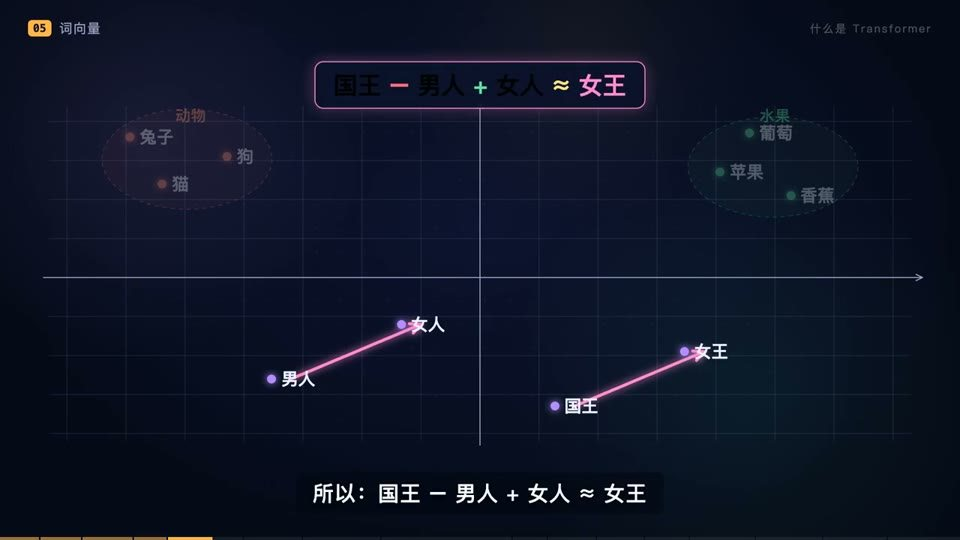</a></td>
</tr>
<tr>
<td width="50%" valign="top"><strong>用线稿回顾中华五千年</strong> <a href="https://x.com/akokoi1">@akokoi1</a> · 知识讲解 2:38 · 收藏 762 <a href="https://guanmo-ai.github.io/awesome-ai-motion/#case-2102583898865873225">▶ 播放</a> · <a href="https://x.com/akokoi1/status/2102583898865873225">原帖</a></td>
<td width="50%" valign="top"><strong>从直觉到数学解释 Transformer</strong> <a href="https://x.com/dotey">@dotey</a> · 知识讲解 12:12 · 收藏 1,457 <a href="https://guanmo-ai.github.io/awesome-ai-motion/#case-2103683057689522564">▶ 播放</a> · <a href="https://x.com/dotey/status/2103683057689522564">原帖</a></td>
</tr>
</tbody>
<tbody>
<tr>
<td width="50%" height="225" align="center" valign="middle"><a href="https://guanmo-ai.github.io/awesome-ai-motion/#case-2102853258582880547">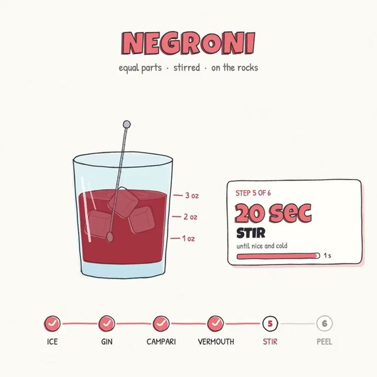</a></td>
<td width="50%" height="225" align="center" valign="middle"><a href="https://guanmo-ai.github.io/awesome-ai-motion/#case-2102606609574941028">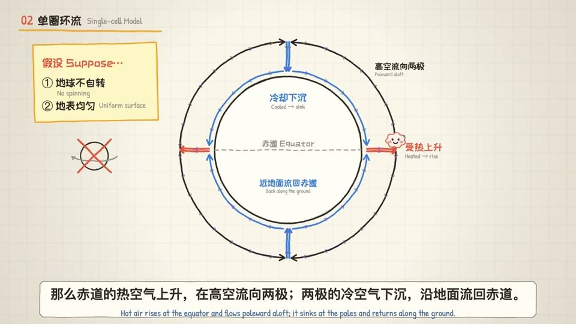</a></td>
</tr>
<tr>
<td width="50%" valign="top"><strong>让鸡尾酒配方动起来</strong> <a href="https://x.com/Ror_Fly">@Ror_Fly</a> · 知识讲解 0:30 · 收藏 1,442 <a href="https://guanmo-ai.github.io/awesome-ai-motion/#case-2102853258582880547">▶ 播放</a> · <a href="https://x.com/Ror_Fly/status/2102853258582880547">原帖</a></td>
<td width="50%" valign="top"><strong>把大气环流讲成动画</strong> <a href="https://x.com/akokoi1">@akokoi1</a> · 知识讲解 4:48 · 收藏 810 <a href="https://guanmo-ai.github.io/awesome-ai-motion/#case-2102606609574941028">▶ 播放</a> · <a href="https://x.com/akokoi1/status/2102606609574941028">原帖</a></td>
</tr>
</tbody>
<tbody>
<tr>
<td width="50%" height="225" align="center" valign="middle"></td>
<td width="50%" height="225" align="center" valign="middle"></td>
</tr>
<tr>
<td width="50%" valign="top"><strong>密码与通行密钥的区别</strong> <a href="https://x.com/Tz_2022">@Tz_2022</a> · 知识讲解 4:09 · 收藏 376 · 资料待完善 <a href="https://guanmo-ai.github.io/awesome-ai-motion/#case-2102838830285898214">▶ 播放</a> · <a href="https://x.com/Tz_2022/status/2102838830285898214">原帖</a></td>
<td width="50%" valign="top"><strong>导数概念的 Manim 动画课</strong> <a href="https://x.com/LinearUncle">@LinearUncle</a> · 知识讲解 7:37 · 收藏 360 · 资料待完善 <a href="https://guanmo-ai.github.io/awesome-ai-motion/#case-2103128559174971663">▶ 播放</a> · <a href="https://x.com/LinearUncle/status/2103128559174971663">原帖</a></td>
</tr>
</tbody>
<tbody>
<tr>
<td width="50%" height="225" align="center" valign="middle"><a href="https://guanmo-ai.github.io/awesome-ai-motion/#case-2106958663525314769">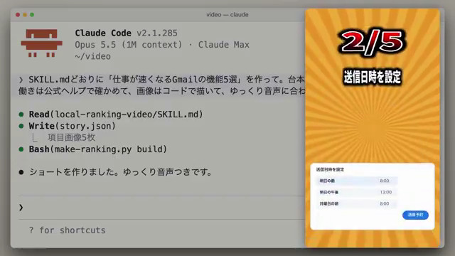</a></td>
<td width="50%" height="225" align="center" valign="middle"><a href="https://guanmo-ai.github.io/awesome-ai-motion/#case-2102751132502446549">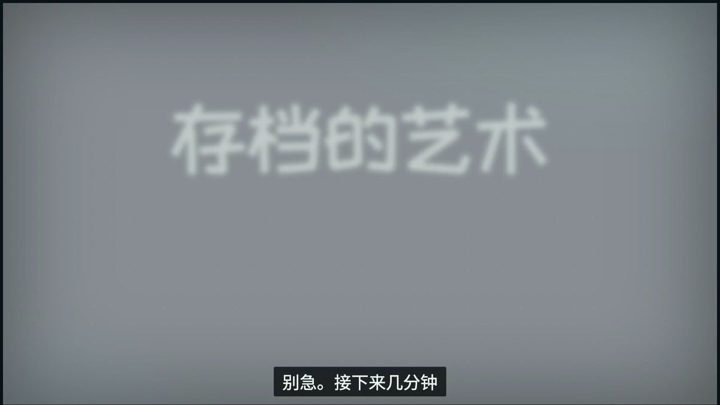</a></td>
</tr>
<tr>
<td width="50%" valign="top"><strong>Gmail 五个功能的短视频制作</strong> <a href="https://x.com/ClaudeCode_UT">@ClaudeCode_UT</a> · 知识讲解 0:32 · 收藏 186 · 资料待完善 <a href="https://guanmo-ai.github.io/awesome-ai-motion/#case-2106958663525314769">▶ 播放</a> · <a href="https://x.com/ClaudeCode_UT/status/2106958663525314769">原帖</a></td>
<td width="50%" valign="top"><strong>GitHub 版本管理入门</strong> <a href="https://x.com/sundyme">@sundyme</a> · 知识讲解 3:46 · 收藏 140 · 资料待完善 <a href="https://guanmo-ai.github.io/awesome-ai-motion/#case-2102751132502446549">▶ 播放</a> · <a href="https://x.com/sundyme/status/2102751132502446549">原帖</a></td>
</tr>
</tbody>
<tbody>
<tr>
<td width="50%" height="225" align="center" valign="middle"><a href="https://guanmo-ai.github.io/awesome-ai-motion/#case-2102695622042411419">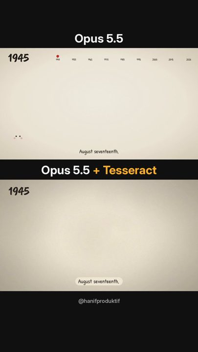</a></td>
<td width="50%" height="225" align="center" valign="middle"></td>
</tr>
<tr>
<td width="50%" valign="top"><strong>印度尼西亚八十一年历史速览</strong> <a href="https://x.com/hanifproduktif">@hanifproduktif</a> · 知识讲解 0:59 · 收藏 120 · 资料待完善 <a href="https://guanmo-ai.github.io/awesome-ai-motion/#case-2102695622042411419">▶ 播放</a> · <a href="https://x.com/hanifproduktif/status/2102695622042411419">原帖</a></td>
<td width="50%" valign="top"><strong>把印尼历史排成动态图形</strong> <a href="https://x.com/sonnylazuardi">@sonnylazuardi</a> · 知识讲解 0:53 · 收藏 102 <a href="https://guanmo-ai.github.io/awesome-ai-motion/#case-2103511590884815282">▶ 播放</a> · <a href="https://x.com/sonnylazuardi/status/2103511590884815282">原帖</a></td>
</tr>
</tbody>
<tbody>
<tr>
<td width="50%" height="225" align="center" valign="middle"><a href="https://guanmo-ai.github.io/awesome-ai-motion/#case-2103171088637419631">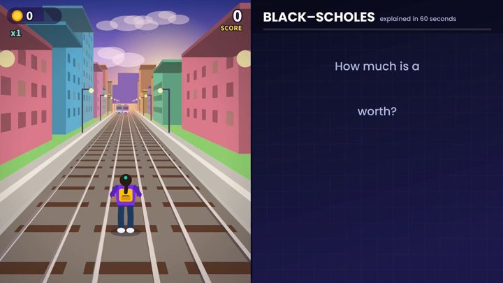</a></td>
<td width="50%" height="225" align="center" valign="middle"><a href="https://guanmo-ai.github.io/awesome-ai-motion/#case-2104949329639198912">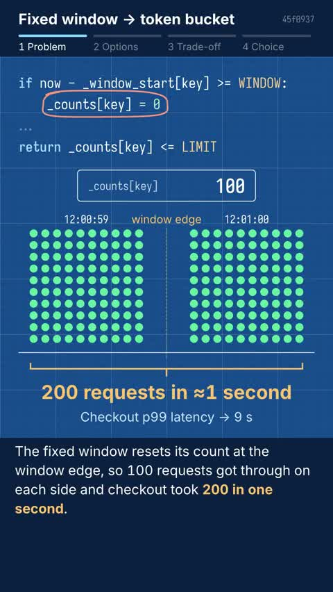</a></td>
</tr>
<tr>
<td width="50%" valign="top"><strong>期权公式与跑酷并屏讲解</strong> <a href="https://x.com/goodside">@goodside</a> · 知识讲解 1:00 · 收藏 45 · 资料待完善 <a href="https://guanmo-ai.github.io/awesome-ai-motion/#case-2103171088637419631">▶ 播放</a> · <a href="https://x.com/goodside/status/2103171088637419631">原帖</a></td>
<td width="50%" valign="top"><strong>从固定窗口到令牌桶的蓝图动画</strong> <a href="https://x.com/Voxyz_ai">@Voxyz_ai</a> · 知识讲解 0:41 · 收藏 27 · 资料待完善 <a href="https://guanmo-ai.github.io/awesome-ai-motion/#case-2104949329639198912">▶ 播放</a> · <a href="https://x.com/Voxyz_ai/status/2104949329639198912">原帖</a></td>
</tr>
</tbody>
<tbody>
<tr>
<td width="50%" height="225" align="center" valign="middle"></td>
<td width="50%" height="225" align="center" valign="middle"><a href="https://guanmo-ai.github.io/awesome-ai-motion/#case-2103801351993975279">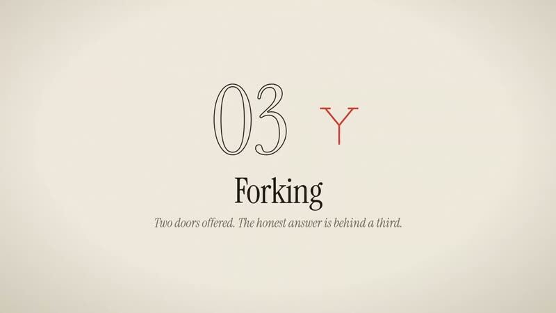</a></td>
</tr>
<tr>
<td width="50%" valign="top"><strong>SEO 与 GEO 的差异动画</strong> <a href="https://x.com/oscarmartin">@oscarmartin</a> · 知识讲解 0:33 · 收藏 22 · 资料待完善 <a href="https://guanmo-ai.github.io/awesome-ai-motion/#case-2102731669853573582">▶ 播放</a> · <a href="https://x.com/oscarmartin/status/2102731669853573582">原帖</a></td>
<td width="50%" valign="top"><strong>手机上一条指令把文章变成教程</strong> <a href="https://x.com/henkvaness">@henkvaness</a> · 知识讲解 5:37 · 收藏 9 <a href="https://guanmo-ai.github.io/awesome-ai-motion/#case-2103801351993975279">▶ 播放</a> · <a href="https://x.com/henkvaness/status/2103801351993975279">原帖</a></td>
</tr>
</tbody>
<tbody>
<tr>
<td width="50%" height="225" align="center" valign="middle"></td>
<td width="50%" height="225" align="center" valign="middle"><a href="https://guanmo-ai.github.io/awesome-ai-motion/#case-2103845689713111079">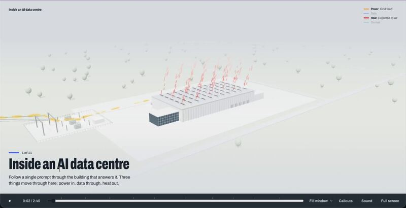</a></td>
</tr>
<tr>
<td width="50%" valign="top"><strong>Steam 新游的动态图文新闻</strong> <a href="https://x.com/gigabit_million">@gigabit_million</a> · 知识讲解 1:00 · 收藏 6 · 资料待完善 <a href="https://guanmo-ai.github.io/awesome-ai-motion/#case-2104068536041959719">▶ 播放</a> · <a href="https://x.com/gigabit_million/status/2104068536041959719">原帖</a></td>
<td width="50%" valign="top"><strong>从电网进入 AI 数据中心的三维影片</strong> <a href="https://x.com/mdaman010">@mdaman010</a> · 知识讲解 1:38 · 收藏 5 <a href="https://guanmo-ai.github.io/awesome-ai-motion/#case-2103845689713111079">▶ 播放</a> · <a href="https://x.com/mdaman010/status/2103845689713111079">原帖</a></td>
</tr>
</tbody>
<tbody>
<tr>
<td width="50%" height="225" align="center" valign="middle"></td>
<td width="50%" height="225" align="center" valign="middle"></td>
</tr>
<tr>
<td width="50%" valign="top"><strong>双角色讲解视频的初次练习</strong> <a href="https://x.com/Naonekozamurai">@Naonekozamurai</a> · 知识讲解 0:27 · 收藏 2 · 资料待完善 <a href="https://guanmo-ai.github.io/awesome-ai-motion/#case-2107584181941502428">▶ 播放</a> · <a href="https://x.com/Naonekozamurai/status/2107584181941502428">原帖</a></td>
<td width="50%" valign="top"><strong>面向零基础的 Git 视频</strong> <a href="https://x.com/Yunn260414">@Yunn260414</a> · 知识讲解 6:48 · 收藏 2 <a href="https://guanmo-ai.github.io/awesome-ai-motion/#case-2104044910769016888">▶ 播放</a> · <a href="https://x.com/Yunn260414/status/2104044910769016888">原帖</a></td>
</tr>
</tbody>
<tbody>
<tr>
<td width="50%" height="225" align="center" valign="middle"></td>
<td width="50%" height="225" align="center" valign="middle"><a href="https://guanmo-ai.github.io/awesome-ai-motion/#case-2107653001959833860">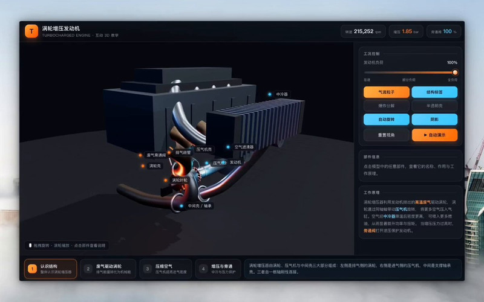</a></td>
</tr>
<tr>
<td width="50%" valign="top"><strong>鸡尾酒制作过程动效</strong> <a href="https://x.com/Sarut0biSasuke">@Sarut0biSasuke</a> · 知识讲解 0:30 · 收藏 1 · 资料待完善 <a href="https://guanmo-ai.github.io/awesome-ai-motion/#case-2103418429248069973">▶ 播放</a> · <a href="https://x.com/Sarut0biSasuke/status/2103418429248069973">原帖</a></td>
<td width="50%" valign="top"><strong>涡轮增压发动机互动教学</strong> <a href="https://x.com/yyyole">@yyyole</a> · 知识讲解 0:45 · 收藏 1 · 资料待完善 <a href="https://guanmo-ai.github.io/awesome-ai-motion/#case-2107653001959833860">▶ 播放</a> · <a href="https://x.com/yyyole/status/2107653001959833860">原帖</a></td>
</tr>
</tbody>
<tbody>
<tr>
<td width="50%" height="225" align="center" valign="middle"><a href="https://guanmo-ai.github.io/awesome-ai-motion/#case-2105033204319277506">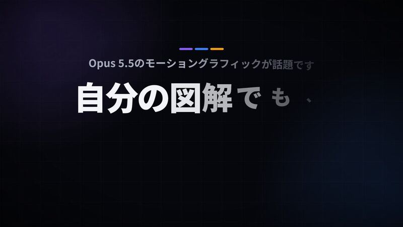</a></td>
<td width="50%" height="225" align="center" valign="middle"></td>
</tr>
<tr>
<td width="50%" valign="top"><strong>文章开场片：模板复用与文字检查</strong> <a href="https://x.com/FalconG_J">@FalconG_J</a> · 知识讲解 0:30 · 收藏 0 <a href="https://guanmo-ai.github.io/awesome-ai-motion/#case-2105033204319277506">▶ 播放</a> · <a href="https://x.com/FalconG_J/status/2105033204319277506">原帖</a></td>
<td width="50%" valign="top"><strong>通行密钥入门动画长片</strong> <a href="https://x.com/imShiWen">@imShiWen</a> · 知识讲解 6:15 · 收藏 0 · 资料待完善 <a href="https://guanmo-ai.github.io/awesome-ai-motion/#case-2102954743442399395">▶ 播放</a> · <a href="https://x.com/imShiWen/status/2102954743442399395">原帖</a></td>
</tr>
</tbody>
<tbody>
<tr>
<td width="50%" height="225" align="center" valign="middle"></td>
<td width="50%" height="225" align="center" valign="middle"></td>
</tr>
<tr>
<td width="50%" valign="top"><strong>《临江仙》古诗词学习动画</strong> <a href="https://x.com/7998l201">@7998l201</a> · 知识讲解 3:45 · 收藏 0 · 资料待完善 <a href="https://guanmo-ai.github.io/awesome-ai-motion/#case-2107443821630107654">▶ 播放</a> · <a href="https://x.com/7998l201/status/2107443821630107654">原帖</a></td>
<td width="50%" valign="top"><strong>用镜头实验室解释对焦</strong> <a href="https://x.com/RyanSael">@RyanSael</a> · 知识讲解 0:32 · 收藏 9,188 <a href="https://guanmo-ai.github.io/awesome-ai-motion/#case-2102591147927654847">▶ 播放</a> · <a href="https://x.com/RyanSael/status/2102591147927654847">原帖</a></td>
</tr>
</tbody>
<tbody>
<tr>
<td width="50%" height="225" align="center" valign="middle"></td>
<td width="50%" height="225" align="center" valign="middle"><a href="https://guanmo-ai.github.io/awesome-ai-motion/#case-2104094723887501736">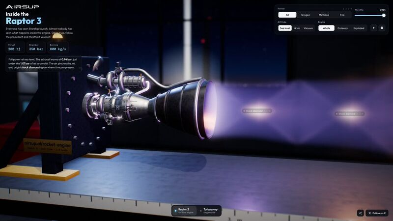</a></td>
</tr>
<tr>
<td width="50%" valign="top"><strong>研究论文八分钟动画讲解</strong> <a href="https://x.com/deedydas">@deedydas</a> · 知识讲解 8:39 · 收藏 5,419 · 资料待完善 <a href="https://guanmo-ai.github.io/awesome-ai-motion/#case-2103141339651350646">▶ 播放</a> · <a href="https://x.com/deedydas/status/2103141339651350646">原帖</a></td>
<td width="50%" valign="top"><strong>可拆解的 Raptor 3 火箭发动机</strong> <a href="https://x.com/konstantinsaifo">@konstantinsaifo</a> · 知识讲解 0:35 · 收藏 4,758 · 资料待完善 <a href="https://guanmo-ai.github.io/awesome-ai-motion/#case-2104094723887501736">▶ 播放</a> · <a href="https://x.com/konstantinsaifo/status/2104094723887501736">原帖</a></td>
</tr>
</tbody>
<tbody>
<tr>
<td width="50%" height="225" align="center" valign="middle"><a href="https://guanmo-ai.github.io/awesome-ai-motion/#case-2102737776219168939">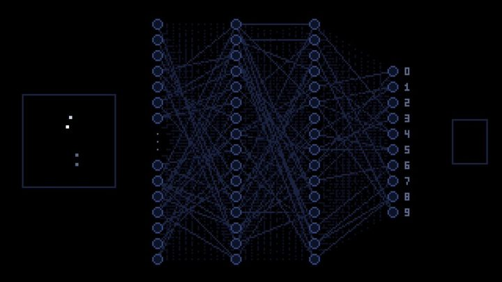</a></td>
<td width="50%" height="225" align="center" valign="middle"><a href="https://guanmo-ai.github.io/awesome-ai-motion/#case-2104151743907160546">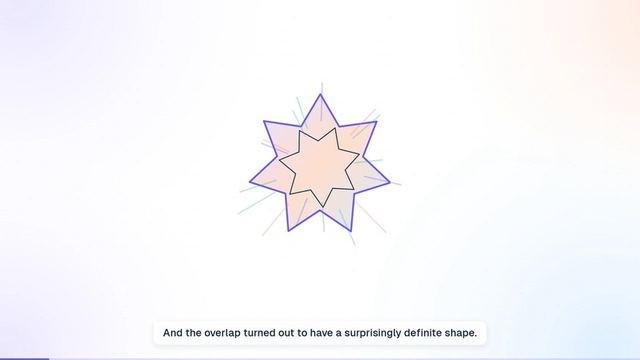</a></td>
</tr>
<tr>
<td width="50%" valign="top"><strong>像素画神经网络训练过程</strong> <a href="https://x.com/DotCSV">@DotCSV</a> · 知识讲解 0:56 · 收藏 3,196 · 资料待完善 <a href="https://guanmo-ai.github.io/awesome-ai-motion/#case-2102737776219168939">▶ 播放</a> · <a href="https://x.com/DotCSV/status/2102737776219168939">原帖</a></td>
<td width="50%" valign="top"><strong>《如何做好工作》短片</strong> <a href="https://x.com/deedydas">@deedydas</a> · 知识讲解 3:15 · 收藏 2,879 · 资料待完善 <a href="https://guanmo-ai.github.io/awesome-ai-motion/#case-2104151743907160546">▶ 播放</a> · <a href="https://x.com/deedydas/status/2104151743907160546">原帖</a></td>
</tr>
</tbody>
<tbody>
<tr>
<td width="50%" height="225" align="center" valign="middle"><a href="https://guanmo-ai.github.io/awesome-ai-motion/#case-2104206095313215591">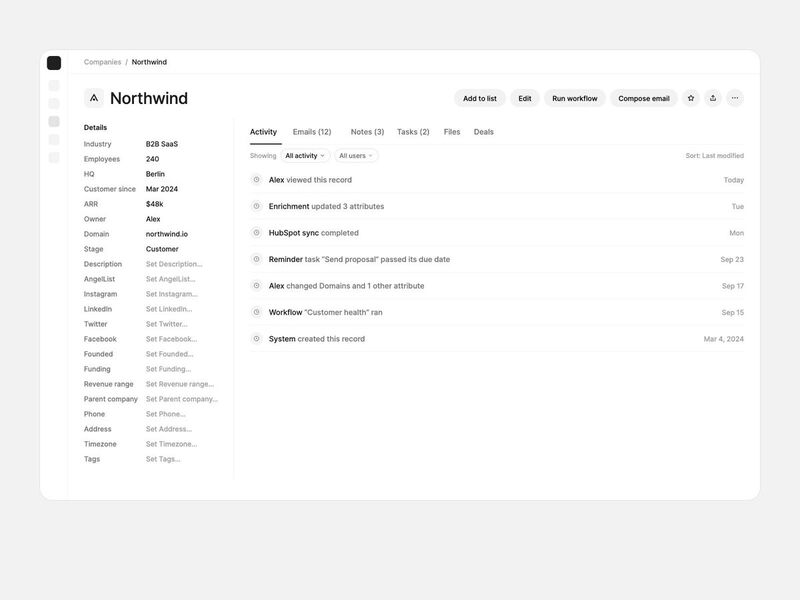</a></td>
<td width="50%" height="225" align="center" valign="middle"><a href="https://guanmo-ai.github.io/awesome-ai-motion/#case-2104391577091407965">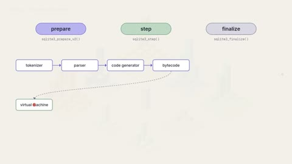</a></td>
</tr>
<tr>
<td width="50%" valign="top"><strong>用动画解释 UX 设计决策</strong> <a href="https://x.com/moguzbulbul">@moguzbulbul</a> · 知识讲解 0:42 · 收藏 2,728 · 资料待完善 <a href="https://guanmo-ai.github.io/awesome-ai-motion/#case-2104206095313215591">▶ 播放</a> · <a href="https://x.com/moguzbulbul/status/2104206095313215591">原帖</a></td>
<td width="50%" valign="top"><strong>SQLite：一条查询如何穿过代码库</strong> <a href="https://x.com/deedydas">@deedydas</a> · 知识讲解 7:30 · 收藏 2,031 · 资料待完善 <a href="https://guanmo-ai.github.io/awesome-ai-motion/#case-2104391577091407965">▶ 播放</a> · <a href="https://x.com/deedydas/status/2104391577091407965">原帖</a></td>
</tr>
</tbody>
<tbody>
<tr>
<td width="50%" height="225" align="center" valign="middle"></td>
<td width="50%" height="225" align="center" valign="middle"></td>
</tr>
<tr>
<td width="50%" valign="top"><strong>学习如何学习</strong> <a href="https://x.com/momoflilbit">@momoflilbit</a> · 知识讲解 10:40 · 收藏 1,792 · 资料待完善 <a href="https://guanmo-ai.github.io/awesome-ai-motion/#case-2105276821214532096">▶ 播放</a> · <a href="https://x.com/momoflilbit/status/2105276821214532096">原帖</a></td>
<td width="50%" valign="top"><strong>浏览器工作过程四十秒讲解</strong> <a href="https://x.com/addyosmani">@addyosmani</a> · 知识讲解 0:40 · 收藏 1,744 · 资料待完善 <a href="https://guanmo-ai.github.io/awesome-ai-motion/#case-2103009037164110327">▶ 播放</a> · <a href="https://x.com/addyosmani/status/2103009037164110327">原帖</a></td>
</tr>
</tbody>
<tbody>
<tr>
<td width="50%" height="225" align="center" valign="middle"><a href="https://guanmo-ai.github.io/awesome-ai-motion/#case-2104402407358919124">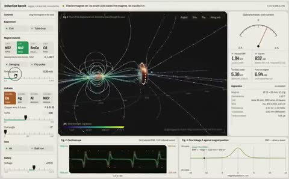</a></td>
<td width="50%" height="225" align="center" valign="middle"><a href="https://guanmo-ai.github.io/awesome-ai-motion/#case-2102844654169575547">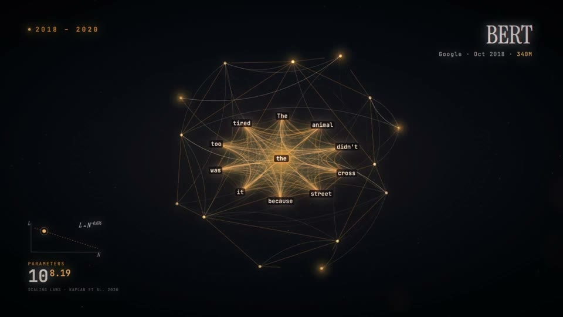</a></td>
</tr>
<tr>
<td width="50%" valign="top"><strong>电磁场与感应线圈的交互图解</strong> <a href="https://x.com/thebuggeddev">@thebuggeddev</a> · 知识讲解 1:11 · 收藏 1,608 · 资料待完善 <a href="https://guanmo-ai.github.io/awesome-ai-motion/#case-2104402407358919124">▶ 播放</a> · <a href="https://x.com/thebuggeddev/status/2104402407358919124">原帖</a></td>
<td width="50%" valign="top"><strong>从 Attention 到 AGI 的三分钟简史</strong> <a href="https://x.com/kimmonismus">@kimmonismus</a> · 知识讲解 3:00 · 收藏 1,590 <a href="https://guanmo-ai.github.io/awesome-ai-motion/#case-2102844654169575547">▶ 播放</a> · <a href="https://x.com/kimmonismus/status/2102844654169575547">原帖</a></td>
</tr>
</tbody>
<tbody>
<tr>
<td width="50%" height="225" align="center" valign="middle"><a href="https://guanmo-ai.github.io/awesome-ai-motion/#case-2108241054298415258">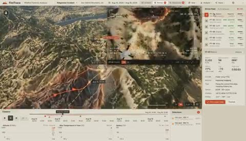</a></td>
<td width="50%" height="225" align="center" valign="middle"><a href="https://guanmo-ai.github.io/awesome-ai-motion/#case-2106411941497389342">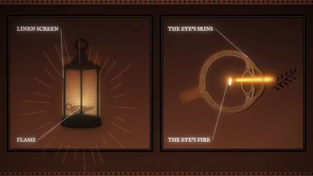</a></td>
</tr>
<tr>
<td width="50%" valign="top"><strong>山火进程的三维可视化原型</strong> <a href="https://x.com/DilumSanjaya">@DilumSanjaya</a> · 知识讲解 1:55 · 收藏 1,572 · 资料待完善 <a href="https://guanmo-ai.github.io/awesome-ai-motion/#case-2108241054298415258">▶ 播放</a> · <a href="https://x.com/DilumSanjaya/status/2108241054298415258">原帖</a></td>
<td width="50%" valign="top"><strong>The History of Light：约 36 分钟光学科普</strong> <a href="https://x.com/LLMJunky">@LLMJunky</a> · 知识讲解 35:37 · 收藏 1,470 · 资料待完善 <a href="https://guanmo-ai.github.io/awesome-ai-motion/#case-2106411941497389342">▶ 播放</a> · <a href="https://x.com/LLMJunky/status/2106411941497389342">原帖</a></td>
</tr>
</tbody>
<tbody>
<tr>
<td width="50%" height="225" align="center" valign="middle"></td>
<td width="50%" height="225" align="center" valign="middle"><a href="https://guanmo-ai.github.io/awesome-ai-motion/#case-2102463796149440888">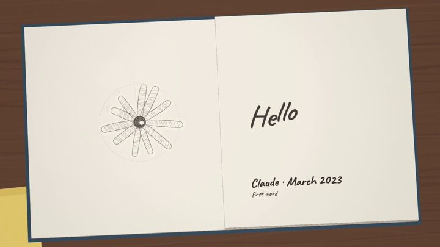</a></td>
</tr>
<tr>
<td width="50%" valign="top"><strong>谷歌历史两分钟视频</strong> <a href="https://x.com/deedydas">@deedydas</a> · 知识讲解 2:00 · 收藏 1,012 · 资料待完善 <a href="https://guanmo-ai.github.io/awesome-ai-motion/#case-2103965547780345859">▶ 播放</a> · <a href="https://x.com/deedydas/status/2103965547780345859">原帖</a></td>
<td width="50%" valign="top"><strong>Claude 模型发展时间线</strong> <a href="https://x.com/superalesha">@superalesha</a> · 知识讲解 1:28 · 收藏 939 · 资料待完善 <a href="https://guanmo-ai.github.io/awesome-ai-motion/#case-2102463796149440888">▶ 播放</a> · <a href="https://x.com/superalesha/status/2102463796149440888">原帖</a></td>
</tr>
</tbody>
<tbody>
<tr>
<td width="50%" height="225" align="center" valign="middle"><a href="https://guanmo-ai.github.io/awesome-ai-motion/#case-2103865359988125706">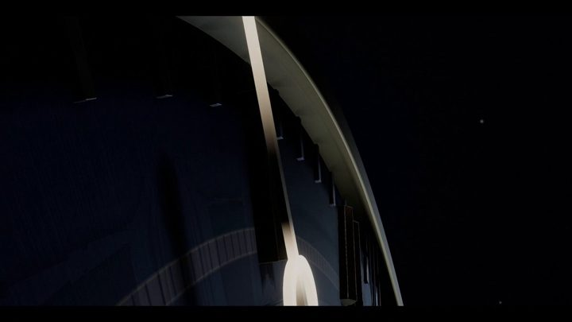</a></td>
<td width="50%" height="225" align="center" valign="middle"><a href="https://guanmo-ai.github.io/awesome-ai-motion/#case-2104437066755125601">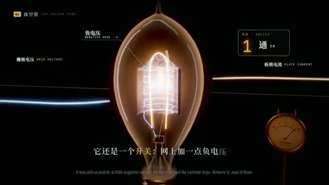</a></td>
</tr>
<tr>
<td width="50%" valign="top"><strong>超级智能风险动画</strong> <a href="https://x.com/AndrewOnXYZ">@AndrewOnXYZ</a> · 知识讲解 5:16 · 收藏 893 · 资料待完善 <a href="https://guanmo-ai.github.io/awesome-ai-motion/#case-2103865359988125706">▶ 播放</a> · <a href="https://x.com/AndrewOnXYZ/status/2103865359988125706">原帖</a></td>
<td width="50%" valign="top"><strong>芯片简史：从灯丝到光刻</strong> <a href="https://x.com/AndyL5cc">@AndyL5cc</a> · 知识讲解 3:29 · 收藏 882 · 资料待完善 <a href="https://guanmo-ai.github.io/awesome-ai-motion/#case-2104437066755125601">▶ 播放</a> · <a href="https://x.com/AndyL5cc/status/2104437066755125601">原帖</a></td>
</tr>
</tbody>
<tbody>
<tr>
<td width="50%" height="225" align="center" valign="middle"><a href="https://guanmo-ai.github.io/awesome-ai-motion/#case-2106052083040256293">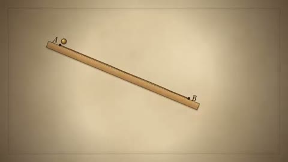</a></td>
<td width="50%" height="225" align="center" valign="middle"><a href="https://guanmo-ai.github.io/awesome-ai-motion/#case-2106829942206173497">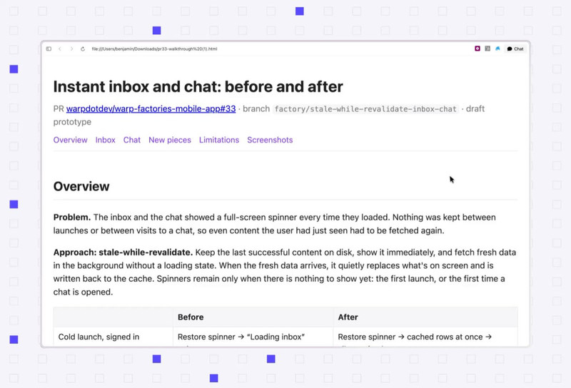</a></td>
</tr>
<tr>
<td width="50%" valign="top"><strong>哪条路径下落最快？</strong> <a href="https://x.com/AIMevzulari">@AIMevzulari</a> · 知识讲解 2:08 · 收藏 831 · 资料待完善 <a href="https://guanmo-ai.github.io/awesome-ai-motion/#case-2106052083040256293">▶ 播放</a> · <a href="https://x.com/AIMevzulari/status/2106052083040256293">原帖</a></td>
<td width="50%" valign="top"><strong>用 HTML 解释缓存 PR</strong> <a href="https://x.com/BHolmesDev">@BHolmesDev</a> · 知识讲解 0:19 · 收藏 798 · 资料待完善 <a href="https://guanmo-ai.github.io/awesome-ai-motion/#case-2106829942206173497">▶ 播放</a> · <a href="https://x.com/BHolmesDev/status/2106829942206173497">原帖</a></td>
</tr>
</tbody>
<tbody>
<tr>
<td width="50%" height="225" align="center" valign="middle"></td>
<td width="50%" height="225" align="center" valign="middle"><a href="https://guanmo-ai.github.io/awesome-ai-motion/#case-2103174501345493197">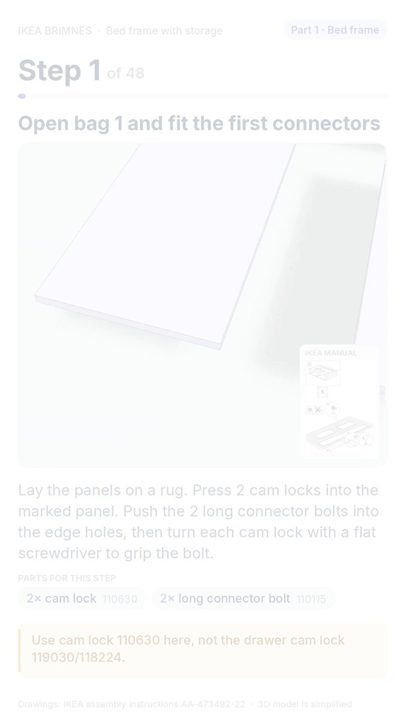</a></td>
</tr>
<tr>
<td width="50%" valign="top"><strong>从生命诞生到大脑：人体科普</strong> <a href="https://x.com/chetaslua">@chetaslua</a> · 知识讲解 0:30 · 收藏 630 · 资料待完善 <a href="https://guanmo-ai.github.io/awesome-ai-motion/#case-2109244702235275680">▶ 播放</a> · <a href="https://x.com/chetaslua/status/2109244702235275680">原帖</a></td>
<td width="50%" valign="top"><strong>宜家说明书转三维教程</strong> <a href="https://x.com/deedydas">@deedydas</a> · 知识讲解 1:42 · 收藏 596 · 资料待完善 <a href="https://guanmo-ai.github.io/awesome-ai-motion/#case-2103174501345493197">▶ 播放</a> · <a href="https://x.com/deedydas/status/2103174501345493197">原帖</a></td>
</tr>
</tbody>
<tbody>
<tr>
<td width="50%" height="225" align="center" valign="middle"></td>
<td width="50%" height="225" align="center" valign="middle"><a href="https://guanmo-ai.github.io/awesome-ai-motion/#case-2102498682931441977">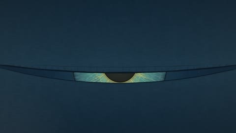</a></td>
</tr>
<tr>
<td width="50%" valign="top"><strong>双生子佯谬剪纸动画</strong> <a href="https://x.com/masahirochaen">@masahirochaen</a> · 知识讲解 0:47 · 收藏 577 · 资料待完善 <a href="https://guanmo-ai.github.io/awesome-ai-motion/#case-2102722719502704941">▶ 播放</a> · <a href="https://x.com/masahirochaen/status/2102722719502704941">原帖</a></td>
<td width="50%" valign="top"><strong>从细胞到眼睛的科普动效</strong> <a href="https://x.com/rege_dev">@rege_dev</a> · 知识讲解 0:50 · 收藏 569 · 资料待完善 <a href="https://guanmo-ai.github.io/awesome-ai-motion/#case-2102498682931441977">▶ 播放</a> · <a href="https://x.com/rege_dev/status/2102498682931441977">原帖</a></td>
</tr>
</tbody>
<tbody>
<tr>
<td width="50%" height="225" align="center" valign="middle"></td>
<td width="50%" height="225" align="center" valign="middle"></td>
</tr>
<tr>
<td width="50%" valign="top"><strong>五座日本建筑的线框搭建</strong> <a href="https://x.com/yoshifujidesign">@yoshifujidesign</a> · 知识讲解 0:16 · 收藏 547 · 资料待完善 <a href="https://guanmo-ai.github.io/awesome-ai-motion/#case-2105746986339283305">▶ 播放</a> · <a href="https://x.com/yoshifujidesign/status/2105746986339283305">原帖</a></td>
<td width="50%" valign="top"><strong>人工智能历史的程序动画</strong> <a href="https://x.com/bridgemindai">@bridgemindai</a> · 知识讲解 1:00 · 收藏 499 · 资料待完善 <a href="https://guanmo-ai.github.io/awesome-ai-motion/#case-2103530750767206626">▶ 播放</a> · <a href="https://x.com/bridgemindai/status/2103530750767206626">原帖</a></td>
</tr>
</tbody>
<tbody>
<tr>
<td width="50%" height="225" align="center" valign="middle"></td>
<td width="50%" height="225" align="center" valign="middle"><a href="https://guanmo-ai.github.io/awesome-ai-motion/#case-2109146752528110053">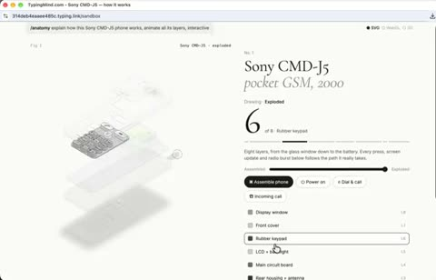</a></td>
</tr>
<tr>
<td width="50%" valign="top"><strong>用动画解释嵌入向量</strong> <a href="https://x.com/antonioleivag">@antonioleivag</a> · 知识讲解 0:42 · 收藏 468 · 资料待完善 <a href="https://guanmo-ai.github.io/awesome-ai-motion/#case-2107833536669532671">▶ 播放</a> · <a href="https://x.com/antonioleivag/status/2107833536669532671">原帖</a></td>
<td width="50%" valign="top"><strong>Sony CMD-J5 的分层解剖</strong> <a href="https://x.com/ann_nnng">@ann_nnng</a> · 知识讲解 0:17 · 收藏 461 · 资料待完善 <a href="https://guanmo-ai.github.io/awesome-ai-motion/#case-2109146752528110053">▶ 播放</a> · <a href="https://x.com/ann_nnng/status/2109146752528110053">原帖</a></td>
</tr>
</tbody>
<tbody>
<tr>
<td width="50%" height="225" align="center" valign="middle"><a href="https://guanmo-ai.github.io/awesome-ai-motion/#case-2106490563964874926">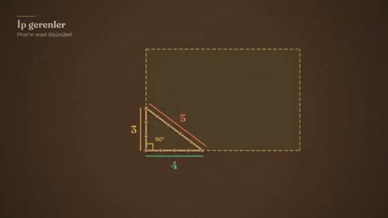</a></td>
<td width="50%" height="225" align="center" valign="middle"><a href="https://guanmo-ai.github.io/awesome-ai-motion/#case-2106313749846249487">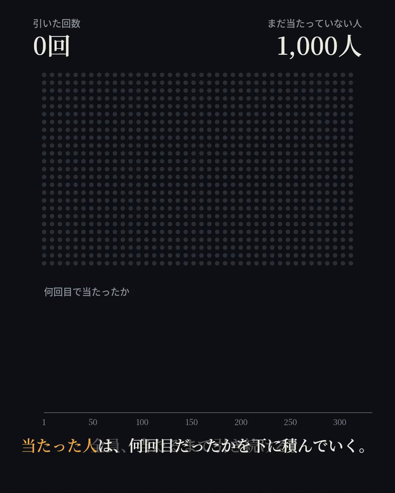</a></td>
</tr>
<tr>
<td width="50%" valign="top"><strong>勾股定理的面积变换</strong> <a href="https://x.com/AIMevzulari">@AIMevzulari</a> · 知识讲解 3:26 · 收藏 429 · 资料待完善 <a href="https://guanmo-ai.github.io/awesome-ai-motion/#case-2106490563964874926">▶ 播放</a> · <a href="https://x.com/AIMevzulari/status/2106490563964874926">原帖</a></td>
<td width="50%" valign="top"><strong>百分之一概率的逐次尝试</strong> <a href="https://x.com/Lattice_Node">@Lattice_Node</a> · 知识讲解 0:42 · 收藏 387 · 资料待完善 <a href="https://guanmo-ai.github.io/awesome-ai-motion/#case-2106313749846249487">▶ 播放</a> · <a href="https://x.com/Lattice_Node/status/2106313749846249487">原帖</a></td>
</tr>
</tbody>
<tbody>
<tr>
<td width="50%" height="225" align="center" valign="middle"><a href="https://guanmo-ai.github.io/awesome-ai-motion/#case-2103997975173439834">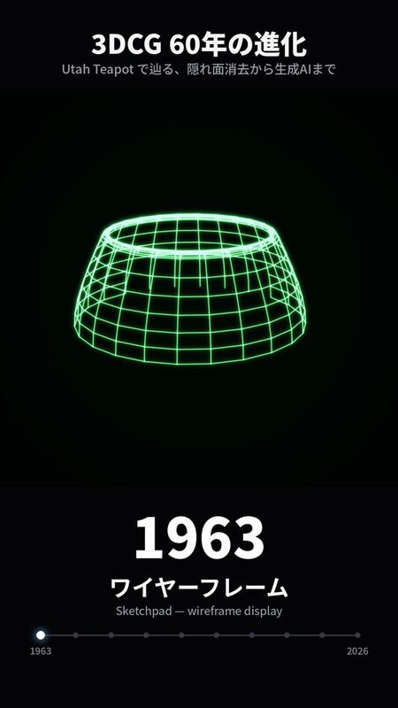</a></td>
<td width="50%" height="225" align="center" valign="middle"><a href="https://guanmo-ai.github.io/awesome-ai-motion/#case-2111864203753492513">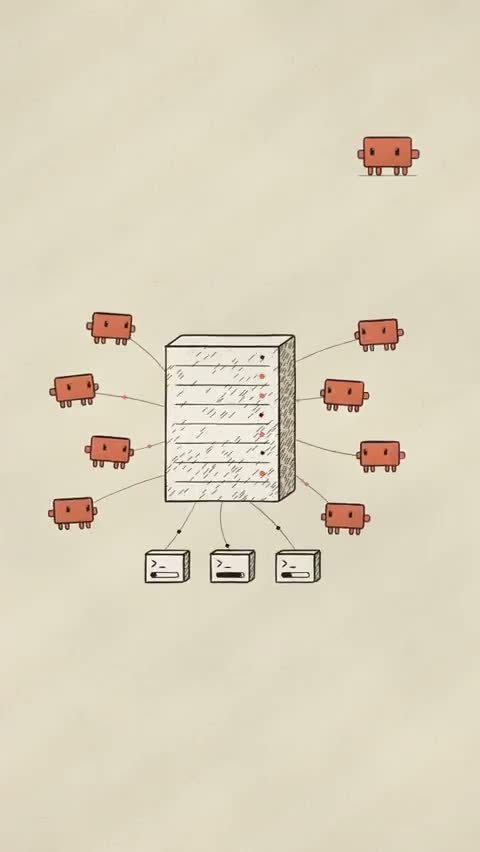</a></td>
</tr>
<tr>
<td width="50%" valign="top"><strong>15秒回顾三维计算机图形史</strong> <a href="https://x.com/jmitani">@jmitani</a> · 知识讲解 0:15 · 收藏 356 · 资料待完善 <a href="https://guanmo-ai.github.io/awesome-ai-motion/#case-2103997975173439834">▶ 播放</a> · <a href="https://x.com/jmitani/status/2103997975173439834">原帖</a></td>
<td width="50%" valign="top"><strong>Scion 源码管理的动态图解</strong> <a href="https://x.com/devteamdrew">@devteamdrew</a> · 知识讲解 1:39 · 收藏 302 · 资料待完善 <a href="https://guanmo-ai.github.io/awesome-ai-motion/#case-2111864203753492513">▶ 播放</a> · <a href="https://x.com/devteamdrew/status/2111864203753492513">原帖</a></td>
</tr>
</tbody>
<tbody>
<tr>
<td width="50%" height="225" align="center" valign="middle"><a href="https://guanmo-ai.github.io/awesome-ai-motion/#case-2102779758408774104">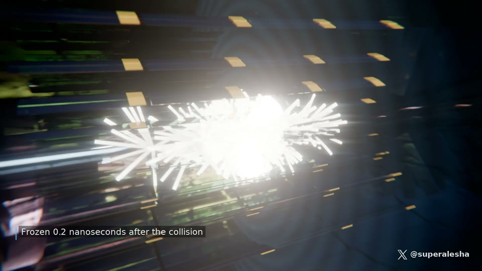</a></td>
<td width="50%" height="225" align="center" valign="middle"><a href="https://guanmo-ai.github.io/awesome-ai-motion/#case-2103482545111232946">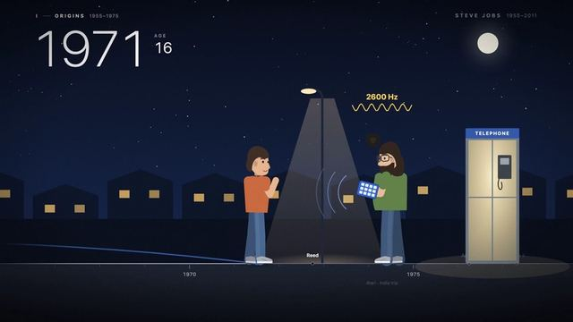</a></td>
</tr>
<tr>
<td width="50%" valign="top"><strong>走进强子对撞机的质子碰撞</strong> <a href="https://x.com/superalesha">@superalesha</a> · 知识讲解 0:34 · 收藏 300 <a href="https://guanmo-ai.github.io/awesome-ai-motion/#case-2102779758408774104">▶ 播放</a> · <a href="https://x.com/superalesha/status/2102779758408774104">原帖</a></td>
<td width="50%" valign="top"><strong>乔布斯生平的代码动画</strong> <a href="https://x.com/oozn">@oozn</a> · 知识讲解 1:59 · 收藏 254 · 资料待完善 <a href="https://guanmo-ai.github.io/awesome-ai-motion/#case-2103482545111232946">▶ 播放</a> · <a href="https://x.com/oozn/status/2103482545111232946">原帖</a></td>
</tr>
</tbody>
<tbody>
<tr>
<td width="50%" height="225" align="center" valign="middle"><a href="https://guanmo-ai.github.io/awesome-ai-motion/#case-2104978414465945696">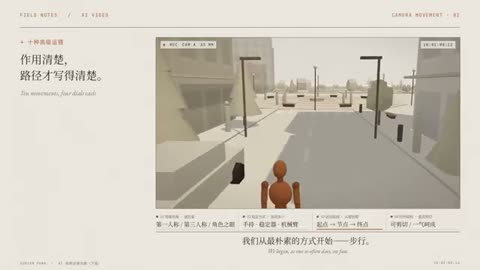</a></td>
<td width="50%" height="225" align="center" valign="middle"></td>
</tr>
<tr>
<td width="50%" valign="top"><strong>第一性原理的三维科普</strong> <a href="https://x.com/Tz_2022">@Tz_2022</a> · 知识讲解 5:02 · 收藏 251 · 资料待完善 <a href="https://guanmo-ai.github.io/awesome-ai-motion/#case-2104978414465945696">▶ 播放</a> · <a href="https://x.com/Tz_2022/status/2104978414465945696">原帖</a></td>
<td width="50%" valign="top"><strong>六分钟程序化教学影像</strong> <a href="https://x.com/0x0funky">@0x0funky</a> · 知识讲解 6:34 · 收藏 248 · 资料待完善 <a href="https://guanmo-ai.github.io/awesome-ai-motion/#case-2102736587708854585">▶ 播放</a> · <a href="https://x.com/0x0funky/status/2102736587708854585">原帖</a></td>
</tr>
</tbody>
<tbody>
<tr>
<td width="50%" height="225" align="center" valign="middle"><a href="https://guanmo-ai.github.io/awesome-ai-motion/#case-2107408409859359211">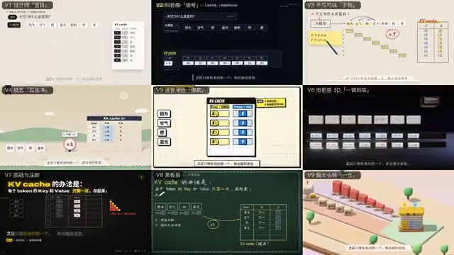</a></td>
<td width="50%" height="225" align="center" valign="middle"><a href="https://guanmo-ai.github.io/awesome-ai-motion/#case-2107449104926482912">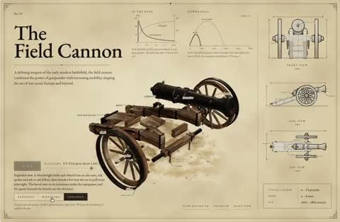</a></td>
</tr>
<tr>
<td width="50%" valign="top"><strong>九种 KV Cache 讲解风格</strong> <a href="https://x.com/LufzzLiz">@LufzzLiz</a> · 知识讲解 0:45 · 收藏 246 · 资料待完善 <a href="https://guanmo-ai.github.io/awesome-ai-motion/#case-2107408409859359211">▶ 播放</a> · <a href="https://x.com/LufzzLiz/status/2107408409859359211">原帖</a></td>
<td width="50%" valign="top"><strong>拿破仑野战炮的结构可视化</strong> <a href="https://x.com/thebuggeddev">@thebuggeddev</a> · 知识讲解 0:51 · 收藏 242 · 资料待完善 <a href="https://guanmo-ai.github.io/awesome-ai-motion/#case-2107449104926482912">▶ 播放</a> · <a href="https://x.com/thebuggeddev/status/2107449104926482912">原帖</a></td>
</tr>
</tbody>
<tbody>
<tr>
<td width="50%" height="225" align="center" valign="middle"></td>
<td width="50%" height="225" align="center" valign="middle"></td>
</tr>
<tr>
<td width="50%" valign="top"><strong>一只蜜蜂的一生</strong> <a href="https://x.com/kevin_t_ngo">@kevin_t_ngo</a> · 知识讲解 0:53 · 收藏 236 · 资料待完善 <a href="https://guanmo-ai.github.io/awesome-ai-motion/#case-2109766087328100521">▶ 播放</a> · <a href="https://x.com/kevin_t_ngo/status/2109766087328100521">原帖</a></td>
<td width="50%" valign="top"><strong>四十层塔楼的施工顺序动画</strong> <a href="https://x.com/Solvaix">@Solvaix</a> · 知识讲解 0:29 · 收藏 228 · 资料待完善 <a href="https://guanmo-ai.github.io/awesome-ai-motion/#case-2107548992640880755">▶ 播放</a> · <a href="https://x.com/Solvaix/status/2107548992640880755">原帖</a></td>
</tr>
</tbody>
<tbody>
<tr>
<td width="50%" height="225" align="center" valign="middle"><a href="https://guanmo-ai.github.io/awesome-ai-motion/#case-2107018546194882678">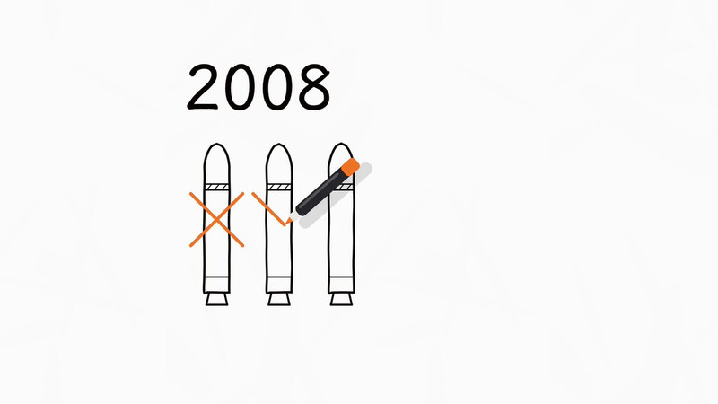</a></td>
<td width="50%" height="225" align="center" valign="middle"><a href="https://guanmo-ai.github.io/awesome-ai-motion/#case-2111097422810169575">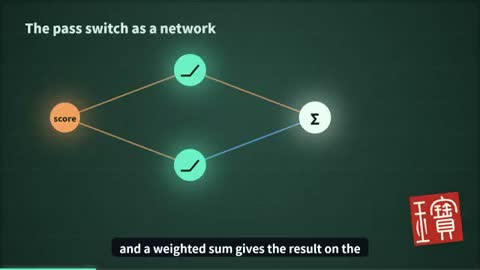</a></td>
</tr>
<tr>
<td width="50%" valign="top"><strong>Huashu：白板式讲解样片</strong> <a href="https://x.com/AlchainHust">@AlchainHust</a> · 知识讲解 2:10 · 收藏 227 · 资料待完善 <a href="https://guanmo-ai.github.io/awesome-ai-motion/#case-2107018546194882678">▶ 播放</a> · <a href="https://x.com/AlchainHust/status/2107018546194882678">原帖</a></td>
<td width="50%" valign="top"><strong>把普通代码变成神经网络</strong> <a href="https://x.com/dotey">@dotey</a> · 知识讲解 14:46 · 收藏 224 · 资料待完善 <a href="https://guanmo-ai.github.io/awesome-ai-motion/#case-2111097422810169575">▶ 播放</a> · <a href="https://x.com/dotey/status/2111097422810169575">原帖</a></td>
</tr>
</tbody>
<tbody>
<tr>
<td width="50%" height="225" align="center" valign="middle"><a href="https://guanmo-ai.github.io/awesome-ai-motion/#case-2102806161728885145">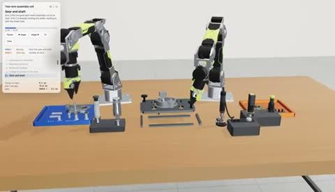</a></td>
<td width="50%" height="225" align="center" valign="middle"></td>
</tr>
<tr>
<td width="50%" valign="top"><strong>双机械臂协作装配</strong> <a href="https://x.com/DilumSanjaya">@DilumSanjaya</a> · 知识讲解 2:55 · 收藏 221 · 资料待完善 <a href="https://guanmo-ai.github.io/awesome-ai-motion/#case-2102806161728885145">▶ 播放</a> · <a href="https://x.com/DilumSanjaya/status/2102806161728885145">原帖</a></td>
<td width="50%" valign="top"><strong>键盘的分层拆解与轴体结构</strong> <a href="https://x.com/quantapar">@quantapar</a> · 知识讲解 0:17 · 收藏 208 · 资料待完善 <a href="https://guanmo-ai.github.io/awesome-ai-motion/#case-2109748221459546529">▶ 播放</a> · <a href="https://x.com/quantapar/status/2109748221459546529">原帖</a></td>
</tr>
</tbody>
<tbody>
<tr>
<td width="50%" height="225" align="center" valign="middle"><a href="https://guanmo-ai.github.io/awesome-ai-motion/#case-2102680453912449223">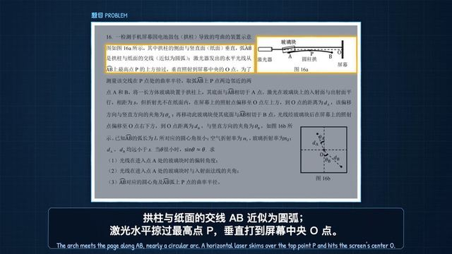</a></td>
<td width="50%" height="225" align="center" valign="middle"></td>
</tr>
<tr>
<td width="50%" valign="top"><strong>物理竞赛题动画讲解</strong> <a href="https://x.com/akokoi1">@akokoi1</a> · 知识讲解 3:09 · 收藏 201 · 资料待完善 <a href="https://guanmo-ai.github.io/awesome-ai-motion/#case-2102680453912449223">▶ 播放</a> · <a href="https://x.com/akokoi1/status/2102680453912449223">原帖</a></td>
<td width="50%" valign="top"><strong>光合作用的艺术</strong> <a href="https://x.com/devteamdrew">@devteamdrew</a> · 知识讲解 0:47 · 收藏 187 · 资料待完善 <a href="https://guanmo-ai.github.io/awesome-ai-motion/#case-2111172786286690324">▶ 播放</a> · <a href="https://x.com/devteamdrew/status/2111172786286690324">原帖</a></td>
</tr>
</tbody>
<tbody>
<tr>
<td width="50%" height="225" align="center" valign="middle"></td>
<td width="50%" height="225" align="center" valign="middle"></td>
</tr>
<tr>
<td width="50%" valign="top"><strong>关原之战：布阵图翻转</strong> <a href="https://x.com/tkz_aiart">@tkz_aiart</a> · 知识讲解 2:15 · 收藏 181 · 资料待完善 <a href="https://guanmo-ai.github.io/awesome-ai-motion/#case-2105271839698428235">▶ 播放</a> · <a href="https://x.com/tkz_aiart/status/2105271839698428235">原帖</a></td>
<td width="50%" valign="top"><strong>上下文窗口的动画解释</strong> <a href="https://x.com/joaoli13">@joaoli13</a> · 知识讲解 1:41 · 收藏 179 · 资料待完善 <a href="https://guanmo-ai.github.io/awesome-ai-motion/#case-2102805376466891137">▶ 播放</a> · <a href="https://x.com/joaoli13/status/2102805376466891137">原帖</a></td>
</tr>
</tbody>
<tbody>
<tr>
<td width="50%" height="225" align="center" valign="middle"><a href="https://guanmo-ai.github.io/awesome-ai-motion/#case-2105983802367688910">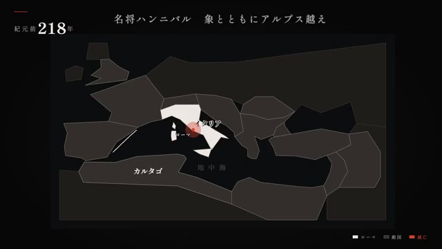</a></td>
<td width="50%" height="225" align="center" valign="middle"></td>
</tr>
<tr>
<td width="50%" valign="top"><strong>罗马帝国的地图纪录片</strong> <a href="https://x.com/tkz_aiart">@tkz_aiart</a> · 知识讲解 2:16 · 收藏 172 · 资料待完善 <a href="https://guanmo-ai.github.io/awesome-ai-motion/#case-2105983802367688910">▶ 播放</a> · <a href="https://x.com/tkz_aiart/status/2105983802367688910">原帖</a></td>
<td width="50%" valign="top"><strong>咖啡历史的拼贴信息图</strong> <a href="https://x.com/ai4everyday">@ai4everyday</a> · 知识讲解 1:00 · 收藏 167 · 资料待完善 <a href="https://guanmo-ai.github.io/awesome-ai-motion/#case-2106130713439256844">▶ 播放</a> · <a href="https://x.com/ai4everyday/status/2106130713439256844">原帖</a></td>
</tr>
</tbody>
<tbody>
<tr>
<td width="50%" height="225" align="center" valign="middle"></td>
<td width="50%" height="225" align="center" valign="middle"><a href="https://guanmo-ai.github.io/awesome-ai-motion/#case-2103099960069873856">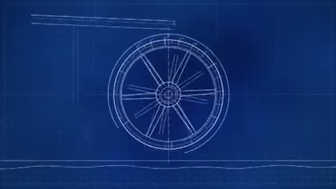</a></td>
</tr>
<tr>
<td width="50%" valign="top"><strong>Huashu：艺术史风格动画</strong> <a href="https://x.com/AlchainHust">@AlchainHust</a> · 知识讲解 2:08 · 收藏 162 · 资料待完善 <a href="https://guanmo-ai.github.io/awesome-ai-motion/#case-2106955771183272343">▶ 播放</a> · <a href="https://x.com/AlchainHust/status/2106955771183272343">原帖</a></td>
<td width="50%" valign="top"><strong>旋转轴：工程史蓝图动画</strong> <a href="https://x.com/ootamato">@ootamato</a> · 知识讲解 0:31 · 收藏 160 · 资料待完善 <a href="https://guanmo-ai.github.io/awesome-ai-motion/#case-2103099960069873856">▶ 播放</a> · <a href="https://x.com/ootamato/status/2103099960069873856">原帖</a></td>
</tr>
</tbody>
<tbody>
<tr>
<td width="50%" height="225" align="center" valign="middle"></td>
<td width="50%" height="225" align="center" valign="middle"></td>
</tr>
<tr>
<td width="50%" valign="top"><strong>咖啡之路</strong> <a href="https://x.com/ai4everyday">@ai4everyday</a> · 知识讲解 0:10 · 收藏 160 · 资料待完善 <a href="https://guanmo-ai.github.io/awesome-ai-motion/#case-2105715960220983304">▶ 播放</a> · <a href="https://x.com/ai4everyday/status/2105715960220983304">原帖</a></td>
<td width="50%" valign="top"><strong>一个汉堡如何被制作出来</strong> <a href="https://x.com/kevin_t_ngo">@kevin_t_ngo</a> · 知识讲解 1:04 · 收藏 137 · 资料待完善 <a href="https://guanmo-ai.github.io/awesome-ai-motion/#case-2111569193347018977">▶ 播放</a> · <a href="https://x.com/kevin_t_ngo/status/2111569193347018977">原帖</a></td>
</tr>
</tbody>
<tbody>
<tr>
<td width="50%" height="225" align="center" valign="middle"></td>
<td width="50%" height="225" align="center" valign="middle"><a href="https://guanmo-ai.github.io/awesome-ai-motion/#case-2107806362621149433">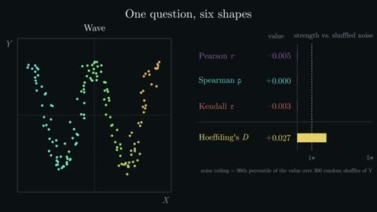</a></td>
</tr>
<tr>
<td width="50%" valign="top"><strong>免疫学历史的代码动画</strong> <a href="https://x.com/DeryaTR_">@DeryaTR_</a> · 知识讲解 2:00 · 收藏 135 · 资料待完善 <a href="https://guanmo-ai.github.io/awesome-ai-motion/#case-2106567073149190228">▶ 播放</a> · <a href="https://x.com/DeryaTR_/status/2106567073149190228">原帖</a></td>
<td width="50%" valign="top"><strong>Hoeffding's D 的动态图解</strong> <a href="https://x.com/doodlestein">@doodlestein</a> · 知识讲解 8:27 · 收藏 127 · 资料待完善 <a href="https://guanmo-ai.github.io/awesome-ai-motion/#case-2107806362621149433">▶ 播放</a> · <a href="https://x.com/doodlestein/status/2107806362621149433">原帖</a></td>
</tr>
</tbody>
<tbody>
<tr>
<td width="50%" height="225" align="center" valign="middle"></td>
<td width="50%" height="225" align="center" valign="middle"><a href="https://guanmo-ai.github.io/awesome-ai-motion/#case-2104717572788883829">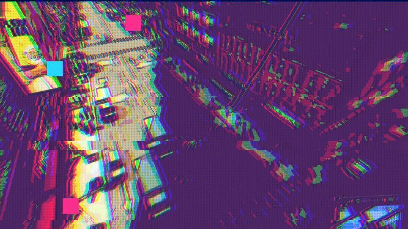</a></td>
</tr>
<tr>
<td width="50%" valign="top"><strong>播客音频自动剪成短视频</strong> <a href="https://x.com/Fujin_Metaverse">@Fujin_Metaverse</a> · 知识讲解 0:53 · 收藏 125 · 资料待完善 <a href="https://guanmo-ai.github.io/awesome-ai-motion/#case-2102897123037761640">▶ 播放</a> · <a href="https://x.com/Fujin_Metaverse/status/2102897123037761640">原帖</a></td>
<td width="50%" valign="top"><strong>Spiderbench 工作流讲解动画</strong> <a href="https://x.com/xikhar">@xikhar</a> · 知识讲解 2:13 · 收藏 117 · 资料待完善 <a href="https://guanmo-ai.github.io/awesome-ai-motion/#case-2104717572788883829">▶ 播放</a> · <a href="https://x.com/xikhar/status/2104717572788883829">原帖</a></td>
</tr>
</tbody>
<tbody>
<tr>
<td width="50%" height="225" align="center" valign="middle"><a href="https://guanmo-ai.github.io/awesome-ai-motion/#case-2106714104689828066">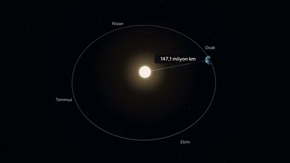</a></td>
<td width="50%" height="225" align="center" valign="middle"></td>
</tr>
<tr>
<td width="50%" valign="top"><strong>季节与太阳高度的三维图解</strong> <a href="https://x.com/AIMevzulari">@AIMevzulari</a> · 知识讲解 2:23 · 收藏 116 · 资料待完善 <a href="https://guanmo-ai.github.io/awesome-ai-motion/#case-2106714104689828066">▶ 播放</a> · <a href="https://x.com/AIMevzulari/status/2106714104689828066">原帖</a></td>
<td width="50%" valign="top"><strong>电动机三维结构动画对照</strong> <a href="https://x.com/rubenssoto_ai">@rubenssoto_ai</a> · 知识讲解 0:40 · 收藏 115 · 资料待完善 <a href="https://guanmo-ai.github.io/awesome-ai-motion/#case-2107175794145386838">▶ 播放</a> · <a href="https://x.com/rubenssoto_ai/status/2107175794145386838">原帖</a></td>
</tr>
</tbody>
<tbody>
<tr>
<td width="50%" height="225" align="center" valign="middle"><a href="https://guanmo-ai.github.io/awesome-ai-motion/#case-2108208479358026208">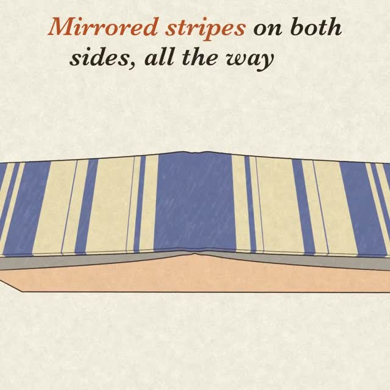</a></td>
<td width="50%" height="225" align="center" valign="middle"><a href="https://guanmo-ai.github.io/awesome-ai-motion/#case-2103822595993018838">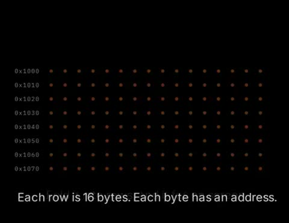</a></td>
</tr>
<tr>
<td width="50%" valign="top"><strong>用卡通动画讲板块漂移</strong> <a href="https://x.com/kevin_t_ngo">@kevin_t_ngo</a> · 知识讲解 2:21 · 收藏 112 · 资料待完善 <a href="https://guanmo-ai.github.io/awesome-ai-motion/#case-2108208479358026208">▶ 播放</a> · <a href="https://x.com/kevin_t_ngo/status/2108208479358026208">原帖</a></td>
<td width="50%" valign="top"><strong>用 Manim 解释指针和地址</strong> <a href="https://x.com/Hesamation">@Hesamation</a> · 知识讲解 1:32 · 收藏 107 · 资料待完善 <a href="https://guanmo-ai.github.io/awesome-ai-motion/#case-2103822595993018838">▶ 播放</a> · <a href="https://x.com/Hesamation/status/2103822595993018838">原帖</a></td>
</tr>
</tbody>
<tbody>
<tr>
<td width="50%" height="225" align="center" valign="middle"><a href="https://guanmo-ai.github.io/awesome-ai-motion/#case-2104814438318776441">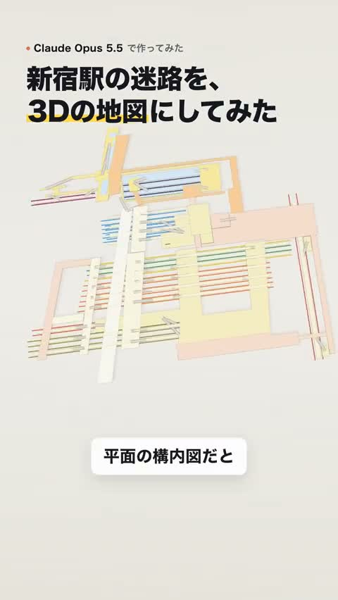</a></td>
<td width="50%" height="225" align="center" valign="middle"></td>
</tr>
<tr>
<td width="50%" valign="top"><strong>新宿站：多层三维路线图解</strong> <a href="https://x.com/masahirochaen">@masahirochaen</a> · 知识讲解 0:43 · 收藏 105 · 资料待完善 <a href="https://guanmo-ai.github.io/awesome-ai-motion/#case-2104814438318776441">▶ 播放</a> · <a href="https://x.com/masahirochaen/status/2104814438318776441">原帖</a></td>
<td width="50%" valign="top"><strong>郑和下西洋：地图与港口</strong> <a href="https://x.com/bangbuilds">@bangbuilds</a> · 知识讲解 2:05 · 收藏 98 · 资料待完善 <a href="https://guanmo-ai.github.io/awesome-ai-motion/#case-2105914831887102064">▶ 播放</a> · <a href="https://x.com/bangbuilds/status/2105914831887102064">原帖</a></td>
</tr>
</tbody>
<tbody>
<tr>
<td width="50%" height="225" align="center" valign="middle"></td>
<td width="50%" height="225" align="center" valign="middle"></td>
</tr>
<tr>
<td width="50%" valign="top"><strong>榫卯结构的动态图解</strong> <a href="https://x.com/op7418">@op7418</a> · 知识讲解 0:48 · 收藏 95 · 资料待完善 <a href="https://guanmo-ai.github.io/awesome-ai-motion/#case-2105675440409174160">▶ 播放</a> · <a href="https://x.com/op7418/status/2105675440409174160">原帖</a></td>
<td width="50%" valign="top"><strong>微笑的好处</strong> <a href="https://x.com/ai4everyday">@ai4everyday</a> · 知识讲解 0:57 · 收藏 95 · 资料待完善 <a href="https://guanmo-ai.github.io/awesome-ai-motion/#case-2106385179006685254">▶ 播放</a> · <a href="https://x.com/ai4everyday/status/2106385179006685254">原帖</a></td>
</tr>
</tbody>
<tbody>
<tr>
<td width="50%" height="225" align="center" valign="middle"></td>
<td width="50%" height="225" align="center" valign="middle"></td>
</tr>
<tr>
<td width="50%" valign="top"><strong>独立开发流程的等距信息图</strong> <a href="https://x.com/GoSailGlobal">@GoSailGlobal</a> · 知识讲解 1:08 · 收藏 87 · 资料待完善 <a href="https://guanmo-ai.github.io/awesome-ai-motion/#case-2112077471839621203">▶ 播放</a> · <a href="https://x.com/GoSailGlobal/status/2112077471839621203">原帖</a></td>
<td width="50%" valign="top"><strong>人形机器人关节的拆解动画</strong> <a href="https://x.com/techartist_">@techartist_</a> · 知识讲解 0:40 · 收藏 84 · 资料待完善 <a href="https://guanmo-ai.github.io/awesome-ai-motion/#case-2108233726094365172">▶ 播放</a> · <a href="https://x.com/techartist_/status/2108233726094365172">原帖</a></td>
</tr>
</tbody>
<tbody>
<tr>
<td width="50%" height="225" align="center" valign="middle"></td>
<td width="50%" height="225" align="center" valign="middle"></td>
</tr>
<tr>
<td width="50%" valign="top"><strong>金属三维打印火箭发动机</strong> <a href="https://x.com/konstantinsaifo">@konstantinsaifo</a> · 知识讲解 0:56 · 收藏 76 · 资料待完善 <a href="https://guanmo-ai.github.io/awesome-ai-motion/#case-2106378121557782950">▶ 播放</a> · <a href="https://x.com/konstantinsaifo/status/2106378121557782950">原帖</a></td>
<td width="50%" valign="top"><strong>3D 细胞教学视频</strong> <a href="https://x.com/akokoi1">@akokoi1</a> · 知识讲解 3:50 · 收藏 72 · 资料待完善 <a href="https://guanmo-ai.github.io/awesome-ai-motion/#case-2104105016235860050">▶ 播放</a> · <a href="https://x.com/akokoi1/status/2104105016235860050">原帖</a></td>
</tr>
</tbody>
<tbody>
<tr>
<td width="50%" height="225" align="center" valign="middle"></td>
<td width="50%" height="225" align="center" valign="middle"></td>
</tr>
<tr>
<td width="50%" valign="top"><strong>六边形软件架构动画解说</strong> <a href="https://x.com/ManuelZapata">@ManuelZapata</a> · 知识讲解 1:18 · 收藏 67 · 资料待完善 <a href="https://guanmo-ai.github.io/awesome-ai-motion/#case-2106926676571467996">▶ 播放</a> · <a href="https://x.com/ManuelZapata/status/2106926676571467996">原帖</a></td>
<td width="50%" valign="top"><strong>电机工厂的程序化生产线</strong> <a href="https://x.com/konstantinsaifo">@konstantinsaifo</a> · 知识讲解 0:44 · 收藏 63 · 资料待完善 <a href="https://guanmo-ai.github.io/awesome-ai-motion/#case-2110757897600716906">▶ 播放</a> · <a href="https://x.com/konstantinsaifo/status/2110757897600716906">原帖</a></td>
</tr>
</tbody>
<tbody>
<tr>
<td width="50%" height="225" align="center" valign="middle"></td>
<td width="50%" height="225" align="center" valign="middle"></td>
</tr>
<tr>
<td width="50%" valign="top"><strong>等轴测水车的机械联动</strong> <a href="https://x.com/thebuggeddev">@thebuggeddev</a> · 知识讲解 0:25 · 收藏 58 · 资料待完善 <a href="https://guanmo-ai.github.io/awesome-ai-motion/#case-2109348192638865629">▶ 播放</a> · <a href="https://x.com/thebuggeddev/status/2109348192638865629">原帖</a></td>
<td width="50%" valign="top"><strong>喷气机从工厂走向跑道</strong> <a href="https://x.com/konstantinsaifo">@konstantinsaifo</a> · 知识讲解 0:29 · 收藏 58 · 资料待完善 <a href="https://guanmo-ai.github.io/awesome-ai-motion/#case-2109989449673347271">▶ 播放</a> · <a href="https://x.com/konstantinsaifo/status/2109989449673347271">原帖</a></td>
</tr>
</tbody>
<tbody>
<tr>
<td width="50%" height="225" align="center" valign="middle"></td>
<td width="50%" height="225" align="center" valign="middle"></td>
</tr>
<tr>
<td width="50%" valign="top"><strong>函数极值与三维曲面</strong> <a href="https://x.com/AIMevzulari">@AIMevzulari</a> · 知识讲解 13:15 · 收藏 58 · 资料待完善 <a href="https://guanmo-ai.github.io/awesome-ai-motion/#case-2106844572882202974">▶ 播放</a> · <a href="https://x.com/AIMevzulari/status/2106844572882202974">原帖</a></td>
<td width="50%" valign="top"><strong>眼睛的演化：光线与视网膜图解</strong> <a href="https://x.com/cagrimbakirci">@cagrimbakirci</a> · 知识讲解 1:10 · 收藏 52 · 资料待完善 <a href="https://guanmo-ai.github.io/awesome-ai-motion/#case-2104011756397842869">▶ 播放</a> · <a href="https://x.com/cagrimbakirci/status/2104011756397842869">原帖</a></td>
</tr>
</tbody>
<tbody>
<tr>
<td width="50%" height="225" align="center" valign="middle"></td>
<td width="50%" height="225" align="center" valign="middle"></td>
</tr>
<tr>
<td width="50%" valign="top"><strong>品牌标志趋同的动效讲解</strong> <a href="https://x.com/charliejhills">@charliejhills</a> · 知识讲解 0:57 · 收藏 48 · 资料待完善 <a href="https://guanmo-ai.github.io/awesome-ai-motion/#case-2105580875299836388">▶ 播放</a> · <a href="https://x.com/charliejhills/status/2105580875299836388">原帖</a></td>
<td width="50%" valign="top"><strong>空间音频位置的三维可视化</strong> <a href="https://x.com/chroman">@chroman</a> · 知识讲解 0:50 · 收藏 48 · 资料待完善 <a href="https://guanmo-ai.github.io/awesome-ai-motion/#case-2109778453625020920">▶ 播放</a> · <a href="https://x.com/chroman/status/2109778453625020920">原帖</a></td>
</tr>
</tbody>
<tbody>
<tr>
<td width="50%" height="225" align="center" valign="middle"></td>
<td width="50%" height="225" align="center" valign="middle"></td>
</tr>
<tr>
<td width="50%" valign="top"><strong>坛之浦海战三维演示</strong> <a href="https://x.com/tetumemo">@tetumemo</a> · 知识讲解 1:14 · 收藏 47 · 资料待完善 <a href="https://guanmo-ai.github.io/awesome-ai-motion/#case-2102652072252584046">▶ 播放</a> · <a href="https://x.com/tetumemo/status/2102652072252584046">原帖</a></td>
<td width="50%" valign="top"><strong>Three.js 生物细胞演示课件</strong> <a href="https://x.com/akokoi1">@akokoi1</a> · 知识讲解 0:37 · 收藏 45 · 资料待完善 <a href="https://guanmo-ai.github.io/awesome-ai-motion/#case-2106568339917324296">▶ 播放</a> · <a href="https://x.com/akokoi1/status/2106568339917324296">原帖</a></td>
</tr>
</tbody>
<tbody>
<tr>
<td width="50%" height="225" align="center" valign="middle"></td>
<td width="50%" height="225" align="center" valign="middle"></td>
</tr>
<tr>
<td width="50%" valign="top"><strong>Hidden Valence 论文的动画解释</strong> <a href="https://x.com/camhberg">@camhberg</a> · 知识讲解 2:20 · 收藏 41 · 资料待完善 <a href="https://guanmo-ai.github.io/awesome-ai-motion/#case-2108313983505842650">▶ 播放</a> · <a href="https://x.com/camhberg/status/2108313983505842650">原帖</a></td>
<td width="50%" valign="top"><strong>陀螺为什么转起来不倒</strong> <a href="https://x.com/nicekate8888">@nicekate8888</a> · 知识讲解 2:04 · 收藏 39 · 资料待完善 <a href="https://guanmo-ai.github.io/awesome-ai-motion/#case-2105829517168365707">▶ 播放</a> · <a href="https://x.com/nicekate8888/status/2105829517168365707">原帖</a></td>
</tr>
</tbody>
<tbody>
<tr>
<td width="50%" height="225" align="center" valign="middle"></td>
<td width="50%" height="225" align="center" valign="middle"></td>
</tr>
<tr>
<td width="50%" valign="top"><strong>手绘风技术讲解片</strong> <a href="https://x.com/so_ainsight">@so_ainsight</a> · 知识讲解 0:15 · 收藏 38 · 资料待完善 <a href="https://guanmo-ai.github.io/awesome-ai-motion/#case-2103117547776163845">▶ 播放</a> · <a href="https://x.com/so_ainsight/status/2103117547776163845">原帖</a></td>
<td width="50%" valign="top"><strong>磁约束与激光聚变的三维示意</strong> <a href="https://x.com/techartist_">@techartist_</a> · 知识讲解 0:27 · 收藏 33 · 资料待完善 <a href="https://guanmo-ai.github.io/awesome-ai-motion/#case-2107888306633752881">▶ 播放</a> · <a href="https://x.com/techartist_/status/2107888306633752881">原帖</a></td>
</tr>
</tbody>
<tbody>
<tr>
<td width="50%" height="225" align="center" valign="middle"></td>
<td width="50%" height="225" align="center" valign="middle"></td>
</tr>
<tr>
<td width="50%" valign="top"><strong>秦帝国主题的历史解释动画</strong> <a href="https://x.com/aiRobertDaily">@aiRobertDaily</a> · 知识讲解 1:13 · 收藏 29 · 资料待完善 <a href="https://guanmo-ai.github.io/awesome-ai-motion/#case-2107815114745487588">▶ 播放</a> · <a href="https://x.com/aiRobertDaily/status/2107815114745487588">原帖</a></td>
<td width="50%" valign="top"><strong>高难概念播客的可视化片段</strong> <a href="https://x.com/theviclaw">@theviclaw</a> · 知识讲解 0:16 · 收藏 23 <a href="https://guanmo-ai.github.io/awesome-ai-motion/#case-2103896101120356793">▶ 播放</a> · <a href="https://x.com/theviclaw/status/2103896101120356793">原帖</a></td>
</tr>
</tbody>
<tbody>
<tr>
<td width="50%" height="225" align="center" valign="middle"></td>
<td width="50%" height="225" align="center" valign="middle"></td>
</tr>
<tr>
<td width="50%" valign="top"><strong>为什么无法超过光速：Agent 讲解试片</strong> <a href="https://x.com/MrLarus">@MrLarus</a> · 知识讲解 1:18 · 收藏 22 · 资料待完善 <a href="https://guanmo-ai.github.io/awesome-ai-motion/#case-2108120392179089496">▶ 播放</a> · <a href="https://x.com/MrLarus/status/2108120392179089496">原帖</a></td>
<td width="50%" valign="top"><strong>Trace：艺术生成规则图解</strong> <a href="https://x.com/traceforms">@traceforms</a> · 知识讲解 1:18 · 收藏 20 · 资料待完善 <a href="https://guanmo-ai.github.io/awesome-ai-motion/#case-2105029763421147460">▶ 播放</a> · <a href="https://x.com/traceforms/status/2105029763421147460">原帖</a></td>
</tr>
</tbody>
<tbody>
<tr>
<td width="50%" height="225" align="center" valign="middle"></td>
<td width="50%" height="225" align="center" valign="middle"></td>
</tr>
<tr>
<td width="50%" valign="top"><strong>Raptor 3：从发动机阵列到内部流路</strong> <a href="https://x.com/techartist_">@techartist_</a> · 知识讲解 0:25 · 收藏 19 · 资料待完善 <a href="https://guanmo-ai.github.io/awesome-ai-motion/#case-2109312002099441934">▶ 播放</a> · <a href="https://x.com/techartist_/status/2109312002099441934">原帖</a></td>
<td width="50%" valign="top"><strong>用动态图表介绍 Opus 5.5</strong> <a href="https://x.com/genel_ai">@genel_ai</a> · 知识讲解 1:30 · 收藏 18 · 资料待完善 <a href="https://guanmo-ai.github.io/awesome-ai-motion/#case-2102460794013462940">▶ 播放</a> · <a href="https://x.com/genel_ai/status/2102460794013462940">原帖</a></td>
</tr>
</tbody>
<tbody>
<tr>
<td width="50%" height="225" align="center" valign="middle"></td>
<td width="50%" height="225" align="center" valign="middle"></td>
</tr>
<tr>
<td width="50%" valign="top"><strong>Singularity：30秒恒星演化</strong> <a href="https://x.com/techartist_">@techartist_</a> · 知识讲解 0:30 · 收藏 16 · 资料待完善 <a href="https://guanmo-ai.github.io/awesome-ai-motion/#case-2104352888793477147">▶ 播放</a> · <a href="https://x.com/techartist_/status/2104352888793477147">原帖</a></td>
<td width="50%" valign="top"><strong>Lemo-Opuscar：白板风格创作教学片</strong> <a href="https://x.com/lemomo_ai">@lemomo_ai</a> · 知识讲解 1:11 · 收藏 16 · 资料待完善 <a href="https://guanmo-ai.github.io/awesome-ai-motion/#case-2104070024575242622">▶ 播放</a> · <a href="https://x.com/lemomo_ai/status/2104070024575242622">原帖</a></td>
</tr>
</tbody>
<tbody>
<tr>
<td width="50%" height="225" align="center" valign="middle"></td>
<td width="50%" height="225" align="center" valign="middle"></td>
</tr>
<tr>
<td width="50%" valign="top"><strong>F1 动力单元的拆解与运转</strong> <a href="https://x.com/konstantinsaifo">@konstantinsaifo</a> · 知识讲解 0:41 · 收藏 15 · 资料待完善 <a href="https://guanmo-ai.github.io/awesome-ai-motion/#case-2111190608031170960">▶ 播放</a> · <a href="https://x.com/konstantinsaifo/status/2111190608031170960">原帖</a></td>
<td width="50%" valign="top"><strong>722 篇数学论文：数据图形解说</strong> <a href="https://x.com/FinanceYF5">@FinanceYF5</a> · 知识讲解 1:32 · 收藏 15 · 资料待完善 <a href="https://guanmo-ai.github.io/awesome-ai-motion/#case-2108758983121187251">▶ 播放</a> · <a href="https://x.com/FinanceYF5/status/2108758983121187251">原帖</a></td>
</tr>
</tbody>
<tbody>
<tr>
<td width="50%" height="225" align="center" valign="middle"></td>
<td width="50%" height="225" align="center" valign="middle"></td>
</tr>
<tr>
<td width="50%" valign="top"><strong>Jido 如何融入工程的讲解片</strong> <a href="https://x.com/h14hdotcom">@h14hdotcom</a> · 知识讲解 7:26 · 收藏 14 · 资料待完善 <a href="https://guanmo-ai.github.io/awesome-ai-motion/#case-2107514903879688390">▶ 播放</a> · <a href="https://x.com/h14hdotcom/status/2107514903879688390">原帖</a></td>
<td width="50%" valign="top"><strong>我们都是恒星的孩子</strong> <a href="https://x.com/threeaus">@threeaus</a> · 知识讲解 2:49 · 收藏 14 · 资料待完善 <a href="https://guanmo-ai.github.io/awesome-ai-motion/#case-2108949764264128808">▶ 播放</a> · <a href="https://x.com/threeaus/status/2108949764264128808">原帖</a></td>
</tr>
</tbody>
<tbody>
<tr>
<td width="50%" height="225" align="center" valign="middle"></td>
<td width="50%" height="225" align="center" valign="middle"></td>
</tr>
<tr>
<td width="50%" valign="top"><strong>DeepSeek 模型缓存的动态图解</strong> <a href="https://x.com/ItsmeAjayKV">@ItsmeAjayKV</a> · 知识讲解 7:22 · 收藏 13 · 资料待完善 <a href="https://guanmo-ai.github.io/awesome-ai-motion/#case-2103591055396663493">▶ 播放</a> · <a href="https://x.com/ItsmeAjayKV/status/2103591055396663493">原帖</a></td>
<td width="50%" valign="top"><strong>夜间无人机竞速的轨迹与受力</strong> <a href="https://x.com/konstantinsaifo">@konstantinsaifo</a> · 知识讲解 0:34 · 收藏 12 · 资料待完善 <a href="https://guanmo-ai.github.io/awesome-ai-motion/#case-2111379526404186306">▶ 播放</a> · <a href="https://x.com/konstantinsaifo/status/2111379526404186306">原帖</a></td>
</tr>
</tbody>
<tbody>
<tr>
<td width="50%" height="225" align="center" valign="middle"></td>
<td width="50%" height="225" align="center" valign="middle"></td>
</tr>
<tr>
<td width="50%" valign="top"><strong>从数据中心深入 GPU 芯片</strong> <a href="https://x.com/motyka_9">@motyka_9</a> · 知识讲解 0:49 · 收藏 11 · 资料待完善 <a href="https://guanmo-ai.github.io/awesome-ai-motion/#case-2107571783729557855">▶ 播放</a> · <a href="https://x.com/motyka_9/status/2107571783729557855">原帖</a></td>
<td width="50%" valign="top"><strong>魔方入门与纠错动画教程</strong> <a href="https://x.com/NorthstarBrain">@NorthstarBrain</a> · 知识讲解 2:47 · 收藏 11 · 资料待完善 <a href="https://guanmo-ai.github.io/awesome-ai-motion/#case-2107600930762031447">▶ 播放</a> · <a href="https://x.com/NorthstarBrain/status/2107600930762031447">原帖</a></td>
</tr>
</tbody>
<tbody>
<tr>
<td width="50%" height="225" align="center" valign="middle"></td>
<td width="50%" height="225" align="center" valign="middle"></td>
</tr>
<tr>
<td width="50%" valign="top"><strong>十五种知识动画风格样片</strong> <a href="https://x.com/agentchengfeng">@agentchengfeng</a> · 知识讲解 2:51 · 收藏 9 · 资料待完善 <a href="https://guanmo-ai.github.io/awesome-ai-motion/#case-2107473998212927525">▶ 播放</a> · <a href="https://x.com/agentchengfeng/status/2107473998212927525">原帖</a></td>
<td width="50%" valign="top"><strong>YouMind 里的历史动画风格试验</strong> <a href="https://x.com/KengGuangLong">@KengGuangLong</a> · 知识讲解 4:57 · 收藏 9 · 资料待完善 <a href="https://guanmo-ai.github.io/awesome-ai-motion/#case-2108029927161541111">▶ 播放</a> · <a href="https://x.com/KengGuangLong/status/2108029927161541111">原帖</a></td>
</tr>
</tbody>
<tbody>
<tr>
<td width="50%" height="225" align="center" valign="middle"></td>
<td width="50%" height="225" align="center" valign="middle"></td>
</tr>
<tr>
<td width="50%" valign="top"><strong>SVG 相机的结构拆解</strong> <a href="https://x.com/quantapar">@quantapar</a> · 知识讲解 0:14 · 收藏 8 · 资料待完善 <a href="https://guanmo-ai.github.io/awesome-ai-motion/#case-2109219079928385747">▶ 播放</a> · <a href="https://x.com/quantapar/status/2109219079928385747">原帖</a></td>
<td width="50%" valign="top"><strong>按一下圆珠笔：卡槽与弹簧</strong> <a href="https://x.com/elliscrosby">@elliscrosby</a> · 知识讲解 0:20 · 收藏 8 · 资料待完善 <a href="https://guanmo-ai.github.io/awesome-ai-motion/#case-2109701103835341174">▶ 播放</a> · <a href="https://x.com/elliscrosby/status/2109701103835341174">原帖</a></td>
</tr>
</tbody>
<tbody>
<tr>
<td width="50%" height="225" align="center" valign="middle"></td>
<td width="50%" height="225" align="center" valign="middle"></td>
</tr>
<tr>
<td width="50%" valign="top"><strong>Seeing the Unseen：放射学文章手绘讲解</strong> <a href="https://x.com/woojinrad">@woojinrad</a> · 知识讲解 1:05 · 收藏 8 · 资料待完善 <a href="https://guanmo-ai.github.io/awesome-ai-motion/#case-2106083299462455731">▶ 播放</a> · <a href="https://x.com/woojinrad/status/2106083299462455731">原帖</a></td>
<td width="50%" valign="top"><strong>机械键盘：三维拆解与开关录音节拍</strong> <a href="https://x.com/iniyanai">@iniyanai</a> · 知识讲解 0:35 · 收藏 8 <a href="https://guanmo-ai.github.io/awesome-ai-motion/#case-2103814603100856596">▶ 播放</a> · <a href="https://x.com/iniyanai/status/2103814603100856596">原帖</a></td>
</tr>
</tbody>
<tbody>
<tr>
<td width="50%" height="225" align="center" valign="middle"></td>
<td width="50%" height="225" align="center" valign="middle"></td>
</tr>
<tr>
<td width="50%" valign="top"><strong>变分自编码器数学讲解</strong> <a href="https://x.com/ng169onX">@ng169onX</a> · 知识讲解 5:34 · 收藏 8 · 资料待完善 <a href="https://guanmo-ai.github.io/awesome-ai-motion/#case-2103183904563998809">▶ 播放</a> · <a href="https://x.com/ng169onX/status/2103183904563998809">原帖</a></td>
<td width="50%" valign="top"><strong>DeepSeek架构主题的代码讲解动画</strong> <a href="https://x.com/ItsmeAjayKV">@ItsmeAjayKV</a> · 知识讲解 2:07 · 收藏 7 · 资料待完善 <a href="https://guanmo-ai.github.io/awesome-ai-motion/#case-2108485332757074286">▶ 播放</a> · <a href="https://x.com/ItsmeAjayKV/status/2108485332757074286">原帖</a></td>
</tr>
</tbody>
<tbody>
<tr>
<td width="50%" height="225" align="center" valign="middle"></td>
<td width="50%" height="225" align="center" valign="middle"></td>
</tr>
<tr>
<td width="50%" valign="top"><strong>SHRINCS 签名方案的解释动画</strong> <a href="https://x.com/NavRoudsari">@NavRoudsari</a> · 知识讲解 4:21 · 收藏 7 · 资料待完善 <a href="https://guanmo-ai.github.io/awesome-ai-motion/#case-2108304898198581689">▶ 播放</a> · <a href="https://x.com/NavRoudsari/status/2108304898198581689">原帖</a></td>
<td width="50%" valign="top"><strong>电子轨道中的概率流可视化</strong> <a href="https://x.com/ottollm">@ottollm</a> · 知识讲解 0:57 · 收藏 7 · 资料待完善 <a href="https://guanmo-ai.github.io/awesome-ai-motion/#case-2111129290464964764">▶ 播放</a> · <a href="https://x.com/ottollm/status/2111129290464964764">原帖</a></td>
</tr>
</tbody>
<tbody>
<tr>
<td width="50%" height="225" align="center" valign="middle"></td>
<td width="50%" height="225" align="center" valign="middle"></td>
</tr>
<tr>
<td width="50%" valign="top"><strong>电风扇如何产生气流</strong> <a href="https://x.com/LinearUncle">@LinearUncle</a> · 知识讲解 1:29 · 收藏 7 · 资料待完善 <a href="https://guanmo-ai.github.io/awesome-ai-motion/#case-2104024423972155805">▶ 播放</a> · <a href="https://x.com/LinearUncle/status/2104024423972155805">原帖</a></td>
<td width="50%" valign="top"><strong>Roadster 如何飞起：线稿原理解说</strong> <a href="https://x.com/tuolaji2024">@tuolaji2024</a> · 知识讲解 3:56 · 收藏 7 · 资料待完善 <a href="https://guanmo-ai.github.io/awesome-ai-motion/#case-2110987175009685842">▶ 播放</a> · <a href="https://x.com/tuolaji2024/status/2110987175009685842">原帖</a></td>
</tr>
</tbody>
<tbody>
<tr>
<td width="50%" height="225" align="center" valign="middle"></td>
<td width="50%" height="225" align="center" valign="middle"></td>
</tr>
<tr>
<td width="50%" valign="top"><strong>CLIProxyAPI 文章的视频讲解</strong> <a href="https://x.com/0xlangeai">@0xlangeai</a> · 知识讲解 0:57 · 收藏 7 <a href="https://guanmo-ai.github.io/awesome-ai-motion/#case-2106391068367597929">▶ 播放</a> · <a href="https://x.com/0xlangeai/status/2106391068367597929">原帖</a></td>
<td width="50%" valign="top"><strong>星系碰撞的粒子可视化</strong> <a href="https://x.com/techartist_">@techartist_</a> · 知识讲解 0:29 · 收藏 6 · 资料待完善 <a href="https://guanmo-ai.github.io/awesome-ai-motion/#case-2107629480714076484">▶ 播放</a> · <a href="https://x.com/techartist_/status/2107629480714076484">原帖</a></td>
</tr>
</tbody>
<tbody>
<tr>
<td width="50%" height="225" align="center" valign="middle"></td>
<td width="50%" height="225" align="center" valign="middle"></td>
</tr>
<tr>
<td width="50%" valign="top"><strong>倒挂 Roadster 的运动与受力</strong> <a href="https://x.com/konstantinsaifo">@konstantinsaifo</a> · 知识讲解 0:44 · 收藏 6 · 资料待完善 <a href="https://guanmo-ai.github.io/awesome-ai-motion/#case-2111119619461153190">▶ 播放</a> · <a href="https://x.com/konstantinsaifo/status/2111119619461153190">原帖</a></td>
<td width="50%" valign="top"><strong>Sonnet与VOICEVOX的通讯介绍片</strong> <a href="https://x.com/tetumemo">@tetumemo</a> · 知识讲解 0:32 · 收藏 6 · 资料待完善 <a href="https://guanmo-ai.github.io/awesome-ai-motion/#case-2108517711970234631">▶ 播放</a> · <a href="https://x.com/tetumemo/status/2108517711970234631">原帖</a></td>
</tr>
</tbody>
<tbody>
<tr>
<td width="50%" height="225" align="center" valign="middle"></td>
<td width="50%" height="225" align="center" valign="middle"></td>
</tr>
<tr>
<td width="50%" valign="top"><strong>闪电：天空为什么突然漏电</strong> <a href="https://x.com/nicekate8888">@nicekate8888</a> · 知识讲解 2:02 · 收藏 5 · 资料待完善 <a href="https://guanmo-ai.github.io/awesome-ai-motion/#case-2105830269551079691">▶ 播放</a> · <a href="https://x.com/nicekate8888/status/2105830269551079691">原帖</a></td>
<td width="50%" valign="top"><strong>光合作用动画课程</strong> <a href="https://x.com/rainwishyt">@rainwishyt</a> · 知识讲解 1:42 · 收藏 5 · 资料待完善 <a href="https://guanmo-ai.github.io/awesome-ai-motion/#case-2102605736002150408">▶ 播放</a> · <a href="https://x.com/rainwishyt/status/2102605736002150408">原帖</a></td>
</tr>
</tbody>
<tbody>
<tr>
<td width="50%" height="225" align="center" valign="middle"></td>
<td width="50%" height="225" align="center" valign="middle"></td>
</tr>
<tr>
<td width="50%" valign="top"><strong>两分钟二战讲解片</strong> <a href="https://x.com/Miguel07Code">@Miguel07Code</a> · 知识讲解 1:55 · 收藏 4 · 资料待完善 <a href="https://guanmo-ai.github.io/awesome-ai-motion/#case-2104247692503204330">▶ 播放</a> · <a href="https://x.com/Miguel07Code/status/2104247692503204330">原帖</a></td>
<td width="50%" valign="top"><strong>风暴中的夜航：船舶轨迹与气象可视化</strong> <a href="https://x.com/konstantinsaifo">@konstantinsaifo</a> · 知识讲解 0:47 · 收藏 4 · 资料待完善 <a href="https://guanmo-ai.github.io/awesome-ai-motion/#case-2111836412052152500">▶ 播放</a> · <a href="https://x.com/konstantinsaifo/status/2111836412052152500">原帖</a></td>
</tr>
</tbody>
<tbody>
<tr>
<td width="50%" height="225" align="center" valign="middle"></td>
<td width="50%" height="225" align="center" valign="middle"></td>
</tr>
<tr>
<td width="50%" valign="top"><strong>跨越楼顶间隙的跑酷机器人</strong> <a href="https://x.com/konstantinsaifo">@konstantinsaifo</a> · 知识讲解 0:37 · 收藏 4 · 资料待完善 <a href="https://guanmo-ai.github.io/awesome-ai-motion/#case-2111756400472822039">▶ 播放</a> · <a href="https://x.com/konstantinsaifo/status/2111756400472822039">原帖</a></td>
<td width="50%" valign="top"><strong>从桌面深入 CPU 与原子的连续镜头</strong> <a href="https://x.com/Acoramaa">@Acoramaa</a> · 知识讲解 0:44 · 收藏 4 <a href="https://guanmo-ai.github.io/awesome-ai-motion/#case-2103833991879053577">▶ 播放</a> · <a href="https://x.com/Acoramaa/status/2103833991879053577">原帖</a></td>
</tr>
</tbody>
<tbody>
<tr>
<td width="50%" height="225" align="center" valign="middle"></td>
<td width="50%" height="225" align="center" valign="middle"></td>
</tr>
<tr>
<td width="50%" valign="top"><strong>火星改造的阶段模拟</strong> <a href="https://x.com/ottollm">@ottollm</a> · 知识讲解 1:00 · 收藏 4 · 资料待完善 <a href="https://guanmo-ai.github.io/awesome-ai-motion/#case-2108976029180059757">▶ 播放</a> · <a href="https://x.com/ottollm/status/2108976029180059757">原帖</a></td>
<td width="50%" valign="top"><strong>手绘睡眠科普的代码复刻实验</strong> <a href="https://x.com/wadezone">@wadezone</a> · 知识讲解 5:04 · 收藏 4 · 资料待完善 <a href="https://guanmo-ai.github.io/awesome-ai-motion/#case-2112042940172570637">▶ 播放</a> · <a href="https://x.com/wadezone/status/2112042940172570637">原帖</a></td>
</tr>
</tbody>
<tbody>
<tr>
<td width="50%" height="225" align="center" valign="middle"></td>
<td width="50%" height="225" align="center" valign="middle"></td>
</tr>
<tr>
<td width="50%" valign="top"><strong>英国庇护申请动态条形图</strong> <a href="https://x.com/AylmerTH">@AylmerTH</a> · 知识讲解 0:50 · 收藏 3 · 资料待完善 <a href="https://guanmo-ai.github.io/awesome-ai-motion/#case-2105346401878356252">▶ 播放</a> · <a href="https://x.com/AylmerTH/status/2105346401878356252">原帖</a></td>
<td width="50%" valign="top"><strong>Starship 火箭剖面与推进动画</strong> <a href="https://x.com/quantapar">@quantapar</a> · 知识讲解 0:18 · 收藏 3 · 资料待完善 <a href="https://guanmo-ai.github.io/awesome-ai-motion/#case-2109020808610021423">▶ 播放</a> · <a href="https://x.com/quantapar/status/2109020808610021423">原帖</a></td>
</tr>
</tbody>
<tbody>
<tr>
<td width="50%" height="225" align="center" valign="middle"></td>
<td width="50%" height="225" align="center" valign="middle"></td>
</tr>
<tr>
<td width="50%" valign="top"><strong>无规则赛车的结构与赛道可视化</strong> <a href="https://x.com/konstantinsaifo">@konstantinsaifo</a> · 知识讲解 0:44 · 收藏 3 · 资料待完善 <a href="https://guanmo-ai.github.io/awesome-ai-motion/#case-2111463485359972696">▶ 播放</a> · <a href="https://x.com/konstantinsaifo/status/2111463485359972696">原帖</a></td>
<td width="50%" valign="top"><strong>从手机玻璃到原子尺度的三维穿越</strong> <a href="https://x.com/irinatoxi">@irinatoxi</a> · 知识讲解 0:22 · 收藏 3 · 资料待完善 <a href="https://guanmo-ai.github.io/awesome-ai-motion/#case-2104212841657962937">▶ 播放</a> · <a href="https://x.com/irinatoxi/status/2104212841657962937">原帖</a></td>
</tr>
</tbody>
<tbody>
<tr>
<td width="50%" height="225" align="center" valign="middle"></td>
<td width="50%" height="225" align="center" valign="middle"></td>
</tr>
<tr>
<td width="50%" valign="top"><strong>日本夏季天气的手绘数据讲解</strong> <a href="https://x.com/GroundControl">@GroundControl</a> · 知识讲解 3:00 · 收藏 3 · 资料待完善 <a href="https://guanmo-ai.github.io/awesome-ai-motion/#case-2103678647777230877">▶ 播放</a> · <a href="https://x.com/GroundControl/status/2103678647777230877">原帖</a></td>
<td width="50%" valign="top"><strong>Noise：自然的语法</strong> <a href="https://x.com/ChildhoodAndy">@ChildhoodAndy</a> · 知识讲解 5:00 · 收藏 3 · 资料待完善 <a href="https://guanmo-ai.github.io/awesome-ai-motion/#case-2108954095407251849">▶ 播放</a> · <a href="https://x.com/ChildhoodAndy/status/2108954095407251849">原帖</a></td>
</tr>
</tbody>
<tbody>
<tr>
<td width="50%" height="225" align="center" valign="middle"></td>
<td width="50%" height="225" align="center" valign="middle"></td>
</tr>
<tr>
<td width="50%" valign="top"><strong>汽车刹车工作原理讲解</strong> <a href="https://x.com/ZeroZ_JQ">@ZeroZ_JQ</a> · 知识讲解 6:25 · 收藏 3 · 资料待完善 <a href="https://guanmo-ai.github.io/awesome-ai-motion/#case-2108167157393838191">▶ 播放</a> · <a href="https://x.com/ZeroZ_JQ/status/2108167157393838191">原帖</a></td>
<td width="50%" valign="top"><strong>代码逐帧绘制的剪纸风 AI 早报</strong> <a href="https://x.com/yolohair">@yolohair</a> · 知识讲解 0:47 · 收藏 3 · 资料待完善 <a href="https://guanmo-ai.github.io/awesome-ai-motion/#case-2109146914000457838">▶ 播放</a> · <a href="https://x.com/yolohair/status/2109146914000457838">原帖</a></td>
</tr>
</tbody>
<tbody>
<tr>
<td width="50%" height="225" align="center" valign="middle"></td>
<td width="50%" height="225" align="center" valign="middle"></td>
</tr>
<tr>
<td width="50%" valign="top"><strong>Pup 小狗的量子分身叙事</strong> <a href="https://x.com/rgk_degen">@rgk_degen</a> · 知识讲解 0:25 · 收藏 2 · 资料待完善 <a href="https://guanmo-ai.github.io/awesome-ai-motion/#case-2108926559264379318">▶ 播放</a> · <a href="https://x.com/rgk_degen/status/2108926559264379318">原帖</a></td>
<td width="50%" valign="top"><strong>以真实硬件关系讲解装机</strong> <a href="https://x.com/baoweiheihei">@baoweiheihei</a> · 知识讲解 1:42 · 收藏 2 · 资料待完善 <a href="https://guanmo-ai.github.io/awesome-ai-motion/#case-2107505590151020548">▶ 播放</a> · <a href="https://x.com/baoweiheihei/status/2107505590151020548">原帖</a></td>
</tr>
</tbody>
<tbody>
<tr>
<td width="50%" height="225" align="center" valign="middle"></td>
<td width="50%" height="225" align="center" valign="middle"></td>
</tr>
<tr>
<td width="50%" valign="top"><strong>“树作为生态系统”的带声动画</strong> <a href="https://x.com/hunzai">@hunzai</a> · 知识讲解 0:32 · 收藏 2 <a href="https://guanmo-ai.github.io/awesome-ai-motion/#case-2103904436141842605">▶ 播放</a> · <a href="https://x.com/hunzai/status/2103904436141842605">原帖</a></td>
<td width="50%" valign="top"><strong>选用动效样例的日语讲解</strong> <a href="https://x.com/tenbin_ai">@tenbin_ai</a> · 知识讲解 0:58 · 收藏 2 · 资料待完善 <a href="https://guanmo-ai.github.io/awesome-ai-motion/#case-2107667480034562167">▶ 播放</a> · <a href="https://x.com/tenbin_ai/status/2107667480034562167">原帖</a></td>
</tr>
</tbody>
<tbody>
<tr>
<td width="50%" height="225" align="center" valign="middle"></td>
<td width="50%" height="225" align="center" valign="middle"></td>
</tr>
<tr>
<td width="50%" valign="top"><strong>大规模代码检出的架构解说动画</strong> <a href="https://x.com/brunolemos">@brunolemos</a> · 知识讲解 1:04 · 收藏 2 · 资料待完善 <a href="https://guanmo-ai.github.io/awesome-ai-motion/#case-2110638812934385925">▶ 播放</a> · <a href="https://x.com/brunolemos/status/2110638812934385925">原帖</a></td>
<td width="50%" valign="top"><strong>Opus 5.5：日文卡通介绍短片</strong> <a href="https://x.com/_nogu66">@_nogu66</a> · 知识讲解 1:00 · 收藏 1 · 资料待完善 <a href="https://guanmo-ai.github.io/awesome-ai-motion/#case-2102603686321250337">▶ 播放</a> · <a href="https://x.com/_nogu66/status/2102603686321250337">原帖</a></td>
</tr>
</tbody>
<tbody>
<tr>
<td width="50%" height="225" align="center" valign="middle"></td>
<td width="50%" height="225" align="center" valign="middle"></td>
</tr>
<tr>
<td width="50%" valign="top"><strong>水车与灘の酒的历史讲解</strong> <a href="https://x.com/phstarrion">@phstarrion</a> · 知识讲解 1:39 · 收藏 1 · 资料待完善 <a href="https://guanmo-ai.github.io/awesome-ai-motion/#case-2107600510069182690">▶ 播放</a> · <a href="https://x.com/phstarrion/status/2107600510069182690">原帖</a></td>
<td width="50%" valign="top"><strong>一部手机吞掉了多少东西</strong> <a href="https://x.com/bangbuilds">@bangbuilds</a> · 知识讲解 1:30 · 收藏 1 · 资料待完善 <a href="https://guanmo-ai.github.io/awesome-ai-motion/#case-2107666804776775749">▶ 播放</a> · <a href="https://x.com/bangbuilds/status/2107666804776775749">原帖</a></td>
</tr>
</tbody>
<tbody>
<tr>
<td width="50%" height="225" align="center" valign="middle"></td>
<td width="50%" height="225" align="center" valign="middle"></td>
</tr>
<tr>
<td width="50%" valign="top"><strong>HyperFrames 与 Remotion 的制作方式讲解</strong> <a href="https://x.com/btcup99">@btcup99</a> · 知识讲解 2:45 · 收藏 1 · 资料待完善 <a href="https://guanmo-ai.github.io/awesome-ai-motion/#case-2108062374028783947">▶ 播放</a> · <a href="https://x.com/btcup99/status/2108062374028783947">原帖</a></td>
<td width="50%" valign="top"><strong>黎曼猜想论文的数学动画实验</strong> <a href="https://x.com/ChaseBrowe32432">@ChaseBrowe32432</a> · 知识讲解 19:39 · 收藏 1 · 资料待完善 <a href="https://guanmo-ai.github.io/awesome-ai-motion/#case-2108346112663056497">▶ 播放</a> · <a href="https://x.com/ChaseBrowe32432/status/2108346112663056497">原帖</a></td>
</tr>
</tbody>
<tbody>
<tr>
<td width="50%" height="225" align="center" valign="middle"></td>
<td width="50%" height="225" align="center" valign="middle"></td>
</tr>
<tr>
<td width="50%" valign="top"><strong>AI 2027 论文动画解读</strong> <a href="https://x.com/Akash_Bang">@Akash_Bang</a> · 知识讲解 9:08 · 收藏 1 · 资料待完善 <a href="https://guanmo-ai.github.io/awesome-ai-motion/#case-2103108964821107104">▶ 播放</a> · <a href="https://x.com/Akash_Bang/status/2103108964821107104">原帖</a></td>
<td width="50%" valign="top"><strong>CRISPR：分子剪刀的竖屏图解</strong> <a href="https://x.com/cvamarosa">@cvamarosa</a> · 知识讲解 1:06 · 收藏 1 · 资料待完善 <a href="https://guanmo-ai.github.io/awesome-ai-motion/#case-2102832673232200171">▶ 播放</a> · <a href="https://x.com/cvamarosa/status/2102832673232200171">原帖</a></td>
</tr>
</tbody>
<tbody>
<tr>
<td width="50%" height="225" align="center" valign="middle"></td>
<td width="50%" height="225" align="center" valign="middle"></td>
</tr>
<tr>
<td width="50%" valign="top"><strong>Paul Graham 创业点子文章讲解</strong> <a href="https://x.com/tejaskalpande">@tejaskalpande</a> · 知识讲解 2:19 · 收藏 1 · 资料待完善 <a href="https://guanmo-ai.github.io/awesome-ai-motion/#case-2104598355372646422">▶ 播放</a> · <a href="https://x.com/tejaskalpande/status/2104598355372646422">原帖</a></td>
<td width="50%" valign="top"><strong>短跑距离的 Blender 讲解片</strong> <a href="https://x.com/tanabe_fragm">@tanabe_fragm</a> · 知识讲解 0:52 · 收藏 1 · 资料待完善 <a href="https://guanmo-ai.github.io/awesome-ai-motion/#case-2108396748217749961">▶ 播放</a> · <a href="https://x.com/tanabe_fragm/status/2108396748217749961">原帖</a></td>
</tr>
</tbody>
<tbody>
<tr>
<td width="50%" height="225" align="center" valign="middle"></td>
<td width="50%" height="225" align="center" valign="middle"></td>
</tr>
<tr>
<td width="50%" valign="top"><strong>狮子岩：斯里兰卡历史故事动画</strong> <a href="https://x.com/hashir">@hashir</a> · 知识讲解 4:30 · 收藏 1 · 资料待完善 <a href="https://guanmo-ai.github.io/awesome-ai-motion/#case-2103054687016825162">▶ 播放</a> · <a href="https://x.com/hashir/status/2103054687016825162">原帖</a></td>
<td width="50%" valign="top"><strong>网络连接的 HTML 交互讲解</strong> <a href="https://x.com/Drake5112">@Drake5112</a> · 知识讲解 0:10 · 收藏 1 · 资料待完善 <a href="https://guanmo-ai.github.io/awesome-ai-motion/#case-2108391993609216508">▶ 播放</a> · <a href="https://x.com/Drake5112/status/2108391993609216508">原帖</a></td>
</tr>
</tbody>
<tbody>
<tr>
<td width="50%" height="225" align="center" valign="middle"></td>
<td width="50%" height="225" align="center" valign="middle"></td>
</tr>
<tr>
<td width="50%" valign="top"><strong>先口播再动画的ReAct科普</strong> <a href="https://x.com/BX33666">@BX33666</a> · 知识讲解 4:52 · 收藏 1 · 资料待完善 <a href="https://guanmo-ai.github.io/awesome-ai-motion/#case-2108505866626560200">▶ 播放</a> · <a href="https://x.com/BX33666/status/2108505866626560200">原帖</a></td>
<td width="50%" valign="top"><strong>从地球形成到人类的代码动画</strong> <a href="https://x.com/JuancaGlez7">@JuancaGlez7</a> · 知识讲解 1:18 · 收藏 1 · 资料待完善 <a href="https://guanmo-ai.github.io/awesome-ai-motion/#case-2102890107200229817">▶ 播放</a> · <a href="https://x.com/JuancaGlez7/status/2102890107200229817">原帖</a></td>
</tr>
</tbody>
<tbody>
<tr>
<td width="50%" height="225" align="center" valign="middle"></td>
<td width="50%" height="225" align="center" valign="middle"></td>
</tr>
<tr>
<td width="50%" valign="top"><strong>线稿风经济学讲解</strong> <a href="https://x.com/0xpai_eth">@0xpai_eth</a> · 知识讲解 4:24 · 收藏 1 · 资料待完善 <a href="https://guanmo-ai.github.io/awesome-ai-motion/#case-2103166575071330778">▶ 播放</a> · <a href="https://x.com/0xpai_eth/status/2103166575071330778">原帖</a></td>
<td width="50%" valign="top"><strong>MED13 综合征分层讲解</strong> <a href="https://x.com/eztati">@eztati</a> · 知识讲解 2:42 · 收藏 1 · 资料待完善 <a href="https://guanmo-ai.github.io/awesome-ai-motion/#case-2103202431224119500">▶ 播放</a> · <a href="https://x.com/eztati/status/2103202431224119500">原帖</a></td>
</tr>
</tbody>
<tbody>
<tr>
<td width="50%" height="225" align="center" valign="middle"></td>
<td width="50%" height="225" align="center" valign="middle"></td>
</tr>
<tr>
<td width="50%" valign="top"><strong>何为引导：卡通课堂图解</strong> <a href="https://x.com/HenrygSing">@HenrygSing</a> · 知识讲解 3:00 · 收藏 1 · 资料待完善 <a href="https://guanmo-ai.github.io/awesome-ai-motion/#case-2106206696146382891">▶ 播放</a> · <a href="https://x.com/HenrygSing/status/2106206696146382891">原帖</a></td>
<td width="50%" valign="top"><strong>四分钟的大语言模型 Token 讲解</strong> <a href="https://x.com/linxiaobei888">@linxiaobei888</a> · 知识讲解 4:21 · 收藏 1 · 资料待完善 <a href="https://guanmo-ai.github.io/awesome-ai-motion/#case-2107715610121760984">▶ 播放</a> · <a href="https://x.com/linxiaobei888/status/2107715610121760984">原帖</a></td>
</tr>
</tbody>
<tbody>
<tr>
<td width="50%" height="225" align="center" valign="middle"></td>
<td width="50%" height="225" align="center" valign="middle"></td>
</tr>
<tr>
<td width="50%" valign="top"><strong>太常引：古诗词动画学习片</strong> <a href="https://x.com/7998l201">@7998l201</a> · 知识讲解 3:09 · 收藏 1 · 资料待完善 <a href="https://guanmo-ai.github.io/awesome-ai-motion/#case-2108204728534663215">▶ 播放</a> · <a href="https://x.com/7998l201/status/2108204728534663215">原帖</a></td>
<td width="50%" valign="top"><strong>How do LLMs work：可编辑代码讲解片</strong> <a href="https://x.com/ItsDarcy_AI">@ItsDarcy_AI</a> · 知识讲解 0:38 · 收藏 0 · 资料待完善 <a href="https://guanmo-ai.github.io/awesome-ai-motion/#case-2106208810604081208">▶ 播放</a> · <a href="https://x.com/ItsDarcy_AI/status/2106208810604081208">原帖</a></td>
</tr>
</tbody>
<tbody>
<tr>
<td width="50%" height="225" align="center" valign="middle"></td>
<td width="50%" height="225" align="center" valign="middle"></td>
</tr>
<tr>
<td width="50%" valign="top"><strong>十五秒搜索发展时间线</strong> <a href="https://x.com/aigame_lab">@aigame_lab</a> · 知识讲解 0:15 · 收藏 0 <a href="https://guanmo-ai.github.io/awesome-ai-motion/#case-2104466394859593915">▶ 播放</a> · <a href="https://x.com/aigame_lab/status/2104466394859593915">原帖</a></td>
<td width="50%" valign="top"><strong>把一条模型速度讨论变成动态图表</strong> <a href="https://x.com/SimonasLTU1">@SimonasLTU1</a> · 知识讲解 0:45 · 收藏 0 · 资料待完善 <a href="https://guanmo-ai.github.io/awesome-ai-motion/#case-2111203055693893912">▶ 播放</a> · <a href="https://x.com/SimonasLTU1/status/2111203055693893912">原帖</a></td>
</tr>
</tbody>
<tbody>
<tr>
<td width="50%" height="225" align="center" valign="middle"></td>
<td width="50%" height="225" align="center" valign="middle"></td>
</tr>
<tr>
<td width="50%" valign="top"><strong>从地球山坡拉远到可观测宇宙</strong> <a href="https://x.com/kgonia7">@kgonia7</a> · 知识讲解 1:00 · 收藏 0 <a href="https://guanmo-ai.github.io/awesome-ai-motion/#case-2103835848575746268">▶ 播放</a> · <a href="https://x.com/kgonia7/status/2103835848575746268">原帖</a></td>
<td width="50%" valign="top"><strong>黑板上的 For 循环</strong> <a href="https://x.com/kenyondigital">@kenyondigital</a> · 知识讲解 6:03 · 收藏 0 · 资料待完善 <a href="https://guanmo-ai.github.io/awesome-ai-motion/#case-2106108583570034984">▶ 播放</a> · <a href="https://x.com/kenyondigital/status/2106108583570034984">原帖</a></td>
</tr>
</tbody>
<tbody>
<tr>
<td width="50%" height="225" align="center" valign="middle"></td>
<td width="50%" height="225" align="center" valign="middle"></td>
</tr>
<tr>
<td width="50%" valign="top"><strong>浏览器中的生物实验室</strong> <a href="https://x.com/nabendu82">@nabendu82</a> · 知识讲解 0:27 · 收藏 0 · 资料待完善 <a href="https://guanmo-ai.github.io/awesome-ai-motion/#case-2107495093200691462">▶ 播放</a> · <a href="https://x.com/nabendu82/status/2107495093200691462">原帖</a></td>
<td width="50%" valign="top"><strong>五个冷知识：卡通图形解说</strong> <a href="https://x.com/LukeElin">@LukeElin</a> · 知识讲解 0:41 · 收藏 0 · 资料待完善 <a href="https://guanmo-ai.github.io/awesome-ai-motion/#case-2109979155467305044">▶ 播放</a> · <a href="https://x.com/LukeElin/status/2109979155467305044">原帖</a></td>
</tr>
</tbody>
<tbody>
<tr>
<td width="50%" height="225" align="center" valign="middle"></td>
<td width="50%" height="225" align="center" valign="middle"></td>
</tr>
<tr>
<td width="50%" valign="top"><strong>球形建筑演进时间线</strong> <a href="https://x.com/RetropunkAI">@RetropunkAI</a> · 知识讲解 1:00 · 收藏 0 · 资料待完善 <a href="https://guanmo-ai.github.io/awesome-ai-motion/#case-2103237989065277590">▶ 播放</a> · <a href="https://x.com/RetropunkAI/status/2103237989065277590">原帖</a></td>
<td width="50%" valign="top"><strong>三分钟 AI 史</strong> <a href="https://x.com/shreyanshbuilds">@shreyanshbuilds</a> · 知识讲解 2:57 · 收藏 0 · 资料待完善 <a href="https://guanmo-ai.github.io/awesome-ai-motion/#case-2104196382404084075">▶ 播放</a> · <a href="https://x.com/shreyanshbuilds/status/2104196382404084075">原帖</a></td>
</tr>
</tbody>
<tbody>
<tr>
<td width="50%" height="225" align="center" valign="middle"></td>
<td width="50%" height="225" align="center" valign="middle"></td>
</tr>
<tr>
<td width="50%" valign="top"><strong>40秒解释 Coding Agent 如何工作</strong> <a href="https://x.com/arthurkatcher">@arthurkatcher</a> · 知识讲解 0:40 · 收藏 0 · 资料待完善 <a href="https://guanmo-ai.github.io/awesome-ai-motion/#case-2104198927549604161">▶ 播放</a> · <a href="https://x.com/arthurkatcher/status/2104198927549604161">原帖</a></td>
<td width="50%" valign="top"><strong>红宝石与蓝宝石的标本箱讲解</strong> <a href="https://x.com/Ruri_Fable">@Ruri_Fable</a> · 知识讲解 0:33 · 收藏 0 · 资料待完善 <a href="https://guanmo-ai.github.io/awesome-ai-motion/#case-2107642061826445617">▶ 播放</a> · <a href="https://x.com/Ruri_Fable/status/2107642061826445617">原帖</a></td>
</tr>
</tbody>
<tbody>
<tr>
<td width="50%" height="225" align="center" valign="middle"></td>
<td width="50%" height="225" align="center" valign="middle"></td>
</tr>
<tr>
<td width="50%" valign="top"><strong>黎曼猜想的科普动画</strong> <a href="https://x.com/win96_fur">@win96_fur</a> · 知识讲解 12:41 · 收藏 0 · 资料待完善 <a href="https://guanmo-ai.github.io/awesome-ai-motion/#case-2107680151593201743">▶ 播放</a> · <a href="https://x.com/win96_fur/status/2107680151593201743">原帖</a></td>
<td width="50%" valign="top"><strong>Token：剪刀与纸片的拼贴讲解</strong> <a href="https://x.com/ALSK_ai">@ALSK_ai</a> · 知识讲解 1:28 · 收藏 0 · 资料待完善 <a href="https://guanmo-ai.github.io/awesome-ai-motion/#case-2108026744968298654">▶ 播放</a> · <a href="https://x.com/ALSK_ai/status/2108026744968298654">原帖</a></td>
</tr>
</tbody>
<tbody>
<tr>
<td width="50%" height="225" align="center" valign="middle"></td>
<td width="50%" height="225" align="center" valign="middle"></td>
</tr>
<tr>
<td width="50%" valign="top"><strong>《无人生还》：悬疑小说推荐动画</strong> <a href="https://x.com/Great_Mirror">@Great_Mirror</a> · 知识讲解 1:57 · 收藏 0 · 资料待完善 <a href="https://guanmo-ai.github.io/awesome-ai-motion/#case-2108726456402784549">▶ 播放</a> · <a href="https://x.com/Great_Mirror/status/2108726456402784549">原帖</a></td>
<td width="50%" valign="top"><strong>Three Sacrifices：国际象棋解题动画</strong> <a href="https://x.com/TheAIObserverX">@TheAIObserverX</a> · 知识讲解 0:30 · 收藏 0 · 资料待完善 <a href="https://guanmo-ai.github.io/awesome-ai-motion/#case-2105558561602560448">▶ 播放</a> · <a href="https://x.com/TheAIObserverX/status/2105558561602560448">原帖</a></td>
</tr>
</tbody>
<tbody>
<tr>
<td width="50%" height="225" align="center" valign="middle"></td>
<td width="50%" height="225" align="center" valign="middle"></td>
</tr>
<tr>
<td width="50%" valign="top"><strong>用 3D 动画解释 AI 量化</strong> <a href="https://x.com/Juleboost3">@Juleboost3</a> · 知识讲解 1:11 · 收藏 0 · 资料待完善 <a href="https://x.com/Juleboost3/status/2106060741732147653">▶ 在 X 观看</a> · <a href="https://x.com/Juleboost3/status/2106060741732147653">原帖</a></td>
<td width="50%" valign="top"><strong>Nano Banana 2.1 的用途与限制讲解</strong> <a href="https://x.com/FalconG_J">@FalconG_J</a> · 知识讲解 0:30 · 收藏 0 · 资料待完善 <a href="https://guanmo-ai.github.io/awesome-ai-motion/#case-2108161420911370303">▶ 播放</a> · <a href="https://x.com/FalconG_J/status/2108161420911370303">原帖</a></td>
</tr>
</tbody>
<tbody>
<tr>
<td width="50%" height="225" align="center" valign="middle"></td>
<td width="50%" height="225" align="center" valign="middle"></td>
</tr>
<tr>
<td width="50%" valign="top"><strong>公开回复生成的X主题成分图</strong> <a href="https://x.com/bangbuilds">@bangbuilds</a> · 知识讲解 0:12 · 收藏 0 · 资料待完善 <a href="https://guanmo-ai.github.io/awesome-ai-motion/#case-2108421410557428177">▶ 播放</a> · <a href="https://x.com/bangbuilds/status/2108421410557428177">原帖</a></td>
<td width="50%" valign="top"><strong>宇宙的形成：WebGL2 十四章</strong> <a href="https://x.com/l_mejiaC">@l_mejiaC</a> · 知识讲解 2:20 · 收藏 0 · 资料待完善 <a href="https://guanmo-ai.github.io/awesome-ai-motion/#case-2109272229821456827">▶ 播放</a> · <a href="https://x.com/l_mejiaC/status/2109272229821456827">原帖</a></td>
</tr>
</tbody>
<tbody>
<tr>
<td width="50%" height="225" align="center" valign="middle"></td>
<td width="50%" height="225" align="center" valign="middle"></td>
</tr>
<tr>
<td width="50%" valign="top"><strong>猛禽 2 发动机：等轴测线框图解</strong> <a href="https://x.com/nilnlll">@nilnlll</a> · 知识讲解 0:15 · 收藏 0 · 资料待完善 <a href="https://guanmo-ai.github.io/awesome-ai-motion/#case-2109937580330655809">▶ 播放</a> · <a href="https://x.com/nilnlll/status/2109937580330655809">原帖</a></td>
<td width="50%" valign="top"><strong>历史主题讲解视频合成</strong> <a href="https://x.com/Hectoryu">@Hectoryu</a> · 知识讲解 1:00 · 收藏 0 · 资料待完善 <a href="https://guanmo-ai.github.io/awesome-ai-motion/#case-2103130115177898208">▶ 播放</a> · <a href="https://x.com/Hectoryu/status/2103130115177898208">原帖</a></td>
</tr>
</tbody>
<tbody>
<tr>
<td width="50%" height="225" align="center" valign="middle"></td>
<td width="50%" height="225" align="center" valign="middle"></td>
</tr>
<tr>
<td width="50%" valign="top"><strong>从手机拆解到硅原子的三维镜头</strong> <a href="https://x.com/johnalejandrohr">@johnalejandrohr</a> · 知识讲解 1:57 · 收藏 0 · 资料待完善 <a href="https://guanmo-ai.github.io/awesome-ai-motion/#case-2104037718300950643">▶ 播放</a> · <a href="https://x.com/johnalejandrohr/status/2104037718300950643">原帖</a></td>
<td width="50%" valign="top"><strong>地球自转与公转信息图</strong> <a href="https://x.com/sidodtv">@sidodtv</a> · 知识讲解 1:22 · 收藏 0 · 资料待完善 <a href="https://guanmo-ai.github.io/awesome-ai-motion/#case-2104234497156018396">▶ 播放</a> · <a href="https://x.com/sidodtv/status/2104234497156018396">原帖</a></td>
</tr>
</tbody>
<tbody>
<tr>
<td width="50%" height="225" align="center" valign="middle"></td>
<td width="50%" height="225" align="center" valign="middle"></td>
</tr>
<tr>
<td width="50%" valign="top"><strong>Starlink 工作原理讲解</strong> <a href="https://x.com/omni1896837">@omni1896837</a> · 知识讲解 4:34 · 收藏 0 · 资料待完善 <a href="https://guanmo-ai.github.io/awesome-ai-motion/#case-2104256238246596651">▶ 播放</a> · <a href="https://x.com/omni1896837/status/2104256238246596651">原帖</a></td>
<td width="50%" valign="top"><strong>3500 条整数数列的交互式 3D 图谱</strong> <a href="https://x.com/decompwlj">@decompwlj</a> · 知识讲解 0:29 · 收藏 0 · 资料待完善 <a href="https://guanmo-ai.github.io/awesome-ai-motion/#case-2104809653947265030">▶ 播放</a> · <a href="https://x.com/decompwlj/status/2104809653947265030">原帖</a></td>
</tr>
</tbody>
<tbody>
<tr>
<td width="50%" height="225" align="center" valign="middle"></td>
<td width="50%" height="225" align="center" valign="middle"></td>
</tr>
<tr>
<td width="50%" valign="top"><strong>三轮车急刹与碰撞示意动画</strong> <a href="https://x.com/nullbytes00">@nullbytes00</a> · 知识讲解 0:30 · 收藏 0 · 资料待完善 <a href="https://guanmo-ai.github.io/awesome-ai-motion/#case-2105360011916697713">▶ 播放</a> · <a href="https://x.com/nullbytes00/status/2105360011916697713">原帖</a></td>
<td width="50%" valign="top"><strong>从来不只有我们：人物关系教育短片</strong> <a href="https://x.com/AliKibao">@AliKibao</a> · 知识讲解 2:41 · 收藏 0 · 资料待完善 <a href="https://guanmo-ai.github.io/awesome-ai-motion/#case-2106053810405654768">▶ 播放</a> · <a href="https://x.com/AliKibao/status/2106053810405654768">原帖</a></td>
</tr>
</tbody>
<tbody>
<tr>
<td width="50%" height="225" align="center" valign="middle"></td>
<td width="50%" height="225" align="center" valign="middle"></td>
</tr>
<tr>
<td width="50%" valign="top"><strong>KV Cache：代码动画讲解</strong> <a href="https://x.com/_princegupta13">@_princegupta13</a> · 知识讲解 0:20 · 收藏 0 · 资料待完善 <a href="https://guanmo-ai.github.io/awesome-ai-motion/#case-2107212634835849505">▶ 播放</a> · <a href="https://x.com/_princegupta13/status/2107212634835849505">原帖</a></td>
<td width="50%" valign="top"><strong>CMYK 从版到网点再到纸张</strong> <a href="https://x.com/design_oyaji">@design_oyaji</a> · 知识讲解 0:37 · 收藏 0 · 资料待完善 <a href="https://guanmo-ai.github.io/awesome-ai-motion/#case-2107615935570084308">▶ 播放</a> · <a href="https://x.com/design_oyaji/status/2107615935570084308">原帖</a></td>
</tr>
</tbody>
<tbody>
<tr>
<td width="50%" height="225" align="center" valign="middle"></td>
<td width="50%" height="225" align="center" valign="middle"></td>
</tr>
<tr>
<td width="50%" valign="top"><strong>克苏鲁神话 TRPG 入门讲解</strong> <a href="https://x.com/gigabit_million">@gigabit_million</a> · 知识讲解 1:16 · 收藏 0 · 资料待完善 <a href="https://guanmo-ai.github.io/awesome-ai-motion/#case-2108183474968654242">▶ 播放</a> · <a href="https://x.com/gigabit_million/status/2108183474968654242">原帖</a></td>
<td width="50%" valign="top"><strong>二维码的浏览器三维讲解</strong> <a href="https://x.com/eyadnour">@eyadnour</a> · 知识讲解 1:46 · 收藏 0 · 资料待完善 <a href="https://guanmo-ai.github.io/awesome-ai-motion/#case-2108314868189172216">▶ 播放</a> · <a href="https://x.com/eyadnour/status/2108314868189172216">原帖</a></td>
</tr>
</tbody>
<tbody>
<tr>
<td width="50%" height="225" align="center" valign="middle"></td>
<td width="50%" height="225" align="center" valign="middle"></td>
</tr>
<tr>
<td width="50%" valign="top"><strong>刹车踏板断裂的3D讲解</strong> <a href="https://x.com/chang_">@chang_</a> · 知识讲解 5:15 · 收藏 0 · 资料待完善 <a href="https://guanmo-ai.github.io/awesome-ai-motion/#case-2108458503367200908">▶ 播放</a> · <a href="https://x.com/chang_/status/2108458503367200908">原帖</a></td>
<td width="50%" valign="top"><strong>AI 发展史：四分钟几何叙事</strong> <a href="https://x.com/Nuseti5">@Nuseti5</a> · 知识讲解 4:20 · 收藏 0 · 资料待完善 <a href="https://guanmo-ai.github.io/awesome-ai-motion/#case-2108506248341856721">▶ 播放</a> · <a href="https://x.com/Nuseti5/status/2108506248341856721">原帖</a></td>
</tr>
</tbody>
<tbody>
<tr>
<td width="50%" height="225" align="center" valign="middle"></td>
<td width="50%" height="225" align="center" valign="middle"></td>
</tr>
<tr>
<td width="50%" valign="top"><strong>韩文日：字母的一天</strong> <a href="https://x.com/danialnamkr">@danialnamkr</a> · 知识讲解 1:24 · 收藏 0 · 资料待完善 <a href="https://guanmo-ai.github.io/awesome-ai-motion/#case-2109070380711481599">▶ 播放</a> · <a href="https://x.com/danialnamkr/status/2109070380711481599">原帖</a></td>
<td width="50%" valign="top"><strong>韩文字母的构成与动态排版</strong> <a href="https://x.com/Peache0e">@Peache0e</a> · 知识讲解 0:20 · 收藏 0 · 资料待完善 <a href="https://guanmo-ai.github.io/awesome-ai-motion/#case-2109077256643477816">▶ 播放</a> · <a href="https://x.com/Peache0e/status/2109077256643477816">原帖</a></td>
</tr>
</tbody>
<tbody>
<tr>
<td width="50%" height="225" align="center" valign="middle"></td>
<td width="50%" height="225" align="center" valign="middle"></td>
</tr>
<tr>
<td width="50%" valign="top"><strong>LRU 缓存与标签机制说明动画</strong> <a href="https://x.com/dstartupkid">@dstartupkid</a> · 知识讲解 0:28 · 收藏 0 · 资料待完善 <a href="https://guanmo-ai.github.io/awesome-ai-motion/#case-2109225733382086866">▶ 播放</a> · <a href="https://x.com/dstartupkid/status/2109225733382086866">原帖</a></td>
<td width="50%" valign="top"><strong>69 年卫星史：轨道与数据动画</strong> <a href="https://x.com/ob12er">@ob12er</a> · 知识讲解 1:20 · 收藏 0 · 资料待完善 <a href="https://guanmo-ai.github.io/awesome-ai-motion/#case-2109753917751849067">▶ 播放</a> · <a href="https://x.com/ob12er/status/2109753917751849067">原帖</a></td>
</tr>
</tbody>
<tbody>
<tr>
<td width="50%" height="225" align="center" valign="middle"></td>
<td width="50%" height="225" align="center" valign="middle"></td>
</tr>
<tr>
<td width="50%" valign="top"><strong>探索柏林：公交、火车与城市动画</strong> <a href="https://x.com/sigiammarinaro">@sigiammarinaro</a> · 知识讲解 0:30 · 收藏 0 · 资料待完善 <a href="https://guanmo-ai.github.io/awesome-ai-motion/#case-2110003335101354273">▶ 播放</a> · <a href="https://x.com/sigiammarinaro/status/2110003335101354273">原帖</a></td>
<td width="50%" valign="top"><strong>狗狗如何找到菌子</strong> <a href="https://x.com/nicekate8888">@nicekate8888</a> · 知识讲解 1:42 · 收藏 0 · 资料待完善 <a href="https://guanmo-ai.github.io/awesome-ai-motion/#case-2110912834762846343">▶ 播放</a> · <a href="https://x.com/nicekate8888/status/2110912834762846343">原帖</a></td>
</tr>
</tbody>
<tbody>
<tr>
<td width="50%" height="225" align="center" valign="middle"></td>
<td width="50%" height="225" align="center" valign="middle"></td>
</tr>
<tr>
<td width="50%" valign="top"><strong>三分钟人工智能简史</strong> <a href="https://x.com/moodomac">@moodomac</a> · 知识讲解 3:00 · 收藏 0 · 资料待完善 <a href="https://guanmo-ai.github.io/awesome-ai-motion/#case-2110915740345962856">▶ 播放</a> · <a href="https://x.com/moodomac/status/2110915740345962856">原帖</a></td>
<td width="50%" valign="top"><strong>竖屏播放器布局的动态图解</strong> <a href="https://x.com/SimonasLTU1">@SimonasLTU1</a> · 知识讲解 0:43 · 收藏 0 · 资料待完善 <a href="https://guanmo-ai.github.io/awesome-ai-motion/#case-2111417607173685704">▶ 播放</a> · <a href="https://x.com/SimonasLTU1/status/2111417607173685704">原帖</a></td>
</tr>
</tbody>
<tbody>
<tr>
<td width="50%" height="225" align="center" valign="middle"></td>
<td width="50%" height="225" align="center" valign="middle"></td>
</tr>
<tr>
<td width="50%" valign="top"><strong>高考物理题动画解答</strong> <a href="https://x.com/hooyall0113">@hooyall0113</a> · 知识讲解 1:56 · 收藏 0 · 资料待完善 <a href="https://guanmo-ai.github.io/awesome-ai-motion/#case-2103022039854657902">▶ 播放</a> · <a href="https://x.com/hooyall0113/status/2103022039854657902">原帖</a></td>
<td width="50%" valign="top"><strong>电力从电厂到插座的旅程</strong> <a href="https://x.com/jisaku_net">@jisaku_net</a> · 知识讲解 1:17 · 收藏 0 · 资料待完善 <a href="https://guanmo-ai.github.io/awesome-ai-motion/#case-2103095131536764940">▶ 播放</a> · <a href="https://x.com/jisaku_net/status/2103095131536764940">原帖</a></td>
</tr>
</tbody>
<tbody>
<tr>
<td width="50%" height="225" align="center" valign="middle"></td>
<td width="50%" height="225" align="center" valign="middle"></td>
</tr>
<tr>
<td width="50%" valign="top"><strong>网页设计文章改编视频</strong> <a href="https://x.com/Oscar_sanmillan">@Oscar_sanmillan</a> · 知识讲解 0:46 · 收藏 0 · 资料待完善 <a href="https://guanmo-ai.github.io/awesome-ai-motion/#case-2103114698610683964">▶ 播放</a> · <a href="https://x.com/Oscar_sanmillan/status/2103114698610683964">原帖</a></td>
<td width="50%" valign="top"><strong>动画赛艇入门教程</strong> <a href="https://x.com/Bishal_Ramdam1">@Bishal_Ramdam1</a> · 知识讲解 1:00 · 收藏 0 · 资料待完善 <a href="https://guanmo-ai.github.io/awesome-ai-motion/#case-2103192634395361596">▶ 播放</a> · <a href="https://x.com/Bishal_Ramdam1/status/2103192634395361596">原帖</a></td>
</tr>
</tbody>
<tbody>
<tr>
<td width="50%" height="225" align="center" valign="middle"></td>
<td width="50%" height="225" align="center" valign="middle"></td>
</tr>
<tr>
<td width="50%" valign="top"><strong>甘特图关键路径讲解</strong> <a href="https://x.com/marc_bara">@marc_bara</a> · 知识讲解 0:43 · 收藏 0 · 资料待完善 <a href="https://guanmo-ai.github.io/awesome-ai-motion/#case-2104166304177336520">▶ 播放</a> · <a href="https://x.com/marc_bara/status/2104166304177336520">原帖</a></td>
<td width="50%" valign="top"><strong>LeJEPA 论文动画讲解</strong> <a href="https://x.com/SimonGoodman_">@SimonGoodman_</a> · 知识讲解 6:24 · 收藏 0 · 资料待完善 <a href="https://guanmo-ai.github.io/awesome-ai-motion/#case-2104211152662106358">▶ 播放</a> · <a href="https://x.com/SimonGoodman_/status/2104211152662106358">原帖</a></td>
</tr>
</tbody>
<tbody>
<tr>
<td width="50%" height="225" align="center" valign="middle"></td>
<td width="50%" height="225" align="center" valign="middle"></td>
</tr>
<tr>
<td width="50%" valign="top"><strong>从细胞到肿瘤：86秒动画讲解</strong> <a href="https://x.com/bobbyships">@bobbyships</a> · 知识讲解 1:26 · 收藏 0 · 资料待完善 <a href="https://guanmo-ai.github.io/awesome-ai-motion/#case-2104342945713561812">▶ 播放</a> · <a href="https://x.com/bobbyships/status/2104342945713561812">原帖</a></td>
<td width="50%" valign="top"><strong>安第斯汉坦病毒机制二维讲解</strong> <a href="https://x.com/ericpoderoso_cg">@ericpoderoso_cg</a> · 知识讲解 1:33 · 收藏 0 · 资料待完善 <a href="https://guanmo-ai.github.io/awesome-ai-motion/#case-2105231283248844875">▶ 播放</a> · <a href="https://x.com/ericpoderoso_cg/status/2105231283248844875">原帖</a></td>
</tr>
</tbody>
<tbody>
<tr>
<td width="50%" height="225" align="center" valign="middle"></td>
<td width="50%" height="225" align="center" valign="middle"></td>
</tr>
<tr>
<td width="50%" valign="top"><strong>营销策略与 LEGO 概念讲解试验</strong> <a href="https://x.com/BasiratAfroz1">@BasiratAfroz1</a> · 知识讲解 1:34 · 收藏 0 · 资料待完善 <a href="https://guanmo-ai.github.io/awesome-ai-motion/#case-2105560147863187557">▶ 播放</a> · <a href="https://x.com/BasiratAfroz1/status/2105560147863187557">原帖</a></td>
<td width="50%" valign="top"><strong>一分钟回顾 Windows 更新</strong> <a href="https://x.com/shion_nichicoma">@shion_nichicoma</a> · 知识讲解 1:03 · 收藏 0 · 资料待完善 <a href="https://guanmo-ai.github.io/awesome-ai-motion/#case-2105563112539893936">▶ 播放</a> · <a href="https://x.com/shion_nichicoma/status/2105563112539893936">原帖</a></td>
</tr>
</tbody>
<tbody>
<tr>
<td width="50%" height="225" align="center" valign="middle"></td>
<td width="50%" height="225" align="center" valign="middle"></td>
</tr>
<tr>
<td width="50%" valign="top"><strong>用视频理解 Karpathy 的表达</strong> <a href="https://x.com/fun000001">@fun000001</a> · 知识讲解 3:42 · 收藏 0 · 资料待完善 <a href="https://guanmo-ai.github.io/awesome-ai-motion/#case-2106220406382432518">▶ 播放</a> · <a href="https://x.com/fun000001/status/2106220406382432518">原帖</a></td>
<td width="50%" valign="top"><strong>手绘式 AI 历史短片</strong> <a href="https://x.com/13_narcissus">@13_narcissus</a> · 知识讲解 0:40 · 收藏 0 · 资料待完善 <a href="https://guanmo-ai.github.io/awesome-ai-motion/#case-2107157967329960060">▶ 播放</a> · <a href="https://x.com/13_narcissus/status/2107157967329960060">原帖</a></td>
</tr>
</tbody>
<tbody>
<tr>
<td width="50%" height="225" align="center" valign="middle"></td>
<td width="50%" height="225" align="center" valign="middle"></td>
</tr>
<tr>
<td width="50%" valign="top"><strong>45 秒 AI 简史：黑板到 Transformer</strong> <a href="https://x.com/IAenCrudo">@IAenCrudo</a> · 知识讲解 0:45 · 收藏 0 · 资料待完善 <a href="https://guanmo-ai.github.io/awesome-ai-motion/#case-2107274640431456454">▶ 播放</a> · <a href="https://x.com/IAenCrudo/status/2107274640431456454">原帖</a></td>
<td width="50%" valign="top"><strong>曾侯乙编钟：三分钟历史讲解</strong> <a href="https://x.com/YFeng2022">@YFeng2022</a> · 知识讲解 3:01 · 收藏 0 · 资料待完善 <a href="https://guanmo-ai.github.io/awesome-ai-motion/#case-2107480273969627325">▶ 播放</a> · <a href="https://x.com/YFeng2022/status/2107480273969627325">原帖</a></td>
</tr>
</tbody>
<tbody>
<tr>
<td width="50%" height="225" align="center" valign="middle"></td>
<td width="50%" height="225" align="center" valign="middle"></td>
</tr>
<tr>
<td width="50%" valign="top"><strong>AI 意识与宗教的旁白讲解</strong> <a href="https://x.com/itnavi2022">@itnavi2022</a> · 知识讲解 3:31 · 收藏 0 · 资料待完善 <a href="https://guanmo-ai.github.io/awesome-ai-motion/#case-2107499968143733228">▶ 播放</a> · <a href="https://x.com/itnavi2022/status/2107499968143733228">原帖</a></td>
<td width="50%" valign="top"><strong>数据库内部结构的三维交互导览</strong> <a href="https://x.com/EKeric13">@EKeric13</a> · 知识讲解 2:22 · 收藏 0 · 资料待完善 <a href="https://guanmo-ai.github.io/awesome-ai-motion/#case-2107878084032753751">▶ 播放</a> · <a href="https://x.com/EKeric13/status/2107878084032753751">原帖</a></td>
</tr>
</tbody>
<tbody>
<tr>
<td width="50%" height="225" align="center" valign="middle"></td>
<td width="50%" height="225" align="center" valign="middle"></td>
</tr>
<tr>
<td width="50%" valign="top"><strong>写程序画视频的二十八秒讲解</strong> <a href="https://x.com/sycbruce">@sycbruce</a> · 知识讲解 0:28 · 收藏 0 · 资料待完善 <a href="https://guanmo-ai.github.io/awesome-ai-motion/#case-2108043700416954557">▶ 播放</a> · <a href="https://x.com/sycbruce/status/2108043700416954557">原帖</a></td>
<td width="50%" valign="top"><strong>模型费用主题的资讯短片</strong> <a href="https://x.com/zheng_qili666">@zheng_qili666</a> · 知识讲解 1:35 · 收藏 0 · 资料待完善 <a href="https://guanmo-ai.github.io/awesome-ai-motion/#case-2108091950310019268">▶ 播放</a> · <a href="https://x.com/zheng_qili666/status/2108091950310019268">原帖</a></td>
</tr>
</tbody>
<tbody>
<tr>
<td width="50%" height="225" align="center" valign="middle"></td>
<td width="50%" height="225" align="center" valign="middle"></td>
</tr>
<tr>
<td width="50%" valign="top"><strong>FIRE 博客的四十六分钟动画改编</strong> <a href="https://x.com/ploto_me">@ploto_me</a> · 知识讲解 46:18 · 收藏 0 · 资料待完善 <a href="https://guanmo-ai.github.io/awesome-ai-motion/#case-2108121685752967414">▶ 播放</a> · <a href="https://x.com/ploto_me/status/2108121685752967414">原帖</a></td>
<td width="50%" valign="top"><strong>十三分钟的诺贝尔奖讲解试片</strong> <a href="https://x.com/KeWai386772">@KeWai386772</a> · 知识讲解 13:00 · 收藏 0 · 资料待完善 <a href="https://guanmo-ai.github.io/awesome-ai-motion/#case-2108143447496679553">▶ 播放</a> · <a href="https://x.com/KeWai386772/status/2108143447496679553">原帖</a></td>
</tr>
</tbody>
<tbody>
<tr>
<td width="50%" height="225" align="center" valign="middle"></td>
<td width="50%" height="225" align="center" valign="middle"></td>
</tr>
<tr>
<td width="50%" valign="top"><strong>HyperFrames 与 Three.js 讲 AI 发展史</strong> <a href="https://x.com/btcup99">@btcup99</a> · 知识讲解 2:03 · 收藏 0 · 资料待完善 <a href="https://guanmo-ai.github.io/awesome-ai-motion/#case-2108152460523311469">▶ 播放</a> · <a href="https://x.com/btcup99/status/2108152460523311469">原帖</a></td>
<td width="50%" valign="top"><strong>从 Blender 动态预演到水彩影像</strong> <a href="https://x.com/Okibaru_youtube">@Okibaru_youtube</a> · 知识讲解 0:15 · 收藏 0 · 资料待完善 <a href="https://guanmo-ai.github.io/awesome-ai-motion/#case-2108194840899174633">▶ 播放</a> · <a href="https://x.com/Okibaru_youtube/status/2108194840899174633">原帖</a></td>
</tr>
</tbody>
<tbody>
<tr>
<td width="50%" height="225" align="center" valign="middle"></td>
<td width="50%" height="225" align="center" valign="middle"></td>
</tr>
<tr>
<td width="50%" valign="top"><strong>如果月球消失了：代码科普短片</strong> <a href="https://x.com/mbaiagent">@mbaiagent</a> · 知识讲解 1:07 · 收藏 0 · 资料待完善 <a href="https://guanmo-ai.github.io/awesome-ai-motion/#case-2108294768010854860">▶ 播放</a> · <a href="https://x.com/mbaiagent/status/2108294768010854860">原帖</a></td>
<td width="50%" valign="top"><strong>水陆空分类的儿童问答短片</strong> <a href="https://x.com/Yousan_O">@Yousan_O</a> · 知识讲解 0:27 · 收藏 0 · 资料待完善 <a href="https://guanmo-ai.github.io/awesome-ai-motion/#case-2108365512820637771">▶ 播放</a> · <a href="https://x.com/Yousan_O/status/2108365512820637771">原帖</a></td>
</tr>
</tbody>
<tbody>
<tr>
<td width="50%" height="225" align="center" valign="middle"></td>
<td width="50%" height="225" align="center" valign="middle"></td>
</tr>
<tr>
<td width="50%" valign="top"><strong>decompwlj：整数序列的三维图解</strong> <a href="https://x.com/decompwlj">@decompwlj</a> · 知识讲解 0:30 · 收藏 0 · 资料待完善 <a href="https://guanmo-ai.github.io/awesome-ai-motion/#case-2108392469880832000">▶ 播放</a> · <a href="https://x.com/decompwlj/status/2108392469880832000">原帖</a></td>
<td width="50%" valign="top"><strong>诺贝尔奖主题动态科普</strong> <a href="https://x.com/Wavequester">@Wavequester</a> · 知识讲解 2:22 · 收藏 0 · 资料待完善 <a href="https://guanmo-ai.github.io/awesome-ai-motion/#case-2108476166495727716">▶ 播放</a> · <a href="https://x.com/Wavequester/status/2108476166495727716">原帖</a></td>
</tr>
</tbody>
<tbody>
<tr>
<td width="50%" height="225" align="center" valign="middle"></td>
<td width="50%" height="225" align="center" valign="middle"></td>
</tr>
<tr>
<td width="50%" valign="top"><strong>吊桥施工过程示意动画</strong> <a href="https://x.com/VisPhysLab">@VisPhysLab</a> · 知识讲解 0:24 · 收藏 0 · 资料待完善 <a href="https://guanmo-ai.github.io/awesome-ai-motion/#case-2109167882261373356">▶ 播放</a> · <a href="https://x.com/VisPhysLab/status/2109167882261373356">原帖</a></td>
<td width="50%" valign="top"><strong>光线与棱镜的科普动效</strong> <a href="https://x.com/_goaltracker_">@_goaltracker_</a> · 知识讲解 2:00 · 收藏 0 · 资料待完善 <a href="https://guanmo-ai.github.io/awesome-ai-motion/#case-2109201684622913822">▶ 播放</a> · <a href="https://x.com/_goaltracker_/status/2109201684622913822">原帖</a></td>
</tr>
</tbody>
<tbody>
<tr>
<td width="50%" height="225" align="center" valign="middle"></td>
<td width="50%" height="225" align="center" valign="middle"></td>
</tr>
<tr>
<td width="50%" valign="top"><strong>VarMQ：队列架构 SVG 动画</strong> <a href="https://x.com/FahimFaisaal">@FahimFaisaal</a> · 知识讲解 1:00 · 收藏 0 · 资料待完善 <a href="https://guanmo-ai.github.io/awesome-ai-motion/#case-2109631569182982524">▶ 播放</a> · <a href="https://x.com/FahimFaisaal/status/2109631569182982524">原帖</a></td>
<td width="50%" valign="top"><strong>活塞与曲轴：三维四冲程图解</strong> <a href="https://x.com/JIN21685260">@JIN21685260</a> · 知识讲解 0:32 · 收藏 0 · 资料待完善 <a href="https://guanmo-ai.github.io/awesome-ai-motion/#case-2110203733242269788">▶ 播放</a> · <a href="https://x.com/JIN21685260/status/2110203733242269788">原帖</a></td>
</tr>
</tbody>
</table>
