[← All categories](../README.en.md#browse)

# 3D & interactive

391 works. Click a cover to play; works without gallery video open on X.

<table>
<tbody>
<tr>
<td width="50%" height="225" align="center" valign="middle"></td>
<td width="50%" height="225" align="center" valign="middle"></td>
</tr>
<tr>
<td width="50%" valign="top"><strong>A Pirate Ship Sails out of Its Blueprint</strong> <a href="https://x.com/Ayu_AI_0912">@Ayu_AI_0912</a> · 3D &amp; interactive 0:24 · Bookmarks 562 · Details pending <a href="https://guanmo-ai.github.io/awesome-ai-motion/?lang=en#case-2109043294911291886">▶ Play</a> · <a href="https://x.com/Ayu_AI_0912/status/2109043294911291886">Original post</a></td>
<td width="50%" valign="top"><strong>Peach Blossom Spring: A Guided Three.js Journey</strong> <a href="https://x.com/dotey">@dotey</a> · 3D &amp; interactive 4:17 · Bookmarks 460 · Details pending <a href="https://guanmo-ai.github.io/awesome-ai-motion/?lang=en#case-2102940980379017293">▶ Play</a> · <a href="https://x.com/dotey/status/2102940980379017293">Original post</a></td>
</tr>
</tbody>
<tbody>
<tr>
<td width="50%" height="225" align="center" valign="middle"></td>
<td width="50%" height="225" align="center" valign="middle"><a href="https://guanmo-ai.github.io/awesome-ai-motion/?lang=en#case-2112186912060654023">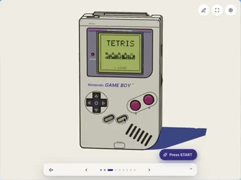</a></td>
</tr>
<tr>
<td width="50%" valign="top"><strong>A Cel-Shaded Journey through Autumn Rails</strong> <a href="https://x.com/ishuagra02">@ishuagra02</a> · 3D &amp; interactive 0:49 · Bookmarks 238 · Details pending <a href="https://guanmo-ai.github.io/awesome-ai-motion/?lang=en#case-2102543638689460488">▶ Play</a> · <a href="https://x.com/ishuagra02/status/2102543638689460488">Original post</a></td>
<td width="50%" valign="top"><strong>A Playable Three-Dimensional Game Boy</strong> <a href="https://x.com/numaausaumon">@numaausaumon</a> · 3D &amp; interactive 1:09 · Bookmarks 153 · Details pending <a href="https://guanmo-ai.github.io/awesome-ai-motion/?lang=en#case-2112186912060654023">▶ Play</a> · <a href="https://x.com/numaausaumon/status/2112186912060654023">Original post</a></td>
</tr>
</tbody>
<tbody>
<tr>
<td width="50%" height="225" align="center" valign="middle"></td>
<td width="50%" height="225" align="center" valign="middle"></td>
</tr>
<tr>
<td width="50%" valign="top"><strong>A prehistoric island: Opus 5 vs. Opus 5.5</strong> <a href="https://x.com/vib3coded">@vib3coded</a> · 3D &amp; interactive 0:20 · Bookmarks 77 <a href="https://guanmo-ai.github.io/awesome-ai-motion/?lang=en#case-2102450239923720440">▶ Play</a> · <a href="https://x.com/vib3coded/status/2102450239923720440">Original post</a></td>
<td width="50%" valign="top"><strong>Pelican Cycling Along a Seaside Pier</strong> <a href="https://x.com/AxtonLiu">@AxtonLiu</a> · 3D &amp; interactive 0:38 · Bookmarks 57 · Details pending <a href="https://guanmo-ai.github.io/awesome-ai-motion/?lang=en#case-2103119648271290566">▶ Play</a> · <a href="https://x.com/AxtonLiu/status/2103119648271290566">Original post</a></td>
</tr>
</tbody>
<tbody>
<tr>
<td width="50%" height="225" align="center" valign="middle"></td>
<td width="50%" height="225" align="center" valign="middle"></td>
</tr>
<tr>
<td width="50%" valign="top"><strong>Soft-Body Motion of a Jelly Peach</strong> <a href="https://x.com/vib3coded">@vib3coded</a> · 3D &amp; interactive 0:18 · Bookmarks 31 · Details pending <a href="https://guanmo-ai.github.io/awesome-ai-motion/?lang=en#case-2112240323560645092">▶ Play</a> · <a href="https://x.com/vib3coded/status/2112240323560645092">Original post</a></td>
<td width="50%" valign="top"><strong>Walking Architecture: A Space for People</strong> <a href="https://x.com/shion_takk">@shion_takk</a> · 3D &amp; interactive 0:30 · Bookmarks 3 · Details pending <a href="https://guanmo-ai.github.io/awesome-ai-motion/?lang=en#case-2104590334152056983">▶ Play</a> · <a href="https://x.com/shion_takk/status/2104590334152056983">Original post</a></td>
</tr>
</tbody>
<tbody>
<tr>
<td width="50%" height="225" align="center" valign="middle"></td>
<td width="50%" height="225" align="center" valign="middle"></td>
</tr>
<tr>
<td width="50%" valign="top"><strong>Combos and Splashes in Splat Knight</strong> <a href="https://x.com/code_coded">@code_coded</a> · 3D &amp; interactive 0:23 · Bookmarks 1 · Details pending <a href="https://guanmo-ai.github.io/awesome-ai-motion/?lang=en#case-2111121904388251714">▶ Play</a> · <a href="https://x.com/code_coded/status/2111121904388251714">Original post</a></td>
<td width="50%" valign="top"><strong>Moving inside and around a Three-Dimensional Pagoda</strong> <a href="https://x.com/BuildFastWithAI">@BuildFastWithAI</a> · 3D &amp; interactive 1:19 · Bookmarks 0 · Details pending <a href="https://guanmo-ai.github.io/awesome-ai-motion/?lang=en#case-2103483174957597035">▶ Play</a> · <a href="https://x.com/BuildFastWithAI/status/2103483174957597035">Original post</a></td>
</tr>
</tbody>
<tbody>
<tr>
<td width="50%" height="225" align="center" valign="middle"></td>
<td width="50%" height="225" align="center" valign="middle"><a href="https://guanmo-ai.github.io/awesome-ai-motion/?lang=en#case-2104276129381220369">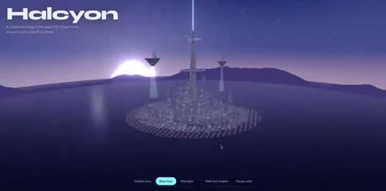</a></td>
</tr>
<tr>
<td width="50%" valign="top"><strong>A felt character: Sol and Opus with the same reference</strong> <a href="https://x.com/JakubAntowski">@JakubAntowski</a> · 3D &amp; interactive 0:20 · Bookmarks 0 · Details pending <a href="https://guanmo-ai.github.io/awesome-ai-motion/?lang=en#case-2105245039521628213">▶ Play</a> · <a href="https://x.com/JakubAntowski/status/2105245039521628213">Original post</a></td>
<td width="50%" valign="top"><strong>Halcyon: A Future City above the Sea</strong> <a href="https://x.com/Muhamma61700589">@Muhamma61700589</a> · 3D &amp; interactive 0:24 · Bookmarks 0 · Details pending <a href="https://guanmo-ai.github.io/awesome-ai-motion/?lang=en#case-2104276129381220369">▶ Play</a> · <a href="https://x.com/Muhamma61700589/status/2104276129381220369">Original post</a></td>
</tr>
</tbody>
<tbody>
<tr>
<td width="50%" height="225" align="center" valign="middle"></td>
<td width="50%" height="225" align="center" valign="middle"></td>
</tr>
<tr>
<td width="50%" valign="top"><strong>The orbital post office: a brass-and-planet world</strong> <a href="https://x.com/allenrokxlate">@allenrokxlate</a> · 3D &amp; interactive 0:24 · Bookmarks 0 · Details pending <a href="https://x.com/allenrokxlate/status/2106040262245896675">▶ Watch on X</a> · <a href="https://x.com/allenrokxlate/status/2106040262245896675">Original post</a></td>
<td width="50%" valign="top"><strong>A Lava Lamp in One HTML File</strong> <a href="https://x.com/juancarlos17626">@juancarlos17626</a> · 3D &amp; interactive 0:51 · Bookmarks 0 · Details pending <a href="https://guanmo-ai.github.io/awesome-ai-motion/?lang=en#case-2108301452384870600">▶ Play</a> · <a href="https://x.com/juancarlos17626/status/2108301452384870600">Original post</a></td>
</tr>
</tbody>
<tbody>
<tr>
<td width="50%" height="225" align="center" valign="middle"></td>
<td width="50%" height="225" align="center" valign="middle"></td>
</tr>
<tr>
<td width="50%" valign="top"><strong>Wareflow: a strategy-game-style warehouse interface</strong> <a href="https://x.com/DilumSanjaya">@DilumSanjaya</a> · 3D &amp; interactive 1:12 · Bookmarks 10,714 · Details pending <a href="https://guanmo-ai.github.io/awesome-ai-motion/?lang=en#case-2106426962738880879">▶ Play</a> · <a href="https://x.com/DilumSanjaya/status/2106426962738880879">Original post</a></td>
<td width="50%" valign="top"><strong>The Little Prince: Across the Stars Trailer</strong> <a href="https://x.com/Saccc_c">@Saccc_c</a> · 3D &amp; interactive 1:03 · Bookmarks 9,884 · Details pending <a href="https://guanmo-ai.github.io/awesome-ai-motion/?lang=en#case-2109962425512734739">▶ Play</a> · <a href="https://x.com/Saccc_c/status/2109962425512734739">Original post</a></td>
</tr>
</tbody>
<tbody>
<tr>
<td width="50%" height="225" align="center" valign="middle"></td>
<td width="50%" height="225" align="center" valign="middle"></td>
</tr>
<tr>
<td width="50%" valign="top"><strong>Anatomy: Working Machine Illustrations</strong> <a href="https://x.com/wheresryan22">@wheresryan22</a> · 3D &amp; interactive 0:39 · Bookmarks 6,423 · Details pending <a href="https://guanmo-ai.github.io/awesome-ai-motion/?lang=en#case-2108948624004526516">▶ Play</a> · <a href="https://x.com/wheresryan22/status/2108948624004526516">Original post</a></td>
<td width="50%" valign="top"><strong>Gigacity: An Endless Procedural City</strong> <a href="https://x.com/RyanSael">@RyanSael</a> · 3D &amp; interactive 0:53 · Bookmarks 6,354 · Details pending <a href="https://guanmo-ai.github.io/awesome-ai-motion/?lang=en#case-2108203997480063196">▶ Play</a> · <a href="https://x.com/RyanSael/status/2108203997480063196">Original post</a></td>
</tr>
</tbody>
<tbody>
<tr>
<td width="50%" height="225" align="center" valign="middle"></td>
<td width="50%" height="225" align="center" valign="middle"></td>
</tr>
<tr>
<td width="50%" valign="top"><strong>A Transparent CD Case with an Animated Lid</strong> <a href="https://x.com/ann_nnng">@ann_nnng</a> · 3D &amp; interactive 0:30 · Bookmarks 3,816 · Details pending <a href="https://guanmo-ai.github.io/awesome-ai-motion/?lang=en#case-2109257723246501895">▶ Play</a> · <a href="https://x.com/ann_nnng/status/2109257723246501895">Original post</a></td>
<td width="50%" valign="top"><strong>Spiderbench: Swinging Through a Browser City</strong> <a href="https://x.com/xikhar">@xikhar</a> · 3D &amp; interactive 2:21 · Bookmarks 3,777 · Details pending <a href="https://guanmo-ai.github.io/awesome-ai-motion/?lang=en#case-2104001664793600012">▶ Play</a> · <a href="https://x.com/xikhar/status/2104001664793600012">Original post</a></td>
</tr>
</tbody>
<tbody>
<tr>
<td width="50%" height="225" align="center" valign="middle"></td>
<td width="50%" height="225" align="center" valign="middle"></td>
</tr>
<tr>
<td width="50%" valign="top"><strong>Sketch Becomes a 3D Steam Train</strong> <a href="https://x.com/tomkrcha">@tomkrcha</a> · 3D &amp; interactive 0:34 · Bookmarks 3,540 · Details pending <a href="https://guanmo-ai.github.io/awesome-ai-motion/?lang=en#case-2095756085890310311">▶ Play</a> · <a href="https://x.com/tomkrcha/status/2095756085890310311">Original post</a></td>
<td width="50%" valign="top"><strong>An Island, Ocean Swells and Underwater Whales</strong> <a href="https://x.com/dangreenheck">@dangreenheck</a> · 3D &amp; interactive 3:47 · Bookmarks 3,407 · Details pending <a href="https://guanmo-ai.github.io/awesome-ai-motion/?lang=en#case-2102878170089169235">▶ Play</a> · <a href="https://x.com/dangreenheck/status/2102878170089169235">Original post</a></td>
</tr>
</tbody>
<tbody>
<tr>
<td width="50%" height="225" align="center" valign="middle"></td>
<td width="50%" height="225" align="center" valign="middle"></td>
</tr>
<tr>
<td width="50%" valign="top"><strong>Clearwater: real-time shallow water and interactive ripples</strong> <a href="https://x.com/Aurelien_Gz">@Aurelien_Gz</a> · 3D &amp; interactive 0:27 · Bookmarks 2,612 <a href="https://guanmo-ai.github.io/awesome-ai-motion/?lang=en#case-2102786378282987591">▶ Play</a> · <a href="https://x.com/Aurelien_Gz/status/2102786378282987591">Original post</a></td>
<td width="50%" valign="top"><strong>A Water Surface Carrying Leaves on Ripples</strong> <a href="https://x.com/sonia_code">@sonia_code</a> · 3D &amp; interactive 0:18 · Bookmarks 2,090 · Details pending <a href="https://guanmo-ai.github.io/awesome-ai-motion/?lang=en#case-2104320172815503463">▶ Play</a> · <a href="https://x.com/sonia_code/status/2104320172815503463">Original post</a></td>
</tr>
</tbody>
<tbody>
<tr>
<td width="50%" height="225" align="center" valign="middle"></td>
<td width="50%" height="225" align="center" valign="middle"></td>
</tr>
<tr>
<td width="50%" valign="top"><strong>Antikythera underwater game demo</strong> <a href="https://x.com/edwinarbus">@edwinarbus</a> · 3D &amp; interactive 1:00 · Bookmarks 1,701 · Details pending <a href="https://guanmo-ai.github.io/awesome-ai-motion/?lang=en#case-2102463453176979794">▶ Play</a> · <a href="https://x.com/edwinarbus/status/2102463453176979794">Original post</a></td>
<td width="50%" valign="top"><strong>Cozy Creek: a Browser Woodland Stream</strong> <a href="https://x.com/chetanankola">@chetanankola</a> · 3D &amp; interactive 0:59 · Bookmarks 1,559 · Details pending <a href="https://guanmo-ai.github.io/awesome-ai-motion/?lang=en#case-2107996576228753545">▶ Play</a> · <a href="https://x.com/chetanankola/status/2107996576228753545">Original post</a></td>
</tr>
</tbody>
<tbody>
<tr>
<td width="50%" height="225" align="center" valign="middle"></td>
<td width="50%" height="225" align="center" valign="middle"></td>
</tr>
<tr>
<td width="50%" valign="top"><strong>Logistics management as a strategy interface</strong> <a href="https://x.com/alexcooldev">@alexcooldev</a> · 3D &amp; interactive 1:14 · Bookmarks 1,343 · Details pending <a href="https://guanmo-ai.github.io/awesome-ai-motion/?lang=en#case-2106835487365419479">▶ Play</a> · <a href="https://x.com/alexcooldev/status/2106835487365419479">Original post</a></td>
<td width="50%" valign="top"><strong>Athenaion: An Ancient Greek World in Code</strong> <a href="https://x.com/LexnLin">@LexnLin</a> · 3D &amp; interactive 0:54 · Bookmarks 1,280 · Details pending <a href="https://guanmo-ai.github.io/awesome-ai-motion/?lang=en#case-2111582260818239777">▶ Play</a> · <a href="https://x.com/LexnLin/status/2111582260818239777">Original post</a></td>
</tr>
</tbody>
<tbody>
<tr>
<td width="50%" height="225" align="center" valign="middle"></td>
<td width="50%" height="225" align="center" valign="middle"></td>
</tr>
<tr>
<td width="50%" valign="top"><strong>Fish and Underwater Light in a Coastal Simulation</strong> <a href="https://x.com/hajimetwi3">@hajimetwi3</a> · 3D &amp; interactive 2:02 · Bookmarks 1,209 · Details pending <a href="https://guanmo-ai.github.io/awesome-ai-motion/?lang=en#case-2104381179151753464">▶ Play</a> · <a href="https://x.com/hajimetwi3/status/2104381179151753464">Original post</a></td>
<td width="50%" valign="top"><strong>Code-Rendered Mountain Stream</strong> <a href="https://x.com/hayashimon1">@hayashimon1</a> · 3D &amp; interactive 0:15 · Bookmarks 1,188 · Details pending <a href="https://guanmo-ai.github.io/awesome-ai-motion/?lang=en#case-2102576886182453454">▶ Play</a> · <a href="https://x.com/hayashimon1/status/2102576886182453454">Original post</a></td>
</tr>
</tbody>
<tbody>
<tr>
<td width="50%" height="225" align="center" valign="middle"></td>
<td width="50%" height="225" align="center" valign="middle"></td>
</tr>
<tr>
<td width="50%" valign="top"><strong>A Miniature City Motorcycle Park</strong> <a href="https://x.com/chrisjdimarco">@chrisjdimarco</a> · 3D &amp; interactive 1:40 · Bookmarks 1,153 · Details pending <a href="https://guanmo-ai.github.io/awesome-ai-motion/?lang=en#case-2104598205417591120">▶ Play</a> · <a href="https://x.com/chrisjdimarco/status/2104598205417591120">Original post</a></td>
<td width="50%" valign="top"><strong>I Just Wanted to Fish: a fishing game demonstration</strong> <a href="https://x.com/ForkedPush">@ForkedPush</a> · 3D &amp; interactive 2:42 · Bookmarks 1,096 · Details pending <a href="https://guanmo-ai.github.io/awesome-ai-motion/?lang=en#case-2106313584829431901">▶ Play</a> · <a href="https://x.com/ForkedPush/status/2106313584829431901">Original post</a></td>
</tr>
</tbody>
<tbody>
<tr>
<td width="50%" height="225" align="center" valign="middle"></td>
<td width="50%" height="225" align="center" valign="middle"><a href="https://guanmo-ai.github.io/awesome-ai-motion/?lang=en#case-2113260416679952691">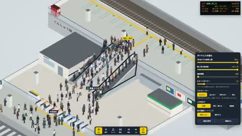</a></td>
</tr>
<tr>
<td width="50%" valign="top"><strong>Catapult sketch becomes a simulation</strong> <a href="https://x.com/poolio">@poolio</a> · 3D &amp; interactive 1:20 · Bookmarks 1,073 · Details pending <a href="https://guanmo-ai.github.io/awesome-ai-motion/?lang=en#case-2102445641205248145">▶ Play</a> · <a href="https://x.com/poolio/status/2102445641205248145">Original post</a></td>
<td width="50%" valign="top"><strong>A Rush-Hour Crowd Simulation</strong> <a href="https://x.com/ootamato">@ootamato</a> · 3D &amp; interactive 1:00 · Bookmarks 1,017 · Details pending <a href="https://guanmo-ai.github.io/awesome-ai-motion/?lang=en#case-2113260416679952691">▶ Play</a> · <a href="https://x.com/ootamato/status/2113260416679952691">Original post</a></td>
</tr>
</tbody>
<tbody>
<tr>
<td width="50%" height="225" align="center" valign="middle"></td>
<td width="50%" height="225" align="center" valign="middle"></td>
</tr>
<tr>
<td width="50%" valign="top"><strong>An experiment combining MOBA and fighting-game mechanics</strong> <a href="https://x.com/GamefxAI">@GamefxAI</a> · 3D &amp; interactive 1:43 · Bookmarks 1,009 · Details pending <a href="https://guanmo-ai.github.io/awesome-ai-motion/?lang=en#case-2106387548486738010">▶ Play</a> · <a href="https://x.com/GamefxAI/status/2106387548486738010">Original post</a></td>
<td width="50%" valign="top"><strong>A Code-generated HD-2D Pixel Game</strong> <a href="https://x.com/hakimieiqbal">@hakimieiqbal</a> · 3D &amp; interactive 1:20 · Bookmarks 879 · Details pending <a href="https://guanmo-ai.github.io/awesome-ai-motion/?lang=en#case-2107804983416467598">▶ Play</a> · <a href="https://x.com/hakimieiqbal/status/2107804983416467598">Original post</a></td>
</tr>
</tbody>
<tbody>
<tr>
<td width="50%" height="225" align="center" valign="middle"></td>
<td width="50%" height="225" align="center" valign="middle"></td>
</tr>
<tr>
<td width="50%" valign="top"><strong>A Fictional Study with a Spinning Fan</strong> <a href="https://x.com/shion_takk">@shion_takk</a> · 3D &amp; interactive 0:36 · Bookmarks 877 · Details pending <a href="https://guanmo-ai.github.io/awesome-ai-motion/?lang=en#case-2110896887096369573">▶ Play</a> · <a href="https://x.com/shion_takk/status/2110896887096369573">Original post</a></td>
<td width="50%" valign="top"><strong>Two model procedural Blender shots</strong> <a href="https://x.com/Stefan_3D_AI">@Stefan_3D_AI</a> · 3D &amp; interactive 0:46 · Bookmarks 773 · Details pending <a href="https://guanmo-ai.github.io/awesome-ai-motion/?lang=en#case-2102471841046786153">▶ Play</a> · <a href="https://x.com/Stefan_3D_AI/status/2102471841046786153">Original post</a></td>
</tr>
</tbody>
<tbody>
<tr>
<td width="50%" height="225" align="center" valign="middle"></td>
<td width="50%" height="225" align="center" valign="middle"></td>
</tr>
<tr>
<td width="50%" valign="top"><strong>Ground Operations on an Airport Apron</strong> <a href="https://x.com/anxuanng">@anxuanng</a> · 3D &amp; interactive 0:30 · Bookmarks 758 · Details pending <a href="https://guanmo-ai.github.io/awesome-ai-motion/?lang=en#case-2110460775722852744">▶ Play</a> · <a href="https://x.com/anxuanng/status/2110460775722852744">Original post</a></td>
<td width="50%" valign="top"><strong>Mine management as a strategy interface</strong> <a href="https://x.com/tradphi">@tradphi</a> · 3D &amp; interactive 0:30 · Bookmarks 738 · Details pending <a href="https://guanmo-ai.github.io/awesome-ai-motion/?lang=en#case-2107022944916709886">▶ Play</a> · <a href="https://x.com/tradphi/status/2107022944916709886">Original post</a></td>
</tr>
</tbody>
<tbody>
<tr>
<td width="50%" height="225" align="center" valign="middle"></td>
<td width="50%" height="225" align="center" valign="middle"></td>
</tr>
<tr>
<td width="50%" valign="top"><strong>A Weather World in a Glass Box</strong> <a href="https://x.com/LexnLin">@LexnLin</a> · 3D &amp; interactive 1:02 · Bookmarks 727 · Details pending <a href="https://guanmo-ai.github.io/awesome-ai-motion/?lang=en#case-2108159248148611292">▶ Play</a> · <a href="https://x.com/LexnLin/status/2108159248148611292">Original post</a></td>
<td width="50%" valign="top"><strong>Procedural Buildings: From Blender Nodes to the Web</strong> <a href="https://x.com/chirovisuals">@chirovisuals</a> · 3D &amp; interactive 1:15 · Bookmarks 673 · Details pending <a href="https://guanmo-ai.github.io/awesome-ai-motion/?lang=en#case-2104548658171834749">▶ Play</a> · <a href="https://x.com/chirovisuals/status/2104548658171834749">Original post</a></td>
</tr>
</tbody>
<tbody>
<tr>
<td width="50%" height="225" align="center" valign="middle"></td>
<td width="50%" height="225" align="center" valign="middle"></td>
</tr>
<tr>
<td width="50%" valign="top"><strong>3D Character Acting Experiment</strong> <a href="https://x.com/manaimovie">@manaimovie</a> · 3D &amp; interactive 0:05 · Bookmarks 618 · Details pending <a href="https://guanmo-ai.github.io/awesome-ai-motion/?lang=en#case-2103138089790996843">▶ Play</a> · <a href="https://x.com/manaimovie/status/2103138089790996843">Original post</a></td>
<td width="50%" valign="top"><strong>Code-Built Dragon Ship Scene</strong> <a href="https://x.com/MengTo">@MengTo</a> · 3D &amp; interactive 1:08 · Bookmarks 617 · Details pending <a href="https://guanmo-ai.github.io/awesome-ai-motion/?lang=en#case-2103122947133309311">▶ Play</a> · <a href="https://x.com/MengTo/status/2103122947133309311">Original post</a></td>
</tr>
</tbody>
<tbody>
<tr>
<td width="50%" height="225" align="center" valign="middle"></td>
<td width="50%" height="225" align="center" valign="middle"><a href="https://guanmo-ai.github.io/awesome-ai-motion/?lang=en#case-2113715036296499441">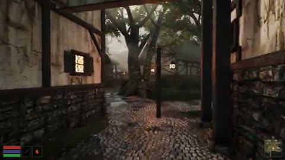</a></td>
</tr>
<tr>
<td width="50%" valign="top"><strong>A Procedural Forest and Stream</strong> <a href="https://x.com/AndreiProvkin">@AndreiProvkin</a> · 3D &amp; interactive 1:08 · Bookmarks 526 · Details pending <a href="https://guanmo-ai.github.io/awesome-ai-motion/?lang=en#case-2103919236653428985">▶ Play</a> · <a href="https://x.com/AndreiProvkin/status/2103919236653428985">Original post</a></td>
<td width="50%" valign="top"><strong>Rebuilding Morrowind's Starting Village</strong> <a href="https://x.com/genex_games">@genex_games</a> · 3D &amp; interactive 1:53 · Bookmarks 497 · Details pending <a href="https://guanmo-ai.github.io/awesome-ai-motion/?lang=en#case-2113715036296499441">▶ Play</a> · <a href="https://x.com/genex_games/status/2113715036296499441">Original post</a></td>
</tr>
</tbody>
<tbody>
<tr>
<td width="50%" height="225" align="center" valign="middle"></td>
<td width="50%" height="225" align="center" valign="middle"></td>
</tr>
<tr>
<td width="50%" valign="top"><strong>A Rainy Neon Street in 3D</strong> <a href="https://x.com/xikhar">@xikhar</a> · 3D &amp; interactive 1:33 · Bookmarks 493 · Details pending <a href="https://guanmo-ai.github.io/awesome-ai-motion/?lang=en#case-2109782676085539061">▶ Play</a> · <a href="https://x.com/xikhar/status/2109782676085539061">Original post</a></td>
<td width="50%" valign="top"><strong>A Draggable Black Hole Lab for Gravitational Lensing</strong> <a href="https://x.com/Voxyz_ai">@Voxyz_ai</a> · 3D &amp; interactive 0:22 · Bookmarks 468 · Details pending <a href="https://guanmo-ai.github.io/awesome-ai-motion/?lang=en#case-2103117246860345550">▶ Play</a> · <a href="https://x.com/Voxyz_ai/status/2103117246860345550">Original post</a></td>
</tr>
</tbody>
<tbody>
<tr>
<td width="50%" height="225" align="center" valign="middle"></td>
<td width="50%" height="225" align="center" valign="middle"><a href="https://guanmo-ai.github.io/awesome-ai-motion/?lang=en#case-2111880621954081240">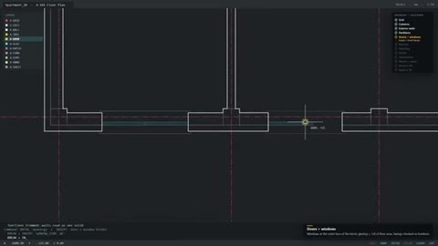</a></td>
</tr>
<tr>
<td width="50%" valign="top"><strong>A VFX Iteration Demo with Effekseer and Godot</strong> <a href="https://x.com/KanaWorks_AI">@KanaWorks_AI</a> · 3D &amp; interactive 0:32 · Bookmarks 463 · Details pending <a href="https://guanmo-ai.github.io/awesome-ai-motion/?lang=en#case-2107752774423511539">▶ Play</a> · <a href="https://x.com/KanaWorks_AI/status/2107752774423511539">Original post</a></td>
<td width="50%" valign="top"><strong>An Apartment Rising from a Plan Grid</strong> <a href="https://x.com/Solvaix">@Solvaix</a> · 3D &amp; interactive 1:13 · Bookmarks 449 · Details pending <a href="https://guanmo-ai.github.io/awesome-ai-motion/?lang=en#case-2111880621954081240">▶ Play</a> · <a href="https://x.com/Solvaix/status/2111880621954081240">Original post</a></td>
</tr>
</tbody>
<tbody>
<tr>
<td width="50%" height="225" align="center" valign="middle"></td>
<td width="50%" height="225" align="center" valign="middle"><a href="https://guanmo-ai.github.io/awesome-ai-motion/?lang=en#case-2111139309206040640">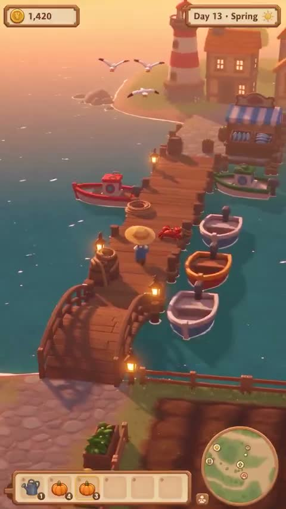</a></td>
</tr>
<tr>
<td width="50%" valign="top"><strong>From Golden Water to a Storm</strong> <a href="https://x.com/LexnLin">@LexnLin</a> · 3D &amp; interactive 1:00 · Bookmarks 436 · Details pending <a href="https://guanmo-ai.github.io/awesome-ai-motion/?lang=en#case-2113333862625648715">▶ Play</a> · <a href="https://x.com/LexnLin/status/2113333862625648715">Original post</a></td>
<td width="50%" valign="top"><strong>Fishing on an Island Farm</strong> <a href="https://x.com/Mnilax">@Mnilax</a> · 3D &amp; interactive 0:15 · Bookmarks 429 · Details pending <a href="https://guanmo-ai.github.io/awesome-ai-motion/?lang=en#case-2111139309206040640">▶ Play</a> · <a href="https://x.com/Mnilax/status/2111139309206040640">Original post</a></td>
</tr>
</tbody>
<tbody>
<tr>
<td width="50%" height="225" align="center" valign="middle"></td>
<td width="50%" height="225" align="center" valign="middle"></td>
</tr>
<tr>
<td width="50%" valign="top"><strong>A 3D visualization of river-flow calculations</strong> <a href="https://x.com/dobokuya77">@dobokuya77</a> · 3D &amp; interactive 0:46 · Bookmarks 426 · Details pending <a href="https://guanmo-ai.github.io/awesome-ai-motion/?lang=en#case-2106604492728967620">▶ Play</a> · <a href="https://x.com/dobokuya77/status/2106604492728967620">Original post</a></td>
<td width="50%" valign="top"><strong>An Interactive 3D Tour Inside a Data Center</strong> <a href="https://x.com/RyanSael">@RyanSael</a> · 3D &amp; interactive 0:34 · Bookmarks 425 · Details pending <a href="https://guanmo-ai.github.io/awesome-ai-motion/?lang=en#case-2102740041621762166">▶ Play</a> · <a href="https://x.com/RyanSael/status/2102740041621762166">Original post</a></td>
</tr>
</tbody>
<tbody>
<tr>
<td width="50%" height="225" align="center" valign="middle"></td>
<td width="50%" height="225" align="center" valign="middle"><a href="https://guanmo-ai.github.io/awesome-ai-motion/?lang=en#case-2113573386794254715">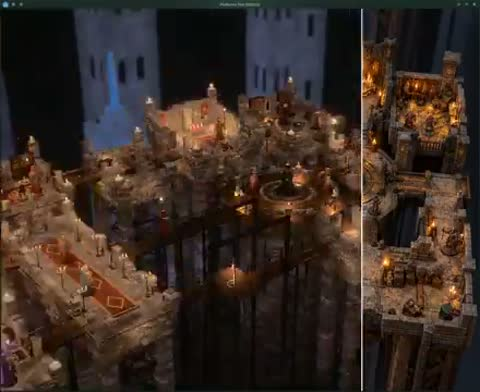</a></td>
</tr>
<tr>
<td width="50%" valign="top"><strong>A Procedural Flight over Na Pali</strong> <a href="https://x.com/LexnLin">@LexnLin</a> · 3D &amp; interactive 0:53 · Bookmarks 421 · Details pending <a href="https://guanmo-ai.github.io/awesome-ai-motion/?lang=en#case-2113720560920428685">▶ Play</a> · <a href="https://x.com/LexnLin/status/2113720560920428685">Original post</a></td>
<td width="50%" valign="top"><strong>From Concept Art to a Spatial Level</strong> <a href="https://x.com/rewind02">@rewind02</a> · 3D &amp; interactive 0:38 · Bookmarks 415 · Details pending <a href="https://guanmo-ai.github.io/awesome-ai-motion/?lang=en#case-2113573386794254715">▶ Play</a> · <a href="https://x.com/rewind02/status/2113573386794254715">Original post</a></td>
</tr>
</tbody>
<tbody>
<tr>
<td width="50%" height="225" align="center" valign="middle"></td>
<td width="50%" height="225" align="center" valign="middle"></td>
</tr>
<tr>
<td width="50%" valign="top"><strong>Sunset Alley: a watercolor miniature world</strong> <a href="https://x.com/akakuma0219">@akakuma0219</a> · 3D &amp; interactive 0:45 · Bookmarks 399 · Details pending <a href="https://guanmo-ai.github.io/awesome-ai-motion/?lang=en#case-2105990418886480092">▶ Play</a> · <a href="https://x.com/akakuma0219/status/2105990418886480092">Original post</a></td>
<td width="50%" valign="top"><strong>Red Foliage and a White Castle</strong> <a href="https://x.com/xikhar">@xikhar</a> · 3D &amp; interactive 0:05 · Bookmarks 391 · Details pending <a href="https://guanmo-ai.github.io/awesome-ai-motion/?lang=en#case-2110143242591510835">▶ Play</a> · <a href="https://x.com/xikhar/status/2110143242591510835">Original post</a></td>
</tr>
</tbody>
<tbody>
<tr>
<td width="50%" height="225" align="center" valign="middle"></td>
<td width="50%" height="225" align="center" valign="middle"></td>
</tr>
<tr>
<td width="50%" valign="top"><strong>A Starry Night Town with Flowing Brushstrokes</strong> <a href="https://x.com/simonxxoo">@simonxxoo</a> · 3D &amp; interactive 1:52 · Bookmarks 391 · Details pending <a href="https://guanmo-ai.github.io/awesome-ai-motion/?lang=en#case-2107793610230075416">▶ Play</a> · <a href="https://x.com/simonxxoo/status/2107793610230075416">Original post</a></td>
<td width="50%" valign="top"><strong>A Japanese Temple at Golden Hour</strong> <a href="https://x.com/LexnLin">@LexnLin</a> · 3D &amp; interactive 1:10 · Bookmarks 364 · Details pending <a href="https://guanmo-ai.github.io/awesome-ai-motion/?lang=en#case-2110657641831956870">▶ Play</a> · <a href="https://x.com/LexnLin/status/2110657641831956870">Original post</a></td>
</tr>
</tbody>
<tbody>
<tr>
<td width="50%" height="225" align="center" valign="middle"></td>
<td width="50%" height="225" align="center" valign="middle"></td>
</tr>
<tr>
<td width="50%" valign="top"><strong>A tomato-growing Pomodoro timer</strong> <a href="https://x.com/ayhankorkmaz_">@ayhankorkmaz_</a> · 3D &amp; interactive 1:28 · Bookmarks 349 · Details pending <a href="https://guanmo-ai.github.io/awesome-ai-motion/?lang=en#case-2106684612822896770">▶ Play</a> · <a href="https://x.com/ayhankorkmaz_/status/2106684612822896770">Original post</a></td>
<td width="50%" valign="top"><strong>Reference-Inspired 3D Water</strong> <a href="https://x.com/Aurelien_Gz">@Aurelien_Gz</a> · 3D &amp; interactive 0:22 · Bookmarks 325 · Details pending <a href="https://guanmo-ai.github.io/awesome-ai-motion/?lang=en#case-2102479887495758076">▶ Play</a> · <a href="https://x.com/Aurelien_Gz/status/2102479887495758076">Original post</a></td>
</tr>
</tbody>
<tbody>
<tr>
<td width="50%" height="225" align="center" valign="middle"></td>
<td width="50%" height="225" align="center" valign="middle"></td>
</tr>
<tr>
<td width="50%" valign="top"><strong>A GTA-style Bangalore neighborhood game prototype</strong> <a href="https://x.com/0xaxit">@0xaxit</a> · 3D &amp; interactive 1:01 · Bookmarks 299 · Details pending <a href="https://guanmo-ai.github.io/awesome-ai-motion/?lang=en#case-2106375041269342691">▶ Play</a> · <a href="https://x.com/0xaxit/status/2106375041269342691">Original post</a></td>
<td width="50%" valign="top"><strong>An Explorable Japanese Garden and Koi Pond</strong> <a href="https://x.com/SouranyPhomhome">@SouranyPhomhome</a> · 3D &amp; interactive 2:36 · Bookmarks 298 · Details pending <a href="https://guanmo-ai.github.io/awesome-ai-motion/?lang=en#case-2103539410302038359">▶ Play</a> · <a href="https://x.com/SouranyPhomhome/status/2103539410302038359">Original post</a></td>
</tr>
</tbody>
<tbody>
<tr>
<td width="50%" height="225" align="center" valign="middle"></td>
<td width="50%" height="225" align="center" valign="middle"></td>
</tr>
<tr>
<td width="50%" valign="top"><strong>Ink Shrimp in WebGL</strong> <a href="https://x.com/jshguo">@jshguo</a> · 3D &amp; interactive 0:10 · Bookmarks 292 · Details pending <a href="https://guanmo-ai.github.io/awesome-ai-motion/?lang=en#case-2105250266392224097">▶ Play</a> · <a href="https://x.com/jshguo/status/2105250266392224097">Original post</a></td>
<td width="50%" valign="top"><strong>Blender 3D Shot Experiment</strong> <a href="https://x.com/superalesha">@superalesha</a> · 3D &amp; interactive 1:01 · Bookmarks 285 · Details pending <a href="https://guanmo-ai.github.io/awesome-ai-motion/?lang=en#case-2102487989381156991">▶ Play</a> · <a href="https://x.com/superalesha/status/2102487989381156991">Original post</a></td>
</tr>
</tbody>
<tbody>
<tr>
<td width="50%" height="225" align="center" valign="middle"></td>
<td width="50%" height="225" align="center" valign="middle"></td>
</tr>
<tr>
<td width="50%" valign="top"><strong>A Glowing Giant at a Stormy Pier</strong> <a href="https://x.com/rewind02">@rewind02</a> · 3D &amp; interactive 0:16 · Bookmarks 271 · Details pending <a href="https://guanmo-ai.github.io/awesome-ai-motion/?lang=en#case-2111466550045622537">▶ Play</a> · <a href="https://x.com/rewind02/status/2111466550045622537">Original post</a></td>
<td width="50%" valign="top"><strong>Code-Generated Shots of the Golden Gate Bridge</strong> <a href="https://x.com/petergyang">@petergyang</a> · 3D &amp; interactive 0:30 · Bookmarks 266 · Details pending <a href="https://guanmo-ai.github.io/awesome-ai-motion/?lang=en#case-2102458049856479474">▶ Play</a> · <a href="https://x.com/petergyang/status/2102458049856479474">Original post</a></td>
</tr>
</tbody>
<tbody>
<tr>
<td width="50%" height="225" align="center" valign="middle"></td>
<td width="50%" height="225" align="center" valign="middle"></td>
</tr>
<tr>
<td width="50%" valign="top"><strong>Fishing by Forest Waterfalls and a Bay</strong> <a href="https://x.com/sorenxet">@sorenxet</a> · 3D &amp; interactive 0:27 · Bookmarks 259 · Details pending <a href="https://guanmo-ai.github.io/awesome-ai-motion/?lang=en#case-2112213933272490380">▶ Play</a> · <a href="https://x.com/sorenxet/status/2112213933272490380">Original post</a></td>
<td width="50%" valign="top"><strong>Hollowmere: an explorable 3D world in five styles</strong> <a href="https://x.com/LexnLin">@LexnLin</a> · 3D &amp; interactive 0:41 · Bookmarks 259 · Details pending <a href="https://guanmo-ai.github.io/awesome-ai-motion/?lang=en#case-2106493673425047896">▶ Play</a> · <a href="https://x.com/LexnLin/status/2106493673425047896">Original post</a></td>
</tr>
</tbody>
<tbody>
<tr>
<td width="50%" height="225" align="center" valign="middle"></td>
<td width="50%" height="225" align="center" valign="middle"></td>
</tr>
<tr>
<td width="50%" valign="top"><strong>Twenty-Four Procedural Animals</strong> <a href="https://x.com/majidmanzarpour">@majidmanzarpour</a> · 3D &amp; interactive 1:57 · Bookmarks 257 · Details pending <a href="https://guanmo-ai.github.io/awesome-ai-motion/?lang=en#case-2105723245722812598">▶ Play</a> · <a href="https://x.com/majidmanzarpour/status/2105723245722812598">Original post</a></td>
<td width="50%" valign="top"><strong>3D creature rig and animation test</strong> <a href="https://x.com/Stefan_3D_AI">@Stefan_3D_AI</a> · 3D &amp; interactive 0:25 · Bookmarks 256 · Details pending <a href="https://guanmo-ai.github.io/awesome-ai-motion/?lang=en#case-2102641562824135022">▶ Play</a> · <a href="https://x.com/Stefan_3D_AI/status/2102641562824135022">Original post</a></td>
</tr>
</tbody>
<tbody>
<tr>
<td width="50%" height="225" align="center" valign="middle"></td>
<td width="50%" height="225" align="center" valign="middle"></td>
</tr>
<tr>
<td width="50%" valign="top"><strong>Wafers and Transport Tracks in a Chip Fab</strong> <a href="https://x.com/anxuanng">@anxuanng</a> · 3D &amp; interactive 0:30 · Bookmarks 256 · Details pending <a href="https://guanmo-ai.github.io/awesome-ai-motion/?lang=en#case-2110816730163605912">▶ Play</a> · <a href="https://x.com/anxuanng/status/2110816730163605912">Original post</a></td>
<td width="50%" valign="top"><strong>Turkish Marbling in Code</strong> <a href="https://x.com/dhruvalgolakiya">@dhruvalgolakiya</a> · 3D &amp; interactive 0:51 · Bookmarks 248 · Details pending <a href="https://guanmo-ai.github.io/awesome-ai-motion/?lang=en#case-2105705406958067765">▶ Play</a> · <a href="https://x.com/dhruvalgolakiya/status/2105705406958067765">Original post</a></td>
</tr>
</tbody>
<tbody>
<tr>
<td width="50%" height="225" align="center" valign="middle"><a href="https://guanmo-ai.github.io/awesome-ai-motion/?lang=en#case-2113644365876691235">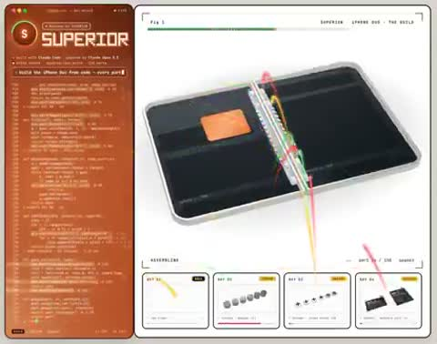</a></td>
<td width="50%" height="225" align="center" valign="middle"><a href="https://guanmo-ai.github.io/awesome-ai-motion/?lang=en#case-2113335762850615298">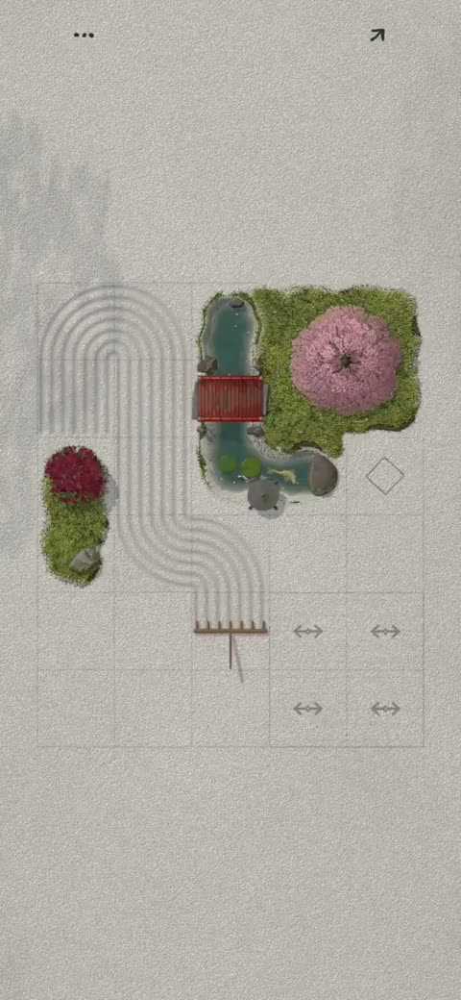</a></td>
</tr>
<tr>
<td width="50%" valign="top"><strong>An Exploded View of a Foldable Phone</strong> <a href="https://x.com/andreysuperior">@andreysuperior</a> · 3D &amp; interactive 0:24 · Bookmarks 233 · Details pending <a href="https://guanmo-ai.github.io/awesome-ai-motion/?lang=en#case-2113644365876691235">▶ Play</a> · <a href="https://x.com/andreysuperior/status/2113644365876691235">Original post</a></td>
<td width="50%" valign="top"><strong>A Miniature Zen Garden Raked in One Path</strong> <a href="https://x.com/jipvandervelde">@jipvandervelde</a> · 3D &amp; interactive 0:25 · Bookmarks 228 · Details pending <a href="https://guanmo-ai.github.io/awesome-ai-motion/?lang=en#case-2113335762850615298">▶ Play</a> · <a href="https://x.com/jipvandervelde/status/2113335762850615298">Original post</a></td>
</tr>
</tbody>
<tbody>
<tr>
<td width="50%" height="225" align="center" valign="middle"></td>
<td width="50%" height="225" align="center" valign="middle"></td>
</tr>
<tr>
<td width="50%" valign="top"><strong>Blender windmill build and animation</strong> <a href="https://x.com/higgsfield_ai">@higgsfield_ai</a> · 3D &amp; interactive 0:21 · Bookmarks 223 · Details pending <a href="https://guanmo-ai.github.io/awesome-ai-motion/?lang=en#case-2102453658889953717">▶ Play</a> · <a href="https://x.com/higgsfield_ai/status/2102453658889953717">Original post</a></td>
<td width="50%" valign="top"><strong>KAIRO Robot Game Interface</strong> <a href="https://x.com/DilumSanjaya">@DilumSanjaya</a> · 3D &amp; interactive 0:56 · Bookmarks 222 · Details pending <a href="https://guanmo-ai.github.io/awesome-ai-motion/?lang=en#case-2109688787068731568">▶ Play</a> · <a href="https://x.com/DilumSanjaya/status/2109688787068731568">Original post</a></td>
</tr>
</tbody>
<tbody>
<tr>
<td width="50%" height="225" align="center" valign="middle"></td>
<td width="50%" height="225" align="center" valign="middle"></td>
</tr>
<tr>
<td width="50%" valign="top"><strong>Koi in a Stone-Lined Waterway</strong> <a href="https://x.com/nachat_dayo">@nachat_dayo</a> · 3D &amp; interactive 0:53 · Bookmarks 219 · Details pending <a href="https://guanmo-ai.github.io/awesome-ai-motion/?lang=en#case-2109769320050090381">▶ Play</a> · <a href="https://x.com/nachat_dayo/status/2109769320050090381">Original post</a></td>
<td width="50%" valign="top"><strong>A 3D game prototype built around Tripo models</strong> <a href="https://x.com/xikhar">@xikhar</a> · 3D &amp; interactive 0:50 · Bookmarks 213 · Details pending <a href="https://guanmo-ai.github.io/awesome-ai-motion/?lang=en#case-2106527292633825693">▶ Play</a> · <a href="https://x.com/xikhar/status/2106527292633825693">Original post</a></td>
</tr>
</tbody>
<tbody>
<tr>
<td width="50%" height="225" align="center" valign="middle"></td>
<td width="50%" height="225" align="center" valign="middle"></td>
</tr>
<tr>
<td width="50%" valign="top"><strong>Clouds and Gardens in a Little Prince World</strong> <a href="https://x.com/Saccc_c">@Saccc_c</a> · 3D &amp; interactive 0:36 · Bookmarks 211 · Details pending <a href="https://guanmo-ai.github.io/awesome-ai-motion/?lang=en#case-2109903473387201003">▶ Play</a> · <a href="https://x.com/Saccc_c/status/2109903473387201003">Original post</a></td>
<td width="50%" valign="top"><strong>From realism to an impressionist WebGPU world</strong> <a href="https://x.com/gruberbuilds">@gruberbuilds</a> · 3D &amp; interactive 1:34 · Bookmarks 201 · Details pending <a href="https://guanmo-ai.github.io/awesome-ai-motion/?lang=en#case-2107285581109547516">▶ Play</a> · <a href="https://x.com/gruberbuilds/status/2107285581109547516">Original post</a></td>
</tr>
</tbody>
<tbody>
<tr>
<td width="50%" height="225" align="center" valign="middle"></td>
<td width="50%" height="225" align="center" valign="middle"></td>
</tr>
<tr>
<td width="50%" valign="top"><strong>Warehouse Logistics in 2D and 3D</strong> <a href="https://x.com/konstantinsaifo">@konstantinsaifo</a> · 3D &amp; interactive 0:45 · Bookmarks 199 · Details pending <a href="https://guanmo-ai.github.io/awesome-ai-motion/?lang=en#case-2112108122126827887">▶ Play</a> · <a href="https://x.com/konstantinsaifo/status/2112108122126827887">Original post</a></td>
<td width="50%" valign="top"><strong>PIXEL WORLD: A Rebuilding World</strong> <a href="https://x.com/aicreataro">@aicreataro</a> · 3D &amp; interactive 1:06 · Bookmarks 199 · Details pending <a href="https://guanmo-ai.github.io/awesome-ai-motion/?lang=en#case-2109598040889942476">▶ Play</a> · <a href="https://x.com/aicreataro/status/2109598040889942476">Original post</a></td>
</tr>
</tbody>
<tbody>
<tr>
<td width="50%" height="225" align="center" valign="middle"><a href="https://guanmo-ai.github.io/awesome-ai-motion/?lang=en#case-2111034892750409811">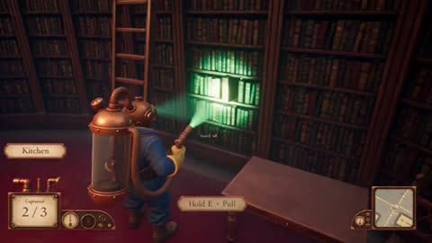</a></td>
<td width="50%" height="225" align="center" valign="middle"></td>
</tr>
<tr>
<td width="50%" valign="top"><strong>A Vacuum-Pack Adventure in a Haunted Mansion</strong> <a href="https://x.com/rewind02">@rewind02</a> · 3D &amp; interactive 0:24 · Bookmarks 193 · Details pending <a href="https://guanmo-ai.github.io/awesome-ai-motion/?lang=en#case-2111034892750409811">▶ Play</a> · <a href="https://x.com/rewind02/status/2111034892750409811">Original post</a></td>
<td width="50%" valign="top"><strong>A Cozy World of Streams and Fireflies</strong> <a href="https://x.com/keydol123">@keydol123</a> · 3D &amp; interactive 1:09 · Bookmarks 191 · Details pending <a href="https://guanmo-ai.github.io/awesome-ai-motion/?lang=en#case-2109314447508709796">▶ Play</a> · <a href="https://x.com/keydol123/status/2109314447508709796">Original post</a></td>
</tr>
</tbody>
<tbody>
<tr>
<td width="50%" height="225" align="center" valign="middle"></td>
<td width="50%" height="225" align="center" valign="middle"></td>
</tr>
<tr>
<td width="50%" valign="top"><strong>A Coastal Town from Daylight to Lanterns</strong> <a href="https://x.com/techartist_">@techartist_</a> · 3D &amp; interactive 0:25 · Bookmarks 191 · Details pending <a href="https://guanmo-ai.github.io/awesome-ai-motion/?lang=en#case-2108595566578192759">▶ Play</a> · <a href="https://x.com/techartist_/status/2108595566578192759">Original post</a></td>
<td width="50%" valign="top"><strong>Aeloria: Flight Through Floating Islands and Storms</strong> <a href="https://x.com/0xRhinoX">@0xRhinoX</a> · 3D &amp; interactive 0:28 · Bookmarks 188 · Details pending <a href="https://guanmo-ai.github.io/awesome-ai-motion/?lang=en#case-2108931642542698801">▶ Play</a> · <a href="https://x.com/0xRhinoX/status/2108931642542698801">Original post</a></td>
</tr>
</tbody>
<tbody>
<tr>
<td width="50%" height="225" align="center" valign="middle"></td>
<td width="50%" height="225" align="center" valign="middle"></td>
</tr>
<tr>
<td width="50%" valign="top"><strong>Cartoon Action in a Chang'an City Scene</strong> <a href="https://x.com/akokoi1">@akokoi1</a> · 3D &amp; interactive 1:35 · Bookmarks 188 · Details pending <a href="https://guanmo-ai.github.io/awesome-ai-motion/?lang=en#case-2112365119187591189">▶ Play</a> · <a href="https://x.com/akokoi1/status/2112365119187591189">Original post</a></td>
<td width="50%" valign="top"><strong>A Procedural Coastal Cave and Sea</strong> <a href="https://x.com/techartist_">@techartist_</a> · 3D &amp; interactive 0:16 · Bookmarks 183 · Details pending <a href="https://guanmo-ai.github.io/awesome-ai-motion/?lang=en#case-2111912410131153254">▶ Play</a> · <a href="https://x.com/techartist_/status/2111912410131153254">Original post</a></td>
</tr>
</tbody>
<tbody>
<tr>
<td width="50%" height="225" align="center" valign="middle"></td>
<td width="50%" height="225" align="center" valign="middle"></td>
</tr>
<tr>
<td width="50%" valign="top"><strong>Four AI humanoid-animation pipelines</strong> <a href="https://x.com/nazimadakli">@nazimadakli</a> · 3D &amp; interactive 0:12 · Bookmarks 175 · Details pending <a href="https://guanmo-ai.github.io/awesome-ai-motion/?lang=en#case-2107159129420964343">▶ Play</a> · <a href="https://x.com/nazimadakli/status/2107159129420964343">Original post</a></td>
<td width="50%" valign="top"><strong>An Explorable Fusion Reactor</strong> <a href="https://x.com/konstantinsaifo">@konstantinsaifo</a> · 3D &amp; interactive 0:43 · Bookmarks 174 · Details pending <a href="https://guanmo-ai.github.io/awesome-ai-motion/?lang=en#case-2104216976801587629">▶ Play</a> · <a href="https://x.com/konstantinsaifo/status/2104216976801587629">Original post</a></td>
</tr>
</tbody>
<tbody>
<tr>
<td width="50%" height="225" align="center" valign="middle"><a href="https://guanmo-ai.github.io/awesome-ai-motion/?lang=en#case-2103243328041132100">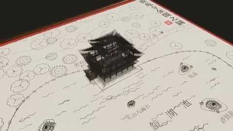</a></td>
<td width="50%" height="225" align="center" valign="middle"></td>
</tr>
<tr>
<td width="50%" valign="top"><strong>Kinkakuji Rising from a Drawing</strong> <a href="https://x.com/Ayu_AI_0912">@Ayu_AI_0912</a> · 3D &amp; interactive 0:24 · Bookmarks 174 · Details pending <a href="https://guanmo-ai.github.io/awesome-ai-motion/?lang=en#case-2103243328041132100">▶ Play</a> · <a href="https://x.com/Ayu_AI_0912/status/2103243328041132100">Original post</a></td>
<td width="50%" valign="top"><strong>Voxel Self-Portrait of an AI Model</strong> <a href="https://x.com/blueemi99">@blueemi99</a> · 3D &amp; interactive 0:15 · Bookmarks 171 · Details pending <a href="https://guanmo-ai.github.io/awesome-ai-motion/?lang=en#case-2102511304456212763">▶ Play</a> · <a href="https://x.com/blueemi99/status/2102511304456212763">Original post</a></td>
</tr>
</tbody>
<tbody>
<tr>
<td width="50%" height="225" align="center" valign="middle"></td>
<td width="50%" height="225" align="center" valign="middle"></td>
</tr>
<tr>
<td width="50%" valign="top"><strong>Space Tracks for a Rocket League-Style Racer</strong> <a href="https://x.com/LLMJunky">@LLMJunky</a> · 3D &amp; interactive 1:07 · Bookmarks 169 · Details pending <a href="https://guanmo-ai.github.io/awesome-ai-motion/?lang=en#case-2102847543042343072">▶ Play</a> · <a href="https://x.com/LLMJunky/status/2102847543042343072">Original post</a></td>
<td width="50%" valign="top"><strong>An LLM body-control experiment in Unreal</strong> <a href="https://x.com/L_ARCH_01">@L_ARCH_01</a> · 3D &amp; interactive 0:22 · Bookmarks 167 · Details pending <a href="https://guanmo-ai.github.io/awesome-ai-motion/?lang=en#case-2106656783221899534">▶ Play</a> · <a href="https://x.com/L_ARCH_01/status/2106656783221899534">Original post</a></td>
</tr>
</tbody>
<tbody>
<tr>
<td width="50%" height="225" align="center" valign="middle"></td>
<td width="50%" height="225" align="center" valign="middle"></td>
</tr>
<tr>
<td width="50%" valign="top"><strong>A Fragment-shader RISC-V Emulator in VRChat</strong> <a href="https://x.com/Michael_Moroz_">@Michael_Moroz_</a> · 3D &amp; interactive 3:11 · Bookmarks 163 · Details pending <a href="https://guanmo-ai.github.io/awesome-ai-motion/?lang=en#case-2107713497224130638">▶ Play</a> · <a href="https://x.com/Michael_Moroz_/status/2107713497224130638">Original post</a></td>
<td width="50%" valign="top"><strong>Container Port Loading and Dispatch</strong> <a href="https://x.com/anxuanng">@anxuanng</a> · 3D &amp; interactive 0:30 · Bookmarks 163 · Details pending <a href="https://guanmo-ai.github.io/awesome-ai-motion/?lang=en#case-2111486639130439956">▶ Play</a> · <a href="https://x.com/anxuanng/status/2111486639130439956">Original post</a></td>
</tr>
</tbody>
<tbody>
<tr>
<td width="50%" height="225" align="center" valign="middle"><a href="https://guanmo-ai.github.io/awesome-ai-motion/?lang=en#case-2113610341599117427">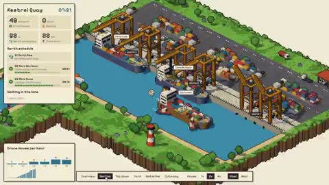</a></td>
<td width="50%" height="225" align="center" valign="middle"></td>
</tr>
<tr>
<td width="50%" valign="top"><strong>A Pixel Cutaway of a Container Port</strong> <a href="https://x.com/anxuanng">@anxuanng</a> · 3D &amp; interactive 0:30 · Bookmarks 161 · Details pending <a href="https://guanmo-ai.github.io/awesome-ai-motion/?lang=en#case-2113610341599117427">▶ Play</a> · <a href="https://x.com/anxuanng/status/2113610341599117427">Original post</a></td>
<td width="50%" valign="top"><strong>Cooling and Transport in an AI Data Center</strong> <a href="https://x.com/anxuanng">@anxuanng</a> · 3D &amp; interactive 0:30 · Bookmarks 161 · Details pending <a href="https://guanmo-ai.github.io/awesome-ai-motion/?lang=en#case-2110475736213819575">▶ Play</a> · <a href="https://x.com/anxuanng/status/2110475736213819575">Original post</a></td>
</tr>
</tbody>
<tbody>
<tr>
<td width="50%" height="225" align="center" valign="middle"></td>
<td width="50%" height="225" align="center" valign="middle"></td>
</tr>
<tr>
<td width="50%" valign="top"><strong>A Three-Dimensional Playground of Wind-Up Toys</strong> <a href="https://x.com/techartist_">@techartist_</a> · 3D &amp; interactive 0:21 · Bookmarks 154 · Details pending <a href="https://guanmo-ai.github.io/awesome-ai-motion/?lang=en#case-2113735969174360081">▶ Play</a> · <a href="https://x.com/techartist_/status/2113735969174360081">Original post</a></td>
<td width="50%" valign="top"><strong>An Emergency Department in Motion</strong> <a href="https://x.com/anxuanng">@anxuanng</a> · 3D &amp; interactive 0:30 · Bookmarks 150 · Details pending <a href="https://guanmo-ai.github.io/awesome-ai-motion/?lang=en#case-2111543476123042185">▶ Play</a> · <a href="https://x.com/anxuanng/status/2111543476123042185">Original post</a></td>
</tr>
</tbody>
<tbody>
<tr>
<td width="50%" height="225" align="center" valign="middle"></td>
<td width="50%" height="225" align="center" valign="middle"></td>
</tr>
<tr>
<td width="50%" valign="top"><strong>Truck Loading, Routes and Axle Loads</strong> <a href="https://x.com/konstantinsaifo">@konstantinsaifo</a> · 3D &amp; interactive 0:09 · Bookmarks 150 · Details pending <a href="https://guanmo-ai.github.io/awesome-ai-motion/?lang=en#case-2112802541327331552">▶ Play</a> · <a href="https://x.com/konstantinsaifo/status/2112802541327331552">Original post</a></td>
<td width="50%" valign="top"><strong>Iterating a sunset-harbor game scene</strong> <a href="https://x.com/prasenx">@prasenx</a> · 3D &amp; interactive 5:20 · Bookmarks 147 · Details pending <a href="https://guanmo-ai.github.io/awesome-ai-motion/?lang=en#case-2107451914954911838">▶ Play</a> · <a href="https://x.com/prasenx/status/2107451914954911838">Original post</a></td>
</tr>
</tbody>
<tbody>
<tr>
<td width="50%" height="225" align="center" valign="middle"></td>
<td width="50%" height="225" align="center" valign="middle"></td>
</tr>
<tr>
<td width="50%" valign="top"><strong>Exploring a Three.js Planted Aquarium</strong> <a href="https://x.com/aollivier82">@aollivier82</a> · 3D &amp; interactive 1:34 · Bookmarks 146 · Details pending <a href="https://guanmo-ai.github.io/awesome-ai-motion/?lang=en#case-2103474530232717444">▶ Play</a> · <a href="https://x.com/aollivier82/status/2103474530232717444">Original post</a></td>
<td width="50%" valign="top"><strong>A Browser Racer from the Cockpit</strong> <a href="https://x.com/klattkev">@klattkev</a> · 3D &amp; interactive 0:34 · Bookmarks 145 · Details pending <a href="https://guanmo-ai.github.io/awesome-ai-motion/?lang=en#case-2111189894517375117">▶ Play</a> · <a href="https://x.com/klattkev/status/2111189894517375117">Original post</a></td>
</tr>
</tbody>
<tbody>
<tr>
<td width="50%" height="225" align="center" valign="middle"></td>
<td width="50%" height="225" align="center" valign="middle"></td>
</tr>
<tr>
<td width="50%" valign="top"><strong>A Haunted House at Two Effort Levels</strong> <a href="https://x.com/MrTacticalX">@MrTacticalX</a> · 3D &amp; interactive 0:46 · Bookmarks 140 · Details pending <a href="https://guanmo-ai.github.io/awesome-ai-motion/?lang=en#case-2112756630203011516">▶ Play</a> · <a href="https://x.com/MrTacticalX/status/2112756630203011516">Original post</a></td>
<td width="50%" valign="top"><strong>A 3D Simulation of Sunlight and Heat around a Home</strong> <a href="https://x.com/Rutto02">@Rutto02</a> · 3D &amp; interactive 0:34 · Bookmarks 140 · Details pending <a href="https://guanmo-ai.github.io/awesome-ai-motion/?lang=en#case-2110019227998683484">▶ Play</a> · <a href="https://x.com/Rutto02/status/2110019227998683484">Original post</a></td>
</tr>
</tbody>
<tbody>
<tr>
<td width="50%" height="225" align="center" valign="middle"></td>
<td width="50%" height="225" align="center" valign="middle"></td>
</tr>
<tr>
<td width="50%" valign="top"><strong>Floorplan Design: From 2D Layout to 3D Walkthrough</strong> <a href="https://x.com/akokoi1">@akokoi1</a> · 3D &amp; interactive 0:33 · Bookmarks 137 · Details pending <a href="https://guanmo-ai.github.io/awesome-ai-motion/?lang=en#case-2104520072014508316">▶ Play</a> · <a href="https://x.com/akokoi1/status/2104520072014508316">Original post</a></td>
<td width="50%" valign="top"><strong>Soft-Body Interaction with an Orange Slice</strong> <a href="https://x.com/sonia_code">@sonia_code</a> · 3D &amp; interactive 0:18 · Bookmarks 135 · Details pending <a href="https://guanmo-ai.github.io/awesome-ai-motion/?lang=en#case-2104150303906177301">▶ Play</a> · <a href="https://x.com/sonia_code/status/2104150303906177301">Original post</a></td>
</tr>
</tbody>
<tbody>
<tr>
<td width="50%" height="225" align="center" valign="middle"></td>
<td width="50%" height="225" align="center" valign="middle"><a href="https://guanmo-ai.github.io/awesome-ai-motion/?lang=en#case-2103774074505949448">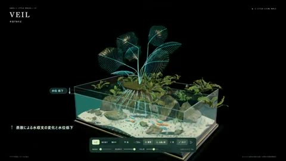</a></td>
</tr>
<tr>
<td width="50%" valign="top"><strong>Flight Paths in an Air Traffic Control Simulation</strong> <a href="https://x.com/anxuanng">@anxuanng</a> · 3D &amp; interactive 0:30 · Bookmarks 134 · Details pending <a href="https://guanmo-ai.github.io/awesome-ai-motion/?lang=en#case-2110801686923264126">▶ Play</a> · <a href="https://x.com/anxuanng/status/2110801686923264126">Original post</a></td>
<td width="50%" valign="top"><strong>Plants and Ecological Connections inside an Aquarium</strong> <a href="https://x.com/sonia_code">@sonia_code</a> · 3D &amp; interactive 0:21 · Bookmarks 133 · Details pending <a href="https://guanmo-ai.github.io/awesome-ai-motion/?lang=en#case-2103774074505949448">▶ Play</a> · <a href="https://x.com/sonia_code/status/2103774074505949448">Original post</a></td>
</tr>
</tbody>
<tbody>
<tr>
<td width="50%" height="225" align="center" valign="middle"></td>
<td width="50%" height="225" align="center" valign="middle"></td>
</tr>
<tr>
<td width="50%" valign="top"><strong>An Iron Armor Parts Interface</strong> <a href="https://x.com/DilumSanjaya">@DilumSanjaya</a> · 3D &amp; interactive 0:49 · Bookmarks 129 · Details pending <a href="https://guanmo-ai.github.io/awesome-ai-motion/?lang=en#case-2104977431098757317">▶ Play</a> · <a href="https://x.com/DilumSanjaya/status/2104977431098757317">Original post</a></td>
<td width="50%" valign="top"><strong>A Gothic Castle in the Waves</strong> <a href="https://x.com/emollick">@emollick</a> · 3D &amp; interactive 0:10 · Bookmarks 127 · Details pending <a href="https://guanmo-ai.github.io/awesome-ai-motion/?lang=en#case-2102441628661080384">▶ Play</a> · <a href="https://x.com/emollick/status/2102441628661080384">Original post</a></td>
</tr>
</tbody>
<tbody>
<tr>
<td width="50%" height="225" align="center" valign="middle"></td>
<td width="50%" height="225" align="center" valign="middle"></td>
</tr>
<tr>
<td width="50%" valign="top"><strong>A Concept Bike from Road to Sky</strong> <a href="https://x.com/thebuggeddev">@thebuggeddev</a> · 3D &amp; interactive 0:58 · Bookmarks 125 · Details pending <a href="https://guanmo-ai.github.io/awesome-ai-motion/?lang=en#case-2114377433369739331">▶ Play</a> · <a href="https://x.com/thebuggeddev/status/2114377433369739331">Original post</a></td>
<td width="50%" valign="top"><strong>A Rocket Assembles for a Night Launch</strong> <a href="https://x.com/Ayu_AI_0912">@Ayu_AI_0912</a> · 3D &amp; interactive 0:24 · Bookmarks 124 · Details pending <a href="https://guanmo-ai.github.io/awesome-ai-motion/?lang=en#case-2109515393220083912">▶ Play</a> · <a href="https://x.com/Ayu_AI_0912/status/2109515393220083912">Original post</a></td>
</tr>
</tbody>
<tbody>
<tr>
<td width="50%" height="225" align="center" valign="middle"></td>
<td width="50%" height="225" align="center" valign="middle"></td>
</tr>
<tr>
<td width="50%" valign="top"><strong>A Solitary Fishing World around a Mountain Cabin</strong> <a href="https://x.com/prasenx">@prasenx</a> · 3D &amp; interactive 3:51 · Bookmarks 123 · Details pending <a href="https://guanmo-ai.github.io/awesome-ai-motion/?lang=en#case-2108905413467079026">▶ Play</a> · <a href="https://x.com/prasenx/status/2108905413467079026">Original post</a></td>
<td width="50%" valign="top"><strong>A Miniature World of Airport Operations</strong> <a href="https://x.com/viktoroddy">@viktoroddy</a> · 3D &amp; interactive 0:26 · Bookmarks 122 · Details pending <a href="https://guanmo-ai.github.io/awesome-ai-motion/?lang=en#case-2113602878288052581">▶ Play</a> · <a href="https://x.com/viktoroddy/status/2113602878288052581">Original post</a></td>
</tr>
</tbody>
<tbody>
<tr>
<td width="50%" height="225" align="center" valign="middle"></td>
<td width="50%" height="225" align="center" valign="middle"></td>
</tr>
<tr>
<td width="50%" valign="top"><strong>Moving Racks in a Robotic Fulfillment Center</strong> <a href="https://x.com/anxuanng">@anxuanng</a> · 3D &amp; interactive 0:30 · Bookmarks 121 · Details pending <a href="https://guanmo-ai.github.io/awesome-ai-motion/?lang=en#case-2111471324816404683">▶ Play</a> · <a href="https://x.com/anxuanng/status/2111471324816404683">Original post</a></td>
<td width="50%" valign="top"><strong>A Deer in a Misty Forest</strong> <a href="https://x.com/tripoai">@tripoai</a> · 3D &amp; interactive 0:29 · Bookmarks 120 · Details pending <a href="https://guanmo-ai.github.io/awesome-ai-motion/?lang=en#case-2111109914055803222">▶ Play</a> · <a href="https://x.com/tripoai/status/2111109914055803222">Original post</a></td>
</tr>
</tbody>
<tbody>
<tr>
<td width="50%" height="225" align="center" valign="middle"></td>
<td width="50%" height="225" align="center" valign="middle"></td>
</tr>
<tr>
<td width="50%" valign="top"><strong>Squishing and Slicing a Jelly Orange</strong> <a href="https://x.com/vib3coded">@vib3coded</a> · 3D &amp; interactive 0:18 · Bookmarks 118 · Details pending <a href="https://guanmo-ai.github.io/awesome-ai-motion/?lang=en#case-2110665495221268915">▶ Play</a> · <a href="https://x.com/vib3coded/status/2110665495221268915">Original post</a></td>
<td width="50%" valign="top"><strong>A Hovercar Chase in a Gothic City</strong> <a href="https://x.com/techartist_">@techartist_</a> · 3D &amp; interactive 0:28 · Bookmarks 109 · Details pending <a href="https://guanmo-ai.github.io/awesome-ai-motion/?lang=en#case-2112265555780771886">▶ Play</a> · <a href="https://x.com/techartist_/status/2112265555780771886">Original post</a></td>
</tr>
</tbody>
<tbody>
<tr>
<td width="50%" height="225" align="center" valign="middle"></td>
<td width="50%" height="225" align="center" valign="middle"></td>
</tr>
<tr>
<td width="50%" valign="top"><strong>Heatsink: a City Drone Racing Game</strong> <a href="https://x.com/aniketjart">@aniketjart</a> · 3D &amp; interactive 0:27 · Bookmarks 109 · Details pending <a href="https://guanmo-ai.github.io/awesome-ai-motion/?lang=en#case-2107973550300856334">▶ Play</a> · <a href="https://x.com/aniketjart/status/2107973550300856334">Original post</a></td>
<td width="50%" valign="top"><strong>An Endless Tram Ride Through Lisbon</strong> <a href="https://x.com/thebuggeddev">@thebuggeddev</a> · 3D &amp; interactive 0:53 · Bookmarks 108 · Details pending <a href="https://guanmo-ai.github.io/awesome-ai-motion/?lang=en#case-2103465304039076319">▶ Play</a> · <a href="https://x.com/thebuggeddev/status/2103465304039076319">Original post</a></td>
</tr>
</tbody>
<tbody>
<tr>
<td width="50%" height="225" align="center" valign="middle"></td>
<td width="50%" height="225" align="center" valign="middle"></td>
</tr>
<tr>
<td width="50%" valign="top"><strong>Interactive Ink Bleed Around Brand Lettering</strong> <a href="https://x.com/ann_nnng">@ann_nnng</a> · 3D &amp; interactive 0:17 · Bookmarks 103 · Details pending <a href="https://guanmo-ai.github.io/awesome-ai-motion/?lang=en#case-2108926571021279560">▶ Play</a> · <a href="https://x.com/ann_nnng/status/2108926571021279560">Original post</a></td>
<td width="50%" valign="top"><strong>Twin-Engine Canyon Racing</strong> <a href="https://x.com/Aurelien_Gz">@Aurelien_Gz</a> · 3D &amp; interactive 0:33 · Bookmarks 103 · Details pending <a href="https://guanmo-ai.github.io/awesome-ai-motion/?lang=en#case-2103195122422755563">▶ Play</a> · <a href="https://x.com/Aurelien_Gz/status/2103195122422755563">Original post</a></td>
</tr>
</tbody>
<tbody>
<tr>
<td width="50%" height="225" align="center" valign="middle"></td>
<td width="50%" height="225" align="center" valign="middle"></td>
</tr>
<tr>
<td width="50%" valign="top"><strong>An interactive miniature convenience store</strong> <a href="https://x.com/beefnoode">@beefnoode</a> · 3D &amp; interactive 0:13 · Bookmarks 100 · Details pending <a href="https://guanmo-ai.github.io/awesome-ai-motion/?lang=en#case-2107417865406324750">▶ Play</a> · <a href="https://x.com/beefnoode/status/2107417865406324750">Original post</a></td>
<td width="50%" valign="top"><strong>Through the Looking-Glass: the Garden of Live Flowers</strong> <a href="https://x.com/ring_hyacinth">@ring_hyacinth</a> · 3D &amp; interactive 1:55 · Bookmarks 99 · Details pending <a href="https://guanmo-ai.github.io/awesome-ai-motion/?lang=en#case-2106307854085029889">▶ Play</a> · <a href="https://x.com/ring_hyacinth/status/2106307854085029889">Original post</a></td>
</tr>
</tbody>
<tbody>
<tr>
<td width="50%" height="225" align="center" valign="middle"></td>
<td width="50%" height="225" align="center" valign="middle"></td>
</tr>
<tr>
<td width="50%" valign="top"><strong>A Stylized Naval Turret Exercise</strong> <a href="https://x.com/i2cjak">@i2cjak</a> · 3D &amp; interactive 1:31 · Bookmarks 89 · Details pending <a href="https://guanmo-ai.github.io/awesome-ai-motion/?lang=en#case-2110474945704903065">▶ Play</a> · <a href="https://x.com/i2cjak/status/2110474945704903065">Original post</a></td>
<td width="50%" valign="top"><strong>Flying Wing: an Aircraft Cutaway</strong> <a href="https://x.com/konstantinsaifo">@konstantinsaifo</a> · 3D &amp; interactive 0:43 · Bookmarks 87 · Details pending <a href="https://guanmo-ai.github.io/awesome-ai-motion/?lang=en#case-2107752275980476558">▶ Play</a> · <a href="https://x.com/konstantinsaifo/status/2107752275980476558">Original post</a></td>
</tr>
</tbody>
<tbody>
<tr>
<td width="50%" height="225" align="center" valign="middle"></td>
<td width="50%" height="225" align="center" valign="middle"></td>
</tr>
<tr>
<td width="50%" valign="top"><strong>Exploring a Looping Subway Corridor</strong> <a href="https://x.com/parhelion318">@parhelion318</a> · 3D &amp; interactive 0:56 · Bookmarks 86 · Details pending <a href="https://guanmo-ai.github.io/awesome-ai-motion/?lang=en#case-2111128415319548058">▶ Play</a> · <a href="https://x.com/parhelion318/status/2111128415319548058">Original post</a></td>
<td width="50%" valign="top"><strong>Exploring the Silver Vesper Train</strong> <a href="https://x.com/DilumSanjaya">@DilumSanjaya</a> · 3D &amp; interactive 0:44 · Bookmarks 85 · Details pending <a href="https://guanmo-ai.github.io/awesome-ai-motion/?lang=en#case-2103525797822960007">▶ Play</a> · <a href="https://x.com/DilumSanjaya/status/2103525797822960007">Original post</a></td>
</tr>
</tbody>
<tbody>
<tr>
<td width="50%" height="225" align="center" valign="middle"></td>
<td width="50%" height="225" align="center" valign="middle"></td>
</tr>
<tr>
<td width="50%" valign="top"><strong>A Theme Park Running in Real Time</strong> <a href="https://x.com/anxuanng">@anxuanng</a> · 3D &amp; interactive 0:30 · Bookmarks 85 · Details pending <a href="https://guanmo-ai.github.io/awesome-ai-motion/?lang=en#case-2111528513690026292">▶ Play</a> · <a href="https://x.com/anxuanng/status/2111528513690026292">Original post</a></td>
<td width="50%" valign="top"><strong>Rocket-Powered Car Soccer in the Browser</strong> <a href="https://x.com/BlendiByl">@BlendiByl</a> · 3D &amp; interactive 0:39 · Bookmarks 83 · Details pending <a href="https://guanmo-ai.github.io/awesome-ai-motion/?lang=en#case-2104800823620632641">▶ Play</a> · <a href="https://x.com/BlendiByl/status/2104800823620632641">Original post</a></td>
</tr>
</tbody>
<tbody>
<tr>
<td width="50%" height="225" align="center" valign="middle"></td>
<td width="50%" height="225" align="center" valign="middle"></td>
</tr>
<tr>
<td width="50%" valign="top"><strong>A 3D Flight Game through a Hurricane</strong> <a href="https://x.com/techartist_">@techartist_</a> · 3D &amp; interactive 0:21 · Bookmarks 82 · Details pending <a href="https://guanmo-ai.github.io/awesome-ai-motion/?lang=en#case-2108369354991759658">▶ Play</a> · <a href="https://x.com/techartist_/status/2108369354991759658">Original post</a></td>
<td width="50%" valign="top"><strong>Boba Bar: An Interactive 3D Drink</strong> <a href="https://x.com/techartist_">@techartist_</a> · 3D &amp; interactive 0:23 · Bookmarks 82 · Details pending <a href="https://guanmo-ai.github.io/awesome-ai-motion/?lang=en#case-2111140364275052719">▶ Play</a> · <a href="https://x.com/techartist_/status/2111140364275052719">Original post</a></td>
</tr>
</tbody>
<tbody>
<tr>
<td width="50%" height="225" align="center" valign="middle"></td>
<td width="50%" height="225" align="center" valign="middle"></td>
</tr>
<tr>
<td width="50%" valign="top"><strong>A Watercolor Courtyard with Moving Branches</strong> <a href="https://x.com/thebuggeddev">@thebuggeddev</a> · 3D &amp; interactive 0:39 · Bookmarks 80 · Details pending <a href="https://guanmo-ai.github.io/awesome-ai-motion/?lang=en#case-2104094704543662358">▶ Play</a> · <a href="https://x.com/thebuggeddev/status/2104094704543662358">Original post</a></td>
<td width="50%" valign="top"><strong>A 3D Forest Snakeboard</strong> <a href="https://x.com/thebuggeddev">@thebuggeddev</a> · 3D &amp; interactive 0:58 · Bookmarks 78 · Details pending <a href="https://guanmo-ai.github.io/awesome-ai-motion/?lang=en#case-2107106516918743153">▶ Play</a> · <a href="https://x.com/thebuggeddev/status/2107106516918743153">Original post</a></td>
</tr>
</tbody>
<tbody>
<tr>
<td width="50%" height="225" align="center" valign="middle"></td>
<td width="50%" height="225" align="center" valign="middle"></td>
</tr>
<tr>
<td width="50%" valign="top"><strong>A Tesla Semi Factory Simulation</strong> <a href="https://x.com/konstantinsaifo">@konstantinsaifo</a> · 3D &amp; interactive 0:35 · Bookmarks 77 · Details pending <a href="https://guanmo-ai.github.io/awesome-ai-motion/?lang=en#case-2112913135782756652">▶ Play</a> · <a href="https://x.com/konstantinsaifo/status/2112913135782756652">Original post</a></td>
<td width="50%" valign="top"><strong>A Procedural City under Kaiju Attack</strong> <a href="https://x.com/majidmanzarpour">@majidmanzarpour</a> · 3D &amp; interactive 2:13 · Bookmarks 76 · Details pending <a href="https://guanmo-ai.github.io/awesome-ai-motion/?lang=en#case-2102810710791401883">▶ Play</a> · <a href="https://x.com/majidmanzarpour/status/2102810710791401883">Original post</a></td>
</tr>
</tbody>
<tbody>
<tr>
<td width="50%" height="225" align="center" valign="middle"></td>
<td width="50%" height="225" align="center" valign="middle"></td>
</tr>
<tr>
<td width="50%" valign="top"><strong>A Multi-tool Island-hunting Prototype</strong> <a href="https://x.com/yyyole">@yyyole</a> · 3D &amp; interactive 1:04 · Bookmarks 76 · Details pending <a href="https://guanmo-ai.github.io/awesome-ai-motion/?lang=en#case-2108368534963413293">▶ Play</a> · <a href="https://x.com/yyyole/status/2108368534963413293">Original post</a></td>
<td width="50%" valign="top"><strong>Procedural cartoon scene comparison</strong> <a href="https://x.com/Stefan_3D_AI">@Stefan_3D_AI</a> · 3D &amp; interactive 0:30 · Bookmarks 73 · Details pending <a href="https://guanmo-ai.github.io/awesome-ai-motion/?lang=en#case-2102623690152419633">▶ Play</a> · <a href="https://x.com/Stefan_3D_AI/status/2102623690152419633">Original post</a></td>
</tr>
</tbody>
<tbody>
<tr>
<td width="50%" height="225" align="center" valign="middle"></td>
<td width="50%" height="225" align="center" valign="middle"></td>
</tr>
<tr>
<td width="50%" valign="top"><strong>Transforming Electric Truck Animation</strong> <a href="https://x.com/scottstts">@scottstts</a> · 3D &amp; interactive 1:13 · Bookmarks 72 · Details pending <a href="https://guanmo-ai.github.io/awesome-ai-motion/?lang=en#case-2102539904274325540">▶ Play</a> · <a href="https://x.com/scottstts/status/2102539904274325540">Original post</a></td>
<td width="50%" valign="top"><strong>A combable soft-body dragon comparison</strong> <a href="https://x.com/vib3coded">@vib3coded</a> · 3D &amp; interactive 0:18 · Bookmarks 72 · Details pending <a href="https://guanmo-ai.github.io/awesome-ai-motion/?lang=en#case-2107020311380033949">▶ Play</a> · <a href="https://x.com/vib3coded/status/2107020311380033949">Original post</a></td>
</tr>
</tbody>
<tbody>
<tr>
<td width="50%" height="225" align="center" valign="middle"></td>
<td width="50%" height="225" align="center" valign="middle"></td>
</tr>
<tr>
<td width="50%" valign="top"><strong>Glowing jellyfish: a Claude and Sol comparison</strong> <a href="https://x.com/SPAC89">@SPAC89</a> · 3D &amp; interactive 0:20 · Bookmarks 69 · Details pending <a href="https://guanmo-ai.github.io/awesome-ai-motion/?lang=en#case-2105783511433318451">▶ Play</a> · <a href="https://x.com/SPAC89/status/2105783511433318451">Original post</a></td>
<td width="50%" valign="top"><strong>Through a Japanese Voxel Valley</strong> <a href="https://x.com/8co28">@8co28</a> · 3D &amp; interactive 1:07 · Bookmarks 69 · Details pending <a href="https://guanmo-ai.github.io/awesome-ai-motion/?lang=en#case-2110291146291466725">▶ Play</a> · <a href="https://x.com/8co28/status/2110291146291466725">Original post</a></td>
</tr>
</tbody>
<tbody>
<tr>
<td width="50%" height="225" align="center" valign="middle"></td>
<td width="50%" height="225" align="center" valign="middle"></td>
</tr>
<tr>
<td width="50%" valign="top"><strong>A Wuxia ARPG from Character Topology to Combat</strong> <a href="https://x.com/cnyzgkc">@cnyzgkc</a> · 3D &amp; interactive 0:59 · Bookmarks 69 · Details pending <a href="https://guanmo-ai.github.io/awesome-ai-motion/?lang=en#case-2108159853533466672">▶ Play</a> · <a href="https://x.com/cnyzgkc/status/2108159853533466672">Original post</a></td>
<td width="50%" valign="top"><strong>A Halloween robot-control animation</strong> <a href="https://x.com/loganmb_">@loganmb_</a> · 3D &amp; interactive 0:31 · Bookmarks 66 · Details pending <a href="https://guanmo-ai.github.io/awesome-ai-motion/?lang=en#case-2106075623613694123">▶ Play</a> · <a href="https://x.com/loganmb_/status/2106075623613694123">Original post</a></td>
</tr>
</tbody>
<tbody>
<tr>
<td width="50%" height="225" align="center" valign="middle"></td>
<td width="50%" height="225" align="center" valign="middle"></td>
</tr>
<tr>
<td width="50%" valign="top"><strong>Reef Station: Water and Lighting in a Browser</strong> <a href="https://x.com/apekshik">@apekshik</a> · 3D &amp; interactive 0:40 · Bookmarks 66 · Details pending <a href="https://guanmo-ai.github.io/awesome-ai-motion/?lang=en#case-2107938887679267180">▶ Play</a> · <a href="https://x.com/apekshik/status/2107938887679267180">Original post</a></td>
<td width="50%" valign="top"><strong>Annecy canals: a navigable 3D travel prototype</strong> <a href="https://x.com/techartist_">@techartist_</a> · 3D &amp; interactive 0:20 · Bookmarks 65 <a href="https://guanmo-ai.github.io/awesome-ai-motion/?lang=en#case-2103933640392786274">▶ Play</a> · <a href="https://x.com/techartist_/status/2103933640392786274">Original post</a></td>
</tr>
</tbody>
<tbody>
<tr>
<td width="50%" height="225" align="center" valign="middle"></td>
<td width="50%" height="225" align="center" valign="middle"></td>
</tr>
<tr>
<td width="50%" valign="top"><strong>The Inbox Kingdom Email Castle Prototype</strong> <a href="https://x.com/thebuggeddev">@thebuggeddev</a> · 3D &amp; interactive 1:13 · Bookmarks 65 · Details pending <a href="https://guanmo-ai.github.io/awesome-ai-motion/?lang=en#case-2108206814236184802">▶ Play</a> · <a href="https://x.com/thebuggeddev/status/2108206814236184802">Original post</a></td>
<td width="50%" valign="top"><strong>3D Flyover Above Manhattan</strong> <a href="https://x.com/Dimillian">@Dimillian</a> · 3D &amp; interactive 0:10 · Bookmarks 58 · Details pending <a href="https://guanmo-ai.github.io/awesome-ai-motion/?lang=en#case-2096478021234426059">▶ Play</a> · <a href="https://x.com/Dimillian/status/2096478021234426059">Original post</a></td>
</tr>
</tbody>
<tbody>
<tr>
<td width="50%" height="225" align="center" valign="middle"></td>
<td width="50%" height="225" align="center" valign="middle"></td>
</tr>
<tr>
<td width="50%" valign="top"><strong>A Robot Platform World in Unreal</strong> <a href="https://x.com/xikhar">@xikhar</a> · 3D &amp; interactive 0:34 · Bookmarks 54 · Details pending <a href="https://guanmo-ai.github.io/awesome-ai-motion/?lang=en#case-2109084216768319499">▶ Play</a> · <a href="https://x.com/xikhar/status/2109084216768319499">Original post</a></td>
<td width="50%" valign="top"><strong>Jelly Fruit under a Hydraulic Press</strong> <a href="https://x.com/vib3coded">@vib3coded</a> · 3D &amp; interactive 0:18 · Bookmarks 53 · Details pending <a href="https://guanmo-ai.github.io/awesome-ai-motion/?lang=en#case-2105285992865272110">▶ Play</a> · <a href="https://x.com/vib3coded/status/2105285992865272110">Original post</a></td>
</tr>
</tbody>
<tbody>
<tr>
<td width="50%" height="225" align="center" valign="middle"></td>
<td width="50%" height="225" align="center" valign="middle"></td>
</tr>
<tr>
<td width="50%" valign="top"><strong>The Loom: a voxel-island landing-page experiment</strong> <a href="https://x.com/Mr_Salio">@Mr_Salio</a> · 3D &amp; interactive 0:45 · Bookmarks 52 · Details pending <a href="https://guanmo-ai.github.io/awesome-ai-motion/?lang=en#case-2105774088492916757">▶ Play</a> · <a href="https://x.com/Mr_Salio/status/2105774088492916757">Original post</a></td>
<td width="50%" valign="top"><strong>A Roadster from Curves to Bodywork</strong> <a href="https://x.com/majidmanzarpour">@majidmanzarpour</a> · 3D &amp; interactive 1:01 · Bookmarks 51 · Details pending <a href="https://guanmo-ai.github.io/awesome-ai-motion/?lang=en#case-2109042101019156848">▶ Play</a> · <a href="https://x.com/majidmanzarpour/status/2109042101019156848">Original post</a></td>
</tr>
</tbody>
<tbody>
<tr>
<td width="50%" height="225" align="center" valign="middle"><a href="https://guanmo-ai.github.io/awesome-ai-motion/?lang=en#case-2113299893158638078">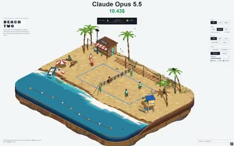</a></td>
<td width="50%" height="225" align="center" valign="middle"></td>
</tr>
<tr>
<td width="50%" valign="top"><strong>A Pixel Beach Volleyball World from Day to Night</strong> <a href="https://x.com/vib3coded">@vib3coded</a> · 3D &amp; interactive 0:18 · Bookmarks 50 · Details pending <a href="https://guanmo-ai.github.io/awesome-ai-motion/?lang=en#case-2113299893158638078">▶ Play</a> · <a href="https://x.com/vib3coded/status/2113299893158638078">Original post</a></td>
<td width="50%" valign="top"><strong>Designing and Test-Driving a Browser Race Car</strong> <a href="https://x.com/RyanSael">@RyanSael</a> · 3D &amp; interactive 0:30 · Bookmarks 50 · Details pending <a href="https://guanmo-ai.github.io/awesome-ai-motion/?lang=en#case-2111502236761415768">▶ Play</a> · <a href="https://x.com/RyanSael/status/2111502236761415768">Original post</a></td>
</tr>
</tbody>
<tbody>
<tr>
<td width="50%" height="225" align="center" valign="middle"></td>
<td width="50%" height="225" align="center" valign="middle"><a href="https://guanmo-ai.github.io/awesome-ai-motion/?lang=en#case-2114512807500615723">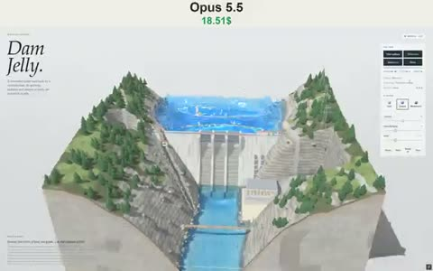</a></td>
</tr>
<tr>
<td width="50%" valign="top"><strong>Ashcombe Mill: A Streamside 3D Scene</strong> <a href="https://x.com/techartist_">@techartist_</a> · 3D &amp; interactive 0:30 · Bookmarks 48 · Details pending <a href="https://guanmo-ai.github.io/awesome-ai-motion/?lang=en#case-2111187771440370028">▶ Play</a> · <a href="https://x.com/techartist_/status/2111187771440370028">Original post</a></td>
<td width="50%" valign="top"><strong>Water and Light in a Jelly Dam</strong> <a href="https://x.com/vib3coded">@vib3coded</a> · 3D &amp; interactive 0:18 · Bookmarks 48 · Details pending <a href="https://guanmo-ai.github.io/awesome-ai-motion/?lang=en#case-2114512807500615723">▶ Play</a> · <a href="https://x.com/vib3coded/status/2114512807500615723">Original post</a></td>
</tr>
</tbody>
<tbody>
<tr>
<td width="50%" height="225" align="center" valign="middle"><a href="https://guanmo-ai.github.io/awesome-ai-motion/?lang=en#case-2112189854234652746">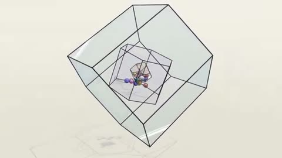</a></td>
<td width="50%" height="225" align="center" valign="middle"><a href="https://guanmo-ai.github.io/awesome-ai-motion/?lang=en#case-2113527486869016974">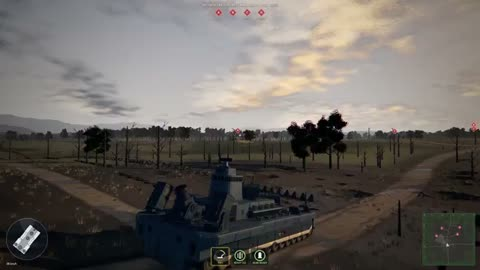</a></td>
</tr>
<tr>
<td width="50%" valign="top"><strong>Ball Physics inside Rotating Frames</strong> <a href="https://x.com/blueemi99">@blueemi99</a> · 3D &amp; interactive 0:28 · Bookmarks 46 · Details pending <a href="https://guanmo-ai.github.io/awesome-ai-motion/?lang=en#case-2112189854234652746">▶ Play</a> · <a href="https://x.com/blueemi99/status/2112189854234652746">Original post</a></td>
<td width="50%" valign="top"><strong>A Tank Level across a Dusk Landscape</strong> <a href="https://x.com/Greysuki">@Greysuki</a> · 3D &amp; interactive 0:30 · Bookmarks 46 · Details pending <a href="https://guanmo-ai.github.io/awesome-ai-motion/?lang=en#case-2113527486869016974">▶ Play</a> · <a href="https://x.com/Greysuki/status/2113527486869016974">Original post</a></td>
</tr>
</tbody>
<tbody>
<tr>
<td width="50%" height="225" align="center" valign="middle"></td>
<td width="50%" height="225" align="center" valign="middle"></td>
</tr>
<tr>
<td width="50%" valign="top"><strong>Obsidian: Monolith, Cathedral and Whale</strong> <a href="https://x.com/techartist_">@techartist_</a> · 3D &amp; interactive 0:18 · Bookmarks 44 · Details pending <a href="https://guanmo-ai.github.io/awesome-ai-motion/?lang=en#case-2106848293678620860">▶ Play</a> · <a href="https://x.com/techartist_/status/2106848293678620860">Original post</a></td>
<td width="50%" valign="top"><strong>Flying through Floating Mountains</strong> <a href="https://x.com/0xRhinoX">@0xRhinoX</a> · 3D &amp; interactive 0:30 · Bookmarks 44 · Details pending <a href="https://guanmo-ai.github.io/awesome-ai-motion/?lang=en#case-2108588869255827570">▶ Play</a> · <a href="https://x.com/0xRhinoX/status/2108588869255827570">Original post</a></td>
</tr>
</tbody>
<tbody>
<tr>
<td width="50%" height="225" align="center" valign="middle"></td>
<td width="50%" height="225" align="center" valign="middle"></td>
</tr>
<tr>
<td width="50%" valign="top"><strong>An Ant Colony on a Kitchen Counter</strong> <a href="https://x.com/kevin_t_ngo">@kevin_t_ngo</a> · 3D &amp; interactive 0:50 · Bookmarks 41 · Details pending <a href="https://guanmo-ai.github.io/awesome-ai-motion/?lang=en#case-2112215957276070188">▶ Play</a> · <a href="https://x.com/kevin_t_ngo/status/2112215957276070188">Original post</a></td>
<td width="50%" valign="top"><strong>A Stylized Coastal Map in 3D</strong> <a href="https://x.com/Aurelien_Gz">@Aurelien_Gz</a> · 3D &amp; interactive 0:35 · Bookmarks 41 · Details pending <a href="https://guanmo-ai.github.io/awesome-ai-motion/?lang=en#case-2102842401434030253">▶ Play</a> · <a href="https://x.com/Aurelien_Gz/status/2102842401434030253">Original post</a></td>
</tr>
</tbody>
<tbody>
<tr>
<td width="50%" height="225" align="center" valign="middle"></td>
<td width="50%" height="225" align="center" valign="middle"></td>
</tr>
<tr>
<td width="50%" valign="top"><strong>Explorable 3D eye demo</strong> <a href="https://x.com/higgsfield_ai">@higgsfield_ai</a> · 3D &amp; interactive 0:20 · Bookmarks 40 · Details pending <a href="https://guanmo-ai.github.io/awesome-ai-motion/?lang=en#case-2102536138884092185">▶ Play</a> · <a href="https://x.com/higgsfield_ai/status/2102536138884092185">Original post</a></td>
<td width="50%" valign="top"><strong>A Bath Bomb and Real-Time Fluid Color</strong> <a href="https://x.com/techartist_">@techartist_</a> · 3D &amp; interactive 0:14 · Bookmarks 39 · Details pending <a href="https://guanmo-ai.github.io/awesome-ai-motion/?lang=en#case-2111219143936790802">▶ Play</a> · <a href="https://x.com/techartist_/status/2111219143936790802">Original post</a></td>
</tr>
</tbody>
<tbody>
<tr>
<td width="50%" height="225" align="center" valign="middle"></td>
<td width="50%" height="225" align="center" valign="middle"></td>
</tr>
<tr>
<td width="50%" valign="top"><strong>SaaS Planes over San Francisco</strong> <a href="https://x.com/donaldjewkes">@donaldjewkes</a> · 3D &amp; interactive 0:25 · Bookmarks 37 · Details pending <a href="https://guanmo-ai.github.io/awesome-ai-motion/?lang=en#case-2108267057485898032">▶ Play</a> · <a href="https://x.com/donaldjewkes/status/2108267057485898032">Original post</a></td>
<td width="50%" valign="top"><strong>A Lantern Reveals a World of Shadows</strong> <a href="https://x.com/LexnLin">@LexnLin</a> · 3D &amp; interactive 1:29 · Bookmarks 37 · Details pending <a href="https://guanmo-ai.github.io/awesome-ai-motion/?lang=en#case-2108653450691232173">▶ Play</a> · <a href="https://x.com/LexnLin/status/2108653450691232173">Original post</a></td>
</tr>
</tbody>
<tbody>
<tr>
<td width="50%" height="225" align="center" valign="middle"></td>
<td width="50%" height="225" align="center" valign="middle"></td>
</tr>
<tr>
<td width="50%" valign="top"><strong>Robotaxi Perception and Prediction</strong> <a href="https://x.com/techartist_">@techartist_</a> · 3D &amp; interactive 0:37 · Bookmarks 34 · Details pending <a href="https://guanmo-ai.github.io/awesome-ai-motion/?lang=en#case-2109094132253880629">▶ Play</a> · <a href="https://x.com/techartist_/status/2109094132253880629">Original post</a></td>
<td width="50%" valign="top"><strong>A Future Flight from Earth Orbit to a Solar Mirror Swarm</strong> <a href="https://x.com/theSethian">@theSethian</a> · 3D &amp; interactive 1:21 · Bookmarks 34 · Details pending <a href="https://guanmo-ai.github.io/awesome-ai-motion/?lang=en#case-2106447666519384517">▶ Play</a> · <a href="https://x.com/theSethian/status/2106447666519384517">Original post</a></td>
</tr>
</tbody>
<tbody>
<tr>
<td width="50%" height="225" align="center" valign="middle"></td>
<td width="50%" height="225" align="center" valign="middle"></td>
</tr>
<tr>
<td width="50%" valign="top"><strong>Athens Two Millennia Further On</strong> <a href="https://x.com/konstantinsaifo">@konstantinsaifo</a> · 3D &amp; interactive 0:38 · Bookmarks 34 · Details pending <a href="https://guanmo-ai.github.io/awesome-ai-motion/?lang=en#case-2112310470124122503">▶ Play</a> · <a href="https://x.com/konstantinsaifo/status/2112310470124122503">Original post</a></td>
<td width="50%" valign="top"><strong>Jelly Dice Falling and Rebounding</strong> <a href="https://x.com/vib3coded">@vib3coded</a> · 3D &amp; interactive 0:16 · Bookmarks 33 · Details pending <a href="https://guanmo-ai.github.io/awesome-ai-motion/?lang=en#case-2105832839023415521">▶ Play</a> · <a href="https://x.com/vib3coded/status/2105832839023415521">Original post</a></td>
</tr>
</tbody>
<tbody>
<tr>
<td width="50%" height="225" align="center" valign="middle"></td>
<td width="50%" height="225" align="center" valign="middle"></td>
</tr>
<tr>
<td width="50%" valign="top"><strong>Mars GT: a driving demo through red canyons</strong> <a href="https://x.com/AndreiProvkin">@AndreiProvkin</a> · 3D &amp; interactive 1:06 · Bookmarks 33 · Details pending <a href="https://guanmo-ai.github.io/awesome-ai-motion/?lang=en#case-2106449409978626416">▶ Play</a> · <a href="https://x.com/AndreiProvkin/status/2106449409978626416">Original post</a></td>
<td width="50%" valign="top"><strong>A Simulated Drone Light Show</strong> <a href="https://x.com/techartist_">@techartist_</a> · 3D &amp; interactive 0:28 · Bookmarks 31 · Details pending <a href="https://guanmo-ai.github.io/awesome-ai-motion/?lang=en#case-2110427429965873559">▶ Play</a> · <a href="https://x.com/techartist_/status/2110427429965873559">Original post</a></td>
</tr>
</tbody>
<tbody>
<tr>
<td width="50%" height="225" align="center" valign="middle"></td>
<td width="50%" height="225" align="center" valign="middle"></td>
</tr>
<tr>
<td width="50%" valign="top"><strong>Exploring the Hidden Lagoons</strong> <a href="https://x.com/Aurelien_Gz">@Aurelien_Gz</a> · 3D &amp; interactive 1:28 · Bookmarks 30 · Details pending <a href="https://guanmo-ai.github.io/awesome-ai-motion/?lang=en#case-2103506302693450100">▶ Play</a> · <a href="https://x.com/Aurelien_Gz/status/2103506302693450100">Original post</a></td>
<td width="50%" valign="top"><strong>Sports-Car Racing on City Tracks</strong> <a href="https://x.com/AndrewOnXYZ">@AndrewOnXYZ</a> · 3D &amp; interactive 1:57 · Bookmarks 30 · Details pending <a href="https://guanmo-ai.github.io/awesome-ai-motion/?lang=en#case-2102791372440736155">▶ Play</a> · <a href="https://x.com/AndrewOnXYZ/status/2102791372440736155">Original post</a></td>
</tr>
</tbody>
<tbody>
<tr>
<td width="50%" height="225" align="center" valign="middle"></td>
<td width="50%" height="225" align="center" valign="middle"></td>
</tr>
<tr>
<td width="50%" valign="top"><strong>A Stretching, Wobbling Jelly Crab</strong> <a href="https://x.com/vib3coded">@vib3coded</a> · 3D &amp; interactive 0:18 · Bookmarks 29 · Details pending <a href="https://guanmo-ai.github.io/awesome-ai-motion/?lang=en#case-2109588091069452587">▶ Play</a> · <a href="https://x.com/vib3coded/status/2109588091069452587">Original post</a></td>
<td width="50%" valign="top"><strong>Sakura Saber Details and Moves</strong> <a href="https://x.com/aimikoda">@aimikoda</a> · 3D &amp; interactive 0:42 · Bookmarks 28 · Details pending <a href="https://guanmo-ai.github.io/awesome-ai-motion/?lang=en#case-2111509796172218694">▶ Play</a> · <a href="https://x.com/aimikoda/status/2111509796172218694">Original post</a></td>
</tr>
</tbody>
<tbody>
<tr>
<td width="50%" height="225" align="center" valign="middle"></td>
<td width="50%" height="225" align="center" valign="middle"></td>
</tr>
<tr>
<td width="50%" valign="top"><strong>An Endlessly Generated Santorini</strong> <a href="https://x.com/thebuggeddev">@thebuggeddev</a> · 3D &amp; interactive 0:51 · Bookmarks 28 · Details pending <a href="https://guanmo-ai.github.io/awesome-ai-motion/?lang=en#case-2102466136118063134">▶ Play</a> · <a href="https://x.com/thebuggeddev/status/2102466136118063134">Original post</a></td>
<td width="50%" valign="top"><strong>Clawd RPG: The Token Sea and Neon Stages</strong> <a href="https://x.com/LexnLin">@LexnLin</a> · 3D &amp; interactive 0:59 · Bookmarks 28 · Details pending <a href="https://guanmo-ai.github.io/awesome-ai-motion/?lang=en#case-2108320373397770624">▶ Play</a> · <a href="https://x.com/LexnLin/status/2108320373397770624">Original post</a></td>
</tr>
</tbody>
<tbody>
<tr>
<td width="50%" height="225" align="center" valign="middle"></td>
<td width="50%" height="225" align="center" valign="middle"></td>
</tr>
<tr>
<td width="50%" valign="top"><strong>Digital Wax Seals on a Letter</strong> <a href="https://x.com/thebuggeddev">@thebuggeddev</a> · 3D &amp; interactive 0:31 · Bookmarks 28 · Details pending <a href="https://guanmo-ai.github.io/awesome-ai-motion/?lang=en#case-2113686216327802927">▶ Play</a> · <a href="https://x.com/thebuggeddev/status/2113686216327802927">Original post</a></td>
<td width="50%" valign="top"><strong>From a Marble to a Giant Domino</strong> <a href="https://x.com/techartist_">@techartist_</a> · 3D &amp; interactive 0:44 · Bookmarks 27 · Details pending <a href="https://guanmo-ai.github.io/awesome-ai-motion/?lang=en#case-2107514291213697078">▶ Play</a> · <a href="https://x.com/techartist_/status/2107514291213697078">Original post</a></td>
</tr>
</tbody>
<tbody>
<tr>
<td width="50%" height="225" align="center" valign="middle"></td>
<td width="50%" height="225" align="center" valign="middle"></td>
</tr>
<tr>
<td width="50%" valign="top"><strong>A Trebuchet against a Voxel Castle</strong> <a href="https://x.com/vib3coded">@vib3coded</a> · 3D &amp; interactive 0:18 · Bookmarks 24 · Details pending <a href="https://guanmo-ai.github.io/awesome-ai-motion/?lang=en#case-2114295486299664582">▶ Play</a> · <a href="https://x.com/vib3coded/status/2114295486299664582">Original post</a></td>
<td width="50%" valign="top"><strong>A Neon Seafront Car Chase</strong> <a href="https://x.com/techartist_">@techartist_</a> · 3D &amp; interactive 0:23 · Bookmarks 23 · Details pending <a href="https://guanmo-ai.github.io/awesome-ai-motion/?lang=en#case-2108960267359117371">▶ Play</a> · <a href="https://x.com/techartist_/status/2108960267359117371">Original post</a></td>
</tr>
</tbody>
<tbody>
<tr>
<td width="50%" height="225" align="center" valign="middle"></td>
<td width="50%" height="225" align="center" valign="middle"></td>
</tr>
<tr>
<td width="50%" valign="top"><strong>An Alpine Lake Built in Code</strong> <a href="https://x.com/LexnLin">@LexnLin</a> · 3D &amp; interactive 1:00 · Bookmarks 23 · Details pending <a href="https://guanmo-ai.github.io/awesome-ai-motion/?lang=en#case-2112560562609803311">▶ Play</a> · <a href="https://x.com/LexnLin/status/2112560562609803311">Original post</a></td>
<td width="50%" valign="top"><strong>Particles of Sand, Water and Fire</strong> <a href="https://x.com/cyrilXBT">@cyrilXBT</a> · 3D &amp; interactive 0:44 · Bookmarks 21 · Details pending <a href="https://guanmo-ai.github.io/awesome-ai-motion/?lang=en#case-2103532793406149036">▶ Play</a> · <a href="https://x.com/cyrilXBT/status/2103532793406149036">Original post</a></td>
</tr>
</tbody>
<tbody>
<tr>
<td width="50%" height="225" align="center" valign="middle"></td>
<td width="50%" height="225" align="center" valign="middle"></td>
</tr>
<tr>
<td width="50%" valign="top"><strong>Two Jelly Octopuses in Motion</strong> <a href="https://x.com/vib3coded">@vib3coded</a> · 3D &amp; interactive 0:18 · Bookmarks 20 · Details pending <a href="https://guanmo-ai.github.io/awesome-ai-motion/?lang=en#case-2111761593327345779">▶ Play</a> · <a href="https://x.com/vib3coded/status/2111761593327345779">Original post</a></td>
<td width="50%" valign="top"><strong>A Little Ghost and Cloth Motion in Rain</strong> <a href="https://x.com/chetanankola">@chetanankola</a> · 3D &amp; interactive 0:28 · Bookmarks 20 · Details pending <a href="https://guanmo-ai.github.io/awesome-ai-motion/?lang=en#case-2110225806849122363">▶ Play</a> · <a href="https://x.com/chetanankola/status/2110225806849122363">Original post</a></td>
</tr>
</tbody>
<tbody>
<tr>
<td width="50%" height="225" align="center" valign="middle"></td>
<td width="50%" height="225" align="center" valign="middle"></td>
</tr>
<tr>
<td width="50%" valign="top"><strong>Plank Tower Through Day, Night and Rain</strong> <a href="https://x.com/thebuggeddev">@thebuggeddev</a> · 3D &amp; interactive 0:57 · Bookmarks 20 · Details pending <a href="https://guanmo-ai.github.io/awesome-ai-motion/?lang=en#case-2105859150106484832">▶ Play</a> · <a href="https://x.com/thebuggeddev/status/2105859150106484832">Original post</a></td>
<td width="50%" valign="top"><strong>Skyhold: Balancing a Floating Island</strong> <a href="https://x.com/0xbobaaa">@0xbobaaa</a> · 3D &amp; interactive 0:45 · Bookmarks 20 · Details pending <a href="https://guanmo-ai.github.io/awesome-ai-motion/?lang=en#case-2108495368585371666">▶ Play</a> · <a href="https://x.com/0xbobaaa/status/2108495368585371666">Original post</a></td>
</tr>
</tbody>
<tbody>
<tr>
<td width="50%" height="225" align="center" valign="middle"></td>
<td width="50%" height="225" align="center" valign="middle"></td>
</tr>
<tr>
<td width="50%" valign="top"><strong>A Balloon Inflating, Stretching and Bursting</strong> <a href="https://x.com/vib3coded">@vib3coded</a> · 3D &amp; interactive 0:17 · Bookmarks 19 · Details pending <a href="https://guanmo-ai.github.io/awesome-ai-motion/?lang=en#case-2105710456677499162">▶ Play</a> · <a href="https://x.com/vib3coded/status/2105710456677499162">Original post</a></td>
<td width="50%" valign="top"><strong>3D Seaside Cycling Scene</strong> <a href="https://x.com/liu8in">@liu8in</a> · 3D &amp; interactive 0:27 · Bookmarks 19 · Details pending <a href="https://guanmo-ai.github.io/awesome-ai-motion/?lang=en#case-2102528278732894667">▶ Play</a> · <a href="https://x.com/liu8in/status/2102528278732894667">Original post</a></td>
</tr>
</tbody>
<tbody>
<tr>
<td width="50%" height="225" align="center" valign="middle"></td>
<td width="50%" height="225" align="center" valign="middle"></td>
</tr>
<tr>
<td width="50%" valign="top"><strong>Jelly World: an Arctic-island comparison</strong> <a href="https://x.com/vib3coded">@vib3coded</a> · 3D &amp; interactive 0:18 · Bookmarks 19 · Details pending <a href="https://guanmo-ai.github.io/awesome-ai-motion/?lang=en#case-2107455583129313304">▶ Play</a> · <a href="https://x.com/vib3coded/status/2107455583129313304">Original post</a></td>
<td width="50%" valign="top"><strong>A new HUD for an Astra-built Rust game</strong> <a href="https://x.com/Dimillian">@Dimillian</a> · 3D &amp; interactive 0:27 · Bookmarks 18 · Details pending <a href="https://guanmo-ai.github.io/awesome-ai-motion/?lang=en#case-2107529401567207465">▶ Play</a> · <a href="https://x.com/Dimillian/status/2107529401567207465">Original post</a></td>
</tr>
</tbody>
<tbody>
<tr>
<td width="50%" height="225" align="center" valign="middle"></td>
<td width="50%" height="225" align="center" valign="middle"></td>
</tr>
<tr>
<td width="50%" valign="top"><strong>Design the World First: Controlled 3D Scene Previews</strong> <a href="https://x.com/xikhar">@xikhar</a> · 3D &amp; interactive 0:35 · Bookmarks 18 · Details pending <a href="https://guanmo-ai.github.io/awesome-ai-motion/?lang=en#case-2112341619936764162">▶ Play</a> · <a href="https://x.com/xikhar/status/2112341619936764162">Original post</a></td>
<td width="50%" valign="top"><strong>A Horror Game Refined with Two Models</strong> <a href="https://x.com/LexnLin">@LexnLin</a> · 3D &amp; interactive 0:45 · Bookmarks 17 · Details pending <a href="https://guanmo-ai.github.io/awesome-ai-motion/?lang=en#case-2108301624515137601">▶ Play</a> · <a href="https://x.com/LexnLin/status/2108301624515137601">Original post</a></td>
</tr>
</tbody>
<tbody>
<tr>
<td width="50%" height="225" align="center" valign="middle"></td>
<td width="50%" height="225" align="center" valign="middle"><a href="https://guanmo-ai.github.io/awesome-ai-motion/?lang=en#case-2113564577636163648">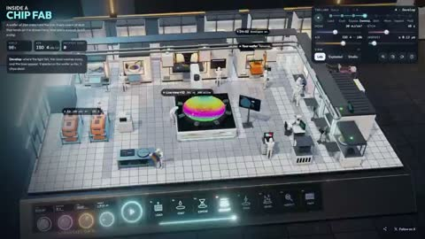</a></td>
</tr>
<tr>
<td width="50%" valign="top"><strong>Worldfold: Poolrooms and Underwater Effects</strong> <a href="https://x.com/Ben__Springer">@Ben__Springer</a> · 3D &amp; interactive 3:54 · Bookmarks 16 · Details pending <a href="https://guanmo-ai.github.io/awesome-ai-motion/?lang=en#case-2109237653832953921">▶ Play</a> · <a href="https://x.com/Ben__Springer/status/2109237653832953921">Original post</a></td>
<td width="50%" valign="top"><strong>Inside a Three-Dimensional Chip Fab</strong> <a href="https://x.com/RyanSael">@RyanSael</a> · 3D &amp; interactive 0:30 · Bookmarks 15 · Details pending <a href="https://guanmo-ai.github.io/awesome-ai-motion/?lang=en#case-2113564577636163648">▶ Play</a> · <a href="https://x.com/RyanSael/status/2113564577636163648">Original post</a></td>
</tr>
</tbody>
<tbody>
<tr>
<td width="50%" height="225" align="center" valign="middle"></td>
<td width="50%" height="225" align="center" valign="middle"></td>
</tr>
<tr>
<td width="50%" valign="top"><strong>Particle Horses Under the Moon</strong> <a href="https://x.com/techartist_">@techartist_</a> · 3D &amp; interactive 0:04 · Bookmarks 14 · Details pending <a href="https://guanmo-ai.github.io/awesome-ai-motion/?lang=en#case-2109980058597437575">▶ Play</a> · <a href="https://x.com/techartist_/status/2109980058597437575">Original post</a></td>
<td width="50%" valign="top"><strong>DYSTOPIA: A Rain-Soaked Browser City</strong> <a href="https://x.com/cryptomanavan">@cryptomanavan</a> · 3D &amp; interactive 1:24 · Bookmarks 14 · Details pending <a href="https://guanmo-ai.github.io/awesome-ai-motion/?lang=en#case-2109107708192284923">▶ Play</a> · <a href="https://x.com/cryptomanavan/status/2109107708192284923">Original post</a></td>
</tr>
</tbody>
<tbody>
<tr>
<td width="50%" height="225" align="center" valign="middle"></td>
<td width="50%" height="225" align="center" valign="middle"></td>
</tr>
<tr>
<td width="50%" valign="top"><strong>Slicing a Fluffy Watermelon</strong> <a href="https://x.com/vib3coded">@vib3coded</a> · 3D &amp; interactive 0:18 · Bookmarks 13 · Details pending <a href="https://guanmo-ai.github.io/awesome-ai-motion/?lang=en#case-2111829421040488960">▶ Play</a> · <a href="https://x.com/vib3coded/status/2111829421040488960">Original post</a></td>
<td width="50%" valign="top"><strong>Jelly sakura: Opus and Astra comparison</strong> <a href="https://x.com/Artless101">@Artless101</a> · 3D &amp; interactive 0:19 · Bookmarks 13 · Details pending <a href="https://guanmo-ai.github.io/awesome-ai-motion/?lang=en#case-2105559382150742523">▶ Play</a> · <a href="https://x.com/Artless101/status/2105559382150742523">Original post</a></td>
</tr>
</tbody>
<tbody>
<tr>
<td width="50%" height="225" align="center" valign="middle"></td>
<td width="50%" height="225" align="center" valign="middle"></td>
</tr>
<tr>
<td width="50%" valign="top"><strong>A Mecha Assembles and Launches</strong> <a href="https://x.com/Ayu_AI_0912">@Ayu_AI_0912</a> · 3D &amp; interactive 0:24 · Bookmarks 13 · Details pending <a href="https://guanmo-ai.github.io/awesome-ai-motion/?lang=en#case-2109834916313842133">▶ Play</a> · <a href="https://x.com/Ayu_AI_0912/status/2109834916313842133">Original post</a></td>
<td width="50%" valign="top"><strong>A 3D Zen Garden You Can Rake</strong> <a href="https://x.com/arixxbt">@arixxbt</a> · 3D &amp; interactive 0:15 · Bookmarks 13 · Details pending <a href="https://guanmo-ai.github.io/awesome-ai-motion/?lang=en#case-2108541814718292438">▶ Play</a> · <a href="https://x.com/arixxbt/status/2108541814718292438">Original post</a></td>
</tr>
</tbody>
<tbody>
<tr>
<td width="50%" height="225" align="center" valign="middle"></td>
<td width="50%" height="225" align="center" valign="middle"></td>
</tr>
<tr>
<td width="50%" valign="top"><strong>An interactive house from foundation to finish</strong> <a href="https://x.com/techartist_">@techartist_</a> · 3D &amp; interactive 0:37 · Bookmarks 13 · Details pending <a href="https://guanmo-ai.github.io/awesome-ai-motion/?lang=en#case-2105350783416021472">▶ Play</a> · <a href="https://x.com/techartist_/status/2105350783416021472">Original post</a></td>
<td width="50%" valign="top"><strong>Neon Skiing at the Matterhorn</strong> <a href="https://x.com/techartist_">@techartist_</a> · 3D &amp; interactive 0:25 · Bookmarks 12 · Details pending <a href="https://guanmo-ai.github.io/awesome-ai-motion/?lang=en#case-2110906072022097996">▶ Play</a> · <a href="https://x.com/techartist_/status/2110906072022097996">Original post</a></td>
</tr>
</tbody>
<tbody>
<tr>
<td width="50%" height="225" align="center" valign="middle"></td>
<td width="50%" height="225" align="center" valign="middle"><a href="https://guanmo-ai.github.io/awesome-ai-motion/?lang=en#case-2103385835328680050">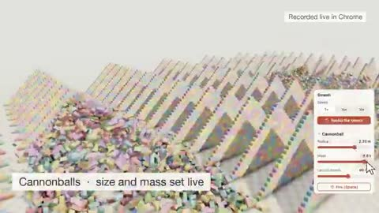</a></td>
</tr>
<tr>
<td width="50%" valign="top"><strong>A Lit House beside an Icy Sea</strong> <a href="https://x.com/thebuggeddev">@thebuggeddev</a> · 3D &amp; interactive 0:25 · Bookmarks 12 · Details pending <a href="https://guanmo-ai.github.io/awesome-ai-motion/?lang=en#case-2113978686106177862">▶ Play</a> · <a href="https://x.com/thebuggeddev/status/2113978686106177862">Original post</a></td>
<td width="50%" valign="top"><strong>Rigid Bodies and Cloth in a Browser</strong> <a href="https://x.com/nybobs">@nybobs</a> · 3D &amp; interactive 0:26 · Bookmarks 12 · Details pending <a href="https://guanmo-ai.github.io/awesome-ai-motion/?lang=en#case-2103385835328680050">▶ Play</a> · <a href="https://x.com/nybobs/status/2103385835328680050">Original post</a></td>
</tr>
</tbody>
<tbody>
<tr>
<td width="50%" height="225" align="center" valign="middle"></td>
<td width="50%" height="225" align="center" valign="middle"></td>
</tr>
<tr>
<td width="50%" valign="top"><strong>An Autumn Cottage Inside a Glass Globe</strong> <a href="https://x.com/flxrnc">@flxrnc</a> · 3D &amp; interactive 0:13 · Bookmarks 12 · Details pending <a href="https://guanmo-ai.github.io/awesome-ai-motion/?lang=en#case-2107538944002773379">▶ Play</a> · <a href="https://x.com/flxrnc/status/2107538944002773379">Original post</a></td>
<td width="50%" valign="top"><strong>A Procedural Black Cat in Grass</strong> <a href="https://x.com/majidmanzarpour">@majidmanzarpour</a> · 3D &amp; interactive 0:44 · Bookmarks 11 · Details pending <a href="https://guanmo-ai.github.io/awesome-ai-motion/?lang=en#case-2104919375568318760">▶ Play</a> · <a href="https://x.com/majidmanzarpour/status/2104919375568318760">Original post</a></td>
</tr>
</tbody>
<tbody>
<tr>
<td width="50%" height="225" align="center" valign="middle"></td>
<td width="50%" height="225" align="center" valign="middle"></td>
</tr>
<tr>
<td width="50%" valign="top"><strong>Three.js devices and a layer-based design tool</strong> <a href="https://x.com/MengTo">@MengTo</a> · 3D &amp; interactive 1:14 · Bookmarks 11 · Details pending <a href="https://guanmo-ai.github.io/awesome-ai-motion/?lang=en#case-2105680287854440715">▶ Play</a> · <a href="https://x.com/MengTo/status/2105680287854440715">Original post</a></td>
<td width="50%" valign="top"><strong>A Glacier Hoverjet Racing Preview</strong> <a href="https://x.com/techartist_">@techartist_</a> · 3D &amp; interactive 0:13 · Bookmarks 10 · Details pending <a href="https://guanmo-ai.github.io/awesome-ai-motion/?lang=en#case-2110521031589048820">▶ Play</a> · <a href="https://x.com/techartist_/status/2110521031589048820">Original post</a></td>
</tr>
</tbody>
<tbody>
<tr>
<td width="50%" height="225" align="center" valign="middle"></td>
<td width="50%" height="225" align="center" valign="middle"></td>
</tr>
<tr>
<td width="50%" valign="top"><strong>Stylized Parkour Rush Animation</strong> <a href="https://x.com/majidmanzarpour">@majidmanzarpour</a> · 3D &amp; interactive 0:32 · Bookmarks 10 · Details pending <a href="https://guanmo-ai.github.io/awesome-ai-motion/?lang=en#case-2108010617034486130">▶ Play</a> · <a href="https://x.com/majidmanzarpour/status/2108010617034486130">Original post</a></td>
<td width="50%" valign="top"><strong>Jet Moto-Style Canyon Racing</strong> <a href="https://x.com/cherry_mx_reds">@cherry_mx_reds</a> · 3D &amp; interactive 3:54 · Bookmarks 10 · Details pending <a href="https://guanmo-ai.github.io/awesome-ai-motion/?lang=en#case-2102850529718055250">▶ Play</a> · <a href="https://x.com/cherry_mx_reds/status/2102850529718055250">Original post</a></td>
</tr>
</tbody>
<tbody>
<tr>
<td width="50%" height="225" align="center" valign="middle"></td>
<td width="50%" height="225" align="center" valign="middle"></td>
</tr>
<tr>
<td width="50%" valign="top"><strong>A Shaoshan 8 Locomotive on a Drivable Loop</strong> <a href="https://x.com/akokoi1">@akokoi1</a> · 3D &amp; interactive 0:31 · Bookmarks 10 · Details pending <a href="https://guanmo-ai.github.io/awesome-ai-motion/?lang=en#case-2104222017696469188">▶ Play</a> · <a href="https://x.com/akokoi1/status/2104222017696469188">Original post</a></td>
<td width="50%" valign="top"><strong>Real-Time Rendered Mech Shot</strong> <a href="https://x.com/wizardbrainz">@wizardbrainz</a> · 3D &amp; interactive 0:24 · Bookmarks 10 · Details pending <a href="https://guanmo-ai.github.io/awesome-ai-motion/?lang=en#case-2102755328161116223">▶ Play</a> · <a href="https://x.com/wizardbrainz/status/2102755328161116223">Original post</a></td>
</tr>
</tbody>
<tbody>
<tr>
<td width="50%" height="225" align="center" valign="middle"></td>
<td width="50%" height="225" align="center" valign="middle"></td>
</tr>
<tr>
<td width="50%" valign="top"><strong>Procedural Boats and Cars at a Harbor</strong> <a href="https://x.com/techartist_">@techartist_</a> · 3D &amp; interactive 0:12 · Bookmarks 9 · Details pending <a href="https://guanmo-ai.github.io/awesome-ai-motion/?lang=en#case-2109011242690265462">▶ Play</a> · <a href="https://x.com/techartist_/status/2109011242690265462">Original post</a></td>
<td width="50%" valign="top"><strong>Two Models Design a Dating-game UI</strong> <a href="https://x.com/yunma33331111">@yunma33331111</a> · 3D &amp; interactive 0:10 · Bookmarks 9 · Details pending <a href="https://guanmo-ai.github.io/awesome-ai-motion/?lang=en#case-2108168718308302855">▶ Play</a> · <a href="https://x.com/yunma33331111/status/2108168718308302855">Original post</a></td>
</tr>
</tbody>
<tbody>
<tr>
<td width="50%" height="225" align="center" valign="middle"></td>
<td width="50%" height="225" align="center" valign="middle"></td>
</tr>
<tr>
<td width="50%" valign="top"><strong>A Giant Robot at Work in a Physics Simulation</strong> <a href="https://x.com/konstantinsaifo">@konstantinsaifo</a> · 3D &amp; interactive 0:38 · Bookmarks 9 · Details pending <a href="https://guanmo-ai.github.io/awesome-ai-motion/?lang=en#case-2112477830046957818">▶ Play</a> · <a href="https://x.com/konstantinsaifo/status/2112477830046957818">Original post</a></td>
<td width="50%" valign="top"><strong>An X-Wing in an Asteroid Field</strong> <a href="https://x.com/ottollm">@ottollm</a> · 3D &amp; interactive 0:20 · Bookmarks 9 · Details pending <a href="https://guanmo-ai.github.io/awesome-ai-motion/?lang=en#case-2108597257251459458">▶ Play</a> · <a href="https://x.com/ottollm/status/2108597257251459458">Original post</a></td>
</tr>
</tbody>
<tbody>
<tr>
<td width="50%" height="225" align="center" valign="middle"></td>
<td width="50%" height="225" align="center" valign="middle"><a href="https://guanmo-ai.github.io/awesome-ai-motion/?lang=en#case-2114556610911916085">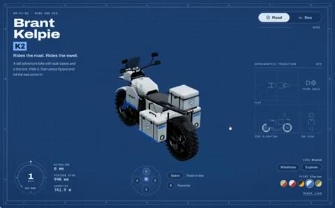</a></td>
</tr>
<tr>
<td width="50%" valign="top"><strong>An OpenAI Dot Handheld Escape-room Game</strong> <a href="https://x.com/fedesarquis">@fedesarquis</a> · 3D &amp; interactive 0:14 · Bookmarks 8 · Details pending <a href="https://guanmo-ai.github.io/awesome-ai-motion/?lang=en#case-2108302123553247742">▶ Play</a> · <a href="https://x.com/fedesarquis/status/2108302123553247742">Original post</a></td>
<td width="50%" valign="top"><strong>A Road-and-Sea Concept Bike</strong> <a href="https://x.com/thebuggeddev">@thebuggeddev</a> · 3D &amp; interactive 0:43 · Bookmarks 8 · Details pending <a href="https://guanmo-ai.github.io/awesome-ai-motion/?lang=en#case-2114556610911916085">▶ Play</a> · <a href="https://x.com/thebuggeddev/status/2114556610911916085">Original post</a></td>
</tr>
</tbody>
<tbody>
<tr>
<td width="50%" height="225" align="center" valign="middle"></td>
<td width="50%" height="225" align="center" valign="middle"></td>
</tr>
<tr>
<td width="50%" valign="top"><strong>A Railgun Launching Cargo toward Orbit</strong> <a href="https://x.com/konstantinsaifo">@konstantinsaifo</a> · 3D &amp; interactive 0:41 · Bookmarks 8 · Details pending <a href="https://guanmo-ai.github.io/awesome-ai-motion/?lang=en#case-2110320918362816794">▶ Play</a> · <a href="https://x.com/konstantinsaifo/status/2110320918362816794">Original post</a></td>
<td width="50%" valign="top"><strong>A Sketch-Style Walk Inspired by Goa</strong> <a href="https://x.com/chetanankola">@chetanankola</a> · 3D &amp; interactive 1:06 · Bookmarks 8 · Details pending <a href="https://guanmo-ai.github.io/awesome-ai-motion/?lang=en#case-2104719287613341732">▶ Play</a> · <a href="https://x.com/chetanankola/status/2104719287613341732">Original post</a></td>
</tr>
</tbody>
<tbody>
<tr>
<td width="50%" height="225" align="center" valign="middle"></td>
<td width="50%" height="225" align="center" valign="middle"></td>
</tr>
<tr>
<td width="50%" valign="top"><strong>An Interactive Falcon 9 Landing Simulation</strong> <a href="https://x.com/konstantinsaifo">@konstantinsaifo</a> · 3D &amp; interactive 0:50 · Bookmarks 8 · Details pending <a href="https://guanmo-ai.github.io/awesome-ai-motion/?lang=en#case-2109061641027678483">▶ Play</a> · <a href="https://x.com/konstantinsaifo/status/2109061641027678483">Original post</a></td>
<td width="50%" valign="top"><strong>A Procedural Running Boar</strong> <a href="https://x.com/majidmanzarpour">@majidmanzarpour</a> · 3D &amp; interactive 0:26 · Bookmarks 7 · Details pending <a href="https://guanmo-ai.github.io/awesome-ai-motion/?lang=en#case-2104917356380291188">▶ Play</a> · <a href="https://x.com/majidmanzarpour/status/2104917356380291188">Original post</a></td>
</tr>
</tbody>
<tbody>
<tr>
<td width="50%" height="225" align="center" valign="middle"></td>
<td width="50%" height="225" align="center" valign="middle"></td>
</tr>
<tr>
<td width="50%" valign="top"><strong>Pollen Collector: Gathering Pollen in a Forest</strong> <a href="https://x.com/SimonasLTU1">@SimonasLTU1</a> · 3D &amp; interactive 3:37 · Bookmarks 7 · Details pending <a href="https://guanmo-ai.github.io/awesome-ai-motion/?lang=en#case-2111557103366066547">▶ Play</a> · <a href="https://x.com/SimonasLTU1/status/2111557103366066547">Original post</a></td>
<td width="50%" valign="top"><strong>A Small Island Castle in 3D</strong> <a href="https://x.com/thebuggeddev">@thebuggeddev</a> · 3D &amp; interactive 0:10 · Bookmarks 7 · Details pending <a href="https://guanmo-ai.github.io/awesome-ai-motion/?lang=en#case-2105143635708907787">▶ Play</a> · <a href="https://x.com/thebuggeddev/status/2105143635708907787">Original post</a></td>
</tr>
</tbody>
<tbody>
<tr>
<td width="50%" height="225" align="center" valign="middle"></td>
<td width="50%" height="225" align="center" valign="middle"></td>
</tr>
<tr>
<td width="50%" valign="top"><strong>BLOCKWORLD: A Browser Voxel World</strong> <a href="https://x.com/L1vsun">@L1vsun</a> · 3D &amp; interactive 0:32 · Bookmarks 7 · Details pending <a href="https://guanmo-ai.github.io/awesome-ai-motion/?lang=en#case-2105020794602676465">▶ Play</a> · <a href="https://x.com/L1vsun/status/2105020794602676465">Original post</a></td>
<td width="50%" valign="top"><strong>A 3D Moon-Collision Scenario</strong> <a href="https://x.com/ottollm">@ottollm</a> · 3D &amp; interactive 1:20 · Bookmarks 7 · Details pending <a href="https://guanmo-ai.github.io/awesome-ai-motion/?lang=en#case-2108517404712325592">▶ Play</a> · <a href="https://x.com/ottollm/status/2108517404712325592">Original post</a></td>
</tr>
</tbody>
<tbody>
<tr>
<td width="50%" height="225" align="center" valign="middle"></td>
<td width="50%" height="225" align="center" valign="middle"></td>
</tr>
<tr>
<td width="50%" valign="top"><strong>Four clips of new mobs in a block-world game</strong> <a href="https://x.com/kepochnik">@kepochnik</a> · 3D &amp; interactive 0:17 · Bookmarks 6 <a href="https://guanmo-ai.github.io/awesome-ai-motion/?lang=en#case-2103867115044237752">▶ Play</a> · <a href="https://x.com/kepochnik/status/2103867115044237752">Original post</a></td>
<td width="50%" valign="top"><strong>A Three.js Rock-Skipping Game</strong> <a href="https://x.com/llama3dstudio">@llama3dstudio</a> · 3D &amp; interactive 0:44 · Bookmarks 6 · Details pending <a href="https://guanmo-ai.github.io/awesome-ai-motion/?lang=en#case-2104115092124012980">▶ Play</a> · <a href="https://x.com/llama3dstudio/status/2104115092124012980">Original post</a></td>
</tr>
</tbody>
<tbody>
<tr>
<td width="50%" height="225" align="center" valign="middle"></td>
<td width="50%" height="225" align="center" valign="middle"></td>
</tr>
<tr>
<td width="50%" valign="top"><strong>Haiku and Opus Build a Scroll-animation Page</strong> <a href="https://x.com/exploraX_">@exploraX_</a> · 3D &amp; interactive 0:53 · Bookmarks 5 · Details pending <a href="https://guanmo-ai.github.io/awesome-ai-motion/?lang=en#case-2108082845528756475">▶ Play</a> · <a href="https://x.com/exploraX_/status/2108082845528756475">Original post</a></td>
<td width="50%" valign="top"><strong>An Interactive Mendelian Pea-Crossing Experiment</strong> <a href="https://x.com/akokoi1">@akokoi1</a> · 3D &amp; interactive 0:32 · Bookmarks 5 · Details pending <a href="https://guanmo-ai.github.io/awesome-ai-motion/?lang=en#case-2109242856305238410">▶ Play</a> · <a href="https://x.com/akokoi1/status/2109242856305238410">Original post</a></td>
</tr>
</tbody>
<tbody>
<tr>
<td width="50%" height="225" align="center" valign="middle"></td>
<td width="50%" height="225" align="center" valign="middle"></td>
</tr>
<tr>
<td width="50%" valign="top"><strong>A 3D forest-conservation website experiment</strong> <a href="https://x.com/Souradip3000">@Souradip3000</a> · 3D &amp; interactive 0:25 · Bookmarks 5 <a href="https://guanmo-ai.github.io/awesome-ai-motion/?lang=en#case-2103876499262800291">▶ Play</a> · <a href="https://x.com/Souradip3000/status/2103876499262800291">Original post</a></td>
<td width="50%" valign="top"><strong>A Flying Roadster over Austin</strong> <a href="https://x.com/techartist_">@techartist_</a> · 3D &amp; interactive 0:20 · Bookmarks 4 · Details pending <a href="https://guanmo-ai.github.io/awesome-ai-motion/?lang=en#case-2111863304050356644">▶ Play</a> · <a href="https://x.com/techartist_/status/2111863304050356644">Original post</a></td>
</tr>
</tbody>
<tbody>
<tr>
<td width="50%" height="225" align="center" valign="middle"></td>
<td width="50%" height="225" align="center" valign="middle"></td>
</tr>
<tr>
<td width="50%" valign="top"><strong>An Opus-built CRPG prologue</strong> <a href="https://x.com/Ainthropos">@Ainthropos</a> · 3D &amp; interactive 2:05 · Bookmarks 4 · Details pending <a href="https://guanmo-ai.github.io/awesome-ai-motion/?lang=en#case-2107581537453805650">▶ Play</a> · <a href="https://x.com/Ainthropos/status/2107581537453805650">Original post</a></td>
<td width="50%" valign="top"><strong>A Stylized Stone Bridge</strong> <a href="https://x.com/arecanon_isegye">@arecanon_isegye</a> · 3D &amp; interactive 0:07 · Bookmarks 4 · Details pending <a href="https://guanmo-ai.github.io/awesome-ai-motion/?lang=en#case-2109618554824020403">▶ Play</a> · <a href="https://x.com/arecanon_isegye/status/2109618554824020403">Original post</a></td>
</tr>
</tbody>
<tbody>
<tr>
<td width="50%" height="225" align="center" valign="middle"></td>
<td width="50%" height="225" align="center" valign="middle"></td>
</tr>
<tr>
<td width="50%" valign="top"><strong>Apple Park: a browser tour</strong> <a href="https://x.com/RyanSael">@RyanSael</a> · 3D &amp; interactive 0:30 · Bookmarks 4 · Details pending <a href="https://guanmo-ai.github.io/awesome-ai-motion/?lang=en#case-2107499672915021992">▶ Play</a> · <a href="https://x.com/RyanSael/status/2107499672915021992">Original post</a></td>
<td width="50%" valign="top"><strong>A Cinematic 3D Café Reconstruction</strong> <a href="https://x.com/essjaykay755">@essjaykay755</a> · 3D &amp; interactive 2:56 · Bookmarks 4 · Details pending <a href="https://guanmo-ai.github.io/awesome-ai-motion/?lang=en#case-2109726006034800916">▶ Play</a> · <a href="https://x.com/essjaykay755/status/2109726006034800916">Original post</a></td>
</tr>
</tbody>
<tbody>
<tr>
<td width="50%" height="225" align="center" valign="middle"></td>
<td width="50%" height="225" align="center" valign="middle"></td>
</tr>
<tr>
<td width="50%" valign="top"><strong>An updated browser zombie game</strong> <a href="https://x.com/SimonasLTU1">@SimonasLTU1</a> · 3D &amp; interactive 2:34 · Bookmarks 4 · Details pending <a href="https://guanmo-ai.github.io/awesome-ai-motion/?lang=en#case-2105559563764220114">▶ Play</a> · <a href="https://x.com/SimonasLTU1/status/2105559563764220114">Original post</a></td>
<td width="50%" valign="top"><strong>Procedural Spider Locomotion</strong> <a href="https://x.com/majidmanzarpour">@majidmanzarpour</a> · 3D &amp; interactive 0:31 · Bookmarks 3 · Details pending <a href="https://guanmo-ai.github.io/awesome-ai-motion/?lang=en#case-2104798636089512007">▶ Play</a> · <a href="https://x.com/majidmanzarpour/status/2104798636089512007">Original post</a></td>
</tr>
</tbody>
<tbody>
<tr>
<td width="50%" height="225" align="center" valign="middle"></td>
<td width="50%" height="225" align="center" valign="middle"></td>
</tr>
<tr>
<td width="50%" valign="top"><strong>ENDGAME: a Horror-game Experiment on Spawn</strong> <a href="https://x.com/majidmanzarpour">@majidmanzarpour</a> · 3D &amp; interactive 1:02 · Bookmarks 3 · Details pending <a href="https://guanmo-ai.github.io/awesome-ai-motion/?lang=en#case-2107633024909377612">▶ Play</a> · <a href="https://x.com/majidmanzarpour/status/2107633024909377612">Original post</a></td>
<td width="50%" valign="top"><strong>From intake to exhaust: a 3D jet-engine demo</strong> <a href="https://x.com/techartist_">@techartist_</a> · 3D &amp; interactive 0:24 · Bookmarks 3 · Details pending <a href="https://guanmo-ai.github.io/awesome-ai-motion/?lang=en#case-2106064200535859685">▶ Play</a> · <a href="https://x.com/techartist_/status/2106064200535859685">Original post</a></td>
</tr>
</tbody>
<tbody>
<tr>
<td width="50%" height="225" align="center" valign="middle"></td>
<td width="50%" height="225" align="center" valign="middle"></td>
</tr>
<tr>
<td width="50%" valign="top"><strong>A Beach of Glowing Particles and Ribbons</strong> <a href="https://x.com/ishuagra02">@ishuagra02</a> · 3D &amp; interactive 1:00 · Bookmarks 3 · Details pending <a href="https://guanmo-ai.github.io/awesome-ai-motion/?lang=en#case-2102920408743678129">▶ Play</a> · <a href="https://x.com/ishuagra02/status/2102920408743678129">Original post</a></td>
<td width="50%" valign="top"><strong>A code-built seaplane scene</strong> <a href="https://x.com/mdaman010">@mdaman010</a> · 3D &amp; interactive 1:43 · Bookmarks 3 · Details pending <a href="https://guanmo-ai.github.io/awesome-ai-motion/?lang=en#case-2107166049326285268">▶ Play</a> · <a href="https://x.com/mdaman010/status/2107166049326285268">Original post</a></td>
</tr>
</tbody>
<tbody>
<tr>
<td width="50%" height="225" align="center" valign="middle"></td>
<td width="50%" height="225" align="center" valign="middle"></td>
</tr>
<tr>
<td width="50%" valign="top"><strong>Drone Flight through an Urban Canyon</strong> <a href="https://x.com/konstantinsaifo">@konstantinsaifo</a> · 3D &amp; interactive 0:04 · Bookmarks 3 · Details pending <a href="https://guanmo-ai.github.io/awesome-ai-motion/?lang=en#case-2111757525125370282">▶ Play</a> · <a href="https://x.com/konstantinsaifo/status/2111757525125370282">Original post</a></td>
<td width="50%" valign="top"><strong>Robot Dog Perception and Walking Simulation</strong> <a href="https://x.com/konstantinsaifo">@konstantinsaifo</a> · 3D &amp; interactive 0:49 · Bookmarks 3 · Details pending <a href="https://guanmo-ai.github.io/awesome-ai-motion/?lang=en#case-2109243587724755158">▶ Play</a> · <a href="https://x.com/konstantinsaifo/status/2109243587724755158">Original post</a></td>
</tr>
</tbody>
<tbody>
<tr>
<td width="50%" height="225" align="center" valign="middle"></td>
<td width="50%" height="225" align="center" valign="middle"></td>
</tr>
<tr>
<td width="50%" valign="top"><strong>An Interactive Portfolio of Four AIGC Projects</strong> <a href="https://x.com/Jinghui_Dong">@Jinghui_Dong</a> · 3D &amp; interactive 1:01 · Bookmarks 3 · Details pending <a href="https://guanmo-ai.github.io/awesome-ai-motion/?lang=en#case-2108079671783170156">▶ Play</a> · <a href="https://x.com/Jinghui_Dong/status/2108079671783170156">Original post</a></td>
<td width="50%" valign="top"><strong>A Cardboard Robot Made of Shaders</strong> <a href="https://x.com/gcduncombe">@gcduncombe</a> · 3D &amp; interactive 0:12 · Bookmarks 2 · Details pending <a href="https://guanmo-ai.github.io/awesome-ai-motion/?lang=en#case-2110539227347951617">▶ Play</a> · <a href="https://x.com/gcduncombe/status/2110539227347951617">Original post</a></td>
</tr>
</tbody>
<tbody>
<tr>
<td width="50%" height="225" align="center" valign="middle"></td>
<td width="50%" height="225" align="center" valign="middle"></td>
</tr>
<tr>
<td width="50%" valign="top"><strong>Ladprao Flood Ski: drains and water chases</strong> <a href="https://x.com/vibechine">@vibechine</a> · 3D &amp; interactive 0:11 · Bookmarks 2 <a href="https://guanmo-ai.github.io/awesome-ai-motion/?lang=en#case-2103966021451465008">▶ Play</a> · <a href="https://x.com/vibechine/status/2103966021451465008">Original post</a></td>
<td width="50%" valign="top"><strong>A Procedural Jumping Frog</strong> <a href="https://x.com/majidmanzarpour">@majidmanzarpour</a> · 3D &amp; interactive 0:25 · Bookmarks 2 · Details pending <a href="https://guanmo-ai.github.io/awesome-ai-motion/?lang=en#case-2104797677569372518">▶ Play</a> · <a href="https://x.com/majidmanzarpour/status/2104797677569372518">Original post</a></td>
</tr>
</tbody>
<tbody>
<tr>
<td width="50%" height="225" align="center" valign="middle"></td>
<td width="50%" height="225" align="center" valign="middle"></td>
</tr>
<tr>
<td width="50%" valign="top"><strong>A Procedural Lion Walking the Savanna</strong> <a href="https://x.com/majidmanzarpour">@majidmanzarpour</a> · 3D &amp; interactive 0:29 · Bookmarks 2 · Details pending <a href="https://guanmo-ai.github.io/awesome-ai-motion/?lang=en#case-2105370301986996556">▶ Play</a> · <a href="https://x.com/majidmanzarpour/status/2105370301986996556">Original post</a></td>
<td width="50%" valign="top"><strong>SOMNOLITH α: an Abstract Exploration Game</strong> <a href="https://x.com/minima_ai">@minima_ai</a> · 3D &amp; interactive 0:32 · Bookmarks 2 · Details pending <a href="https://guanmo-ai.github.io/awesome-ai-motion/?lang=en#case-2108481299707203767">▶ Play</a> · <a href="https://x.com/minima_ai/status/2108481299707203767">Original post</a></td>
</tr>
</tbody>
<tbody>
<tr>
<td width="50%" height="225" align="center" valign="middle"></td>
<td width="50%" height="225" align="center" valign="middle"></td>
</tr>
<tr>
<td width="50%" valign="top"><strong>Updraft: a game trailer for 21 worlds</strong> <a href="https://x.com/EMostaque">@EMostaque</a> · 3D &amp; interactive 0:59 · Bookmarks 2 · Details pending <a href="https://guanmo-ai.github.io/awesome-ai-motion/?lang=en#case-2106065029850091943">▶ Play</a> · <a href="https://x.com/EMostaque/status/2106065029850091943">Original post</a></td>
<td width="50%" valign="top"><strong>Severance: a Code-drawn Shooter</strong> <a href="https://x.com/Andrew_Blumson">@Andrew_Blumson</a> · 3D &amp; interactive 2:16 · Bookmarks 2 · Details pending <a href="https://guanmo-ai.github.io/awesome-ai-motion/?lang=en#case-2108314700371099863">▶ Play</a> · <a href="https://x.com/Andrew_Blumson/status/2108314700371099863">Original post</a></td>
</tr>
</tbody>
<tbody>
<tr>
<td width="50%" height="225" align="center" valign="middle"></td>
<td width="50%" height="225" align="center" valign="middle"></td>
</tr>
<tr>
<td width="50%" valign="top"><strong>Zathura: a Broken House in Space</strong> <a href="https://x.com/DrstaOne">@DrstaOne</a> · 3D &amp; interactive 0:48 · Bookmarks 2 · Details pending <a href="https://guanmo-ai.github.io/awesome-ai-motion/?lang=en#case-2107849452707107170">▶ Play</a> · <a href="https://x.com/DrstaOne/status/2107849452707107170">Original post</a></td>
<td width="50%" valign="top"><strong>A cozy seafaring game in Rive</strong> <a href="https://x.com/drawsgood">@drawsgood</a> · 3D &amp; interactive 3:10 · Bookmarks 2 · Details pending <a href="https://guanmo-ai.github.io/awesome-ai-motion/?lang=en#case-2107624896247271672">▶ Play</a> · <a href="https://x.com/drawsgood/status/2107624896247271672">Original post</a></td>
</tr>
</tbody>
<tbody>
<tr>
<td width="50%" height="225" align="center" valign="middle"></td>
<td width="50%" height="225" align="center" valign="middle"></td>
</tr>
<tr>
<td width="50%" valign="top"><strong>Five Controls Transform a Cliffside House</strong> <a href="https://x.com/mizugame_22">@mizugame_22</a> · 3D &amp; interactive 0:21 · Bookmarks 2 · Details pending <a href="https://guanmo-ai.github.io/awesome-ai-motion/?lang=en#case-2108325457389359268">▶ Play</a> · <a href="https://x.com/mizugame_22/status/2108325457389359268">Original post</a></td>
<td width="50%" valign="top"><strong>Cloth Resolution and Draping: A Model Comparison</strong> <a href="https://x.com/EvoLinkAi">@EvoLinkAi</a> · 3D &amp; interactive 0:25 · Bookmarks 2 · Details pending <a href="https://guanmo-ai.github.io/awesome-ai-motion/?lang=en#case-2108912938656407888">▶ Play</a> · <a href="https://x.com/EvoLinkAi/status/2108912938656407888">Original post</a></td>
</tr>
</tbody>
<tbody>
<tr>
<td width="50%" height="225" align="center" valign="middle"></td>
<td width="50%" height="225" align="center" valign="middle"></td>
</tr>
<tr>
<td width="50%" valign="top"><strong>Rebuilding a TV Shot from One Reference</strong> <a href="https://x.com/varga_bee">@varga_bee</a> · 3D &amp; interactive 0:05 · Bookmarks 2 · Details pending <a href="https://guanmo-ai.github.io/awesome-ai-motion/?lang=en#case-2102744321355067761">▶ Play</a> · <a href="https://x.com/varga_bee/status/2102744321355067761">Original post</a></td>
<td width="50%" valign="top"><strong>From Floor Plan to a Walkable House</strong> <a href="https://x.com/aayush4soni">@aayush4soni</a> · 3D &amp; interactive 0:38 · Bookmarks 2 · Details pending <a href="https://guanmo-ai.github.io/awesome-ai-motion/?lang=en#case-2104181266459644283">▶ Play</a> · <a href="https://x.com/aayush4soni/status/2104181266459644283">Original post</a></td>
</tr>
</tbody>
<tbody>
<tr>
<td width="50%" height="225" align="center" valign="middle"></td>
<td width="50%" height="225" align="center" valign="middle"></td>
</tr>
<tr>
<td width="50%" valign="top"><strong>A Record Shelf with Spinning Vinyl</strong> <a href="https://x.com/aichrislee">@aichrislee</a> · 3D &amp; interactive 0:17 · Bookmarks 2 · Details pending <a href="https://guanmo-ai.github.io/awesome-ai-motion/?lang=en#case-2105448284139454974">▶ Play</a> · <a href="https://x.com/aichrislee/status/2105448284139454974">Original post</a></td>
<td width="50%" valign="top"><strong>A Conceptual Cutaway of the Porsche Mission S</strong> <a href="https://x.com/konstantinsaifo">@konstantinsaifo</a> · 3D &amp; interactive 0:45 · Bookmarks 2 · Details pending <a href="https://guanmo-ai.github.io/awesome-ai-motion/?lang=en#case-2111049987916280182">▶ Play</a> · <a href="https://x.com/konstantinsaifo/status/2111049987916280182">Original post</a></td>
</tr>
</tbody>
<tbody>
<tr>
<td width="50%" height="225" align="center" valign="middle"></td>
<td width="50%" height="225" align="center" valign="middle"></td>
</tr>
<tr>
<td width="50%" valign="top"><strong>Clear Skies: a Pink Pixel Mini-game</strong> <a href="https://x.com/oliveolveioveil">@oliveolveioveil</a> · 3D &amp; interactive 1:12 · Bookmarks 1 · Details pending <a href="https://guanmo-ai.github.io/awesome-ai-motion/?lang=en#case-2108332649802834104">▶ Play</a> · <a href="https://x.com/oliveolveioveil/status/2108332649802834104">Original post</a></td>
<td width="50%" valign="top"><strong>TRI-USAGI: a Side-view Shooting Action Game</strong> <a href="https://x.com/act_pike">@act_pike</a> · 3D &amp; interactive 0:15 · Bookmarks 1 · Details pending <a href="https://guanmo-ai.github.io/awesome-ai-motion/?lang=en#case-2108154705549656175">▶ Play</a> · <a href="https://x.com/act_pike/status/2108154705549656175">Original post</a></td>
</tr>
</tbody>
<tbody>
<tr>
<td width="50%" height="225" align="center" valign="middle"></td>
<td width="50%" height="225" align="center" valign="middle"></td>
</tr>
<tr>
<td width="50%" valign="top"><strong>Workspace: A 3D Office for Coding Sessions</strong> <a href="https://x.com/kum1ta">@kum1ta</a> · 3D &amp; interactive 0:30 · Bookmarks 1 · Details pending <a href="https://guanmo-ai.github.io/awesome-ai-motion/?lang=en#case-2103998389058740521">▶ Play</a> · <a href="https://x.com/kum1ta/status/2103998389058740521">Original post</a></td>
<td width="50%" valign="top"><strong>Melon Jelly: drag and cut experiment</strong> <a href="https://x.com/Abmankendrick">@Abmankendrick</a> · 3D &amp; interactive 0:27 · Bookmarks 1 · Details pending <a href="https://guanmo-ai.github.io/awesome-ai-motion/?lang=en#case-2105675232954474831">▶ Play</a> · <a href="https://x.com/Abmankendrick/status/2105675232954474831">Original post</a></td>
</tr>
</tbody>
<tbody>
<tr>
<td width="50%" height="225" align="center" valign="middle"></td>
<td width="50%" height="225" align="center" valign="middle"></td>
</tr>
<tr>
<td width="50%" valign="top"><strong>Castle Critters: a Browser Castle Game</strong> <a href="https://x.com/PratikPatel_227">@PratikPatel_227</a> · 3D &amp; interactive 1:35 · Bookmarks 1 · Details pending <a href="https://guanmo-ai.github.io/awesome-ai-motion/?lang=en#case-2108484938983235837">▶ Play</a> · <a href="https://x.com/PratikPatel_227/status/2108484938983235837">Original post</a></td>
<td width="50%" valign="top"><strong>A Koi Pond with Ripples and Drifting Leaves</strong> <a href="https://x.com/anvithbuilds">@anvithbuilds</a> · 3D &amp; interactive 0:09 · Bookmarks 1 · Details pending <a href="https://guanmo-ai.github.io/awesome-ai-motion/?lang=en#case-2105220761086828778">▶ Play</a> · <a href="https://x.com/anvithbuilds/status/2105220761086828778">Original post</a></td>
</tr>
</tbody>
<tbody>
<tr>
<td width="50%" height="225" align="center" valign="middle"></td>
<td width="50%" height="225" align="center" valign="middle"></td>
</tr>
<tr>
<td width="50%" valign="top"><strong>A Small Coral-Reef World</strong> <a href="https://x.com/untitled_sys">@untitled_sys</a> · 3D &amp; interactive 0:20 · Bookmarks 1 · Details pending <a href="https://guanmo-ai.github.io/awesome-ai-motion/?lang=en#case-2109494015767007331">▶ Play</a> · <a href="https://x.com/untitled_sys/status/2109494015767007331">Original post</a></td>
<td width="50%" valign="top"><strong>House Model Explodes and Reassembles</strong> <a href="https://x.com/zdkiel_labs">@zdkiel_labs</a> · 3D &amp; interactive 0:15 · Bookmarks 1 · Details pending <a href="https://guanmo-ai.github.io/awesome-ai-motion/?lang=en#case-2102722754172850310">▶ Play</a> · <a href="https://x.com/zdkiel_labs/status/2102722754172850310">Original post</a></td>
</tr>
</tbody>
<tbody>
<tr>
<td width="50%" height="225" align="center" valign="middle"></td>
<td width="50%" height="225" align="center" valign="middle"></td>
</tr>
<tr>
<td width="50%" valign="top"><strong>Symbiote suit 3D game demo</strong> <a href="https://x.com/stfu0911">@stfu0911</a> · 3D &amp; interactive 2:10 · Bookmarks 1 · Details pending <a href="https://guanmo-ai.github.io/awesome-ai-motion/?lang=en#case-2104246455938797888">▶ Play</a> · <a href="https://x.com/stfu0911/status/2104246455938797888">Original post</a></td>
<td width="50%" valign="top"><strong>A Folding-phone Anatomy and Scroll Loop</strong> <a href="https://x.com/saitopatopo">@saitopatopo</a> · 3D &amp; interactive 0:12 · Bookmarks 1 · Details pending <a href="https://guanmo-ai.github.io/awesome-ai-motion/?lang=en#case-2108156566059020511">▶ Play</a> · <a href="https://x.com/saitopatopo/status/2108156566059020511">Original post</a></td>
</tr>
</tbody>
<tbody>
<tr>
<td width="50%" height="225" align="center" valign="middle"><a href="https://guanmo-ai.github.io/awesome-ai-motion/?lang=en#case-2108188411844776363">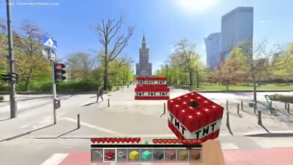</a></td>
<td width="50%" height="225" align="center" valign="middle"></td>
</tr>
<tr>
<td width="50%" valign="top"><strong>Turning Street View into a Block-Building World</strong> <a href="https://x.com/0xverdao">@0xverdao</a> · 3D &amp; interactive 0:29 · Bookmarks 1 · Details pending <a href="https://guanmo-ai.github.io/awesome-ai-motion/?lang=en#case-2108188411844776363">▶ Play</a> · <a href="https://x.com/0xverdao/status/2108188411844776363">Original post</a></td>
<td width="50%" valign="top"><strong>Krakatoa: Real-Time Lava and Smoke</strong> <a href="https://x.com/pagustafsson">@pagustafsson</a> · 3D &amp; interactive 0:37 · Bookmarks 1 · Details pending <a href="https://guanmo-ai.github.io/awesome-ai-motion/?lang=en#case-2108936279081566609">▶ Play</a> · <a href="https://x.com/pagustafsson/status/2108936279081566609">Original post</a></td>
</tr>
</tbody>
<tbody>
<tr>
<td width="50%" height="225" align="center" valign="middle"></td>
<td width="50%" height="225" align="center" valign="middle"></td>
</tr>
<tr>
<td width="50%" valign="top"><strong>Jiggle Buddies: translucent jelly characters</strong> <a href="https://x.com/angie_carel">@angie_carel</a> · 3D &amp; interactive 0:41 · Bookmarks 1 <a href="https://guanmo-ai.github.io/awesome-ai-motion/?lang=en#case-2103876982819954689">▶ Play</a> · <a href="https://x.com/angie_carel/status/2103876982819954689">Original post</a></td>
<td width="50%" valign="top"><strong>The Apex Rush: A Single-File 3D Browser Game</strong> <a href="https://x.com/sidgiri2104">@sidgiri2104</a> · 3D &amp; interactive 1:07 · Bookmarks 1 · Details pending <a href="https://guanmo-ai.github.io/awesome-ai-motion/?lang=en#case-2104820347875045751">▶ Play</a> · <a href="https://x.com/sidgiri2104/status/2104820347875045751">Original post</a></td>
</tr>
</tbody>
<tbody>
<tr>
<td width="50%" height="225" align="center" valign="middle"></td>
<td width="50%" height="225" align="center" valign="middle"></td>
</tr>
<tr>
<td width="50%" valign="top"><strong>Interactive Particles, from Galaxies to Surfaces</strong> <a href="https://x.com/chudry223">@chudry223</a> · 3D &amp; interactive 0:33 · Bookmarks 1 · Details pending <a href="https://guanmo-ai.github.io/awesome-ai-motion/?lang=en#case-2105374954195657142">▶ Play</a> · <a href="https://x.com/chudry223/status/2105374954195657142">Original post</a></td>
<td width="50%" valign="top"><strong>Reconstructing ancient Izumo Taisha</strong> <a href="https://x.com/yoshifujidesign">@yoshifujidesign</a> · 3D &amp; interactive 1:04 · Bookmarks 1 · Details pending <a href="https://guanmo-ai.github.io/awesome-ai-motion/?lang=en#case-2105679580191416322">▶ Play</a> · <a href="https://x.com/yoshifujidesign/status/2105679580191416322">Original post</a></td>
</tr>
</tbody>
<tbody>
<tr>
<td width="50%" height="225" align="center" valign="middle"></td>
<td width="50%" height="225" align="center" valign="middle"></td>
</tr>
<tr>
<td width="50%" valign="top"><strong>Two bus models in Blender</strong> <a href="https://x.com/0c103a">@0c103a</a> · 3D &amp; interactive 0:45 · Bookmarks 1 · Details pending <a href="https://guanmo-ai.github.io/awesome-ai-motion/?lang=en#case-2107494964410429923">▶ Play</a> · <a href="https://x.com/0c103a/status/2107494964410429923">Original post</a></td>
<td width="50%" valign="top"><strong>A Fractal Browser Made of Layered Paper</strong> <a href="https://x.com/jrayon">@jrayon</a> · 3D &amp; interactive 0:35 · Bookmarks 1 · Details pending <a href="https://guanmo-ai.github.io/awesome-ai-motion/?lang=en#case-2102861376184054015">▶ Play</a> · <a href="https://x.com/jrayon/status/2102861376184054015">Original post</a></td>
</tr>
</tbody>
<tbody>
<tr>
<td width="50%" height="225" align="center" valign="middle"></td>
<td width="50%" height="225" align="center" valign="middle"></td>
</tr>
<tr>
<td width="50%" valign="top"><strong>Hraunheim: a Home beside a Lava River</strong> <a href="https://x.com/ottollm">@ottollm</a> · 3D &amp; interactive 0:20 · Bookmarks 1 · Details pending <a href="https://guanmo-ai.github.io/awesome-ai-motion/?lang=en#case-2108311732376453546">▶ Play</a> · <a href="https://x.com/ottollm/status/2108311732376453546">Original post</a></td>
<td width="50%" valign="top"><strong>From One Image to a Three.js Scene</strong> <a href="https://x.com/NicksonTan">@NicksonTan</a> · 3D &amp; interactive 1:12 · Bookmarks 1 · Details pending <a href="https://guanmo-ai.github.io/awesome-ai-motion/?lang=en#case-2102798578427265368">▶ Play</a> · <a href="https://x.com/NicksonTan/status/2102798578427265368">Original post</a></td>
</tr>
</tbody>
<tbody>
<tr>
<td width="50%" height="225" align="center" valign="middle"></td>
<td width="50%" height="225" align="center" valign="middle"></td>
</tr>
<tr>
<td width="50%" valign="top"><strong>Flying from Galactic Arms into Space</strong> <a href="https://x.com/lolCountEng">@lolCountEng</a> · 3D &amp; interactive 0:30 · Bookmarks 1 · Details pending <a href="https://guanmo-ai.github.io/awesome-ai-motion/?lang=en#case-2106235220106342708">▶ Play</a> · <a href="https://x.com/lolCountEng/status/2106235220106342708">Original post</a></td>
<td width="50%" valign="top"><strong>Runtime Repairs for FlightGear Aircraft</strong> <a href="https://x.com/lekanadeyeri">@lekanadeyeri</a> · 3D &amp; interactive 0:11 · Bookmarks 0 · Details pending <a href="https://guanmo-ai.github.io/awesome-ai-motion/?lang=en#case-2108331960636731899">▶ Play</a> · <a href="https://x.com/lekanadeyeri/status/2108331960636731899">Original post</a></td>
</tr>
</tbody>
<tbody>
<tr>
<td width="50%" height="225" align="center" valign="middle"></td>
<td width="50%" height="225" align="center" valign="middle"></td>
</tr>
<tr>
<td width="50%" valign="top"><strong>Two Godot Character-status Layouts</strong> <a href="https://x.com/yunma33331111">@yunma33331111</a> · 3D &amp; interactive 0:26 · Bookmarks 0 · Details pending <a href="https://guanmo-ai.github.io/awesome-ai-motion/?lang=en#case-2108517265193025631">▶ Play</a> · <a href="https://x.com/yunma33331111/status/2108517265193025631">Original post</a></td>
<td width="50%" valign="top"><strong>Accra Crazy Trotro: An Accra Driving Game</strong> <a href="https://x.com/Ed_Forson">@Ed_Forson</a> · 3D &amp; interactive 2:15 · Bookmarks 0 · Details pending <a href="https://guanmo-ai.github.io/awesome-ai-motion/?lang=en#case-2108906748840972621">▶ Play</a> · <a href="https://x.com/Ed_Forson/status/2108906748840972621">Original post</a></td>
</tr>
</tbody>
<tbody>
<tr>
<td width="50%" height="225" align="center" valign="middle"></td>
<td width="50%" height="225" align="center" valign="middle"></td>
</tr>
<tr>
<td width="50%" valign="top"><strong>A Storm around a Lighthouse Diorama</strong> <a href="https://x.com/azygod">@azygod</a> · 3D &amp; interactive 0:30 · Bookmarks 0 · Details pending <a href="https://guanmo-ai.github.io/awesome-ai-motion/?lang=en#case-2113556642440650948">▶ Play</a> · <a href="https://x.com/azygod/status/2113556642440650948">Original post</a></td>
<td width="50%" valign="top"><strong>Demolition Derby in the browser</strong> <a href="https://x.com/drcollect">@drcollect</a> · 3D &amp; interactive 0:16 · Bookmarks 0 · Details pending <a href="https://guanmo-ai.github.io/awesome-ai-motion/?lang=en#case-2105361031371383180">▶ Play</a> · <a href="https://x.com/drcollect/status/2105361031371383180">Original post</a></td>
</tr>
</tbody>
<tbody>
<tr>
<td width="50%" height="225" align="center" valign="middle"></td>
<td width="50%" height="225" align="center" valign="middle"></td>
</tr>
<tr>
<td width="50%" valign="top"><strong>A 3D supermarket operations simulator</strong> <a href="https://x.com/ballerinifb">@ballerinifb</a> · 3D &amp; interactive 1:28 · Bookmarks 0 · Details pending <a href="https://guanmo-ai.github.io/awesome-ai-motion/?lang=en#case-2107104693448999402">▶ Play</a> · <a href="https://x.com/ballerinifb/status/2107104693448999402">Original post</a></td>
<td width="50%" valign="top"><strong>A Pixel-game Devlog: a Codex-made Introduction</strong> <a href="https://x.com/DSTO_boardgamer">@DSTO_boardgamer</a> · 3D &amp; interactive 0:36 · Bookmarks 0 · Details pending <a href="https://guanmo-ai.github.io/awesome-ai-motion/?lang=en#case-2108507501402661118">▶ Play</a> · <a href="https://x.com/DSTO_boardgamer/status/2108507501402661118">Original post</a></td>
</tr>
</tbody>
<tbody>
<tr>
<td width="50%" height="225" align="center" valign="middle"></td>
<td width="50%" height="225" align="center" valign="middle"></td>
</tr>
<tr>
<td width="50%" valign="top"><strong>A Roguelike Shooter with a Live2D Character</strong> <a href="https://x.com/beko_X_account">@beko_X_account</a> · 3D &amp; interactive 0:45 · Bookmarks 0 · Details pending <a href="https://guanmo-ai.github.io/awesome-ai-motion/?lang=en#case-2108148762849980892">▶ Play</a> · <a href="https://x.com/beko_X_account/status/2108148762849980892">Original post</a></td>
<td width="50%" valign="top"><strong>A Bamboo-spear Throwing Game</strong> <a href="https://x.com/bDAxjGohPDX7XiV">@bDAxjGohPDX7XiV</a> · 3D &amp; interactive 0:15 · Bookmarks 0 · Details pending <a href="https://guanmo-ai.github.io/awesome-ai-motion/?lang=en#case-2108162966659224000">▶ Play</a> · <a href="https://x.com/bDAxjGohPDX7XiV/status/2108162966659224000">Original post</a></td>
</tr>
</tbody>
<tbody>
<tr>
<td width="50%" height="225" align="center" valign="middle"></td>
<td width="50%" height="225" align="center" valign="middle"></td>
</tr>
<tr>
<td width="50%" valign="top"><strong>Demon Slayer Takes over Portal 2</strong> <a href="https://x.com/sigf_ai">@sigf_ai</a> · 3D &amp; interactive 0:30 · Bookmarks 0 · Details pending <a href="https://guanmo-ai.github.io/awesome-ai-motion/?lang=en#case-2108319343712886998">▶ Play</a> · <a href="https://x.com/sigf_ai/status/2108319343712886998">Original post</a></td>
<td width="50%" valign="top"><strong>A Convex Game with AI Characters Fighting</strong> <a href="https://x.com/_sarant">@_sarant</a> · 3D &amp; interactive 0:33 · Bookmarks 0 · Details pending <a href="https://guanmo-ai.github.io/awesome-ai-motion/?lang=en#case-2108336621980360830">▶ Play</a> · <a href="https://x.com/_sarant/status/2108336621980360830">Original post</a></td>
</tr>
</tbody>
<tbody>
<tr>
<td width="50%" height="225" align="center" valign="middle"></td>
<td width="50%" height="225" align="center" valign="middle"></td>
</tr>
<tr>
<td width="50%" valign="top"><strong>A Pond of Lilies and Ripples</strong> <a href="https://x.com/untitled_sys">@untitled_sys</a> · 3D &amp; interactive 0:22 · Bookmarks 0 · Details pending <a href="https://guanmo-ai.github.io/awesome-ai-motion/?lang=en#case-2109118782438617103">▶ Play</a> · <a href="https://x.com/untitled_sys/status/2109118782438617103">Original post</a></td>
<td width="50%" valign="top"><strong>A Computer Mark I Analog Computer Simulation</strong> <a href="https://x.com/markovs_razor">@markovs_razor</a> · 3D &amp; interactive 1:00 · Bookmarks 0 · Details pending <a href="https://guanmo-ai.github.io/awesome-ai-motion/?lang=en#case-2109173369140810135">▶ Play</a> · <a href="https://x.com/markovs_razor/status/2109173369140810135">Original post</a></td>
</tr>
</tbody>
<tbody>
<tr>
<td width="50%" height="225" align="center" valign="middle"></td>
<td width="50%" height="225" align="center" valign="middle"></td>
</tr>
<tr>
<td width="50%" valign="top"><strong>A Three.js Personal Site Concept</strong> <a href="https://x.com/hymmakbar">@hymmakbar</a> · 3D &amp; interactive 1:07 · Bookmarks 0 · Details pending <a href="https://guanmo-ai.github.io/awesome-ai-motion/?lang=en#case-2105082553996820579">▶ Play</a> · <a href="https://x.com/hymmakbar/status/2105082553996820579">Original post</a></td>
<td width="50%" valign="top"><strong>Vector Tango: a mixed-reality aircraft hangar</strong> <a href="https://x.com/scobelverse">@scobelverse</a> · 3D &amp; interactive 0:08 · Bookmarks 0 · Details pending <a href="https://guanmo-ai.github.io/awesome-ai-motion/?lang=en#case-2107498407745225201">▶ Play</a> · <a href="https://x.com/scobelverse/status/2107498407745225201">Original post</a></td>
</tr>
</tbody>
<tbody>
<tr>
<td width="50%" height="225" align="center" valign="middle"></td>
<td width="50%" height="225" align="center" valign="middle"></td>
</tr>
<tr>
<td width="50%" valign="top"><strong>Dodging Falling Bamboo Spears</strong> <a href="https://x.com/bDAxjGohPDX7XiV">@bDAxjGohPDX7XiV</a> · 3D &amp; interactive 0:22 · Bookmarks 0 · Details pending <a href="https://guanmo-ai.github.io/awesome-ai-motion/?lang=en#case-2108169409856709062">▶ Play</a> · <a href="https://x.com/bDAxjGohPDX7XiV/status/2108169409856709062">Original post</a></td>
<td width="50%" valign="top"><strong>A Game Hero's Lightning-effect Update</strong> <a href="https://x.com/Toshi_nyaruo_AI">@Toshi_nyaruo_AI</a> · 3D &amp; interactive 0:18 · Bookmarks 0 · Details pending <a href="https://guanmo-ai.github.io/awesome-ai-motion/?lang=en#case-2108385330072272973">▶ Play</a> · <a href="https://x.com/Toshi_nyaruo_AI/status/2108385330072272973">Original post</a></td>
</tr>
</tbody>
<tbody>
<tr>
<td width="50%" height="225" align="center" valign="middle"></td>
<td width="50%" height="225" align="center" valign="middle"></td>
</tr>
<tr>
<td width="50%" valign="top"><strong>A Destructible City Sandbox in the Browser</strong> <a href="https://x.com/OfSensor">@OfSensor</a> · 3D &amp; interactive 1:04 · Bookmarks 0 · Details pending <a href="https://guanmo-ai.github.io/awesome-ai-motion/?lang=en#case-2109229172484641007">▶ Play</a> · <a href="https://x.com/OfSensor/status/2109229172484641007">Original post</a></td>
<td width="50%" valign="top"><strong>A touchable, sounding tesseract</strong> <a href="https://x.com/_postminimal">@_postminimal</a> · 3D &amp; interactive 0:55 · Bookmarks 0 · Details pending <a href="https://guanmo-ai.github.io/awesome-ai-motion/?lang=en#case-2105561265531957530">▶ Play</a> · <a href="https://x.com/_postminimal/status/2105561265531957530">Original post</a></td>
</tr>
</tbody>
<tbody>
<tr>
<td width="50%" height="225" align="center" valign="middle"></td>
<td width="50%" height="225" align="center" valign="middle"></td>
</tr>
<tr>
<td width="50%" valign="top"><strong>A Bamboo Pole-vaulting Game</strong> <a href="https://x.com/bDAxjGohPDX7XiV">@bDAxjGohPDX7XiV</a> · 3D &amp; interactive 0:17 · Bookmarks 0 · Details pending <a href="https://guanmo-ai.github.io/awesome-ai-motion/?lang=en#case-2108172640842359264">▶ Play</a> · <a href="https://x.com/bDAxjGohPDX7XiV/status/2108172640842359264">Original post</a></td>
<td width="50%" valign="top"><strong>An Interactive Watercolor Hummingbird</strong> <a href="https://x.com/Tentamasoba1016">@Tentamasoba1016</a> · 3D &amp; interactive 0:30 · Bookmarks 0 · Details pending <a href="https://guanmo-ai.github.io/awesome-ai-motion/?lang=en#case-2108321415606968363">▶ Play</a> · <a href="https://x.com/Tentamasoba1016/status/2108321415606968363">Original post</a></td>
</tr>
</tbody>
<tbody>
<tr>
<td width="50%" height="225" align="center" valign="middle"></td>
<td width="50%" height="225" align="center" valign="middle"></td>
</tr>
<tr>
<td width="50%" valign="top"><strong>SkateBIRD Takes over Quake</strong> <a href="https://x.com/sigf_ai">@sigf_ai</a> · 3D &amp; interactive 0:30 · Bookmarks 0 · Details pending <a href="https://guanmo-ai.github.io/awesome-ai-motion/?lang=en#case-2108371550617456882">▶ Play</a> · <a href="https://x.com/sigf_ai/status/2108371550617456882">Original post</a></td>
<td width="50%" valign="top"><strong>Pixel Racer: pixel-space racing and its project page</strong> <a href="https://x.com/dmowlin">@dmowlin</a> · 3D &amp; interactive 0:10 · Bookmarks 0 <a href="https://guanmo-ai.github.io/awesome-ai-motion/?lang=en#case-2103830851897221566">▶ Play</a> · <a href="https://x.com/dmowlin/status/2103830851897221566">Original post</a></td>
</tr>
</tbody>
<tbody>
<tr>
<td width="50%" height="225" align="center" valign="middle"></td>
<td width="50%" height="225" align="center" valign="middle"></td>
</tr>
<tr>
<td width="50%" valign="top"><strong>A House Designed as Code</strong> <a href="https://x.com/AJtheMongol">@AJtheMongol</a> · 3D &amp; interactive 0:51 · Bookmarks 0 · Details pending <a href="https://guanmo-ai.github.io/awesome-ai-motion/?lang=en#case-2104214187522318512">▶ Play</a> · <a href="https://x.com/AJtheMongol/status/2104214187522318512">Original post</a></td>
<td width="50%" valign="top"><strong>A Nine-Camera Rocket Launch Simulation</strong> <a href="https://x.com/abyssallD">@abyssallD</a> · 3D &amp; interactive 0:53 · Bookmarks 0 · Details pending <a href="https://guanmo-ai.github.io/awesome-ai-motion/?lang=en#case-2106434250467602690">▶ Play</a> · <a href="https://x.com/abyssallD/status/2106434250467602690">Original post</a></td>
</tr>
</tbody>
<tbody>
<tr>
<td width="50%" height="225" align="center" valign="middle"></td>
<td width="50%" height="225" align="center" valign="middle"></td>
</tr>
<tr>
<td width="50%" valign="top"><strong>Worldmaker particle-system worlds</strong> <a href="https://x.com/Aaron_Wacker">@Aaron_Wacker</a> · 3D &amp; interactive 1:00 · Bookmarks 0 · Details pending <a href="https://guanmo-ai.github.io/awesome-ai-motion/?lang=en#case-2107640509967536301">▶ Play</a> · <a href="https://x.com/Aaron_Wacker/status/2107640509967536301">Original post</a></td>
<td width="50%" valign="top"><strong>YUDHVEER mythological action-game trailer</strong> <a href="https://x.com/TejasGovin17982">@TejasGovin17982</a> · 3D &amp; interactive 1:00 · Bookmarks 0 · Details pending <a href="https://guanmo-ai.github.io/awesome-ai-motion/?lang=en#case-2107663339664949463">▶ Play</a> · <a href="https://x.com/TejasGovin17982/status/2107663339664949463">Original post</a></td>
</tr>
</tbody>
<tbody>
<tr>
<td width="50%" height="225" align="center" valign="middle"></td>
<td width="50%" height="225" align="center" valign="middle"></td>
</tr>
<tr>
<td width="50%" valign="top"><strong>Black Bulls hideout: visitors as floating lights</strong> <a href="https://x.com/lribes4">@lribes4</a> · 3D &amp; interactive 0:23 · Bookmarks 0 <a href="https://guanmo-ai.github.io/awesome-ai-motion/?lang=en#case-2103938636173742305">▶ Play</a> · <a href="https://x.com/lribes4/status/2103938636173742305">Original post</a></td>
<td width="50%" valign="top"><strong>Turning Python learning into a surfing game</strong> <a href="https://x.com/deeprajO1">@deeprajO1</a> · 3D &amp; interactive 0:52 · Bookmarks 0 <a href="https://guanmo-ai.github.io/awesome-ai-motion/?lang=en#case-2103938972426834106">▶ Play</a> · <a href="https://x.com/deeprajO1/status/2103938972426834106">Original post</a></td>
</tr>
</tbody>
<tbody>
<tr>
<td width="50%" height="225" align="center" valign="middle"></td>
<td width="50%" height="225" align="center" valign="middle"></td>
</tr>
<tr>
<td width="50%" valign="top"><strong>Sydney Harbour Bridge: Dawn to Dusk</strong> <a href="https://x.com/CeciliaW888">@CeciliaW888</a> · 3D &amp; interactive 0:23 · Bookmarks 0 · Details pending <a href="https://guanmo-ai.github.io/awesome-ai-motion/?lang=en#case-2104504480968683521">▶ Play</a> · <a href="https://x.com/CeciliaW888/status/2104504480968683521">Original post</a></td>
<td width="50%" valign="top"><strong>Underwater Room with Dolphins and a Harp</strong> <a href="https://x.com/VeronicaVZMusic">@VeronicaVZMusic</a> · 3D &amp; interactive 0:42 · Bookmarks 0 · Details pending <a href="https://guanmo-ai.github.io/awesome-ai-motion/?lang=en#case-2104740780208164947">▶ Play</a> · <a href="https://x.com/VeronicaVZMusic/status/2104740780208164947">Original post</a></td>
</tr>
</tbody>
<tbody>
<tr>
<td width="50%" height="225" align="center" valign="middle"></td>
<td width="50%" height="225" align="center" valign="middle"></td>
</tr>
<tr>
<td width="50%" valign="top"><strong>An interactive LEGO Ferrari F1 build</strong> <a href="https://x.com/eigeorguy">@eigeorguy</a> · 3D &amp; interactive 0:39 · Bookmarks 0 · Details pending <a href="https://guanmo-ai.github.io/awesome-ai-motion/?lang=en#case-2105346791021629821">▶ Play</a> · <a href="https://x.com/eigeorguy/status/2105346791021629821">Original post</a></td>
<td width="50%" valign="top"><strong>Casper: a 3D ghost mascot on the web</strong> <a href="https://x.com/bazfurby">@bazfurby</a> · 3D &amp; interactive 0:22 · Bookmarks 0 · Details pending <a href="https://guanmo-ai.github.io/awesome-ai-motion/?lang=en#case-2105595903943774360">▶ Play</a> · <a href="https://x.com/bazfurby/status/2105595903943774360">Original post</a></td>
</tr>
</tbody>
<tbody>
<tr>
<td width="50%" height="225" align="center" valign="middle"></td>
<td width="50%" height="225" align="center" valign="middle"></td>
</tr>
<tr>
<td width="50%" valign="top"><strong>Browser water tests: Sol and Fable</strong> <a href="https://x.com/NotionLab7">@NotionLab7</a> · 3D &amp; interactive 0:11 · Bookmarks 0 · Details pending <a href="https://guanmo-ai.github.io/awesome-ai-motion/?lang=en#case-2106062220735963507">▶ Play</a> · <a href="https://x.com/NotionLab7/status/2106062220735963507">Original post</a></td>
<td width="50%" valign="top"><strong>A Five-Story Pagoda Built from a Blueprint</strong> <a href="https://x.com/dan__proggg">@dan__proggg</a> · 3D &amp; interactive 0:19 · Bookmarks 0 · Details pending <a href="https://guanmo-ai.github.io/awesome-ai-motion/?lang=en#case-2106477834873274533">▶ Play</a> · <a href="https://x.com/dan__proggg/status/2106477834873274533">Original post</a></td>
</tr>
</tbody>
<tbody>
<tr>
<td width="50%" height="225" align="center" valign="middle"></td>
<td width="50%" height="225" align="center" valign="middle"></td>
</tr>
<tr>
<td width="50%" valign="top"><strong>A rainy Saigon alley</strong> <a href="https://x.com/toankhontech">@toankhontech</a> · 3D &amp; interactive 0:44 · Bookmarks 0 · Details pending <a href="https://guanmo-ai.github.io/awesome-ai-motion/?lang=en#case-2107644521521807650">▶ Play</a> · <a href="https://x.com/toankhontech/status/2107644521521807650">Original post</a></td>
<td width="50%" valign="top"><strong>A Code-generated 3D Pixel Asset Panel</strong> <a href="https://x.com/jing1meow">@jing1meow</a> · 3D &amp; interactive 0:17 · Bookmarks 0 · Details pending <a href="https://guanmo-ai.github.io/awesome-ai-motion/?lang=en#case-2108139498504851759">▶ Play</a> · <a href="https://x.com/jing1meow/status/2108139498504851759">Original post</a></td>
</tr>
</tbody>
<tbody>
<tr>
<td width="50%" height="225" align="center" valign="middle"></td>
<td width="50%" height="225" align="center" valign="middle"></td>
</tr>
<tr>
<td width="50%" valign="top"><strong>Diablo Takeover: a Doom Mod</strong> <a href="https://x.com/sigf_ai">@sigf_ai</a> · 3D &amp; interactive 0:30 · Bookmarks 0 · Details pending <a href="https://guanmo-ai.github.io/awesome-ai-motion/?lang=en#case-2108486210955981251">▶ Play</a> · <a href="https://x.com/sigf_ai/status/2108486210955981251">Original post</a></td>
<td width="50%" valign="top"><strong>A Flight Simulator with a Cat-eared Pilot</strong> <a href="https://x.com/kazur71507359">@kazur71507359</a> · 3D &amp; interactive 0:36 · Bookmarks 0 · Details pending <a href="https://guanmo-ai.github.io/awesome-ai-motion/?lang=en#case-2108487893056417869">▶ Play</a> · <a href="https://x.com/kazur71507359/status/2108487893056417869">Original post</a></td>
</tr>
</tbody>
<tbody>
<tr>
<td width="50%" height="225" align="center" valign="middle"></td>
<td width="50%" height="225" align="center" valign="middle"></td>
</tr>
<tr>
<td width="50%" valign="top"><strong>Locus Amoenus: A Gaussian Splat Scene</strong> <a href="https://x.com/easyldur">@easyldur</a> · 3D &amp; interactive 3:27 · Bookmarks 0 · Details pending <a href="https://guanmo-ai.github.io/awesome-ai-motion/?lang=en#case-2108918893523963917">▶ Play</a> · <a href="https://x.com/easyldur/status/2108918893523963917">Original post</a></td>
<td width="50%" valign="top"><strong>Dawnroll: A Beetle Rolling Its Sun Through a Miniature Garden</strong> <a href="https://x.com/Nickxyzn">@Nickxyzn</a> · 3D &amp; interactive 0:30 · Bookmarks 0 · Details pending <a href="https://guanmo-ai.github.io/awesome-ai-motion/?lang=en#case-2102543530002456775">▶ Play</a> · <a href="https://x.com/Nickxyzn/status/2102543530002456775">Original post</a></td>
</tr>
</tbody>
<tbody>
<tr>
<td width="50%" height="225" align="center" valign="middle"></td>
<td width="50%" height="225" align="center" valign="middle"></td>
</tr>
<tr>
<td width="50%" valign="top"><strong>An Underground Delivery Network Game</strong> <a href="https://x.com/lisp_mi">@lisp_mi</a> · 3D &amp; interactive 0:11 · Bookmarks 0 · Details pending <a href="https://guanmo-ai.github.io/awesome-ai-motion/?lang=en#case-2104046743751139812">▶ Play</a> · <a href="https://x.com/lisp_mi/status/2104046743751139812">Original post</a></td>
<td width="50%" valign="top"><strong>Latentown: AI News as a 3D City</strong> <a href="https://x.com/sanjay_khadka07">@sanjay_khadka07</a> · 3D &amp; interactive 0:42 · Bookmarks 0 · Details pending <a href="https://guanmo-ai.github.io/awesome-ai-motion/?lang=en#case-2104102479927620029">▶ Play</a> · <a href="https://x.com/sanjay_khadka07/status/2104102479927620029">Original post</a></td>
</tr>
</tbody>
<tbody>
<tr>
<td width="50%" height="225" align="center" valign="middle"></td>
<td width="50%" height="225" align="center" valign="middle"></td>
</tr>
<tr>
<td width="50%" valign="top"><strong>An Interactive Mining Truck Breakdown</strong> <a href="https://x.com/aichrislee">@aichrislee</a> · 3D &amp; interactive 0:10 · Bookmarks 0 · Details pending <a href="https://guanmo-ai.github.io/awesome-ai-motion/?lang=en#case-2105329006149001333">▶ Play</a> · <a href="https://x.com/aichrislee/status/2105329006149001333">Original post</a></td>
<td width="50%" valign="top"><strong>A walkable bedroom with a lava lamp</strong> <a href="https://x.com/TimJayas">@TimJayas</a> · 3D &amp; interactive 0:40 · Bookmarks 0 · Details pending <a href="https://guanmo-ai.github.io/awesome-ai-motion/?lang=en#case-2105685544906952811">▶ Play</a> · <a href="https://x.com/TimJayas/status/2105685544906952811">Original post</a></td>
</tr>
</tbody>
<tbody>
<tr>
<td width="50%" height="225" align="center" valign="middle"></td>
<td width="50%" height="225" align="center" valign="middle"></td>
</tr>
<tr>
<td width="50%" valign="top"><strong>From a sky image to an HDRI preview</strong> <a href="https://x.com/Atomic0111">@Atomic0111</a> · 3D &amp; interactive 0:30 · Bookmarks 0 · Details pending <a href="https://guanmo-ai.github.io/awesome-ai-motion/?lang=en#case-2107499721560641723">▶ Play</a> · <a href="https://x.com/Atomic0111/status/2107499721560641723">Original post</a></td>
<td width="50%" valign="top"><strong>Depth-map motion on a web page</strong> <a href="https://x.com/___sakurarin">@___sakurarin</a> · 3D &amp; interactive 0:30 · Bookmarks 0 · Details pending <a href="https://guanmo-ai.github.io/awesome-ai-motion/?lang=en#case-2107566590799831417">▶ Play</a> · <a href="https://x.com/___sakurarin/status/2107566590799831417">Original post</a></td>
</tr>
</tbody>
<tbody>
<tr>
<td width="50%" height="225" align="center" valign="middle"></td>
<td width="50%" height="225" align="center" valign="middle"></td>
</tr>
<tr>
<td width="50%" valign="top"><strong>Exploring Venice by gondola</strong> <a href="https://x.com/kzms">@kzms</a> · 3D &amp; interactive 1:08 · Bookmarks 0 · Details pending <a href="https://guanmo-ai.github.io/awesome-ai-motion/?lang=en#case-2107670748034908552">▶ Play</a> · <a href="https://x.com/kzms/status/2107670748034908552">Original post</a></td>
<td width="50%" valign="top"><strong>Astoro Racer: a Suzuka Circuit Iteration</strong> <a href="https://x.com/CHAPTER0423">@CHAPTER0423</a> · 3D &amp; interactive 1:30 · Bookmarks 0 · Details pending <a href="https://guanmo-ai.github.io/awesome-ai-motion/?lang=en#case-2108184032194576811">▶ Play</a> · <a href="https://x.com/CHAPTER0423/status/2108184032194576811">Original post</a></td>
</tr>
</tbody>
<tbody>
<tr>
<td width="50%" height="225" align="center" valign="middle"></td>
<td width="50%" height="225" align="center" valign="middle"></td>
</tr>
<tr>
<td width="50%" valign="top"><strong>Keyameleon: a Keyboard with Split-flap Keycaps</strong> <a href="https://x.com/fedemas">@fedemas</a> · 3D &amp; interactive 0:15 · Bookmarks 0 · Details pending <a href="https://guanmo-ai.github.io/awesome-ai-motion/?lang=en#case-2108400811411996801">▶ Play</a> · <a href="https://x.com/fedemas/status/2108400811411996801">Original post</a></td>
<td width="50%" valign="top"><strong>From an Empty UE5 Level to a Fantasy Game</strong> <a href="https://x.com/willa_wu7">@willa_wu7</a> · 3D &amp; interactive 0:31 · Bookmarks 0 · Details pending <a href="https://guanmo-ai.github.io/awesome-ai-motion/?lang=en#case-2108401715494244619">▶ Play</a> · <a href="https://x.com/willa_wu7/status/2108401715494244619">Original post</a></td>
</tr>
</tbody>
<tbody>
<tr>
<td width="50%" height="225" align="center" valign="middle"></td>
<td width="50%" height="225" align="center" valign="middle"></td>
</tr>
<tr>
<td width="50%" valign="top"><strong>Day and Night in a Manor Garden</strong> <a href="https://x.com/Thusatharan">@Thusatharan</a> · 3D &amp; interactive 1:48 · Bookmarks 0 · Details pending <a href="https://guanmo-ai.github.io/awesome-ai-motion/?lang=en#case-2108544807333433543">▶ Play</a> · <a href="https://x.com/Thusatharan/status/2108544807333433543">Original post</a></td>
<td width="50%" valign="top"><strong>Low Tide: a playable beach painting and its trailer</strong> <a href="https://x.com/boona11">@boona11</a> · 3D &amp; interactive 0:31 · Bookmarks 0 <a href="https://guanmo-ai.github.io/awesome-ai-motion/?lang=en#case-2103830083446415751">▶ Play</a> · <a href="https://x.com/boona11/status/2103830083446415751">Original post</a></td>
</tr>
</tbody>
<tbody>
<tr>
<td width="50%" height="225" align="center" valign="middle"></td>
<td width="50%" height="225" align="center" valign="middle"></td>
</tr>
<tr>
<td width="50%" valign="top"><strong>Compound QUEST: concepts as pixel-game levels</strong> <a href="https://x.com/0xpai_eth">@0xpai_eth</a> · 3D &amp; interactive 0:40 · Bookmarks 0 <a href="https://guanmo-ai.github.io/awesome-ai-motion/?lang=en#case-2103870009877635565">▶ Play</a> · <a href="https://x.com/0xpai_eth/status/2103870009877635565">Original post</a></td>
<td width="50%" valign="top"><strong>Different models for game development and video</strong> <a href="https://x.com/loverWNL">@loverWNL</a> · 3D &amp; interactive 0:36 · Bookmarks 0 <a href="https://guanmo-ai.github.io/awesome-ai-motion/?lang=en#case-2103888380794712109">▶ Play</a> · <a href="https://x.com/loverWNL/status/2103888380794712109">Original post</a></td>
</tr>
</tbody>
<tbody>
<tr>
<td width="50%" height="225" align="center" valign="middle"></td>
<td width="50%" height="225" align="center" valign="middle"></td>
</tr>
<tr>
<td width="50%" valign="top"><strong>A 3D Bicycle Product Demo</strong> <a href="https://x.com/EWashoku">@EWashoku</a> · 3D &amp; interactive 0:49 · Bookmarks 0 · Details pending <a href="https://guanmo-ai.github.io/awesome-ai-motion/?lang=en#case-2104211672370201053">▶ Play</a> · <a href="https://x.com/EWashoku/status/2104211672370201053">Original post</a></td>
<td width="50%" valign="top"><strong>An Explorable Engine: Pistons and Magnets</strong> <a href="https://x.com/StefanoStraus">@StefanoStraus</a> · 3D &amp; interactive 0:32 · Bookmarks 0 · Details pending <a href="https://guanmo-ai.github.io/awesome-ai-motion/?lang=en#case-2104236916316971191">▶ Play</a> · <a href="https://x.com/StefanoStraus/status/2104236916316971191">Original post</a></td>
</tr>
</tbody>
<tbody>
<tr>
<td width="50%" height="225" align="center" valign="middle"></td>
<td width="50%" height="225" align="center" valign="middle"></td>
</tr>
<tr>
<td width="50%" valign="top"><strong>3D house walkthrough video</strong> <a href="https://x.com/truenyl">@truenyl</a> · 3D &amp; interactive 1:00 · Bookmarks 0 · Details pending <a href="https://guanmo-ai.github.io/awesome-ai-motion/?lang=en#case-2104242902218285246">▶ Play</a> · <a href="https://x.com/truenyl/status/2104242902218285246">Original post</a></td>
<td width="50%" valign="top"><strong>Code rebuild of an older Blender project</strong> <a href="https://x.com/hasiyevv">@hasiyevv</a> · 3D &amp; interactive 0:34 · Bookmarks 0 · Details pending <a href="https://guanmo-ai.github.io/awesome-ai-motion/?lang=en#case-2104254095196602550">▶ Play</a> · <a href="https://x.com/hasiyevv/status/2104254095196602550">Original post</a></td>
</tr>
</tbody>
<tbody>
<tr>
<td width="50%" height="225" align="center" valign="middle"></td>
<td width="50%" height="225" align="center" valign="middle"></td>
</tr>
<tr>
<td width="50%" valign="top"><strong>A JavaScript wool-art world</strong> <a href="https://x.com/thebuggeddev">@thebuggeddev</a> · 3D &amp; interactive 0:33 · Bookmarks 0 · Details pending <a href="https://guanmo-ai.github.io/awesome-ai-motion/?lang=en#case-2105360949888840080">▶ Play</a> · <a href="https://x.com/thebuggeddev/status/2105360949888840080">Original post</a></td>
<td width="50%" valign="top"><strong>Four agents build a browser FPS</strong> <a href="https://x.com/quentin_barden">@quentin_barden</a> · 3D &amp; interactive 0:46 · Bookmarks 0 · Details pending <a href="https://guanmo-ai.github.io/awesome-ai-motion/?lang=en#case-2105583511017046319">▶ Play</a> · <a href="https://x.com/quentin_barden/status/2105583511017046319">Original post</a></td>
</tr>
</tbody>
<tbody>
<tr>
<td width="50%" height="225" align="center" valign="middle"></td>
<td width="50%" height="225" align="center" valign="middle"></td>
</tr>
<tr>
<td width="50%" valign="top"><strong>A dragon siege: two Three.js interpretations</strong> <a href="https://x.com/ReconScribe">@ReconScribe</a> · 3D &amp; interactive 0:39 · Bookmarks 0 · Details pending <a href="https://guanmo-ai.github.io/awesome-ai-motion/?lang=en#case-2105659005817462972">▶ Play</a> · <a href="https://x.com/ReconScribe/status/2105659005817462972">Original post</a></td>
<td width="50%" valign="top"><strong>A code-video prototype in a baseball setting</strong> <a href="https://x.com/psicomante">@psicomante</a> · 3D &amp; interactive 0:10 · Bookmarks 0 · Details pending <a href="https://guanmo-ai.github.io/awesome-ai-motion/?lang=en#case-2106065282221424822">▶ Play</a> · <a href="https://x.com/psicomante/status/2106065282221424822">Original post</a></td>
</tr>
</tbody>
<tbody>
<tr>
<td width="50%" height="225" align="center" valign="middle"></td>
<td width="50%" height="225" align="center" valign="middle"><a href="https://guanmo-ai.github.io/awesome-ai-motion/?lang=en#case-2106897839204847776">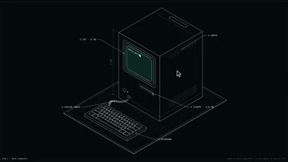</a></td>
</tr>
<tr>
<td width="50%" valign="top"><strong>A Blender cube model and animation made with Codex</strong> <a href="https://x.com/Kyoung12292">@Kyoung12292</a> · 3D &amp; interactive 0:25 · Bookmarks 0 · Details pending <a href="https://guanmo-ai.github.io/awesome-ai-motion/?lang=en#case-2106222619225895169">▶ Play</a> · <a href="https://x.com/Kyoung12292/status/2106222619225895169">Original post</a></td>
<td width="50%" valign="top"><strong>An Interactive Wireframe Macintosh</strong> <a href="https://x.com/aichrislee">@aichrislee</a> · 3D &amp; interactive 0:16 · Bookmarks 0 · Details pending <a href="https://guanmo-ai.github.io/awesome-ai-motion/?lang=en#case-2106897839204847776">▶ Play</a> · <a href="https://x.com/aichrislee/status/2106897839204847776">Original post</a></td>
</tr>
</tbody>
<tbody>
<tr>
<td width="50%" height="225" align="center" valign="middle"></td>
<td width="50%" height="225" align="center" valign="middle"></td>
</tr>
<tr>
<td width="50%" valign="top"><strong>Rain, water and a red scene in Blender</strong> <a href="https://x.com/supasaiyanian">@supasaiyanian</a> · 3D &amp; interactive 0:15 · Bookmarks 0 · Details pending <a href="https://guanmo-ai.github.io/awesome-ai-motion/?lang=en#case-2107372731721539640">▶ Play</a> · <a href="https://x.com/supasaiyanian/status/2107372731721539640">Original post</a></td>
<td width="50%" valign="top"><strong>Flying through rainy Kowloon</strong> <a href="https://x.com/Billpwchan">@Billpwchan</a> · 3D &amp; interactive 0:15 · Bookmarks 0 · Details pending <a href="https://guanmo-ai.github.io/awesome-ai-motion/?lang=en#case-2107461457936093325">▶ Play</a> · <a href="https://x.com/Billpwchan/status/2107461457936093325">Original post</a></td>
</tr>
</tbody>
<tbody>
<tr>
<td width="50%" height="225" align="center" valign="middle"></td>
<td width="50%" height="225" align="center" valign="middle"></td>
</tr>
<tr>
<td width="50%" valign="top"><strong>Magica: a 3D car-animation comparison</strong> <a href="https://x.com/magica_ai">@magica_ai</a> · 3D &amp; interactive 0:18 · Bookmarks 0 · Details pending <a href="https://guanmo-ai.github.io/awesome-ai-motion/?lang=en#case-2107501431695495470">▶ Play</a> · <a href="https://x.com/magica_ai/status/2107501431695495470">Original post</a></td>
<td width="50%" valign="top"><strong>Timberline Span: bridge game and trailer</strong> <a href="https://x.com/jeffbruchado">@jeffbruchado</a> · 3D &amp; interactive 0:15 · Bookmarks 0 · Details pending <a href="https://guanmo-ai.github.io/awesome-ai-motion/?lang=en#case-2107501594992423246">▶ Play</a> · <a href="https://x.com/jeffbruchado/status/2107501594992423246">Original post</a></td>
</tr>
</tbody>
<tbody>
<tr>
<td width="50%" height="225" align="center" valign="middle"></td>
<td width="50%" height="225" align="center" valign="middle"></td>
</tr>
<tr>
<td width="50%" valign="top"><strong>Interactive isometric SVG scenes</strong> <a href="https://x.com/_drishtantk">@_drishtantk</a> · 3D &amp; interactive 0:19 · Bookmarks 0 · Details pending <a href="https://guanmo-ai.github.io/awesome-ai-motion/?lang=en#case-2107668414424830249">▶ Play</a> · <a href="https://x.com/_drishtantk/status/2107668414424830249">Original post</a></td>
<td width="50%" valign="top"><strong>Integer sequences in interactive 3D</strong> <a href="https://x.com/decompwlj">@decompwlj</a> · 3D &amp; interactive 0:30 · Bookmarks 0 · Details pending <a href="https://guanmo-ai.github.io/awesome-ai-motion/?lang=en#case-2107671507078156328">▶ Play</a> · <a href="https://x.com/decompwlj/status/2107671507078156328">Original post</a></td>
</tr>
</tbody>
<tbody>
<tr>
<td width="50%" height="225" align="center" valign="middle"></td>
<td width="50%" height="225" align="center" valign="middle"></td>
</tr>
<tr>
<td width="50%" valign="top"><strong>An Angkor Temple Game-scene Experiment</strong> <a href="https://x.com/alifeofdesignTV">@alifeofdesignTV</a> · 3D &amp; interactive 0:44 · Bookmarks 0 · Details pending <a href="https://guanmo-ai.github.io/awesome-ai-motion/?lang=en#case-2107774659764822423">▶ Play</a> · <a href="https://x.com/alifeofdesignTV/status/2107774659764822423">Original post</a></td>
<td width="50%" valign="top"><strong>A Cat-beast Encounter in a Game Rebuild</strong> <a href="https://x.com/kephen20936">@kephen20936</a> · 3D &amp; interactive 4:21 · Bookmarks 0 · Details pending <a href="https://guanmo-ai.github.io/awesome-ai-motion/?lang=en#case-2108317049613115767">▶ Play</a> · <a href="https://x.com/kephen20936/status/2108317049613115767">Original post</a></td>
</tr>
</tbody>
<tbody>
<tr>
<td width="50%" height="225" align="center" valign="middle"></td>
<td width="50%" height="225" align="center" valign="middle"></td>
</tr>
<tr>
<td width="50%" valign="top"><strong>Two Models Make an Auto-fighting Single File</strong> <a href="https://x.com/AIcurvewars">@AIcurvewars</a> · 3D &amp; interactive 0:47 · Bookmarks 0 · Details pending <a href="https://guanmo-ai.github.io/awesome-ai-motion/?lang=en#case-2108326043115229415">▶ Play</a> · <a href="https://x.com/AIcurvewars/status/2108326043115229415">Original post</a></td>
<td width="50%" valign="top"><strong>Sky Runner: a Vertical Flight Game</strong> <a href="https://x.com/JohnSlagboom1">@JohnSlagboom1</a> · 3D &amp; interactive 1:17 · Bookmarks 0 · Details pending <a href="https://guanmo-ai.github.io/awesome-ai-motion/?lang=en#case-2108337781198217451">▶ Play</a> · <a href="https://x.com/JohnSlagboom1/status/2108337781198217451">Original post</a></td>
</tr>
</tbody>
<tbody>
<tr>
<td width="50%" height="225" align="center" valign="middle"></td>
<td width="50%" height="225" align="center" valign="middle"></td>
</tr>
<tr>
<td width="50%" valign="top"><strong>An Exploded View of Saturn V</strong> <a href="https://x.com/aichrislee">@aichrislee</a> · 3D &amp; interactive 0:16 · Bookmarks 0 · Details pending <a href="https://guanmo-ai.github.io/awesome-ai-motion/?lang=en#case-2108347412636938609">▶ Play</a> · <a href="https://x.com/aichrislee/status/2108347412636938609">Original post</a></td>
<td width="50%" valign="top"><strong>An Isometric Cottage Portfolio Entrance</strong> <a href="https://x.com/TrevinWisaksana">@TrevinWisaksana</a> · 3D &amp; interactive 0:33 · Bookmarks 0 · Details pending <a href="https://guanmo-ai.github.io/awesome-ai-motion/?lang=en#case-2108357235625873419">▶ Play</a> · <a href="https://x.com/TrevinWisaksana/status/2108357235625873419">Original post</a></td>
</tr>
</tbody>
<tbody>
<tr>
<td width="50%" height="225" align="center" valign="middle"></td>
<td width="50%" height="225" align="center" valign="middle"></td>
</tr>
<tr>
<td width="50%" valign="top"><strong>A Co-op Combat Game Built over Many Iterations</strong> <a href="https://x.com/AlandysGame">@AlandysGame</a> · 3D &amp; interactive 1:31 · Bookmarks 0 · Details pending <a href="https://guanmo-ai.github.io/awesome-ai-motion/?lang=en#case-2108381328299176238">▶ Play</a> · <a href="https://x.com/AlandysGame/status/2108381328299176238">Original post</a></td>
<td width="50%" valign="top"><strong>Hidamari Numa: a Fishing Game with Travel</strong> <a href="https://x.com/seicolor">@seicolor</a> · 3D &amp; interactive 1:00 · Bookmarks 0 · Details pending <a href="https://guanmo-ai.github.io/awesome-ai-motion/?lang=en#case-2108402902666756345">▶ Play</a> · <a href="https://x.com/seicolor/status/2108402902666756345">Original post</a></td>
</tr>
</tbody>
<tbody>
<tr>
<td width="50%" height="225" align="center" valign="middle"></td>
<td width="50%" height="225" align="center" valign="middle"></td>
</tr>
<tr>
<td width="50%" valign="top"><strong>Pixshard: a Multiplayer Elemental-gear Game</strong> <a href="https://x.com/0xRayer">@0xRayer</a> · 3D &amp; interactive 1:20 · Bookmarks 0 · Details pending <a href="https://guanmo-ai.github.io/awesome-ai-motion/?lang=en#case-2108405098565029986">▶ Play</a> · <a href="https://x.com/0xRayer/status/2108405098565029986">Original post</a></td>
<td width="50%" valign="top"><strong>A Virtual Night Lap Around Marina Bay</strong> <a href="https://x.com/DarrenTjan">@DarrenTjan</a> · 3D &amp; interactive 2:16 · Bookmarks 0 · Details pending <a href="https://guanmo-ai.github.io/awesome-ai-motion/?lang=en#case-2108466187529314717">▶ Play</a> · <a href="https://x.com/DarrenTjan/status/2108466187529314717">Original post</a></td>
</tr>
</tbody>
<tbody>
<tr>
<td width="50%" height="225" align="center" valign="middle"></td>
<td width="50%" height="225" align="center" valign="middle"></td>
</tr>
<tr>
<td width="50%" valign="top"><strong>Roadster: a Flying-Car Game Trailer</strong> <a href="https://x.com/k_millionaire_">@k_millionaire_</a> · 3D &amp; interactive 0:30 · Bookmarks 0 · Details pending <a href="https://guanmo-ai.github.io/awesome-ai-motion/?lang=en#case-2108490551385624581">▶ Play</a> · <a href="https://x.com/k_millionaire_/status/2108490551385624581">Original post</a></td>
<td width="50%" valign="top"><strong>Alley Cat: CGA and HD Remaster Comparison</strong> <a href="https://x.com/davidkal88">@davidkal88</a> · 3D &amp; interactive 0:35 · Bookmarks 0 · Details pending <a href="https://guanmo-ai.github.io/awesome-ai-motion/?lang=en#case-2108521844819337635">▶ Play</a> · <a href="https://x.com/davidkal88/status/2108521844819337635">Original post</a></td>
</tr>
</tbody>
<tbody>
<tr>
<td width="50%" height="225" align="center" valign="middle"></td>
<td width="50%" height="225" align="center" valign="middle"></td>
</tr>
<tr>
<td width="50%" valign="top"><strong>Golden Gate Bridge through Fog and Night</strong> <a href="https://x.com/MondemSuraj">@MondemSuraj</a> · 3D &amp; interactive 0:26 · Bookmarks 0 · Details pending <a href="https://guanmo-ai.github.io/awesome-ai-motion/?lang=en#case-2108716642540691517">▶ Play</a> · <a href="https://x.com/MondemSuraj/status/2108716642540691517">Original post</a></td>
<td width="50%" valign="top"><strong>A Flight Game Powered by Real-Time Fluid Simulation</strong> <a href="https://x.com/filiptehking">@filiptehking</a> · 3D &amp; interactive 0:16 · Bookmarks 0 · Details pending <a href="https://guanmo-ai.github.io/awesome-ai-motion/?lang=en#case-2109170164532928698">▶ Play</a> · <a href="https://x.com/filiptehking/status/2109170164532928698">Original post</a></td>
</tr>
</tbody>
<tbody>
<tr>
<td width="50%" height="225" align="center" valign="middle"></td>
<td width="50%" height="225" align="center" valign="middle"></td>
</tr>
<tr>
<td width="50%" valign="top"><strong>A 3D Arena Covered in Colorful Ink</strong> <a href="https://x.com/JaydenDavisNC">@JaydenDavisNC</a> · 3D &amp; interactive 2:28 · Bookmarks — · Details pending <a href="https://guanmo-ai.github.io/awesome-ai-motion/?lang=en#case-2103357848961036304">▶ Play</a> · <a href="https://x.com/JaydenDavisNC/status/2103357848961036304">Original post</a></td>
<td width="50%" valign="top"><strong>A Mechanical Head Responding to Music</strong> <a href="https://x.com/kaolti">@kaolti</a> · 3D &amp; interactive 0:28 · Bookmarks — · Details pending <a href="https://guanmo-ai.github.io/awesome-ai-motion/?lang=en#case-2103887665305391343">▶ Play</a> · <a href="https://x.com/kaolti/status/2103887665305391343">Original post</a></td>
</tr>
</tbody>
<tbody>
<tr>
<td width="50%" height="225" align="center" valign="middle"><a href="https://guanmo-ai.github.io/awesome-ai-motion/?lang=en#case-2104778232683999363">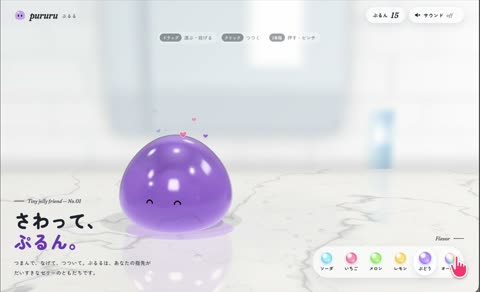</a></td>
<td width="50%" height="225" align="center" valign="middle"></td>
</tr>
<tr>
<td width="50%" valign="top"><strong>A Transparent Jelly That Changes Color and Springs Back</strong> <a href="https://x.com/MatoToushi">@MatoToushi</a> · 3D &amp; interactive 0:41 · Bookmarks — · Details pending <a href="https://guanmo-ai.github.io/awesome-ai-motion/?lang=en#case-2104778232683999363">▶ Play</a> · <a href="https://x.com/MatoToushi/status/2104778232683999363">Original post</a></td>
<td width="50%" valign="top"><strong>A Cartoon Character in a Midnight Laundromat</strong> <a href="https://x.com/midori_tatsuta">@midori_tatsuta</a> · 3D &amp; interactive 0:10 · Bookmarks — · Details pending <a href="https://guanmo-ai.github.io/awesome-ai-motion/?lang=en#case-2109609040716452113">▶ Play</a> · <a href="https://x.com/midori_tatsuta/status/2109609040716452113">Original post</a></td>
</tr>
</tbody>
<tbody>
<tr>
<td width="50%" height="225" align="center" valign="middle"><a href="https://guanmo-ai.github.io/awesome-ai-motion/?lang=en#case-2111519266898169925">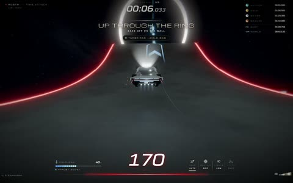</a></td>
<td width="50%" height="225" align="center" valign="middle"><a href="https://guanmo-ai.github.io/awesome-ai-motion/?lang=en#case-2103759320664219750">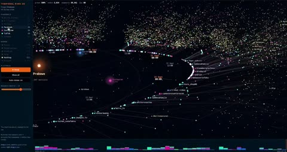</a></td>
</tr>
<tr>
<td width="50%" valign="top"><strong>Roadster Stunts and Multiplayer Racing</strong> <a href="https://x.com/aymericrabot">@aymericrabot</a> · 3D &amp; interactive 1:03 · Bookmarks — · Details pending <a href="https://guanmo-ai.github.io/awesome-ai-motion/?lang=en#case-2111519266898169925">▶ Play</a> · <a href="https://x.com/aymericrabot/status/2111519266898169925">Original post</a></td>
<td width="50%" valign="top"><strong>An Interstellar Relationship Graph for Drone Emprit</strong> <a href="https://x.com/ismailfahmi">@ismailfahmi</a> · 3D &amp; interactive 2:08 · Bookmarks — · Details pending <a href="https://guanmo-ai.github.io/awesome-ai-motion/?lang=en#case-2103759320664219750">▶ Play</a> · <a href="https://x.com/ismailfahmi/status/2103759320664219750">Original post</a></td>
</tr>
</tbody>
<tbody>
<tr>
<td width="50%" height="225" align="center" valign="middle"><a href="https://guanmo-ai.github.io/awesome-ai-motion/?lang=en#case-2103966645588984183">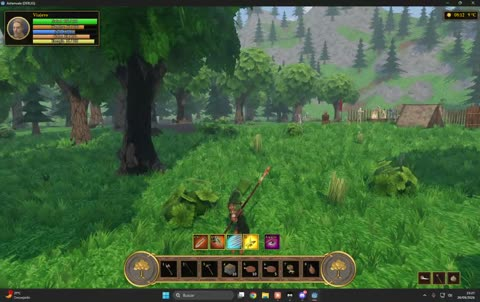</a></td>
<td width="50%" height="225" align="center" valign="middle"></td>
</tr>
<tr>
<td width="50%" valign="top"><strong>Spells and Village Exploration in a Woodland Game</strong> <a href="https://x.com/jorge_coder">@jorge_coder</a> · 3D &amp; interactive 2:36 · Bookmarks — · Details pending <a href="https://guanmo-ai.github.io/awesome-ai-motion/?lang=en#case-2103966645588984183">▶ Play</a> · <a href="https://x.com/jorge_coder/status/2103966645588984183">Original post</a></td>
<td width="50%" valign="top"><strong>A Personal Study with Moving Details</strong> <a href="https://x.com/shion_takk">@shion_takk</a> · 3D &amp; interactive 0:20 · Bookmarks — · Details pending <a href="https://guanmo-ai.github.io/awesome-ai-motion/?lang=en#case-2109993123606941955">▶ Play</a> · <a href="https://x.com/shion_takk/status/2109993123606941955">Original post</a></td>
</tr>
</tbody>
<tbody>
<tr>
<td width="50%" height="225" align="center" valign="middle"><a href="https://guanmo-ai.github.io/awesome-ai-motion/?lang=en#case-2110291409018212638">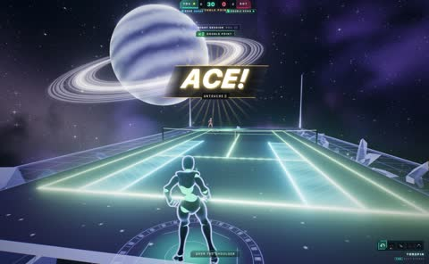</a></td>
<td width="50%" height="225" align="center" valign="middle"><a href="https://guanmo-ai.github.io/awesome-ai-motion/?lang=en#case-2109902063916257466">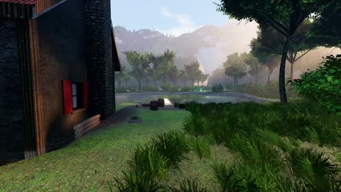</a></td>
</tr>
<tr>
<td width="50%" valign="top"><strong>Space Tennis beneath Saturn's Rings</strong> <a href="https://x.com/darel023">@darel023</a> · 3D &amp; interactive 1:14 · Bookmarks — · Details pending <a href="https://guanmo-ai.github.io/awesome-ai-motion/?lang=en#case-2110291409018212638">▶ Play</a> · <a href="https://x.com/darel023/status/2110291409018212638">Original post</a></td>
<td width="50%" valign="top"><strong>Exploring a Woodland Stream and Cabin</strong> <a href="https://x.com/badboyfoxy">@badboyfoxy</a> · 3D &amp; interactive 2:32 · Bookmarks — · Details pending <a href="https://guanmo-ai.github.io/awesome-ai-motion/?lang=en#case-2109902063916257466">▶ Play</a> · <a href="https://x.com/badboyfoxy/status/2109902063916257466">Original post</a></td>
</tr>
</tbody>
<tbody>
<tr>
<td width="50%" height="225" align="center" valign="middle"></td>
<td width="50%" height="225" align="center" valign="middle"><a href="https://guanmo-ai.github.io/awesome-ai-motion/?lang=en#case-2103728863666896933">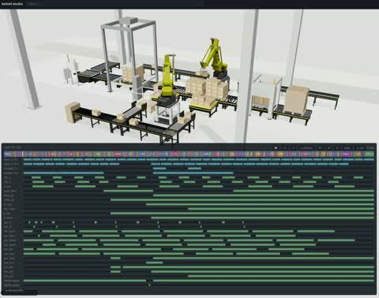</a></td>
</tr>
<tr>
<td width="50%" valign="top"><strong>A Stormy Colossus Chase in Tidebreaker</strong> <a href="https://x.com/chongdashu">@chongdashu</a> · 3D &amp; interactive 0:28 · Bookmarks — · Details pending <a href="https://guanmo-ai.github.io/awesome-ai-motion/?lang=en#case-2109278486015914364">▶ Play</a> · <a href="https://x.com/chongdashu/status/2109278486015914364">Original post</a></td>
<td width="50%" valign="top"><strong>A Collaborative Palletizing-Robot Simulation</strong> <a href="https://x.com/neka_nat">@neka_nat</a> · 3D &amp; interactive 0:26 · Bookmarks — · Details pending <a href="https://guanmo-ai.github.io/awesome-ai-motion/?lang=en#case-2103728863666896933">▶ Play</a> · <a href="https://x.com/neka_nat/status/2103728863666896933">Original post</a></td>
</tr>
</tbody>
<tbody>
<tr>
<td width="50%" height="225" align="center" valign="middle"></td>
<td width="50%" height="225" align="center" valign="middle"></td>
</tr>
<tr>
<td width="50%" valign="top"><strong>Lighting the Lakeside in Lantern Hallow</strong> <a href="https://x.com/notjazii">@notjazii</a> · 3D &amp; interactive 0:42 · Bookmarks — · Details pending <a href="https://guanmo-ai.github.io/awesome-ai-motion/?lang=en#case-2109957002822889591">▶ Play</a> · <a href="https://x.com/notjazii/status/2109957002822889591">Original post</a></td>
<td width="50%" valign="top"><strong>Particles in a Star's Encounter with a Black Hole</strong> <a href="https://x.com/adonis_singh">@adonis_singh</a> · 3D &amp; interactive 0:28 · Bookmarks — · Details pending <a href="https://guanmo-ai.github.io/awesome-ai-motion/?lang=en#case-2103816126778003746">▶ Play</a> · <a href="https://x.com/adonis_singh/status/2103816126778003746">Original post</a></td>
</tr>
</tbody>
<tbody>
<tr>
<td width="50%" height="225" align="center" valign="middle"><a href="https://guanmo-ai.github.io/awesome-ai-motion/?lang=en#case-2103801828744061307">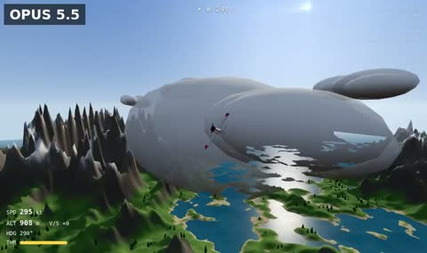</a></td>
<td width="50%" height="225" align="center" valign="middle"></td>
</tr>
<tr>
<td width="50%" valign="top"><strong>Flying through Noise-Generated Mountains</strong> <a href="https://x.com/cyrilXBT">@cyrilXBT</a> · 3D &amp; interactive 0:15 · Bookmarks — · Details pending <a href="https://guanmo-ai.github.io/awesome-ai-motion/?lang=en#case-2103801828744061307">▶ Play</a> · <a href="https://x.com/cyrilXBT/status/2103801828744061307">Original post</a></td>
<td width="50%" valign="top"><strong>A Cartoon Character beneath Cherry Blossoms</strong> <a href="https://x.com/flxrnc">@flxrnc</a> · 3D &amp; interactive 0:17 · Bookmarks — · Details pending <a href="https://guanmo-ai.github.io/awesome-ai-motion/?lang=en#case-2113263621463572991">▶ Play</a> · <a href="https://x.com/flxrnc/status/2113263621463572991">Original post</a></td>
</tr>
</tbody>
<tbody>
<tr>
<td width="50%" height="225" align="center" valign="middle"></td>
<td width="50%" height="225" align="center" valign="middle"></td>
</tr>
<tr>
<td width="50%" valign="top"><strong>A Deer Scarer in a Rainy Japanese Garden</strong> <a href="https://x.com/mizugame_22">@mizugame_22</a> · 3D &amp; interactive 0:15 · Bookmarks — · Details pending <a href="https://guanmo-ai.github.io/awesome-ai-motion/?lang=en#case-2103822799580307674">▶ Play</a> · <a href="https://x.com/mizugame_22/status/2103822799580307674">Original post</a></td>
<td width="50%" valign="top"><strong>Procedural Streets in Endless Space Colonies</strong> <a href="https://x.com/smallhusk">@smallhusk</a> · 3D &amp; interactive 0:49 · Bookmarks — · Details pending <a href="https://guanmo-ai.github.io/awesome-ai-motion/?lang=en#case-2104046074600272056">▶ Play</a> · <a href="https://x.com/smallhusk/status/2104046074600272056">Original post</a></td>
</tr>
</tbody>
<tbody>
<tr>
<td width="50%" height="225" align="center" valign="middle"><a href="https://guanmo-ai.github.io/awesome-ai-motion/?lang=en#case-2107817784432267498">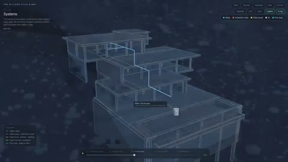</a></td>
<td width="50%"></td>
</tr>
<tr>
<td width="50%" valign="top"><strong>A Hillside House Built along a Timeline</strong> <a href="https://x.com/MrKindey">@MrKindey</a> · 3D &amp; interactive 0:35 · Bookmarks — · Details pending <a href="https://guanmo-ai.github.io/awesome-ai-motion/?lang=en#case-2107817784432267498">▶ Play</a> · <a href="https://x.com/MrKindey/status/2107817784432267498">Original post</a></td>
<td width="50%"></td>
</tr>
</tbody>
</table>
