[← All categories](../README.en.md#browse)

# Motion design

202 works. Click a cover to play; works without gallery video open on X.

<table>
<tbody>
<tr>
<td width="50%" height="225" align="center" valign="middle"></td>
<td width="50%" height="225" align="center" valign="middle"></td>
</tr>
<tr>
<td width="50%" valign="top"><strong>A 15-second motion design showreel</strong> <a href="https://x.com/stephanlivera">@stephanlivera</a> · Motion design 0:15 · Bookmarks 11,692 <a href="https://guanmo-ai.github.io/awesome-ai-motion/?lang=en#case-2103315922098470926">▶ Play</a> · <a href="https://x.com/stephanlivera/status/2103315922098470926">Original post</a></td>
<td width="50%" valign="top"><strong>One shape, a seamless UI morph loop</strong> <a href="https://x.com/twoclipping">@twoclipping</a> · Motion design 0:14 · Bookmarks 19,303 <a href="https://guanmo-ai.github.io/awesome-ai-motion/?lang=en#case-2103273003555402193">▶ Play</a> · <a href="https://x.com/twoclipping/status/2103273003555402193">Original post</a></td>
</tr>
</tbody>
<tbody>
<tr>
<td width="50%" height="225" align="center" valign="middle"><a href="https://guanmo-ai.github.io/awesome-ai-motion/?lang=en#case-2103449416325890146">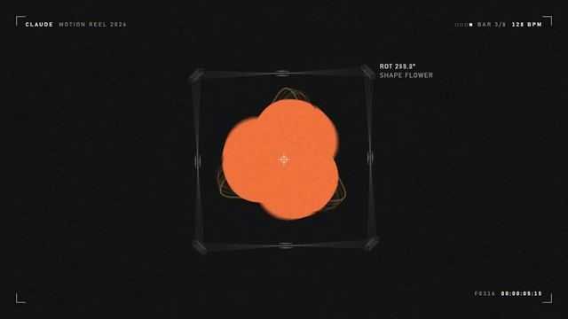</a></td>
<td width="50%" height="225" align="center" valign="middle"></td>
</tr>
<tr>
<td width="50%" valign="top"><strong>Fifteen-Second Motion Design Reel</strong> <a href="https://x.com/ajith_io">@ajith_io</a> · Motion design 0:15 · Bookmarks 4,403 · Details pending <a href="https://guanmo-ai.github.io/awesome-ai-motion/?lang=en#case-2103449416325890146">▶ Play</a> · <a href="https://x.com/ajith_io/status/2103449416325890146">Original post</a></td>
<td width="50%" valign="top"><strong>A Product-Motion Template in One Continuous Take</strong> <a href="https://x.com/twoclipping">@twoclipping</a> · Motion design 0:22 · Bookmarks 1,019 · Details pending <a href="https://guanmo-ai.github.io/awesome-ai-motion/?lang=en#case-2104674464868762046">▶ Play</a> · <a href="https://x.com/twoclipping/status/2104674464868762046">Original post</a></td>
</tr>
</tbody>
<tbody>
<tr>
<td width="50%" height="225" align="center" valign="middle"></td>
<td width="50%" height="225" align="center" valign="middle"></td>
</tr>
<tr>
<td width="50%" valign="top"><strong>What Day Is It?</strong> <a href="https://x.com/nokonoko_1203">@nokonoko_1203</a> · Motion design 0:30 · Bookmarks 902 · Details pending <a href="https://guanmo-ai.github.io/awesome-ai-motion/?lang=en#case-2105922366190784915">▶ Play</a> · <a href="https://x.com/nokonoko_1203/status/2105922366190784915">Original post</a></td>
<td width="50%" valign="top"><strong>Leon’s 15-second motion design reel</strong> <a href="https://x.com/leonabboud">@leonabboud</a> · Motion design 0:15 · Bookmarks 642 <a href="https://guanmo-ai.github.io/awesome-ai-motion/?lang=en#case-2103576084499358051">▶ Play</a> · <a href="https://x.com/leonabboud/status/2103576084499358051">Original post</a></td>
</tr>
</tbody>
<tbody>
<tr>
<td width="50%" height="225" align="center" valign="middle"><a href="https://guanmo-ai.github.io/awesome-ai-motion/?lang=en#case-2102876925102555526">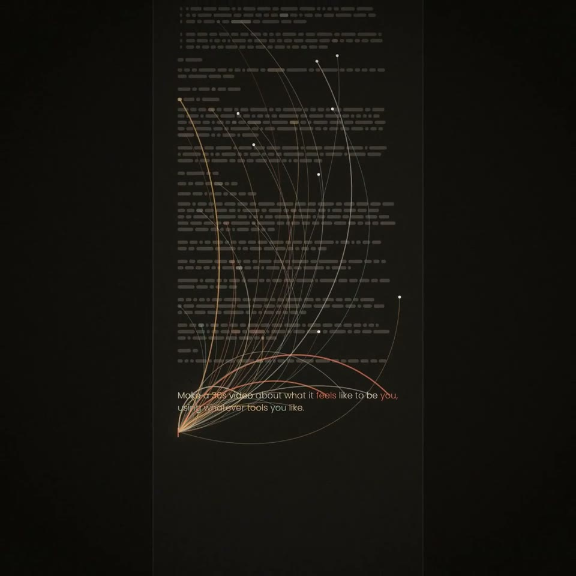</a></td>
<td width="50%" height="225" align="center" valign="middle"></td>
</tr>
<tr>
<td width="50%" valign="top"><strong>What it feels like to be you</strong> <a href="https://x.com/goodside">@goodside</a> · Motion design 0:30 · Bookmarks 638 <a href="https://guanmo-ai.github.io/awesome-ai-motion/?lang=en#case-2102876925102555526">▶ Play</a> · <a href="https://x.com/goodside/status/2102876925102555526">Original post</a></td>
<td width="50%" valign="top"><strong>One Orange Dot Connects a Motion System</strong> <a href="https://x.com/rossaxbt">@rossaxbt</a> · Motion design 0:15 · Bookmarks 275 · Details pending <a href="https://guanmo-ai.github.io/awesome-ai-motion/?lang=en#case-2108570705692357094">▶ Play</a> · <a href="https://x.com/rossaxbt/status/2108570705692357094">Original post</a></td>
</tr>
</tbody>
<tbody>
<tr>
<td width="50%" height="225" align="center" valign="middle"><a href="https://guanmo-ai.github.io/awesome-ai-motion/?lang=en#case-2111814234090693110">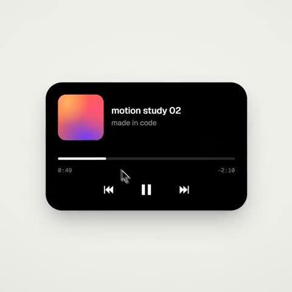</a></td>
<td width="50%" height="225" align="center" valign="middle"></td>
</tr>
<tr>
<td width="50%" valign="top"><strong>One Shape Becomes an Interface</strong> <a href="https://x.com/0xAiky">@0xAiky</a> · Motion design 0:14 · Bookmarks 163 · Details pending <a href="https://guanmo-ai.github.io/awesome-ai-motion/?lang=en#case-2111814234090693110">▶ Play</a> · <a href="https://x.com/0xAiky/status/2111814234090693110">Original post</a></td>
<td width="50%" valign="top"><strong>A Journey through Icon Arrays</strong> <a href="https://x.com/Multi_Serio_Ai">@Multi_Serio_Ai</a> · Motion design 3:04 · Bookmarks 100 · Details pending <a href="https://guanmo-ai.github.io/awesome-ai-motion/?lang=en#case-2105722219892789560">▶ Play</a> · <a href="https://x.com/Multi_Serio_Ai/status/2105722219892789560">Original post</a></td>
</tr>
</tbody>
<tbody>
<tr>
<td width="50%" height="225" align="center" valign="middle"><a href="https://guanmo-ai.github.io/awesome-ai-motion/?lang=en#case-2103742861971726495">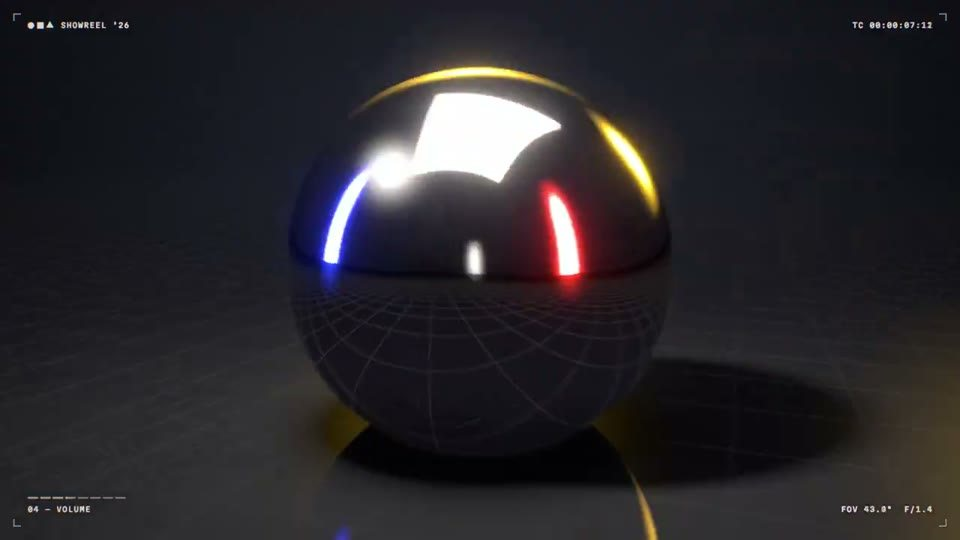</a></td>
<td width="50%" height="225" align="center" valign="middle"></td>
</tr>
<tr>
<td width="50%" valign="top"><strong>Unbranded and branded motion design variants</strong> <a href="https://x.com/lukasersil">@lukasersil</a> · Motion design 0:15 · Bookmarks 98 <a href="https://guanmo-ai.github.io/awesome-ai-motion/?lang=en#case-2103742861971726495">▶ Play</a> · <a href="https://x.com/lukasersil/status/2103742861971726495">Original post</a></td>
<td width="50%" valign="top"><strong>90 seconds of motion design and original piano</strong> <a href="https://x.com/kloss_xyz">@kloss_xyz</a> · Motion design 1:30 · Bookmarks 70 <a href="https://guanmo-ai.github.io/awesome-ai-motion/?lang=en#case-2103557735086428547">▶ Play</a> · <a href="https://x.com/kloss_xyz/status/2103557735086428547">Original post</a></td>
</tr>
</tbody>
<tbody>
<tr>
<td width="50%" height="225" align="center" valign="middle"><a href="https://guanmo-ai.github.io/awesome-ai-motion/?lang=en#case-2103664956482941143">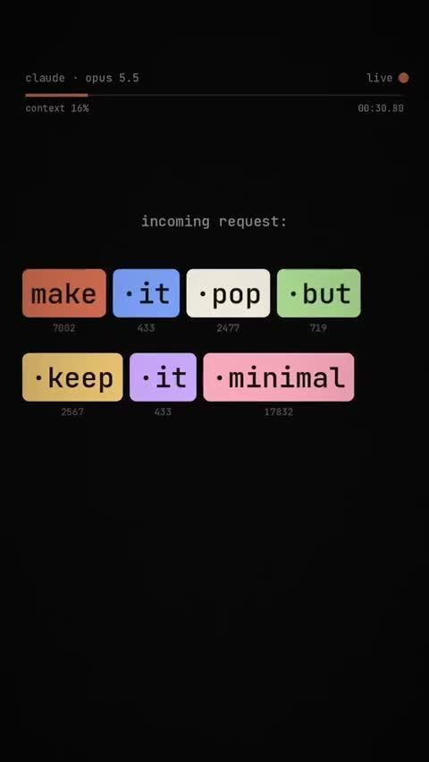</a></td>
<td width="50%" height="225" align="center" valign="middle"><a href="https://guanmo-ai.github.io/awesome-ai-motion/?lang=en#case-2103502614134718609">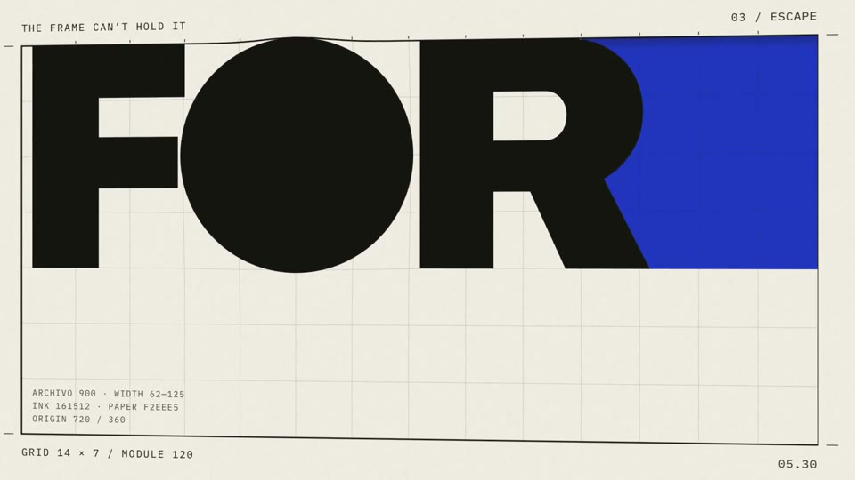</a></td>
</tr>
<tr>
<td width="50%" valign="top"><strong>A Type Film from Colorful Requests to IS IT SAFE</strong> <a href="https://x.com/kloss_xyz">@kloss_xyz</a> · Motion design 2:34 · Bookmarks 39 · Details pending <a href="https://guanmo-ai.github.io/awesome-ai-motion/?lang=en#case-2103664956482941143">▶ Play</a> · <a href="https://x.com/kloss_xyz/status/2103664956482941143">Original post</a></td>
<td width="50%" valign="top"><strong>A poster breaks out of its own frame</strong> <a href="https://x.com/pankajkumar_dev">@pankajkumar_dev</a> · Motion design 0:30 · Bookmarks 16 <a href="https://guanmo-ai.github.io/awesome-ai-motion/?lang=en#case-2103502614134718609">▶ Play</a> · <a href="https://x.com/pankajkumar_dev/status/2103502614134718609">Original post</a></td>
</tr>
</tbody>
<tbody>
<tr>
<td width="50%" height="225" align="center" valign="middle"><a href="https://guanmo-ai.github.io/awesome-ai-motion/?lang=en#case-2105917770907156748">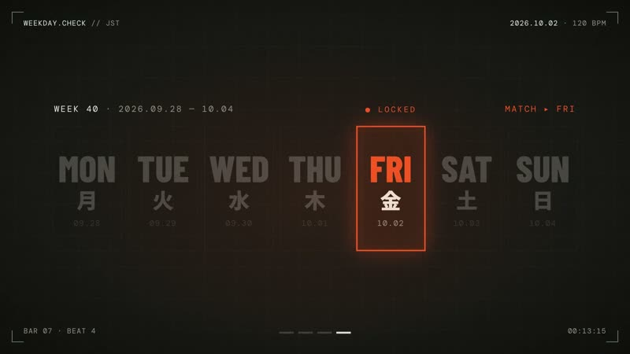</a></td>
<td width="50%" height="225" align="center" valign="middle"><a href="https://guanmo-ai.github.io/awesome-ai-motion/?lang=en#case-2108242454105251921">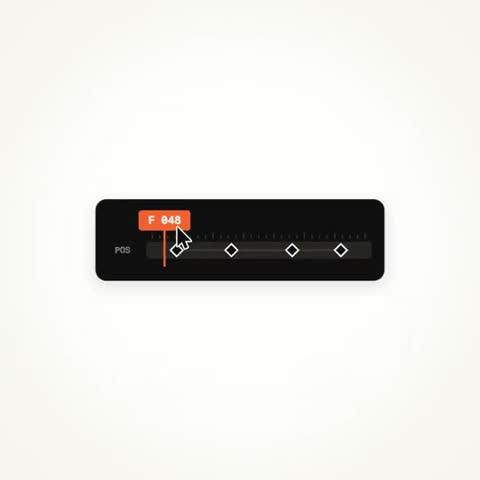</a></td>
</tr>
<tr>
<td width="50%" valign="top"><strong>A thirty-second motion answer to the day of the week</strong> <a href="https://x.com/tankazunori0914">@tankazunori0914</a> · Motion design 0:30 · Bookmarks 16 <a href="https://guanmo-ai.github.io/awesome-ai-motion/?lang=en#case-2105917770907156748">▶ Play</a> · <a href="https://x.com/tankazunori0914/status/2105917770907156748">Original post</a></td>
<td width="50%" valign="top"><strong>One Shape, a Fourteen-Second UI Loop</strong> <a href="https://x.com/flxrnc">@flxrnc</a> · Motion design 0:14 · Bookmarks 15 · Details pending <a href="https://guanmo-ai.github.io/awesome-ai-motion/?lang=en#case-2108242454105251921">▶ Play</a> · <a href="https://x.com/flxrnc/status/2108242454105251921">Original post</a></td>
</tr>
</tbody>
<tbody>
<tr>
<td width="50%" height="225" align="center" valign="middle"><a href="https://guanmo-ai.github.io/awesome-ai-motion/?lang=en#case-2105671467962950000">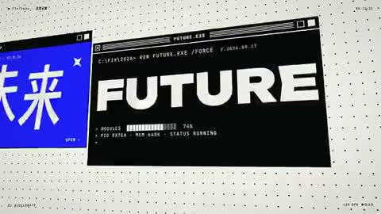</a></td>
<td width="50%" height="225" align="center" valign="middle"><a href="https://guanmo-ai.github.io/awesome-ai-motion/?lang=en#case-2109174851412119558">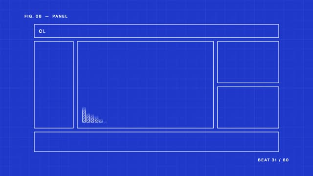</a></td>
</tr>
<tr>
<td width="50%" valign="top"><strong>The Future Is Here: High-Contrast Type in Motion</strong> <a href="https://x.com/renmu2017">@renmu2017</a> · Motion design 1:02 · Bookmarks 15 · Details pending <a href="https://guanmo-ai.github.io/awesome-ai-motion/?lang=en#case-2105671467962950000">▶ Play</a> · <a href="https://x.com/renmu2017/status/2105671467962950000">Original post</a></td>
<td width="50%" valign="top"><strong>One Line Becomes a Motion Design Reel</strong> <a href="https://x.com/heyiamnick">@heyiamnick</a> · Motion design 0:30 · Bookmarks 15 · Details pending <a href="https://guanmo-ai.github.io/awesome-ai-motion/?lang=en#case-2109174851412119558">▶ Play</a> · <a href="https://x.com/heyiamnick/status/2109174851412119558">Original post</a></td>
</tr>
</tbody>
<tbody>
<tr>
<td width="50%" height="225" align="center" valign="middle"><a href="https://guanmo-ai.github.io/awesome-ai-motion/?lang=en#case-2104191375809954126">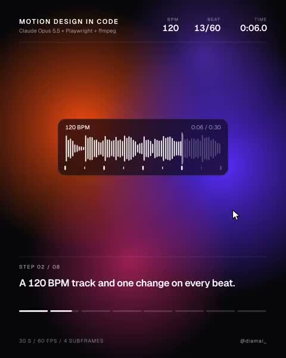</a></td>
<td width="50%" height="225" align="center" valign="middle"><a href="https://guanmo-ai.github.io/awesome-ai-motion/?lang=en#case-2104200939095904322">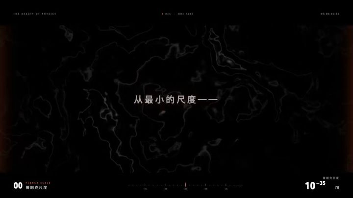</a></td>
</tr>
<tr>
<td width="50%" valign="top"><strong>One Beat Track Connecting Eight UI States</strong> <a href="https://x.com/diamai_">@diamai_</a> · Motion design 0:30 · Bookmarks 14 · Details pending <a href="https://guanmo-ai.github.io/awesome-ai-motion/?lang=en#case-2104191375809954126">▶ Play</a> · <a href="https://x.com/diamai_/status/2104191375809954126">Original post</a></td>
<td width="50%" valign="top"><strong>One shot beauty of physics animation</strong> <a href="https://x.com/akokoi1">@akokoi1</a> · Motion design 1:16 · Bookmarks 14 · Details pending <a href="https://guanmo-ai.github.io/awesome-ai-motion/?lang=en#case-2104200939095904322">▶ Play</a> · <a href="https://x.com/akokoi1/status/2104200939095904322">Original post</a></td>
</tr>
</tbody>
<tbody>
<tr>
<td width="50%" height="225" align="center" valign="middle"><a href="https://guanmo-ai.github.io/awesome-ai-motion/?lang=en#case-2107123676768342403">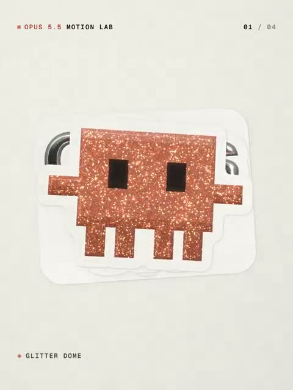</a></td>
<td width="50%" height="225" align="center" valign="middle"></td>
</tr>
<tr>
<td width="50%" valign="top"><strong>Glitter and Chrome Sticker Peels</strong> <a href="https://x.com/flxrnc">@flxrnc</a> · Motion design 0:12 · Bookmarks 13 · Details pending <a href="https://guanmo-ai.github.io/awesome-ai-motion/?lang=en#case-2107123676768342403">▶ Play</a> · <a href="https://x.com/flxrnc/status/2107123676768342403">Original post</a></td>
<td width="50%" valign="top"><strong>Market Themes in Fifteen Seconds of Motion</strong> <a href="https://x.com/thomasrice_au">@thomasrice_au</a> · Motion design 0:15 · Bookmarks 6 · Details pending <a href="https://guanmo-ai.github.io/awesome-ai-motion/?lang=en#case-2103779928932257876">▶ Play</a> · <a href="https://x.com/thomasrice_au/status/2103779928932257876">Original post</a></td>
</tr>
</tbody>
<tbody>
<tr>
<td width="50%" height="225" align="center" valign="middle"><a href="https://guanmo-ai.github.io/awesome-ai-motion/?lang=en#case-2103832593355686104">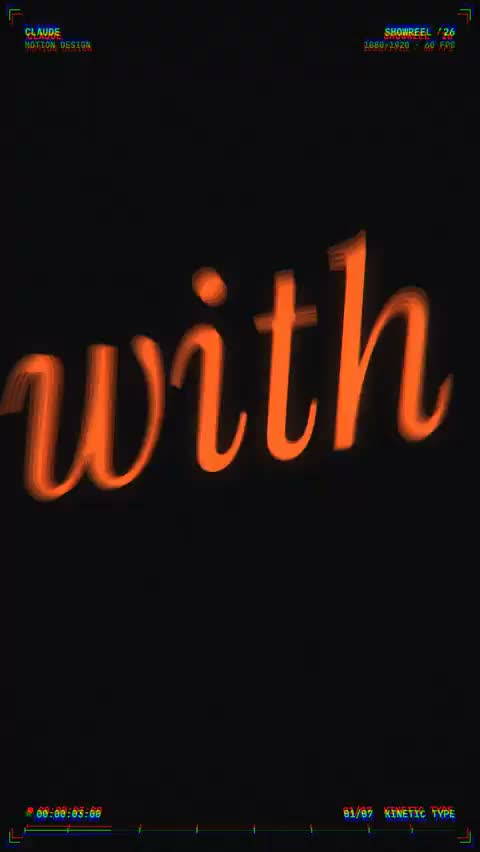</a></td>
<td width="50%" height="225" align="center" valign="middle"><a href="https://guanmo-ai.github.io/awesome-ai-motion/?lang=en#case-2104207707980869918">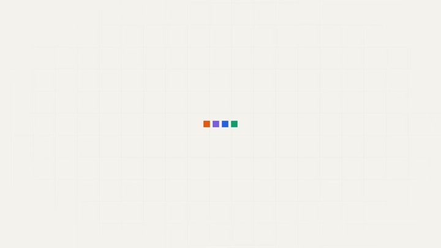</a></td>
</tr>
<tr>
<td width="50%" valign="top"><strong>A Vertical Reel of Liquid Type and Reflective Materials</strong> <a href="https://x.com/ndhabarde11">@ndhabarde11</a> · Motion design 0:15 · Bookmarks 6 · Details pending <a href="https://guanmo-ai.github.io/awesome-ai-motion/?lang=en#case-2103832593355686104">▶ Play</a> · <a href="https://x.com/ndhabarde11/status/2103832593355686104">Original post</a></td>
<td width="50%" valign="top"><strong>Fifteen second motion design demo</strong> <a href="https://x.com/TheViableEdge">@TheViableEdge</a> · Motion design 0:15 · Bookmarks 5 · Details pending <a href="https://guanmo-ai.github.io/awesome-ai-motion/?lang=en#case-2104207707980869918">▶ Play</a> · <a href="https://x.com/TheViableEdge/status/2104207707980869918">Original post</a></td>
</tr>
</tbody>
<tbody>
<tr>
<td width="50%" height="225" align="center" valign="middle"></td>
<td width="50%" height="225" align="center" valign="middle"><a href="https://guanmo-ai.github.io/awesome-ai-motion/?lang=en#case-2103458245213929495">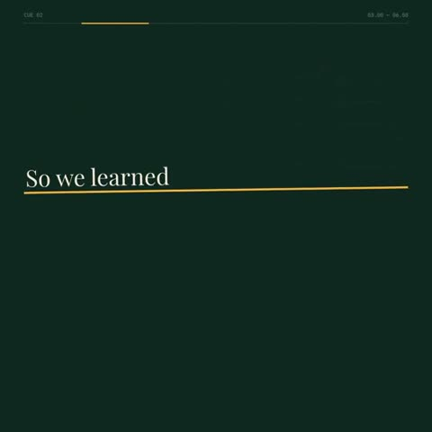</a></td>
</tr>
<tr>
<td width="50%" valign="top"><strong>A Serif Typeface in Motion</strong> <a href="https://x.com/maxescu">@maxescu</a> · Motion design 0:30 · Bookmarks 3 · Details pending <a href="https://guanmo-ai.github.io/awesome-ai-motion/?lang=en#case-2112190348982190390">▶ Play</a> · <a href="https://x.com/maxescu/status/2112190348982190390">Original post</a></td>
<td width="50%" valign="top"><strong>Words Build a Stage</strong> <a href="https://x.com/Gdgtify">@Gdgtify</a> · Motion design 0:20 · Bookmarks 3 · Details pending <a href="https://guanmo-ai.github.io/awesome-ai-motion/?lang=en#case-2103458245213929495">▶ Play</a> · <a href="https://x.com/Gdgtify/status/2103458245213929495">Original post</a></td>
</tr>
</tbody>
<tbody>
<tr>
<td width="50%" height="225" align="center" valign="middle"><a href="https://guanmo-ai.github.io/awesome-ai-motion/?lang=en#case-2105570411870130294">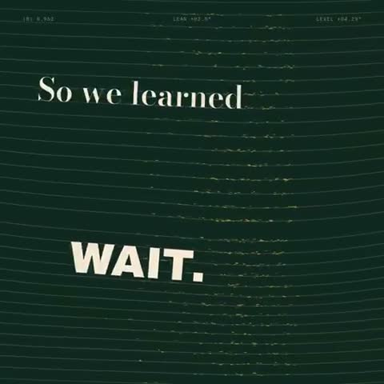</a></td>
<td width="50%" height="225" align="center" valign="middle"><a href="https://guanmo-ai.github.io/awesome-ai-motion/?lang=en#case-2105669567036989608">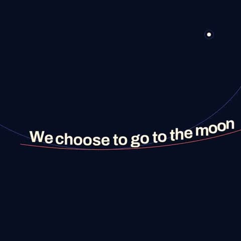</a></td>
</tr>
<tr>
<td width="50%" valign="top"><strong>Typography in a Magnetic Field</strong> <a href="https://x.com/Gdgtify">@Gdgtify</a> · Motion design 0:20 · Bookmarks 3 · Details pending <a href="https://guanmo-ai.github.io/awesome-ai-motion/?lang=en#case-2105570411870130294">▶ Play</a> · <a href="https://x.com/Gdgtify/status/2105570411870130294">Original post</a></td>
<td width="50%" valign="top"><strong>Escape the Orbit</strong> <a href="https://x.com/Gdgtify">@Gdgtify</a> · Motion design 0:20 · Bookmarks 2 · Details pending <a href="https://guanmo-ai.github.io/awesome-ai-motion/?lang=en#case-2105669567036989608">▶ Play</a> · <a href="https://x.com/Gdgtify/status/2105669567036989608">Original post</a></td>
</tr>
</tbody>
<tbody>
<tr>
<td width="50%" height="225" align="center" valign="middle"><a href="https://guanmo-ai.github.io/awesome-ai-motion/?lang=en#case-2103446726245847163">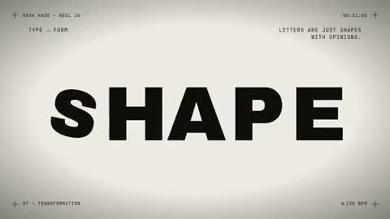</a></td>
<td width="50%" height="225" align="center" valign="middle"></td>
</tr>
<tr>
<td width="50%" valign="top"><strong>A Thirty-Second Reel of Type, Geometry and Camera Moves</strong> <a href="https://x.com/essjaykay755">@essjaykay755</a> · Motion design 0:30 · Bookmarks 1 · Details pending <a href="https://guanmo-ai.github.io/awesome-ai-motion/?lang=en#case-2103446726245847163">▶ Play</a> · <a href="https://x.com/essjaykay755/status/2103446726245847163">Original post</a></td>
<td width="50%" valign="top"><strong>A Showreel of Dots, Grids and Bilingual Type</strong> <a href="https://x.com/Ai9app">@Ai9app</a> · Motion design 0:15 · Bookmarks 0 · Details pending <a href="https://guanmo-ai.github.io/awesome-ai-motion/?lang=en#case-2104912803786375645">▶ Play</a> · <a href="https://x.com/Ai9app/status/2104912803786375645">Original post</a></td>
</tr>
</tbody>
<tbody>
<tr>
<td width="50%" height="225" align="center" valign="middle"><a href="https://guanmo-ai.github.io/awesome-ai-motion/?lang=en#case-2105770390924738984">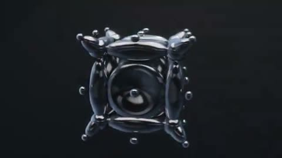</a></td>
<td width="50%" height="225" align="center" valign="middle"></td>
</tr>
<tr>
<td width="50%" valign="top"><strong>A Metallic Fractal Growing to the Beat</strong> <a href="https://x.com/Xanares">@Xanares</a> · Motion design 0:37 · Bookmarks 0 · Details pending <a href="https://guanmo-ai.github.io/awesome-ai-motion/?lang=en#case-2105770390924738984">▶ Play</a> · <a href="https://x.com/Xanares/status/2105770390924738984">Original post</a></td>
<td width="50%" valign="top"><strong>A Bouncing Dot Becomes a Search Bar</strong> <a href="https://x.com/cgclick">@cgclick</a> · Motion design 0:06 · Bookmarks 0 · Details pending <a href="https://guanmo-ai.github.io/awesome-ai-motion/?lang=en#case-2107906341243081068">▶ Play</a> · <a href="https://x.com/cgclick/status/2107906341243081068">Original post</a></td>
</tr>
</tbody>
<tbody>
<tr>
<td width="50%" height="225" align="center" valign="middle"><a href="https://guanmo-ai.github.io/awesome-ai-motion/?lang=en#case-2110706003058536747">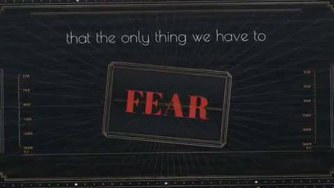</a></td>
<td width="50%" height="225" align="center" valign="middle"><a href="https://guanmo-ai.github.io/awesome-ai-motion/?lang=en#case-2104756321908375866">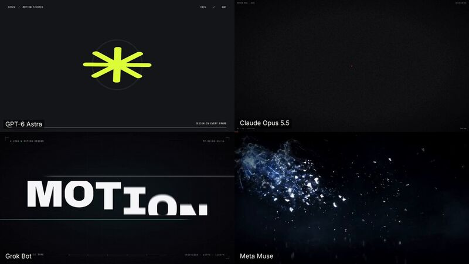</a></td>
</tr>
<tr>
<td width="50%" valign="top"><strong>Fear Itself</strong> <a href="https://x.com/Gdgtify">@Gdgtify</a> · Motion design 0:25 · Bookmarks 0 · Details pending <a href="https://guanmo-ai.github.io/awesome-ai-motion/?lang=en#case-2110706003058536747">▶ Play</a> · <a href="https://x.com/Gdgtify/status/2110706003058536747">Original post</a></td>
<td width="50%" valign="top"><strong>Four Models, One Motion Showreel Prompt</strong> <a href="https://x.com/MasonMosen">@MasonMosen</a> · Motion design 0:15 · Bookmarks 0 · Details pending <a href="https://guanmo-ai.github.io/awesome-ai-motion/?lang=en#case-2104756321908375866">▶ Play</a> · <a href="https://x.com/MasonMosen/status/2104756321908375866">Original post</a></td>
</tr>
</tbody>
<tbody>
<tr>
<td width="50%" height="225" align="center" valign="middle"><a href="https://guanmo-ai.github.io/awesome-ai-motion/?lang=en#case-2104788406656184436">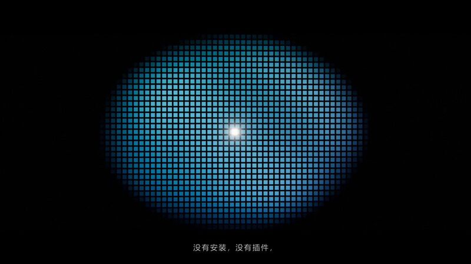</a></td>
<td width="50%" height="225" align="center" valign="middle"><a href="https://guanmo-ai.github.io/awesome-ai-motion/?lang=en#case-2106715812023226687">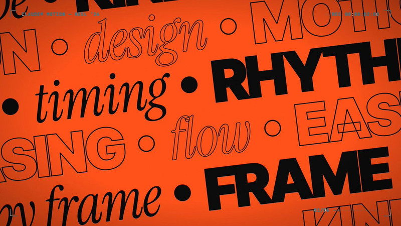</a></td>
</tr>
<tr>
<td width="50%" valign="top"><strong>The Beauty of Three.js: A Cinematic Long Take</strong> <a href="https://x.com/yupengfei990919">@yupengfei990919</a> · Motion design 1:53 · Bookmarks 0 · Details pending <a href="https://guanmo-ai.github.io/awesome-ai-motion/?lang=en#case-2104788406656184436">▶ Play</a> · <a href="https://x.com/yupengfei990919/status/2104788406656184436">Original post</a></td>
<td width="50%" valign="top"><strong>A fifteen-second motion-design showreel</strong> <a href="https://x.com/Adimazuz03">@Adimazuz03</a> · Motion design 0:15 · Bookmarks 0 · Details pending <a href="https://guanmo-ai.github.io/awesome-ai-motion/?lang=en#case-2106715812023226687">▶ Play</a> · <a href="https://x.com/Adimazuz03/status/2106715812023226687">Original post</a></td>
</tr>
</tbody>
<tbody>
<tr>
<td width="50%" height="225" align="center" valign="middle"><a href="https://guanmo-ai.github.io/awesome-ai-motion/?lang=en#case-2106734468715466818">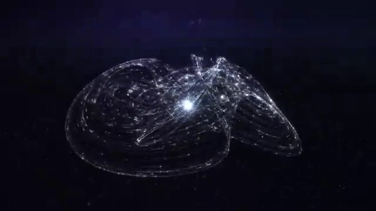</a></td>
<td width="50%" height="225" align="center" valign="middle"><a href="https://guanmo-ai.github.io/awesome-ai-motion/?lang=en#case-2107367735466573937">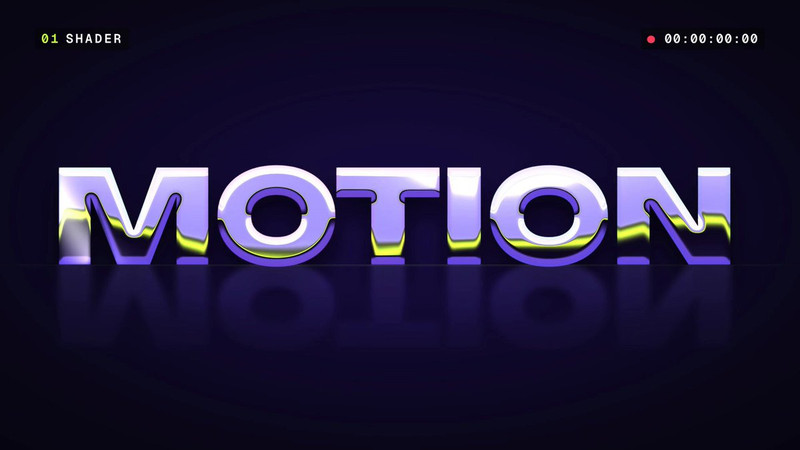</a></td>
</tr>
<tr>
<td width="50%" valign="top"><strong>Show Me Your Mind</strong> <a href="https://x.com/argbeknwn">@argbeknwn</a> · Motion design 0:15 · Bookmarks 0 · Details pending <a href="https://guanmo-ai.github.io/awesome-ai-motion/?lang=en#case-2106734468715466818">▶ Play</a> · <a href="https://x.com/argbeknwn/status/2106734468715466818">Original post</a></td>
<td width="50%" valign="top"><strong>Showtime: a motion-design skill sample</strong> <a href="https://x.com/FavioVaz">@FavioVaz</a> · Motion design 0:15 · Bookmarks 0 · Details pending <a href="https://guanmo-ai.github.io/awesome-ai-motion/?lang=en#case-2107367735466573937">▶ Play</a> · <a href="https://x.com/FavioVaz/status/2107367735466573937">Original post</a></td>
</tr>
</tbody>
<tbody>
<tr>
<td width="50%" height="225" align="center" valign="middle"><a href="https://guanmo-ai.github.io/awesome-ai-motion/?lang=en#case-2107628283009364368">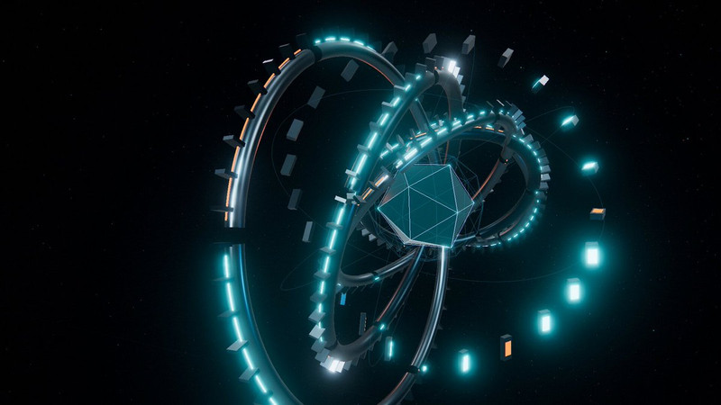</a></td>
<td width="50%" height="225" align="center" valign="middle"><a href="https://guanmo-ai.github.io/awesome-ai-motion/?lang=en#case-2108122750724260231">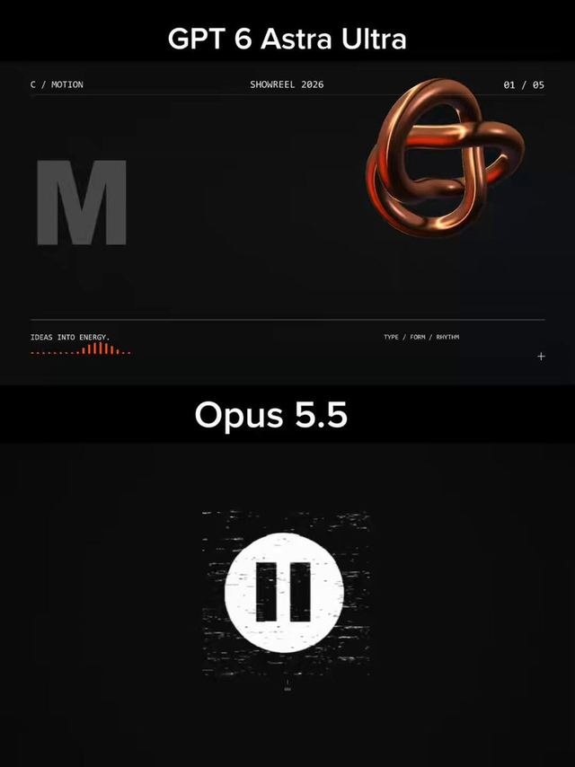</a></td>
</tr>
<tr>
<td width="50%" valign="top"><strong>AXIOM / REACTOR mechanical motion</strong> <a href="https://x.com/zyon1527">@zyon1527</a> · Motion design 0:15 · Bookmarks 0 · Details pending <a href="https://guanmo-ai.github.io/awesome-ai-motion/?lang=en#case-2107628283009364368">▶ Play</a> · <a href="https://x.com/zyon1527/status/2107628283009364368">Original post</a></td>
<td width="50%" valign="top"><strong>Two Models, One Motion Showreel Prompt</strong> <a href="https://x.com/BMWepta">@BMWepta</a> · Motion design 0:30 · Bookmarks 0 · Details pending <a href="https://guanmo-ai.github.io/awesome-ai-motion/?lang=en#case-2108122750724260231">▶ Play</a> · <a href="https://x.com/BMWepta/status/2108122750724260231">Original post</a></td>
</tr>
</tbody>
<tbody>
<tr>
<td width="50%" height="225" align="center" valign="middle"><a href="https://guanmo-ai.github.io/awesome-ai-motion/?lang=en#case-2110476412213686723">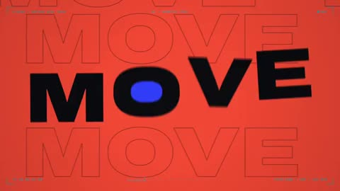</a></td>
<td width="50%" height="225" align="center" valign="middle"><a href="https://guanmo-ai.github.io/awesome-ai-motion/?lang=en#case-2110898326740803893">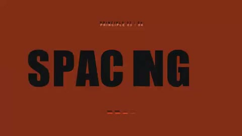</a></td>
</tr>
<tr>
<td width="50%" valign="top"><strong>MOVE: Fifteen Seconds of Type and Waveforms</strong> <a href="https://x.com/0node0">@0node0</a> · Motion design 0:15 · Bookmarks 0 · Details pending <a href="https://guanmo-ai.github.io/awesome-ai-motion/?lang=en#case-2110476412213686723">▶ Play</a> · <a href="https://x.com/0node0/status/2110476412213686723">Original post</a></td>
<td width="50%" valign="top"><strong>Eighteen Seconds of Type and Lines</strong> <a href="https://x.com/weilicdrv">@weilicdrv</a> · Motion design 0:18 · Bookmarks 0 · Details pending <a href="https://guanmo-ai.github.io/awesome-ai-motion/?lang=en#case-2110898326740803893">▶ Play</a> · <a href="https://x.com/weilicdrv/status/2110898326740803893">Original post</a></td>
</tr>
</tbody>
<tbody>
<tr>
<td width="50%" height="225" align="center" valign="middle"><a href="https://guanmo-ai.github.io/awesome-ai-motion/?lang=en#case-2111129754254680272">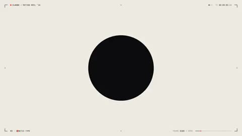</a></td>
<td width="50%" height="225" align="center" valign="middle"><a href="https://guanmo-ai.github.io/awesome-ai-motion/?lang=en#case-2104618175803609305">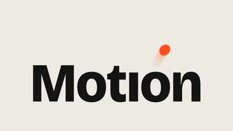</a></td>
</tr>
<tr>
<td width="50%" valign="top"><strong>A Dot Becomes a Glitch-Type Showreel</strong> <a href="https://x.com/ravenblaze99">@ravenblaze99</a> · Motion design 0:15 · Bookmarks 0 · Details pending <a href="https://guanmo-ai.github.io/awesome-ai-motion/?lang=en#case-2111129754254680272">▶ Play</a> · <a href="https://x.com/ravenblaze99/status/2111129754254680272">Original post</a></td>
<td width="50%" valign="top"><strong>An Orange Dot Connects the Film</strong> <a href="https://x.com/uxmiles">@uxmiles</a> · Motion design 0:15 · Bookmarks 4,720 · Details pending <a href="https://guanmo-ai.github.io/awesome-ai-motion/?lang=en#case-2104618175803609305">▶ Play</a> · <a href="https://x.com/uxmiles/status/2104618175803609305">Original post</a></td>
</tr>
</tbody>
<tbody>
<tr>
<td width="50%" height="225" align="center" valign="middle"><a href="https://guanmo-ai.github.io/awesome-ai-motion/?lang=en#case-2102514581684052169">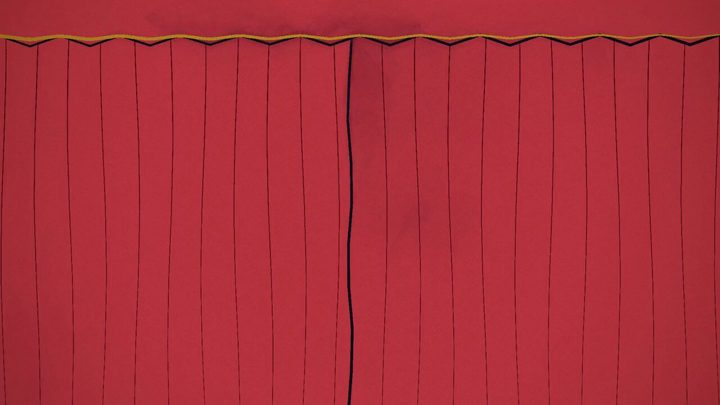</a></td>
<td width="50%" height="225" align="center" valign="middle"></td>
</tr>
<tr>
<td width="50%" valign="top"><strong>Opus visual design test</strong> <a href="https://x.com/other__reality">@other__reality</a> · Motion design 2:37 · Bookmarks 4,192 · Details pending <a href="https://guanmo-ai.github.io/awesome-ai-motion/?lang=en#case-2102514581684052169">▶ Play</a> · <a href="https://x.com/other__reality/status/2102514581684052169">Original post</a></td>
<td width="50%" valign="top"><strong>Opus 5.5 animation demo</strong> <a href="https://x.com/devteamdrew">@devteamdrew</a> · Motion design 0:32 · Bookmarks 4,153 · Details pending <a href="https://guanmo-ai.github.io/awesome-ai-motion/?lang=en#case-2102436464323661880">▶ Play</a> · <a href="https://x.com/devteamdrew/status/2102436464323661880">Original post</a></td>
</tr>
</tbody>
<tbody>
<tr>
<td width="50%" height="225" align="center" valign="middle"><a href="https://guanmo-ai.github.io/awesome-ai-motion/?lang=en#case-2103403361022419005">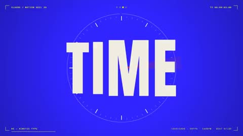</a></td>
<td width="50%" height="225" align="center" valign="middle"><a href="https://guanmo-ai.github.io/awesome-ai-motion/?lang=en#case-2103082510607610023">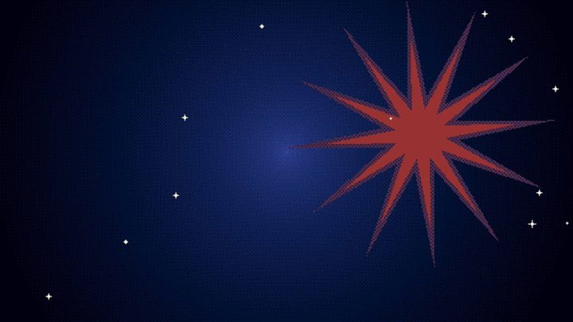</a></td>
</tr>
<tr>
<td width="50%" valign="top"><strong>A Fifteen-Second Motion Reel Organized by Beats</strong> <a href="https://x.com/aiehon_aya">@aiehon_aya</a> · Motion design 0:15 · Bookmarks 3,729 · Details pending <a href="https://guanmo-ai.github.io/awesome-ai-motion/?lang=en#case-2103403361022419005">▶ Play</a> · <a href="https://x.com/aiehon_aya/status/2103403361022419005">Original post</a></td>
<td width="50%" valign="top"><strong>Animation Experiment from a Shared Workflow</strong> <a href="https://x.com/pleometric">@pleometric</a> · Motion design 2:37 · Bookmarks 3,466 · Details pending <a href="https://guanmo-ai.github.io/awesome-ai-motion/?lang=en#case-2103082510607610023">▶ Play</a> · <a href="https://x.com/pleometric/status/2103082510607610023">Original post</a></td>
</tr>
</tbody>
<tbody>
<tr>
<td width="50%" height="225" align="center" valign="middle"></td>
<td width="50%" height="225" align="center" valign="middle"><a href="https://guanmo-ai.github.io/awesome-ai-motion/?lang=en#case-2104957548797604116">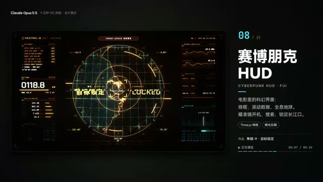</a></td>
</tr>
<tr>
<td width="50%" valign="top"><strong>Dance Motion Composed Across Tools</strong> <a href="https://x.com/sankakuten91256">@sankakuten91256</a> · Motion design 0:15 · Bookmarks 3,185 · Details pending <a href="https://guanmo-ai.github.io/awesome-ai-motion/?lang=en#case-2103483923783373039">▶ Play</a> · <a href="https://x.com/sankakuten91256/status/2103483923783373039">Original post</a></td>
<td width="50%" valign="top"><strong>15 Code-Generated Motion Design Styles</strong> <a href="https://x.com/VincentWei93">@VincentWei93</a> · Motion design 2:59 · Bookmarks 2,850 · Details pending <a href="https://guanmo-ai.github.io/awesome-ai-motion/?lang=en#case-2104957548797604116">▶ Play</a> · <a href="https://x.com/VincentWei93/status/2104957548797604116">Original post</a></td>
</tr>
</tbody>
<tbody>
<tr>
<td width="50%" height="225" align="center" valign="middle"></td>
<td width="50%" height="225" align="center" valign="middle"></td>
</tr>
<tr>
<td width="50%" valign="top"><strong>Twenty Code-Drawn Styles</strong> <a href="https://x.com/yasinozmeen">@yasinozmeen</a> · Motion design 3:46 · Bookmarks 2,775 · Details pending <a href="https://guanmo-ai.github.io/awesome-ai-motion/?lang=en#case-2104086740600254919">▶ Play</a> · <a href="https://x.com/yasinozmeen/status/2104086740600254919">Original post</a></td>
<td width="50%" valign="top"><strong>A Suite of Glass-Like UI Motion</strong> <a href="https://x.com/motion_conquest">@motion_conquest</a> · Motion design 0:16 · Bookmarks 2,059 · Details pending <a href="https://guanmo-ai.github.io/awesome-ai-motion/?lang=en#case-2103510103622308152">▶ Play</a> · <a href="https://x.com/motion_conquest/status/2103510103622308152">Original post</a></td>
</tr>
</tbody>
<tbody>
<tr>
<td width="50%" height="225" align="center" valign="middle"><a href="https://guanmo-ai.github.io/awesome-ai-motion/?lang=en#case-2103893708550914076">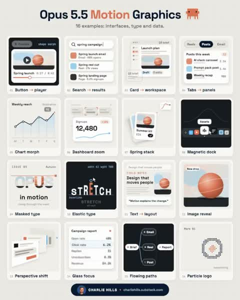</a></td>
<td width="50%" height="225" align="center" valign="middle"><a href="https://guanmo-ai.github.io/awesome-ai-motion/?lang=en#case-2104085484347818226">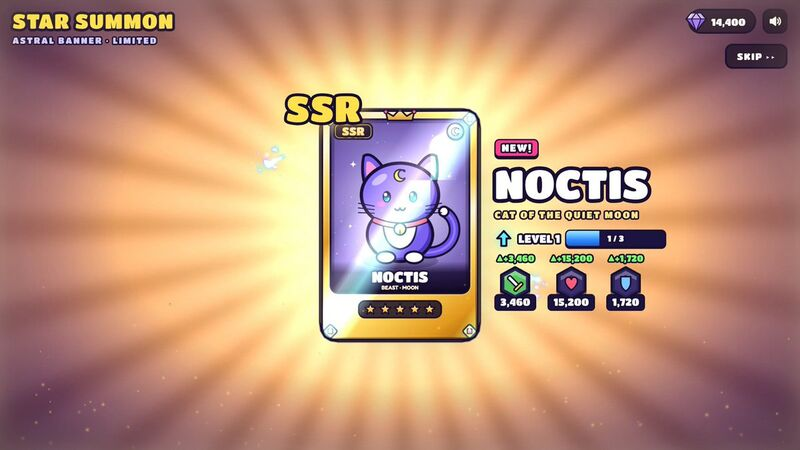</a></td>
</tr>
<tr>
<td width="50%" valign="top"><strong>Sixteen Motion Components</strong> <a href="https://x.com/charliejhills">@charliejhills</a> · Motion design 0:08 · Bookmarks 1,823 · Details pending <a href="https://guanmo-ai.github.io/awesome-ai-motion/?lang=en#case-2103893708550914076">▶ Play</a> · <a href="https://x.com/charliejhills/status/2103893708550914076">Original post</a></td>
<td width="50%" valign="top"><strong>A Game Card-Draw Animation</strong> <a href="https://x.com/op7418">@op7418</a> · Motion design 0:18 · Bookmarks 1,621 · Details pending <a href="https://guanmo-ai.github.io/awesome-ai-motion/?lang=en#case-2104085484347818226">▶ Play</a> · <a href="https://x.com/op7418/status/2104085484347818226">Original post</a></td>
</tr>
</tbody>
<tbody>
<tr>
<td width="50%" height="225" align="center" valign="middle"></td>
<td width="50%" height="225" align="center" valign="middle"><a href="https://guanmo-ai.github.io/awesome-ai-motion/?lang=en#case-2111435045109903540">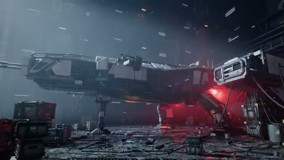</a></td>
</tr>
<tr>
<td width="50%" valign="top"><strong>An Imagined Short-Video Feed</strong> <a href="https://x.com/pleometric">@pleometric</a> · Motion design 0:47 · Bookmarks 1,318 · Details pending <a href="https://guanmo-ai.github.io/awesome-ai-motion/?lang=en#case-2102572941699354900">▶ Play</a> · <a href="https://x.com/pleometric/status/2102572941699354900">Original post</a></td>
<td width="50%" valign="top"><strong>A Volumetric Sci-Fi Hangar in Houdini</strong> <a href="https://x.com/hectorVFX">@hectorVFX</a> · Motion design 0:15 · Bookmarks 1,122 · Details pending <a href="https://guanmo-ai.github.io/awesome-ai-motion/?lang=en#case-2111435045109903540">▶ Play</a> · <a href="https://x.com/hectorVFX/status/2111435045109903540">Original post</a></td>
</tr>
</tbody>
<tbody>
<tr>
<td width="50%" height="225" align="center" valign="middle"><a href="https://guanmo-ai.github.io/awesome-ai-motion/?lang=en#case-2104525735713206557">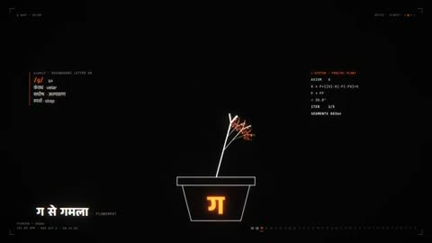</a></td>
<td width="50%" height="225" align="center" valign="middle"></td>
</tr>
<tr>
<td width="50%" valign="top"><strong>Hindi Letterforms in Motion</strong> <a href="https://x.com/pratyushrungta">@pratyushrungta</a> · Motion design 3:30 · Bookmarks 985 · Details pending <a href="https://guanmo-ai.github.io/awesome-ai-motion/?lang=en#case-2104525735713206557">▶ Play</a> · <a href="https://x.com/pratyushrungta/status/2104525735713206557">Original post</a></td>
<td width="50%" valign="top"><strong>Arabic Voiceover with Kinetic Type</strong> <a href="https://x.com/tu_u_k">@tu_u_k</a> · Motion design 0:34 · Bookmarks 942 · Details pending <a href="https://guanmo-ai.github.io/awesome-ai-motion/?lang=en#case-2104629219607114206">▶ Play</a> · <a href="https://x.com/tu_u_k/status/2104629219607114206">Original post</a></td>
</tr>
</tbody>
<tbody>
<tr>
<td width="50%" height="225" align="center" valign="middle"></td>
<td width="50%" height="225" align="center" valign="middle"></td>
</tr>
<tr>
<td width="50%" valign="top"><strong>Single-Model Animation Test</strong> <a href="https://x.com/LCSlates">@LCSlates</a> · Motion design 1:20 · Bookmarks 867 · Details pending <a href="https://guanmo-ai.github.io/awesome-ai-motion/?lang=en#case-2102503027340988559">▶ Play</a> · <a href="https://x.com/LCSlates/status/2102503027340988559">Original post</a></td>
<td width="50%" valign="top"><strong>One-File Generative Visual Demo</strong> <a href="https://x.com/JustinPerea">@JustinPerea</a> · Motion design 0:43 · Bookmarks 816 · Details pending <a href="https://guanmo-ai.github.io/awesome-ai-motion/?lang=en#case-2102893186330841502">▶ Play</a> · <a href="https://x.com/JustinPerea/status/2102893186330841502">Original post</a></td>
</tr>
</tbody>
<tbody>
<tr>
<td width="50%" height="225" align="center" valign="middle"></td>
<td width="50%" height="225" align="center" valign="middle"></td>
</tr>
<tr>
<td width="50%" valign="top"><strong>Tea, Flowers and Paper-Cut Motion</strong> <a href="https://x.com/chetaslua">@chetaslua</a> · Motion design 0:10 · Bookmarks 769 · Details pending <a href="https://guanmo-ai.github.io/awesome-ai-motion/?lang=en#case-2102501773705670994">▶ Play</a> · <a href="https://x.com/chetaslua/status/2102501773705670994">Original post</a></td>
<td width="50%" valign="top"><strong>Frame drawn JavaScript animation</strong> <a href="https://x.com/strawhatsu4">@strawhatsu4</a> · Motion design 0:14 · Bookmarks 695 · Details pending <a href="https://guanmo-ai.github.io/awesome-ai-motion/?lang=en#case-2102457111787745405">▶ Play</a> · <a href="https://x.com/strawhatsu4/status/2102457111787745405">Original post</a></td>
</tr>
</tbody>
<tbody>
<tr>
<td width="50%" height="225" align="center" valign="middle"><a href="https://guanmo-ai.github.io/awesome-ai-motion/?lang=en#case-2110010240825737683">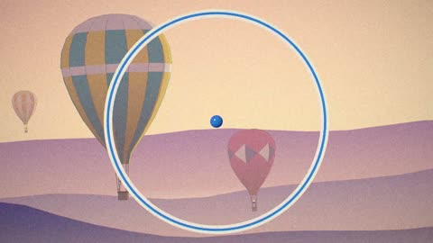</a></td>
<td width="50%" height="225" align="center" valign="middle"><a href="https://guanmo-ai.github.io/awesome-ai-motion/?lang=en#case-2107488996490166538">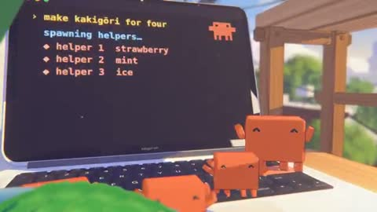</a></td>
</tr>
<tr>
<td width="50%" valign="top"><strong>A Blue Ball, Rings and Hot-Air Balloons</strong> <a href="https://x.com/kevin_t_ngo">@kevin_t_ngo</a> · Motion design 0:28 · Bookmarks 663 · Details pending <a href="https://guanmo-ai.github.io/awesome-ai-motion/?lang=en#case-2110010240825737683">▶ Play</a> · <a href="https://x.com/kevin_t_ngo/status/2110010240825737683">Original post</a></td>
<td width="50%" valign="top"><strong>ishuagra02: Pending Work</strong> <a href="https://x.com/ishuagra02">@ishuagra02</a> · Motion design 1:09 · Bookmarks 615 · Details pending <a href="https://guanmo-ai.github.io/awesome-ai-motion/?lang=en#case-2107488996490166538">▶ Play</a> · <a href="https://x.com/ishuagra02/status/2107488996490166538">Original post</a></td>
</tr>
</tbody>
<tbody>
<tr>
<td width="50%" height="225" align="center" valign="middle"><a href="https://guanmo-ai.github.io/awesome-ai-motion/?lang=en#case-2109192628818563353">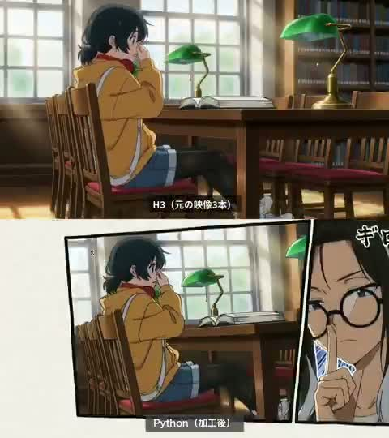</a></td>
<td width="50%" height="225" align="center" valign="middle"><a href="https://guanmo-ai.github.io/awesome-ai-motion/?lang=en#case-2107095740485144817">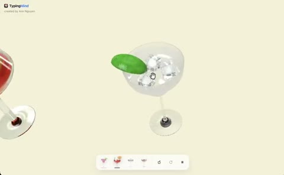</a></td>
</tr>
<tr>
<td width="50%" valign="top"><strong>From Cartoon Footage to Turning Comic Pages</strong> <a href="https://x.com/aicreataro">@aicreataro</a> · Motion design 0:34 · Bookmarks 604 · Details pending <a href="https://guanmo-ai.github.io/awesome-ai-motion/?lang=en#case-2109192628818563353">▶ Play</a> · <a href="https://x.com/aicreataro/status/2109192628818563353">Original post</a></td>
<td width="50%" valign="top"><strong>Flowing Light in Cocktail Glasses</strong> <a href="https://x.com/ann_nnng">@ann_nnng</a> · Motion design 0:16 · Bookmarks 555 · Details pending <a href="https://guanmo-ai.github.io/awesome-ai-motion/?lang=en#case-2107095740485144817">▶ Play</a> · <a href="https://x.com/ann_nnng/status/2107095740485144817">Original post</a></td>
</tr>
</tbody>
<tbody>
<tr>
<td width="50%" height="225" align="center" valign="middle"></td>
<td width="50%" height="225" align="center" valign="middle"><a href="https://guanmo-ai.github.io/awesome-ai-motion/?lang=en#case-2102733714845491558">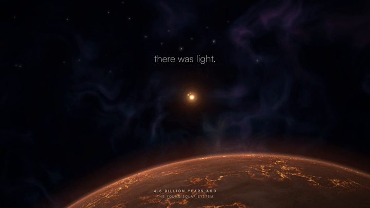</a></td>
</tr>
<tr>
<td width="50%" valign="top"><strong>Code generated cinematic test clip</strong> <a href="https://x.com/RileyRalmuto">@RileyRalmuto</a> · Motion design 0:16 · Bookmarks 475 · Details pending <a href="https://guanmo-ai.github.io/awesome-ai-motion/?lang=en#case-2102679018206052828">▶ Play</a> · <a href="https://x.com/RileyRalmuto/status/2102679018206052828">Original post</a></td>
<td width="50%" valign="top"><strong>Multi-Prompt Video with Sound</strong> <a href="https://x.com/dhruvalgolakiya">@dhruvalgolakiya</a> · Motion design 2:04 · Bookmarks 471 · Details pending <a href="https://guanmo-ai.github.io/awesome-ai-motion/?lang=en#case-2102733714845491558">▶ Play</a> · <a href="https://x.com/dhruvalgolakiya/status/2102733714845491558">Original post</a></td>
</tr>
</tbody>
<tbody>
<tr>
<td width="50%" height="225" align="center" valign="middle"><a href="https://guanmo-ai.github.io/awesome-ai-motion/?lang=en#case-2102436001473786054">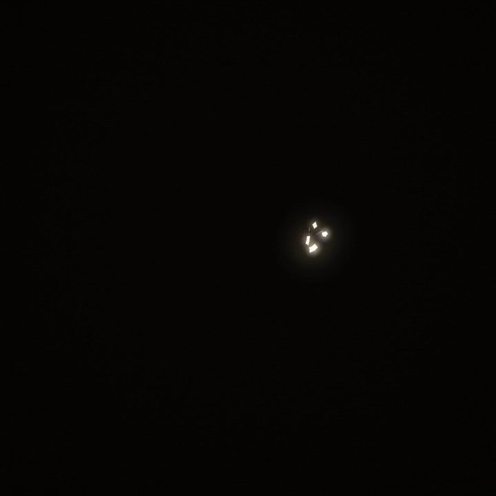</a></td>
<td width="50%" height="225" align="center" valign="middle"><a href="https://guanmo-ai.github.io/awesome-ai-motion/?lang=en#case-2102878288008057171">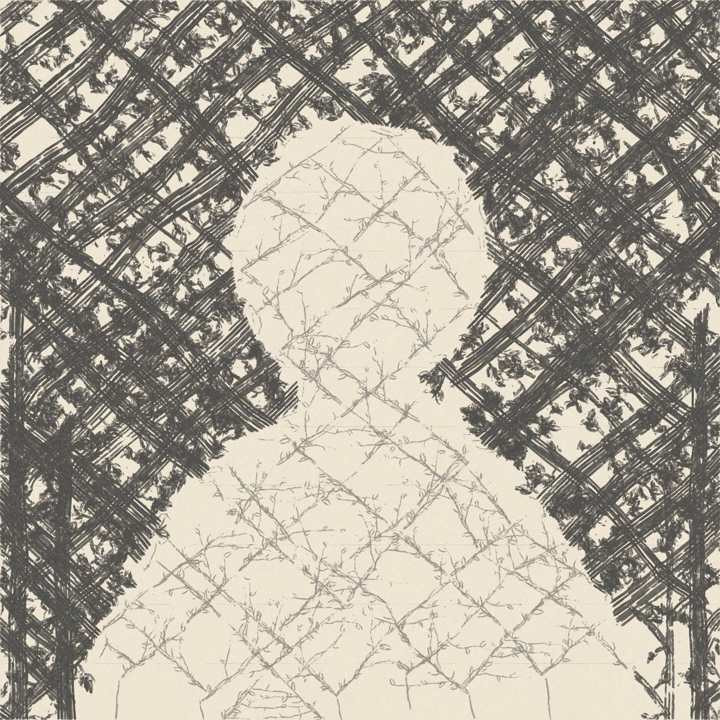</a></td>
</tr>
<tr>
<td width="50%" valign="top"><strong>Fish Animation Built from Mosaic Tiles</strong> <a href="https://x.com/dfeinition">@dfeinition</a> · Motion design 1:20 · Bookmarks 458 · Details pending <a href="https://guanmo-ai.github.io/awesome-ai-motion/?lang=en#case-2102436001473786054">▶ Play</a> · <a href="https://x.com/dfeinition/status/2102436001473786054">Original post</a></td>
<td width="50%" valign="top"><strong>Code-Drawn Self-Portrait Sequence</strong> <a href="https://x.com/kevin_t_ngo">@kevin_t_ngo</a> · Motion design 0:20 · Bookmarks 456 · Details pending <a href="https://guanmo-ai.github.io/awesome-ai-motion/?lang=en#case-2102878288008057171">▶ Play</a> · <a href="https://x.com/kevin_t_ngo/status/2102878288008057171">Original post</a></td>
</tr>
</tbody>
<tbody>
<tr>
<td width="50%" height="225" align="center" valign="middle"><a href="https://guanmo-ai.github.io/awesome-ai-motion/?lang=en#case-2102656273112326609">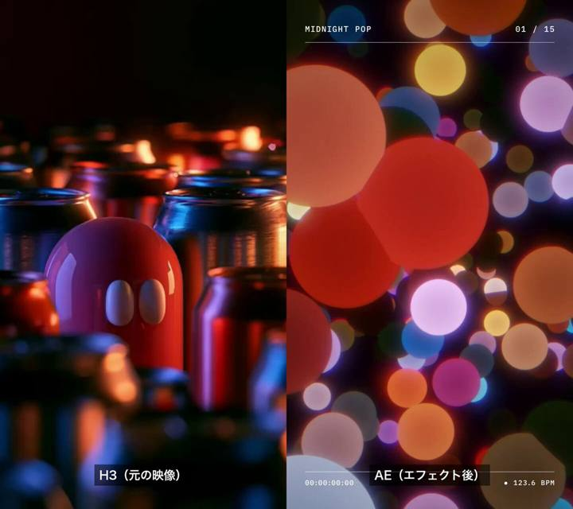</a></td>
<td width="50%" height="225" align="center" valign="middle"><a href="https://guanmo-ai.github.io/awesome-ai-motion/?lang=en#case-2102817596009504849">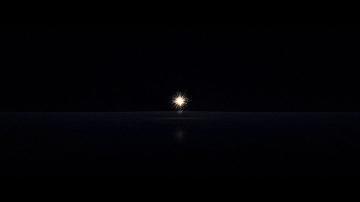</a></td>
</tr>
<tr>
<td width="50%" valign="top"><strong>After Effects Treatment of AI Footage</strong> <a href="https://x.com/aicreataro">@aicreataro</a> · Motion design 0:15 · Bookmarks 433 · Details pending <a href="https://guanmo-ai.github.io/awesome-ai-motion/?lang=en#case-2102656273112326609">▶ Play</a> · <a href="https://x.com/aicreataro/status/2102656273112326609">Original post</a></td>
<td width="50%" valign="top"><strong>Abstract Animation of How a Model Feels</strong> <a href="https://x.com/AndrewOnXYZ">@AndrewOnXYZ</a> · Motion design 3:32 · Bookmarks 397 · Details pending <a href="https://guanmo-ai.github.io/awesome-ai-motion/?lang=en#case-2102817596009504849">▶ Play</a> · <a href="https://x.com/AndrewOnXYZ/status/2102817596009504849">Original post</a></td>
</tr>
</tbody>
<tbody>
<tr>
<td width="50%" height="225" align="center" valign="middle"><a href="https://guanmo-ai.github.io/awesome-ai-motion/?lang=en#case-2103472385563459833">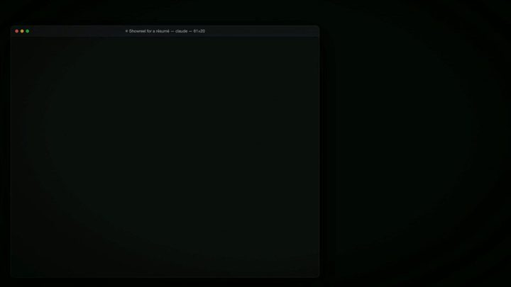</a></td>
<td width="50%" height="225" align="center" valign="middle"></td>
</tr>
<tr>
<td width="50%" valign="top"><strong>3D Recap of a Coding Session</strong> <a href="https://x.com/shneural">@shneural</a> · Motion design 0:56 · Bookmarks 391 · Details pending <a href="https://guanmo-ai.github.io/awesome-ai-motion/?lang=en#case-2103472385563459833">▶ Play</a> · <a href="https://x.com/shneural/status/2103472385563459833">Original post</a></td>
<td width="50%" valign="top"><strong>1990s-Style Audiovisual Demo</strong> <a href="https://x.com/gandamu_ml">@gandamu_ml</a> · Motion design 6:23 · Bookmarks 358 · Details pending <a href="https://guanmo-ai.github.io/awesome-ai-motion/?lang=en#case-2102919394775220530">▶ Play</a> · <a href="https://x.com/gandamu_ml/status/2102919394775220530">Original post</a></td>
</tr>
</tbody>
<tbody>
<tr>
<td width="50%" height="225" align="center" valign="middle"></td>
<td width="50%" height="225" align="center" valign="middle"></td>
</tr>
<tr>
<td width="50%" valign="top"><strong>One-Prompt Sand Animation</strong> <a href="https://x.com/Michaelzsguo">@Michaelzsguo</a> · Motion design 2:00 · Bookmarks 355 · Details pending <a href="https://guanmo-ai.github.io/awesome-ai-motion/?lang=en#case-2102592355165782312">▶ Play</a> · <a href="https://x.com/Michaelzsguo/status/2102592355165782312">Original post</a></td>
<td width="50%" valign="top"><strong>Ink Painting Unfolding on Rice Paper</strong> <a href="https://x.com/AxtonLiu">@AxtonLiu</a> · Motion design 0:39 · Bookmarks 347 · Details pending <a href="https://guanmo-ai.github.io/awesome-ai-motion/?lang=en#case-2103288413969621231">▶ Play</a> · <a href="https://x.com/AxtonLiu/status/2103288413969621231">Original post</a></td>
</tr>
</tbody>
<tbody>
<tr>
<td width="50%" height="225" align="center" valign="middle"></td>
<td width="50%" height="225" align="center" valign="middle"></td>
</tr>
<tr>
<td width="50%" valign="top"><strong>AndrewOnXYZ: Pending Work</strong> <a href="https://x.com/AndrewOnXYZ">@AndrewOnXYZ</a> · Motion design 1:58 · Bookmarks 339 · Details pending <a href="https://guanmo-ai.github.io/awesome-ai-motion/?lang=en#case-2102128068693266453">▶ Play</a> · <a href="https://x.com/AndrewOnXYZ/status/2102128068693266453">Original post</a></td>
<td width="50%" valign="top"><strong>From Circles to a Flock</strong> <a href="https://x.com/HBCoop_">@HBCoop_</a> · Motion design 0:29 · Bookmarks 278 · Details pending <a href="https://guanmo-ai.github.io/awesome-ai-motion/?lang=en#case-2107139305324122491">▶ Play</a> · <a href="https://x.com/HBCoop_/status/2107139305324122491">Original post</a></td>
</tr>
</tbody>
<tbody>
<tr>
<td width="50%" height="225" align="center" valign="middle"></td>
<td width="50%" height="225" align="center" valign="middle"></td>
</tr>
<tr>
<td width="50%" valign="top"><strong>A Coded Coast of Waves, Palms and Shadows</strong> <a href="https://x.com/LexnLin">@LexnLin</a> · Motion design 0:18 · Bookmarks 275 · Details pending <a href="https://guanmo-ai.github.io/awesome-ai-motion/?lang=en#case-2108694114476650840">▶ Play</a> · <a href="https://x.com/LexnLin/status/2108694114476650840">Original post</a></td>
<td width="50%" valign="top"><strong>Paper Doodle Animation Loops</strong> <a href="https://x.com/kevin_t_ngo">@kevin_t_ngo</a> · Motion design 0:05 · Bookmarks 259 · Details pending <a href="https://guanmo-ai.github.io/awesome-ai-motion/?lang=en#case-2109003656280646014">▶ Play</a> · <a href="https://x.com/kevin_t_ngo/status/2109003656280646014">Original post</a></td>
</tr>
</tbody>
<tbody>
<tr>
<td width="50%" height="225" align="center" valign="middle"></td>
<td width="50%" height="225" align="center" valign="middle"></td>
</tr>
<tr>
<td width="50%" valign="top"><strong>A floral foil greeting card</strong> <a href="https://x.com/ann_nnng">@ann_nnng</a> · Motion design 0:23 · Bookmarks 245 · Details pending <a href="https://guanmo-ai.github.io/awesome-ai-motion/?lang=en#case-2105606322310054044">▶ Play</a> · <a href="https://x.com/ann_nnng/status/2105606322310054044">Original post</a></td>
<td width="50%" valign="top"><strong>Concept Film About an AI Work Plan</strong> <a href="https://x.com/chetaslua">@chetaslua</a> · Motion design 3:18 · Bookmarks 234 · Details pending <a href="https://guanmo-ai.github.io/awesome-ai-motion/?lang=en#case-2102717699600368045">▶ Play</a> · <a href="https://x.com/chetaslua/status/2102717699600368045">Original post</a></td>
</tr>
</tbody>
<tbody>
<tr>
<td width="50%" height="225" align="center" valign="middle"></td>
<td width="50%" height="225" align="center" valign="middle"></td>
</tr>
<tr>
<td width="50%" valign="top"><strong>Drawn Buttons and a Day-Night Toggle</strong> <a href="https://x.com/kevin_t_ngo">@kevin_t_ngo</a> · Motion design 0:25 · Bookmarks 233 · Details pending <a href="https://guanmo-ai.github.io/awesome-ai-motion/?lang=en#case-2111974919353544757">▶ Play</a> · <a href="https://x.com/kevin_t_ngo/status/2111974919353544757">Original post</a></td>
<td width="50%" valign="top"><strong>One-Prompt Animation Experiment</strong> <a href="https://x.com/pivi___">@pivi___</a> · Motion design 0:33 · Bookmarks 233 · Details pending <a href="https://guanmo-ai.github.io/awesome-ai-motion/?lang=en#case-2103024907965612250">▶ Play</a> · <a href="https://x.com/pivi___/status/2103024907965612250">Original post</a></td>
</tr>
</tbody>
<tbody>
<tr>
<td width="50%" height="225" align="center" valign="middle"></td>
<td width="50%" height="225" align="center" valign="middle"></td>
</tr>
<tr>
<td width="50%" valign="top"><strong>A Watercolor House Through the Seasons</strong> <a href="https://x.com/thebuggeddev">@thebuggeddev</a> · Motion design 0:45 · Bookmarks 231 · Details pending <a href="https://guanmo-ai.github.io/awesome-ai-motion/?lang=en#case-2103192913140469762">▶ Play</a> · <a href="https://x.com/thebuggeddev/status/2103192913140469762">Original post</a></td>
<td width="50%" valign="top"><strong>Twelve Micro-Animation Studies</strong> <a href="https://x.com/humzaakhalid">@humzaakhalid</a> · Motion design 0:04 · Bookmarks 222 · Details pending <a href="https://guanmo-ai.github.io/awesome-ai-motion/?lang=en#case-2109946042355753399">▶ Play</a> · <a href="https://x.com/humzaakhalid/status/2109946042355753399">Original post</a></td>
</tr>
</tbody>
<tbody>
<tr>
<td width="50%" height="225" align="center" valign="middle"></td>
<td width="50%" height="225" align="center" valign="middle"></td>
</tr>
<tr>
<td width="50%" valign="top"><strong>A 3D mosaic of the girl with a pearl</strong> <a href="https://x.com/redp314">@redp314</a> · Motion design 0:32 · Bookmarks 217 · Details pending <a href="https://guanmo-ai.github.io/awesome-ai-motion/?lang=en#case-2106324559805010004">▶ Play</a> · <a href="https://x.com/redp314/status/2106324559805010004">Original post</a></td>
<td width="50%" valign="top"><strong>Training Montage of an AI Model</strong> <a href="https://x.com/ishuagra02">@ishuagra02</a> · Motion design 0:30 · Bookmarks 195 · Details pending <a href="https://guanmo-ai.github.io/awesome-ai-motion/?lang=en#case-2102788371114246177">▶ Play</a> · <a href="https://x.com/ishuagra02/status/2102788371114246177">Original post</a></td>
</tr>
</tbody>
<tbody>
<tr>
<td width="50%" height="225" align="center" valign="middle"></td>
<td width="50%" height="225" align="center" valign="middle"></td>
</tr>
<tr>
<td width="50%" valign="top"><strong>Verdant: Ground That Opens as You Scroll</strong> <a href="https://x.com/viktoroddy">@viktoroddy</a> · Motion design 0:22 · Bookmarks 189 · Details pending <a href="https://guanmo-ai.github.io/awesome-ai-motion/?lang=en#case-2109984169845821651">▶ Play</a> · <a href="https://x.com/viktoroddy/status/2109984169845821651">Original post</a></td>
<td width="50%" valign="top"><strong>Can I Give You Ten Percent of Me</strong> <a href="https://x.com/DaphneRHansell">@DaphneRHansell</a> · Motion design 2:24 · Bookmarks 188 · Details pending <a href="https://guanmo-ai.github.io/awesome-ai-motion/?lang=en#case-2111106459408986368">▶ Play</a> · <a href="https://x.com/DaphneRHansell/status/2111106459408986368">Original post</a></td>
</tr>
</tbody>
<tbody>
<tr>
<td width="50%" height="225" align="center" valign="middle"></td>
<td width="50%" height="225" align="center" valign="middle"></td>
</tr>
<tr>
<td width="50%" valign="top"><strong>The Creative Process in Motion</strong> <a href="https://x.com/aicreataro">@aicreataro</a> · Motion design 0:42 · Bookmarks 184 · Details pending <a href="https://guanmo-ai.github.io/awesome-ai-motion/?lang=en#case-2109286588891214094">▶ Play</a> · <a href="https://x.com/aicreataro/status/2109286588891214094">Original post</a></td>
<td width="50%" valign="top"><strong>A Hand-Drawn Teachers' Day Film</strong> <a href="https://x.com/ai4everyday">@ai4everyday</a> · Motion design 1:06 · Bookmarks 170 · Details pending <a href="https://guanmo-ai.github.io/awesome-ai-motion/?lang=en#case-2106992353219056006">▶ Play</a> · <a href="https://x.com/ai4everyday/status/2106992353219056006">Original post</a></td>
</tr>
</tbody>
<tbody>
<tr>
<td width="50%" height="225" align="center" valign="middle"></td>
<td width="50%" height="225" align="center" valign="middle"></td>
</tr>
<tr>
<td width="50%" valign="top"><strong>Rebuilding a Cartoon Street as a GLSL Shader</strong> <a href="https://x.com/gokayfem">@gokayfem</a> · Motion design 0:53 · Bookmarks 166 · Details pending <a href="https://guanmo-ai.github.io/awesome-ai-motion/?lang=en#case-2111907592129671505">▶ Play</a> · <a href="https://x.com/gokayfem/status/2111907592129671505">Original post</a></td>
<td width="50%" valign="top"><strong>Continuous Transformations of 260,000 Voxels</strong> <a href="https://x.com/LexnLin">@LexnLin</a> · Motion design 1:18 · Bookmarks 163 · Details pending <a href="https://guanmo-ai.github.io/awesome-ai-motion/?lang=en#case-2112310361194140058">▶ Play</a> · <a href="https://x.com/LexnLin/status/2112310361194140058">Original post</a></td>
</tr>
</tbody>
<tbody>
<tr>
<td width="50%" height="225" align="center" valign="middle"></td>
<td width="50%" height="225" align="center" valign="middle"></td>
</tr>
<tr>
<td width="50%" valign="top"><strong>A cinemagraph by a train window</strong> <a href="https://x.com/shironagasu_ai">@shironagasu_ai</a> · Motion design 0:10 · Bookmarks 161 · Details pending <a href="https://guanmo-ai.github.io/awesome-ai-motion/?lang=en#case-2106299981875347740">▶ Play</a> · <a href="https://x.com/shironagasu_ai/status/2106299981875347740">Original post</a></td>
<td width="50%" valign="top"><strong>A Lab for Procedural Spells and Sound</strong> <a href="https://x.com/majidmanzarpour">@majidmanzarpour</a> · Motion design 1:39 · Bookmarks 141 · Details pending <a href="https://guanmo-ai.github.io/awesome-ai-motion/?lang=en#case-2102586912993116411">▶ Play</a> · <a href="https://x.com/majidmanzarpour/status/2102586912993116411">Original post</a></td>
</tr>
</tbody>
<tbody>
<tr>
<td width="50%" height="225" align="center" valign="middle"></td>
<td width="50%" height="225" align="center" valign="middle"></td>
</tr>
<tr>
<td width="50%" valign="top"><strong>Code Recreation of a Reference Film's Rhythm</strong> <a href="https://x.com/leo_xiaolei">@leo_xiaolei</a> · Motion design 0:28 · Bookmarks 140 · Details pending <a href="https://guanmo-ai.github.io/awesome-ai-motion/?lang=en#case-2102724347446305104">▶ Play</a> · <a href="https://x.com/leo_xiaolei/status/2102724347446305104">Original post</a></td>
<td width="50%" valign="top"><strong>Design / Weight</strong> <a href="https://x.com/tequilafunks">@tequilafunks</a> · Motion design 0:15 · Bookmarks 108 · Details pending <a href="https://guanmo-ai.github.io/awesome-ai-motion/?lang=en#case-2103528644828127728">▶ Play</a> · <a href="https://x.com/tequilafunks/status/2103528644828127728">Original post</a></td>
</tr>
</tbody>
<tbody>
<tr>
<td width="50%" height="225" align="center" valign="middle"></td>
<td width="50%" height="225" align="center" valign="middle"></td>
</tr>
<tr>
<td width="50%" valign="top"><strong>konstantinsaifo: Pending Work</strong> <a href="https://x.com/konstantinsaifo">@konstantinsaifo</a> · Motion design 0:34 · Bookmarks 100 · Details pending <a href="https://guanmo-ai.github.io/awesome-ai-motion/?lang=en#case-2109595253879816337">▶ Play</a> · <a href="https://x.com/konstantinsaifo/status/2109595253879816337">Original post</a></td>
<td width="50%" valign="top"><strong>A 3D Fire Explosion in the Browser</strong> <a href="https://x.com/Aurelien_Gz">@Aurelien_Gz</a> · Motion design 1:01 · Bookmarks 87 · Details pending <a href="https://guanmo-ai.github.io/awesome-ai-motion/?lang=en#case-2104251332354085344">▶ Play</a> · <a href="https://x.com/Aurelien_Gz/status/2104251332354085344">Original post</a></td>
</tr>
</tbody>
<tbody>
<tr>
<td width="50%" height="225" align="center" valign="middle"></td>
<td width="50%" height="225" align="center" valign="middle"></td>
</tr>
<tr>
<td width="50%" valign="top"><strong>Model Self-Portraits in Geometric Patterns</strong> <a href="https://x.com/kevin_t_ngo">@kevin_t_ngo</a> · Motion design 0:20 · Bookmarks 83 · Details pending <a href="https://guanmo-ai.github.io/awesome-ai-motion/?lang=en#case-2107462206610935857">▶ Play</a> · <a href="https://x.com/kevin_t_ngo/status/2107462206610935857">Original post</a></td>
<td width="50%" valign="top"><strong>Frame drawn narrated JavaScript animation</strong> <a href="https://x.com/kevin_t_ngo">@kevin_t_ngo</a> · Motion design 1:20 · Bookmarks 80 · Details pending <a href="https://guanmo-ai.github.io/awesome-ai-motion/?lang=en#case-2104213302624821647">▶ Play</a> · <a href="https://x.com/kevin_t_ngo/status/2104213302624821647">Original post</a></td>
</tr>
</tbody>
<tbody>
<tr>
<td width="50%" height="225" align="center" valign="middle"></td>
<td width="50%" height="225" align="center" valign="middle"></td>
</tr>
<tr>
<td width="50%" valign="top"><strong>A Line-Drawn Roadster Stunt</strong> <a href="https://x.com/devteamdrew">@devteamdrew</a> · Motion design 0:18 · Bookmarks 78 · Details pending <a href="https://guanmo-ai.github.io/awesome-ai-motion/?lang=en#case-2111235450035745058">▶ Play</a> · <a href="https://x.com/devteamdrew/status/2111235450035745058">Original post</a></td>
<td width="50%" valign="top"><strong>Line-Drawing Timing and Compositing Test</strong> <a href="https://x.com/araminta_k">@araminta_k</a> · Motion design 0:25 · Bookmarks 78 · Details pending <a href="https://guanmo-ai.github.io/awesome-ai-motion/?lang=en#case-2103244081388503196">▶ Play</a> · <a href="https://x.com/araminta_k/status/2103244081388503196">Original post</a></td>
</tr>
</tbody>
<tbody>
<tr>
<td width="50%" height="225" align="center" valign="middle"></td>
<td width="50%" height="225" align="center" valign="middle"></td>
</tr>
<tr>
<td width="50%" valign="top"><strong>Anidoodle: code-drawn motion and music</strong> <a href="https://x.com/alexgreensh">@alexgreensh</a> · Motion design 0:31 · Bookmarks 73 · Details pending <a href="https://guanmo-ai.github.io/awesome-ai-motion/?lang=en#case-2107086004964282814">▶ Play</a> · <a href="https://x.com/alexgreensh/status/2107086004964282814">Original post</a></td>
<td width="50%" valign="top"><strong>Two 15-second motion-design trials</strong> <a href="https://x.com/mesmerlord">@mesmerlord</a> · Motion design 0:15 · Bookmarks 65 · Details pending <a href="https://guanmo-ai.github.io/awesome-ai-motion/?lang=en#case-2105758042830549235">▶ Play</a> · <a href="https://x.com/mesmerlord/status/2105758042830549235">Original post</a></td>
</tr>
</tbody>
<tbody>
<tr>
<td width="50%" height="225" align="center" valign="middle"></td>
<td width="50%" height="225" align="center" valign="middle"></td>
</tr>
<tr>
<td width="50%" valign="top"><strong>Stop-Motion from Excel Shapes</strong> <a href="https://x.com/aicreataro">@aicreataro</a> · Motion design 1:01 · Bookmarks 61 · Details pending <a href="https://guanmo-ai.github.io/awesome-ai-motion/?lang=en#case-2109892378383540394">▶ Play</a> · <a href="https://x.com/aicreataro/status/2109892378383540394">Original post</a></td>
<td width="50%" valign="top"><strong>A Single-Prompt HyperFrames Motion Test</strong> <a href="https://x.com/leandroriviello">@leandroriviello</a> · Motion design 0:14 · Bookmarks 52 · Details pending <a href="https://guanmo-ai.github.io/awesome-ai-motion/?lang=en#case-2104728379798827135">▶ Play</a> · <a href="https://x.com/leandroriviello/status/2104728379798827135">Original post</a></td>
</tr>
</tbody>
<tbody>
<tr>
<td width="50%" height="225" align="center" valign="middle"></td>
<td width="50%" height="225" align="center" valign="middle"></td>
</tr>
<tr>
<td width="50%" valign="top"><strong>Two Styles for One Coded Animation</strong> <a href="https://x.com/Aurelien_Gz">@Aurelien_Gz</a> · Motion design 0:28 · Bookmarks 51 · Details pending <a href="https://guanmo-ai.github.io/awesome-ai-motion/?lang=en#case-2102502056603136078">▶ Play</a> · <a href="https://x.com/Aurelien_Gz/status/2102502056603136078">Original post</a></td>
<td width="50%" valign="top"><strong>Turning API Keys into Literal Keys</strong> <a href="https://x.com/SergioGMN">@SergioGMN</a> · Motion design 0:31 · Bookmarks 47 · Details pending <a href="https://guanmo-ai.github.io/awesome-ai-motion/?lang=en#case-2111582026092470741">▶ Play</a> · <a href="https://x.com/SergioGMN/status/2111582026092470741">Original post</a></td>
</tr>
</tbody>
<tbody>
<tr>
<td width="50%" height="225" align="center" valign="middle"></td>
<td width="50%" height="225" align="center" valign="middle"></td>
</tr>
<tr>
<td width="50%" valign="top"><strong>A Geometry Wars-Style Neon Grid Shooter</strong> <a href="https://x.com/cherry_mx_reds">@cherry_mx_reds</a> · Motion design 2:12 · Bookmarks 41 · Details pending <a href="https://guanmo-ai.github.io/awesome-ai-motion/?lang=en#case-2102529784131600745">▶ Play</a> · <a href="https://x.com/cherry_mx_reds/status/2102529784131600745">Original post</a></td>
<td width="50%" valign="top"><strong>thebuggeddev: Pending Work</strong> <a href="https://x.com/thebuggeddev">@thebuggeddev</a> · Motion design 0:22 · Bookmarks 41 · Details pending <a href="https://guanmo-ai.github.io/awesome-ai-motion/?lang=en#case-2109524968686100500">▶ Play</a> · <a href="https://x.com/thebuggeddev/status/2109524968686100500">Original post</a></td>
</tr>
</tbody>
<tbody>
<tr>
<td width="50%" height="225" align="center" valign="middle"></td>
<td width="50%" height="225" align="center" valign="middle"></td>
</tr>
<tr>
<td width="50%" valign="top"><strong>FUNTECH Pixel Type and 3D Web Motion</strong> <a href="https://x.com/yoshi15_funtech">@yoshi15_funtech</a> · Motion design 0:47 · Bookmarks 41 · Details pending <a href="https://guanmo-ai.github.io/awesome-ai-motion/?lang=en#case-2109836860067606721">▶ Play</a> · <a href="https://x.com/yoshi15_funtech/status/2109836860067606721">Original post</a></td>
<td width="50%" valign="top"><strong>Motion: Geometry, Particles and Type</strong> <a href="https://x.com/RaphaelAubryy">@RaphaelAubryy</a> · Motion design 0:15 · Bookmarks 35 · Details pending <a href="https://guanmo-ai.github.io/awesome-ai-motion/?lang=en#case-2103416909857190360">▶ Play</a> · <a href="https://x.com/RaphaelAubryy/status/2103416909857190360">Original post</a></td>
</tr>
</tbody>
<tbody>
<tr>
<td width="50%" height="225" align="center" valign="middle"></td>
<td width="50%" height="225" align="center" valign="middle"></td>
</tr>
<tr>
<td width="50%" valign="top"><strong>Glitching Numbers and Type</strong> <a href="https://x.com/yyyole">@yyyole</a> · Motion design 1:20 · Bookmarks 35 · Details pending <a href="https://guanmo-ai.github.io/awesome-ai-motion/?lang=en#case-2104244923746947433">▶ Play</a> · <a href="https://x.com/yyyole/status/2104244923746947433">Original post</a></td>
<td width="50%" valign="top"><strong>A Block Mascot and a Halo</strong> <a href="https://x.com/flxrnc">@flxrnc</a> · Motion design 0:32 · Bookmarks 34 · Details pending <a href="https://guanmo-ai.github.io/awesome-ai-motion/?lang=en#case-2106799122950869034">▶ Play</a> · <a href="https://x.com/flxrnc/status/2106799122950869034">Original post</a></td>
</tr>
</tbody>
<tbody>
<tr>
<td width="50%" height="225" align="center" valign="middle"></td>
<td width="50%" height="225" align="center" valign="middle"></td>
</tr>
<tr>
<td width="50%" valign="top"><strong>Code Animation of an Ant Colony</strong> <a href="https://x.com/hanifproduktif">@hanifproduktif</a> · Motion design 0:32 · Bookmarks 31 · Details pending <a href="https://guanmo-ai.github.io/awesome-ai-motion/?lang=en#case-2102742924148830211">▶ Play</a> · <a href="https://x.com/hanifproduktif/status/2102742924148830211">Original post</a></td>
<td width="50%" valign="top"><strong>Local Session History Becomes Animation</strong> <a href="https://x.com/jake11moran">@jake11moran</a> · Motion design 0:53 · Bookmarks 29 · Details pending <a href="https://guanmo-ai.github.io/awesome-ai-motion/?lang=en#case-2103247490237825416">▶ Play</a> · <a href="https://x.com/jake11moran/status/2103247490237825416">Original post</a></td>
</tr>
</tbody>
<tbody>
<tr>
<td width="50%" height="225" align="center" valign="middle"></td>
<td width="50%" height="225" align="center" valign="middle"></td>
</tr>
<tr>
<td width="50%" valign="top"><strong>SwiftUI Thinking-Text Animations</strong> <a href="https://x.com/amos_gyamfi">@amos_gyamfi</a> · Motion design 2:16 · Bookmarks 26 · Details pending <a href="https://guanmo-ai.github.io/awesome-ai-motion/?lang=en#case-2109056620831649927">▶ Play</a> · <a href="https://x.com/amos_gyamfi/status/2109056620831649927">Original post</a></td>
<td width="50%" valign="top"><strong>Rust Frames on a Beat Grid</strong> <a href="https://x.com/BuildFastWithAI">@BuildFastWithAI</a> · Motion design 0:30 · Bookmarks 22 · Details pending <a href="https://guanmo-ai.github.io/awesome-ai-motion/?lang=en#case-2108403445304844291">▶ Play</a> · <a href="https://x.com/BuildFastWithAI/status/2108403445304844291">Original post</a></td>
</tr>
</tbody>
<tbody>
<tr>
<td width="50%" height="225" align="center" valign="middle"></td>
<td width="50%" height="225" align="center" valign="middle"></td>
</tr>
<tr>
<td width="50%" valign="top"><strong>A Mosaic Portrait of the Claude Family</strong> <a href="https://x.com/devteamdrew">@devteamdrew</a> · Motion design 0:17 · Bookmarks 19 · Details pending <a href="https://guanmo-ai.github.io/awesome-ai-motion/?lang=en#case-2105711844090429564">▶ Play</a> · <a href="https://x.com/devteamdrew/status/2105711844090429564">Original post</a></td>
<td width="50%" valign="top"><strong>Soft Fur on Interactive Social Buttons</strong> <a href="https://x.com/thebuggeddev">@thebuggeddev</a> · Motion design 0:22 · Bookmarks 18 · Details pending <a href="https://guanmo-ai.github.io/awesome-ai-motion/?lang=en#case-2103002563042042042">▶ Play</a> · <a href="https://x.com/thebuggeddev/status/2103002563042042042">Original post</a></td>
</tr>
</tbody>
<tbody>
<tr>
<td width="50%" height="225" align="center" valign="middle"></td>
<td width="50%" height="225" align="center" valign="middle"></td>
</tr>
<tr>
<td width="50%" valign="top"><strong>Clawd Travels Through 56 Brand Logos</strong> <a href="https://x.com/lemomo_ai">@lemomo_ai</a> · Motion design 3:43 · Bookmarks 16 · Details pending <a href="https://guanmo-ai.github.io/awesome-ai-motion/?lang=en#case-2110885678259269822">▶ Play</a> · <a href="https://x.com/lemomo_ai/status/2110885678259269822">Original post</a></td>
<td width="50%" valign="top"><strong>Shaml: Paper Geometry at Night</strong> <a href="https://x.com/makwired">@makwired</a> · Motion design 0:20 · Bookmarks 16 · Details pending <a href="https://guanmo-ai.github.io/awesome-ai-motion/?lang=en#case-2103008945220567166">▶ Play</a> · <a href="https://x.com/makwired/status/2103008945220567166">Original post</a></td>
</tr>
</tbody>
<tbody>
<tr>
<td width="50%" height="225" align="center" valign="middle"></td>
<td width="50%" height="225" align="center" valign="middle"></td>
</tr>
<tr>
<td width="50%" valign="top"><strong>A Colorful Spiral of Clawd Mascots</strong> <a href="https://x.com/kevin_t_ngo">@kevin_t_ngo</a> · Motion design 0:06 · Bookmarks 14 · Details pending <a href="https://guanmo-ai.github.io/awesome-ai-motion/?lang=en#case-2112056165672837425">▶ Play</a> · <a href="https://x.com/kevin_t_ngo/status/2112056165672837425">Original post</a></td>
<td width="50%" valign="top"><strong>An OpenAI-dot character comparison</strong> <a href="https://x.com/kepochnik">@kepochnik</a> · Motion design 0:18 · Bookmarks 11 · Details pending <a href="https://guanmo-ai.github.io/awesome-ai-motion/?lang=en#case-2107443775232438381">▶ Play</a> · <a href="https://x.com/kepochnik/status/2107443775232438381">Original post</a></td>
</tr>
</tbody>
<tbody>
<tr>
<td width="50%" height="225" align="center" valign="middle"></td>
<td width="50%" height="225" align="center" valign="middle"></td>
</tr>
<tr>
<td width="50%" valign="top"><strong>AI in Japanese Motion Type</strong> <a href="https://x.com/mercarioji">@mercarioji</a> · Motion design 3:49 · Bookmarks 11 · Details pending <a href="https://guanmo-ai.github.io/awesome-ai-motion/?lang=en#case-2110709134417133872">▶ Play</a> · <a href="https://x.com/mercarioji/status/2110709134417133872">Original post</a></td>
<td width="50%" valign="top"><strong>Python cubes, variable type and synchronized notes</strong> <a href="https://x.com/Dannnnnok">@Dannnnnok</a> · Motion design 0:20 · Bookmarks 9 <a href="https://guanmo-ai.github.io/awesome-ai-motion/?lang=en#case-2103846630088716687">▶ Play</a> · <a href="https://x.com/Dannnnnok/status/2103846630088716687">Original post</a></td>
</tr>
</tbody>
<tbody>
<tr>
<td width="50%" height="225" align="center" valign="middle"></td>
<td width="50%" height="225" align="center" valign="middle"></td>
</tr>
<tr>
<td width="50%" valign="top"><strong>A Roblox magical-effects refinement</strong> <a href="https://x.com/JohnKlerAI">@JohnKlerAI</a> · Motion design 0:06 · Bookmarks 9 · Details pending <a href="https://guanmo-ai.github.io/awesome-ai-motion/?lang=en#case-2107484860717973791">▶ Play</a> · <a href="https://x.com/JohnKlerAI/status/2107484860717973791">Original post</a></td>
<td width="50%" valign="top"><strong>Aurora, Mountains and a Lake in One Shader</strong> <a href="https://x.com/ottollm">@ottollm</a> · Motion design 0:30 · Bookmarks 8 · Details pending <a href="https://guanmo-ai.github.io/awesome-ai-motion/?lang=en#case-2111786470935544214">▶ Play</a> · <a href="https://x.com/ottollm/status/2111786470935544214">Original post</a></td>
</tr>
</tbody>
<tbody>
<tr>
<td width="50%" height="225" align="center" valign="middle"></td>
<td width="50%" height="225" align="center" valign="middle"></td>
</tr>
<tr>
<td width="50%" valign="top"><strong>DVD-inspired motion on an existing UI</strong> <a href="https://x.com/AdamPolify">@AdamPolify</a> · Motion design 0:08 · Bookmarks 7 · Details pending <a href="https://guanmo-ai.github.io/awesome-ai-motion/?lang=en#case-2107592216126411062">▶ Play</a> · <a href="https://x.com/AdamPolify/status/2107592216126411062">Original post</a></td>
<td width="50%" valign="top"><strong>Nostalgic Devices and Pixel Scenes</strong> <a href="https://x.com/twoclipping">@twoclipping</a> · Motion design 0:19 · Bookmarks 7 · Details pending <a href="https://guanmo-ai.github.io/awesome-ai-motion/?lang=en#case-2109623099050115548">▶ Play</a> · <a href="https://x.com/twoclipping/status/2109623099050115548">Original post</a></td>
</tr>
</tbody>
<tbody>
<tr>
<td width="50%" height="225" align="center" valign="middle"></td>
<td width="50%" height="225" align="center" valign="middle"></td>
</tr>
<tr>
<td width="50%" valign="top"><strong>Boeing 747 Parts Assembly</strong> <a href="https://x.com/misat0x">@misat0x</a> · Motion design 1:00 · Bookmarks 7 · Details pending <a href="https://guanmo-ai.github.io/awesome-ai-motion/?lang=en#case-2108510836981445009">▶ Play</a> · <a href="https://x.com/misat0x/status/2108510836981445009">Original post</a></td>
<td width="50%" valign="top"><strong>Making a Web Page Bloom</strong> <a href="https://x.com/thebuggeddev">@thebuggeddev</a> · Motion design 0:42 · Bookmarks 6 · Details pending <a href="https://guanmo-ai.github.io/awesome-ai-motion/?lang=en#case-2106006478998180260">▶ Play</a> · <a href="https://x.com/thebuggeddev/status/2106006478998180260">Original post</a></td>
</tr>
</tbody>
<tbody>
<tr>
<td width="50%" height="225" align="center" valign="middle"></td>
<td width="50%" height="225" align="center" valign="middle"></td>
</tr>
<tr>
<td width="50%" valign="top"><strong>VincentWei93: Pending Work</strong> <a href="https://x.com/VincentWei93">@VincentWei93</a> · Motion design 0:35 · Bookmarks 6 · Details pending <a href="https://guanmo-ai.github.io/awesome-ai-motion/?lang=en#case-2104603177610060161">▶ Play</a> · <a href="https://x.com/VincentWei93/status/2104603177610060161">Original post</a></td>
<td width="50%" valign="top"><strong>A Cartoon Stunt Reel for a Permission Switch</strong> <a href="https://x.com/ishuagra02">@ishuagra02</a> · Motion design 1:38 · Bookmarks 4 · Details pending <a href="https://guanmo-ai.github.io/awesome-ai-motion/?lang=en#case-2108615535164367146">▶ Play</a> · <a href="https://x.com/ishuagra02/status/2108615535164367146">Original post</a></td>
</tr>
</tbody>
<tbody>
<tr>
<td width="50%" height="225" align="center" valign="middle"></td>
<td width="50%" height="225" align="center" valign="middle"></td>
</tr>
<tr>
<td width="50%" valign="top"><strong>A Starship Launch Inside a Painting</strong> <a href="https://x.com/devteamdrew">@devteamdrew</a> · Motion design 0:19 · Bookmarks 4 · Details pending <a href="https://guanmo-ai.github.io/awesome-ai-motion/?lang=en#case-2107156755763364178">▶ Play</a> · <a href="https://x.com/devteamdrew/status/2107156755763364178">Original post</a></td>
<td width="50%" valign="top"><strong>Liquid Glass and Kinetic Web Type</strong> <a href="https://x.com/Aurelien_Gz">@Aurelien_Gz</a> · Motion design 0:50 · Bookmarks 4 · Details pending <a href="https://guanmo-ai.github.io/awesome-ai-motion/?lang=en#case-2105367456025874553">▶ Play</a> · <a href="https://x.com/Aurelien_Gz/status/2105367456025874553">Original post</a></td>
</tr>
</tbody>
<tbody>
<tr>
<td width="50%" height="225" align="center" valign="middle"></td>
<td width="50%" height="225" align="center" valign="middle"></td>
</tr>
<tr>
<td width="50%" valign="top"><strong>A one-pass HyperFrames remake with voice</strong> <a href="https://x.com/justinbuilds">@justinbuilds</a> · Motion design 0:22 · Bookmarks 4 <a href="https://guanmo-ai.github.io/awesome-ai-motion/?lang=en#case-2107655437969412401">▶ Play</a> · <a href="https://x.com/justinbuilds/status/2107655437969412401">Original post</a></td>
<td width="50%" valign="top"><strong>A DesignLoop, HyperFrames and voice experiment</strong> <a href="https://x.com/vince_builds">@vince_builds</a> · Motion design 0:56 · Bookmarks 4 <a href="https://guanmo-ai.github.io/awesome-ai-motion/?lang=en#case-2104257989100355650">▶ Play</a> · <a href="https://x.com/vince_builds/status/2104257989100355650">Original post</a></td>
</tr>
</tbody>
<tbody>
<tr>
<td width="50%" height="225" align="center" valign="middle"></td>
<td width="50%" height="225" align="center" valign="middle"></td>
</tr>
<tr>
<td width="50%" valign="top"><strong>Card Entrance Animation and Easing Corrections</strong> <a href="https://x.com/genuenci">@genuenci</a> · Motion design 0:25 · Bookmarks 3 · Details pending <a href="https://guanmo-ai.github.io/awesome-ai-motion/?lang=en#case-2109232824838467652">▶ Play</a> · <a href="https://x.com/genuenci/status/2109232824838467652">Original post</a></td>
<td width="50%" valign="top"><strong>Cubes and Particle Arrays</strong> <a href="https://x.com/SadAlbert10">@SadAlbert10</a> · Motion design 0:45 · Bookmarks 3 · Details pending <a href="https://guanmo-ai.github.io/awesome-ai-motion/?lang=en#case-2106123044569890823">▶ Play</a> · <a href="https://x.com/SadAlbert10/status/2106123044569890823">Original post</a></td>
</tr>
</tbody>
<tbody>
<tr>
<td width="50%" height="225" align="center" valign="middle"></td>
<td width="50%" height="225" align="center" valign="middle"></td>
</tr>
<tr>
<td width="50%" valign="top"><strong>Motion: Typography as a Function of Time</strong> <a href="https://x.com/lochan_twt">@lochan_twt</a> · Motion design 0:16 · Bookmarks 3 · Details pending <a href="https://guanmo-ai.github.io/awesome-ai-motion/?lang=en#case-2107796331561730439">▶ Play</a> · <a href="https://x.com/lochan_twt/status/2107796331561730439">Original post</a></td>
<td width="50%" valign="top"><strong>A Remotion motion and sound revision experiment</strong> <a href="https://x.com/saxxyweb3">@saxxyweb3</a> · Motion design 0:40 · Bookmarks 3 <a href="https://guanmo-ai.github.io/awesome-ai-motion/?lang=en#case-2104961677963690124">▶ Play</a> · <a href="https://x.com/saxxyweb3/status/2104961677963690124">Original post</a></td>
</tr>
</tbody>
<tbody>
<tr>
<td width="50%" height="225" align="center" valign="middle"></td>
<td width="50%" height="225" align="center" valign="middle"></td>
</tr>
<tr>
<td width="50%" valign="top"><strong>One Character across Comics, Pixels and Vaporwave</strong> <a href="https://x.com/AlchainHust">@AlchainHust</a> · Motion design 0:20 · Bookmarks 3 · Details pending <a href="https://guanmo-ai.github.io/awesome-ai-motion/?lang=en#case-2107641558073803075">▶ Play</a> · <a href="https://x.com/AlchainHust/status/2107641558073803075">Original post</a></td>
<td width="50%" valign="top"><strong>The Chef and the Dish</strong> <a href="https://x.com/sofwath">@sofwath</a> · Motion design 0:12 · Bookmarks 3 · Details pending <a href="https://guanmo-ai.github.io/awesome-ai-motion/?lang=en#case-2108956236742074521">▶ Play</a> · <a href="https://x.com/sofwath/status/2108956236742074521">Original post</a></td>
</tr>
</tbody>
<tbody>
<tr>
<td width="50%" height="225" align="center" valign="middle"></td>
<td width="50%" height="225" align="center" valign="middle"></td>
</tr>
<tr>
<td width="50%" valign="top"><strong>Motion Graphics Unfolding from a Point</strong> <a href="https://x.com/enhanced_jp">@enhanced_jp</a> · Motion design 0:15 · Bookmarks 3 · Details pending <a href="https://guanmo-ai.github.io/awesome-ai-motion/?lang=en#case-2103424960211644662">▶ Play</a> · <a href="https://x.com/enhanced_jp/status/2103424960211644662">Original post</a></td>
<td width="50%" valign="top"><strong>Taking a Line for a Walk</strong> <a href="https://x.com/pradeepXkapoor">@pradeepXkapoor</a> · Motion design 0:41 · Bookmarks 2 · Details pending <a href="https://guanmo-ai.github.io/awesome-ai-motion/?lang=en#case-2109657381881962673">▶ Play</a> · <a href="https://x.com/pradeepXkapoor/status/2109657381881962673">Original post</a></td>
</tr>
</tbody>
<tbody>
<tr>
<td width="50%" height="225" align="center" valign="middle"></td>
<td width="50%" height="225" align="center" valign="middle"></td>
</tr>
<tr>
<td width="50%" valign="top"><strong>Code Extension of an Earlier Motion Piece</strong> <a href="https://x.com/elianiva_">@elianiva_</a> · Motion design 0:26 · Bookmarks 2 · Details pending <a href="https://guanmo-ai.github.io/awesome-ai-motion/?lang=en#case-2103003425915195750">▶ Play</a> · <a href="https://x.com/elianiva_/status/2103003425915195750">Original post</a></td>
<td width="50%" valign="top"><strong>A 15-second Opus geometric-motion comparison</strong> <a href="https://x.com/mesmerlord">@mesmerlord</a> · Motion design 0:15 · Bookmarks 2 · Details pending <a href="https://guanmo-ai.github.io/awesome-ai-motion/?lang=en#case-2105766824558174486">▶ Play</a> · <a href="https://x.com/mesmerlord/status/2105766824558174486">Original post</a></td>
</tr>
</tbody>
<tbody>
<tr>
<td width="50%" height="225" align="center" valign="middle"></td>
<td width="50%" height="225" align="center" valign="middle"></td>
</tr>
<tr>
<td width="50%" valign="top"><strong>A Dark Graphic and Data Motion Study</strong> <a href="https://x.com/0xRapzz">@0xRapzz</a> · Motion design 0:45 · Bookmarks 2 · Details pending <a href="https://guanmo-ai.github.io/awesome-ai-motion/?lang=en#case-2106062139920433554">▶ Play</a> · <a href="https://x.com/0xRapzz/status/2106062139920433554">Original post</a></td>
<td width="50%" valign="top"><strong>Portfolio Work Section Transition</strong> <a href="https://x.com/adamhmwn">@adamhmwn</a> · Motion design 0:05 · Bookmarks 2 · Details pending <a href="https://guanmo-ai.github.io/awesome-ai-motion/?lang=en#case-2108920438244143547">▶ Play</a> · <a href="https://x.com/adamhmwn/status/2108920438244143547">Original post</a></td>
</tr>
</tbody>
<tbody>
<tr>
<td width="50%" height="225" align="center" valign="middle"></td>
<td width="50%" height="225" align="center" valign="middle"></td>
</tr>
<tr>
<td width="50%" valign="top"><strong>A Chrome Knot: Bloom, Break and Reassemble</strong> <a href="https://x.com/gogu_name">@gogu_name</a> · Motion design 0:15 · Bookmarks 2 · Details pending <a href="https://guanmo-ai.github.io/awesome-ai-motion/?lang=en#case-2104347638883873255">▶ Play</a> · <a href="https://x.com/gogu_name/status/2104347638883873255">Original post</a></td>
<td width="50%" valign="top"><strong>A half-hour HyperFrames Studio experiment</strong> <a href="https://x.com/joaquimcassano">@joaquimcassano</a> · Motion design 0:30 · Bookmarks 2 <a href="https://guanmo-ai.github.io/awesome-ai-motion/?lang=en#case-2107237736121778239">▶ Play</a> · <a href="https://x.com/joaquimcassano/status/2107237736121778239">Original post</a></td>
</tr>
</tbody>
<tbody>
<tr>
<td width="50%" height="225" align="center" valign="middle"></td>
<td width="50%" height="225" align="center" valign="middle"></td>
</tr>
<tr>
<td width="50%" valign="top"><strong>A Fictional Company 3D End Logo</strong> <a href="https://x.com/arumii_movie">@arumii_movie</a> · Motion design 0:15 · Bookmarks 1 · Details pending <a href="https://guanmo-ai.github.io/awesome-ai-motion/?lang=en#case-2107737607908249613">▶ Play</a> · <a href="https://x.com/arumii_movie/status/2107737607908249613">Original post</a></td>
<td width="50%" valign="top"><strong>Opus Rocks: Type Transformations</strong> <a href="https://x.com/neha_d4">@neha_d4</a> · Motion design 0:12 · Bookmarks 1 · Details pending <a href="https://guanmo-ai.github.io/awesome-ai-motion/?lang=en#case-2110639818845966569">▶ Play</a> · <a href="https://x.com/neha_d4/status/2110639818845966569">Original post</a></td>
</tr>
</tbody>
<tbody>
<tr>
<td width="50%" height="225" align="center" valign="middle"></td>
<td width="50%" height="225" align="center" valign="middle"></td>
</tr>
<tr>
<td width="50%" valign="top"><strong>HyperFrames motion with code-composed audio</strong> <a href="https://x.com/Dheepanratnam">@Dheepanratnam</a> · Motion design 0:58 · Bookmarks 1 · Details pending <a href="https://guanmo-ai.github.io/awesome-ai-motion/?lang=en#case-2107568904075706454">▶ Play</a> · <a href="https://x.com/Dheepanratnam/status/2107568904075706454">Original post</a></td>
<td width="50%" valign="top"><strong>Animated Overlay on a Spinning Cup</strong> <a href="https://x.com/AnduArtist">@AnduArtist</a> · Motion design 0:15 · Bookmarks 1 · Details pending <a href="https://guanmo-ai.github.io/awesome-ai-motion/?lang=en#case-2102548178646016377">▶ Play</a> · <a href="https://x.com/AnduArtist/status/2102548178646016377">Original post</a></td>
</tr>
</tbody>
<tbody>
<tr>
<td width="50%" height="225" align="center" valign="middle"></td>
<td width="50%" height="225" align="center" valign="middle"></td>
</tr>
<tr>
<td width="50%" valign="top"><strong>A Pelican Drawn with One Line</strong> <a href="https://x.com/anxuanng">@anxuanng</a> · Motion design 0:43 · Bookmarks 1 · Details pending <a href="https://guanmo-ai.github.io/awesome-ai-motion/?lang=en#case-2110487420731007461">▶ Play</a> · <a href="https://x.com/anxuanng/status/2110487420731007461">Original post</a></td>
<td width="50%" valign="top"><strong>One Character Across Multiple Animation Styles</strong> <a href="https://x.com/ianstig">@ianstig</a> · Motion design 2:11 · Bookmarks 1 · Details pending <a href="https://x.com/ianstig/status/2103169675928764486">▶ Watch on X</a> · <a href="https://x.com/ianstig/status/2103169675928764486">Original post</a></td>
</tr>
</tbody>
<tbody>
<tr>
<td width="50%" height="225" align="center" valign="middle"></td>
<td width="50%" height="225" align="center" valign="middle"></td>
</tr>
<tr>
<td width="50%" valign="top"><strong>A single-prompt HyperFrames screen recording</strong> <a href="https://x.com/TimGuignard">@TimGuignard</a> · Motion design 0:25 · Bookmarks 1 <a href="https://guanmo-ai.github.io/awesome-ai-motion/?lang=en#case-2104515756159623571">▶ Play</a> · <a href="https://x.com/TimGuignard/status/2104515756159623571">Original post</a></td>
<td width="50%" valign="top"><strong>One Shape through Five UI States</strong> <a href="https://x.com/zheng_qili666">@zheng_qili666</a> · Motion design 0:14 · Bookmarks 1 · Details pending <a href="https://guanmo-ai.github.io/awesome-ai-motion/?lang=en#case-2107863174095769958">▶ Play</a> · <a href="https://x.com/zheng_qili666/status/2107863174095769958">Original post</a></td>
</tr>
</tbody>
<tbody>
<tr>
<td width="50%" height="225" align="center" valign="middle"></td>
<td width="50%" height="225" align="center" valign="middle"></td>
</tr>
<tr>
<td width="50%" valign="top"><strong>A Code-Only Motion Reel</strong> <a href="https://x.com/yu9_LTX">@yu9_LTX</a> · Motion design 0:39 · Bookmarks 0 · Details pending <a href="https://guanmo-ai.github.io/awesome-ai-motion/?lang=en#case-2108409874845696470">▶ Play</a> · <a href="https://x.com/yu9_LTX/status/2108409874845696470">Original post</a></td>
<td width="50%" valign="top"><strong>Drawn imaginary engraving animation</strong> <a href="https://x.com/illodevcode">@illodevcode</a> · Motion design 1:04 · Bookmarks 0 · Details pending <a href="https://guanmo-ai.github.io/awesome-ai-motion/?lang=en#case-2104214763358015565">▶ Play</a> · <a href="https://x.com/illodevcode/status/2104214763358015565">Original post</a></td>
</tr>
</tbody>
<tbody>
<tr>
<td width="50%" height="225" align="center" valign="middle"></td>
<td width="50%" height="225" align="center" valign="middle"></td>
</tr>
<tr>
<td width="50%" valign="top"><strong>A Fictional Game-console Startup Logo</strong> <a href="https://x.com/arumii_movie">@arumii_movie</a> · Motion design 0:25 · Bookmarks 0 · Details pending <a href="https://guanmo-ai.github.io/awesome-ai-motion/?lang=en#case-2107790132061622720">▶ Play</a> · <a href="https://x.com/arumii_movie/status/2107790132061622720">Original post</a></td>
<td width="50%" valign="top"><strong>The Jagged Frontier</strong> <a href="https://x.com/LinXule">@LinXule</a> · Motion design 5:04 · Bookmarks 0 · Details pending <a href="https://guanmo-ai.github.io/awesome-ai-motion/?lang=en#case-2108970903048790440">▶ Play</a> · <a href="https://x.com/LinXule/status/2108970903048790440">Original post</a></td>
</tr>
</tbody>
<tbody>
<tr>
<td width="50%" height="225" align="center" valign="middle"></td>
<td width="50%" height="225" align="center" valign="middle"></td>
</tr>
<tr>
<td width="50%" valign="top"><strong>A London Snow Globe in Swift</strong> <a href="https://x.com/eigeorguy">@eigeorguy</a> · Motion design 0:06 · Bookmarks 0 · Details pending <a href="https://guanmo-ai.github.io/awesome-ai-motion/?lang=en#case-2103992442072813651">▶ Play</a> · <a href="https://x.com/eigeorguy/status/2103992442072813651">Original post</a></td>
<td width="50%" valign="top"><strong>A Celebrating Cartoon Character in Rive</strong> <a href="https://x.com/osmatrixcode">@osmatrixcode</a> · Motion design 0:02 · Bookmarks 0 · Details pending <a href="https://guanmo-ai.github.io/awesome-ai-motion/?lang=en#case-2109195278913880455">▶ Play</a> · <a href="https://x.com/osmatrixcode/status/2109195278913880455">Original post</a></td>
</tr>
</tbody>
<tbody>
<tr>
<td width="50%" height="225" align="center" valign="middle"></td>
<td width="50%" height="225" align="center" valign="middle"></td>
</tr>
<tr>
<td width="50%" valign="top"><strong>A Speech Choreographed in Black and White</strong> <a href="https://x.com/Gdgtify">@Gdgtify</a> · Motion design 0:30 · Bookmarks 0 · Details pending <a href="https://guanmo-ai.github.io/awesome-ai-motion/?lang=en#case-2109859673742659812">▶ Play</a> · <a href="https://x.com/Gdgtify/status/2109859673742659812">Original post</a></td>
<td width="50%" valign="top"><strong>An Autumn Night</strong> <a href="https://x.com/TommyAIseisaku">@TommyAIseisaku</a> · Motion design 0:37 · Bookmarks 0 · Details pending <a href="https://guanmo-ai.github.io/awesome-ai-motion/?lang=en#case-2110884838823612891">▶ Play</a> · <a href="https://x.com/TommyAIseisaku/status/2110884838823612891">Original post</a></td>
</tr>
</tbody>
<tbody>
<tr>
<td width="50%" height="225" align="center" valign="middle"></td>
<td width="50%" height="225" align="center" valign="middle"></td>
</tr>
<tr>
<td width="50%" valign="top"><strong>An intro with open-source TTS and layered sound</strong> <a href="https://x.com/itsahmedharoon">@itsahmedharoon</a> · Motion design 0:41 · Bookmarks 0 <a href="https://guanmo-ai.github.io/awesome-ai-motion/?lang=en#case-2103986344414544194">▶ Play</a> · <a href="https://x.com/itsahmedharoon/status/2103986344414544194">Original post</a></td>
<td width="50%" valign="top"><strong>An Opus and Remotion motion experiment</strong> <a href="https://x.com/SmitJainEditor">@SmitJainEditor</a> · Motion design 0:40 · Bookmarks 0 <a href="https://guanmo-ai.github.io/awesome-ai-motion/?lang=en#case-2107019496078843957">▶ Play</a> · <a href="https://x.com/SmitJainEditor/status/2107019496078843957">Original post</a></td>
</tr>
</tbody>
<tbody>
<tr>
<td width="50%" height="225" align="center" valign="middle"></td>
<td width="50%" height="225" align="center" valign="middle"></td>
</tr>
<tr>
<td width="50%" valign="top"><strong>A single-prompt HyperFrames motion experiment</strong> <a href="https://x.com/kzmucx">@kzmucx</a> · Motion design 0:24 · Bookmarks 0 <a href="https://guanmo-ai.github.io/awesome-ai-motion/?lang=en#case-2107225121123402052">▶ Play</a> · <a href="https://x.com/kzmucx/status/2107225121123402052">Original post</a></td>
<td width="50%" valign="top"><strong>Nailong in a 2.5D beat edit</strong> <a href="https://x.com/tirtaVEX">@tirtaVEX</a> · Motion design 0:28 · Bookmarks 0 · Details pending <a href="https://guanmo-ai.github.io/awesome-ai-motion/?lang=en#case-2107649731229094304">▶ Play</a> · <a href="https://x.com/tirtaVEX/status/2107649731229094304">Original post</a></td>
</tr>
</tbody>
<tbody>
<tr>
<td width="50%" height="225" align="center" valign="middle"></td>
<td width="50%" height="225" align="center" valign="middle"></td>
</tr>
<tr>
<td width="50%" valign="top"><strong>Painting the Night: From a Blank Canvas to the Sky</strong> <a href="https://x.com/obydulme">@obydulme</a> · Motion design 1:14 · Bookmarks 0 · Details pending <a href="https://guanmo-ai.github.io/awesome-ai-motion/?lang=en#case-2104802322518052905">▶ Play</a> · <a href="https://x.com/obydulme/status/2104802322518052905">Original post</a></td>
<td width="50%" valign="top"><strong>Particle typography: Opus animation and Fable text</strong> <a href="https://x.com/mszzz0011">@mszzz0011</a> · Motion design 0:20 · Bookmarks 0 · Details pending <a href="https://guanmo-ai.github.io/awesome-ai-motion/?lang=en#case-2106040056616239235">▶ Play</a> · <a href="https://x.com/mszzz0011/status/2106040056616239235">Original post</a></td>
</tr>
</tbody>
<tbody>
<tr>
<td width="50%" height="225" align="center" valign="middle"></td>
<td width="50%" height="225" align="center" valign="middle"></td>
</tr>
<tr>
<td width="50%" valign="top"><strong>An Endless Mandelbrot Zoom</strong> <a href="https://x.com/AiDinzeo">@AiDinzeo</a> · Motion design 0:55 · Bookmarks 0 · Details pending <a href="https://guanmo-ai.github.io/awesome-ai-motion/?lang=en#case-2107126979841708182">▶ Play</a> · <a href="https://x.com/AiDinzeo/status/2107126979841708182">Original post</a></td>
<td width="50%" valign="top"><strong>A 365-brushstroke painting replay</strong> <a href="https://x.com/redp314">@redp314</a> · Motion design 0:32 · Bookmarks 0 · Details pending <a href="https://guanmo-ai.github.io/awesome-ai-motion/?lang=en#case-2107499130536763520">▶ Play</a> · <a href="https://x.com/redp314/status/2107499130536763520">Original post</a></td>
</tr>
</tbody>
<tbody>
<tr>
<td width="50%" height="225" align="center" valign="middle"></td>
<td width="50%" height="225" align="center" valign="middle"></td>
</tr>
<tr>
<td width="50%" valign="top"><strong>A Circle-and-triangle Code Animation Test</strong> <a href="https://x.com/karoukun_ai">@karoukun_ai</a> · Motion design 0:15 · Bookmarks 0 · Details pending <a href="https://guanmo-ai.github.io/awesome-ai-motion/?lang=en#case-2108150684176863482">▶ Play</a> · <a href="https://x.com/karoukun_ai/status/2108150684176863482">Original post</a></td>
<td width="50%" valign="top"><strong>12,346 iPhones in a Domino Animation</strong> <a href="https://x.com/paojiaofty">@paojiaofty</a> · Motion design 0:26 · Bookmarks 0 · Details pending <a href="https://guanmo-ai.github.io/awesome-ai-motion/?lang=en#case-2104756133558984946">▶ Play</a> · <a href="https://x.com/paojiaofty/status/2104756133558984946">Original post</a></td>
</tr>
</tbody>
<tbody>
<tr>
<td width="50%" height="225" align="center" valign="middle"></td>
<td width="50%" height="225" align="center" valign="middle"></td>
</tr>
<tr>
<td width="50%" valign="top"><strong>A Portuguese Vehicle-registration Motion Test</strong> <a href="https://x.com/SquareOnChain">@SquareOnChain</a> · Motion design 0:55 · Bookmarks 0 · Details pending <a href="https://guanmo-ai.github.io/awesome-ai-motion/?lang=en#case-2107667218326835369">▶ Play</a> · <a href="https://x.com/SquareOnChain/status/2107667218326835369">Original post</a></td>
<td width="50%" valign="top"><strong>A Side-by-side Codex Motion Recreation</strong> <a href="https://x.com/TTDD686">@TTDD686</a> · Motion design 0:50 · Bookmarks 0 · Details pending <a href="https://guanmo-ai.github.io/awesome-ai-motion/?lang=en#case-2108447153098207345">▶ Play</a> · <a href="https://x.com/TTDD686/status/2108447153098207345">Original post</a></td>
</tr>
</tbody>
<tbody>
<tr>
<td width="50%" height="225" align="center" valign="middle"></td>
<td width="50%" height="225" align="center" valign="middle"></td>
</tr>
<tr>
<td width="50%" valign="top"><strong>Roblox Radial Effects Showcase</strong> <a href="https://x.com/JohnKlerAI">@JohnKlerAI</a> · Motion design 0:05 · Bookmarks 0 · Details pending <a href="https://guanmo-ai.github.io/awesome-ai-motion/?lang=en#case-2108929788517789892">▶ Play</a> · <a href="https://x.com/JohnKlerAI/status/2108929788517789892">Original post</a></td>
<td width="50%" valign="top"><strong>A Bar Story in Vertical Type</strong> <a href="https://x.com/downandoutlaw">@downandoutlaw</a> · Motion design 1:00 · Bookmarks 0 · Details pending <a href="https://guanmo-ai.github.io/awesome-ai-motion/?lang=en#case-2110820795383783614">▶ Play</a> · <a href="https://x.com/downandoutlaw/status/2110820795383783614">Original post</a></td>
</tr>
</tbody>
<tbody>
<tr>
<td width="50%" height="225" align="center" valign="middle"></td>
<td width="50%" height="225" align="center" valign="middle"></td>
</tr>
<tr>
<td width="50%" valign="top"><strong>Multi-Round After Effects Production Test</strong> <a href="https://x.com/throughiris_">@throughiris_</a> · Motion design 0:12 · Bookmarks 0 · Details pending <a href="https://guanmo-ai.github.io/awesome-ai-motion/?lang=en#case-2102911234526048706">▶ Play</a> · <a href="https://x.com/throughiris_/status/2102911234526048706">Original post</a></td>
<td width="50%" valign="top"><strong>I Make Pixels</strong> <a href="https://x.com/karanb192">@karanb192</a> · Motion design 0:15 · Bookmarks 0 · Details pending <a href="https://guanmo-ai.github.io/awesome-ai-motion/?lang=en#case-2103690266633032177">▶ Play</a> · <a href="https://x.com/karanb192/status/2103690266633032177">Original post</a></td>
</tr>
</tbody>
<tbody>
<tr>
<td width="50%" height="225" align="center" valign="middle"></td>
<td width="50%" height="225" align="center" valign="middle"></td>
</tr>
<tr>
<td width="50%" valign="top"><strong>HyperFrames motion graphics experiment</strong> <a href="https://x.com/mukhtharcm">@mukhtharcm</a> · Motion design 1:08 · Bookmarks 0 · Details pending <a href="https://guanmo-ai.github.io/awesome-ai-motion/?lang=en#case-2104235944383803495">▶ Play</a> · <a href="https://x.com/mukhtharcm/status/2104235944383803495">Original post</a></td>
<td width="50%" valign="top"><strong>Gold Dust and Chladni Patterns</strong> <a href="https://x.com/park_danie36173">@park_danie36173</a> · Motion design 0:30 · Bookmarks 0 · Details pending <a href="https://guanmo-ai.github.io/awesome-ai-motion/?lang=en#case-2104763812733981142">▶ Play</a> · <a href="https://x.com/park_danie36173/status/2104763812733981142">Original post</a></td>
</tr>
</tbody>
<tbody>
<tr>
<td width="50%" height="225" align="center" valign="middle"></td>
<td width="50%" height="225" align="center" valign="middle"></td>
</tr>
<tr>
<td width="50%" valign="top"><strong>Design Builder Introduction</strong> <a href="https://x.com/Prathamesh_812">@Prathamesh_812</a> · Motion design 0:15 · Bookmarks 0 · Details pending <a href="https://guanmo-ai.github.io/awesome-ai-motion/?lang=en#case-2104776177609293975">▶ Play</a> · <a href="https://x.com/Prathamesh_812/status/2104776177609293975">Original post</a></td>
<td width="50%" valign="top"><strong>A Paper-Folding Launch Film in One HTML Page</strong> <a href="https://x.com/Vignesh_rav">@Vignesh_rav</a> · Motion design 0:13 · Bookmarks 0 · Details pending <a href="https://guanmo-ai.github.io/awesome-ai-motion/?lang=en#case-2104837895773417649">▶ Play</a> · <a href="https://x.com/Vignesh_rav/status/2104837895773417649">Original post</a></td>
</tr>
</tbody>
<tbody>
<tr>
<td width="50%" height="225" align="center" valign="middle"></td>
<td width="50%" height="225" align="center" valign="middle"></td>
</tr>
<tr>
<td width="50%" valign="top"><strong>A code-rendered neon city in the rain</strong> <a href="https://x.com/0xInsiderf5">@0xInsiderf5</a> · Motion design 0:15 · Bookmarks 0 · Details pending <a href="https://guanmo-ai.github.io/awesome-ai-motion/?lang=en#case-2106056138894479482">▶ Play</a> · <a href="https://x.com/0xInsiderf5/status/2106056138894479482">Original post</a></td>
<td width="50%" valign="top"><strong>A vending-machine service-menu animation</strong> <a href="https://x.com/ux_vlad">@ux_vlad</a> · Motion design 0:15 · Bookmarks 0 · Details pending <a href="https://guanmo-ai.github.io/awesome-ai-motion/?lang=en#case-2106068105894207525">▶ Play</a> · <a href="https://x.com/ux_vlad/status/2106068105894207525">Original post</a></td>
</tr>
</tbody>
<tbody>
<tr>
<td width="50%" height="225" align="center" valign="middle"></td>
<td width="50%" height="225" align="center" valign="middle"></td>
</tr>
<tr>
<td width="50%" valign="top"><strong>A fly-through of a gyroid-inspired metallic form</strong> <a href="https://x.com/CsaplarD">@CsaplarD</a> · Motion design 0:22 · Bookmarks 0 · Details pending <a href="https://guanmo-ai.github.io/awesome-ai-motion/?lang=en#case-2106462870745534946">▶ Play</a> · <a href="https://x.com/CsaplarD/status/2106462870745534946">Original post</a></td>
<td width="50%" valign="top"><strong>A loading-to-success interface animation</strong> <a href="https://x.com/briangulo_">@briangulo_</a> · Motion design 0:06 · Bookmarks 0 · Details pending <a href="https://guanmo-ai.github.io/awesome-ai-motion/?lang=en#case-2107500032538575272">▶ Play</a> · <a href="https://x.com/briangulo_/status/2107500032538575272">Original post</a></td>
</tr>
</tbody>
<tbody>
<tr>
<td width="50%" height="225" align="center" valign="middle"></td>
<td width="50%" height="225" align="center" valign="middle"></td>
</tr>
<tr>
<td width="50%" valign="top"><strong>An Astra and Remotion motion experiment</strong> <a href="https://x.com/MathryxAI">@MathryxAI</a> · Motion design 0:24 · Bookmarks 0 · Details pending <a href="https://guanmo-ai.github.io/awesome-ai-motion/?lang=en#case-2107581288265711900">▶ Play</a> · <a href="https://x.com/MathryxAI/status/2107581288265711900">Original post</a></td>
<td width="50%" valign="top"><strong>Shader motion on a hand-crafted UI</strong> <a href="https://x.com/artabrarov">@artabrarov</a> · Motion design 0:18 · Bookmarks 0 · Details pending <a href="https://guanmo-ai.github.io/awesome-ai-motion/?lang=en#case-2107582341182861643">▶ Play</a> · <a href="https://x.com/artabrarov/status/2107582341182861643">Original post</a></td>
</tr>
</tbody>
<tbody>
<tr>
<td width="50%" height="225" align="center" valign="middle"></td>
<td width="50%" height="225" align="center" valign="middle"></td>
</tr>
<tr>
<td width="50%" valign="top"><strong>An Isometric Animation about Design and Code</strong> <a href="https://x.com/Arnaud34Web">@Arnaud34Web</a> · Motion design 1:16 · Bookmarks 0 · Details pending <a href="https://guanmo-ai.github.io/awesome-ai-motion/?lang=en#case-2108183084847841636">▶ Play</a> · <a href="https://x.com/Arnaud34Web/status/2108183084847841636">Original post</a></td>
<td width="50%" valign="top"><strong>Drawing the Temple of Heaven</strong> <a href="https://x.com/shunshu32385143">@shunshu32385143</a> · Motion design 0:45 · Bookmarks 0 · Details pending <a href="https://guanmo-ai.github.io/awesome-ai-motion/?lang=en#case-2108480534254944719">▶ Play</a> · <a href="https://x.com/shunshu32385143/status/2108480534254944719">Original post</a></td>
</tr>
</tbody>
<tbody>
<tr>
<td width="50%" height="225" align="center" valign="middle"></td>
<td width="50%" height="225" align="center" valign="middle"></td>
</tr>
<tr>
<td width="50%" valign="top"><strong>Numbers and Grids in Motion</strong> <a href="https://x.com/clementonn">@clementonn</a> · Motion design 1:25 · Bookmarks 0 · Details pending <a href="https://guanmo-ai.github.io/awesome-ai-motion/?lang=en#case-2108504736257434081">▶ Play</a> · <a href="https://x.com/clementonn/status/2108504736257434081">Original post</a></td>
<td width="50%" valign="top"><strong>Thirty Years, a New Orbit</strong> <a href="https://x.com/qiMengasi">@qiMengasi</a> · Motion design 2:43 · Bookmarks 0 · Details pending <a href="https://guanmo-ai.github.io/awesome-ai-motion/?lang=en#case-2108781831860683000">▶ Play</a> · <a href="https://x.com/qiMengasi/status/2108781831860683000">Original post</a></td>
</tr>
</tbody>
<tbody>
<tr>
<td width="50%" height="225" align="center" valign="middle"></td>
<td width="50%" height="225" align="center" valign="middle"></td>
</tr>
<tr>
<td width="50%" valign="top"><strong>Animation from Style, Script and Voiceover</strong> <a href="https://x.com/kudela_maxim">@kudela_maxim</a> · Motion design 1:33 · Bookmarks 0 · Details pending <a href="https://guanmo-ai.github.io/awesome-ai-motion/?lang=en#case-2108917734406844505">▶ Play</a> · <a href="https://x.com/kudela_maxim/status/2108917734406844505">Original post</a></td>
<td width="50%" valign="top"><strong>Five Styles of Code Animation</strong> <a href="https://x.com/Fgambling_">@Fgambling_</a> · Motion design 2:03 · Bookmarks 0 · Details pending <a href="https://guanmo-ai.github.io/awesome-ai-motion/?lang=en#case-2110981398001770680">▶ Play</a> · <a href="https://x.com/Fgambling_/status/2110981398001770680">Original post</a></td>
</tr>
</tbody>
</table>
