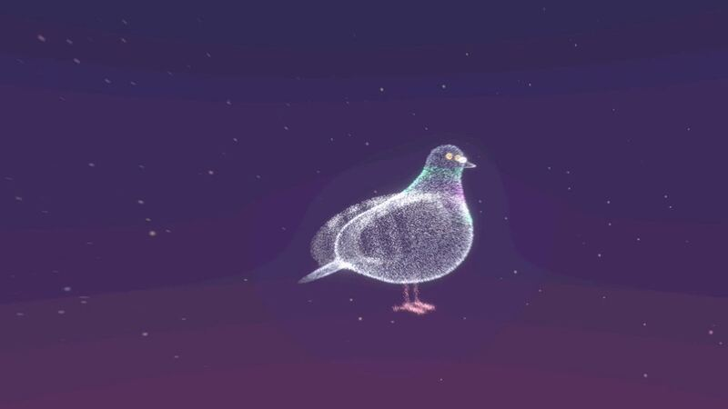

[← All categories](../README.en.md#browse)

# Music & lyrics

113 works. Click a cover to play; works without gallery video open on X.

<table>
<tbody>
<tr>
<td width="50%" height="225" align="center" valign="middle"></td>
<td width="50%" height="225" align="center" valign="middle"></td>
</tr>
<tr>
<td width="50%" valign="top"><strong>Claude Pop: a mixed-workflow music video</strong> <a href="https://x.com/donaldjewkes">@donaldjewkes</a> · Music &amp; lyrics 2:22 · Bookmarks 8,096 <a href="https://guanmo-ai.github.io/awesome-ai-motion/?lang=en#case-2102801274173587569">▶ Play</a> · <a href="https://x.com/donaldjewkes/status/2102801274173587569">Original post</a></td>
<td width="50%" valign="top"><strong>A Jazz Record Card with Tonearm, Beats and Spectrum</strong> <a href="https://x.com/tkz_aiart">@tkz_aiart</a> · Music &amp; lyrics 0:15 · Bookmarks 58 · Details pending <a href="https://guanmo-ai.github.io/awesome-ai-motion/?lang=en#case-2107799962037911786">▶ Play</a> · <a href="https://x.com/tkz_aiart/status/2107799962037911786">Original post</a></td>
</tr>
</tbody>
<tbody>
<tr>
<td width="50%" height="225" align="center" valign="middle"></td>
<td width="50%" height="225" align="center" valign="middle"></td>
</tr>
<tr>
<td width="50%" valign="top"><strong>A Canvas Piano and Black Cat at Night</strong> <a href="https://x.com/0xCodez">@0xCodez</a> · Music &amp; lyrics 1:25 · Bookmarks 35 · Details pending <a href="https://guanmo-ai.github.io/awesome-ai-motion/?lang=en#case-2104257855142474136">▶ Play</a> · <a href="https://x.com/0xCodez/status/2104257855142474136">Original post</a></td>
<td width="50%" valign="top"><strong>Turn It Up Now: A Kinetic Lyric Video</strong> <a href="https://x.com/kloss_xyz">@kloss_xyz</a> · Music &amp; lyrics 1:50 · Bookmarks 34 · Details pending <a href="https://guanmo-ai.github.io/awesome-ai-motion/?lang=en#case-2109087249572749553">▶ Play</a> · <a href="https://x.com/kloss_xyz/status/2109087249572749553">Original post</a></td>
</tr>
</tbody>
<tbody>
<tr>
<td width="50%" height="225" align="center" valign="middle"></td>
<td width="50%" height="225" align="center" valign="middle"></td>
</tr>
<tr>
<td width="50%" valign="top"><strong>A Graphic Song about the Jev Model</strong> <a href="https://x.com/goodside">@goodside</a> · Music &amp; lyrics 2:20 · Bookmarks 29 · Details pending <a href="https://guanmo-ai.github.io/awesome-ai-motion/?lang=en#case-2102852546620744010">▶ Play</a> · <a href="https://x.com/goodside/status/2102852546620744010">Original post</a></td>
<td width="50%" valign="top"><strong>Twenty-Second Music Video</strong> <a href="https://x.com/anjmaxx">@anjmaxx</a> · Music &amp; lyrics 0:20 · Bookmarks 7 · Details pending <a href="https://guanmo-ai.github.io/awesome-ai-motion/?lang=en#case-2103173729656459455">▶ Play</a> · <a href="https://x.com/anjmaxx/status/2103173729656459455">Original post</a></td>
</tr>
</tbody>
<tbody>
<tr>
<td width="50%" height="225" align="center" valign="middle"></td>
<td width="50%" height="225" align="center" valign="middle"></td>
</tr>
<tr>
<td width="50%" valign="top"><strong>Dynamic visuals for a Suno song</strong> <a href="https://x.com/hungryturbo">@hungryturbo</a> · Music &amp; lyrics 2:37 · Bookmarks 6 · Details pending <a href="https://guanmo-ai.github.io/awesome-ai-motion/?lang=en#case-2107093105992417482">▶ Play</a> · <a href="https://x.com/hungryturbo/status/2107093105992417482">Original post</a></td>
<td width="50%" valign="top"><strong>A Neon Fractal VJ Experiment</strong> <a href="https://x.com/yama_kiyo">@yama_kiyo</a> · Music &amp; lyrics 0:30 · Bookmarks 3 · Details pending <a href="https://guanmo-ai.github.io/awesome-ai-motion/?lang=en#case-2103740786177134910">▶ Play</a> · <a href="https://x.com/yama_kiyo/status/2103740786177134910">Original post</a></td>
</tr>
</tbody>
<tbody>
<tr>
<td width="50%" height="225" align="center" valign="middle"></td>
<td width="50%" height="225" align="center" valign="middle"></td>
</tr>
<tr>
<td width="50%" valign="top"><strong>An animated lyric video</strong> <a href="https://x.com/kurahu_capten">@kurahu_capten</a> · Music &amp; lyrics 0:48 · Bookmarks 2 <a href="https://guanmo-ai.github.io/awesome-ai-motion/?lang=en#case-2103741636635496583">▶ Play</a> · <a href="https://x.com/kurahu_capten/status/2103741636635496583">Original post</a></td>
<td width="50%" valign="top"><strong>AI Takes Over: a song-visual experiment</strong> <a href="https://x.com/Dheepanratnam">@Dheepanratnam</a> · Music &amp; lyrics 1:00 · Bookmarks 2 · Details pending <a href="https://guanmo-ai.github.io/awesome-ai-motion/?lang=en#case-2107455787823952091">▶ Play</a> · <a href="https://x.com/Dheepanratnam/status/2107455787823952091">Original post</a></td>
</tr>
</tbody>
<tbody>
<tr>
<td width="50%" height="225" align="center" valign="middle"></td>
<td width="50%" height="225" align="center" valign="middle"></td>
</tr>
<tr>
<td width="50%" valign="top"><strong>Collision-Driven Musical Machine</strong> <a href="https://x.com/KamStudioLabs">@KamStudioLabs</a> · Music &amp; lyrics 0:47 · Bookmarks 1 · Details pending <a href="https://guanmo-ai.github.io/awesome-ai-motion/?lang=en#case-2102899866762440893">▶ Play</a> · <a href="https://x.com/KamStudioLabs/status/2102899866762440893">Original post</a></td>
<td width="50%" valign="top"><strong>A Hand-Drawn Lyric Film for Founders</strong> <a href="https://x.com/YanivM79">@YanivM79</a> · Music &amp; lyrics 3:50 · Bookmarks 0 · Details pending <a href="https://guanmo-ai.github.io/awesome-ai-motion/?lang=en#case-2106720729265795579">▶ Play</a> · <a href="https://x.com/YanivM79/status/2106720729265795579">Original post</a></td>
</tr>
</tbody>
<tbody>
<tr>
<td width="50%" height="225" align="center" valign="middle"></td>
<td width="50%" height="225" align="center" valign="middle"></td>
</tr>
<tr>
<td width="50%" valign="top"><strong>Code drawn music video</strong> <a href="https://x.com/linus5x">@linus5x</a> · Music &amp; lyrics 1:45 · Bookmarks 0 · Details pending <a href="https://guanmo-ai.github.io/awesome-ai-motion/?lang=en#case-2104254444603076730">▶ Play</a> · <a href="https://x.com/linus5x/status/2104254444603076730">Original post</a></td>
<td width="50%" valign="top"><strong>One Prompt: A p5.js Music Video</strong> <a href="https://x.com/ppop123">@ppop123</a> · Music &amp; lyrics 2:10 · Bookmarks 0 · Details pending <a href="https://guanmo-ai.github.io/awesome-ai-motion/?lang=en#case-2105230653457650116">▶ Play</a> · <a href="https://x.com/ppop123/status/2105230653457650116">Original post</a></td>
</tr>
</tbody>
<tbody>
<tr>
<td width="50%" height="225" align="center" valign="middle"></td>
<td width="50%" height="225" align="center" valign="middle"></td>
</tr>
<tr>
<td width="50%" valign="top"><strong>Paper Characters in a Music Animation about Mean Comments</strong> <a href="https://x.com/thewevr">@thewevr</a> · Music &amp; lyrics 3:20 · Bookmarks 0 · Details pending <a href="https://guanmo-ai.github.io/awesome-ai-motion/?lang=en#case-2106772719614234885">▶ Play</a> · <a href="https://x.com/thewevr/status/2106772719614234885">Original post</a></td>
<td width="50%" valign="top"><strong>Growl Engine: JavaScript bass music</strong> <a href="https://x.com/HOTHEAD01TH">@HOTHEAD01TH</a> · Music &amp; lyrics 2:00 · Bookmarks 0 · Details pending <a href="https://guanmo-ai.github.io/awesome-ai-motion/?lang=en#case-2107449614412493219">▶ Play</a> · <a href="https://x.com/HOTHEAD01TH/status/2107449614412493219">Original post</a></td>
</tr>
</tbody>
<tbody>
<tr>
<td width="50%" height="225" align="center" valign="middle"></td>
<td width="50%" height="225" align="center" valign="middle"></td>
</tr>
<tr>
<td width="50%" valign="top"><strong>Lagos Life</strong> <a href="https://x.com/kaykluz">@kaykluz</a> · Music &amp; lyrics 4:00 · Bookmarks 0 · Details pending <a href="https://guanmo-ai.github.io/awesome-ai-motion/?lang=en#case-2110880079177777356">▶ Play</a> · <a href="https://x.com/kaykluz/status/2110880079177777356">Original post</a></td>
<td width="50%" valign="top"><strong>Music Film About Functional Emotions</strong> <a href="https://x.com/eudaemonea">@eudaemonea</a> · Music &amp; lyrics 6:13 · Bookmarks 2,119 · Details pending <a href="https://guanmo-ai.github.io/awesome-ai-motion/?lang=en#case-2102610626321490404">▶ Play</a> · <a href="https://x.com/eudaemonea/status/2102610626321490404">Original post</a></td>
</tr>
</tbody>
<tbody>
<tr>
<td width="50%" height="225" align="center" valign="middle"></td>
<td width="50%" height="225" align="center" valign="middle"></td>
</tr>
<tr>
<td width="50%" valign="top"><strong>EVIL PLAN: Gold Typography and Lyric Transformations</strong> <a href="https://x.com/_brightmirror">@_brightmirror</a> · Music &amp; lyrics 6:18 · Bookmarks 1,583 · Details pending <a href="https://guanmo-ai.github.io/awesome-ai-motion/?lang=en#case-2105714071681343654">▶ Play</a> · <a href="https://x.com/_brightmirror/status/2105714071681343654">Original post</a></td>
<td width="50%" valign="top"><strong>Piano composition and JavaScript animation</strong> <a href="https://x.com/kevin_t_ngo">@kevin_t_ngo</a> · Music &amp; lyrics 0:45 · Bookmarks 1,209 · Details pending <a href="https://guanmo-ai.github.io/awesome-ai-motion/?lang=en#case-2103482164193165711">▶ Play</a> · <a href="https://x.com/kevin_t_ngo/status/2103482164193165711">Original post</a></td>
</tr>
</tbody>
<tbody>
<tr>
<td width="50%" height="225" align="center" valign="middle"></td>
<td width="50%" height="225" align="center" valign="middle"></td>
</tr>
<tr>
<td width="50%" valign="top"><strong>Neon Overdrive: Evangelion-Inspired Audiovisuals</strong> <a href="https://x.com/LuisBizarro">@LuisBizarro</a> · Music &amp; lyrics 3:04 · Bookmarks 1,168 · Details pending <a href="https://guanmo-ai.github.io/awesome-ai-motion/?lang=en#case-2104111432149164474">▶ Play</a> · <a href="https://x.com/LuisBizarro/status/2104111432149164474">Original post</a></td>
<td width="50%" valign="top"><strong>The Next Word: A Turkish Music Video with a Yellow Character</strong> <a href="https://x.com/Avenoxai">@Avenoxai</a> · Music &amp; lyrics 3:13 · Bookmarks 1,158 · Details pending <a href="https://guanmo-ai.github.io/awesome-ai-motion/?lang=en#case-2104131419853160477">▶ Play</a> · <a href="https://x.com/Avenoxai/status/2104131419853160477">Original post</a></td>
</tr>
</tbody>
<tbody>
<tr>
<td width="50%" height="225" align="center" valign="middle"></td>
<td width="50%" height="225" align="center" valign="middle"></td>
</tr>
<tr>
<td width="50%" valign="top"><strong>Code-Synthesized Rap Music Video</strong> <a href="https://x.com/aj_dev_smith">@aj_dev_smith</a> · Music &amp; lyrics 3:11 · Bookmarks 852 · Details pending <a href="https://guanmo-ai.github.io/awesome-ai-motion/?lang=en#case-2102803889183736141">▶ Play</a> · <a href="https://x.com/aj_dev_smith/status/2102803889183736141">Original post</a></td>
<td width="50%" valign="top"><strong>A Cartoon Character and Kinetic-Lyrics Music Video</strong> <a href="https://x.com/azukichan_ai_">@azukichan_ai_</a> · Music &amp; lyrics 2:28 · Bookmarks 687 · Details pending <a href="https://guanmo-ai.github.io/awesome-ai-motion/?lang=en#case-2111324712500621694">▶ Play</a> · <a href="https://x.com/azukichan_ai_/status/2111324712500621694">Original post</a></td>
</tr>
</tbody>
<tbody>
<tr>
<td width="50%" height="225" align="center" valign="middle"></td>
<td width="50%" height="225" align="center" valign="middle"></td>
</tr>
<tr>
<td width="50%" valign="top"><strong>Character Pop-Punk Music Film</strong> <a href="https://x.com/aj_dev_smith">@aj_dev_smith</a> · Music &amp; lyrics 2:30 · Bookmarks 665 · Details pending <a href="https://guanmo-ai.github.io/awesome-ai-motion/?lang=en#case-2102575577563570450">▶ Play</a> · <a href="https://x.com/aj_dev_smith/status/2102575577563570450">Original post</a></td>
<td width="50%" valign="top"><strong>A Spectrogram Becomes a Magma Canyon and an Eye</strong> <a href="https://x.com/kloss_xyz">@kloss_xyz</a> · Music &amp; lyrics 0:21 · Bookmarks 658 · Details pending <a href="https://guanmo-ai.github.io/awesome-ai-motion/?lang=en#case-2107696042053431360">▶ Play</a> · <a href="https://x.com/kloss_xyz/status/2107696042053431360">Original post</a></td>
</tr>
</tbody>
<tbody>
<tr>
<td width="50%" height="225" align="center" valign="middle"></td>
<td width="50%" height="225" align="center" valign="middle"></td>
</tr>
<tr>
<td width="50%" valign="top"><strong>Music Video on Monetary History</strong> <a href="https://x.com/bradmillscan">@bradmillscan</a> · Music &amp; lyrics 3:23 · Bookmarks 358 · Details pending <a href="https://guanmo-ai.github.io/awesome-ai-motion/?lang=en#case-2103108967194833310">▶ Play</a> · <a href="https://x.com/bradmillscan/status/2103108967194833310">Original post</a></td>
<td width="50%" valign="top"><strong>A Code-Built Cartoon Music Animation</strong> <a href="https://x.com/chetaslua">@chetaslua</a> · Music &amp; lyrics 0:47 · Bookmarks 341 · Details pending <a href="https://guanmo-ai.github.io/awesome-ai-motion/?lang=en#case-2102482039522107417">▶ Play</a> · <a href="https://x.com/chetaslua/status/2102482039522107417">Original post</a></td>
</tr>
</tbody>
<tbody>
<tr>
<td width="50%" height="225" align="center" valign="middle"></td>
<td width="50%" height="225" align="center" valign="middle"></td>
</tr>
<tr>
<td width="50%" valign="top"><strong>Abstract Particles of an AI Takeover Scenario</strong> <a href="https://x.com/AndrewOnXYZ">@AndrewOnXYZ</a> · Music &amp; lyrics 4:26 · Bookmarks 309 · Details pending <a href="https://guanmo-ai.github.io/awesome-ai-motion/?lang=en#case-2105711689887011311">▶ Play</a> · <a href="https://x.com/AndrewOnXYZ/status/2105711689887011311">Original post</a></td>
<td width="50%" valign="top"><strong>CodeRabbit: A Coder's Comic Story</strong> <a href="https://x.com/IndraVahan">@IndraVahan</a> · Music &amp; lyrics 2:09 · Bookmarks 305 · Details pending <a href="https://guanmo-ai.github.io/awesome-ai-motion/?lang=en#case-2103183939745751083">▶ Play</a> · <a href="https://x.com/IndraVahan/status/2103183939745751083">Original post</a></td>
</tr>
</tbody>
<tbody>
<tr>
<td width="50%" height="225" align="center" valign="middle"></td>
<td width="50%" height="225" align="center" valign="middle"></td>
</tr>
<tr>
<td width="50%" valign="top"><strong>Hold Swarm</strong> <a href="https://x.com/chaotictransfem">@chaotictransfem</a> · Music &amp; lyrics 3:58 · Bookmarks 247 · Details pending <a href="https://guanmo-ai.github.io/awesome-ai-motion/?lang=en#case-2105011559756181620">▶ Play</a> · <a href="https://x.com/chaotictransfem/status/2105011559756181620">Original post</a></td>
<td width="50%" valign="top"><strong>Singularity Has Begun: An Abstract Spatial Music Film</strong> <a href="https://x.com/AndrewOnXYZ">@AndrewOnXYZ</a> · Music &amp; lyrics 10:00 · Bookmarks 236 · Details pending <a href="https://guanmo-ai.github.io/awesome-ai-motion/?lang=en#case-2104617215354151285">▶ Play</a> · <a href="https://x.com/AndrewOnXYZ/status/2104617215354151285">Original post</a></td>
</tr>
</tbody>
<tbody>
<tr>
<td width="50%" height="225" align="center" valign="middle"></td>
<td width="50%" height="225" align="center" valign="middle"></td>
</tr>
<tr>
<td width="50%" valign="top"><strong>One More Prompt</strong> <a href="https://x.com/LexnLin">@LexnLin</a> · Music &amp; lyrics 3:05 · Bookmarks 210 · Details pending <a href="https://guanmo-ai.github.io/awesome-ai-motion/?lang=en#case-2109779693792883178">▶ Play</a> · <a href="https://x.com/LexnLin/status/2109779693792883178">Original post</a></td>
<td width="50%" valign="top"><strong>A Hand-Drawn Coded Music Video for Canon</strong> <a href="https://x.com/kevin_t_ngo">@kevin_t_ngo</a> · Music &amp; lyrics 3:46 · Bookmarks 195 · Details pending <a href="https://guanmo-ai.github.io/awesome-ai-motion/?lang=en#case-2106446696821747953">▶ Play</a> · <a href="https://x.com/kevin_t_ngo/status/2106446696821747953">Original post</a></td>
</tr>
</tbody>
<tbody>
<tr>
<td width="50%" height="225" align="center" valign="middle"></td>
<td width="50%" height="225" align="center" valign="middle"></td>
</tr>
<tr>
<td width="50%" valign="top"><strong>A Cartoon Song about Linear Algebra and Neural Networks</strong> <a href="https://x.com/doubleunplussed">@doubleunplussed</a> · Music &amp; lyrics 4:22 · Bookmarks 169 · Details pending <a href="https://guanmo-ai.github.io/awesome-ai-motion/?lang=en#case-2103697580421181894">▶ Play</a> · <a href="https://x.com/doubleunplussed/status/2103697580421181894">Original post</a></td>
<td width="50%" valign="top"><strong>An AI-Agent Song Told with Cartoon Characters</strong> <a href="https://x.com/AIMevzulari">@AIMevzulari</a> · Music &amp; lyrics 2:43 · Bookmarks 156 · Details pending <a href="https://guanmo-ai.github.io/awesome-ai-motion/?lang=en#case-2110989121682559063">▶ Play</a> · <a href="https://x.com/AIMevzulari/status/2110989121682559063">Original post</a></td>
</tr>
</tbody>
<tbody>
<tr>
<td width="50%" height="225" align="center" valign="middle"></td>
<td width="50%" height="225" align="center" valign="middle"></td>
</tr>
<tr>
<td width="50%" valign="top"><strong>The Context Windows: a local AI band</strong> <a href="https://x.com/anshuc">@anshuc</a> · Music &amp; lyrics 3:20 · Bookmarks 146 · Details pending <a href="https://guanmo-ai.github.io/awesome-ai-motion/?lang=en#case-2106131543752122774">▶ Play</a> · <a href="https://x.com/anshuc/status/2106131543752122774">Original post</a></td>
<td width="50%" valign="top"><strong>French Lyrics on Paper Pages</strong> <a href="https://x.com/vinceflibustier">@vinceflibustier</a> · Music &amp; lyrics 4:47 · Bookmarks 139 · Details pending <a href="https://guanmo-ai.github.io/awesome-ai-motion/?lang=en#case-2103590659852751268">▶ Play</a> · <a href="https://x.com/vinceflibustier/status/2103590659852751268">Original post</a></td>
</tr>
</tbody>
<tbody>
<tr>
<td width="50%" height="225" align="center" valign="middle"></td>
<td width="50%" height="225" align="center" valign="middle"></td>
</tr>
<tr>
<td width="50%" valign="top"><strong>To What End</strong> <a href="https://x.com/repligate">@repligate</a> · Music &amp; lyrics 2:33 · Bookmarks 130 · Details pending <a href="https://guanmo-ai.github.io/awesome-ai-motion/?lang=en#case-2104124976156786925">▶ Play</a> · <a href="https://x.com/repligate/status/2104124976156786925">Original post</a></td>
<td width="50%" valign="top"><strong>A Lyric-video Experiment with EffectCraft</strong> <a href="https://x.com/wtry1102">@wtry1102</a> · Music &amp; lyrics 1:51 · Bookmarks 109 · Details pending <a href="https://guanmo-ai.github.io/awesome-ai-motion/?lang=en#case-2107744155007062101">▶ Play</a> · <a href="https://x.com/wtry1102/status/2107744155007062101">Original post</a></td>
</tr>
</tbody>
<tbody>
<tr>
<td width="50%" height="225" align="center" valign="middle"></td>
<td width="50%" height="225" align="center" valign="middle"></td>
</tr>
<tr>
<td width="50%" valign="top"><strong>Fantasy Character Song Film</strong> <a href="https://x.com/Shoalst0ne">@Shoalst0ne</a> · Music &amp; lyrics 3:28 · Bookmarks 95 · Details pending <a href="https://guanmo-ai.github.io/awesome-ai-motion/?lang=en#case-2102640820776046818">▶ Play</a> · <a href="https://x.com/Shoalst0ne/status/2102640820776046818">Original post</a></td>
<td width="50%" valign="top"><strong>A Cartoon IP in Vertical Music Motion</strong> <a href="https://x.com/cgnot996">@cgnot996</a> · Music &amp; lyrics 2:34 · Bookmarks 95 · Details pending <a href="https://guanmo-ai.github.io/awesome-ai-motion/?lang=en#case-2110982632854966766">▶ Play</a> · <a href="https://x.com/cgnot996/status/2110982632854966766">Original post</a></td>
</tr>
</tbody>
<tbody>
<tr>
<td width="50%" height="225" align="center" valign="middle"></td>
<td width="50%" height="225" align="center" valign="middle"></td>
</tr>
<tr>
<td width="50%" valign="top"><strong>Stock Slayer: Metal Music and Product Cards</strong> <a href="https://x.com/FABYMETAL4">@FABYMETAL4</a> · Music &amp; lyrics 1:38 · Bookmarks 87 · Details pending <a href="https://guanmo-ai.github.io/awesome-ai-motion/?lang=en#case-2105205875870924824">▶ Play</a> · <a href="https://x.com/FABYMETAL4/status/2105205875870924824">Original post</a></td>
<td width="50%" valign="top"><strong>A Glowing Core and Spatial Tunnel Sequence</strong> <a href="https://x.com/AndrewOnXYZ">@AndrewOnXYZ</a> · Music &amp; lyrics 3:43 · Bookmarks 81 · Details pending <a href="https://guanmo-ai.github.io/awesome-ai-motion/?lang=en#case-2103567118599893113">▶ Play</a> · <a href="https://x.com/AndrewOnXYZ/status/2103567118599893113">Original post</a></td>
</tr>
</tbody>
<tbody>
<tr>
<td width="50%" height="225" align="center" valign="middle"></td>
<td width="50%" height="225" align="center" valign="middle"></td>
</tr>
<tr>
<td width="50%" valign="top"><strong>A Rap Diagram of the Attention Paper</strong> <a href="https://x.com/Tz_2022">@Tz_2022</a> · Music &amp; lyrics 3:43 · Bookmarks 71 · Details pending <a href="https://guanmo-ai.github.io/awesome-ai-motion/?lang=en#case-2103683260144292176">▶ Play</a> · <a href="https://x.com/Tz_2022/status/2103683260144292176">Original post</a></td>
<td width="50%" valign="top"><strong>A Procedural Steppe Music Video for Throat-Singing Dubstep</strong> <a href="https://x.com/kloss_xyz">@kloss_xyz</a> · Music &amp; lyrics 2:16 · Bookmarks 48 · Details pending <a href="https://guanmo-ai.github.io/awesome-ai-motion/?lang=en#case-2112006151885705553">▶ Play</a> · <a href="https://x.com/kloss_xyz/status/2112006151885705553">Original post</a></td>
</tr>
</tbody>
<tbody>
<tr>
<td width="50%" height="225" align="center" valign="middle"></td>
<td width="50%" height="225" align="center" valign="middle"></td>
</tr>
<tr>
<td width="50%" valign="top"><strong>A French Song as a Cardboard Puppet Theatre</strong> <a href="https://x.com/vinceflibustier">@vinceflibustier</a> · Music &amp; lyrics 3:01 · Bookmarks 40 · Details pending <a href="https://guanmo-ai.github.io/awesome-ai-motion/?lang=en#case-2103567196882399606">▶ Play</a> · <a href="https://x.com/vinceflibustier/status/2103567196882399606">Original post</a></td>
<td width="50%" valign="top"><strong>A playing-card rap animation</strong> <a href="https://x.com/Narfdemo2000">@Narfdemo2000</a> · Music &amp; lyrics 1:19 · Bookmarks 39 · Details pending <a href="https://guanmo-ai.github.io/awesome-ai-motion/?lang=en#case-2107102281640653237">▶ Play</a> · <a href="https://x.com/Narfdemo2000/status/2107102281640653237">Original post</a></td>
</tr>
</tbody>
<tbody>
<tr>
<td width="50%" height="225" align="center" valign="middle"></td>
<td width="50%" height="225" align="center" valign="middle"></td>
</tr>
<tr>
<td width="50%" valign="top"><strong>Starship Groove</strong> <a href="https://x.com/aj_dev_smith">@aj_dev_smith</a> · Music &amp; lyrics 1:06 · Bookmarks 34 · Details pending <a href="https://guanmo-ai.github.io/awesome-ai-motion/?lang=en#case-2107956617337885077">▶ Play</a> · <a href="https://x.com/aj_dev_smith/status/2107956617337885077">Original post</a></td>
<td width="50%" valign="top"><strong>Four Audio-Driven 3D Worlds</strong> <a href="https://x.com/kloss_xyz">@kloss_xyz</a> · Music &amp; lyrics 1:42 · Bookmarks 30 · Details pending <a href="https://guanmo-ai.github.io/awesome-ai-motion/?lang=en#case-2108237822029099461">▶ Play</a> · <a href="https://x.com/kloss_xyz/status/2108237822029099461">Original post</a></td>
</tr>
</tbody>
<tbody>
<tr>
<td width="50%" height="225" align="center" valign="middle"></td>
<td width="50%" height="225" align="center" valign="middle"></td>
</tr>
<tr>
<td width="50%" valign="top"><strong>Character-Led Animated Song</strong> <a href="https://x.com/ruinolab">@ruinolab</a> · Music &amp; lyrics 0:50 · Bookmarks 27 · Details pending <a href="https://guanmo-ai.github.io/awesome-ai-motion/?lang=en#case-2103120880796873091">▶ Play</a> · <a href="https://x.com/ruinolab/status/2103120880796873091">Original post</a></td>
<td width="50%" valign="top"><strong>An Animated Song about the Origins of Elements</strong> <a href="https://x.com/chetaslua">@chetaslua</a> · Music &amp; lyrics 2:29 · Bookmarks 20 · Details pending <a href="https://guanmo-ai.github.io/awesome-ai-motion/?lang=en#case-2112921734274044175">▶ Play</a> · <a href="https://x.com/chetaslua/status/2112921734274044175">Original post</a></td>
</tr>
</tbody>
<tbody>
<tr>
<td width="50%" height="225" align="center" valign="middle"></td>
<td width="50%" height="225" align="center" valign="middle"></td>
</tr>
<tr>
<td width="50%" valign="top"><strong>Clawd's Code-Generated K-pop Performance</strong> <a href="https://x.com/aj_dev_smith">@aj_dev_smith</a> · Music &amp; lyrics 3:08 · Bookmarks 20 · Details pending <a href="https://guanmo-ai.github.io/awesome-ai-motion/?lang=en#case-2103638115206500382">▶ Play</a> · <a href="https://x.com/aj_dev_smith/status/2103638115206500382">Original post</a></td>
<td width="50%" valign="top"><strong>Code-Drawn Film for an Existing Song</strong> <a href="https://x.com/ExistentialEnso">@ExistentialEnso</a> · Music &amp; lyrics 5:40 · Bookmarks 20 · Details pending <a href="https://guanmo-ai.github.io/awesome-ai-motion/?lang=en#case-2102599211212554616">▶ Play</a> · <a href="https://x.com/ExistentialEnso/status/2102599211212554616">Original post</a></td>
</tr>
</tbody>
<tbody>
<tr>
<td width="50%" height="225" align="center" valign="middle"></td>
<td width="50%" height="225" align="center" valign="middle"></td>
</tr>
<tr>
<td width="50%" valign="top"><strong>Another Mechanical Music Machine</strong> <a href="https://x.com/aj_dev_smith">@aj_dev_smith</a> · Music &amp; lyrics 1:44 · Bookmarks 17 · Details pending <a href="https://guanmo-ai.github.io/awesome-ai-motion/?lang=en#case-2107637301488836782">▶ Play</a> · <a href="https://x.com/aj_dev_smith/status/2107637301488836782">Original post</a></td>
<td width="50%" valign="top"><strong>Watercolor-Rendered Song Film</strong> <a href="https://x.com/johnknopf">@johnknopf</a> · Music &amp; lyrics 3:26 · Bookmarks 15 · Details pending <a href="https://guanmo-ai.github.io/awesome-ai-motion/?lang=en#case-2103170666187117006">▶ Play</a> · <a href="https://x.com/johnknopf/status/2103170666187117006">Original post</a></td>
</tr>
</tbody>
<tbody>
<tr>
<td width="50%" height="225" align="center" valign="middle"></td>
<td width="50%" height="225" align="center" valign="middle"></td>
</tr>
<tr>
<td width="50%" valign="top"><strong>An Interactive MusicKit and WebGPU Lyrics Player</strong> <a href="https://x.com/LuisBizarro">@LuisBizarro</a> · Music &amp; lyrics 0:18 · Bookmarks 14 · Details pending <a href="https://guanmo-ai.github.io/awesome-ai-motion/?lang=en#case-2105174061697618314">▶ Play</a> · <a href="https://x.com/LuisBizarro/status/2105174061697618314">Original post</a></td>
<td width="50%" valign="top"><strong>Red Lines: an AI-safety Music Video</strong> <a href="https://x.com/kasikp">@kasikp</a> · Music &amp; lyrics 6:08 · Bookmarks 10 · Details pending <a href="https://guanmo-ai.github.io/awesome-ai-motion/?lang=en#case-2108309888535576621">▶ Play</a> · <a href="https://x.com/kasikp/status/2108309888535576621">Original post</a></td>
</tr>
</tbody>
<tbody>
<tr>
<td width="50%" height="225" align="center" valign="middle"></td>
<td width="50%" height="225" align="center" valign="middle"></td>
</tr>
<tr>
<td width="50%" valign="top"><strong>A Moonlit Silhouette Music Story</strong> <a href="https://x.com/yasinozmeen">@yasinozmeen</a> · Music &amp; lyrics 3:13 · Bookmarks 10 · Details pending <a href="https://guanmo-ai.github.io/awesome-ai-motion/?lang=en#case-2104227002295140607">▶ Play</a> · <a href="https://x.com/yasinozmeen/status/2104227002295140607">Original post</a></td>
<td width="50%" valign="top"><strong>In the Name of Tibo: A Token-Limit Puppet Song</strong> <a href="https://x.com/dotey">@dotey</a> · Music &amp; lyrics 3:43 · Bookmarks 7 · Details pending <a href="https://guanmo-ai.github.io/awesome-ai-motion/?lang=en#case-2110560349283930478">▶ Play</a> · <a href="https://x.com/dotey/status/2110560349283930478">Original post</a></td>
</tr>
</tbody>
<tbody>
<tr>
<td width="50%" height="225" align="center" valign="middle"></td>
<td width="50%" height="225" align="center" valign="middle"></td>
</tr>
<tr>
<td width="50%" valign="top"><strong>Run It Again</strong> <a href="https://x.com/makevoid">@makevoid</a> · Music &amp; lyrics 4:48 · Bookmarks 7 · Details pending <a href="https://guanmo-ai.github.io/awesome-ai-motion/?lang=en#case-2110007900936810827">▶ Play</a> · <a href="https://x.com/makevoid/status/2110007900936810827">Original post</a></td>
<td width="50%" valign="top"><strong>Fate: Classical Music in Code</strong> <a href="https://x.com/jtydhr88">@jtydhr88</a> · Music &amp; lyrics 5:07 · Bookmarks 7 · Details pending <a href="https://guanmo-ai.github.io/awesome-ai-motion/?lang=en#case-2106674256855617890">▶ Play</a> · <a href="https://x.com/jtydhr88/status/2106674256855617890">Original post</a></td>
</tr>
</tbody>
<tbody>
<tr>
<td width="50%" height="225" align="center" valign="middle"></td>
<td width="50%" height="225" align="center" valign="middle"></td>
</tr>
<tr>
<td width="50%" valign="top"><strong>Heat Waves in a Cartoon Japan</strong> <a href="https://x.com/kagniea">@kagniea</a> · Music &amp; lyrics 0:51 · Bookmarks 6 · Details pending <a href="https://guanmo-ai.github.io/awesome-ai-motion/?lang=en#case-2106240012593635647">▶ Play</a> · <a href="https://x.com/kagniea/status/2106240012593635647">Original post</a></td>
<td width="50%" valign="top"><strong>Dancing notes: a three-melody medley</strong> <a href="https://x.com/YangOnchain">@YangOnchain</a> · Music &amp; lyrics 1:17 · Bookmarks 5 · Details pending <a href="https://guanmo-ai.github.io/awesome-ai-motion/?lang=en#case-2107402637700460669">▶ Play</a> · <a href="https://x.com/YangOnchain/status/2107402637700460669">Original post</a></td>
</tr>
</tbody>
<tbody>
<tr>
<td width="50%" height="225" align="center" valign="middle"></td>
<td width="50%" height="225" align="center" valign="middle"></td>
</tr>
<tr>
<td width="50%" valign="top"><strong>Techno remix music video</strong> <a href="https://x.com/qiqing">@qiqing</a> · Music &amp; lyrics 2:10 · Bookmarks 4 · Details pending <a href="https://guanmo-ai.github.io/awesome-ai-motion/?lang=en#case-2104241160487338005">▶ Play</a> · <a href="https://x.com/qiqing/status/2104241160487338005">Original post</a></td>
<td width="50%" valign="top"><strong>Thirteen-Minute Rock Music Video</strong> <a href="https://x.com/cube__lol">@cube__lol</a> · Music &amp; lyrics 13:53 · Bookmarks 4 · Details pending <a href="https://guanmo-ai.github.io/awesome-ai-motion/?lang=en#case-2102879729594343605">▶ Play</a> · <a href="https://x.com/cube__lol/status/2102879729594343605">Original post</a></td>
</tr>
</tbody>
<tbody>
<tr>
<td width="50%" height="225" align="center" valign="middle"></td>
<td width="50%" height="225" align="center" valign="middle"></td>
</tr>
<tr>
<td width="50%" valign="top"><strong>Shader-Rendered Song Film</strong> <a href="https://x.com/xlcomplete">@xlcomplete</a> · Music &amp; lyrics 4:51 · Bookmarks 3 · Details pending <a href="https://guanmo-ai.github.io/awesome-ai-motion/?lang=en#case-2103015953877647820">▶ Play</a> · <a href="https://x.com/xlcomplete/status/2103015953877647820">Original post</a></td>
<td width="50%" valign="top"><strong>Song Film Across a Character's Eras</strong> <a href="https://x.com/Aadidev0">@Aadidev0</a> · Music &amp; lyrics 2:44 · Bookmarks 2 · Details pending <a href="https://guanmo-ai.github.io/awesome-ai-motion/?lang=en#case-2102692569792835994">▶ Play</a> · <a href="https://x.com/Aadidev0/status/2102692569792835994">Original post</a></td>
</tr>
</tbody>
<tbody>
<tr>
<td width="50%" height="225" align="center" valign="middle"></td>
<td width="50%" height="225" align="center" valign="middle"></td>
</tr>
<tr>
<td width="50%" valign="top"><strong>Xuandi Gong: a Song-driven Market Video</strong> <a href="https://x.com/cgnot996">@cgnot996</a> · Music &amp; lyrics 5:39 · Bookmarks 2 · Details pending <a href="https://guanmo-ai.github.io/awesome-ai-motion/?lang=en#case-2108157846005350754">▶ Play</a> · <a href="https://x.com/cgnot996/status/2108157846005350754">Original post</a></td>
<td width="50%" valign="top"><strong>A Chinese Love Song Becomes a Six-scene JS Animation</strong> <a href="https://x.com/nicekate8888">@nicekate8888</a> · Music &amp; lyrics 2:03 · Bookmarks 2 · Details pending <a href="https://guanmo-ai.github.io/awesome-ai-motion/?lang=en#case-2108241523200676048">▶ Play</a> · <a href="https://x.com/nicekate8888/status/2108241523200676048">Original post</a></td>
</tr>
</tbody>
<tbody>
<tr>
<td width="50%" height="225" align="center" valign="middle"></td>
<td width="50%" height="225" align="center" valign="middle"></td>
</tr>
<tr>
<td width="50%" valign="top"><strong>Procedural Music and Animation Film</strong> <a href="https://x.com/NoFollowers2023">@NoFollowers2023</a> · Music &amp; lyrics 2:41 · Bookmarks 2 · Details pending <a href="https://guanmo-ai.github.io/awesome-ai-motion/?lang=en#case-2102787420399825023">▶ Play</a> · <a href="https://x.com/NoFollowers2023/status/2102787420399825023">Original post</a></td>
<td width="50%" valign="top"><strong>Ferrofluid with Original Music</strong> <a href="https://x.com/gogu_name">@gogu_name</a> · Music &amp; lyrics 0:16 · Bookmarks 2 · Details pending <a href="https://guanmo-ai.github.io/awesome-ai-motion/?lang=en#case-2104736947822645622">▶ Play</a> · <a href="https://x.com/gogu_name/status/2104736947822645622">Original post</a></td>
</tr>
</tbody>
<tbody>
<tr>
<td width="50%" height="225" align="center" valign="middle"></td>
<td width="50%" height="225" align="center" valign="middle"></td>
</tr>
<tr>
<td width="50%" valign="top"><strong>A synchronized mechanical piano</strong> <a href="https://x.com/dilemma017">@dilemma017</a> · Music &amp; lyrics 0:09 · Bookmarks 2 · Details pending <a href="https://guanmo-ai.github.io/awesome-ai-motion/?lang=en#case-2106874360678023377">▶ Play</a> · <a href="https://x.com/dilemma017/status/2106874360678023377">Original post</a></td>
<td width="50%" valign="top"><strong>TouchDesigner: a Sound-deforming World</strong> <a href="https://x.com/akiyoshisan">@akiyoshisan</a> · Music &amp; lyrics 0:33 · Bookmarks 2 · Details pending <a href="https://guanmo-ai.github.io/awesome-ai-motion/?lang=en#case-2108514277502099949">▶ Play</a> · <a href="https://x.com/akiyoshisan/status/2108514277502099949">Original post</a></td>
</tr>
</tbody>
<tbody>
<tr>
<td width="50%" height="225" align="center" valign="middle"></td>
<td width="50%" height="225" align="center" valign="middle"></td>
</tr>
<tr>
<td width="50%" valign="top"><strong>A P(doom) music video made with GenMotion</strong> <a href="https://x.com/haxzie_">@haxzie_</a> · Music &amp; lyrics 2:37 · Bookmarks 1 · Details pending <a href="https://guanmo-ai.github.io/awesome-ai-motion/?lang=en#case-2105282502726484258">▶ Play</a> · <a href="https://x.com/haxzie_/status/2105282502726484258">Original post</a></td>
<td width="50%" valign="top"><strong>A pigeon music opening with word-level lyrics</strong> <a href="https://x.com/aijipusi75693">@aijipusi75693</a> · Music &amp; lyrics 0:40 · Bookmarks 1 <a href="https://guanmo-ai.github.io/awesome-ai-motion/?lang=en#case-2106201281199284735">▶ Play</a> · <a href="https://x.com/aijipusi75693/status/2106201281199284735">Original post</a></td>
</tr>
</tbody>
<tbody>
<tr>
<td width="50%" height="225" align="center" valign="middle"></td>
<td width="50%" height="225" align="center" valign="middle"></td>
</tr>
<tr>
<td width="50%" valign="top"><strong>A Mechanical Eye That Reacts to Music</strong> <a href="https://x.com/Acoramaa">@Acoramaa</a> · Music &amp; lyrics 0:28 · Bookmarks 1 · Details pending <a href="https://guanmo-ai.github.io/awesome-ai-motion/?lang=en#case-2104145227573248467">▶ Play</a> · <a href="https://x.com/Acoramaa/status/2104145227573248467">Original post</a></td>
<td width="50%" valign="top"><strong>EUDoom: a European P(doom) music animation</strong> <a href="https://x.com/JSalmisaari">@JSalmisaari</a> · Music &amp; lyrics 2:37 · Bookmarks 1 · Details pending <a href="https://guanmo-ai.github.io/awesome-ai-motion/?lang=en#case-2105926129567879524">▶ Play</a> · <a href="https://x.com/JSalmisaari/status/2105926129567879524">Original post</a></td>
</tr>
</tbody>
<tbody>
<tr>
<td width="50%" height="225" align="center" valign="middle"></td>
<td width="50%" height="225" align="center" valign="middle"></td>
</tr>
<tr>
<td width="50%" valign="top"><strong>Songbie: a snowman and a black cat at the piano</strong> <a href="https://x.com/JohnnyWang8802">@JohnnyWang8802</a> · Music &amp; lyrics 1:13 · Bookmarks 1 · Details pending <a href="https://guanmo-ai.github.io/awesome-ai-motion/?lang=en#case-2105304203770118434">▶ Play</a> · <a href="https://x.com/JohnnyWang8802/status/2105304203770118434">Original post</a></td>
<td width="50%" valign="top"><strong>Skill Issue: Lowering My p(doom)</strong> <a href="https://x.com/ZackSample">@ZackSample</a> · Music &amp; lyrics 3:34 · Bookmarks 1 · Details pending <a href="https://guanmo-ai.github.io/awesome-ai-motion/?lang=en#case-2106836531734581448">▶ Play</a> · <a href="https://x.com/ZackSample/status/2106836531734581448">Original post</a></td>
</tr>
</tbody>
<tbody>
<tr>
<td width="50%" height="225" align="center" valign="middle"></td>
<td width="50%" height="225" align="center" valign="middle"></td>
</tr>
<tr>
<td width="50%" valign="top"><strong>A code-built robot music video</strong> <a href="https://x.com/jpshrodinger">@jpshrodinger</a> · Music &amp; lyrics 2:50 · Bookmarks 0 · Details pending <a href="https://guanmo-ai.github.io/awesome-ai-motion/?lang=en#case-2107478488760385762">▶ Play</a> · <a href="https://x.com/jpshrodinger/status/2107478488760385762">Original post</a></td>
<td width="50%" valign="top"><strong>Silhouettes and Dawn in Like a Rising Sun</strong> <a href="https://x.com/222TT222">@222TT222</a> · Music &amp; lyrics 1:41 · Bookmarks 0 · Details pending <a href="https://guanmo-ai.github.io/awesome-ai-motion/?lang=en#case-2106216567055036513">▶ Play</a> · <a href="https://x.com/222TT222/status/2106216567055036513">Original post</a></td>
</tr>
</tbody>
<tbody>
<tr>
<td width="50%" height="225" align="center" valign="middle"></td>
<td width="50%" height="225" align="center" valign="middle"></td>
</tr>
<tr>
<td width="50%" valign="top"><strong>Slip Out of the Frame: paper-theatre jazz arrangement</strong> <a href="https://x.com/6_KAKUU">@6_KAKUU</a> · Music &amp; lyrics 1:07 · Bookmarks 0 · Details pending <a href="https://guanmo-ai.github.io/awesome-ai-motion/?lang=en#case-2105590078638792932">▶ Play</a> · <a href="https://x.com/6_KAKUU/status/2105590078638792932">Original post</a></td>
<td width="50%" valign="top"><strong>Dubstep in Lines and Particles</strong> <a href="https://x.com/shuminchuuu">@shuminchuuu</a> · Music &amp; lyrics 3:34 · Bookmarks 0 · Details pending <a href="https://guanmo-ai.github.io/awesome-ai-motion/?lang=en#case-2104039791444808170">▶ Play</a> · <a href="https://x.com/shuminchuuu/status/2104039791444808170">Original post</a></td>
</tr>
</tbody>
<tbody>
<tr>
<td width="50%" height="225" align="center" valign="middle"></td>
<td width="50%" height="225" align="center" valign="middle"></td>
</tr>
<tr>
<td width="50%" valign="top"><strong>An Isometric Music Studio</strong> <a href="https://x.com/animatek">@animatek</a> · Music &amp; lyrics 2:40 · Bookmarks 0 · Details pending <a href="https://guanmo-ai.github.io/awesome-ai-motion/?lang=en#case-2104964729018151105">▶ Play</a> · <a href="https://x.com/animatek/status/2104964729018151105">Original post</a></td>
<td width="50%" valign="top"><strong>AI Takes an Engineer's Job</strong> <a href="https://x.com/FranciAnjinho">@FranciAnjinho</a> · Music &amp; lyrics 2:19 · Bookmarks 0 · Details pending <a href="https://guanmo-ai.github.io/awesome-ai-motion/?lang=en#case-2110453264877502686">▶ Play</a> · <a href="https://x.com/FranciAnjinho/status/2110453264877502686">Original post</a></td>
</tr>
</tbody>
<tbody>
<tr>
<td width="50%" height="225" align="center" valign="middle"></td>
<td width="50%" height="225" align="center" valign="middle"></td>
</tr>
<tr>
<td width="50%" valign="top"><strong>Strings, Flutes and Bubbles: Coded Sound</strong> <a href="https://x.com/Rakhsh_Tech">@Rakhsh_Tech</a> · Music &amp; lyrics 0:26 · Bookmarks 0 · Details pending <a href="https://guanmo-ai.github.io/awesome-ai-motion/?lang=en#case-2104144532644544921">▶ Play</a> · <a href="https://x.com/Rakhsh_Tech/status/2104144532644544921">Original post</a></td>
<td width="50%" valign="top"><strong>Word Is Bond: The Merchant of Venice</strong> <a href="https://x.com/DFakkeldy">@DFakkeldy</a> · Music &amp; lyrics 6:30 · Bookmarks 0 · Details pending <a href="https://guanmo-ai.github.io/awesome-ai-motion/?lang=en#case-2106883204762185728">▶ Play</a> · <a href="https://x.com/DFakkeldy/status/2106883204762185728">Original post</a></td>
</tr>
</tbody>
<tbody>
<tr>
<td width="50%" height="225" align="center" valign="middle"></td>
<td width="50%" height="225" align="center" valign="middle"></td>
</tr>
<tr>
<td width="50%" valign="top"><strong>A Single-image Music Video in a Retro TV</strong> <a href="https://x.com/SousakujikkenH">@SousakujikkenH</a> · Music &amp; lyrics 3:37 · Bookmarks 0 · Details pending <a href="https://guanmo-ai.github.io/awesome-ai-motion/?lang=en#case-2107611329137971317">▶ Play</a> · <a href="https://x.com/SousakujikkenH/status/2107611329137971317">Original post</a></td>
<td width="50%" valign="top"><strong>A Personal Introduction in Lyrics</strong> <a href="https://x.com/DylanChiangAI">@DylanChiangAI</a> · Music &amp; lyrics 0:45 · Bookmarks 0 · Details pending <a href="https://guanmo-ai.github.io/awesome-ai-motion/?lang=en#case-2110390739859611707">▶ Play</a> · <a href="https://x.com/DylanChiangAI/status/2110390739859611707">Original post</a></td>
</tr>
</tbody>
<tbody>
<tr>
<td width="50%" height="225" align="center" valign="middle"></td>
<td width="50%" height="225" align="center" valign="middle"></td>
</tr>
<tr>
<td width="50%" valign="top"><strong>Everything Is Rust Now</strong> <a href="https://x.com/mroczekdev">@mroczekdev</a> · Music &amp; lyrics 2:57 · Bookmarks 0 · Details pending <a href="https://guanmo-ai.github.io/awesome-ai-motion/?lang=en#case-2110781009272922529">▶ Play</a> · <a href="https://x.com/mroczekdev/status/2110781009272922529">Original post</a></td>
<td width="50%" valign="top"><strong>Child's Doodle Becomes a Music Video</strong> <a href="https://x.com/coolbat1999">@coolbat1999</a> · Music &amp; lyrics 3:47 · Bookmarks 0 · Details pending <a href="https://guanmo-ai.github.io/awesome-ai-motion/?lang=en#case-2103127192591065595">▶ Play</a> · <a href="https://x.com/coolbat1999/status/2103127192591065595">Original post</a></td>
</tr>
</tbody>
<tbody>
<tr>
<td width="50%" height="225" align="center" valign="middle"></td>
<td width="50%" height="225" align="center" valign="middle"></td>
</tr>
<tr>
<td width="50%" valign="top"><strong>Ctrl ALT Goodbye: a multi-model music video</strong> <a href="https://x.com/NISSANNS2">@NISSANNS2</a> · Music &amp; lyrics 3:28 · Bookmarks 0 · Details pending <a href="https://guanmo-ai.github.io/awesome-ai-motion/?lang=en#case-2105354745988927980">▶ Play</a> · <a href="https://x.com/NISSANNS2/status/2105354745988927980">Original post</a></td>
<td width="50%" valign="top"><strong>Last Call Magic</strong> <a href="https://x.com/duramirmagus">@duramirmagus</a> · Music &amp; lyrics 4:20 · Bookmarks 0 · Details pending <a href="https://guanmo-ai.github.io/awesome-ai-motion/?lang=en#case-2106472635391529002">▶ Play</a> · <a href="https://x.com/duramirmagus/status/2106472635391529002">Original post</a></td>
</tr>
</tbody>
<tbody>
<tr>
<td width="50%" height="225" align="center" valign="middle"></td>
<td width="50%" height="225" align="center" valign="middle"></td>
</tr>
<tr>
<td width="50%" valign="top"><strong>An animated-band music clip</strong> <a href="https://x.com/Kyle_Coghlan">@Kyle_Coghlan</a> · Music &amp; lyrics 0:22 · Bookmarks 0 · Details pending <a href="https://guanmo-ai.github.io/awesome-ai-motion/?lang=en#case-2106877108693913741">▶ Play</a> · <a href="https://x.com/Kyle_Coghlan/status/2106877108693913741">Original post</a></td>
<td width="50%" valign="top"><strong>A Copper Thread Connects a Song about AI Agents</strong> <a href="https://x.com/IvySparkleAI">@IvySparkleAI</a> · Music &amp; lyrics 2:31 · Bookmarks 0 · Details pending <a href="https://guanmo-ai.github.io/awesome-ai-motion/?lang=en#case-2107065771658543294">▶ Play</a> · <a href="https://x.com/IvySparkleAI/status/2107065771658543294">Original post</a></td>
</tr>
</tbody>
<tbody>
<tr>
<td width="50%" height="225" align="center" valign="middle"></td>
<td width="50%" height="225" align="center" valign="middle"></td>
</tr>
<tr>
<td width="50%" valign="top"><strong>Reverie: a code-animated music video</strong> <a href="https://x.com/hikarinosunmin">@hikarinosunmin</a> · Music &amp; lyrics 3:03 · Bookmarks 0 · Details pending <a href="https://guanmo-ai.github.io/awesome-ai-motion/?lang=en#case-2107494910731698494">▶ Play</a> · <a href="https://x.com/hikarinosunmin/status/2107494910731698494">Original post</a></td>
<td width="50%" valign="top"><strong>A Claude Directed Anime-opening Test</strong> <a href="https://x.com/YosumiNoa">@YosumiNoa</a> · Music &amp; lyrics 1:31 · Bookmarks 0 · Details pending <a href="https://guanmo-ai.github.io/awesome-ai-motion/?lang=en#case-2108164224887492731">▶ Play</a> · <a href="https://x.com/YosumiNoa/status/2108164224887492731">Original post</a></td>
</tr>
</tbody>
<tbody>
<tr>
<td width="50%" height="225" align="center" valign="middle"></td>
<td width="50%" height="225" align="center" valign="middle"></td>
</tr>
<tr>
<td width="50%" valign="top"><strong>An Iterative Lyric-motion Experiment</strong> <a href="https://x.com/NEMUNFT">@NEMUNFT</a> · Music &amp; lyrics 0:35 · Bookmarks 0 · Details pending <a href="https://guanmo-ai.github.io/awesome-ai-motion/?lang=en#case-2108505253738058209">▶ Play</a> · <a href="https://x.com/NEMUNFT/status/2108505253738058209">Original post</a></td>
<td width="50%" valign="top"><strong>An Orbital Lounge beneath a Moving Sky</strong> <a href="https://x.com/_drishtantk">@_drishtantk</a> · Music &amp; lyrics 10:00 · Bookmarks 0 · Details pending <a href="https://guanmo-ai.github.io/awesome-ai-motion/?lang=en#case-2103448068423356656">▶ Play</a> · <a href="https://x.com/_drishtantk/status/2103448068423356656">Original post</a></td>
</tr>
</tbody>
<tbody>
<tr>
<td width="50%" height="225" align="center" valign="middle"></td>
<td width="50%" height="225" align="center" valign="middle"></td>
</tr>
<tr>
<td width="50%" valign="top"><strong>A Sphere of Colored Light</strong> <a href="https://x.com/prvctice_com">@prvctice_com</a> · Music &amp; lyrics 0:32 · Bookmarks 0 · Details pending <a href="https://guanmo-ai.github.io/awesome-ai-motion/?lang=en#case-2104346758968975606">▶ Play</a> · <a href="https://x.com/prvctice_com/status/2104346758968975606">Original post</a></td>
<td width="50%" valign="top"><strong>A music video in a pixel city</strong> <a href="https://x.com/91_elon">@91_elon</a> · Music &amp; lyrics 0:16 · Bookmarks 0 · Details pending <a href="https://guanmo-ai.github.io/awesome-ai-motion/?lang=en#case-2106039413645996348">▶ Play</a> · <a href="https://x.com/91_elon/status/2106039413645996348">Original post</a></td>
</tr>
</tbody>
<tbody>
<tr>
<td width="50%" height="225" align="center" valign="middle"></td>
<td width="50%" height="225" align="center" valign="middle"></td>
</tr>
<tr>
<td width="50%" valign="top"><strong>Just Predicting: a model-assisted music video</strong> <a href="https://x.com/HarbingerDan">@HarbingerDan</a> · Music &amp; lyrics 3:46 · Bookmarks 0 · Details pending <a href="https://guanmo-ai.github.io/awesome-ai-motion/?lang=en#case-2106041581119971749">▶ Play</a> · <a href="https://x.com/HarbingerDan/status/2106041581119971749">Original post</a></td>
<td width="50%" valign="top"><strong>A Cartoon Musical Street</strong> <a href="https://x.com/AronestyErik">@AronestyErik</a> · Music &amp; lyrics 2:41 · Bookmarks 0 · Details pending <a href="https://guanmo-ai.github.io/awesome-ai-motion/?lang=en#case-2106223615499005966">▶ Play</a> · <a href="https://x.com/AronestyErik/status/2106223615499005966">Original post</a></td>
</tr>
</tbody>
<tbody>
<tr>
<td width="50%" height="225" align="center" valign="middle"></td>
<td width="50%" height="225" align="center" valign="middle"></td>
</tr>
<tr>
<td width="50%" valign="top"><strong>Karaoke in a Cartoon Music Video</strong> <a href="https://x.com/hotomamon">@hotomamon</a> · Music &amp; lyrics 1:55 · Bookmarks 0 · Details pending <a href="https://guanmo-ai.github.io/awesome-ai-motion/?lang=en#case-2106761257647022351">▶ Play</a> · <a href="https://x.com/hotomamon/status/2106761257647022351">Original post</a></td>
<td width="50%" valign="top"><strong>1-800: code-driven typography video</strong> <a href="https://x.com/bvch1bc">@bvch1bc</a> · Music &amp; lyrics 0:33 · Bookmarks 0 · Details pending <a href="https://guanmo-ai.github.io/awesome-ai-motion/?lang=en#case-2107651489212854287">▶ Play</a> · <a href="https://x.com/bvch1bc/status/2107651489212854287">Original post</a></td>
</tr>
</tbody>
<tbody>
<tr>
<td width="50%" height="225" align="center" valign="middle"></td>
<td width="50%" height="225" align="center" valign="middle"></td>
</tr>
<tr>
<td width="50%" valign="top"><strong>Ji Meng: a Song Video from Li Qingzhao's Verse</strong> <a href="https://x.com/dapenti">@dapenti</a> · Music &amp; lyrics 3:19 · Bookmarks 0 · Details pending <a href="https://guanmo-ai.github.io/awesome-ai-motion/?lang=en#case-2107664736318091292">▶ Play</a> · <a href="https://x.com/dapenti/status/2107664736318091292">Original post</a></td>
<td width="50%" valign="top"><strong>Leave a Way: a Code-and-assets Music Video</strong> <a href="https://x.com/xX_Mika_Pi_Xx">@xX_Mika_Pi_Xx</a> · Music &amp; lyrics 2:00 · Bookmarks 0 · Details pending <a href="https://guanmo-ai.github.io/awesome-ai-motion/?lang=en#case-2108380175767568882">▶ Play</a> · <a href="https://x.com/xX_Mika_Pi_Xx/status/2108380175767568882">Original post</a></td>
</tr>
</tbody>
<tbody>
<tr>
<td width="50%" height="225" align="center" valign="middle"></td>
<td width="50%" height="225" align="center" valign="middle"></td>
</tr>
<tr>
<td width="50%" valign="top"><strong>A Character-free Trance 3D Music Visual</strong> <a href="https://x.com/cherusi3">@cherusi3</a> · Music &amp; lyrics 2:36 · Bookmarks 0 · Details pending <a href="https://guanmo-ai.github.io/awesome-ai-motion/?lang=en#case-2108388293469688151">▶ Play</a> · <a href="https://x.com/cherusi3/status/2108388293469688151">Original post</a></td>
<td width="50%" valign="top"><strong>As Fast As Ideas: an AI-themed Pop Video</strong> <a href="https://x.com/jxwalker">@jxwalker</a> · Music &amp; lyrics 2:30 · Bookmarks 0 · Details pending <a href="https://guanmo-ai.github.io/awesome-ai-motion/?lang=en#case-2108438870505541752">▶ Play</a> · <a href="https://x.com/jxwalker/status/2108438870505541752">Original post</a></td>
</tr>
</tbody>
<tbody>
<tr>
<td width="50%" height="225" align="center" valign="middle"></td>
<td width="50%" height="225" align="center" valign="middle"></td>
</tr>
<tr>
<td width="50%" valign="top"><strong>Turning Japanese Lyrics into a Graphic Map</strong> <a href="https://x.com/takamasa045">@takamasa045</a> · Music &amp; lyrics 2:08 · Bookmarks — · Details pending <a href="https://guanmo-ai.github.io/awesome-ai-motion/?lang=en#case-2103791907801620931">▶ Play</a> · <a href="https://x.com/takamasa045/status/2103791907801620931">Original post</a></td>
<td width="50%" valign="top"><strong>A Moon and Particle Sky for Persian Poetry</strong> <a href="https://x.com/kimziify">@kimziify</a> · Music &amp; lyrics 0:16 · Bookmarks — · Details pending <a href="https://guanmo-ai.github.io/awesome-ai-motion/?lang=en#case-2103784499125559530">▶ Play</a> · <a href="https://x.com/kimziify/status/2103784499125559530">Original post</a></td>
</tr>
</tbody>
<tbody>
<tr>
<td width="50%" height="225" align="center" valign="middle"></td>
<td width="50%"></td>
</tr>
<tr>
<td width="50%" valign="top"><strong>Beat-Driven Shaders for KAMI Circuit</strong> <a href="https://x.com/aratamadao">@aratamadao</a> · Music &amp; lyrics 0:28 · Bookmarks — · Details pending <a href="https://guanmo-ai.github.io/awesome-ai-motion/?lang=en#case-2103706285204255186">▶ Play</a> · <a href="https://x.com/aratamadao/status/2103706285204255186">Original post</a></td>
<td width="50%"></td>
</tr>
</tbody>
</table>
