[← All categories](../README.en.md#browse)

# Product & marketing

240 works. Click a cover to play; works without gallery video open on X.

<table>
<tbody>
<tr>
<td width="50%" height="225" align="center" valign="middle"></td>
<td width="50%" height="225" align="center" valign="middle"></td>
</tr>
<tr>
<td width="50%" valign="top"><strong>A character-led Pocketsflow product explainer</strong> <a href="https://x.com/achxvi">@achxvi</a> · Product &amp; marketing 0:15 · Bookmarks 2,005 <a href="https://guanmo-ai.github.io/awesome-ai-motion/?lang=en#case-2103918792845963545">▶ Play</a> · <a href="https://x.com/achxvi/status/2103918792845963545">Original post</a></td>
<td width="50%" valign="top"><strong>Awesome AI Motion: Turn Ideas into Motion with AI</strong> <a href="https://x.com/guanmo_ai">@guanmo_ai</a> · Product &amp; marketing 0:15 · Bookmarks 0 · Details pending <a href="https://guanmo-ai.github.io/awesome-ai-motion/?lang=en#case-2109941504827654305">▶ Play</a> · <a href="https://x.com/guanmo_ai/status/2109941504827654305">Original post</a></td>
</tr>
</tbody>
<tbody>
<tr>
<td width="50%" height="225" align="center" valign="middle"><a href="https://guanmo-ai.github.io/awesome-ai-motion/?lang=en#case-2102787937482252537">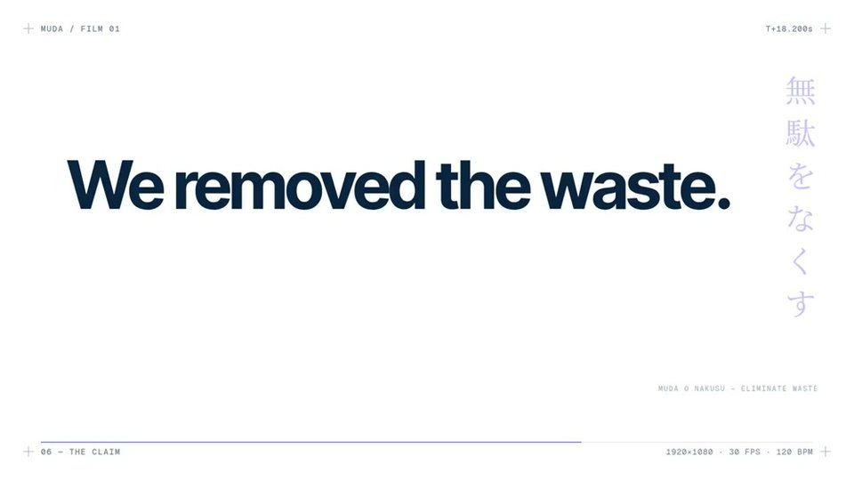</a></td>
<td width="50%" height="225" align="center" valign="middle"><a href="https://guanmo-ai.github.io/awesome-ai-motion/?lang=en#case-2103835273813496100">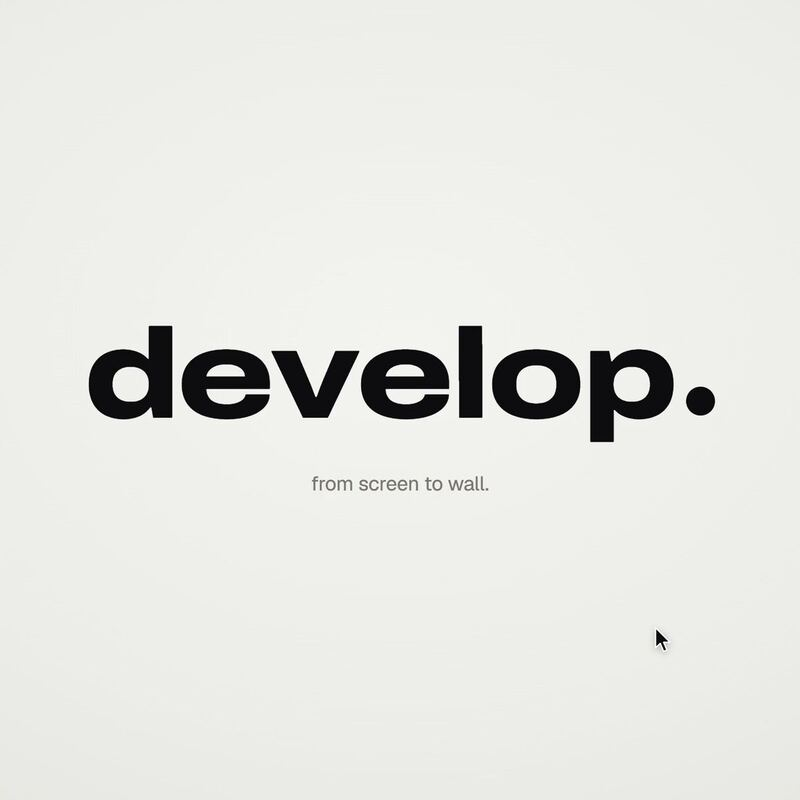</a></td>
</tr>
<tr>
<td width="50%" valign="top"><strong>A one-line prompt for an inference startup launch</strong> <a href="https://x.com/deedydas">@deedydas</a> · Product &amp; marketing 0:26 · Bookmarks 4,697 <a href="https://guanmo-ai.github.io/awesome-ai-motion/?lang=en#case-2102787937482252537">▶ Play</a> · <a href="https://x.com/deedydas/status/2102787937482252537">Original post</a></td>
<td width="50%" valign="top"><strong>A continuous launch film with shape morphs and liquid glass</strong> <a href="https://x.com/twoclipping">@twoclipping</a> · Product &amp; marketing 0:29 · Bookmarks 3,745 <a href="https://guanmo-ai.github.io/awesome-ai-motion/?lang=en#case-2103835273813496100">▶ Play</a> · <a href="https://x.com/twoclipping/status/2103835273813496100">Original post</a></td>
</tr>
</tbody>
<tbody>
<tr>
<td width="50%" height="225" align="center" valign="middle"><a href="https://guanmo-ai.github.io/awesome-ai-motion/?lang=en#case-2102554209166000267">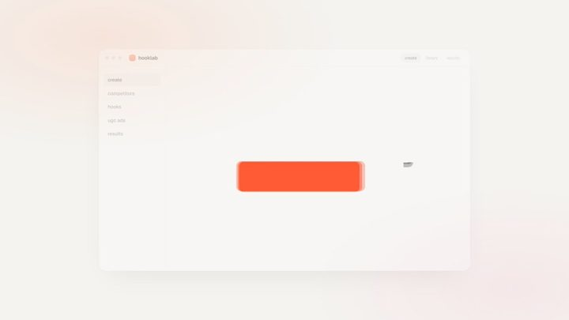</a></td>
<td width="50%" height="225" align="center" valign="middle"></td>
</tr>
<tr>
<td width="50%" valign="top"><strong>Beat-Synced Product Motion Ad</strong> <a href="https://x.com/twoclipping">@twoclipping</a> · Product &amp; marketing 0:20 · Bookmarks 1,422 · Details pending <a href="https://guanmo-ai.github.io/awesome-ai-motion/?lang=en#case-2102554209166000267">▶ Play</a> · <a href="https://x.com/twoclipping/status/2102554209166000267">Original post</a></td>
<td width="50%" valign="top"><strong>A Forty-Second Distilbook Launch Film</strong> <a href="https://x.com/ajith_io">@ajith_io</a> · Product &amp; marketing 0:40 · Bookmarks 847 · Details pending <a href="https://guanmo-ai.github.io/awesome-ai-motion/?lang=en#case-2103469807375208546">▶ Play</a> · <a href="https://x.com/ajith_io/status/2103469807375208546">Original post</a></td>
</tr>
</tbody>
<tbody>
<tr>
<td width="50%" height="225" align="center" valign="middle"></td>
<td width="50%" height="225" align="center" valign="middle"><a href="https://guanmo-ai.github.io/awesome-ai-motion/?lang=en#case-2103499977632997524">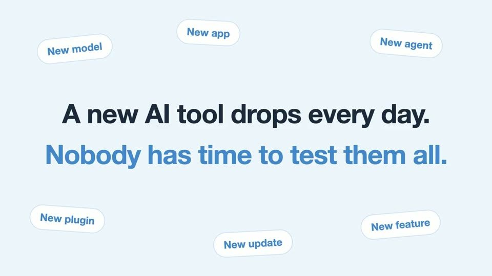</a></td>
</tr>
<tr>
<td width="50%" valign="top"><strong>A Continuous UI Launch Film for Food Ordering</strong> <a href="https://x.com/ultimaxbt">@ultimaxbt</a> · Product &amp; marketing 0:16 · Bookmarks 843 · Details pending <a href="https://guanmo-ai.github.io/awesome-ai-motion/?lang=en#case-2108210884799549714">▶ Play</a> · <a href="https://x.com/ultimaxbt/status/2108210884799549714">Original post</a></td>
<td width="50%" valign="top"><strong>Explain a business in five scenes</strong> <a href="https://x.com/alex_prompter">@alex_prompter</a> · Product &amp; marketing 0:35 · Bookmarks 659 <a href="https://guanmo-ai.github.io/awesome-ai-motion/?lang=en#case-2103499977632997524">▶ Play</a> · <a href="https://x.com/alex_prompter/status/2103499977632997524">Original post</a></td>
</tr>
</tbody>
<tbody>
<tr>
<td width="50%" height="225" align="center" valign="middle"><a href="https://guanmo-ai.github.io/awesome-ai-motion/?lang=en#case-2107507518817878117">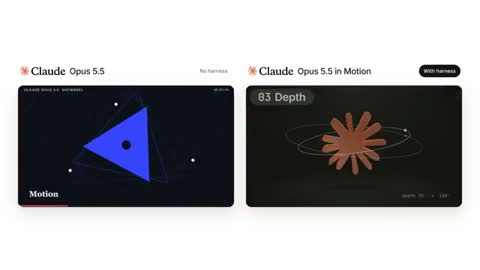</a></td>
<td width="50%" height="225" align="center" valign="middle"></td>
</tr>
<tr>
<td width="50%" valign="top"><strong>One Prompt, Two Opus Motion Workflows</strong> <a href="https://x.com/motion_so">@motion_so</a> · Product &amp; marketing 0:20 · Bookmarks 420 · Details pending <a href="https://guanmo-ai.github.io/awesome-ai-motion/?lang=en#case-2107507518817878117">▶ Play</a> · <a href="https://x.com/motion_so/status/2107507518817878117">Original post</a></td>
<td width="50%" valign="top"><strong>Punchy Promo for a Writing Tool</strong> <a href="https://x.com/shribuilds">@shribuilds</a> · Product &amp; marketing 0:41 · Bookmarks 383 · Details pending <a href="https://guanmo-ai.github.io/awesome-ai-motion/?lang=en#case-2102827288190689364">▶ Play</a> · <a href="https://x.com/shribuilds/status/2102827288190689364">Original post</a></td>
</tr>
</tbody>
<tbody>
<tr>
<td width="50%" height="225" align="center" valign="middle"></td>
<td width="50%" height="225" align="center" valign="middle"></td>
</tr>
<tr>
<td width="50%" valign="top"><strong>Inbox Zero: a code-based product-video workflow</strong> <a href="https://x.com/elie2222">@elie2222</a> · Product &amp; marketing 0:58 · Bookmarks 371 · Details pending <a href="https://guanmo-ai.github.io/awesome-ai-motion/?lang=en#case-2107186094777434454">▶ Play</a> · <a href="https://x.com/elie2222/status/2107186094777434454">Original post</a></td>
<td width="50%" valign="top"><strong>MakerMap: a continuous product journey</strong> <a href="https://x.com/verbove">@verbove</a> · Product &amp; marketing 0:20 · Bookmarks 334 <a href="https://guanmo-ai.github.io/awesome-ai-motion/?lang=en#case-2103483957266268381">▶ Play</a> · <a href="https://x.com/verbove/status/2103483957266268381">Original post</a></td>
</tr>
</tbody>
<tbody>
<tr>
<td width="50%" height="225" align="center" valign="middle"><a href="https://guanmo-ai.github.io/awesome-ai-motion/?lang=en#case-2103800569584562538">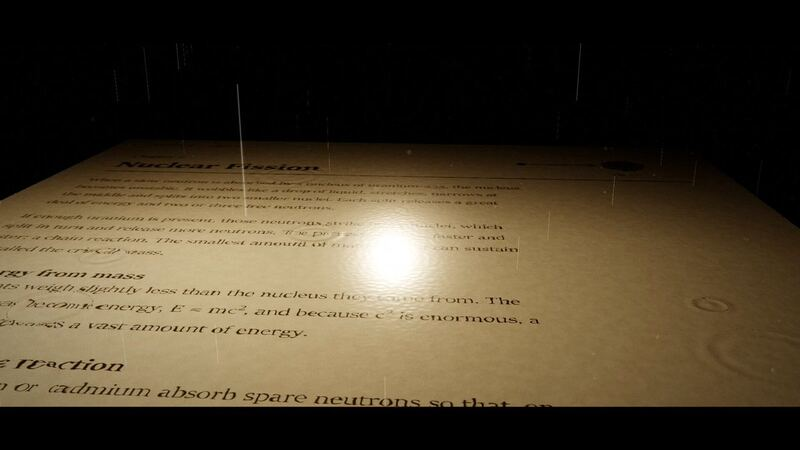</a></td>
<td width="50%" height="225" align="center" valign="middle"><a href="https://guanmo-ai.github.io/awesome-ai-motion/?lang=en#case-2106640261623537875">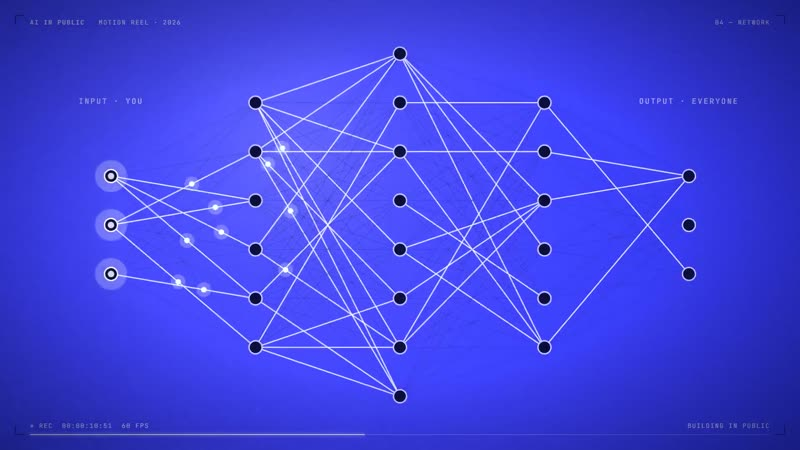</a></td>
</tr>
<tr>
<td width="50%" valign="top"><strong>Distilbook: score inspiration and a composition prompt</strong> <a href="https://x.com/ajith_io">@ajith_io</a> · Product &amp; marketing 0:40 · Bookmarks 57 <a href="https://guanmo-ai.github.io/awesome-ai-motion/?lang=en#case-2103800569584562538">▶ Play</a> · <a href="https://x.com/ajith_io/status/2103800569584562538">Original post</a></td>
<td width="50%" valign="top"><strong>AI In Public: visuals and sound written in code</strong> <a href="https://x.com/humzaakhalid">@humzaakhalid</a> · Product &amp; marketing 0:24 · Bookmarks 56 <a href="https://guanmo-ai.github.io/awesome-ai-motion/?lang=en#case-2106640261623537875">▶ Play</a> · <a href="https://x.com/humzaakhalid/status/2106640261623537875">Original post</a></td>
</tr>
</tbody>
<tbody>
<tr>
<td width="50%" height="225" align="center" valign="middle"></td>
<td width="50%" height="225" align="center" valign="middle"><a href="https://guanmo-ai.github.io/awesome-ai-motion/?lang=en#case-2103761658745335993">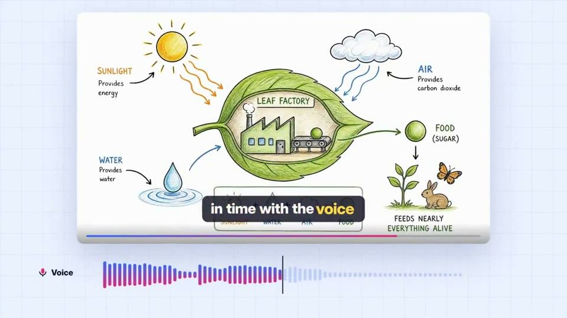</a></td>
</tr>
<tr>
<td width="50%" valign="top"><strong>RedShip’s Animated Product Story</strong> <a href="https://x.com/aschapmann">@aschapmann</a> · Product &amp; marketing 0:30 · Bookmarks 12 · Details pending <a href="https://guanmo-ai.github.io/awesome-ai-motion/?lang=en#case-2104230888812724497">▶ Play</a> · <a href="https://x.com/aschapmann/status/2104230888812724497">Original post</a></td>
<td width="50%" valign="top"><strong>A 30-second product motion brief</strong> <a href="https://x.com/sudo_kiran">@sudo_kiran</a> · Product &amp; marketing 0:30 · Bookmarks 11 <a href="https://guanmo-ai.github.io/awesome-ai-motion/?lang=en#case-2103761658745335993">▶ Play</a> · <a href="https://x.com/sudo_kiran/status/2103761658745335993">Original post</a></td>
</tr>
</tbody>
<tbody>
<tr>
<td width="50%" height="225" align="center" valign="middle"><a href="https://guanmo-ai.github.io/awesome-ai-motion/?lang=en#case-2104336637752955094">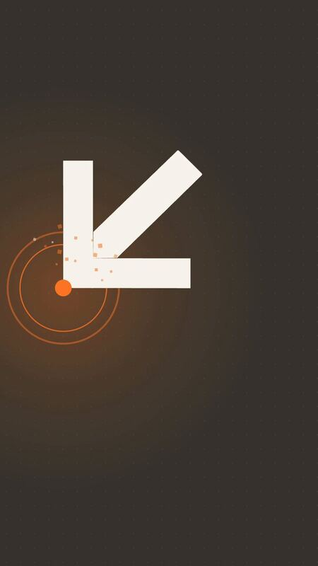</a></td>
<td width="50%" height="225" align="center" valign="middle"><a href="https://guanmo-ai.github.io/awesome-ai-motion/?lang=en#case-2102787822855893072">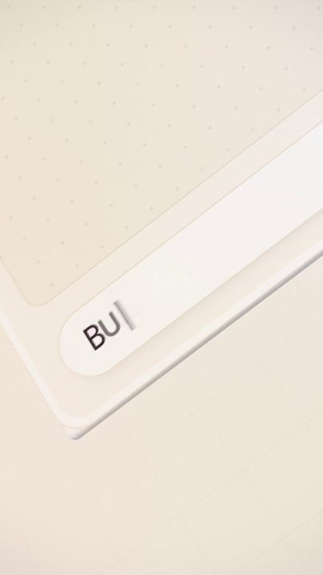</a></td>
</tr>
<tr>
<td width="50%" valign="top"><strong>Onde Fica: real app footage and a mixed-tool reel</strong> <a href="https://x.com/jesscaroline7">@jesscaroline7</a> · Product &amp; marketing 1:00 · Bookmarks 8 <a href="https://guanmo-ai.github.io/awesome-ai-motion/?lang=en#case-2104336637752955094">▶ Play</a> · <a href="https://x.com/jesscaroline7/status/2104336637752955094">Original post</a></td>
<td width="50%" valign="top"><strong>Ad for a UI Components Product</strong> <a href="https://x.com/deweytn">@deweytn</a> · Product &amp; marketing 0:26 · Bookmarks 4 · Details pending <a href="https://guanmo-ai.github.io/awesome-ai-motion/?lang=en#case-2102787822855893072">▶ Play</a> · <a href="https://x.com/deweytn/status/2102787822855893072">Original post</a></td>
</tr>
</tbody>
<tbody>
<tr>
<td width="50%" height="225" align="center" valign="middle"></td>
<td width="50%" height="225" align="center" valign="middle"></td>
</tr>
<tr>
<td width="50%" valign="top"><strong>A Studio1 Kinetic Launch Intro</strong> <a href="https://x.com/Astrodevil_">@Astrodevil_</a> · Product &amp; marketing 0:15 · Bookmarks 4 · Details pending <a href="https://guanmo-ai.github.io/awesome-ai-motion/?lang=en#case-2103600734017392708">▶ Play</a> · <a href="https://x.com/Astrodevil_/status/2103600734017392708">Original post</a></td>
<td width="50%" valign="top"><strong>A Developer Portfolio Motion Reel</strong> <a href="https://x.com/wani_shola">@wani_shola</a> · Product &amp; marketing 1:42 · Bookmarks 3 · Details pending <a href="https://guanmo-ai.github.io/awesome-ai-motion/?lang=en#case-2103769906638459278">▶ Play</a> · <a href="https://x.com/wani_shola/status/2103769906638459278">Original post</a></td>
</tr>
</tbody>
<tbody>
<tr>
<td width="50%" height="225" align="center" valign="middle"><a href="https://guanmo-ai.github.io/awesome-ai-motion/?lang=en#case-2108596616756416945">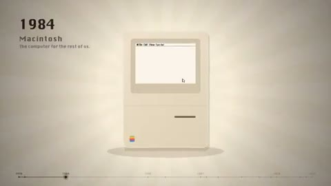</a></td>
<td width="50%" height="225" align="center" valign="middle"><a href="https://guanmo-ai.github.io/awesome-ai-motion/?lang=en#case-2104249941136666741">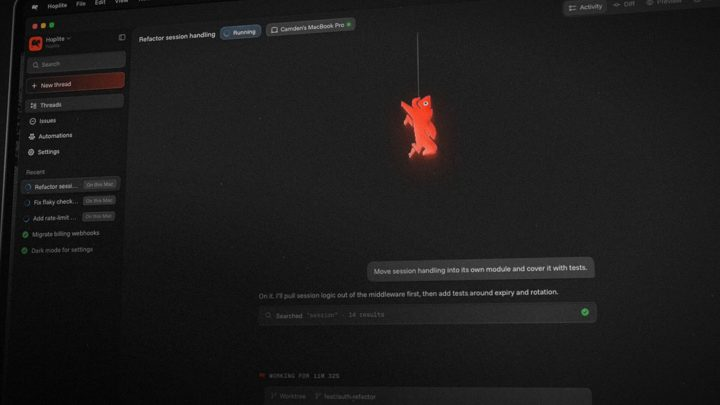</a></td>
</tr>
<tr>
<td width="50%" valign="top"><strong>A 3D Timeline of Apple Products</strong> <a href="https://x.com/aiRobertDaily">@aiRobertDaily</a> · Product &amp; marketing 0:38 · Bookmarks 3 · Details pending <a href="https://guanmo-ai.github.io/awesome-ai-motion/?lang=en#case-2108596616756416945">▶ Play</a> · <a href="https://x.com/aiRobertDaily/status/2108596616756416945">Original post</a></td>
<td width="50%" valign="top"><strong>Hoplite feature launch animation</strong> <a href="https://x.com/ryan_morr">@ryan_morr</a> · Product &amp; marketing 0:32 · Bookmarks 2 · Details pending <a href="https://guanmo-ai.github.io/awesome-ai-motion/?lang=en#case-2104249941136666741">▶ Play</a> · <a href="https://x.com/ryan_morr/status/2104249941136666741">Original post</a></td>
</tr>
</tbody>
<tbody>
<tr>
<td width="50%" height="225" align="center" valign="middle"><a href="https://guanmo-ai.github.io/awesome-ai-motion/?lang=en#case-2108326197516198346">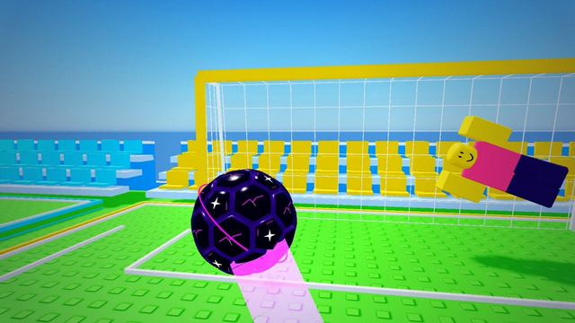</a></td>
<td width="50%" height="225" align="center" valign="middle"><a href="https://guanmo-ai.github.io/awesome-ai-motion/?lang=en#case-2105567585680941521">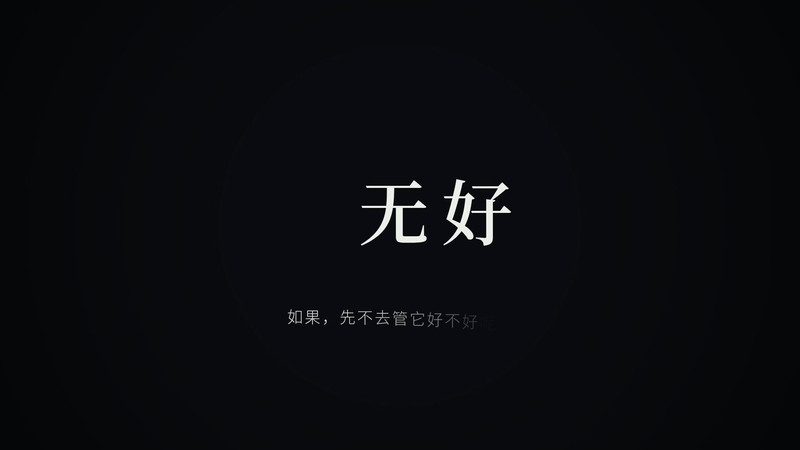</a></td>
</tr>
<tr>
<td width="50%" valign="top"><strong>A One-line Trailer Test for a Roblox Game</strong> <a href="https://x.com/Aryanpxcr7">@Aryanpxcr7</a> · Product &amp; marketing 0:41 · Bookmarks 1 · Details pending <a href="https://guanmo-ai.github.io/awesome-ai-motion/?lang=en#case-2108326197516198346">▶ Play</a> · <a href="https://x.com/Aryanpxcr7/status/2108326197516198346">Original post</a></td>
<td width="50%" valign="top"><strong>A one-minute concept promo for a podcast</strong> <a href="https://x.com/wuhao1031">@wuhao1031</a> · Product &amp; marketing 1:00 · Bookmarks 0 · Details pending <a href="https://guanmo-ai.github.io/awesome-ai-motion/?lang=en#case-2105567585680941521">▶ Play</a> · <a href="https://x.com/wuhao1031/status/2105567585680941521">Original post</a></td>
</tr>
</tbody>
<tbody>
<tr>
<td width="50%" height="225" align="center" valign="middle"><a href="https://guanmo-ai.github.io/awesome-ai-motion/?lang=en#case-2106057217040368042">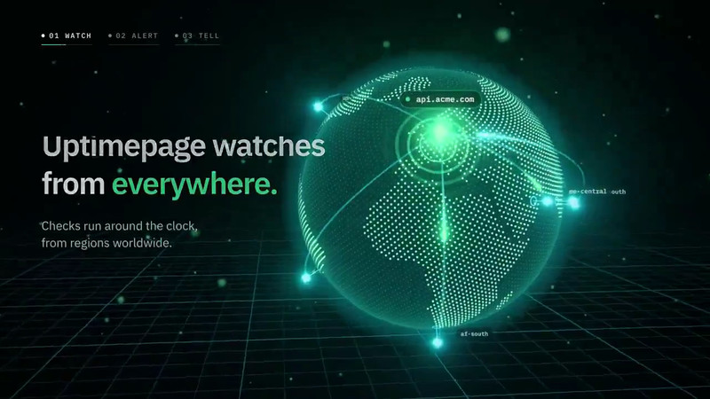</a></td>
<td width="50%" height="225" align="center" valign="middle"></td>
</tr>
<tr>
<td width="50%" valign="top"><strong>Uptimepage: a 30-second Three.js promo</strong> <a href="https://x.com/kevindatas">@kevindatas</a> · Product &amp; marketing 0:30 · Bookmarks 0 · Details pending <a href="https://guanmo-ai.github.io/awesome-ai-motion/?lang=en#case-2106057217040368042">▶ Play</a> · <a href="https://x.com/kevindatas/status/2106057217040368042">Original post</a></td>
<td width="50%" valign="top"><strong>A Glaido Product Demo with a Jingle</strong> <a href="https://x.com/AIJackRoberts">@AIJackRoberts</a> · Product &amp; marketing 0:26 · Bookmarks 0 · Details pending <a href="https://guanmo-ai.github.io/awesome-ai-motion/?lang=en#case-2107869205588848985">▶ Play</a> · <a href="https://x.com/AIJackRoberts/status/2107869205588848985">Original post</a></td>
</tr>
</tbody>
<tbody>
<tr>
<td width="50%" height="225" align="center" valign="middle"><a href="https://guanmo-ai.github.io/awesome-ai-motion/?lang=en#case-2103746671591256286">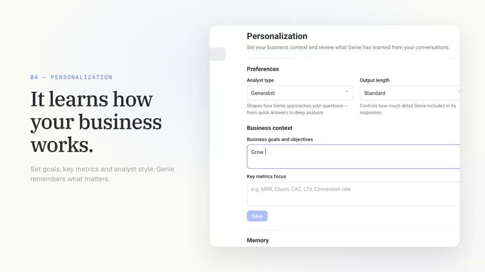</a></td>
<td width="50%" height="225" align="center" valign="middle"></td>
</tr>
<tr>
<td width="50%" valign="top"><strong>An analytics product made from real web assets</strong> <a href="https://x.com/zigapoto">@zigapoto</a> · Product &amp; marketing 1:00 · Bookmarks 0 <a href="https://guanmo-ai.github.io/awesome-ai-motion/?lang=en#case-2103746671591256286">▶ Play</a> · <a href="https://x.com/zigapoto/status/2103746671591256286">Original post</a></td>
<td width="50%" valign="top"><strong>A promotional animation for deckuse</strong> <a href="https://x.com/feiflow">@feiflow</a> · Product &amp; marketing 1:05 · Bookmarks 0 <a href="https://guanmo-ai.github.io/awesome-ai-motion/?lang=en#case-2104039666093572362">▶ Play</a> · <a href="https://x.com/feiflow/status/2104039666093572362">Original post</a></td>
</tr>
</tbody>
<tbody>
<tr>
<td width="50%" height="225" align="center" valign="middle"><a href="https://guanmo-ai.github.io/awesome-ai-motion/?lang=en#case-2109225353243988478">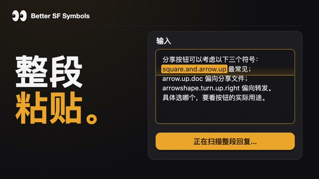</a></td>
<td width="50%" height="225" align="center" valign="middle"></td>
</tr>
<tr>
<td width="50%" valign="top"><strong>SF Symbols Picker Product Animation</strong> <a href="https://x.com/21Terrence1">@21Terrence1</a> · Product &amp; marketing 0:25 · Bookmarks 0 · Details pending <a href="https://guanmo-ai.github.io/awesome-ai-motion/?lang=en#case-2109225353243988478">▶ Play</a> · <a href="https://x.com/21Terrence1/status/2109225353243988478">Original post</a></td>
<td width="50%" valign="top"><strong>Creative Promo from a Single Instruction</strong> <a href="https://x.com/nikomaster01">@nikomaster01</a> · Product &amp; marketing 0:47 · Bookmarks 0 · Details pending <a href="https://guanmo-ai.github.io/awesome-ai-motion/?lang=en#case-2104765209596612730">▶ Play</a> · <a href="https://x.com/nikomaster01/status/2104765209596612730">Original post</a></td>
</tr>
</tbody>
<tbody>
<tr>
<td width="50%" height="225" align="center" valign="middle"></td>
<td width="50%" height="225" align="center" valign="middle"><a href="https://guanmo-ai.github.io/awesome-ai-motion/?lang=en#case-2110426116288827709">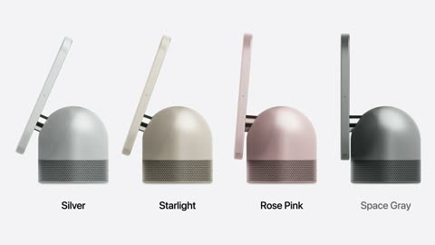</a></td>
</tr>
<tr>
<td width="50%" valign="top"><strong>A tile build revealing an advertisement</strong> <a href="https://x.com/tanabe_fragm">@tanabe_fragm</a> · Product &amp; marketing 0:30 · Bookmarks 0 · Details pending <a href="https://guanmo-ai.github.io/awesome-ai-motion/?lang=en#case-2107644501372322001">▶ Play</a> · <a href="https://x.com/tanabe_fragm/status/2107644501372322001">Original post</a></td>
<td width="50%" valign="top"><strong>Homeview: A 3D Product Launch Concept</strong> <a href="https://x.com/everestchris6">@everestchris6</a> · Product &amp; marketing 0:19 · Bookmarks — · Details pending <a href="https://guanmo-ai.github.io/awesome-ai-motion/?lang=en#case-2110426116288827709">▶ Play</a> · <a href="https://x.com/everestchris6/status/2110426116288827709">Original post</a></td>
</tr>
</tbody>
<tbody>
<tr>
<td width="50%" height="225" align="center" valign="middle"></td>
<td width="50%" height="225" align="center" valign="middle"></td>
</tr>
<tr>
<td width="50%" valign="top"><strong>UDC: An Animated Conference Poster</strong> <a href="https://x.com/johncodunayo">@johncodunayo</a> · Product &amp; marketing 0:24 · Bookmarks 3,756 · Details pending <a href="https://guanmo-ai.github.io/awesome-ai-motion/?lang=en#case-2105270766996701686">▶ Play</a> · <a href="https://x.com/johncodunayo/status/2105270766996701686">Original post</a></td>
<td width="50%" valign="top"><strong>Stickers and Pixel Games for an Event</strong> <a href="https://x.com/tkm_hmng8">@tkm_hmng8</a> · Product &amp; marketing 0:50 · Bookmarks 2,277 · Details pending <a href="https://guanmo-ai.github.io/awesome-ai-motion/?lang=en#case-2105255710531674358">▶ Play</a> · <a href="https://x.com/tkm_hmng8/status/2105255710531674358">Original post</a></td>
</tr>
</tbody>
<tbody>
<tr>
<td width="50%" height="225" align="center" valign="middle"></td>
<td width="50%" height="225" align="center" valign="middle"><a href="https://guanmo-ai.github.io/awesome-ai-motion/?lang=en#case-2104148233106723099">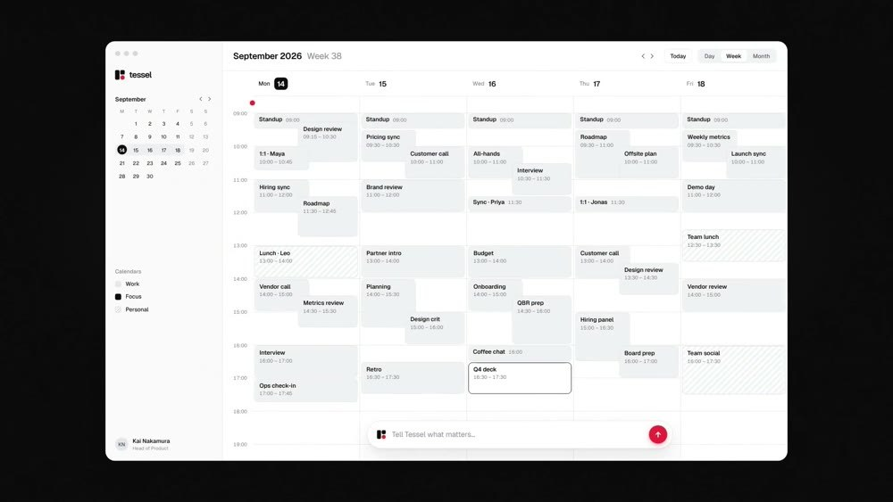</a></td>
</tr>
<tr>
<td width="50%" valign="top"><strong>Shotbase product launch animation</strong> <a href="https://x.com/Miguel07Code">@Miguel07Code</a> · Product &amp; marketing 0:58 · Bookmarks 1,683 · Details pending <a href="https://guanmo-ai.github.io/awesome-ai-motion/?lang=en#case-2102441708395041170">▶ Play</a> · <a href="https://x.com/Miguel07Code/status/2102441708395041170">Original post</a></td>
<td width="50%" valign="top"><strong>A Fully Coded Launch Film for a Fictional Calendar App</strong> <a href="https://x.com/LexnLin">@LexnLin</a> · Product &amp; marketing 0:33 · Bookmarks 1,240 · Details pending <a href="https://guanmo-ai.github.io/awesome-ai-motion/?lang=en#case-2104148233106723099">▶ Play</a> · <a href="https://x.com/LexnLin/status/2104148233106723099">Original post</a></td>
</tr>
</tbody>
<tbody>
<tr>
<td width="50%" height="225" align="center" valign="middle"><a href="https://guanmo-ai.github.io/awesome-ai-motion/?lang=en#case-2102477340920152162">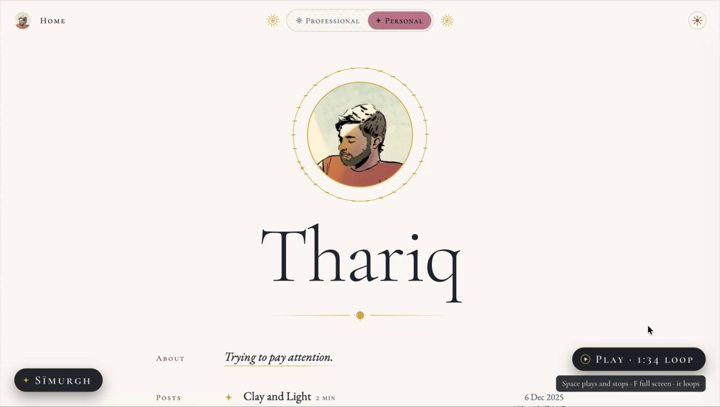</a></td>
<td width="50%" height="225" align="center" valign="middle"><a href="https://guanmo-ai.github.io/awesome-ai-motion/?lang=en#case-2106101651010449796">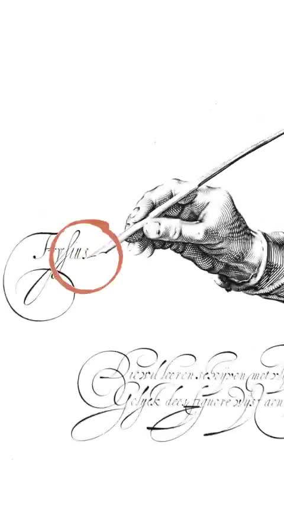</a></td>
</tr>
<tr>
<td width="50%" valign="top"><strong>Personal website redesign trailer</strong> <a href="https://x.com/trq212">@trq212</a> · Product &amp; marketing 1:35 · Bookmarks 1,122 · Details pending <a href="https://guanmo-ai.github.io/awesome-ai-motion/?lang=en#case-2102477340920152162">▶ Play</a> · <a href="https://x.com/trq212/status/2102477340920152162">Original post</a></td>
<td width="50%" valign="top"><strong>Claude Makes Its Own Typographic Ad</strong> <a href="https://x.com/LexnLin">@LexnLin</a> · Product &amp; marketing 0:14 · Bookmarks 1,119 · Details pending <a href="https://guanmo-ai.github.io/awesome-ai-motion/?lang=en#case-2106101651010449796">▶ Play</a> · <a href="https://x.com/LexnLin/status/2106101651010449796">Original post</a></td>
</tr>
</tbody>
<tbody>
<tr>
<td width="50%" height="225" align="center" valign="middle"></td>
<td width="50%" height="225" align="center" valign="middle"></td>
</tr>
<tr>
<td width="50%" valign="top"><strong>Tutorial for Code-Drawn Product Ads</strong> <a href="https://x.com/Lucas_IA_">@Lucas_IA_</a> · Product &amp; marketing 1:12 · Bookmarks 1,119 · Details pending <a href="https://guanmo-ai.github.io/awesome-ai-motion/?lang=en#case-2103152093733253544">▶ Play</a> · <a href="https://x.com/Lucas_IA_/status/2103152093733253544">Original post</a></td>
<td width="50%" valign="top"><strong>A NovaChat Interface Promo</strong> <a href="https://x.com/ann_nnng">@ann_nnng</a> · Product &amp; marketing 0:15 · Bookmarks 1,110 · Details pending <a href="https://guanmo-ai.github.io/awesome-ai-motion/?lang=en#case-2103723183899852885">▶ Play</a> · <a href="https://x.com/ann_nnng/status/2103723183899852885">Original post</a></td>
</tr>
</tbody>
<tbody>
<tr>
<td width="50%" height="225" align="center" valign="middle"><a href="https://guanmo-ai.github.io/awesome-ai-motion/?lang=en#case-2103542300844474452">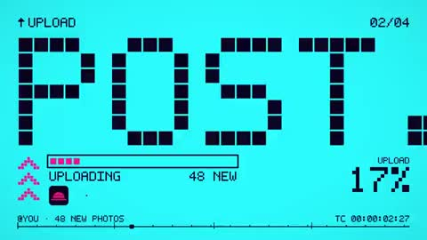</a></td>
<td width="50%" height="225" align="center" valign="middle"><a href="https://guanmo-ai.github.io/awesome-ai-motion/?lang=en#case-2096209514248958161">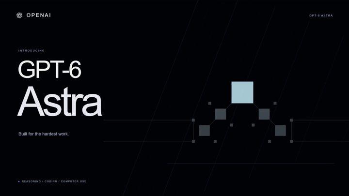</a></td>
</tr>
<tr>
<td width="50%" valign="top"><strong>Pixel Uploads and Retro Social Screens</strong> <a href="https://x.com/trymirage">@trymirage</a> · Product &amp; marketing 0:15 · Bookmarks 1,011 · Details pending <a href="https://guanmo-ai.github.io/awesome-ai-motion/?lang=en#case-2103542300844474452">▶ Play</a> · <a href="https://x.com/trymirage/status/2103542300844474452">Original post</a></td>
<td width="50%" valign="top"><strong>Model-Built Launch Film</strong> <a href="https://x.com/athrix_codes">@athrix_codes</a> · Product &amp; marketing 0:53 · Bookmarks 951 · Details pending <a href="https://guanmo-ai.github.io/awesome-ai-motion/?lang=en#case-2096209514248958161">▶ Play</a> · <a href="https://x.com/athrix_codes/status/2096209514248958161">Original post</a></td>
</tr>
</tbody>
<tbody>
<tr>
<td width="50%" height="225" align="center" valign="middle"><a href="https://guanmo-ai.github.io/awesome-ai-motion/?lang=en#case-2108250410221781009">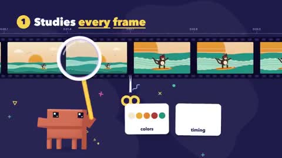</a></td>
<td width="50%" height="225" align="center" valign="middle"></td>
</tr>
<tr>
<td width="50%" valign="top"><strong>From Reference to Animation</strong> <a href="https://x.com/ishuagra02">@ishuagra02</a> · Product &amp; marketing 1:02 · Bookmarks 754 · Details pending <a href="https://guanmo-ai.github.io/awesome-ai-motion/?lang=en#case-2108250410221781009">▶ Play</a> · <a href="https://x.com/ishuagra02/status/2108250410221781009">Original post</a></td>
<td width="50%" valign="top"><strong>Reminders in Motion</strong> <a href="https://x.com/LexnLin">@LexnLin</a> · Product &amp; marketing 0:40 · Bookmarks 639 · Details pending <a href="https://guanmo-ai.github.io/awesome-ai-motion/?lang=en#case-2109718604883370450">▶ Play</a> · <a href="https://x.com/LexnLin/status/2109718604883370450">Original post</a></td>
</tr>
</tbody>
<tbody>
<tr>
<td width="50%" height="225" align="center" valign="middle"></td>
<td width="50%" height="225" align="center" valign="middle"></td>
</tr>
<tr>
<td width="50%" valign="top"><strong>Editable After Effects launch video</strong> <a href="https://x.com/seiiiiiiiiiiru">@seiiiiiiiiiiru</a> · Product &amp; marketing 0:30 · Bookmarks 597 · Details pending <a href="https://guanmo-ai.github.io/awesome-ai-motion/?lang=en#case-2102636308707287201">▶ Play</a> · <a href="https://x.com/seiiiiiiiiiiru/status/2102636308707287201">Original post</a></td>
<td width="50%" valign="top"><strong>Narration led After Effects ad</strong> <a href="https://x.com/seiiiiiiiiiiru">@seiiiiiiiiiiru</a> · Product &amp; marketing 0:29 · Bookmarks 588 · Details pending <a href="https://guanmo-ai.github.io/awesome-ai-motion/?lang=en#case-2103227982592831846">▶ Play</a> · <a href="https://x.com/seiiiiiiiiiiru/status/2103227982592831846">Original post</a></td>
</tr>
</tbody>
<tbody>
<tr>
<td width="50%" height="225" align="center" valign="middle"></td>
<td width="50%" height="225" align="center" valign="middle"></td>
</tr>
<tr>
<td width="50%" valign="top"><strong>A Sticker Library Launch</strong> <a href="https://x.com/javiiarchive">@javiiarchive</a> · Product &amp; marketing 0:23 · Bookmarks 566 · Details pending <a href="https://guanmo-ai.github.io/awesome-ai-motion/?lang=en#case-2105283486487896448">▶ Play</a> · <a href="https://x.com/javiiarchive/status/2105283486487896448">Original post</a></td>
<td width="50%" valign="top"><strong>Tabi: From Keyboard to Words</strong> <a href="https://x.com/nikhilbhima">@nikhilbhima</a> · Product &amp; marketing 0:44 · Bookmarks 449 · Details pending <a href="https://guanmo-ai.github.io/awesome-ai-motion/?lang=en#case-2109019765134213540">▶ Play</a> · <a href="https://x.com/nikhilbhima/status/2109019765134213540">Original post</a></td>
</tr>
</tbody>
<tbody>
<tr>
<td width="50%" height="225" align="center" valign="middle"></td>
<td width="50%" height="225" align="center" valign="middle"></td>
</tr>
<tr>
<td width="50%" valign="top"><strong>A Continuous Camera Move Through a Product Page</strong> <a href="https://x.com/cleeeeeeeeement">@cleeeeeeeeement</a> · Product &amp; marketing 0:15 · Bookmarks 428 · Details pending <a href="https://guanmo-ai.github.io/awesome-ai-motion/?lang=en#case-2110039903312425385">▶ Play</a> · <a href="https://x.com/cleeeeeeeeement/status/2110039903312425385">Original post</a></td>
<td width="50%" valign="top"><strong>Red Analytics Channel Motion</strong> <a href="https://x.com/Gregoirechp">@Gregoirechp</a> · Product &amp; marketing 0:20 · Bookmarks 396 · Details pending <a href="https://guanmo-ai.github.io/awesome-ai-motion/?lang=en#case-2103977724796649763">▶ Play</a> · <a href="https://x.com/Gregoirechp/status/2103977724796649763">Original post</a></td>
</tr>
</tbody>
<tbody>
<tr>
<td width="50%" height="225" align="center" valign="middle"></td>
<td width="50%" height="225" align="center" valign="middle"></td>
</tr>
<tr>
<td width="50%" valign="top"><strong>Animated Mushroom Coffee Ad</strong> <a href="https://x.com/ladprofit">@ladprofit</a> · Product &amp; marketing 0:55 · Bookmarks 334 · Details pending <a href="https://guanmo-ai.github.io/awesome-ai-motion/?lang=en#case-2103148835270971419">▶ Play</a> · <a href="https://x.com/ladprofit/status/2103148835270971419">Original post</a></td>
<td width="50%" valign="top"><strong>Complete Promo for a Unified Chat App</strong> <a href="https://x.com/dhruvalgolakiya">@dhruvalgolakiya</a> · Product &amp; marketing 0:40 · Bookmarks 329 · Details pending <a href="https://guanmo-ai.github.io/awesome-ai-motion/?lang=en#case-2103037586663235713">▶ Play</a> · <a href="https://x.com/dhruvalgolakiya/status/2103037586663235713">Original post</a></td>
</tr>
</tbody>
<tbody>
<tr>
<td width="50%" height="225" align="center" valign="middle"></td>
<td width="50%" height="225" align="center" valign="middle"><a href="https://guanmo-ai.github.io/awesome-ai-motion/?lang=en#case-2104093497561436573">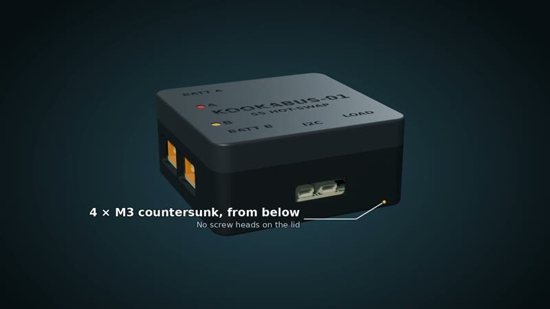</a></td>
</tr>
<tr>
<td width="50%" valign="top"><strong>Dub: A Globe of Particles</strong> <a href="https://x.com/steventey">@steventey</a> · Product &amp; marketing 0:15 · Bookmarks 300 · Details pending <a href="https://guanmo-ai.github.io/awesome-ai-motion/?lang=en#case-2103625902211088880">▶ Play</a> · <a href="https://x.com/steventey/status/2103625902211088880">Original post</a></td>
<td width="50%" valign="top"><strong>A PCB Enclosure and Printable Parts Promo</strong> <a href="https://x.com/VectorCrossProd">@VectorCrossProd</a> · Product &amp; marketing 0:10 · Bookmarks 271 · Details pending <a href="https://guanmo-ai.github.io/awesome-ai-motion/?lang=en#case-2104093497561436573">▶ Play</a> · <a href="https://x.com/VectorCrossProd/status/2104093497561436573">Original post</a></td>
</tr>
</tbody>
<tbody>
<tr>
<td width="50%" height="225" align="center" valign="middle"></td>
<td width="50%" height="225" align="center" valign="middle"></td>
</tr>
<tr>
<td width="50%" valign="top"><strong>A Motion Promo for Drawing Ideas into Animation</strong> <a href="https://x.com/HaileyAILabs">@HaileyAILabs</a> · Product &amp; marketing 1:11 · Bookmarks 236 · Details pending <a href="https://guanmo-ai.github.io/awesome-ai-motion/?lang=en#case-2111353123646427556">▶ Play</a> · <a href="https://x.com/HaileyAILabs/status/2111353123646427556">Original post</a></td>
<td width="50%" valign="top"><strong>Product Motion Through 3D Devices and Sparks</strong> <a href="https://x.com/MengTo">@MengTo</a> · Product &amp; marketing 0:41 · Bookmarks 217 · Details pending <a href="https://guanmo-ai.github.io/awesome-ai-motion/?lang=en#case-2103825139964227999">▶ Play</a> · <a href="https://x.com/MengTo/status/2103825139964227999">Original post</a></td>
</tr>
</tbody>
<tbody>
<tr>
<td width="50%" height="225" align="center" valign="middle"><a href="https://guanmo-ai.github.io/awesome-ai-motion/?lang=en#case-2111138912349626801">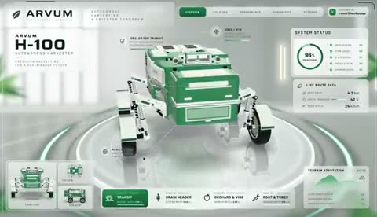</a></td>
<td width="50%" height="225" align="center" valign="middle"></td>
</tr>
<tr>
<td width="50%" valign="top"><strong>A Shape-Shifting Harvester Robot</strong> <a href="https://x.com/DilumSanjaya">@DilumSanjaya</a> · Product &amp; marketing 1:10 · Bookmarks 214 · Details pending <a href="https://guanmo-ai.github.io/awesome-ai-motion/?lang=en#case-2111138912349626801">▶ Play</a> · <a href="https://x.com/DilumSanjaya/status/2111138912349626801">Original post</a></td>
<td width="50%" valign="top"><strong>Short Film from App Redesign Assets</strong> <a href="https://x.com/jackfriks">@jackfriks</a> · Product &amp; marketing 0:20 · Bookmarks 192 · Details pending <a href="https://guanmo-ai.github.io/awesome-ai-motion/?lang=en#case-2103132260589338762">▶ Play</a> · <a href="https://x.com/jackfriks/status/2103132260589338762">Original post</a></td>
</tr>
</tbody>
<tbody>
<tr>
<td width="50%" height="225" align="center" valign="middle"></td>
<td width="50%" height="225" align="center" valign="middle"></td>
</tr>
<tr>
<td width="50%" valign="top"><strong>LaunchBuddy: Ready for Launch</strong> <a href="https://x.com/FloWritesCode">@FloWritesCode</a> · Product &amp; marketing 0:30 · Bookmarks 174 · Details pending <a href="https://guanmo-ai.github.io/awesome-ai-motion/?lang=en#case-2105268326381625845">▶ Play</a> · <a href="https://x.com/FloWritesCode/status/2105268326381625845">Original post</a></td>
<td width="50%" valign="top"><strong>Happily: An AI Letter</strong> <a href="https://x.com/LexnLin">@LexnLin</a> · Product &amp; marketing 0:40 · Bookmarks 169 · Details pending <a href="https://guanmo-ai.github.io/awesome-ai-motion/?lang=en#case-2110013871532490973">▶ Play</a> · <a href="https://x.com/LexnLin/status/2110013871532490973">Original post</a></td>
</tr>
</tbody>
<tbody>
<tr>
<td width="50%" height="225" align="center" valign="middle"></td>
<td width="50%" height="225" align="center" valign="middle"></td>
</tr>
<tr>
<td width="50%" valign="top"><strong>Claude: A Horizon Launch Film</strong> <a href="https://x.com/chetaslua">@chetaslua</a> · Product &amp; marketing 0:20 · Bookmarks 168 · Details pending <a href="https://guanmo-ai.github.io/awesome-ai-motion/?lang=en#case-2102457403119985005">▶ Play</a> · <a href="https://x.com/chetaslua/status/2102457403119985005">Original post</a></td>
<td width="50%" valign="top"><strong>Fish a Friend: A Game Trailer</strong> <a href="https://x.com/Blushneyy">@Blushneyy</a> · Product &amp; marketing 0:43 · Bookmarks 154 · Details pending <a href="https://guanmo-ai.github.io/awesome-ai-motion/?lang=en#case-2108644023330390194">▶ Play</a> · <a href="https://x.com/Blushneyy/status/2108644023330390194">Original post</a></td>
</tr>
</tbody>
<tbody>
<tr>
<td width="50%" height="225" align="center" valign="middle"><a href="https://guanmo-ai.github.io/awesome-ai-motion/?lang=en#case-2102370144546889735">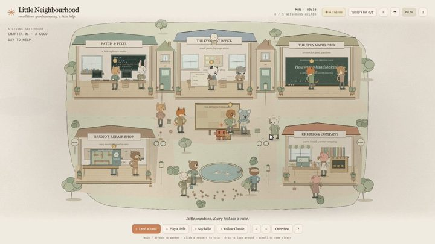</a></td>
<td width="50%" height="225" align="center" valign="middle"><a href="https://guanmo-ai.github.io/awesome-ai-motion/?lang=en#case-2111285052617445438">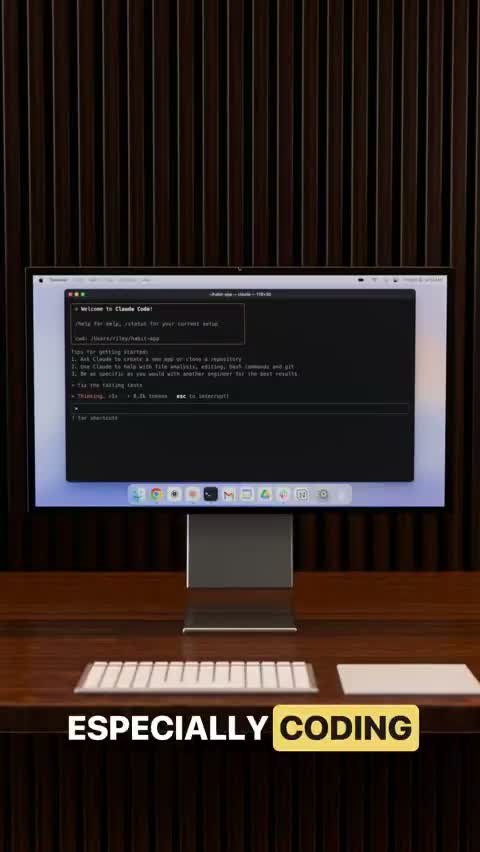</a></td>
</tr>
<tr>
<td width="50%" valign="top"><strong>Launch Animation of Claude Helping a Neighbourhood</strong> <a href="https://x.com/chetaslua">@chetaslua</a> · Product &amp; marketing 0:56 · Bookmarks 139 · Details pending <a href="https://guanmo-ai.github.io/awesome-ai-motion/?lang=en#case-2102370144546889735">▶ Play</a> · <a href="https://x.com/chetaslua/status/2102370144546889735">Original post</a></td>
<td width="50%" valign="top"><strong>A Single-Prompt Blender Desk Film</strong> <a href="https://x.com/rileybrown">@rileybrown</a> · Product &amp; marketing 2:33 · Bookmarks 135 · Details pending <a href="https://guanmo-ai.github.io/awesome-ai-motion/?lang=en#case-2111285052617445438">▶ Play</a> · <a href="https://x.com/rileybrown/status/2111285052617445438">Original post</a></td>
</tr>
</tbody>
<tbody>
<tr>
<td width="50%" height="225" align="center" valign="middle"></td>
<td width="50%" height="225" align="center" valign="middle"><a href="https://guanmo-ai.github.io/awesome-ai-motion/?lang=en#case-2105771088374288692">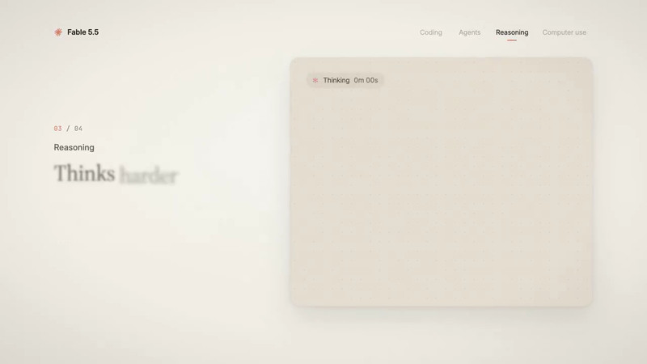</a></td>
</tr>
<tr>
<td width="50%" valign="top"><strong>Hoodie Merchandise Launch Motion</strong> <a href="https://x.com/bridgemindai">@bridgemindai</a> · Product &amp; marketing 0:30 · Bookmarks 127 · Details pending <a href="https://guanmo-ai.github.io/awesome-ai-motion/?lang=en#case-2102462889160286423">▶ Play</a> · <a href="https://x.com/bridgemindai/status/2102462889160286423">Original post</a></td>
<td width="50%" valign="top"><strong>A fictional model-launch video comparison</strong> <a href="https://x.com/mesmerlord">@mesmerlord</a> · Product &amp; marketing 1:20 · Bookmarks 122 · Details pending <a href="https://guanmo-ai.github.io/awesome-ai-motion/?lang=en#case-2105771088374288692">▶ Play</a> · <a href="https://x.com/mesmerlord/status/2105771088374288692">Original post</a></td>
</tr>
</tbody>
<tbody>
<tr>
<td width="50%" height="225" align="center" valign="middle"></td>
<td width="50%" height="225" align="center" valign="middle"><a href="https://guanmo-ai.github.io/awesome-ai-motion/?lang=en#case-2102741813719138661">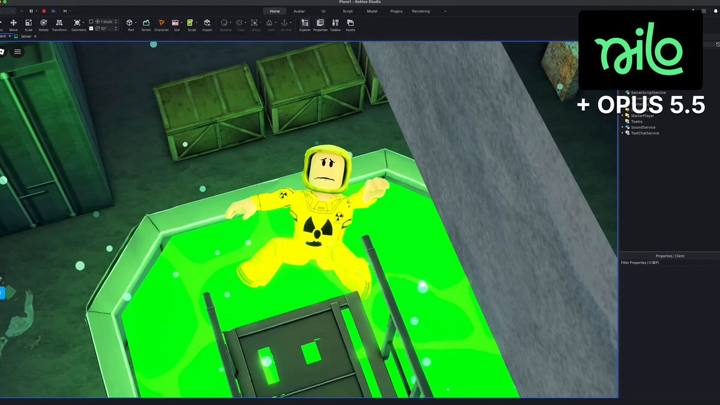</a></td>
</tr>
<tr>
<td width="50%" valign="top"><strong>Loctax: Brand Motion</strong> <a href="https://x.com/achxvi">@achxvi</a> · Product &amp; marketing 0:38 · Bookmarks 107 · Details pending <a href="https://guanmo-ai.github.io/awesome-ai-motion/?lang=en#case-2105310327886029275">▶ Play</a> · <a href="https://x.com/achxvi/status/2105310327886029275">Original post</a></td>
<td width="50%" valign="top"><strong>Building a Roblox Game Trailer</strong> <a href="https://x.com/NiloTechInc">@NiloTechInc</a> · Product &amp; marketing 0:07 · Bookmarks 105 · Details pending <a href="https://guanmo-ai.github.io/awesome-ai-motion/?lang=en#case-2102741813719138661">▶ Play</a> · <a href="https://x.com/NiloTechInc/status/2102741813719138661">Original post</a></td>
</tr>
</tbody>
<tbody>
<tr>
<td width="50%" height="225" align="center" valign="middle"></td>
<td width="50%" height="225" align="center" valign="middle"></td>
</tr>
<tr>
<td width="50%" valign="top"><strong>A Golden Retriever Pet Interface Film</strong> <a href="https://x.com/fakharkamario">@fakharkamario</a> · Product &amp; marketing 0:10 · Bookmarks 101 · Details pending <a href="https://guanmo-ai.github.io/awesome-ai-motion/?lang=en#case-2110218646689599861">▶ Play</a> · <a href="https://x.com/fakharkamario/status/2110218646689599861">Original post</a></td>
<td width="50%" valign="top"><strong>Soft Shapes for a Creative Launch</strong> <a href="https://x.com/ai4everyday">@ai4everyday</a> · Product &amp; marketing 0:46 · Bookmarks 99 · Details pending <a href="https://guanmo-ai.github.io/awesome-ai-motion/?lang=en#case-2107740493262225688">▶ Play</a> · <a href="https://x.com/ai4everyday/status/2107740493262225688">Original post</a></td>
</tr>
</tbody>
<tbody>
<tr>
<td width="50%" height="225" align="center" valign="middle"></td>
<td width="50%" height="225" align="center" valign="middle"><a href="https://guanmo-ai.github.io/awesome-ai-motion/?lang=en#case-2104131805175844923">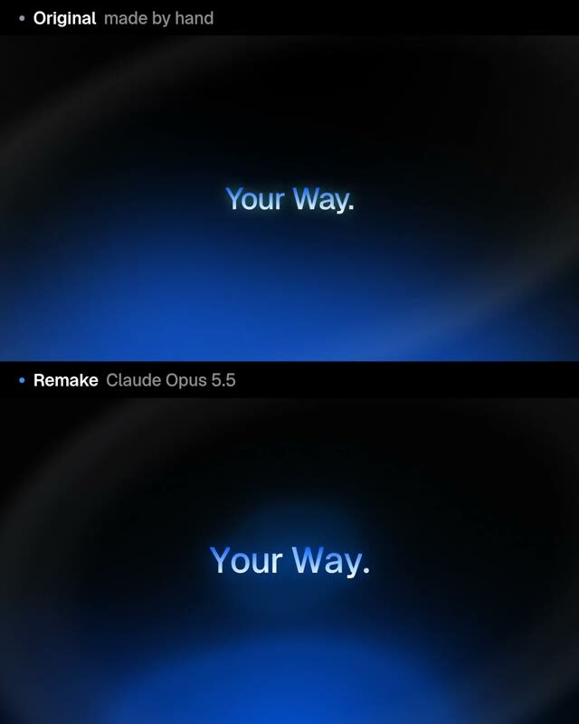</a></td>
</tr>
<tr>
<td width="50%" valign="top"><strong>A Computer in a Dark Studio</strong> <a href="https://x.com/granttheeking">@granttheeking</a> · Product &amp; marketing 0:51 · Bookmarks 97 · Details pending <a href="https://guanmo-ai.github.io/awesome-ai-motion/?lang=en#case-2105773778676429021">▶ Play</a> · <a href="https://x.com/granttheeking/status/2105773778676429021">Original post</a></td>
<td width="50%" valign="top"><strong>Stream Launch Film: Original and Code Recreation</strong> <a href="https://x.com/JurgenPloeger">@JurgenPloeger</a> · Product &amp; marketing 0:48 · Bookmarks 97 · Details pending <a href="https://guanmo-ai.github.io/awesome-ai-motion/?lang=en#case-2104131805175844923">▶ Play</a> · <a href="https://x.com/JurgenPloeger/status/2104131805175844923">Original post</a></td>
</tr>
</tbody>
<tbody>
<tr>
<td width="50%" height="225" align="center" valign="middle"></td>
<td width="50%" height="225" align="center" valign="middle"></td>
</tr>
<tr>
<td width="50%" valign="top"><strong>Sixty-Second Siege Game Promo</strong> <a href="https://x.com/KanaWorks_AI">@KanaWorks_AI</a> · Product &amp; marketing 1:00 · Bookmarks 95 · Details pending <a href="https://guanmo-ai.github.io/awesome-ai-motion/?lang=en#case-2102684116525437206">▶ Play</a> · <a href="https://x.com/KanaWorks_AI/status/2102684116525437206">Original post</a></td>
<td width="50%" valign="top"><strong>Models and Calendar Information in Soft-Lit Cards</strong> <a href="https://x.com/code_kartik">@code_kartik</a> · Product &amp; marketing 1:26 · Bookmarks 94 · Details pending <a href="https://guanmo-ai.github.io/awesome-ai-motion/?lang=en#case-2108276280328331748">▶ Play</a> · <a href="https://x.com/code_kartik/status/2108276280328331748">Original post</a></td>
</tr>
</tbody>
<tbody>
<tr>
<td width="50%" height="225" align="center" valign="middle"></td>
<td width="50%" height="225" align="center" valign="middle"><a href="https://guanmo-ai.github.io/awesome-ai-motion/?lang=en#case-2104610435571884086">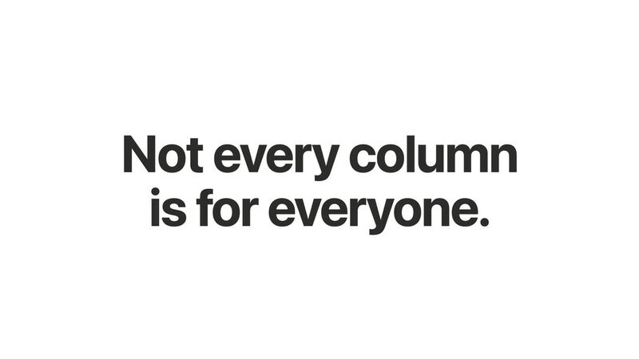</a></td>
</tr>
<tr>
<td width="50%" valign="top"><strong>Firstsales: An Email Product Film</strong> <a href="https://x.com/iuditg">@iuditg</a> · Product &amp; marketing 0:15 · Bookmarks 94 · Details pending <a href="https://guanmo-ai.github.io/awesome-ai-motion/?lang=en#case-2103920117025554453">▶ Play</a> · <a href="https://x.com/iuditg/status/2103920117025554453">Original post</a></td>
<td width="50%" valign="top"><strong>Notion column permissions: four directions to a final cut</strong> <a href="https://x.com/wustep">@wustep</a> · Product &amp; marketing 0:32 · Bookmarks 78 <a href="https://guanmo-ai.github.io/awesome-ai-motion/?lang=en#case-2104610435571884086">▶ Play</a> · <a href="https://x.com/wustep/status/2104610435571884086">Original post</a></td>
</tr>
</tbody>
<tbody>
<tr>
<td width="50%" height="225" align="center" valign="middle"><a href="https://guanmo-ai.github.io/awesome-ai-motion/?lang=en#case-2110245136953139577">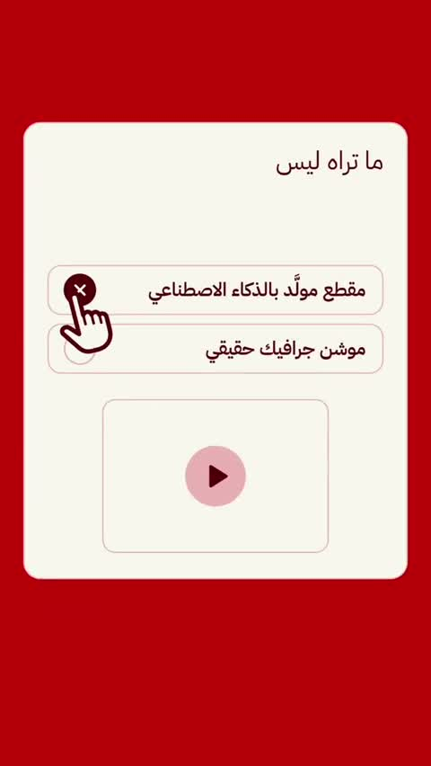</a></td>
<td width="50%" height="225" align="center" valign="middle"></td>
</tr>
<tr>
<td width="50%" valign="top"><strong>Ideas Become Editable Motion</strong> <a href="https://x.com/ai4everyday">@ai4everyday</a> · Product &amp; marketing 1:39 · Bookmarks 64 · Details pending <a href="https://guanmo-ai.github.io/awesome-ai-motion/?lang=en#case-2110245136953139577">▶ Play</a> · <a href="https://x.com/ai4everyday/status/2110245136953139577">Original post</a></td>
<td width="50%" valign="top"><strong>A Thai AI Team Introduction</strong> <a href="https://x.com/vibecodingth">@vibecodingth</a> · Product &amp; marketing 2:21 · Bookmarks 61 · Details pending <a href="https://guanmo-ai.github.io/awesome-ai-motion/?lang=en#case-2105279421435572498">▶ Play</a> · <a href="https://x.com/vibecodingth/status/2105279421435572498">Original post</a></td>
</tr>
</tbody>
<tbody>
<tr>
<td width="50%" height="225" align="center" valign="middle"><a href="https://guanmo-ai.github.io/awesome-ai-motion/?lang=en#case-2111887585639624828">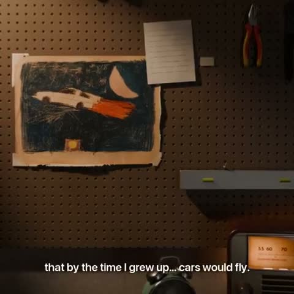</a></td>
<td width="50%" height="225" align="center" valign="middle"></td>
</tr>
<tr>
<td width="50%" valign="top"><strong>A Retro-Future Roadster Test-Drive Film</strong> <a href="https://x.com/kevin_t_ngo">@kevin_t_ngo</a> · Product &amp; marketing 1:05 · Bookmarks 58 · Details pending <a href="https://guanmo-ai.github.io/awesome-ai-motion/?lang=en#case-2111887585639624828">▶ Play</a> · <a href="https://x.com/kevin_t_ngo/status/2111887585639624828">Original post</a></td>
<td width="50%" valign="top"><strong>A clinic-visit memory app launch film</strong> <a href="https://x.com/seri_nonnon">@seri_nonnon</a> · Product &amp; marketing 0:43 · Bookmarks 56 <a href="https://guanmo-ai.github.io/awesome-ai-motion/?lang=en#case-2106192761632231813">▶ Play</a> · <a href="https://x.com/seri_nonnon/status/2106192761632231813">Original post</a></td>
</tr>
</tbody>
<tbody>
<tr>
<td width="50%" height="225" align="center" valign="middle"></td>
<td width="50%" height="225" align="center" valign="middle"><a href="https://guanmo-ai.github.io/awesome-ai-motion/?lang=en#case-2102913101926731879">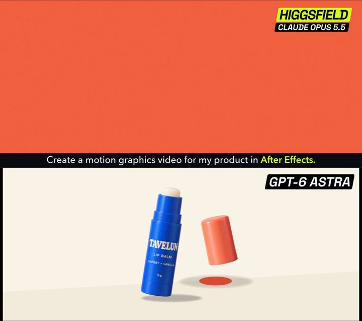</a></td>
</tr>
<tr>
<td width="50%" valign="top"><strong>A Cartoon Introduction to Opus</strong> <a href="https://x.com/nicekate8888">@nicekate8888</a> · Product &amp; marketing 1:30 · Bookmarks 55 · Details pending <a href="https://guanmo-ai.github.io/awesome-ai-motion/?lang=en#case-2102575622912631261">▶ Play</a> · <a href="https://x.com/nicekate8888/status/2102575622912631261">Original post</a></td>
<td width="50%" valign="top"><strong>Lip balm ad model comparison</strong> <a href="https://x.com/higgsfield_ai">@higgsfield_ai</a> · Product &amp; marketing 0:20 · Bookmarks 48 · Details pending <a href="https://guanmo-ai.github.io/awesome-ai-motion/?lang=en#case-2102913101926731879">▶ Play</a> · <a href="https://x.com/higgsfield_ai/status/2102913101926731879">Original post</a></td>
</tr>
</tbody>
<tbody>
<tr>
<td width="50%" height="225" align="center" valign="middle"></td>
<td width="50%" height="225" align="center" valign="middle"><a href="https://guanmo-ai.github.io/awesome-ai-motion/?lang=en#case-2105016259645788381">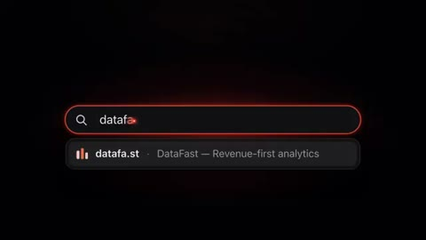</a></td>
</tr>
<tr>
<td width="50%" valign="top"><strong>A Roadster Through a Neon City</strong> <a href="https://x.com/0xwhrrari">@0xwhrrari</a> · Product &amp; marketing 0:14 · Bookmarks 46 · Details pending <a href="https://guanmo-ai.github.io/awesome-ai-motion/?lang=en#case-2111804745853894843">▶ Play</a> · <a href="https://x.com/0xwhrrari/status/2111804745853894843">Original post</a></td>
<td width="50%" valign="top"><strong>Datafa.st Charts and Queries</strong> <a href="https://x.com/Gregoirechp">@Gregoirechp</a> · Product &amp; marketing 0:15 · Bookmarks 46 · Details pending <a href="https://guanmo-ai.github.io/awesome-ai-motion/?lang=en#case-2105016259645788381">▶ Play</a> · <a href="https://x.com/Gregoirechp/status/2105016259645788381">Original post</a></td>
</tr>
</tbody>
<tbody>
<tr>
<td width="50%" height="225" align="center" valign="middle"><a href="https://guanmo-ai.github.io/awesome-ai-motion/?lang=en#case-2104027910004949132">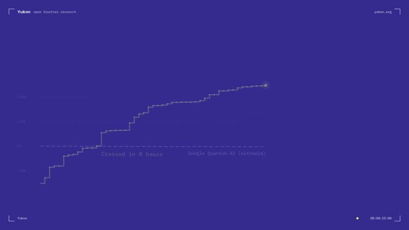</a></td>
<td width="50%" height="225" align="center" valign="middle"><a href="https://guanmo-ai.github.io/awesome-ai-motion/?lang=en#case-2103975338976182477">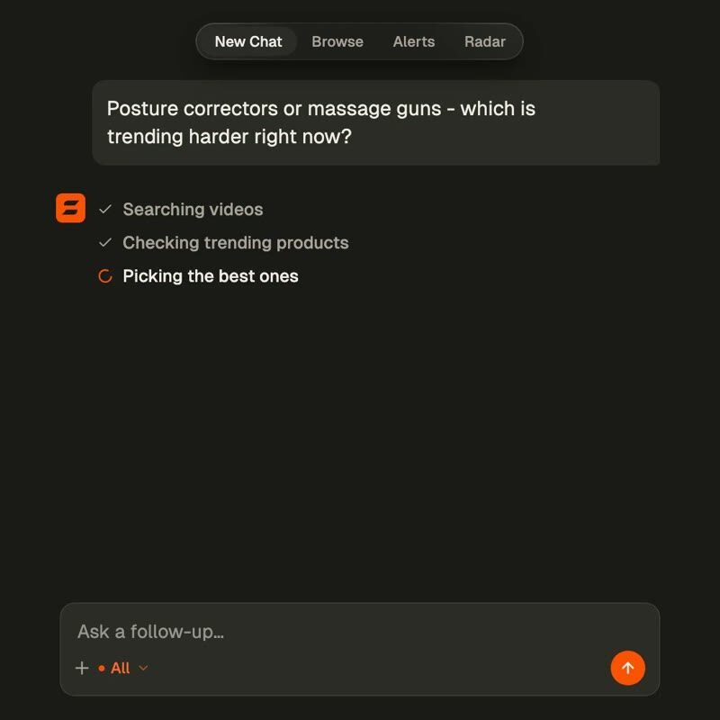</a></td>
</tr>
<tr>
<td width="50%" valign="top"><strong>The Story of Yukon Research</strong> <a href="https://x.com/sreeramkannan">@sreeramkannan</a> · Product &amp; marketing 0:53 · Bookmarks 44 · Details pending <a href="https://guanmo-ai.github.io/awesome-ai-motion/?lang=en#case-2104027910004949132">▶ Play</a> · <a href="https://x.com/sreeramkannan/status/2104027910004949132">Original post</a></td>
<td width="50%" valign="top"><strong>A Software Ad with Gemini and Remotion</strong> <a href="https://x.com/WiFiMoneyGuy">@WiFiMoneyGuy</a> · Product &amp; marketing 0:29 · Bookmarks 44 · Details pending <a href="https://guanmo-ai.github.io/awesome-ai-motion/?lang=en#case-2103975338976182477">▶ Play</a> · <a href="https://x.com/WiFiMoneyGuy/status/2103975338976182477">Original post</a></td>
</tr>
</tbody>
<tbody>
<tr>
<td width="50%" height="225" align="center" valign="middle"></td>
<td width="50%" height="225" align="center" valign="middle"></td>
</tr>
<tr>
<td width="50%" valign="top"><strong>DeepSeek: a weather-app motion-graphics experiment</strong> <a href="https://x.com/ItsmeAjayKV">@ItsmeAjayKV</a> · Product &amp; marketing 0:25 · Bookmarks 43 · Details pending <a href="https://guanmo-ai.github.io/awesome-ai-motion/?lang=en#case-2106323424473907257">▶ Play</a> · <a href="https://x.com/ItsmeAjayKV/status/2106323424473907257">Original post</a></td>
<td width="50%" valign="top"><strong>An Assembly Line for USDai</strong> <a href="https://x.com/0xZergs">@0xZergs</a> · Product &amp; marketing 1:44 · Bookmarks 42 · Details pending <a href="https://guanmo-ai.github.io/awesome-ai-motion/?lang=en#case-2109609404450607352">▶ Play</a> · <a href="https://x.com/0xZergs/status/2109609404450607352">Original post</a></td>
</tr>
</tbody>
<tbody>
<tr>
<td width="50%" height="225" align="center" valign="middle"></td>
<td width="50%" height="225" align="center" valign="middle"><a href="https://guanmo-ai.github.io/awesome-ai-motion/?lang=en#case-2108384911245869197">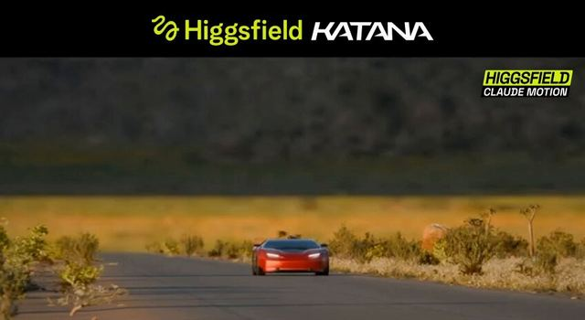</a></td>
</tr>
<tr>
<td width="50%" valign="top"><strong>QuanCard: a card-stack launch film</strong> <a href="https://x.com/luoleiorg">@luoleiorg</a> · Product &amp; marketing 0:42 · Bookmarks 39 · Details pending <a href="https://guanmo-ai.github.io/awesome-ai-motion/?lang=en#case-2107481547242873319">▶ Play</a> · <a href="https://x.com/luoleiorg/status/2107481547242873319">Original post</a></td>
<td width="50%" valign="top"><strong>A Three.js-coded Car Short</strong> <a href="https://x.com/higgsfield">@higgsfield</a> · Product &amp; marketing 0:30 · Bookmarks 37 · Details pending <a href="https://guanmo-ai.github.io/awesome-ai-motion/?lang=en#case-2108384911245869197">▶ Play</a> · <a href="https://x.com/higgsfield/status/2108384911245869197">Original post</a></td>
</tr>
</tbody>
<tbody>
<tr>
<td width="50%" height="225" align="center" valign="middle"></td>
<td width="50%" height="225" align="center" valign="middle"></td>
</tr>
<tr>
<td width="50%" valign="top"><strong>An AI Tool Card Motion Reel</strong> <a href="https://x.com/achxvi">@achxvi</a> · Product &amp; marketing 0:42 · Bookmarks 36 · Details pending <a href="https://guanmo-ai.github.io/awesome-ai-motion/?lang=en#case-2110432527332900879">▶ Play</a> · <a href="https://x.com/achxvi/status/2110432527332900879">Original post</a></td>
<td width="50%" valign="top"><strong>Slidesign: A Commercial Showreel</strong> <a href="https://x.com/dashiAIxz">@dashiAIxz</a> · Product &amp; marketing 1:48 · Bookmarks 36 · Details pending <a href="https://guanmo-ai.github.io/awesome-ai-motion/?lang=en#case-2110654224061366745">▶ Play</a> · <a href="https://x.com/dashiAIxz/status/2110654224061366745">Original post</a></td>
</tr>
</tbody>
<tbody>
<tr>
<td width="50%" height="225" align="center" valign="middle"></td>
<td width="50%" height="225" align="center" valign="middle"></td>
</tr>
<tr>
<td width="50%" valign="top"><strong>Messages Moving Through a 3D Workspace</strong> <a href="https://x.com/ai4everyday">@ai4everyday</a> · Product &amp; marketing 1:13 · Bookmarks 34 · Details pending <a href="https://guanmo-ai.github.io/awesome-ai-motion/?lang=en#case-2109085665694519714">▶ Play</a> · <a href="https://x.com/ai4everyday/status/2109085665694519714">Original post</a></td>
<td width="50%" valign="top"><strong>Futurepost extension motion reel</strong> <a href="https://x.com/allodev">@allodev</a> · Product &amp; marketing 0:25 · Bookmarks 33 <a href="https://guanmo-ai.github.io/awesome-ai-motion/?lang=en#case-2105414480910069765">▶ Play</a> · <a href="https://x.com/allodev/status/2105414480910069765">Original post</a></td>
</tr>
</tbody>
<tbody>
<tr>
<td width="50%" height="225" align="center" valign="middle"></td>
<td width="50%" height="225" align="center" valign="middle"></td>
</tr>
<tr>
<td width="50%" valign="top"><strong>A Vertical Product Film Using Blender Models</strong> <a href="https://x.com/yoshifujidesign">@yoshifujidesign</a> · Product &amp; marketing 0:30 · Bookmarks 33 · Details pending <a href="https://guanmo-ai.github.io/awesome-ai-motion/?lang=en#case-2103987596301119645">▶ Play</a> · <a href="https://x.com/yoshifujidesign/status/2103987596301119645">Original post</a></td>
<td width="50%" valign="top"><strong>Grok Bot: An X Integration Launch</strong> <a href="https://x.com/kocer_eth">@kocer_eth</a> · Product &amp; marketing 0:43 · Bookmarks 29 · Details pending <a href="https://guanmo-ai.github.io/awesome-ai-motion/?lang=en#case-2108539312556089566">▶ Play</a> · <a href="https://x.com/kocer_eth/status/2108539312556089566">Original post</a></td>
</tr>
</tbody>
<tbody>
<tr>
<td width="50%" height="225" align="center" valign="middle"><a href="https://guanmo-ai.github.io/awesome-ai-motion/?lang=en#case-2105750054908891423">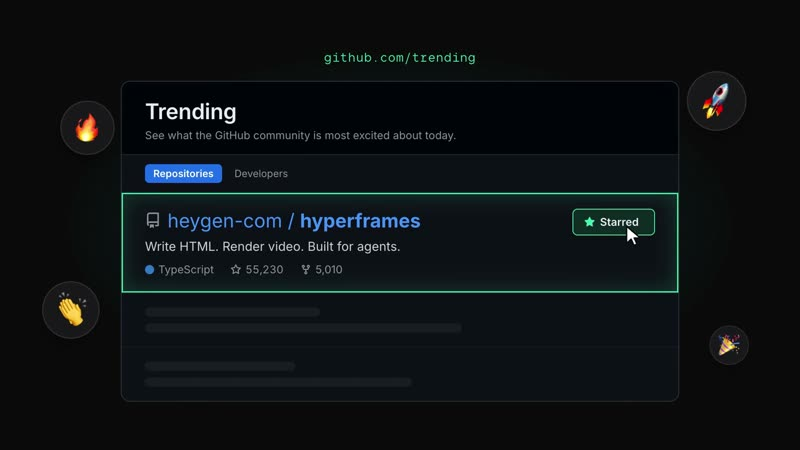</a></td>
<td width="50%" height="225" align="center" valign="middle"></td>
</tr>
<tr>
<td width="50%" valign="top"><strong>A HyperFrames trending celebration film</strong> <a href="https://x.com/liu8in">@liu8in</a> · Product &amp; marketing 0:17 · Bookmarks 28 <a href="https://guanmo-ai.github.io/awesome-ai-motion/?lang=en#case-2105750054908891423">▶ Play</a> · <a href="https://x.com/liu8in/status/2105750054908891423">Original post</a></td>
<td width="50%" valign="top"><strong>Wells Intelligence</strong> <a href="https://x.com/kyle_e_walker">@kyle_e_walker</a> · Product &amp; marketing 1:14 · Bookmarks 27 · Details pending <a href="https://guanmo-ai.github.io/awesome-ai-motion/?lang=en#case-2104734251295863242">▶ Play</a> · <a href="https://x.com/kyle_e_walker/status/2104734251295863242">Original post</a></td>
</tr>
</tbody>
<tbody>
<tr>
<td width="50%" height="225" align="center" valign="middle"><a href="https://guanmo-ai.github.io/awesome-ai-motion/?lang=en#case-2107990570002252237">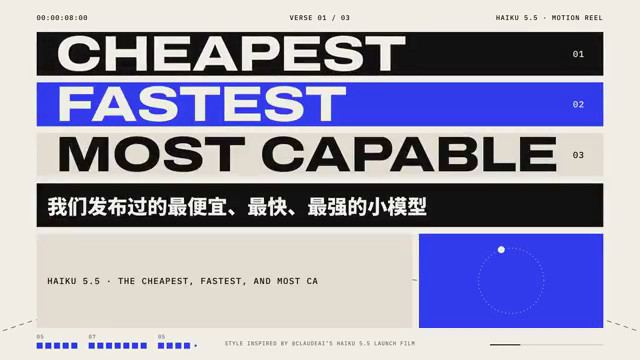</a></td>
<td width="50%" height="225" align="center" valign="middle"><a href="https://guanmo-ai.github.io/awesome-ai-motion/?lang=en#case-2103117698863390805">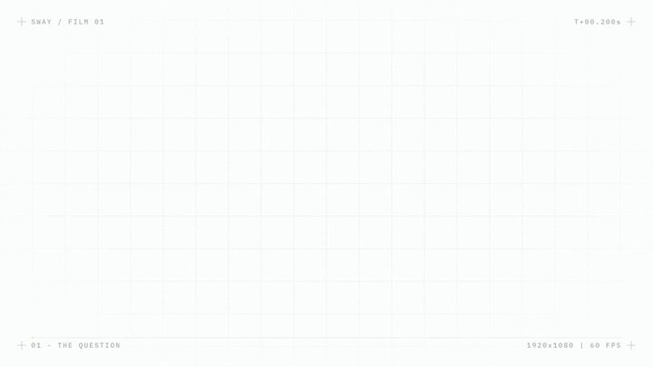</a></td>
</tr>
<tr>
<td width="50%" valign="top"><strong>A Haiku 5.5 Self-promotion Film</strong> <a href="https://x.com/LufzzLiz">@LufzzLiz</a> · Product &amp; marketing 0:30 · Bookmarks 27 · Details pending <a href="https://guanmo-ai.github.io/awesome-ai-motion/?lang=en#case-2107990570002252237">▶ Play</a> · <a href="https://x.com/LufzzLiz/status/2107990570002252237">Original post</a></td>
<td width="50%" valign="top"><strong>Rhythmic Edit of a Mobile App Capture</strong> <a href="https://x.com/reg_andr">@reg_andr</a> · Product &amp; marketing 0:54 · Bookmarks 26 · Details pending <a href="https://guanmo-ai.github.io/awesome-ai-motion/?lang=en#case-2103117698863390805">▶ Play</a> · <a href="https://x.com/reg_andr/status/2103117698863390805">Original post</a></td>
</tr>
</tbody>
<tbody>
<tr>
<td width="50%" height="225" align="center" valign="middle"><a href="https://guanmo-ai.github.io/awesome-ai-motion/?lang=en#case-2103237884564414633">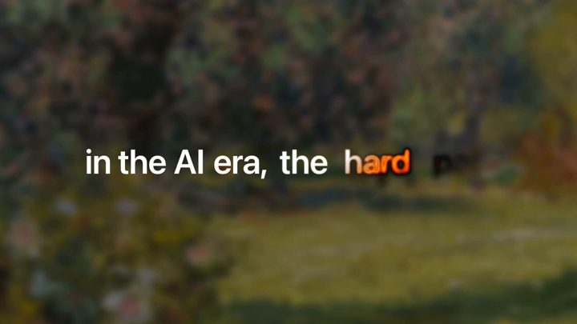</a></td>
<td width="50%" height="225" align="center" valign="middle"></td>
</tr>
<tr>
<td width="50%" valign="top"><strong>Browser Product Teaser Recut</strong> <a href="https://x.com/jake11moran">@jake11moran</a> · Product &amp; marketing 0:27 · Bookmarks 25 · Details pending <a href="https://guanmo-ai.github.io/awesome-ai-motion/?lang=en#case-2103237884564414633">▶ Play</a> · <a href="https://x.com/jake11moran/status/2103237884564414633">Original post</a></td>
<td width="50%" valign="top"><strong>Shillz: real UI and code-generated music</strong> <a href="https://x.com/colecornelll">@colecornelll</a> · Product &amp; marketing 0:15 · Bookmarks 24 <a href="https://guanmo-ai.github.io/awesome-ai-motion/?lang=en#case-2105751866051047465">▶ Play</a> · <a href="https://x.com/colecornelll/status/2105751866051047465">Original post</a></td>
</tr>
</tbody>
<tbody>
<tr>
<td width="50%" height="225" align="center" valign="middle"></td>
<td width="50%" height="225" align="center" valign="middle"></td>
</tr>
<tr>
<td width="50%" valign="top"><strong>A Code-Rendered Mac Launch Film</strong> <a href="https://x.com/charliejhills">@charliejhills</a> · Product &amp; marketing 0:20 · Bookmarks 21 · Details pending <a href="https://guanmo-ai.github.io/awesome-ai-motion/?lang=en#case-2104225890800705789">▶ Play</a> · <a href="https://x.com/charliejhills/status/2104225890800705789">Original post</a></td>
<td width="50%" valign="top"><strong>Vitals: Minimal Type in Many Languages</strong> <a href="https://x.com/attacomsian">@attacomsian</a> · Product &amp; marketing 1:00 · Bookmarks 19 · Details pending <a href="https://guanmo-ai.github.io/awesome-ai-motion/?lang=en#case-2110720587026846101">▶ Play</a> · <a href="https://x.com/attacomsian/status/2110720587026846101">Original post</a></td>
</tr>
</tbody>
<tbody>
<tr>
<td width="50%" height="225" align="center" valign="middle"><a href="https://guanmo-ai.github.io/awesome-ai-motion/?lang=en#case-2104715277120180702">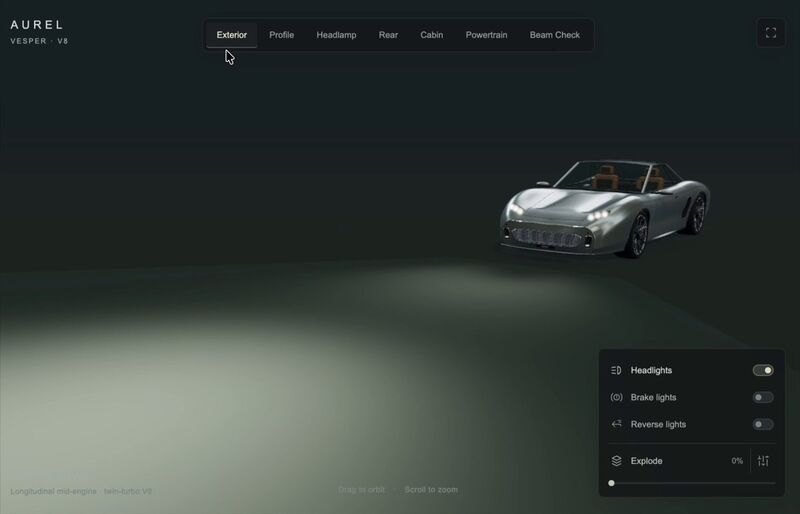</a></td>
<td width="50%" height="225" align="center" valign="middle"></td>
</tr>
<tr>
<td width="50%" valign="top"><strong>A Sonnet Concept Car Generated in Code</strong> <a href="https://x.com/techartist_">@techartist_</a> · Product &amp; marketing 0:18 · Bookmarks 18 · Details pending <a href="https://guanmo-ai.github.io/awesome-ai-motion/?lang=en#case-2104715277120180702">▶ Play</a> · <a href="https://x.com/techartist_/status/2104715277120180702">Original post</a></td>
<td width="50%" valign="top"><strong>Nine-Scene Product Launch Film</strong> <a href="https://x.com/ish_creative">@ish_creative</a> · Product &amp; marketing 0:30 · Bookmarks 18 · Details pending <a href="https://guanmo-ai.github.io/awesome-ai-motion/?lang=en#case-2102966807376334856">▶ Play</a> · <a href="https://x.com/ish_creative/status/2102966807376334856">Original post</a></td>
</tr>
</tbody>
<tbody>
<tr>
<td width="50%" height="225" align="center" valign="middle"></td>
<td width="50%" height="225" align="center" valign="middle"></td>
</tr>
<tr>
<td width="50%" valign="top"><strong>SAHI: From Trading Screens to Space</strong> <a href="https://x.com/dale_vaz">@dale_vaz</a> · Product &amp; marketing 0:47 · Bookmarks 17 · Details pending <a href="https://guanmo-ai.github.io/awesome-ai-motion/?lang=en#case-2103290592679879074">▶ Play</a> · <a href="https://x.com/dale_vaz/status/2103290592679879074">Original post</a></td>
<td width="50%" valign="top"><strong>A Developer and Open-Source Portfolio Reel</strong> <a href="https://x.com/iammukeshm">@iammukeshm</a> · Product &amp; marketing 0:35 · Bookmarks 14 · Details pending <a href="https://guanmo-ai.github.io/awesome-ai-motion/?lang=en#case-2103511739585421585">▶ Play</a> · <a href="https://x.com/iammukeshm/status/2103511739585421585">Original post</a></td>
</tr>
</tbody>
<tbody>
<tr>
<td width="50%" height="225" align="center" valign="middle"></td>
<td width="50%" height="225" align="center" valign="middle"></td>
</tr>
<tr>
<td width="50%" valign="top"><strong>Animated Football Player Recommendations</strong> <a href="https://x.com/Luchigatica">@Luchigatica</a> · Product &amp; marketing 0:39 · Bookmarks 14 · Details pending <a href="https://guanmo-ai.github.io/awesome-ai-motion/?lang=en#case-2102853289259729328">▶ Play</a> · <a href="https://x.com/Luchigatica/status/2102853289259729328">Original post</a></td>
<td width="50%" valign="top"><strong>A HanaAgent 1.0 Promo Experiment</strong> <a href="https://x.com/lilililiMozi">@lilililiMozi</a> · Product &amp; marketing 0:58 · Bookmarks 14 · Details pending <a href="https://guanmo-ai.github.io/awesome-ai-motion/?lang=en#case-2108115329948037522">▶ Play</a> · <a href="https://x.com/lilililiMozi/status/2108115329948037522">Original post</a></td>
</tr>
</tbody>
<tbody>
<tr>
<td width="50%" height="225" align="center" valign="middle"></td>
<td width="50%" height="225" align="center" valign="middle"></td>
</tr>
<tr>
<td width="50%" valign="top"><strong>Seven Hundred Launches</strong> <a href="https://x.com/Suryanshti777">@Suryanshti777</a> · Product &amp; marketing 1:05 · Bookmarks 13 · Details pending <a href="https://guanmo-ai.github.io/awesome-ai-motion/?lang=en#case-2104617112673427527">▶ Play</a> · <a href="https://x.com/Suryanshti777/status/2104617112673427527">Original post</a></td>
<td width="50%" valign="top"><strong>Tokyo Tower in a 3D Promo Sequence</strong> <a href="https://x.com/Maruo_0314">@Maruo_0314</a> · Product &amp; marketing 0:15 · Bookmarks 13 · Details pending <a href="https://guanmo-ai.github.io/awesome-ai-motion/?lang=en#case-2104159752095998343">▶ Play</a> · <a href="https://x.com/Maruo_0314/status/2104159752095998343">Original post</a></td>
</tr>
</tbody>
<tbody>
<tr>
<td width="50%" height="225" align="center" valign="middle"></td>
<td width="50%" height="225" align="center" valign="middle"></td>
</tr>
<tr>
<td width="50%" valign="top"><strong>An AI Rack, Layer by Layer</strong> <a href="https://x.com/w1nklerr">@w1nklerr</a> · Product &amp; marketing 0:12 · Bookmarks 11 · Details pending <a href="https://guanmo-ai.github.io/awesome-ai-motion/?lang=en#case-2110786126558486777">▶ Play</a> · <a href="https://x.com/w1nklerr/status/2110786126558486777">Original post</a></td>
<td width="50%" valign="top"><strong>reFresh Yoghurt Brand Motion</strong> <a href="https://x.com/exploraX_">@exploraX_</a> · Product &amp; marketing 0:20 · Bookmarks 11 · Details pending <a href="https://guanmo-ai.github.io/awesome-ai-motion/?lang=en#case-2108181230692807097">▶ Play</a> · <a href="https://x.com/exploraX_/status/2108181230692807097">Original post</a></td>
</tr>
</tbody>
<tbody>
<tr>
<td width="50%" height="225" align="center" valign="middle"></td>
<td width="50%" height="225" align="center" valign="middle"></td>
</tr>
<tr>
<td width="50%" valign="top"><strong>Forty-Two-Second Help Service Launch Film</strong> <a href="https://x.com/azhar_builds">@azhar_builds</a> · Product &amp; marketing 0:42 · Bookmarks 9 · Details pending <a href="https://guanmo-ai.github.io/awesome-ai-motion/?lang=en#case-2103075805098070315">▶ Play</a> · <a href="https://x.com/azhar_builds/status/2103075805098070315">Original post</a></td>
<td width="50%" valign="top"><strong>Remotion promo for an open source project</strong> <a href="https://x.com/canghe">@canghe</a> · Product &amp; marketing 0:34 · Bookmarks 9 · Details pending <a href="https://guanmo-ai.github.io/awesome-ai-motion/?lang=en#case-2104225521869705468">▶ Play</a> · <a href="https://x.com/canghe/status/2104225521869705468">Original post</a></td>
</tr>
</tbody>
<tbody>
<tr>
<td width="50%" height="225" align="center" valign="middle"></td>
<td width="50%" height="225" align="center" valign="middle"></td>
</tr>
<tr>
<td width="50%" valign="top"><strong>Fumadocs Product Animation</strong> <a href="https://x.com/fuma_nama">@fuma_nama</a> · Product &amp; marketing 1:03 · Bookmarks 8 · Details pending <a href="https://guanmo-ai.github.io/awesome-ai-motion/?lang=en#case-2109204810818064634">▶ Play</a> · <a href="https://x.com/fuma_nama/status/2109204810818064634">Original post</a></td>
<td width="50%" valign="top"><strong>LiteLLM Day Zero</strong> <a href="https://x.com/MisbahSy">@MisbahSy</a> · Product &amp; marketing 0:10 · Bookmarks 8 · Details pending <a href="https://guanmo-ai.github.io/awesome-ai-motion/?lang=en#case-2102486455126020521">▶ Play</a> · <a href="https://x.com/MisbahSy/status/2102486455126020521">Original post</a></td>
</tr>
</tbody>
<tbody>
<tr>
<td width="50%" height="225" align="center" valign="middle"></td>
<td width="50%" height="225" align="center" valign="middle"></td>
</tr>
<tr>
<td width="50%" valign="top"><strong>Nafa: a Product Marketing Film from One Workflow</strong> <a href="https://x.com/SaadPastaDev">@SaadPastaDev</a> · Product &amp; marketing 0:25 · Bookmarks 6 · Details pending <a href="https://guanmo-ai.github.io/awesome-ai-motion/?lang=en#case-2107741413769347341">▶ Play</a> · <a href="https://x.com/SaadPastaDev/status/2107741413769347341">Original post</a></td>
<td width="50%" valign="top"><strong>own.page: a cinematic launch film</strong> <a href="https://x.com/ElitzaVasileva">@ElitzaVasileva</a> · Product &amp; marketing 0:45 · Bookmarks 6 · Details pending <a href="https://guanmo-ai.github.io/awesome-ai-motion/?lang=en#case-2107187734414582139">▶ Play</a> · <a href="https://x.com/ElitzaVasileva/status/2107187734414582139">Original post</a></td>
</tr>
</tbody>
<tbody>
<tr>
<td width="50%" height="225" align="center" valign="middle"><a href="https://guanmo-ai.github.io/awesome-ai-motion/?lang=en#case-2111017059442397559">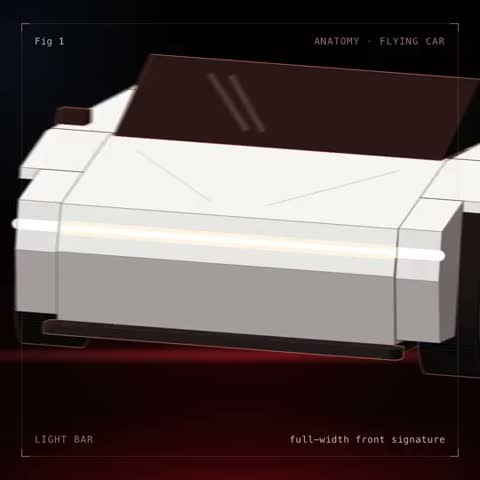</a></td>
<td width="50%" height="225" align="center" valign="middle"><a href="https://guanmo-ai.github.io/awesome-ai-motion/?lang=en#case-2108379423808635005">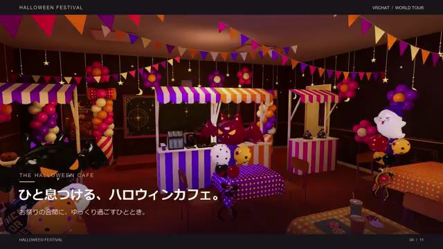</a></td>
</tr>
<tr>
<td width="50%" valign="top"><strong>Tesla Roadster: A Geometric Breakdown</strong> <a href="https://x.com/ann_nnng">@ann_nnng</a> · Product &amp; marketing 0:15 · Bookmarks 6 · Details pending <a href="https://guanmo-ai.github.io/awesome-ai-motion/?lang=en#case-2111017059442397559">▶ Play</a> · <a href="https://x.com/ann_nnng/status/2111017059442397559">Original post</a></td>
<td width="50%" valign="top"><strong>Halloween Festival: an Automatically Shot World Promo</strong> <a href="https://x.com/yuripi_2023">@yuripi_2023</a> · Product &amp; marketing 0:59 · Bookmarks 6 · Details pending <a href="https://guanmo-ai.github.io/awesome-ai-motion/?lang=en#case-2108379423808635005">▶ Play</a> · <a href="https://x.com/yuripi_2023/status/2108379423808635005">Original post</a></td>
</tr>
</tbody>
<tbody>
<tr>
<td width="50%" height="225" align="center" valign="middle"><a href="https://guanmo-ai.github.io/awesome-ai-motion/?lang=en#case-2102766871007436993">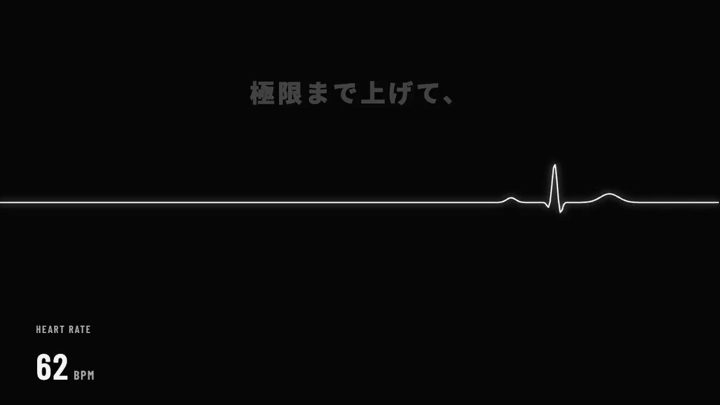</a></td>
<td width="50%" height="225" align="center" valign="middle"><a href="https://guanmo-ai.github.io/awesome-ai-motion/?lang=en#case-2108055549200003356">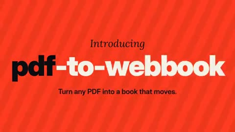</a></td>
</tr>
<tr>
<td width="50%" valign="top"><strong>Unofficial BLVCKOUT promo</strong> <a href="https://x.com/ystknsh">@ystknsh</a> · Product &amp; marketing 0:30 · Bookmarks 6 · Details pending <a href="https://guanmo-ai.github.io/awesome-ai-motion/?lang=en#case-2102766871007436993">▶ Play</a> · <a href="https://x.com/ystknsh/status/2102766871007436993">Original post</a></td>
<td width="50%" valign="top"><strong>A PDF Becomes a Turning Book</strong> <a href="https://x.com/BuildFastWithAI">@BuildFastWithAI</a> · Product &amp; marketing 0:37 · Bookmarks 6 · Details pending <a href="https://guanmo-ai.github.io/awesome-ai-motion/?lang=en#case-2108055549200003356">▶ Play</a> · <a href="https://x.com/BuildFastWithAI/status/2108055549200003356">Original post</a></td>
</tr>
</tbody>
<tbody>
<tr>
<td width="50%" height="225" align="center" valign="middle"></td>
<td width="50%" height="225" align="center" valign="middle"></td>
</tr>
<tr>
<td width="50%" valign="top"><strong>A Gold Curtain Reveals a Perfume Bottle</strong> <a href="https://x.com/flxrnc">@flxrnc</a> · Product &amp; marketing 0:12 · Bookmarks 6 · Details pending <a href="https://guanmo-ai.github.io/awesome-ai-motion/?lang=en#case-2107882536042926295">▶ Play</a> · <a href="https://x.com/flxrnc/status/2107882536042926295">Original post</a></td>
<td width="50%" valign="top"><strong>Code Recreation of a Launch Film</strong> <a href="https://x.com/vikktorrrre">@vikktorrrre</a> · Product &amp; marketing 0:20 · Bookmarks 5 · Details pending <a href="https://guanmo-ai.github.io/awesome-ai-motion/?lang=en#case-2103104303808348305">▶ Play</a> · <a href="https://x.com/vikktorrrre/status/2103104303808348305">Original post</a></td>
</tr>
</tbody>
<tbody>
<tr>
<td width="50%" height="225" align="center" valign="middle"></td>
<td width="50%" height="225" align="center" valign="middle"><a href="https://guanmo-ai.github.io/awesome-ai-motion/?lang=en#case-2104076374281510985">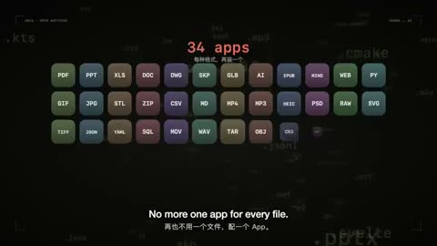</a></td>
</tr>
<tr>
<td width="50%" valign="top"><strong>Sorank Product Launch Motion</strong> <a href="https://x.com/thibaultbessonm">@thibaultbessonm</a> · Product &amp; marketing 1:14 · Bookmarks 5 · Details pending <a href="https://guanmo-ai.github.io/awesome-ai-motion/?lang=en#case-2105221575117324685">▶ Play</a> · <a href="https://x.com/thibaultbessonm/status/2105221575117324685">Original post</a></td>
<td width="50%" valign="top"><strong>Omia: Windows in a 3D Corridor</strong> <a href="https://x.com/xiaoerzhan">@xiaoerzhan</a> · Product &amp; marketing 1:31 · Bookmarks 5 · Details pending <a href="https://guanmo-ai.github.io/awesome-ai-motion/?lang=en#case-2104076374281510985">▶ Play</a> · <a href="https://x.com/xiaoerzhan/status/2104076374281510985">Original post</a></td>
</tr>
</tbody>
<tbody>
<tr>
<td width="50%" height="225" align="center" valign="middle"></td>
<td width="50%" height="225" align="center" valign="middle"><a href="https://guanmo-ai.github.io/awesome-ai-motion/?lang=en#case-2102752585371226241">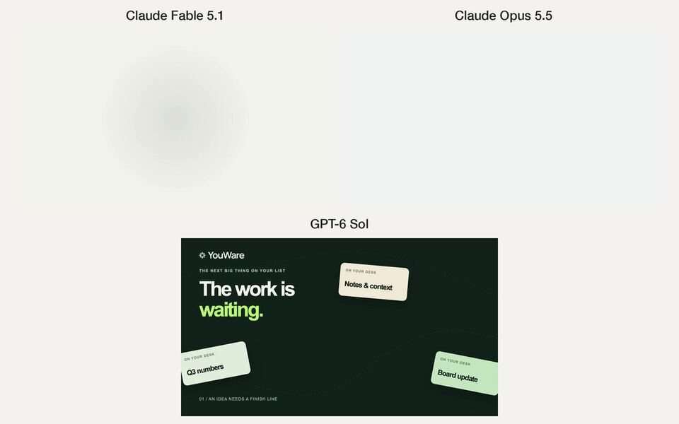</a></td>
</tr>
<tr>
<td width="50%" valign="top"><strong>An Anti-LinkedIn Launch Video</strong> <a href="https://x.com/MaxHirsch13">@MaxHirsch13</a> · Product &amp; marketing 0:20 · Bookmarks 4 · Details pending <a href="https://guanmo-ai.github.io/awesome-ai-motion/?lang=en#case-2107985883949600983">▶ Play</a> · <a href="https://x.com/MaxHirsch13/status/2107985883949600983">Original post</a></td>
<td width="50%" valign="top"><strong>YouWare Launch Video: Opus, Sol and Fable Compared</strong> <a href="https://x.com/yrzhe_top">@yrzhe_top</a> · Product &amp; marketing 0:40 · Bookmarks 4 · Details pending <a href="https://guanmo-ai.github.io/awesome-ai-motion/?lang=en#case-2102752585371226241">▶ Play</a> · <a href="https://x.com/yrzhe_top/status/2102752585371226241">Original post</a></td>
</tr>
</tbody>
<tbody>
<tr>
<td width="50%" height="225" align="center" valign="middle"></td>
<td width="50%" height="225" align="center" valign="middle"></td>
</tr>
<tr>
<td width="50%" valign="top"><strong>TopSlash product launch film</strong> <a href="https://x.com/EnvolDev">@EnvolDev</a> · Product &amp; marketing 0:57 · Bookmarks 4 <a href="https://guanmo-ai.github.io/awesome-ai-motion/?lang=en#case-2107547689819017555">▶ Play</a> · <a href="https://x.com/EnvolDev/status/2107547689819017555">Original post</a></td>
<td width="50%" valign="top"><strong>A Cartoon Narrator on a Motion Stage</strong> <a href="https://x.com/ai4everyday">@ai4everyday</a> · Product &amp; marketing 0:49 · Bookmarks 4 · Details pending <a href="https://guanmo-ai.github.io/awesome-ai-motion/?lang=en#case-2112123340089393359">▶ Play</a> · <a href="https://x.com/ai4everyday/status/2112123340089393359">Original post</a></td>
</tr>
</tbody>
<tbody>
<tr>
<td width="50%" height="225" align="center" valign="middle"></td>
<td width="50%" height="225" align="center" valign="middle"></td>
</tr>
<tr>
<td width="50%" valign="top"><strong>A Phone-led Promo for an Yingge Dance Game</strong> <a href="https://x.com/Gimi_min">@Gimi_min</a> · Product &amp; marketing 1:01 · Bookmarks 4 · Details pending <a href="https://guanmo-ai.github.io/awesome-ai-motion/?lang=en#case-2108477835463766340">▶ Play</a> · <a href="https://x.com/Gimi_min/status/2108477835463766340">Original post</a></td>
<td width="50%" valign="top"><strong>Model Launch Concept Film</strong> <a href="https://x.com/marcthecreatorr">@marcthecreatorr</a> · Product &amp; marketing 0:32 · Bookmarks 3 · Details pending <a href="https://guanmo-ai.github.io/awesome-ai-motion/?lang=en#case-2103133462798483752">▶ Play</a> · <a href="https://x.com/marcthecreatorr/status/2103133462798483752">Original post</a></td>
</tr>
</tbody>
<tbody>
<tr>
<td width="50%" height="225" align="center" valign="middle"></td>
<td width="50%" height="225" align="center" valign="middle"></td>
</tr>
<tr>
<td width="50%" valign="top"><strong>SPECTRA+: a DeepSeek motion experiment</strong> <a href="https://x.com/ItsmeAjayKV">@ItsmeAjayKV</a> · Product &amp; marketing 0:40 · Bookmarks 3 · Details pending <a href="https://guanmo-ai.github.io/awesome-ai-motion/?lang=en#case-2106414547569676331">▶ Play</a> · <a href="https://x.com/ItsmeAjayKV/status/2106414547569676331">Original post</a></td>
<td width="50%" valign="top"><strong>Minicut's Script Spider</strong> <a href="https://x.com/minicut_ai">@minicut_ai</a> · Product &amp; marketing 0:20 · Bookmarks 3 · Details pending <a href="https://guanmo-ai.github.io/awesome-ai-motion/?lang=en#case-2106228800606573028">▶ Play</a> · <a href="https://x.com/minicut_ai/status/2106228800606573028">Original post</a></td>
</tr>
</tbody>
<tbody>
<tr>
<td width="50%" height="225" align="center" valign="middle"></td>
<td width="50%" height="225" align="center" valign="middle"></td>
</tr>
<tr>
<td width="50%" valign="top"><strong>LongCat: a halftone launch film led by cat eyes</strong> <a href="https://x.com/LeowenAI">@LeowenAI</a> · Product &amp; marketing 0:25 · Bookmarks 3 <a href="https://guanmo-ai.github.io/awesome-ai-motion/?lang=en#case-2106666146456125931">▶ Play</a> · <a href="https://x.com/LeowenAI/status/2106666146456125931">Original post</a></td>
<td width="50%" valign="top"><strong>Motion Ad for a Productivity Site</strong> <a href="https://x.com/shushant_l">@shushant_l</a> · Product &amp; marketing 0:15 · Bookmarks 3 · Details pending <a href="https://guanmo-ai.github.io/awesome-ai-motion/?lang=en#case-2103829449359966629">▶ Play</a> · <a href="https://x.com/shushant_l/status/2103829449359966629">Original post</a></td>
</tr>
</tbody>
<tbody>
<tr>
<td width="50%" height="225" align="center" valign="middle"></td>
<td width="50%" height="225" align="center" valign="middle"></td>
</tr>
<tr>
<td width="50%" valign="top"><strong>KotoSearch: from product browsing to narration sync</strong> <a href="https://x.com/tetsu_tetsu333">@tetsu_tetsu333</a> · Product &amp; marketing 0:52 · Bookmarks 3 <a href="https://guanmo-ai.github.io/awesome-ai-motion/?lang=en#case-2106177888265576886">▶ Play</a> · <a href="https://x.com/tetsu_tetsu333/status/2106177888265576886">Original post</a></td>
<td width="50%" valign="top"><strong>A Transparent Cutaway of the Roadster Thrust System</strong> <a href="https://x.com/cherry_mx_reds">@cherry_mx_reds</a> · Product &amp; marketing 0:22 · Bookmarks 2 · Details pending <a href="https://guanmo-ai.github.io/awesome-ai-motion/?lang=en#case-2111179478638739856">▶ Play</a> · <a href="https://x.com/cherry_mx_reds/status/2111179478638739856">Original post</a></td>
</tr>
</tbody>
<tbody>
<tr>
<td width="50%" height="225" align="center" valign="middle"></td>
<td width="50%" height="225" align="center" valign="middle"></td>
</tr>
<tr>
<td width="50%" valign="top"><strong>Inkwell: a DeepSeek brand-intro experiment</strong> <a href="https://x.com/ItsmeAjayKV">@ItsmeAjayKV</a> · Product &amp; marketing 0:38 · Bookmarks 2 · Details pending <a href="https://guanmo-ai.github.io/awesome-ai-motion/?lang=en#case-2106616126776230055">▶ Play</a> · <a href="https://x.com/ItsmeAjayKV/status/2106616126776230055">Original post</a></td>
<td width="50%" valign="top"><strong>Scroll+ product introduction film</strong> <a href="https://x.com/xenit_v0">@xenit_v0</a> · Product &amp; marketing 0:28 · Bookmarks 2 <a href="https://guanmo-ai.github.io/awesome-ai-motion/?lang=en#case-2106270979932532873">▶ Play</a> · <a href="https://x.com/xenit_v0/status/2106270979932532873">Original post</a></td>
</tr>
</tbody>
<tbody>
<tr>
<td width="50%" height="225" align="center" valign="middle"></td>
<td width="50%" height="225" align="center" valign="middle"></td>
</tr>
<tr>
<td width="50%" valign="top"><strong>Code-Rendered Brand Film</strong> <a href="https://x.com/Govindaiii">@Govindaiii</a> · Product &amp; marketing 0:52 · Bookmarks 2 · Details pending <a href="https://guanmo-ai.github.io/awesome-ai-motion/?lang=en#case-2102815918049132792">▶ Play</a> · <a href="https://x.com/Govindaiii/status/2102815918049132792">Original post</a></td>
<td width="50%" valign="top"><strong>Real Halloween Night: a VRChat World Promo</strong> <a href="https://x.com/yuripi_2023">@yuripi_2023</a> · Product &amp; marketing 1:00 · Bookmarks 2 · Details pending <a href="https://guanmo-ai.github.io/awesome-ai-motion/?lang=en#case-2108394968389951585">▶ Play</a> · <a href="https://x.com/yuripi_2023/status/2108394968389951585">Original post</a></td>
</tr>
</tbody>
<tbody>
<tr>
<td width="50%" height="225" align="center" valign="middle"></td>
<td width="50%" height="225" align="center" valign="middle"></td>
</tr>
<tr>
<td width="50%" valign="top"><strong>Atlasnote-pro: a Git-history film</strong> <a href="https://x.com/Tao100086">@Tao100086</a> · Product &amp; marketing 2:06 · Bookmarks 2 · Details pending <a href="https://guanmo-ai.github.io/awesome-ai-motion/?lang=en#case-2106941357915058661">▶ Play</a> · <a href="https://x.com/Tao100086/status/2106941357915058661">Original post</a></td>
<td width="50%" valign="top"><strong>Late-Night Creator Cartoon and Interface Motion</strong> <a href="https://x.com/yulikay">@yulikay</a> · Product &amp; marketing 0:15 · Bookmarks 1 · Details pending <a href="https://guanmo-ai.github.io/awesome-ai-motion/?lang=en#case-2103973764845461768">▶ Play</a> · <a href="https://x.com/yulikay/status/2103973764845461768">Original post</a></td>
</tr>
</tbody>
<tbody>
<tr>
<td width="50%" height="225" align="center" valign="middle"></td>
<td width="50%" height="225" align="center" valign="middle"></td>
</tr>
<tr>
<td width="50%" valign="top"><strong>Vano: Market Graphics</strong> <a href="https://x.com/_MasterMal">@_MasterMal</a> · Product &amp; marketing 1:08 · Bookmarks 1 · Details pending <a href="https://guanmo-ai.github.io/awesome-ai-motion/?lang=en#case-2108471807372325100">▶ Play</a> · <a href="https://x.com/_MasterMal/status/2108471807372325100">Original post</a></td>
<td width="50%" valign="top"><strong>Motion Experiments for an Ad Library</strong> <a href="https://x.com/uglyrobot">@uglyrobot</a> · Product &amp; marketing 0:20 · Bookmarks 1 · Details pending <a href="https://guanmo-ai.github.io/awesome-ai-motion/?lang=en#case-2104360004715446416">▶ Play</a> · <a href="https://x.com/uglyrobot/status/2104360004715446416">Original post</a></td>
</tr>
</tbody>
<tbody>
<tr>
<td width="50%" height="225" align="center" valign="middle"></td>
<td width="50%" height="225" align="center" valign="middle"></td>
</tr>
<tr>
<td width="50%" valign="top"><strong>A RedShip Extension Update Film</strong> <a href="https://x.com/aschapmann">@aschapmann</a> · Product &amp; marketing 0:14 · Bookmarks 1 · Details pending <a href="https://guanmo-ai.github.io/awesome-ai-motion/?lang=en#case-2104590898491228507">▶ Play</a> · <a href="https://x.com/aschapmann/status/2104590898491228507">Original post</a></td>
<td width="50%" valign="top"><strong>Recall: a knowledge-app launch film</strong> <a href="https://x.com/shivamdesignin">@shivamdesignin</a> · Product &amp; marketing 0:48 · Bookmarks 1 · Details pending <a href="https://guanmo-ai.github.io/awesome-ai-motion/?lang=en#case-2106706231029314030">▶ Play</a> · <a href="https://x.com/shivamdesignin/status/2106706231029314030">Original post</a></td>
</tr>
</tbody>
<tbody>
<tr>
<td width="50%" height="225" align="center" valign="middle"></td>
<td width="50%" height="225" align="center" valign="middle"></td>
</tr>
<tr>
<td width="50%" valign="top"><strong>Promo for ten indie apps</strong> <a href="https://x.com/chapi13">@chapi13</a> · Product &amp; marketing 0:27 · Bookmarks 1 · Details pending <a href="https://guanmo-ai.github.io/awesome-ai-motion/?lang=en#case-2104206465863131449">▶ Play</a> · <a href="https://x.com/chapi13/status/2104206465863131449">Original post</a></td>
<td width="50%" valign="top"><strong>Synclify DM: one beat file for visuals and music</strong> <a href="https://x.com/apoorvjain25">@apoorvjain25</a> · Product &amp; marketing 0:51 · Bookmarks 1 <a href="https://guanmo-ai.github.io/awesome-ai-motion/?lang=en#case-2104528012746309680">▶ Play</a> · <a href="https://x.com/apoorvjain25/status/2104528012746309680">Original post</a></td>
</tr>
</tbody>
<tbody>
<tr>
<td width="50%" height="225" align="center" valign="middle"></td>
<td width="50%" height="225" align="center" valign="middle"></td>
</tr>
<tr>
<td width="50%" valign="top"><strong>Ply: A Mac App Launch Film</strong> <a href="https://x.com/Khazs0">@Khazs0</a> · Product &amp; marketing 0:38 · Bookmarks 1 · Details pending <a href="https://guanmo-ai.github.io/awesome-ai-motion/?lang=en#case-2104753708584095936">▶ Play</a> · <a href="https://x.com/Khazs0/status/2104753708584095936">Original post</a></td>
<td width="50%" valign="top"><strong>motion-use: A 3D Timeline</strong> <a href="https://x.com/leeguooooo">@leeguooooo</a> · Product &amp; marketing 1:42 · Bookmarks 1 · Details pending <a href="https://guanmo-ai.github.io/awesome-ai-motion/?lang=en#case-2108783389704929381">▶ Play</a> · <a href="https://x.com/leeguooooo/status/2108783389704929381">Original post</a></td>
</tr>
</tbody>
<tbody>
<tr>
<td width="50%" height="225" align="center" valign="middle"></td>
<td width="50%" height="225" align="center" valign="middle"></td>
</tr>
<tr>
<td width="50%" valign="top"><strong>Thinkr: Documents in Motion</strong> <a href="https://x.com/galangaulia_">@galangaulia_</a> · Product &amp; marketing 0:20 · Bookmarks 1 · Details pending <a href="https://guanmo-ai.github.io/awesome-ai-motion/?lang=en#case-2106223957506658698">▶ Play</a> · <a href="https://x.com/galangaulia_/status/2106223957506658698">Original post</a></td>
<td width="50%" valign="top"><strong>A Vertical Promo Test for an Indie Game</strong> <a href="https://x.com/buluntus_dev">@buluntus_dev</a> · Product &amp; marketing 0:20 · Bookmarks 1 · Details pending <a href="https://guanmo-ai.github.io/awesome-ai-motion/?lang=en#case-2107915831900512276">▶ Play</a> · <a href="https://x.com/buluntus_dev/status/2107915831900512276">Original post</a></td>
</tr>
</tbody>
<tbody>
<tr>
<td width="50%" height="225" align="center" valign="middle"></td>
<td width="50%" height="225" align="center" valign="middle"></td>
</tr>
<tr>
<td width="50%" valign="top"><strong>A Namashkar Bharat Website Promo</strong> <a href="https://x.com/ajinkya_shejul">@ajinkya_shejul</a> · Product &amp; marketing 0:32 · Bookmarks 0 · Details pending <a href="https://guanmo-ai.github.io/awesome-ai-motion/?lang=en#case-2105221279100141928">▶ Play</a> · <a href="https://x.com/ajinkya_shejul/status/2105221279100141928">Original post</a></td>
<td width="50%" valign="top"><strong>Brand Explainer Using Existing Product UI</strong> <a href="https://x.com/imthatcarlos">@imthatcarlos</a> · Product &amp; marketing 0:59 · Bookmarks 0 · Details pending <a href="https://guanmo-ai.github.io/awesome-ai-motion/?lang=en#case-2102849219388133592">▶ Play</a> · <a href="https://x.com/imthatcarlos/status/2102849219388133592">Original post</a></td>
</tr>
</tbody>
<tbody>
<tr>
<td width="50%" height="225" align="center" valign="middle"></td>
<td width="50%" height="225" align="center" valign="middle"></td>
</tr>
<tr>
<td width="50%" valign="top"><strong>Product Motion with Messages and Keycaps</strong> <a href="https://x.com/thomasaas">@thomasaas</a> · Product &amp; marketing 0:20 · Bookmarks 0 · Details pending <a href="https://guanmo-ai.github.io/awesome-ai-motion/?lang=en#case-2105023469918560464">▶ Play</a> · <a href="https://x.com/thomasaas/status/2105023469918560464">Original post</a></td>
<td width="50%" valign="top"><strong>Imagine MCP Launch Motion</strong> <a href="https://x.com/ImagineArt_X">@ImagineArt_X</a> · Product &amp; marketing 0:49 · Bookmarks 0 · Details pending <a href="https://guanmo-ai.github.io/awesome-ai-motion/?lang=en#case-2104771867781574928">▶ Play</a> · <a href="https://x.com/ImagineArt_X/status/2104771867781574928">Original post</a></td>
</tr>
</tbody>
<tbody>
<tr>
<td width="50%" height="225" align="center" valign="middle"></td>
<td width="50%" height="225" align="center" valign="middle"></td>
</tr>
<tr>
<td width="50%" valign="top"><strong>Lernok product teaser</strong> <a href="https://x.com/nehalmax">@nehalmax</a> · Product &amp; marketing 0:32 · Bookmarks 0 <a href="https://guanmo-ai.github.io/awesome-ai-motion/?lang=en#case-2105939128705802479">▶ Play</a> · <a href="https://x.com/nehalmax/status/2105939128705802479">Original post</a></td>
<td width="50%" valign="top"><strong>A Playbook Promo from a Website Link</strong> <a href="https://x.com/chuhaiqu">@chuhaiqu</a> · Product &amp; marketing 0:25 · Bookmarks 0 · Details pending <a href="https://guanmo-ai.github.io/awesome-ai-motion/?lang=en#case-2104359673382175100">▶ Play</a> · <a href="https://x.com/chuhaiqu/status/2104359673382175100">Original post</a></td>
</tr>
</tbody>
<tbody>
<tr>
<td width="50%" height="225" align="center" valign="middle"></td>
<td width="50%" height="225" align="center" valign="middle"></td>
</tr>
<tr>
<td width="50%" valign="top"><strong>A 60-Second Product Launch Film in HTML and GSAP</strong> <a href="https://x.com/maheshdhiman">@maheshdhiman</a> · Product &amp; marketing 1:00 · Bookmarks 0 · Details pending <a href="https://guanmo-ai.github.io/awesome-ai-motion/?lang=en#case-2104607774793679182">▶ Play</a> · <a href="https://x.com/maheshdhiman/status/2104607774793679182">Original post</a></td>
<td width="50%" valign="top"><strong>grouped.news: A Launch Ad Using Site Design Tokens</strong> <a href="https://x.com/l3d1c">@l3d1c</a> · Product &amp; marketing 0:34 · Bookmarks 0 · Details pending <a href="https://guanmo-ai.github.io/awesome-ai-motion/?lang=en#case-2104649028193632524">▶ Play</a> · <a href="https://x.com/l3d1c/status/2104649028193632524">Original post</a></td>
</tr>
</tbody>
<tbody>
<tr>
<td width="50%" height="225" align="center" valign="middle"></td>
<td width="50%" height="225" align="center" valign="middle"></td>
</tr>
<tr>
<td width="50%" valign="top"><strong>An HTML showreel for a personal résumé</strong> <a href="https://x.com/offcod8">@offcod8</a> · Product &amp; marketing 0:41 · Bookmarks 0 · Details pending <a href="https://guanmo-ai.github.io/awesome-ai-motion/?lang=en#case-2107367341973717334">▶ Play</a> · <a href="https://x.com/offcod8/status/2107367341973717334">Original post</a></td>
<td width="50%" valign="top"><strong>Dexter: a Framer Plugin Explainer</strong> <a href="https://x.com/Gacheruthegreat">@Gacheruthegreat</a> · Product &amp; marketing 0:58 · Bookmarks 0 · Details pending <a href="https://guanmo-ai.github.io/awesome-ai-motion/?lang=en#case-2108097480437219614">▶ Play</a> · <a href="https://x.com/Gacheruthegreat/status/2108097480437219614">Original post</a></td>
</tr>
</tbody>
<tbody>
<tr>
<td width="50%" height="225" align="center" valign="middle"></td>
<td width="50%" height="225" align="center" valign="middle"></td>
</tr>
<tr>
<td width="50%" valign="top"><strong>Eternal Return: Type in Fragments</strong> <a href="https://x.com/Sindas_9">@Sindas_9</a> · Product &amp; marketing 0:03 · Bookmarks 0 · Details pending <a href="https://guanmo-ai.github.io/awesome-ai-motion/?lang=en#case-2110152535613034843">▶ Play</a> · <a href="https://x.com/Sindas_9/status/2110152535613034843">Original post</a></td>
<td width="50%" valign="top"><strong>Cardilife: bilingual films from one project</strong> <a href="https://x.com/DengenT">@DengenT</a> · Product &amp; marketing 0:56 · Bookmarks 0 <a href="https://guanmo-ai.github.io/awesome-ai-motion/?lang=en#case-2107425308773412996">▶ Play</a> · <a href="https://x.com/DengenT/status/2107425308773412996">Original post</a></td>
</tr>
</tbody>
<tbody>
<tr>
<td width="50%" height="225" align="center" valign="middle"></td>
<td width="50%" height="225" align="center" valign="middle"></td>
</tr>
<tr>
<td width="50%" valign="top"><strong>A Remotion Explainer about ZenRows Fetching</strong> <a href="https://x.com/xamfonos_">@xamfonos_</a> · Product &amp; marketing 0:45 · Bookmarks 0 · Details pending <a href="https://guanmo-ai.github.io/awesome-ai-motion/?lang=en#case-2107809209593004331">▶ Play</a> · <a href="https://x.com/xamfonos_/status/2107809209593004331">Original post</a></td>
<td width="50%" valign="top"><strong>A Model Introduces Itself in Particles</strong> <a href="https://x.com/olezhavich">@olezhavich</a> · Product &amp; marketing 0:12 · Bookmarks 0 · Details pending <a href="https://guanmo-ai.github.io/awesome-ai-motion/?lang=en#case-2108802612669891048">▶ Play</a> · <a href="https://x.com/olezhavich/status/2108802612669891048">Original post</a></td>
</tr>
</tbody>
<tbody>
<tr>
<td width="50%" height="225" align="center" valign="middle"></td>
<td width="50%" height="225" align="center" valign="middle"></td>
</tr>
<tr>
<td width="50%" valign="top"><strong>A 3D commercial for a fictional drink</strong> <a href="https://x.com/_petert">@_petert</a> · Product &amp; marketing 0:24 · Bookmarks 0 <a href="https://guanmo-ai.github.io/awesome-ai-motion/?lang=en#case-2103885113528635793">▶ Play</a> · <a href="https://x.com/_petert/status/2103885113528635793">Original post</a></td>
<td width="50%" valign="top"><strong>A mixed-tool Meta VR introduction</strong> <a href="https://x.com/_petert">@_petert</a> · Product &amp; marketing 0:30 · Bookmarks 0 <a href="https://guanmo-ai.github.io/awesome-ai-motion/?lang=en#case-2103885710734540960">▶ Play</a> · <a href="https://x.com/_petert/status/2103885710734540960">Original post</a></td>
</tr>
</tbody>
<tbody>
<tr>
<td width="50%" height="225" align="center" valign="middle"></td>
<td width="50%" height="225" align="center" valign="middle"></td>
</tr>
<tr>
<td width="50%" valign="top"><strong>A one-pass Lysa product teaser</strong> <a href="https://x.com/devarshukani">@devarshukani</a> · Product &amp; marketing 0:22 · Bookmarks 0 <a href="https://guanmo-ai.github.io/awesome-ai-motion/?lang=en#case-2104432185277341827">▶ Play</a> · <a href="https://x.com/devarshukani/status/2104432185277341827">Original post</a></td>
<td width="50%" valign="top"><strong>A Stylized HyperFrames Commercial Experiment</strong> <a href="https://x.com/washow_cfo">@washow_cfo</a> · Product &amp; marketing 0:37 · Bookmarks 0 · Details pending <a href="https://guanmo-ai.github.io/awesome-ai-motion/?lang=en#case-2104595346882175311">▶ Play</a> · <a href="https://x.com/washow_cfo/status/2104595346882175311">Original post</a></td>
</tr>
</tbody>
<tbody>
<tr>
<td width="50%" height="225" align="center" valign="middle"></td>
<td width="50%" height="225" align="center" valign="middle"></td>
</tr>
<tr>
<td width="50%" valign="top"><strong>A car showcase with editorial typography</strong> <a href="https://x.com/msbr_dev">@msbr_dev</a> · Product &amp; marketing 0:28 · Bookmarks 0 · Details pending <a href="https://guanmo-ai.github.io/awesome-ai-motion/?lang=en#case-2105666912097358187">▶ Play</a> · <a href="https://x.com/msbr_dev/status/2105666912097358187">Original post</a></td>
<td width="50%" valign="top"><strong>A fifteen-second fictional business reel</strong> <a href="https://x.com/asei_ikarashi">@asei_ikarashi</a> · Product &amp; marketing 0:15 · Bookmarks 0 <a href="https://guanmo-ai.github.io/awesome-ai-motion/?lang=en#case-2105976102074437835">▶ Play</a> · <a href="https://x.com/asei_ikarashi/status/2105976102074437835">Original post</a></td>
</tr>
</tbody>
<tbody>
<tr>
<td width="50%" height="225" align="center" valign="middle"></td>
<td width="50%" height="225" align="center" valign="middle"></td>
</tr>
<tr>
<td width="50%" valign="top"><strong>An explainer for the dplanner project</strong> <a href="https://x.com/knutsi">@knutsi</a> · Product &amp; marketing 1:40 · Bookmarks 0 · Details pending <a href="https://guanmo-ai.github.io/awesome-ai-motion/?lang=en#case-2106067189300113572">▶ Play</a> · <a href="https://x.com/knutsi/status/2106067189300113572">Original post</a></td>
<td width="50%" valign="top"><strong>Agent HUD: motion graphics for an iPhone Duo interface</strong> <a href="https://x.com/Jazzen_Chen">@Jazzen_Chen</a> · Product &amp; marketing 0:30 · Bookmarks 0 · Details pending <a href="https://guanmo-ai.github.io/awesome-ai-motion/?lang=en#case-2106442652522885551">▶ Play</a> · <a href="https://x.com/Jazzen_Chen/status/2106442652522885551">Original post</a></td>
</tr>
</tbody>
<tbody>
<tr>
<td width="50%" height="225" align="center" valign="middle"></td>
<td width="50%" height="225" align="center" valign="middle"></td>
</tr>
<tr>
<td width="50%" valign="top"><strong>A freelance web-design showreel</strong> <a href="https://x.com/ashh_codes">@ashh_codes</a> · Product &amp; marketing 0:21 · Bookmarks 0 · Details pending <a href="https://guanmo-ai.github.io/awesome-ai-motion/?lang=en#case-2106755940326523082">▶ Play</a> · <a href="https://x.com/ashh_codes/status/2106755940326523082">Original post</a></td>
<td width="50%" valign="top"><strong>Terminator Line: a Code-made News Product Ad</strong> <a href="https://x.com/finderlzy">@finderlzy</a> · Product &amp; marketing 0:30 · Bookmarks 0 · Details pending <a href="https://guanmo-ai.github.io/awesome-ai-motion/?lang=en#case-2107794301891842359">▶ Play</a> · <a href="https://x.com/finderlzy/status/2107794301891842359">Original post</a></td>
</tr>
</tbody>
<tbody>
<tr>
<td width="50%" height="225" align="center" valign="middle"></td>
<td width="50%" height="225" align="center" valign="middle"></td>
</tr>
<tr>
<td width="50%" valign="top"><strong>A Tama.dev Episode Five Event Promo</strong> <a href="https://x.com/asagayanaoki">@asagayanaoki</a> · Product &amp; marketing 0:15 · Bookmarks 0 · Details pending <a href="https://guanmo-ai.github.io/awesome-ai-motion/?lang=en#case-2108333603377877195">▶ Play</a> · <a href="https://x.com/asagayanaoki/status/2108333603377877195">Original post</a></td>
<td width="50%" valign="top"><strong>Party Monster: a Party Mini-game App</strong> <a href="https://x.com/feeyarcat">@feeyarcat</a> · Product &amp; marketing 1:46 · Bookmarks 0 · Details pending <a href="https://guanmo-ai.github.io/awesome-ai-motion/?lang=en#case-2108414058718547983">▶ Play</a> · <a href="https://x.com/feeyarcat/status/2108414058718547983">Original post</a></td>
</tr>
</tbody>
<tbody>
<tr>
<td width="50%" height="225" align="center" valign="middle"></td>
<td width="50%" height="225" align="center" valign="middle"></td>
</tr>
<tr>
<td width="50%" valign="top"><strong>Taxtello: Receipts and German Type</strong> <a href="https://x.com/daniel_haida">@daniel_haida</a> · Product &amp; marketing 0:31 · Bookmarks 0 · Details pending <a href="https://guanmo-ai.github.io/awesome-ai-motion/?lang=en#case-2108595684236755242">▶ Play</a> · <a href="https://x.com/daniel_haida/status/2108595684236755242">Original post</a></td>
<td width="50%" valign="top"><strong>BIRIBIRI: real replays into bilingual game trailers</strong> <a href="https://x.com/mappletour">@mappletour</a> · Product &amp; marketing 0:32 · Bookmarks 0 <a href="https://guanmo-ai.github.io/awesome-ai-motion/?lang=en#case-2104206756482334921">▶ Play</a> · <a href="https://x.com/mappletour/status/2104206756482334921">Original post</a></td>
</tr>
</tbody>
<tbody>
<tr>
<td width="50%" height="225" align="center" valign="middle"></td>
<td width="50%" height="225" align="center" valign="middle"></td>
</tr>
<tr>
<td width="50%" valign="top"><strong>Moveno website material promo</strong> <a href="https://x.com/DannyVerkissen">@DannyVerkissen</a> · Product &amp; marketing 0:46 · Bookmarks 0 · Details pending <a href="https://guanmo-ai.github.io/awesome-ai-motion/?lang=en#case-2104212402875101463">▶ Play</a> · <a href="https://x.com/DannyVerkissen/status/2104212402875101463">Original post</a></td>
<td width="50%" valign="top"><strong>Social video from reference screenshots</strong> <a href="https://x.com/itsyashf">@itsyashf</a> · Product &amp; marketing 0:15 · Bookmarks 0 · Details pending <a href="https://guanmo-ai.github.io/awesome-ai-motion/?lang=en#case-2104227261142692347">▶ Play</a> · <a href="https://x.com/itsyashf/status/2104227261142692347">Original post</a></td>
</tr>
</tbody>
<tbody>
<tr>
<td width="50%" height="225" align="center" valign="middle"></td>
<td width="50%" height="225" align="center" valign="middle"></td>
</tr>
<tr>
<td width="50%" valign="top"><strong>Kan Bağı: Open-Source Blood Donation App Promo</strong> <a href="https://x.com/bedirhantongdev">@bedirhantongdev</a> · Product &amp; marketing 0:32 · Bookmarks 0 · Details pending <a href="https://guanmo-ai.github.io/awesome-ai-motion/?lang=en#case-2104628062771888552">▶ Play</a> · <a href="https://x.com/bedirhantongdev/status/2104628062771888552">Original post</a></td>
<td width="50%" valign="top"><strong>Onlya: A Claude and HyperFrames Promo</strong> <a href="https://x.com/polovlad1">@polovlad1</a> · Product &amp; marketing 0:37 · Bookmarks 0 · Details pending <a href="https://guanmo-ai.github.io/awesome-ai-motion/?lang=en#case-2104678989616795662">▶ Play</a> · <a href="https://x.com/polovlad1/status/2104678989616795662">Original post</a></td>
</tr>
</tbody>
<tbody>
<tr>
<td width="50%" height="225" align="center" valign="middle"></td>
<td width="50%" height="225" align="center" valign="middle"></td>
</tr>
<tr>
<td width="50%" valign="top"><strong>A Product Promo in HTML, CSS and JavaScript</strong> <a href="https://x.com/FranzmeierRandy">@FranzmeierRandy</a> · Product &amp; marketing 0:30 · Bookmarks 0 · Details pending <a href="https://guanmo-ai.github.io/awesome-ai-motion/?lang=en#case-2104736355905360348">▶ Play</a> · <a href="https://x.com/FranzmeierRandy/status/2104736355905360348">Original post</a></td>
<td width="50%" valign="top"><strong>ZEXET in Silver Geometry</strong> <a href="https://x.com/RibiryS">@RibiryS</a> · Product &amp; marketing 0:48 · Bookmarks 0 · Details pending <a href="https://guanmo-ai.github.io/awesome-ai-motion/?lang=en#case-2105170934394921463">▶ Play</a> · <a href="https://x.com/RibiryS/status/2105170934394921463">Original post</a></td>
</tr>
</tbody>
<tbody>
<tr>
<td width="50%" height="225" align="center" valign="middle"></td>
<td width="50%" height="225" align="center" valign="middle"></td>
</tr>
<tr>
<td width="50%" valign="top"><strong>OpenSend product promo</strong> <a href="https://x.com/codewithkamal">@codewithkamal</a> · Product &amp; marketing 0:46 · Bookmarks 0 · Details pending <a href="https://guanmo-ai.github.io/awesome-ai-motion/?lang=en#case-2105346293724045443">▶ Play</a> · <a href="https://x.com/codewithkamal/status/2105346293724045443">Original post</a></td>
<td width="50%" valign="top"><strong>A Project256 website-to-video explainer</strong> <a href="https://x.com/0xzxch">@0xzxch</a> · Product &amp; marketing 2:19 · Bookmarks 0 · Details pending <a href="https://guanmo-ai.github.io/awesome-ai-motion/?lang=en#case-2106066675166531796">▶ Play</a> · <a href="https://x.com/0xzxch/status/2106066675166531796">Original post</a></td>
</tr>
</tbody>
<tbody>
<tr>
<td width="50%" height="225" align="center" valign="middle"></td>
<td width="50%" height="225" align="center" valign="middle"></td>
</tr>
<tr>
<td width="50%" valign="top"><strong>A launch film built from one video reference</strong> <a href="https://x.com/Sonali_Sahu_09">@Sonali_Sahu_09</a> · Product &amp; marketing 0:46 · Bookmarks 0 <a href="https://guanmo-ai.github.io/awesome-ai-motion/?lang=en#case-2106265463378350200">▶ Play</a> · <a href="https://x.com/Sonali_Sahu_09/status/2106265463378350200">Original post</a></td>
<td width="50%" valign="top"><strong>A dim-sum restaurant film with HyperFrames</strong> <a href="https://x.com/realunclena">@realunclena</a> · Product &amp; marketing 0:22 · Bookmarks 0 · Details pending <a href="https://guanmo-ai.github.io/awesome-ai-motion/?lang=en#case-2107352553382195584">▶ Play</a> · <a href="https://x.com/realunclena/status/2107352553382195584">Original post</a></td>
</tr>
</tbody>
<tbody>
<tr>
<td width="50%" height="225" align="center" valign="middle"></td>
<td width="50%" height="225" align="center" valign="middle"></td>
</tr>
<tr>
<td width="50%" valign="top"><strong>Lives Mobile: film and loupe animation</strong> <a href="https://x.com/ohmyangboy">@ohmyangboy</a> · Product &amp; marketing 0:57 · Bookmarks 0 · Details pending <a href="https://guanmo-ai.github.io/awesome-ai-motion/?lang=en#case-2107369442602876972">▶ Play</a> · <a href="https://x.com/ohmyangboy/status/2107369442602876972">Original post</a></td>
<td width="50%" valign="top"><strong>Old Fashioned: a cocktail-series film</strong> <a href="https://x.com/onmanjrekar">@onmanjrekar</a> · Product &amp; marketing 0:42 · Bookmarks 0 · Details pending <a href="https://guanmo-ai.github.io/awesome-ai-motion/?lang=en#case-2107499626265784473">▶ Play</a> · <a href="https://x.com/onmanjrekar/status/2107499626265784473">Original post</a></td>
</tr>
</tbody>
<tbody>
<tr>
<td width="50%" height="225" align="center" valign="middle"></td>
<td width="50%" height="225" align="center" valign="middle"></td>
</tr>
<tr>
<td width="50%" valign="top"><strong>A Fan-made Claude Thinking Ad</strong> <a href="https://x.com/Phavorism">@Phavorism</a> · Product &amp; marketing 0:33 · Bookmarks 0 · Details pending <a href="https://guanmo-ai.github.io/awesome-ai-motion/?lang=en#case-2107828023076811083">▶ Play</a> · <a href="https://x.com/Phavorism/status/2107828023076811083">Original post</a></td>
<td width="50%" valign="top"><strong>A Purple-and-Orange Logo Reveal</strong> <a href="https://x.com/ArtBSol">@ArtBSol</a> · Product &amp; marketing 0:08 · Bookmarks 0 · Details pending <a href="https://guanmo-ai.github.io/awesome-ai-motion/?lang=en#case-2108206233362567596">▶ Play</a> · <a href="https://x.com/ArtBSol/status/2108206233362567596">Original post</a></td>
</tr>
</tbody>
<tbody>
<tr>
<td width="50%" height="225" align="center" valign="middle"></td>
<td width="50%" height="225" align="center" valign="middle"></td>
</tr>
<tr>
<td width="50%" valign="top"><strong>A Game-Data App in Motion</strong> <a href="https://x.com/shreyamin_">@shreyamin_</a> · Product &amp; marketing 1:19 · Bookmarks 0 · Details pending <a href="https://guanmo-ai.github.io/awesome-ai-motion/?lang=en#case-2108494133262532882">▶ Play</a> · <a href="https://x.com/shreyamin_/status/2108494133262532882">Original post</a></td>
<td width="50%" valign="top"><strong>Short Film Introducing a New Project</strong> <a href="https://x.com/haidaulau">@haidaulau</a> · Product &amp; marketing 2:29 · Bookmarks 0 · Details pending <a href="https://guanmo-ai.github.io/awesome-ai-motion/?lang=en#case-2103015561076564319">▶ Play</a> · <a href="https://x.com/haidaulau/status/2103015561076564319">Original post</a></td>
</tr>
</tbody>
<tbody>
<tr>
<td width="50%" height="225" align="center" valign="middle"></td>
<td width="50%" height="225" align="center" valign="middle"></td>
</tr>
<tr>
<td width="50%" valign="top"><strong>Bilingual Promo for a Reading App</strong> <a href="https://x.com/WangYeruo">@WangYeruo</a> · Product &amp; marketing 0:44 · Bookmarks 0 · Details pending <a href="https://guanmo-ai.github.io/awesome-ai-motion/?lang=en#case-2103108551799632050">▶ Play</a> · <a href="https://x.com/WangYeruo/status/2103108551799632050">Original post</a></td>
<td width="50%" valign="top"><strong>A Korean App Introduction</strong> <a href="https://x.com/groundcode_io">@groundcode_io</a> · Product &amp; marketing 0:20 · Bookmarks 0 · Details pending <a href="https://guanmo-ai.github.io/awesome-ai-motion/?lang=en#case-2103868924337238383">▶ Play</a> · <a href="https://x.com/groundcode_io/status/2103868924337238383">Original post</a></td>
</tr>
</tbody>
<tbody>
<tr>
<td width="50%" height="225" align="center" valign="middle"></td>
<td width="50%" height="225" align="center" valign="middle"></td>
</tr>
<tr>
<td width="50%" valign="top"><strong>Mixo: A Cat Companion</strong> <a href="https://x.com/SamuSalas">@SamuSalas</a> · Product &amp; marketing 0:25 · Bookmarks 0 · Details pending <a href="https://guanmo-ai.github.io/awesome-ai-motion/?lang=en#case-2104232817723118079">▶ Play</a> · <a href="https://x.com/SamuSalas/status/2104232817723118079">Original post</a></td>
<td width="50%" valign="top"><strong>Moonshoot product launch video</strong> <a href="https://x.com/bekamakhar">@bekamakhar</a> · Product &amp; marketing 0:24 · Bookmarks 0 · Details pending <a href="https://guanmo-ai.github.io/awesome-ai-motion/?lang=en#case-2104240538941538517">▶ Play</a> · <a href="https://x.com/bekamakhar/status/2104240538941538517">Original post</a></td>
</tr>
</tbody>
<tbody>
<tr>
<td width="50%" height="225" align="center" valign="middle"></td>
<td width="50%" height="225" align="center" valign="middle"></td>
</tr>
<tr>
<td width="50%" valign="top"><strong>AKAI Cinematic Product Clip</strong> <a href="https://x.com/rao_abhi_17">@rao_abhi_17</a> · Product &amp; marketing 0:29 · Bookmarks 0 · Details pending <a href="https://guanmo-ai.github.io/awesome-ai-motion/?lang=en#case-2104773492491346349">▶ Play</a> · <a href="https://x.com/rao_abhi_17/status/2104773492491346349">Original post</a></td>
<td width="50%" valign="top"><strong>An IdeaVim Product Promo</strong> <a href="https://x.com/ideavim">@ideavim</a> · Product &amp; marketing 0:30 · Bookmarks 0 · Details pending <a href="https://guanmo-ai.github.io/awesome-ai-motion/?lang=en#case-2105231699407986785">▶ Play</a> · <a href="https://x.com/ideavim/status/2105231699407986785">Original post</a></td>
</tr>
</tbody>
<tbody>
<tr>
<td width="50%" height="225" align="center" valign="middle"></td>
<td width="50%" height="225" align="center" valign="middle"></td>
</tr>
<tr>
<td width="50%" valign="top"><strong>WhoonHub: a startup product-demo experiment</strong> <a href="https://x.com/huannguyenduc28">@huannguyenduc28</a> · Product &amp; marketing 0:27 · Bookmarks 0 · Details pending <a href="https://guanmo-ai.github.io/awesome-ai-motion/?lang=en#case-2105560227622076768">▶ Play</a> · <a href="https://x.com/huannguyenduc28/status/2105560227622076768">Original post</a></td>
<td width="50%" valign="top"><strong>OmniMux: Calls and Billing</strong> <a href="https://x.com/evander2021">@evander2021</a> · Product &amp; marketing 0:30 · Bookmarks 0 · Details pending <a href="https://guanmo-ai.github.io/awesome-ai-motion/?lang=en#case-2105945330336596393">▶ Play</a> · <a href="https://x.com/evander2021/status/2105945330336596393">Original post</a></td>
</tr>
</tbody>
<tbody>
<tr>
<td width="50%" height="225" align="center" valign="middle"></td>
<td width="50%" height="225" align="center" valign="middle"></td>
</tr>
<tr>
<td width="50%" valign="top"><strong>A short video built around mobile messaging</strong> <a href="https://x.com/aeng_t5">@aeng_t5</a> · Product &amp; marketing 0:44 · Bookmarks 0 · Details pending <a href="https://guanmo-ai.github.io/awesome-ai-motion/?lang=en#case-2106044513177194584">▶ Play</a> · <a href="https://x.com/aeng_t5/status/2106044513177194584">Original post</a></td>
<td width="50%" valign="top"><strong>Hourline: a 15-second world-clock app ad</strong> <a href="https://x.com/LiveTranscriber">@LiveTranscriber</a> · Product &amp; marketing 0:15 · Bookmarks 0 · Details pending <a href="https://guanmo-ai.github.io/awesome-ai-motion/?lang=en#case-2106659260683948113">▶ Play</a> · <a href="https://x.com/LiveTranscriber/status/2106659260683948113">Original post</a></td>
</tr>
</tbody>
<tbody>
<tr>
<td width="50%" height="225" align="center" valign="middle"></td>
<td width="50%" height="225" align="center" valign="middle"></td>
</tr>
<tr>
<td width="50%" valign="top"><strong>Litra: a reading-app launch film</strong> <a href="https://x.com/xserart">@xserart</a> · Product &amp; marketing 0:30 · Bookmarks 0 · Details pending <a href="https://guanmo-ai.github.io/awesome-ai-motion/?lang=en#case-2107149734100062383">▶ Play</a> · <a href="https://x.com/xserart/status/2107149734100062383">Original post</a></td>
<td width="50%" valign="top"><strong>An iterated Synclify Link in Bio launch film</strong> <a href="https://x.com/apoorvjain25">@apoorvjain25</a> · Product &amp; marketing 0:30 · Bookmarks 0 <a href="https://guanmo-ai.github.io/awesome-ai-motion/?lang=en#case-2107157871356150112">▶ Play</a> · <a href="https://x.com/apoorvjain25/status/2107157871356150112">Original post</a></td>
</tr>
</tbody>
<tbody>
<tr>
<td width="50%" height="225" align="center" valign="middle"></td>
<td width="50%" height="225" align="center" valign="middle"></td>
</tr>
<tr>
<td width="50%" valign="top"><strong>docs-governance: a documentation-tool film</strong> <a href="https://x.com/GdML1b0OFr90679">@GdML1b0OFr90679</a> · Product &amp; marketing 0:28 · Bookmarks 0 · Details pending <a href="https://guanmo-ai.github.io/awesome-ai-motion/?lang=en#case-2107397947168362555">▶ Play</a> · <a href="https://x.com/GdML1b0OFr90679/status/2107397947168362555">Original post</a></td>
<td width="50%" valign="top"><strong>Newgens: a Blender website animation</strong> <a href="https://x.com/jammingrat">@jammingrat</a> · Product &amp; marketing 0:24 · Bookmarks 0 · Details pending <a href="https://guanmo-ai.github.io/awesome-ai-motion/?lang=en#case-2107422149300600951">▶ Play</a> · <a href="https://x.com/jammingrat/status/2107422149300600951">Original post</a></td>
</tr>
</tbody>
<tbody>
<tr>
<td width="50%" height="225" align="center" valign="middle"></td>
<td width="50%" height="225" align="center" valign="middle"></td>
</tr>
<tr>
<td width="50%" valign="top"><strong>Skills Manager: discovery and installation</strong> <a href="https://x.com/JayTL00">@JayTL00</a> · Product &amp; marketing 1:24 · Bookmarks 0 · Details pending <a href="https://guanmo-ai.github.io/awesome-ai-motion/?lang=en#case-2107453817071804670">▶ Play</a> · <a href="https://x.com/JayTL00/status/2107453817071804670">Original post</a></td>
<td width="50%" valign="top"><strong>A musical character-logo animation</strong> <a href="https://x.com/isaac_shrem">@isaac_shrem</a> · Product &amp; marketing 0:32 · Bookmarks 0 · Details pending <a href="https://guanmo-ai.github.io/awesome-ai-motion/?lang=en#case-2107465618668871824">▶ Play</a> · <a href="https://x.com/isaac_shrem/status/2107465618668871824">Original post</a></td>
</tr>
</tbody>
<tbody>
<tr>
<td width="50%" height="225" align="center" valign="middle"></td>
<td width="50%" height="225" align="center" valign="middle"></td>
</tr>
<tr>
<td width="50%" valign="top"><strong>Cortex: an agent-memory concept film</strong> <a href="https://x.com/FredericZ0">@FredericZ0</a> · Product &amp; marketing 0:48 · Bookmarks 0 · Details pending <a href="https://guanmo-ai.github.io/awesome-ai-motion/?lang=en#case-2107477830661796205">▶ Play</a> · <a href="https://x.com/FredericZ0/status/2107477830661796205">Original post</a></td>
<td width="50%" valign="top"><strong>Jarlo: a coin-jar budgeting concept</strong> <a href="https://x.com/Issayaui">@Issayaui</a> · Product &amp; marketing 0:29 · Bookmarks 0 · Details pending <a href="https://guanmo-ai.github.io/awesome-ai-motion/?lang=en#case-2107499606494126235">▶ Play</a> · <a href="https://x.com/Issayaui/status/2107499606494126235">Original post</a></td>
</tr>
</tbody>
<tbody>
<tr>
<td width="50%" height="225" align="center" valign="middle"></td>
<td width="50%" height="225" align="center" valign="middle"></td>
</tr>
<tr>
<td width="50%" valign="top"><strong>Tokyo Coffee logo-process promotion</strong> <a href="https://x.com/FineCodex">@FineCodex</a> · Product &amp; marketing 0:08 · Bookmarks 0 · Details pending <a href="https://guanmo-ai.github.io/awesome-ai-motion/?lang=en#case-2107534435969360076">▶ Play</a> · <a href="https://x.com/FineCodex/status/2107534435969360076">Original post</a></td>
<td width="50%" valign="top"><strong>Six felt characters weaving a logo</strong> <a href="https://x.com/YuanA41755085">@YuanA41755085</a> · Product &amp; marketing 0:40 · Bookmarks 0 · Details pending <a href="https://guanmo-ai.github.io/awesome-ai-motion/?lang=en#case-2107627715105079492">▶ Play</a> · <a href="https://x.com/YuanA41755085/status/2107627715105079492">Original post</a></td>
</tr>
</tbody>
<tbody>
<tr>
<td width="50%" height="225" align="center" valign="middle"></td>
<td width="50%" height="225" align="center" valign="middle"></td>
</tr>
<tr>
<td width="50%" valign="top"><strong>IDEA → BUILD → SHIP flat motion</strong> <a href="https://x.com/zyon1527">@zyon1527</a> · Product &amp; marketing 0:10 · Bookmarks 0 · Details pending <a href="https://guanmo-ai.github.io/awesome-ai-motion/?lang=en#case-2107630220555481511">▶ Play</a> · <a href="https://x.com/zyon1527/status/2107630220555481511">Original post</a></td>
<td width="50%" valign="top"><strong>SIFTWARD anomaly-detection HUD film</strong> <a href="https://x.com/zyon1527">@zyon1527</a> · Product &amp; marketing 0:10 · Bookmarks 0 · Details pending <a href="https://guanmo-ai.github.io/awesome-ai-motion/?lang=en#case-2107632257653408098">▶ Play</a> · <a href="https://x.com/zyon1527/status/2107632257653408098">Original post</a></td>
</tr>
</tbody>
<tbody>
<tr>
<td width="50%" height="225" align="center" valign="middle"></td>
<td width="50%" height="225" align="center" valign="middle"></td>
</tr>
<tr>
<td width="50%" valign="top"><strong>A Claude-orchestrated self-introduction</strong> <a href="https://x.com/flyfox666">@flyfox666</a> · Product &amp; marketing 1:00 · Bookmarks 0 · Details pending <a href="https://guanmo-ai.github.io/awesome-ai-motion/?lang=en#case-2107663573048803633">▶ Play</a> · <a href="https://x.com/flyfox666/status/2107663573048803633">Original post</a></td>
<td width="50%" valign="top"><strong>An Aidelly Business Motion Explainer</strong> <a href="https://x.com/wilzerjb">@wilzerjb</a> · Product &amp; marketing 0:46 · Bookmarks 0 · Details pending <a href="https://guanmo-ai.github.io/awesome-ai-motion/?lang=en#case-2107892042320007630">▶ Play</a> · <a href="https://x.com/wilzerjb/status/2107892042320007630">Original post</a></td>
</tr>
</tbody>
<tbody>
<tr>
<td width="50%" height="225" align="center" valign="middle"></td>
<td width="50%" height="225" align="center" valign="middle"></td>
</tr>
<tr>
<td width="50%" valign="top"><strong>OfficeLint: a Presentation-checking Tool Promo</strong> <a href="https://x.com/feiflow">@feiflow</a> · Product &amp; marketing 0:46 · Bookmarks 0 · Details pending <a href="https://guanmo-ai.github.io/awesome-ai-motion/?lang=en#case-2108102749493834189">▶ Play</a> · <a href="https://x.com/feiflow/status/2108102749493834189">Original post</a></td>
<td width="50%" valign="top"><strong>A Looping Promo for a Board-game Event</strong> <a href="https://x.com/FujiHamlet27331">@FujiHamlet27331</a> · Product &amp; marketing 0:57 · Bookmarks 0 · Details pending <a href="https://guanmo-ai.github.io/awesome-ai-motion/?lang=en#case-2108173852715176322">▶ Play</a> · <a href="https://x.com/FujiHamlet27331/status/2108173852715176322">Original post</a></td>
</tr>
</tbody>
<tbody>
<tr>
<td width="50%" height="225" align="center" valign="middle"></td>
<td width="50%" height="225" align="center" valign="middle"></td>
</tr>
<tr>
<td width="50%" valign="top"><strong>Apple Car: An Upside-Down Concept</strong> <a href="https://x.com/TheLeaders">@TheLeaders</a> · Product &amp; marketing 0:30 · Bookmarks 0 · Details pending <a href="https://guanmo-ai.github.io/awesome-ai-motion/?lang=en#case-2108346529660760571">▶ Play</a> · <a href="https://x.com/TheLeaders/status/2108346529660760571">Original post</a></td>
<td width="50%" valign="top"><strong>Opus and Sonnet Compare a Personal Intro Ad</strong> <a href="https://x.com/zou_aidouga">@zou_aidouga</a> · Product &amp; marketing 0:20 · Bookmarks 0 · Details pending <a href="https://guanmo-ai.github.io/awesome-ai-motion/?lang=en#case-2108392443112731082">▶ Play</a> · <a href="https://x.com/zou_aidouga/status/2108392443112731082">Original post</a></td>
</tr>
</tbody>
<tbody>
<tr>
<td width="50%" height="225" align="center" valign="middle"></td>
<td width="50%" height="225" align="center" valign="middle"></td>
</tr>
<tr>
<td width="50%" valign="top"><strong>A Fictional Arcade Ad with Audio and UI Compositing</strong> <a href="https://x.com/nAI_station">@nAI_station</a> · Product &amp; marketing 0:30 · Bookmarks 0 · Details pending <a href="https://guanmo-ai.github.io/awesome-ai-motion/?lang=en#case-2109241610190168550">▶ Play</a> · <a href="https://x.com/nAI_station/status/2109241610190168550">Original post</a></td>
<td width="50%" valign="top"><strong>Opus in Thirty Seconds</strong> <a href="https://x.com/kapishagarwal_">@kapishagarwal_</a> · Product &amp; marketing 0:30 · Bookmarks 0 · Details pending <a href="https://guanmo-ai.github.io/awesome-ai-motion/?lang=en#case-2110370341050523999">▶ Play</a> · <a href="https://x.com/kapishagarwal_/status/2110370341050523999">Original post</a></td>
</tr>
</tbody>
<tbody>
<tr>
<td width="50%" height="225" align="center" valign="middle"></td>
<td width="50%" height="225" align="center" valign="middle"></td>
</tr>
<tr>
<td width="50%" valign="top"><strong>Tora Base on the Beat</strong> <a href="https://x.com/toranobase">@toranobase</a> · Product &amp; marketing 0:30 · Bookmarks 0 · Details pending <a href="https://guanmo-ai.github.io/awesome-ai-motion/?lang=en#case-2110391303842488804">▶ Play</a> · <a href="https://x.com/toranobase/status/2110391303842488804">Original post</a></td>
<td width="50%" valign="top"><strong>Marnie: Expense-App Motion</strong> <a href="https://x.com/OddHourBuilder">@OddHourBuilder</a> · Product &amp; marketing 1:43 · Bookmarks 0 · Details pending <a href="https://guanmo-ai.github.io/awesome-ai-motion/?lang=en#case-2110523480819302839">▶ Play</a> · <a href="https://x.com/OddHourBuilder/status/2110523480819302839">Original post</a></td>
</tr>
</tbody>
<tbody>
<tr>
<td width="50%" height="225" align="center" valign="middle"></td>
<td width="50%" height="225" align="center" valign="middle"></td>
</tr>
<tr>
<td width="50%" valign="top"><strong>A Restaurant Ordering System</strong> <a href="https://x.com/vsv1020">@vsv1020</a> · Product &amp; marketing 4:00 · Bookmarks 0 · Details pending <a href="https://guanmo-ai.github.io/awesome-ai-motion/?lang=en#case-2110550293511590243">▶ Play</a> · <a href="https://x.com/vsv1020/status/2110550293511590243">Original post</a></td>
<td width="50%" valign="top"><strong>Communities in a Ring</strong> <a href="https://x.com/Livvux">@Livvux</a> · Product &amp; marketing 0:20 · Bookmarks 0 · Details pending <a href="https://guanmo-ai.github.io/awesome-ai-motion/?lang=en#case-2110672169034465662">▶ Play</a> · <a href="https://x.com/Livvux/status/2110672169034465662">Original post</a></td>
</tr>
</tbody>
<tbody>
<tr>
<td width="50%" height="225" align="center" valign="middle"></td>
<td width="50%" height="225" align="center" valign="middle"></td>
</tr>
<tr>
<td width="50%" valign="top"><strong>App Branch</strong> <a href="https://x.com/tamergpt">@tamergpt</a> · Product &amp; marketing 0:16 · Bookmarks 0 · Details pending <a href="https://guanmo-ai.github.io/awesome-ai-motion/?lang=en#case-2110770438490186227">▶ Play</a> · <a href="https://x.com/tamergpt/status/2110770438490186227">Original post</a></td>
<td width="50%" valign="top"><strong>CuboPlus: Versions in Motion</strong> <a href="https://x.com/_cuboplus">@_cuboplus</a> · Product &amp; marketing 0:59 · Bookmarks 0 · Details pending <a href="https://guanmo-ai.github.io/awesome-ai-motion/?lang=en#case-2110811315971477900">▶ Play</a> · <a href="https://x.com/_cuboplus/status/2110811315971477900">Original post</a></td>
</tr>
</tbody>
<tbody>
<tr>
<td width="50%" height="225" align="center" valign="middle"></td>
<td width="50%" height="225" align="center" valign="middle"></td>
</tr>
<tr>
<td width="50%" valign="top"><strong>A Community for Newcomers</strong> <a href="https://x.com/davestevearch">@davestevearch</a> · Product &amp; marketing 1:01 · Bookmarks 0 · Details pending <a href="https://guanmo-ai.github.io/awesome-ai-motion/?lang=en#case-2110844594233737494">▶ Play</a> · <a href="https://x.com/davestevearch/status/2110844594233737494">Original post</a></td>
<td width="50%" valign="top"><strong>PMDesk in Thirty Seconds</strong> <a href="https://x.com/pmdesk_dev">@pmdesk_dev</a> · Product &amp; marketing 0:30 · Bookmarks 0 · Details pending <a href="https://guanmo-ai.github.io/awesome-ai-motion/?lang=en#case-2110853371552743751">▶ Play</a> · <a href="https://x.com/pmdesk_dev/status/2110853371552743751">Original post</a></td>
</tr>
</tbody>
<tbody>
<tr>
<td width="50%" height="225" align="center" valign="middle"></td>
<td width="50%" height="225" align="center" valign="middle"></td>
</tr>
<tr>
<td width="50%" valign="top"><strong>Replit Animation: From Prompt to Brand Film</strong> <a href="https://x.com/samuel_spitz">@samuel_spitz</a> · Product &amp; marketing 0:28 · Bookmarks — · Details pending <a href="https://guanmo-ai.github.io/awesome-ai-motion/?lang=en#case-2103293794594816100">▶ Play</a> · <a href="https://x.com/samuel_spitz/status/2103293794594816100">Original post</a></td>
<td width="50%" valign="top"><strong>Party Rice: A Vertical Food Brand Film</strong> <a href="https://x.com/Bamdalas">@Bamdalas</a> · Product &amp; marketing 0:24 · Bookmarks — · Details pending <a href="https://guanmo-ai.github.io/awesome-ai-motion/?lang=en#case-2110334942362337403">▶ Play</a> · <a href="https://x.com/Bamdalas/status/2110334942362337403">Original post</a></td>
</tr>
</tbody>
</table>
