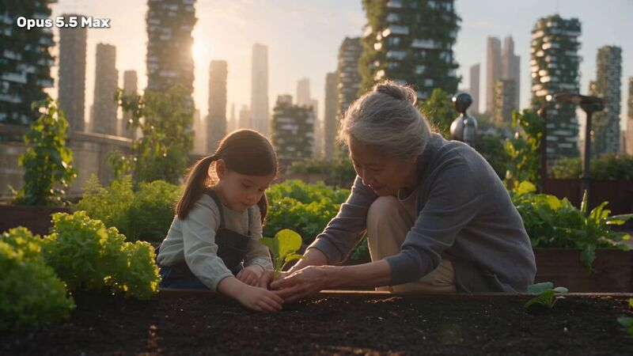
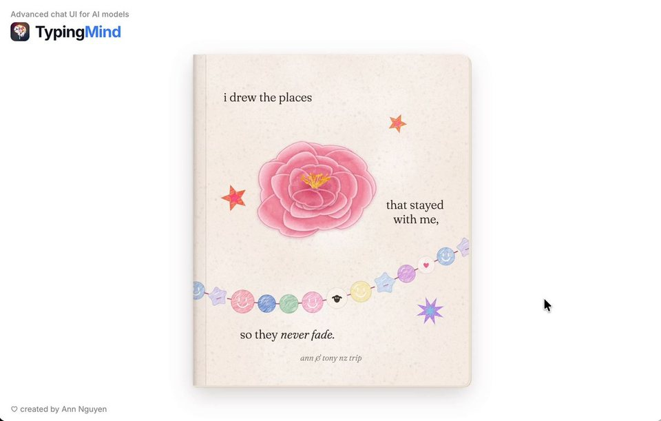
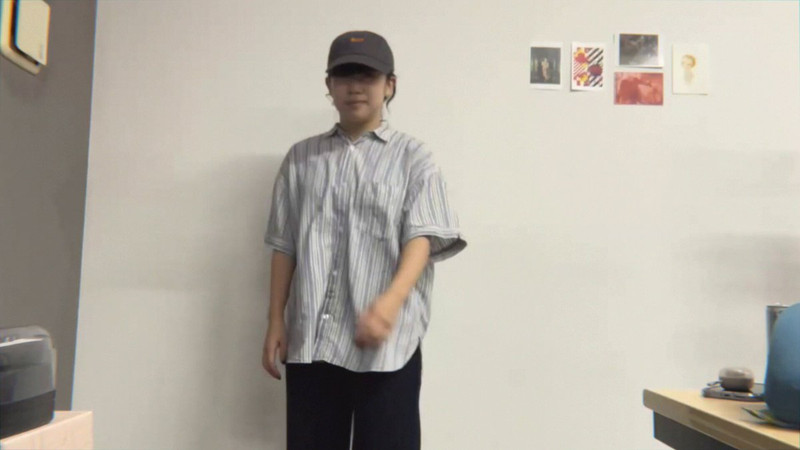
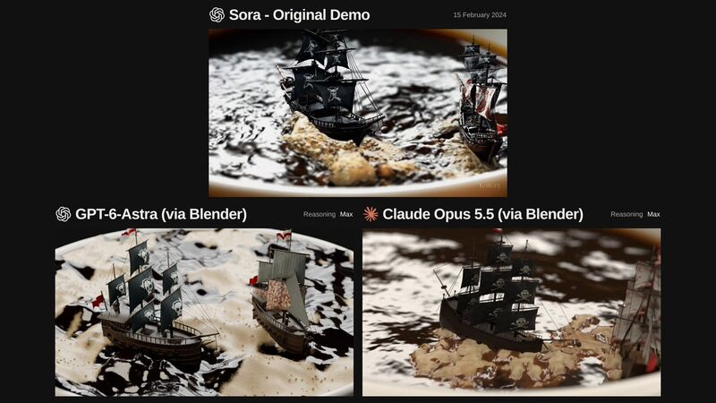
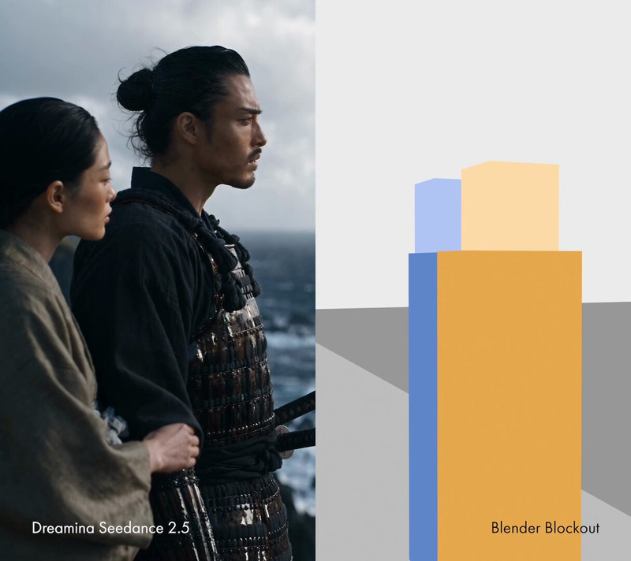

[← 全部分类](../README.md#browse)

# 叙事短片

82 个作品。点击封面播放；没有画廊视频时会前往 X 原帖。

<table>
<tbody>
<tr>
<td width="50%" height="225" align="center" valign="middle"></td>
<td width="50%" height="225" align="center" valign="middle"></td>
</tr>
<tr>
<td width="50%" valign="top"><strong>用代码讲述奥斯特里茨战役</strong> <a href="https://x.com/WinterArc2125">@WinterArc2125</a> · 叙事短片 5:01 · 收藏 272 <a href="https://guanmo-ai.github.io/awesome-ai-motion/#case-2103116235009347650">▶ 播放</a> · <a href="https://x.com/WinterArc2125/status/2103116235009347650">原帖</a></td>
<td width="50%" valign="top"><strong>一句话讲 Anthropic 的发家史</strong> <a href="https://x.com/VincentWei93">@VincentWei93</a> · 叙事短片 3:44 · 收藏 1,207 <a href="https://guanmo-ai.github.io/awesome-ai-motion/#case-2103381720410333314">▶ 播放</a> · <a href="https://x.com/VincentWei93/status/2103381720410333314">原帖</a></td>
</tr>
</tbody>
<tbody>
<tr>
<td width="50%" height="225" align="center" valign="middle"></td>
<td width="50%" height="225" align="center" valign="middle"></td>
</tr>
<tr>
<td width="50%" valign="top"><strong>无法阅读的书本动画故事</strong> <a href="https://x.com/emollick">@emollick</a> · 叙事短片 2:07 · 收藏 642 · 资料待完善 <a href="https://guanmo-ai.github.io/awesome-ai-motion/#case-2103272686570918334">▶ 播放</a> · <a href="https://x.com/emollick/status/2103272686570918334">原帖</a></td>
<td width="50%" valign="top"><strong>九十年代风格三维故事</strong> <a href="https://x.com/scheemunai">@scheemunai</a> · 叙事短片 3:50 · 收藏 370 · 资料待完善 <a href="https://guanmo-ai.github.io/awesome-ai-motion/#case-2102788223835463902">▶ 播放</a> · <a href="https://x.com/scheemunai/status/2102788223835463902">原帖</a></td>
</tr>
</tbody>
<tbody>
<tr>
<td width="50%" height="225" align="center" valign="middle"></td>
<td width="50%" height="225" align="center" valign="middle"></td>
</tr>
<tr>
<td width="50%" valign="top"><strong>雨夜站台的 30 秒重逢</strong> <a href="https://x.com/zhu185178">@zhu185178</a> · 叙事短片 0:30 · 收藏 100 <a href="https://guanmo-ai.github.io/awesome-ai-motion/#case-2103757767727255661">▶ 播放</a> · <a href="https://x.com/zhu185178/status/2103757767727255661">原帖</a></td>
<td width="50%" valign="top"><strong>日落海面上的三维空战场景</strong> <a href="https://x.com/NFT_Chen">@NFT_Chen</a> · 叙事短片 0:14 · 收藏 53 <a href="https://guanmo-ai.github.io/awesome-ai-motion/#case-2103882415299350878">▶ 播放</a> · <a href="https://x.com/NFT_Chen/status/2103882415299350878">原帖</a></td>
</tr>
</tbody>
<tbody>
<tr>
<td width="50%" height="225" align="center" valign="middle"></td>
<td width="50%" height="225" align="center" valign="middle"></td>
</tr>
<tr>
<td width="50%" valign="top"><strong>木兰辞：剪纸皮影短片</strong> <a href="https://x.com/TanLuAI">@TanLuAI</a> · 叙事短片 1:03 · 收藏 3 · 资料待完善 <a href="https://guanmo-ai.github.io/awesome-ai-motion/#case-2107802029100093531">▶ 播放</a> · <a href="https://x.com/TanLuAI/status/2107802029100093531">原帖</a></td>
<td width="50%" valign="top"><strong>人类未来：Opus 与 Astra 同题对比</strong> <a href="https://x.com/yulikay">@yulikay</a> · 叙事短片 0:30 · 收藏 1 · 资料待完善 <a href="https://guanmo-ai.github.io/awesome-ai-motion/#case-2105354432460554648">▶ 播放</a> · <a href="https://x.com/yulikay/status/2105354432460554648">原帖</a></td>
</tr>
</tbody>
<tbody>
<tr>
<td width="50%" height="225" align="center" valign="middle"></td>
<td width="50%" height="225" align="center" valign="middle"></td>
</tr>
<tr>
<td width="50%" valign="top"><strong>不想被修好的程序错误</strong> <a href="https://x.com/KamStudioLabs">@KamStudioLabs</a> · 叙事短片 1:30 · 收藏 1 · 资料待完善 <a href="https://guanmo-ai.github.io/awesome-ai-motion/#case-2102903173161877996">▶ 播放</a> · <a href="https://x.com/KamStudioLabs/status/2102903173161877996">原帖</a></td>
<td width="50%" valign="top"><strong>灯塔守夜人的无对白故事</strong> <a href="https://x.com/KamStudioLabs">@KamStudioLabs</a> · 叙事短片 0:46 · 收藏 0 · 资料待完善 <a href="https://guanmo-ai.github.io/awesome-ai-motion/#case-2102908742518100086">▶ 播放</a> · <a href="https://x.com/KamStudioLabs/status/2102908742518100086">原帖</a></td>
</tr>
</tbody>
<tbody>
<tr>
<td width="50%" height="225" align="center" valign="middle"></td>
<td width="50%" height="225" align="center" valign="middle"></td>
</tr>
<tr>
<td width="50%" valign="top"><strong>关于家的剪影纸戏</strong> <a href="https://x.com/x4b47x">@x4b47x</a> · 叙事短片 0:57 · 收藏 0 · 资料待完善 <a href="https://guanmo-ai.github.io/awesome-ai-motion/#case-2103019799614034026">▶ 播放</a> · <a href="https://x.com/x4b47x/status/2103019799614034026">原帖</a></td>
<td width="50%" valign="top"><strong>女孩向 Claude 提问的短片</strong> <a href="https://x.com/kevin_t_ngo">@kevin_t_ngo</a> · 叙事短片 0:28 · 收藏 2,902 · 资料待完善 <a href="https://guanmo-ai.github.io/awesome-ai-motion/#case-2102437977435893771">▶ 播放</a> · <a href="https://x.com/kevin_t_ngo/status/2102437977435893771">原帖</a></td>
</tr>
</tbody>
<tbody>
<tr>
<td width="50%" height="225" align="center" valign="middle"></td>
<td width="50%" height="225" align="center" valign="middle"></td>
</tr>
<tr>
<td width="50%" valign="top"><strong>火星探测器短片</strong> <a href="https://x.com/AndrewOnXYZ">@AndrewOnXYZ</a> · 叙事短片 3:59 · 收藏 2,163 · 资料待完善 <a href="https://guanmo-ai.github.io/awesome-ai-motion/#case-2102512879258009818">▶ 播放</a> · <a href="https://x.com/AndrewOnXYZ/status/2102512879258009818">原帖</a></td>
<td width="50%" valign="top"><strong>用画笔讲述模型的一生</strong> <a href="https://x.com/shfred0">@shfred0</a> · 叙事短片 0:30 · 收藏 1,732 <a href="https://guanmo-ai.github.io/awesome-ai-motion/#case-2102495989194236158">▶ 播放</a> · <a href="https://x.com/shfred0/status/2102495989194236158">原帖</a></td>
</tr>
</tbody>
<tbody>
<tr>
<td width="50%" height="225" align="center" valign="middle"></td>
<td width="50%" height="225" align="center" valign="middle"></td>
</tr>
<tr>
<td width="50%" valign="top"><strong>复古动画序列：Blender 与生成镜头协作</strong> <a href="https://x.com/AIWarper">@AIWarper</a> · 叙事短片 0:25 · 收藏 1,577 · 资料待完善 <a href="https://guanmo-ai.github.io/awesome-ai-motion/#case-2106466745661980904">▶ 播放</a> · <a href="https://x.com/AIWarper/status/2106466745661980904">原帖</a></td>
<td width="50%" valign="top"><strong>把旅行照片画成丙烯动画</strong> <a href="https://x.com/ann_nnng">@ann_nnng</a> · 叙事短片 0:22 · 收藏 1,250 <a href="https://guanmo-ai.github.io/awesome-ai-motion/#case-2102573127192727704">▶ 播放</a> · <a href="https://x.com/ann_nnng/status/2102573127192727704">原帖</a></td>
</tr>
</tbody>
<tbody>
<tr>
<td width="50%" height="225" align="center" valign="middle"></td>
<td width="50%" height="225" align="center" valign="middle"></td>
</tr>
<tr>
<td width="50%" valign="top"><strong>一滴雨的故事动画</strong> <a href="https://x.com/aollivier82">@aollivier82</a> · 叙事短片 0:32 · 收藏 988 · 资料待完善 <a href="https://guanmo-ai.github.io/awesome-ai-motion/#case-2102498589259821559">▶ 播放</a> · <a href="https://x.com/aollivier82/status/2102498589259821559">原帖</a></td>
<td width="50%" valign="top"><strong>啤酒节短动画</strong> <a href="https://x.com/cherry_mx_reds">@cherry_mx_reds</a> · 叙事短片 0:30 · 收藏 852 · 资料待完善 <a href="https://guanmo-ai.github.io/awesome-ai-motion/#case-2102493303388475855">▶ 播放</a> · <a href="https://x.com/cherry_mx_reds/status/2102493303388475855">原帖</a></td>
</tr>
</tbody>
<tbody>
<tr>
<td width="50%" height="225" align="center" valign="middle"></td>
<td width="50%" height="225" align="center" valign="middle"></td>
</tr>
<tr>
<td width="50%" valign="top"><strong>单页生成的七十八秒动画</strong> <a href="https://x.com/jurlycat">@jurlycat</a> · 叙事短片 1:18 · 收藏 812 · 资料待完善 <a href="https://guanmo-ai.github.io/awesome-ai-motion/#case-2102645793828036643">▶ 播放</a> · <a href="https://x.com/jurlycat/status/2102645793828036643">原帖</a></td>
<td width="50%" valign="top"><strong>Small Print 文字故事动画</strong> <a href="https://x.com/Voxyz_ai">@Voxyz_ai</a> · 叙事短片 0:29 · 收藏 796 · 资料待完善 <a href="https://guanmo-ai.github.io/awesome-ai-motion/#case-2102531681450119426">▶ 播放</a> · <a href="https://x.com/Voxyz_ai/status/2102531681450119426">原帖</a></td>
</tr>
</tbody>
<tbody>
<tr>
<td width="50%" height="225" align="center" valign="middle"></td>
<td width="50%" height="225" align="center" valign="middle"></td>
</tr>
<tr>
<td width="50%" valign="top"><strong>Dot Battle：格斗画面的粒子重建</strong> <a href="https://x.com/aicreataro">@aicreataro</a> · 叙事短片 0:20 · 收藏 789 · 资料待完善 <a href="https://guanmo-ai.github.io/awesome-ai-motion/#case-2106236856979607569">▶ 播放</a> · <a href="https://x.com/aicreataro/status/2106236856979607569">原帖</a></td>
<td width="50%" valign="top"><strong>中秋夜景的拼贴动画</strong> <a href="https://x.com/ring_hyacinth">@ring_hyacinth</a> · 叙事短片 0:40 · 收藏 492 · 资料待完善 <a href="https://guanmo-ai.github.io/awesome-ai-motion/#case-2102986085328716066">▶ 播放</a> · <a href="https://x.com/ring_hyacinth/status/2102986085328716066">原帖</a></td>
</tr>
</tbody>
<tbody>
<tr>
<td width="50%" height="225" align="center" valign="middle"></td>
<td width="50%" height="225" align="center" valign="middle"></td>
</tr>
<tr>
<td width="50%" valign="top"><strong>用代码想象难题求解</strong> <a href="https://x.com/chetaslua">@chetaslua</a> · 叙事短片 0:30 · 收藏 393 · 资料待完善 <a href="https://guanmo-ai.github.io/awesome-ai-motion/#case-2102478640428773861">▶ 播放</a> · <a href="https://x.com/chetaslua/status/2102478640428773861">原帖</a></td>
<td width="50%" valign="top"><strong>从岩石到 AI 的短片</strong> <a href="https://x.com/devteamdrew">@devteamdrew</a> · 叙事短片 3:00 · 收藏 381 · 资料待完善 <a href="https://guanmo-ai.github.io/awesome-ai-motion/#case-2103523994440012086">▶ 播放</a> · <a href="https://x.com/devteamdrew/status/2103523994440012086">原帖</a></td>
</tr>
</tbody>
<tbody>
<tr>
<td width="50%" height="225" align="center" valign="middle"></td>
<td width="50%" height="225" align="center" valign="middle"></td>
</tr>
<tr>
<td width="50%" valign="top"><strong>无人世界的未来寓言</strong> <a href="https://x.com/Hesamation">@Hesamation</a> · 叙事短片 1:28 · 收藏 355 · 资料待完善 <a href="https://guanmo-ai.github.io/awesome-ai-motion/#case-2103457566978162901">▶ 播放</a> · <a href="https://x.com/Hesamation/status/2103457566978162901">原帖</a></td>
<td width="50%" valign="top"><strong>记忆褪成水彩：代码绘制的短片</strong> <a href="https://x.com/techartist_">@techartist_</a> · 叙事短片 0:12 · 收藏 260 · 资料待完善 <a href="https://guanmo-ai.github.io/awesome-ai-motion/#case-2104186357824487573">▶ 播放</a> · <a href="https://x.com/techartist_/status/2104186357824487573">原帖</a></td>
</tr>
</tbody>
<tbody>
<tr>
<td width="50%" height="225" align="center" valign="middle"></td>
<td width="50%" height="225" align="center" valign="middle"></td>
</tr>
<tr>
<td width="50%" valign="top"><strong>火柴人闯迷宫动画</strong> <a href="https://x.com/ForwardEditor">@ForwardEditor</a> · 叙事短片 1:47 · 收藏 142 · 资料待完善 <a href="https://guanmo-ai.github.io/awesome-ai-motion/#case-2102558320695402885">▶ 播放</a> · <a href="https://x.com/ForwardEditor/status/2102558320695402885">原帖</a></td>
<td width="50%" valign="top"><strong>用 3D 预演重建追车场景</strong> <a href="https://x.com/Ror_Fly">@Ror_Fly</a> · 叙事短片 0:25 · 收藏 128 · 资料待完善 <a href="https://guanmo-ai.github.io/awesome-ai-motion/#case-2107572909086761325">▶ 播放</a> · <a href="https://x.com/Ror_Fly/status/2107572909086761325">原帖</a></td>
</tr>
</tbody>
<tbody>
<tr>
<td width="50%" height="225" align="center" valign="middle"></td>
<td width="50%" height="225" align="center" valign="middle"></td>
</tr>
<tr>
<td width="50%" valign="top"><strong>手绘水彩感短片</strong> <a href="https://x.com/mablesjoseph">@mablesjoseph</a> · 叙事短片 0:46 · 收藏 127 · 资料待完善 <a href="https://guanmo-ai.github.io/awesome-ai-motion/#case-2103465246014746943">▶ 播放</a> · <a href="https://x.com/mablesjoseph/status/2103465246014746943">原帖</a></td>
<td width="50%" valign="top"><strong>Andy 的 Opus 单句动画实验</strong> <a href="https://x.com/AndyL5cc">@AndyL5cc</a> · 叙事短片 1:12 · 收藏 125 · 资料待完善 <a href="https://guanmo-ai.github.io/awesome-ai-motion/#case-2104392800892764552">▶ 播放</a> · <a href="https://x.com/AndyL5cc/status/2104392800892764552">原帖</a></td>
</tr>
</tbody>
<tbody>
<tr>
<td width="50%" height="225" align="center" valign="middle"></td>
<td width="50%" height="225" align="center" valign="middle"></td>
</tr>
<tr>
<td width="50%" valign="top"><strong>第七区下层：三维城市预演转视频</strong> <a href="https://x.com/akakuma0219">@akakuma0219</a> · 叙事短片 0:20 · 收藏 122 · 资料待完善 <a href="https://guanmo-ai.github.io/awesome-ai-motion/#case-2103997282270248974">▶ 播放</a> · <a href="https://x.com/akakuma0219/status/2103997282270248974">原帖</a></td>
<td width="50%" valign="top"><strong>小蝌蚪找妈妈水墨短片</strong> <a href="https://x.com/akokoi1">@akokoi1</a> · 叙事短片 3:55 · 收藏 113 · 资料待完善 <a href="https://guanmo-ai.github.io/awesome-ai-motion/#case-2102699703309898026">▶ 播放</a> · <a href="https://x.com/akokoi1/status/2102699703309898026">原帖</a></td>
</tr>
</tbody>
<tbody>
<tr>
<td width="50%" height="225" align="center" valign="middle"></td>
<td width="50%" height="225" align="center" valign="middle"></td>
</tr>
<tr>
<td width="50%" valign="top"><strong>星星与猫的程序化动画</strong> <a href="https://x.com/onofumi_AI">@onofumi_AI</a> · 叙事短片 0:17 · 收藏 95 · 资料待完善 <a href="https://guanmo-ai.github.io/awesome-ai-motion/#case-2102535945333657960">▶ 播放</a> · <a href="https://x.com/onofumi_AI/status/2102535945333657960">原帖</a></td>
<td width="50%" valign="top"><strong>上海夜景中秋剪纸动画</strong> <a href="https://x.com/NFT_Chen">@NFT_Chen</a> · 叙事短片 0:39 · 收藏 83 · 资料待完善 <a href="https://guanmo-ai.github.io/awesome-ai-motion/#case-2103380404791333144">▶ 播放</a> · <a href="https://x.com/NFT_Chen/status/2103380404791333144">原帖</a></td>
</tr>
</tbody>
<tbody>
<tr>
<td width="50%" height="225" align="center" valign="middle"></td>
<td width="50%" height="225" align="center" valign="middle"></td>
</tr>
<tr>
<td width="50%" valign="top"><strong>机器人短篇动画</strong> <a href="https://x.com/ctgptlb">@ctgptlb</a> · 叙事短片 1:04 · 收藏 78 · 资料待完善 <a href="https://guanmo-ai.github.io/awesome-ai-motion/#case-2102726428991373480">▶ 播放</a> · <a href="https://x.com/ctgptlb/status/2102726428991373480">原帖</a></td>
<td width="50%" valign="top"><strong>2076：未来世界的 25 秒想象</strong> <a href="https://x.com/Layton_Gott">@Layton_Gott</a> · 叙事短片 0:26 · 收藏 74 · 资料待完善 <a href="https://guanmo-ai.github.io/awesome-ai-motion/#case-2106190496075035096">▶ 播放</a> · <a href="https://x.com/Layton_Gott/status/2106190496075035096">原帖</a></td>
</tr>
</tbody>
<tbody>
<tr>
<td width="50%" height="225" align="center" valign="middle"></td>
<td width="50%" height="225" align="center" valign="middle"></td>
</tr>
<tr>
<td width="50%" valign="top"><strong>愚公移山的代码动画</strong> <a href="https://x.com/nicekate8888">@nicekate8888</a> · 叙事短片 2:00 · 收藏 70 · 资料待完善 <a href="https://guanmo-ai.github.io/awesome-ai-motion/#case-2108223333431193770">▶ 播放</a> · <a href="https://x.com/nicekate8888/status/2108223333431193770">原帖</a></td>
<td width="50%" valign="top"><strong>一分钟格斗动画</strong> <a href="https://x.com/akokoi1">@akokoi1</a> · 叙事短片 1:00 · 收藏 64 · 资料待完善 <a href="https://guanmo-ai.github.io/awesome-ai-motion/#case-2103149275945517546">▶ 播放</a> · <a href="https://x.com/akokoi1/status/2103149275945517546">原帖</a></td>
</tr>
</tbody>
<tbody>
<tr>
<td width="50%" height="225" align="center" valign="middle"></td>
<td width="50%" height="225" align="center" valign="middle"></td>
</tr>
<tr>
<td width="50%" valign="top"><strong>小芽苗的黏土动画</strong> <a href="https://x.com/cherry_mx_reds">@cherry_mx_reds</a> · 叙事短片 0:30 · 收藏 63 · 资料待完善 <a href="https://guanmo-ai.github.io/awesome-ai-motion/#case-2102574688769650976">▶ 播放</a> · <a href="https://x.com/cherry_mx_reds/status/2102574688769650976">原帖</a></td>
<td width="50%" valign="top"><strong>阿拉伯语配音动漫试播片</strong> <a href="https://x.com/sbalhatlani">@sbalhatlani</a> · 叙事短片 8:33 · 收藏 63 · 资料待完善 <a href="https://guanmo-ai.github.io/awesome-ai-motion/#case-2103475507471806929">▶ 播放</a> · <a href="https://x.com/sbalhatlani/status/2103475507471806929">原帖</a></td>
</tr>
</tbody>
<tbody>
<tr>
<td width="50%" height="225" align="center" valign="middle"></td>
<td width="50%" height="225" align="center" valign="middle"></td>
</tr>
<tr>
<td width="50%" valign="top"><strong>同一支舞的骨架与粒子变换</strong> <a href="https://x.com/aicreataro">@aicreataro</a> · 叙事短片 0:23 · 收藏 57 · 资料待完善 <a href="https://guanmo-ai.github.io/awesome-ai-motion/#case-2107396397800841635">▶ 播放</a> · <a href="https://x.com/aicreataro/status/2107396397800841635">原帖</a></td>
<td width="50%" valign="top"><strong>代码绘制的动漫预告片</strong> <a href="https://x.com/ishuagra02">@ishuagra02</a> · 叙事短片 1:41 · 收藏 44 · 资料待完善 <a href="https://guanmo-ai.github.io/awesome-ai-motion/#case-2103247844542922825">▶ 播放</a> · <a href="https://x.com/ishuagra02/status/2103247844542922825">原帖</a></td>
</tr>
</tbody>
<tbody>
<tr>
<td width="50%" height="225" align="center" valign="middle"></td>
<td width="50%" height="225" align="center" valign="middle"></td>
</tr>
<tr>
<td width="50%" valign="top"><strong>LEGO 风格《西斯的复仇》开场复刻</strong> <a href="https://x.com/ChrisGPT">@ChrisGPT</a> · 叙事短片 1:37 · 收藏 33 · 资料待完善 <a href="https://guanmo-ai.github.io/awesome-ai-motion/#case-2103976291699728742">▶ 播放</a> · <a href="https://x.com/ChrisGPT/status/2103976291699728742">原帖</a></td>
<td width="50%" valign="top"><strong>儿童角色动画短片</strong> <a href="https://x.com/jackfriks">@jackfriks</a> · 叙事短片 0:35 · 收藏 30 · 资料待完善 <a href="https://guanmo-ai.github.io/awesome-ai-motion/#case-2103525576912855363">▶ 播放</a> · <a href="https://x.com/jackfriks/status/2103525576912855363">原帖</a></td>
</tr>
</tbody>
<tbody>
<tr>
<td width="50%" height="225" align="center" valign="middle"></td>
<td width="50%" height="225" align="center" valign="middle"></td>
</tr>
<tr>
<td width="50%" valign="top"><strong>人类：从古代到当代的代码动画</strong> <a href="https://x.com/blueemi99">@blueemi99</a> · 叙事短片 2:00 · 收藏 28 · 资料待完善 <a href="https://guanmo-ai.github.io/awesome-ai-motion/#case-2106041578204655748">▶ 播放</a> · <a href="https://x.com/blueemi99/status/2106041578204655748">原帖</a></td>
<td width="50%" valign="top"><strong>Yearning：窗边的早期三维试片</strong> <a href="https://x.com/xikhar">@xikhar</a> · 叙事短片 0:30 · 收藏 14 · 资料待完善 <a href="https://guanmo-ai.github.io/awesome-ai-motion/#case-2107918993093005610">▶ 播放</a> · <a href="https://x.com/xikhar/status/2107918993093005610">原帖</a></td>
</tr>
</tbody>
<tbody>
<tr>
<td width="50%" height="225" align="center" valign="middle"></td>
<td width="50%" height="225" align="center" valign="middle"></td>
</tr>
<tr>
<td width="50%" valign="top"><strong>黄色方块主角的个人经历动画</strong> <a href="https://x.com/servasyy">@servasyy</a> · 叙事短片 1:20 · 收藏 14 · 资料待完善 <a href="https://guanmo-ai.github.io/awesome-ai-motion/#case-2104039075175182487">▶ 播放</a> · <a href="https://x.com/servasyy/status/2104039075175182487">原帖</a></td>
<td width="50%" valign="top"><strong>Minecraft 预告片的双模型对照</strong> <a href="https://x.com/ITangieff">@ITangieff</a> · 叙事短片 0:30 · 收藏 13 · 资料待完善 <a href="https://guanmo-ai.github.io/awesome-ai-motion/#case-2107868519065170337">▶ 播放</a> · <a href="https://x.com/ITangieff/status/2107868519065170337">原帖</a></td>
</tr>
</tbody>
<tbody>
<tr>
<td width="50%" height="225" align="center" valign="middle"></td>
<td width="50%" height="225" align="center" valign="middle"></td>
</tr>
<tr>
<td width="50%" valign="top"><strong>雨从哪里来：天空鲸鱼短片</strong> <a href="https://x.com/theSethian">@theSethian</a> · 叙事短片 2:11 · 收藏 12 · 资料待完善 <a href="https://guanmo-ai.github.io/awesome-ai-motion/#case-2106063015632158974">▶ 播放</a> · <a href="https://x.com/theSethian/status/2106063015632158974">原帖</a></td>
<td width="50%" valign="top"><strong>中途岛海战代码短片</strong> <a href="https://x.com/WinterArc2125">@WinterArc2125</a> · 叙事短片 1:17 · 收藏 12 · 资料待完善 <a href="https://guanmo-ai.github.io/awesome-ai-motion/#case-2103505613846196323">▶ 播放</a> · <a href="https://x.com/WinterArc2125/status/2103505613846196323">原帖</a></td>
</tr>
</tbody>
<tbody>
<tr>
<td width="50%" height="225" align="center" valign="middle"></td>
<td width="50%" height="225" align="center" valign="middle"></td>
</tr>
<tr>
<td width="50%" valign="top"><strong>AI 开始构建自身：代码与时间线短片</strong> <a href="https://x.com/techartist_">@techartist_</a> · 叙事短片 1:36 · 收藏 11 · 资料待完善 <a href="https://guanmo-ai.github.io/awesome-ai-motion/#case-2106557414992752745">▶ 播放</a> · <a href="https://x.com/techartist_/status/2106557414992752745">原帖</a></td>
<td width="50%" valign="top"><strong>GPU 火焰模拟与离线电影运镜</strong> <a href="https://x.com/NathanWilbanks_">@NathanWilbanks_</a> · 叙事短片 0:38 · 收藏 10 <a href="https://guanmo-ai.github.io/awesome-ai-motion/#case-2103881538592981110">▶ 播放</a> · <a href="https://x.com/NathanWilbanks_/status/2103881538592981110">原帖</a></td>
</tr>
</tbody>
<tbody>
<tr>
<td width="50%" height="225" align="center" valign="middle"></td>
<td width="50%" height="225" align="center" valign="middle"></td>
</tr>
<tr>
<td width="50%" valign="top"><strong>用 Blender 重现 Sora 示例镜头</strong> <a href="https://x.com/petergostev">@petergostev</a> · 叙事短片 0:28 · 收藏 9 · 资料待完善 <a href="https://guanmo-ai.github.io/awesome-ai-motion/#case-2104733074340872656">▶ 播放</a> · <a href="https://x.com/petergostev/status/2104733074340872656">原帖</a></td>
<td width="50%" valign="top"><strong>EVA 灵感的 Three.js 剧场实验</strong> <a href="https://x.com/LuisBizarro">@LuisBizarro</a> · 叙事短片 0:22 · 收藏 9 · 资料待完善 <a href="https://guanmo-ai.github.io/awesome-ai-motion/#case-2104780688113455342">▶ 播放</a> · <a href="https://x.com/LuisBizarro/status/2104780688113455342">原帖</a></td>
</tr>
</tbody>
<tbody>
<tr>
<td width="50%" height="225" align="center" valign="middle"></td>
<td width="50%" height="225" align="center" valign="middle"></td>
</tr>
<tr>
<td width="50%" valign="top"><strong>戏剧作品的漫画式改编</strong> <a href="https://x.com/samspike_">@samspike_</a> · 叙事短片 5:23 · 收藏 8 · 资料待完善 <a href="https://guanmo-ai.github.io/awesome-ai-motion/#case-2103171975220781332">▶ 播放</a> · <a href="https://x.com/samspike_/status/2103171975220781332">原帖</a></td>
<td width="50%" valign="top"><strong>鲲鹏水墨：笔触与骨架动画</strong> <a href="https://x.com/gkxspace">@gkxspace</a> · 叙事短片 2:05 · 收藏 6 · 资料待完善 <a href="https://guanmo-ai.github.io/awesome-ai-motion/#case-2108506384711213108">▶ 播放</a> · <a href="https://x.com/gkxspace/status/2108506384711213108">原帖</a></td>
</tr>
</tbody>
<tbody>
<tr>
<td width="50%" height="225" align="center" valign="middle"></td>
<td width="50%" height="225" align="center" valign="middle"></td>
</tr>
<tr>
<td width="50%" valign="top"><strong>HyperFrames 编排的混合素材短片</strong> <a href="https://x.com/mattworkman">@mattworkman</a> · 叙事短片 0:30 · 收藏 5 · 资料待完善 <a href="https://guanmo-ai.github.io/awesome-ai-motion/#case-2104662818742309357">▶ 播放</a> · <a href="https://x.com/mattworkman/status/2104662818742309357">原帖</a></td>
<td width="50%" valign="top"><strong>水墨武士短片草稿</strong> <a href="https://x.com/pradeepXkapoor">@pradeepXkapoor</a> · 叙事短片 1:30 · 收藏 5 · 资料待完善 <a href="https://guanmo-ai.github.io/awesome-ai-motion/#case-2102782449478668290">▶ 播放</a> · <a href="https://x.com/pradeepXkapoor/status/2102782449478668290">原帖</a></td>
</tr>
</tbody>
<tbody>
<tr>
<td width="50%" height="225" align="center" valign="middle"></td>
<td width="50%" height="225" align="center" valign="middle"></td>
</tr>
<tr>
<td width="50%" valign="top"><strong>《清明上河图》的视频漫游预演</strong> <a href="https://x.com/TanLuAI">@TanLuAI</a> · 叙事短片 0:13 · 收藏 4 · 资料待完善 <a href="https://guanmo-ai.github.io/awesome-ai-motion/#case-2107459822438539692">▶ 播放</a> · <a href="https://x.com/TanLuAI/status/2107459822438539692">原帖</a></td>
<td width="50%" valign="top"><strong>夜班邮局的猫头鹰</strong> <a href="https://x.com/SidMenonTM">@SidMenonTM</a> · 叙事短片 0:24 · 收藏 4 · 资料待完善 <a href="https://guanmo-ai.github.io/awesome-ai-motion/#case-2103169764244017396">▶ 播放</a> · <a href="https://x.com/SidMenonTM/status/2103169764244017396">原帖</a></td>
</tr>
</tbody>
<tbody>
<tr>
<td width="50%" height="225" align="center" valign="middle"></td>
<td width="50%" height="225" align="center" valign="middle"></td>
</tr>
<tr>
<td width="50%" valign="top"><strong>《Into the ANTVERSE》动画试片</strong> <a href="https://x.com/ChrisGPT">@ChrisGPT</a> · 叙事短片 2:00 · 收藏 2 · 资料待完善 <a href="https://guanmo-ai.github.io/awesome-ai-motion/#case-2104775199698629064">▶ 播放</a> · <a href="https://x.com/ChrisGPT/status/2104775199698629064">原帖</a></td>
<td width="50%" valign="top"><strong>RONIN：游戏中的武士开场</strong> <a href="https://x.com/JuanByteLabs">@JuanByteLabs</a> · 叙事短片 0:50 · 收藏 2 · 资料待完善 <a href="https://guanmo-ai.github.io/awesome-ai-motion/#case-2108319013239427198">▶ 播放</a> · <a href="https://x.com/JuanByteLabs/status/2108319013239427198">原帖</a></td>
</tr>
</tbody>
<tbody>
<tr>
<td width="50%" height="225" align="center" valign="middle"></td>
<td width="50%" height="225" align="center" valign="middle"></td>
</tr>
<tr>
<td width="50%" valign="top"><strong>本地合成的纤维质感影像</strong> <a href="https://x.com/Tariq_at">@Tariq_at</a> · 叙事短片 0:20 · 收藏 1 · 资料待完善 <a href="https://guanmo-ai.github.io/awesome-ai-motion/#case-2102561072624410878">▶ 播放</a> · <a href="https://x.com/Tariq_at/status/2102561072624410878">原帖</a></td>
<td width="50%" valign="top"><strong>Three.js 合作恐怖游戏展示片</strong> <a href="https://x.com/AmaySignedIn">@AmaySignedIn</a> · 叙事短片 0:20 · 收藏 1 · 资料待完善 <a href="https://guanmo-ai.github.io/awesome-ai-motion/#case-2104747385692053930">▶ 播放</a> · <a href="https://x.com/AmaySignedIn/status/2104747385692053930">原帖</a></td>
</tr>
</tbody>
<tbody>
<tr>
<td width="50%" height="225" align="center" valign="middle"></td>
<td width="50%" height="225" align="center" valign="middle"></td>
</tr>
<tr>
<td width="50%" valign="top"><strong>红手套角色无声短片</strong> <a href="https://x.com/yaakuups">@yaakuups</a> · 叙事短片 2:18 · 收藏 1 · 资料待完善 <a href="https://guanmo-ai.github.io/awesome-ai-motion/#case-2103082248320766456">▶ 播放</a> · <a href="https://x.com/yaakuups/status/2103082248320766456">原帖</a></td>
<td width="50%" valign="top"><strong>批评与辱骂：小灯角色的故事</strong> <a href="https://x.com/RisingSunInt_">@RisingSunInt_</a> · 叙事短片 0:35 · 收藏 1 · 资料待完善 <a href="https://guanmo-ai.github.io/awesome-ai-motion/#case-2108498649269567492">▶ 播放</a> · <a href="https://x.com/RisingSunInt_/status/2108498649269567492">原帖</a></td>
</tr>
</tbody>
<tbody>
<tr>
<td width="50%" height="225" align="center" valign="middle"></td>
<td width="50%" height="225" align="center" valign="middle"></td>
</tr>
<tr>
<td width="50%" valign="top"><strong>科幻文本改编动态图像</strong> <a href="https://x.com/N8Programs">@N8Programs</a> · 叙事短片 10:09 · 收藏 1 · 资料待完善 <a href="https://guanmo-ai.github.io/awesome-ai-motion/#case-2103154189064876406">▶ 播放</a> · <a href="https://x.com/N8Programs/status/2103154189064876406">原帖</a></td>
<td width="50%" valign="top"><strong>商场的一天：清晨保洁到凌晨保安</strong> <a href="https://x.com/KanikaBK">@KanikaBK</a> · 叙事短片 0:45 · 收藏 0 · 资料待完善 <a href="https://guanmo-ai.github.io/awesome-ai-motion/#case-2105221177035940200">▶ 播放</a> · <a href="https://x.com/KanikaBK/status/2105221177035940200">原帖</a></td>
</tr>
</tbody>
<tbody>
<tr>
<td width="50%" height="225" align="center" valign="middle"></td>
<td width="50%" height="225" align="center" valign="middle"></td>
</tr>
<tr>
<td width="50%" valign="top"><strong>Blender、Remotion 与生成视频协作短片</strong> <a href="https://x.com/Tardigrade111">@Tardigrade111</a> · 叙事短片 0:52 · 收藏 0 <a href="https://guanmo-ai.github.io/awesome-ai-motion/#case-2104620857826160686">▶ 播放</a> · <a href="https://x.com/Tardigrade111/status/2104620857826160686">原帖</a></td>
<td width="50%" valign="top"><strong>古印度史诗灵感的动作游戏预告</strong> <a href="https://x.com/mayuresh_empire">@mayuresh_empire</a> · 叙事短片 0:53 · 收藏 0 · 资料待完善 <a href="https://guanmo-ai.github.io/awesome-ai-motion/#case-2104207365008687553">▶ 播放</a> · <a href="https://x.com/mayuresh_empire/status/2104207365008687553">原帖</a></td>
</tr>
</tbody>
<tbody>
<tr>
<td width="50%" height="225" align="center" valign="middle"></td>
<td width="50%" height="225" align="center" valign="middle"></td>
</tr>
<tr>
<td width="50%" valign="top"><strong>把深夜散文变成四分钟短片</strong> <a href="https://x.com/wenbozhu0328">@wenbozhu0328</a> · 叙事短片 4:09 · 收藏 0 · 资料待完善 <a href="https://guanmo-ai.github.io/awesome-ai-motion/#case-2105655716564656404">▶ 播放</a> · <a href="https://x.com/wenbozhu0328/status/2105655716564656404">原帖</a></td>
<td width="50%" valign="top"><strong>小说改编的 Minecraft 风短片</strong> <a href="https://x.com/tuboshu321">@tuboshu321</a> · 叙事短片 3:42 · 收藏 0 · 资料待完善 <a href="https://guanmo-ai.github.io/awesome-ai-motion/#case-2107768590946738440">▶ 播放</a> · <a href="https://x.com/tuboshu321/status/2107768590946738440">原帖</a></td>
</tr>
</tbody>
<tbody>
<tr>
<td width="50%" height="225" align="center" valign="middle"></td>
<td width="50%" height="225" align="center" valign="middle"></td>
</tr>
<tr>
<td width="50%" valign="top"><strong>异星工业化游戏预告片</strong> <a href="https://x.com/Blackest_Frog">@Blackest_Frog</a> · 叙事短片 1:00 · 收藏 0 · 资料待完善 <a href="https://guanmo-ai.github.io/awesome-ai-motion/#case-2107897224629719415">▶ 播放</a> · <a href="https://x.com/Blackest_Frog/status/2107897224629719415">原帖</a></td>
<td width="50%" valign="top"><strong>Half a Blanket：跨越距离的分屏故事</strong> <a href="https://x.com/Vallabh469">@Vallabh469</a> · 叙事短片 0:39 · 收藏 0 · 资料待完善 <a href="https://guanmo-ai.github.io/awesome-ai-motion/#case-2108494077389926611">▶ 播放</a> · <a href="https://x.com/Vallabh469/status/2108494077389926611">原帖</a></td>
</tr>
</tbody>
<tbody>
<tr>
<td width="50%" height="225" align="center" valign="middle"></td>
<td width="50%" height="225" align="center" valign="middle"></td>
</tr>
<tr>
<td width="50%" valign="top"><strong>潜入任务：三维预演与成片对照</strong> <a href="https://x.com/Finedays_sunday">@Finedays_sunday</a> · 叙事短片 1:05 · 收藏 0 · 资料待完善 <a href="https://guanmo-ai.github.io/awesome-ai-motion/#case-2109235106896617521">▶ 播放</a> · <a href="https://x.com/Finedays_sunday/status/2109235106896617521">原帖</a></td>
<td width="50%" valign="top"><strong>生活巧合的三段动画</strong> <a href="https://x.com/YoshiKura535130">@YoshiKura535130</a> · 叙事短片 0:43 · 收藏 0 · 资料待完善 <a href="https://guanmo-ai.github.io/awesome-ai-motion/#case-2102910805721362875">▶ 播放</a> · <a href="https://x.com/YoshiKura535130/status/2102910805721362875">原帖</a></td>
</tr>
</tbody>
<tbody>
<tr>
<td width="50%" height="225" align="center" valign="middle"></td>
<td width="50%" height="225" align="center" valign="middle"></td>
</tr>
<tr>
<td width="50%" valign="top"><strong>远离尘嚣：太空前哨剪纸短片</strong> <a href="https://x.com/NoFollowers2023">@NoFollowers2023</a> · 叙事短片 5:27 · 收藏 0 · 资料待完善 <a href="https://x.com/NoFollowers2023/status/2104792004978974928">▶ 在 X 观看</a> · <a href="https://x.com/NoFollowers2023/status/2104792004978974928">原帖</a></td>
<td width="50%" valign="top"><strong>AI 时代，人类决定去向</strong> <a href="https://x.com/nakazakifam">@nakazakifam</a> · 叙事短片 1:24 · 收藏 0 · 资料待完善 <a href="https://guanmo-ai.github.io/awesome-ai-motion/#case-2105361184543133877">▶ 播放</a> · <a href="https://x.com/nakazakifam/status/2105361184543133877">原帖</a></td>
</tr>
</tbody>
<tbody>
<tr>
<td width="50%" height="225" align="center" valign="middle"></td>
<td width="50%" height="225" align="center" valign="middle"></td>
</tr>
<tr>
<td width="50%" valign="top"><strong>Emergence：涌现主题代码短片</strong> <a href="https://x.com/JindaLi_">@JindaLi_</a> · 叙事短片 4:37 · 收藏 0 · 资料待完善 <a href="https://guanmo-ai.github.io/awesome-ai-motion/#case-2107434660057800861">▶ 播放</a> · <a href="https://x.com/JindaLi_/status/2107434660057800861">原帖</a></td>
<td width="50%" valign="top"><strong>When Sand Speaks：第一集</strong> <a href="https://x.com/kevrussell">@kevrussell</a> · 叙事短片 0:54 · 收藏 0 · 资料待完善 <a href="https://guanmo-ai.github.io/awesome-ai-motion/#case-2107501886844891607">▶ 播放</a> · <a href="https://x.com/kevrussell/status/2107501886844891607">原帖</a></td>
</tr>
</tbody>
<tbody>
<tr>
<td width="50%" height="225" align="center" valign="middle"></td>
<td width="50%" height="225" align="center" valign="middle"></td>
</tr>
<tr>
<td width="50%" valign="top"><strong>用 Blender 预演控制生成镜头</strong> <a href="https://x.com/gensoFX">@gensoFX</a> · 叙事短片 0:20 · 收藏 0 · 资料待完善 <a href="https://guanmo-ai.github.io/awesome-ai-motion/#case-2107676101749453177">▶ 播放</a> · <a href="https://x.com/gensoFX/status/2107676101749453177">原帖</a></td>
<td width="50%" valign="top"><strong>Codex 制作的动漫介绍试片</strong> <a href="https://x.com/Quantzuma">@Quantzuma</a> · 叙事短片 0:30 · 收藏 0 · 资料待完善 <a href="https://guanmo-ai.github.io/awesome-ai-motion/#case-2108340003613053354">▶ 播放</a> · <a href="https://x.com/Quantzuma/status/2108340003613053354">原帖</a></td>
</tr>
</tbody>
</table>
