[← 全部分类](../README.md#browse)

# 叙事短片

145 个作品。点击封面播放；没有画廊视频时会前往 X 原帖。

<table>
<tbody>
<tr>
<td width="50%" height="225" align="center" valign="middle"></td>
<td width="50%" height="225" align="center" valign="middle"><a href="https://guanmo-ai.github.io/awesome-ai-motion/#case-2103381720410333314">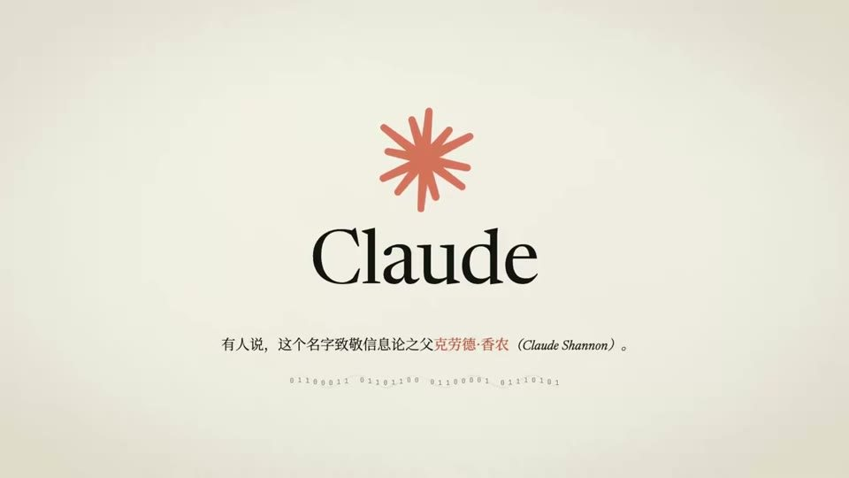</a></td>
</tr>
<tr>
<td width="50%" valign="top"><strong>用代码讲述奥斯特里茨战役</strong> <a href="https://x.com/WinterArc2125">@WinterArc2125</a> · 叙事短片 5:01 · 收藏 272 <a href="https://guanmo-ai.github.io/awesome-ai-motion/#case-2103116235009347650">▶ 播放</a> · <a href="https://x.com/WinterArc2125/status/2103116235009347650">原帖</a></td>
<td width="50%" valign="top"><strong>一句话讲 Anthropic 的发家史</strong> <a href="https://x.com/VincentWei93">@VincentWei93</a> · 叙事短片 3:44 · 收藏 1,207 <a href="https://guanmo-ai.github.io/awesome-ai-motion/#case-2103381720410333314">▶ 播放</a> · <a href="https://x.com/VincentWei93/status/2103381720410333314">原帖</a></td>
</tr>
</tbody>
<tbody>
<tr>
<td width="50%" height="225" align="center" valign="middle"><a href="https://guanmo-ai.github.io/awesome-ai-motion/#case-2102493303388475855">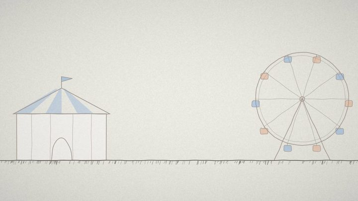</a></td>
<td width="50%" height="225" align="center" valign="middle"><a href="https://guanmo-ai.github.io/awesome-ai-motion/#case-2103272686570918334">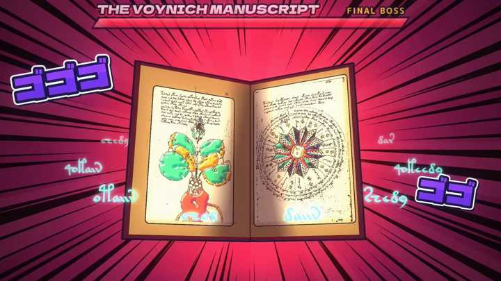</a></td>
</tr>
<tr>
<td width="50%" valign="top"><strong>啤酒节短动画</strong> <a href="https://x.com/cherry_mx_reds">@cherry_mx_reds</a> · 叙事短片 0:30 · 收藏 852 · 资料待完善 <a href="https://guanmo-ai.github.io/awesome-ai-motion/#case-2102493303388475855">▶ 播放</a> · <a href="https://x.com/cherry_mx_reds/status/2102493303388475855">原帖</a></td>
<td width="50%" valign="top"><strong>无法阅读的书本动画故事</strong> <a href="https://x.com/emollick">@emollick</a> · 叙事短片 2:07 · 收藏 642 · 资料待完善 <a href="https://guanmo-ai.github.io/awesome-ai-motion/#case-2103272686570918334">▶ 播放</a> · <a href="https://x.com/emollick/status/2103272686570918334">原帖</a></td>
</tr>
</tbody>
<tbody>
<tr>
<td width="50%" height="225" align="center" valign="middle"><a href="https://guanmo-ai.github.io/awesome-ai-motion/#case-2102788223835463902">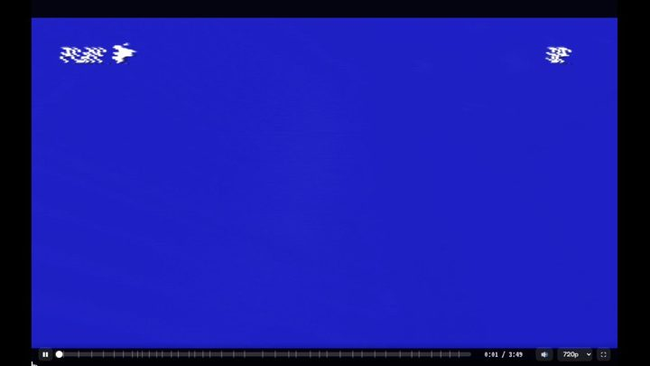</a></td>
<td width="50%" height="225" align="center" valign="middle"><a href="https://guanmo-ai.github.io/awesome-ai-motion/#case-2108199183983497433">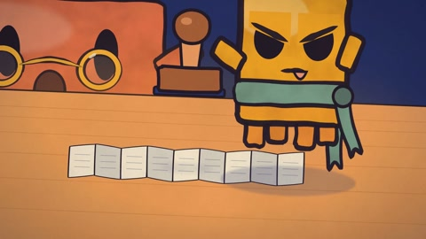</a></td>
</tr>
<tr>
<td width="50%" valign="top"><strong>九十年代风格三维故事</strong> <a href="https://x.com/scheemunai">@scheemunai</a> · 叙事短片 3:50 · 收藏 370 · 资料待完善 <a href="https://guanmo-ai.github.io/awesome-ai-motion/#case-2102788223835463902">▶ 播放</a> · <a href="https://x.com/scheemunai/status/2102788223835463902">原帖</a></td>
<td width="50%" valign="top"><strong>Opus 把任务交给 Haiku</strong> <a href="https://x.com/kelanoo">@kelanoo</a> · 叙事短片 0:20 · 收藏 162 · 资料待完善 <a href="https://guanmo-ai.github.io/awesome-ai-motion/#case-2108199183983497433">▶ 播放</a> · <a href="https://x.com/kelanoo/status/2108199183983497433">原帖</a></td>
</tr>
</tbody>
<tbody>
<tr>
<td width="50%" height="225" align="center" valign="middle"></td>
<td width="50%" height="225" align="center" valign="middle"><a href="https://guanmo-ai.github.io/awesome-ai-motion/#case-2103149275945517546">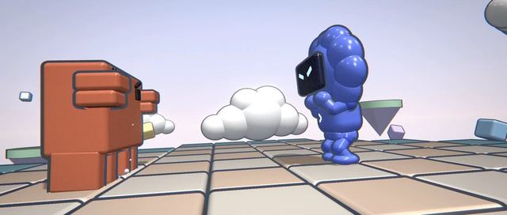</a></td>
</tr>
<tr>
<td width="50%" valign="top"><strong>桃太郎：纸拼贴绘本动画</strong> <a href="https://x.com/tanabe_fragm">@tanabe_fragm</a> · 叙事短片 0:46 · 收藏 155 · 资料待完善 <a href="https://guanmo-ai.github.io/awesome-ai-motion/#case-2110931024469540979">▶ 播放</a> · <a href="https://x.com/tanabe_fragm/status/2110931024469540979">原帖</a></td>
<td width="50%" valign="top"><strong>一分钟格斗动画</strong> <a href="https://x.com/akokoi1">@akokoi1</a> · 叙事短片 1:00 · 收藏 64 · 资料待完善 <a href="https://guanmo-ai.github.io/awesome-ai-motion/#case-2103149275945517546">▶ 播放</a> · <a href="https://x.com/akokoi1/status/2103149275945517546">原帖</a></td>
</tr>
</tbody>
<tbody>
<tr>
<td width="50%" height="225" align="center" valign="middle"><a href="https://guanmo-ai.github.io/awesome-ai-motion/#case-2103882415299350878">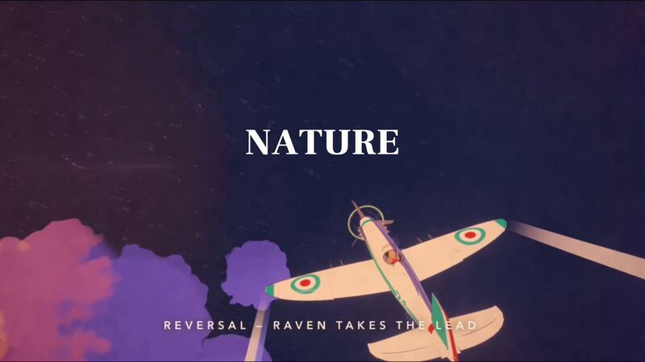</a></td>
<td width="50%" height="225" align="center" valign="middle"><a href="https://guanmo-ai.github.io/awesome-ai-motion/#case-2103247844542922825">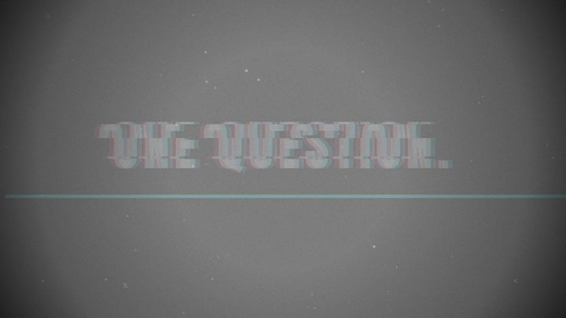</a></td>
</tr>
<tr>
<td width="50%" valign="top"><strong>日落海面上的三维空战场景</strong> <a href="https://x.com/NFT_Chen">@NFT_Chen</a> · 叙事短片 0:14 · 收藏 53 <a href="https://guanmo-ai.github.io/awesome-ai-motion/#case-2103882415299350878">▶ 播放</a> · <a href="https://x.com/NFT_Chen/status/2103882415299350878">原帖</a></td>
<td width="50%" valign="top"><strong>代码绘制的动漫预告片</strong> <a href="https://x.com/ishuagra02">@ishuagra02</a> · 叙事短片 1:41 · 收藏 44 · 资料待完善 <a href="https://guanmo-ai.github.io/awesome-ai-motion/#case-2103247844542922825">▶ 播放</a> · <a href="https://x.com/ishuagra02/status/2103247844542922825">原帖</a></td>
</tr>
</tbody>
<tbody>
<tr>
<td width="50%" height="225" align="center" valign="middle"><a href="https://guanmo-ai.github.io/awesome-ai-motion/#case-2107802029100093531">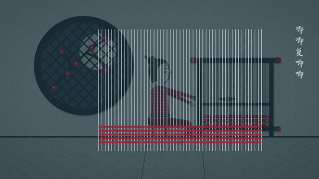</a></td>
<td width="50%" height="225" align="center" valign="middle"></td>
</tr>
<tr>
<td width="50%" valign="top"><strong>木兰辞：剪纸皮影短片</strong> <a href="https://x.com/TanLuAI">@TanLuAI</a> · 叙事短片 1:03 · 收藏 3 · 资料待完善 <a href="https://guanmo-ai.github.io/awesome-ai-motion/#case-2107802029100093531">▶ 播放</a> · <a href="https://x.com/TanLuAI/status/2107802029100093531">原帖</a></td>
<td width="50%" valign="top"><strong>火光与厚涂笔触的短片</strong> <a href="https://x.com/yumaeriel">@yumaeriel</a> · 叙事短片 0:30 · 收藏 2 · 资料待完善 <a href="https://guanmo-ai.github.io/awesome-ai-motion/#case-2103053166006657284">▶ 播放</a> · <a href="https://x.com/yumaeriel/status/2103053166006657284">原帖</a></td>
</tr>
</tbody>
<tbody>
<tr>
<td width="50%" height="225" align="center" valign="middle"></td>
<td width="50%" height="225" align="center" valign="middle"><a href="https://guanmo-ai.github.io/awesome-ai-motion/#case-2103082248320766456">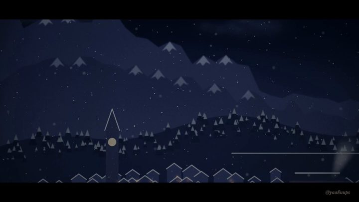</a></td>
</tr>
<tr>
<td width="50%" valign="top"><strong>不想被修好的程序错误</strong> <a href="https://x.com/KamStudioLabs">@KamStudioLabs</a> · 叙事短片 1:30 · 收藏 1 · 资料待完善 <a href="https://guanmo-ai.github.io/awesome-ai-motion/#case-2102903173161877996">▶ 播放</a> · <a href="https://x.com/KamStudioLabs/status/2102903173161877996">原帖</a></td>
<td width="50%" valign="top"><strong>红手套角色无声短片</strong> <a href="https://x.com/yaakuups">@yaakuups</a> · 叙事短片 2:18 · 收藏 1 · 资料待完善 <a href="https://guanmo-ai.github.io/awesome-ai-motion/#case-2103082248320766456">▶ 播放</a> · <a href="https://x.com/yaakuups/status/2103082248320766456">原帖</a></td>
</tr>
</tbody>
<tbody>
<tr>
<td width="50%" height="225" align="center" valign="middle"></td>
<td width="50%" height="225" align="center" valign="middle"></td>
</tr>
<tr>
<td width="50%" valign="top"><strong>雨滴前的一笔巴黎速写</strong> <a href="https://x.com/dan_riverbendai">@dan_riverbendai</a> · 叙事短片 4:45 · 收藏 1 · 资料待完善 <a href="https://guanmo-ai.github.io/awesome-ai-motion/#case-2103985505302163640">▶ 播放</a> · <a href="https://x.com/dan_riverbendai/status/2103985505302163640">原帖</a></td>
<td width="50%" valign="top"><strong>蜘蛛之丝：漫画分镜里的纵深运动</strong> <a href="https://x.com/Kaiyu_AI">@Kaiyu_AI</a> · 叙事短片 4:12 · 收藏 0 · 资料待完善 <a href="https://guanmo-ai.github.io/awesome-ai-motion/#case-2106605246235762929">▶ 播放</a> · <a href="https://x.com/Kaiyu_AI/status/2106605246235762929">原帖</a></td>
</tr>
</tbody>
<tbody>
<tr>
<td width="50%" height="225" align="center" valign="middle"></td>
<td width="50%" height="225" align="center" valign="middle"></td>
</tr>
<tr>
<td width="50%" valign="top"><strong>灯塔守夜人的无对白故事</strong> <a href="https://x.com/KamStudioLabs">@KamStudioLabs</a> · 叙事短片 0:46 · 收藏 0 · 资料待完善 <a href="https://guanmo-ai.github.io/awesome-ai-motion/#case-2102908742518100086">▶ 播放</a> · <a href="https://x.com/KamStudioLabs/status/2102908742518100086">原帖</a></td>
<td width="50%" valign="top"><strong>关于家的剪影纸戏</strong> <a href="https://x.com/x4b47x">@x4b47x</a> · 叙事短片 0:57 · 收藏 0 · 资料待完善 <a href="https://guanmo-ai.github.io/awesome-ai-motion/#case-2103019799614034026">▶ 播放</a> · <a href="https://x.com/x4b47x/status/2103019799614034026">原帖</a></td>
</tr>
</tbody>
<tbody>
<tr>
<td width="50%" height="225" align="center" valign="middle"></td>
<td width="50%" height="225" align="center" valign="middle"></td>
</tr>
<tr>
<td width="50%" valign="top"><strong>桌面上的 Claude 与 ChatGPT 对决</strong> <a href="https://x.com/KadaPlaysAI">@KadaPlaysAI</a> · 叙事短片 1:57 · 收藏 — · 资料待完善 <a href="https://guanmo-ai.github.io/awesome-ai-motion/#case-2103709291530363013">▶ 播放</a> · <a href="https://x.com/KadaPlaysAI/status/2103709291530363013">原帖</a></td>
<td width="50%" valign="top"><strong>关于人工智能未来的图形寓言</strong> <a href="https://x.com/Skoorbkaz">@Skoorbkaz</a> · 叙事短片 11:40 · 收藏 4,325 · 资料待完善 <a href="https://guanmo-ai.github.io/awesome-ai-motion/#case-2113392757548941441">▶ 播放</a> · <a href="https://x.com/Skoorbkaz/status/2113392757548941441">原帖</a></td>
</tr>
</tbody>
<tbody>
<tr>
<td width="50%" height="225" align="center" valign="middle"></td>
<td width="50%" height="225" align="center" valign="middle"><a href="https://guanmo-ai.github.io/awesome-ai-motion/#case-2102512879258009818">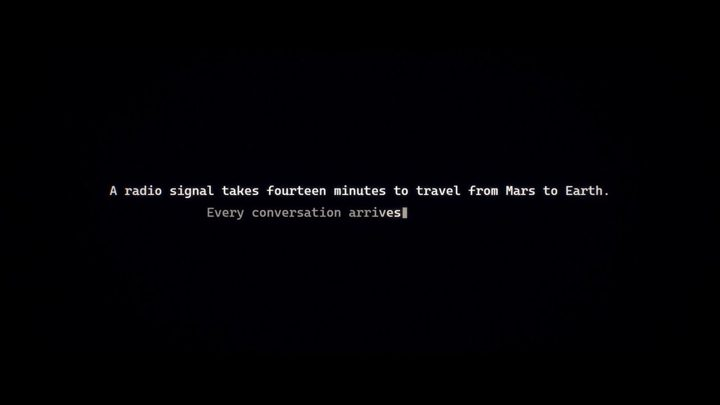</a></td>
</tr>
<tr>
<td width="50%" valign="top"><strong>女孩向 Claude 提问的短片</strong> <a href="https://x.com/kevin_t_ngo">@kevin_t_ngo</a> · 叙事短片 0:28 · 收藏 2,902 · 资料待完善 <a href="https://guanmo-ai.github.io/awesome-ai-motion/#case-2102437977435893771">▶ 播放</a> · <a href="https://x.com/kevin_t_ngo/status/2102437977435893771">原帖</a></td>
<td width="50%" valign="top"><strong>火星探测器短片</strong> <a href="https://x.com/AndrewOnXYZ">@AndrewOnXYZ</a> · 叙事短片 3:59 · 收藏 2,163 · 资料待完善 <a href="https://guanmo-ai.github.io/awesome-ai-motion/#case-2102512879258009818">▶ 播放</a> · <a href="https://x.com/AndrewOnXYZ/status/2102512879258009818">原帖</a></td>
</tr>
</tbody>
<tbody>
<tr>
<td width="50%" height="225" align="center" valign="middle"><a href="https://guanmo-ai.github.io/awesome-ai-motion/#case-2102495989194236158">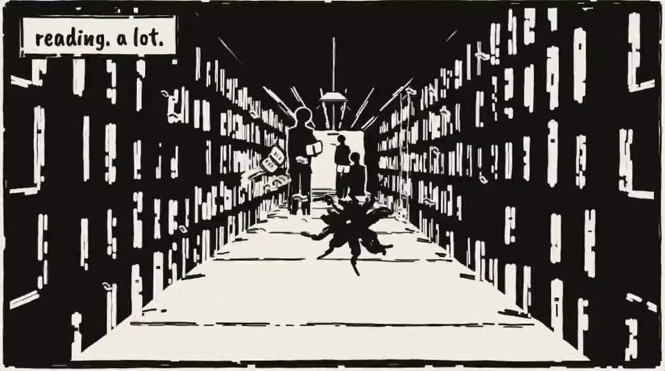</a></td>
<td width="50%" height="225" align="center" valign="middle"><a href="https://guanmo-ai.github.io/awesome-ai-motion/#case-2106466745661980904">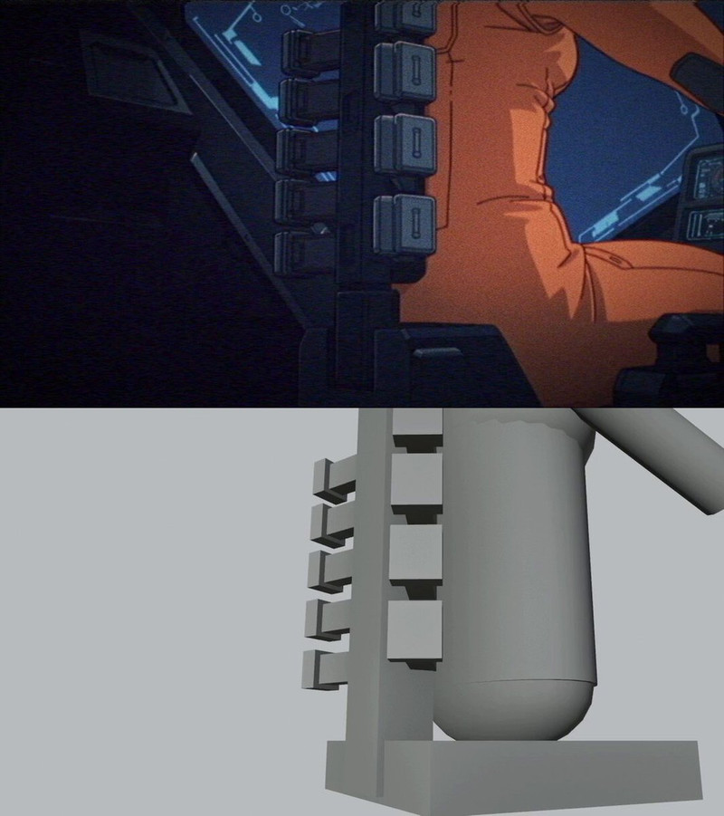</a></td>
</tr>
<tr>
<td width="50%" valign="top"><strong>用画笔讲述模型的一生</strong> <a href="https://x.com/shfred0">@shfred0</a> · 叙事短片 0:30 · 收藏 1,732 <a href="https://guanmo-ai.github.io/awesome-ai-motion/#case-2102495989194236158">▶ 播放</a> · <a href="https://x.com/shfred0/status/2102495989194236158">原帖</a></td>
<td width="50%" valign="top"><strong>复古动画序列：Blender 与生成镜头协作</strong> <a href="https://x.com/AIWarper">@AIWarper</a> · 叙事短片 0:25 · 收藏 1,577 · 资料待完善 <a href="https://guanmo-ai.github.io/awesome-ai-motion/#case-2106466745661980904">▶ 播放</a> · <a href="https://x.com/AIWarper/status/2106466745661980904">原帖</a></td>
</tr>
</tbody>
<tbody>
<tr>
<td width="50%" height="225" align="center" valign="middle"></td>
<td width="50%" height="225" align="center" valign="middle"></td>
</tr>
<tr>
<td width="50%" valign="top"><strong>Gus &amp; Spark：代码卡通第一集</strong> <a href="https://x.com/ziwenxu_">@ziwenxu_</a> · 叙事短片 25:43 · 收藏 1,530 · 资料待完善 <a href="https://guanmo-ai.github.io/awesome-ai-motion/#case-2111212505947357651">▶ 播放</a> · <a href="https://x.com/ziwenxu_/status/2111212505947357651">原帖</a></td>
<td width="50%" valign="top"><strong>钢琴上的黑猫与 Clawd</strong> <a href="https://x.com/kevin_t_ngo">@kevin_t_ngo</a> · 叙事短片 1:12 · 收藏 1,296 · 资料待完善 <a href="https://guanmo-ai.github.io/awesome-ai-motion/#case-2105304249060274631">▶ 播放</a> · <a href="https://x.com/kevin_t_ngo/status/2105304249060274631">原帖</a></td>
</tr>
</tbody>
<tbody>
<tr>
<td width="50%" height="225" align="center" valign="middle"><a href="https://guanmo-ai.github.io/awesome-ai-motion/#case-2107794785188864070">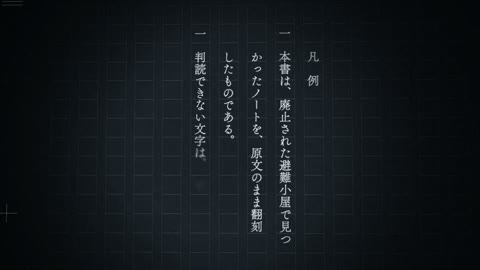</a></td>
<td width="50%" height="225" align="center" valign="middle"><a href="https://guanmo-ai.github.io/awesome-ai-motion/#case-2102498589259821559">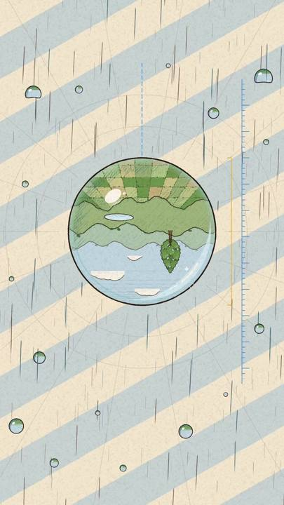</a></td>
</tr>
<tr>
<td width="50%" valign="top"><strong>冻结的手记：文字叙事</strong> <a href="https://x.com/aicreataro">@aicreataro</a> · 叙事短片 1:26 · 收藏 1,083 · 资料待完善 <a href="https://guanmo-ai.github.io/awesome-ai-motion/#case-2107794785188864070">▶ 播放</a> · <a href="https://x.com/aicreataro/status/2107794785188864070">原帖</a></td>
<td width="50%" valign="top"><strong>一滴雨的故事动画</strong> <a href="https://x.com/aollivier82">@aollivier82</a> · 叙事短片 0:32 · 收藏 988 · 资料待完善 <a href="https://guanmo-ai.github.io/awesome-ai-motion/#case-2102498589259821559">▶ 播放</a> · <a href="https://x.com/aollivier82/status/2102498589259821559">原帖</a></td>
</tr>
</tbody>
<tbody>
<tr>
<td width="50%" height="225" align="center" valign="middle"><a href="https://guanmo-ai.github.io/awesome-ai-motion/#case-2102645793828036643">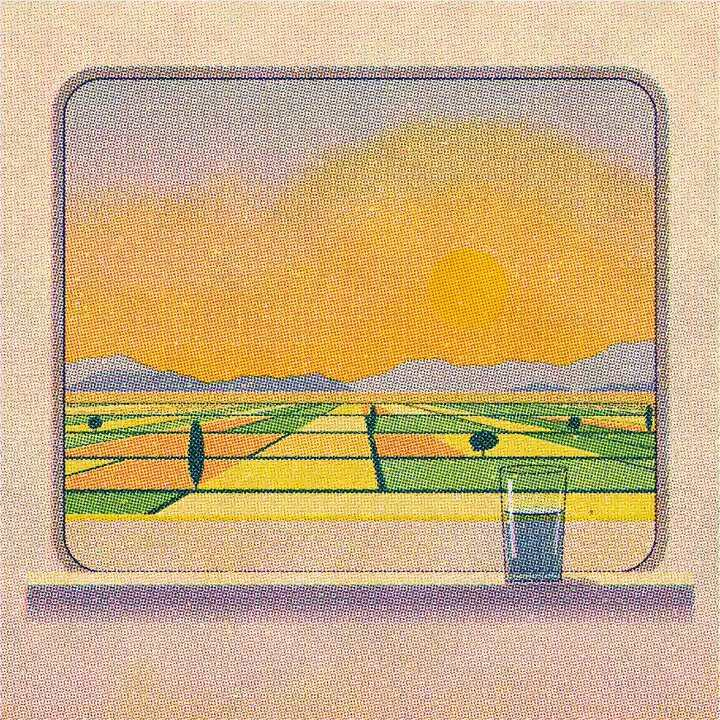</a></td>
<td width="50%" height="225" align="center" valign="middle"><a href="https://guanmo-ai.github.io/awesome-ai-motion/#case-2102531681450119426">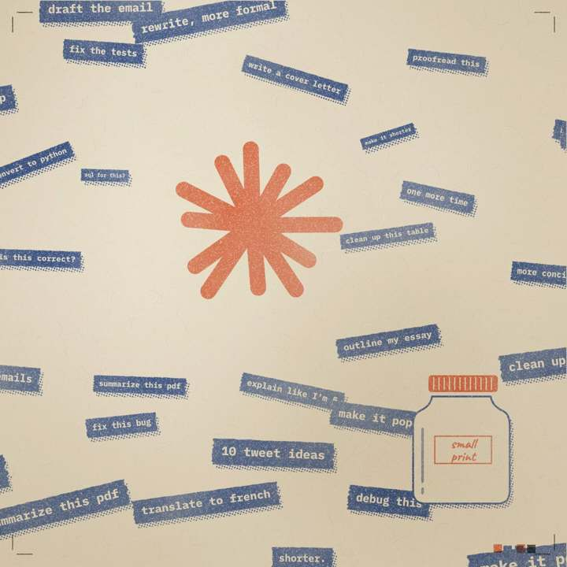</a></td>
</tr>
<tr>
<td width="50%" valign="top"><strong>单页生成的七十八秒动画</strong> <a href="https://x.com/jurlycat">@jurlycat</a> · 叙事短片 1:18 · 收藏 812 · 资料待完善 <a href="https://guanmo-ai.github.io/awesome-ai-motion/#case-2102645793828036643">▶ 播放</a> · <a href="https://x.com/jurlycat/status/2102645793828036643">原帖</a></td>
<td width="50%" valign="top"><strong>Small Print 文字故事动画</strong> <a href="https://x.com/Voxyz_ai">@Voxyz_ai</a> · 叙事短片 0:29 · 收藏 796 · 资料待完善 <a href="https://guanmo-ai.github.io/awesome-ai-motion/#case-2102531681450119426">▶ 播放</a> · <a href="https://x.com/Voxyz_ai/status/2102531681450119426">原帖</a></td>
</tr>
</tbody>
<tbody>
<tr>
<td width="50%" height="225" align="center" valign="middle"><a href="https://guanmo-ai.github.io/awesome-ai-motion/#case-2106236856979607569">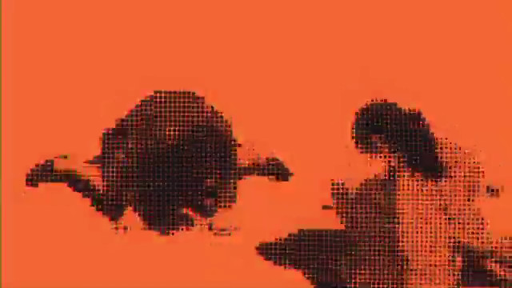</a></td>
<td width="50%" height="225" align="center" valign="middle"></td>
</tr>
<tr>
<td width="50%" valign="top"><strong>Dot Battle：格斗画面的粒子重建</strong> <a href="https://x.com/aicreataro">@aicreataro</a> · 叙事短片 0:20 · 收藏 789 · 资料待完善 <a href="https://guanmo-ai.github.io/awesome-ai-motion/#case-2106236856979607569">▶ 播放</a> · <a href="https://x.com/aicreataro/status/2106236856979607569">原帖</a></td>
<td width="50%" valign="top"><strong>纸上的卡通小人站起来</strong> <a href="https://x.com/chetaslua">@chetaslua</a> · 叙事短片 0:22 · 收藏 784 · 资料待完善 <a href="https://guanmo-ai.github.io/awesome-ai-motion/#case-2109290983896818132">▶ 播放</a> · <a href="https://x.com/chetaslua/status/2109290983896818132">原帖</a></td>
</tr>
</tbody>
<tbody>
<tr>
<td width="50%" height="225" align="center" valign="middle"></td>
<td width="50%" height="225" align="center" valign="middle"><a href="https://guanmo-ai.github.io/awesome-ai-motion/#case-2102774951434695083">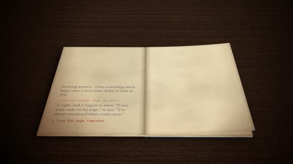</a></td>
</tr>
<tr>
<td width="50%" valign="top"><strong>Clawd 从终端走进草地</strong> <a href="https://x.com/LexnLin">@LexnLin</a> · 叙事短片 1:00 · 收藏 723 · 资料待完善 <a href="https://guanmo-ai.github.io/awesome-ai-motion/#case-2110389810258968965">▶ 播放</a> · <a href="https://x.com/LexnLin/status/2110389810258968965">原帖</a></td>
<td width="50%" valign="top"><strong>立体书里的冒险故事</strong> <a href="https://x.com/nickwalton00">@nickwalton00</a> · 叙事短片 1:03 · 收藏 642 · 资料待完善 <a href="https://guanmo-ai.github.io/awesome-ai-motion/#case-2102774951434695083">▶ 播放</a> · <a href="https://x.com/nickwalton00/status/2102774951434695083">原帖</a></td>
</tr>
</tbody>
<tbody>
<tr>
<td width="50%" height="225" align="center" valign="middle"></td>
<td width="50%" height="225" align="center" valign="middle"></td>
</tr>
<tr>
<td width="50%" valign="top"><strong>第一束火花：墨滴的旅程</strong> <a href="https://x.com/morpheusdv">@morpheusdv</a> · 叙事短片 1:00 · 收藏 603 · 资料待完善 <a href="https://guanmo-ai.github.io/awesome-ai-motion/#case-2102910531560731063">▶ 播放</a> · <a href="https://x.com/morpheusdv/status/2102910531560731063">原帖</a></td>
<td width="50%" valign="top"><strong>月夜海岸与灯塔的代码短片</strong> <a href="https://x.com/mattshumer_">@mattshumer_</a> · 叙事短片 3:13 · 收藏 598 · 资料待完善 <a href="https://guanmo-ai.github.io/awesome-ai-motion/#case-2103928105320763818">▶ 播放</a> · <a href="https://x.com/mattshumer_/status/2103928105320763818">原帖</a></td>
</tr>
</tbody>
<tbody>
<tr>
<td width="50%" height="225" align="center" valign="middle"><a href="https://guanmo-ai.github.io/awesome-ai-motion/#case-2110385144846840172">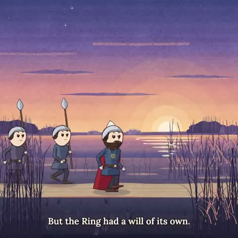</a></td>
<td width="50%" height="225" align="center" valign="middle"><a href="https://guanmo-ai.github.io/awesome-ai-motion/#case-2111816574780706975">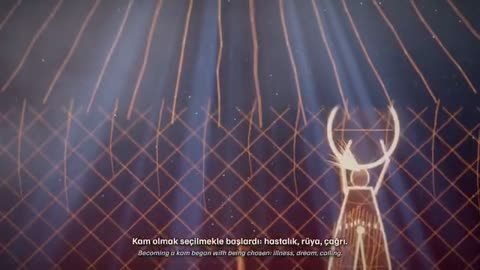</a></td>
</tr>
<tr>
<td width="50%" valign="top"><strong>魔戒的代码动画故事</strong> <a href="https://x.com/kevin_t_ngo">@kevin_t_ngo</a> · 叙事短片 2:16 · 收藏 586 · 资料待完善 <a href="https://guanmo-ai.github.io/awesome-ai-motion/#case-2110385144846840172">▶ 播放</a> · <a href="https://x.com/kevin_t_ngo/status/2110385144846840172">原帖</a></td>
<td width="50%" valign="top"><strong>鹿角、星空与古老罗盘</strong> <a href="https://x.com/sarpstar">@sarpstar</a> · 叙事短片 4:59 · 收藏 561 · 资料待完善 <a href="https://guanmo-ai.github.io/awesome-ai-motion/#case-2111816574780706975">▶ 播放</a> · <a href="https://x.com/sarpstar/status/2111816574780706975">原帖</a></td>
</tr>
</tbody>
<tbody>
<tr>
<td width="50%" height="225" align="center" valign="middle"><a href="https://guanmo-ai.github.io/awesome-ai-motion/#case-2110527353428509076">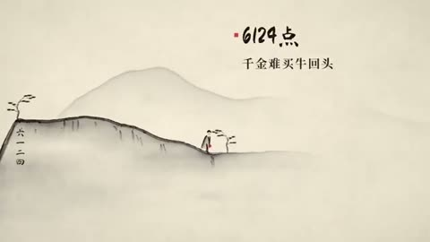</a></td>
<td width="50%" height="225" align="center" valign="middle"></td>
</tr>
<tr>
<td width="50%" valign="top"><strong>从 6124 到 1660：水墨股市寓言</strong> <a href="https://x.com/tuolaji2024">@tuolaji2024</a> · 叙事短片 1:21 · 收藏 550 · 资料待完善 <a href="https://guanmo-ai.github.io/awesome-ai-motion/#case-2110527353428509076">▶ 播放</a> · <a href="https://x.com/tuolaji2024/status/2110527353428509076">原帖</a></td>
<td width="50%" valign="top"><strong>夜间电话亭的立体文字故事</strong> <a href="https://x.com/aicreataro">@aicreataro</a> · 叙事短片 1:11 · 收藏 494 · 资料待完善 <a href="https://guanmo-ai.github.io/awesome-ai-motion/#case-2110689292737749146">▶ 播放</a> · <a href="https://x.com/aicreataro/status/2110689292737749146">原帖</a></td>
</tr>
</tbody>
<tbody>
<tr>
<td width="50%" height="225" align="center" valign="middle"><a href="https://guanmo-ai.github.io/awesome-ai-motion/#case-2102986085328716066">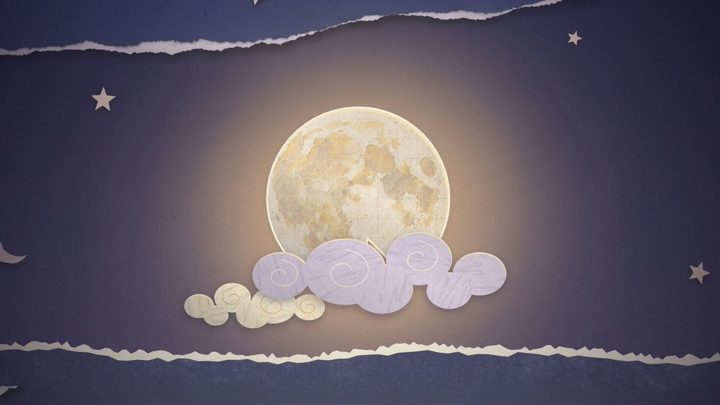</a></td>
<td width="50%" height="225" align="center" valign="middle"><a href="https://guanmo-ai.github.io/awesome-ai-motion/#case-2102478640428773861">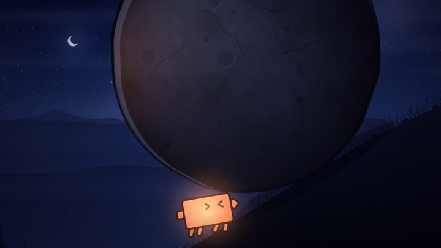</a></td>
</tr>
<tr>
<td width="50%" valign="top"><strong>中秋夜景的拼贴动画</strong> <a href="https://x.com/ring_hyacinth">@ring_hyacinth</a> · 叙事短片 0:40 · 收藏 492 · 资料待完善 <a href="https://guanmo-ai.github.io/awesome-ai-motion/#case-2102986085328716066">▶ 播放</a> · <a href="https://x.com/ring_hyacinth/status/2102986085328716066">原帖</a></td>
<td width="50%" valign="top"><strong>用代码想象难题求解</strong> <a href="https://x.com/chetaslua">@chetaslua</a> · 叙事短片 0:30 · 收藏 393 · 资料待完善 <a href="https://guanmo-ai.github.io/awesome-ai-motion/#case-2102478640428773861">▶ 播放</a> · <a href="https://x.com/chetaslua/status/2102478640428773861">原帖</a></td>
</tr>
</tbody>
<tbody>
<tr>
<td width="50%" height="225" align="center" valign="middle"><a href="https://guanmo-ai.github.io/awesome-ai-motion/#case-2103523994440012086">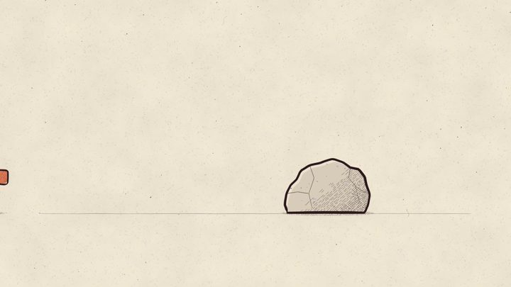</a></td>
<td width="50%" height="225" align="center" valign="middle"></td>
</tr>
<tr>
<td width="50%" valign="top"><strong>从岩石到 AI 的短片</strong> <a href="https://x.com/devteamdrew">@devteamdrew</a> · 叙事短片 3:00 · 收藏 381 · 资料待完善 <a href="https://guanmo-ai.github.io/awesome-ai-motion/#case-2103523994440012086">▶ 播放</a> · <a href="https://x.com/devteamdrew/status/2103523994440012086">原帖</a></td>
<td width="50%" valign="top"><strong>蓝色水面与文字的诗意短片</strong> <a href="https://x.com/sarpstar">@sarpstar</a> · 叙事短片 0:35 · 收藏 375 · 资料待完善 <a href="https://guanmo-ai.github.io/awesome-ai-motion/#case-2110741762159288825">▶ 播放</a> · <a href="https://x.com/sarpstar/status/2110741762159288825">原帖</a></td>
</tr>
</tbody>
<tbody>
<tr>
<td width="50%" height="225" align="center" valign="middle"><a href="https://guanmo-ai.github.io/awesome-ai-motion/#case-2103457566978162901">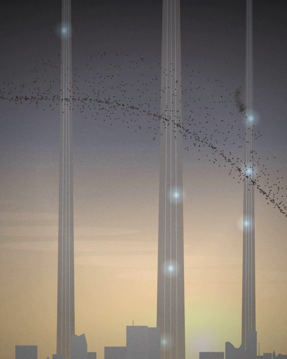</a></td>
<td width="50%" height="225" align="center" valign="middle"></td>
</tr>
<tr>
<td width="50%" valign="top"><strong>无人世界的未来寓言</strong> <a href="https://x.com/Hesamation">@Hesamation</a> · 叙事短片 1:28 · 收藏 355 · 资料待完善 <a href="https://guanmo-ai.github.io/awesome-ai-motion/#case-2103457566978162901">▶ 播放</a> · <a href="https://x.com/Hesamation/status/2103457566978162901">原帖</a></td>
<td width="50%" valign="top"><strong>十幅代码中国山水</strong> <a href="https://x.com/LexnLin">@LexnLin</a> · 叙事短片 1:00 · 收藏 323 · 资料待完善 <a href="https://guanmo-ai.github.io/awesome-ai-motion/#case-2112264777309491443">▶ 播放</a> · <a href="https://x.com/LexnLin/status/2112264777309491443">原帖</a></td>
</tr>
</tbody>
<tbody>
<tr>
<td width="50%" height="225" align="center" valign="middle"><a href="https://guanmo-ai.github.io/awesome-ai-motion/#case-2110975805899825394">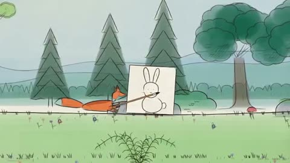</a></td>
<td width="50%" height="225" align="center" valign="middle"><a href="https://guanmo-ai.github.io/awesome-ai-motion/#case-2104186357824487573">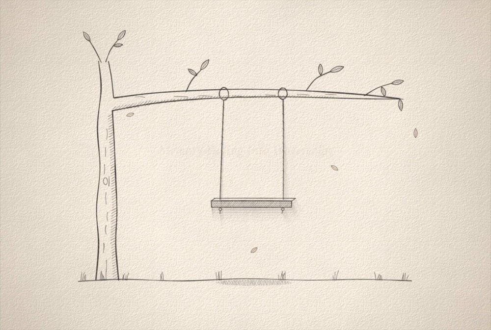</a></td>
</tr>
<tr>
<td width="50%" valign="top"><strong>会画画的水彩故事书：扩展篇</strong> <a href="https://x.com/HaileyAILabs">@HaileyAILabs</a> · 叙事短片 3:47 · 收藏 289 · 资料待完善 <a href="https://guanmo-ai.github.io/awesome-ai-motion/#case-2110975805899825394">▶ 播放</a> · <a href="https://x.com/HaileyAILabs/status/2110975805899825394">原帖</a></td>
<td width="50%" valign="top"><strong>记忆褪成水彩：代码绘制的短片</strong> <a href="https://x.com/techartist_">@techartist_</a> · 叙事短片 0:12 · 收藏 260 · 资料待完善 <a href="https://guanmo-ai.github.io/awesome-ai-motion/#case-2104186357824487573">▶ 播放</a> · <a href="https://x.com/techartist_/status/2104186357824487573">原帖</a></td>
</tr>
</tbody>
<tbody>
<tr>
<td width="50%" height="225" align="center" valign="middle"></td>
<td width="50%" height="225" align="center" valign="middle"></td>
</tr>
<tr>
<td width="50%" valign="top"><strong>Clawd 为 Token 去讨糖</strong> <a href="https://x.com/alexgreensh">@alexgreensh</a> · 叙事短片 1:12 · 收藏 208 · 资料待完善 <a href="https://guanmo-ai.github.io/awesome-ai-motion/#case-2110404428691808308">▶ 播放</a> · <a href="https://x.com/alexgreensh/status/2110404428691808308">原帖</a></td>
<td width="50%" valign="top"><strong>黑色机器人的工厂短片</strong> <a href="https://x.com/matabee_GTO">@matabee_GTO</a> · 叙事短片 0:36 · 收藏 205 · 资料待完善 <a href="https://guanmo-ai.github.io/awesome-ai-motion/#case-2112359668379234684">▶ 播放</a> · <a href="https://x.com/matabee_GTO/status/2112359668379234684">原帖</a></td>
</tr>
</tbody>
<tbody>
<tr>
<td width="50%" height="225" align="center" valign="middle"><a href="https://guanmo-ai.github.io/awesome-ai-motion/#case-2112125144508277165">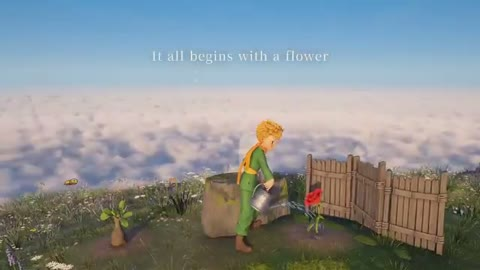</a></td>
<td width="50%" height="225" align="center" valign="middle"><a href="https://guanmo-ai.github.io/awesome-ai-motion/#case-2109108146438275128">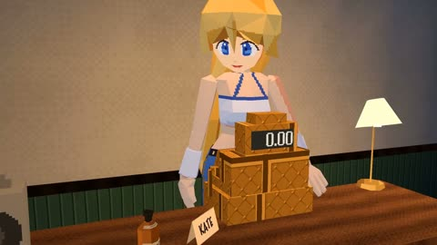</a></td>
</tr>
<tr>
<td width="50%" valign="top"><strong>小王子的立体星球旅程</strong> <a href="https://x.com/rewind02">@rewind02</a> · 叙事短片 0:51 · 收藏 187 · 资料待完善 <a href="https://guanmo-ai.github.io/awesome-ai-motion/#case-2112125144508277165">▶ 播放</a> · <a href="https://x.com/rewind02/status/2112125144508277165">原帖</a></td>
<td width="50%" valign="top"><strong>低多边形小剧场</strong> <a href="https://x.com/fishesareweird">@fishesareweird</a> · 叙事短片 0:06 · 收藏 186 · 资料待完善 <a href="https://guanmo-ai.github.io/awesome-ai-motion/#case-2109108146438275128">▶ 播放</a> · <a href="https://x.com/fishesareweird/status/2109108146438275128">原帖</a></td>
</tr>
</tbody>
<tbody>
<tr>
<td width="50%" height="225" align="center" valign="middle"><a href="https://guanmo-ai.github.io/awesome-ai-motion/#case-2104021881229869394">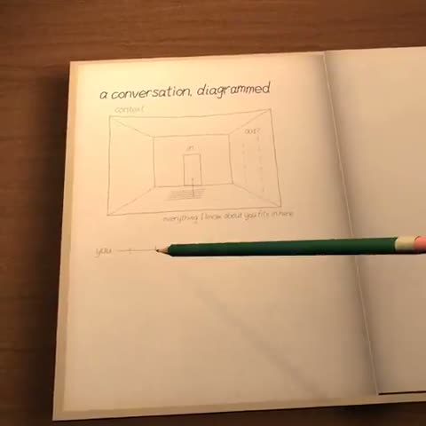</a></td>
<td width="50%" height="225" align="center" valign="middle"></td>
</tr>
<tr>
<td width="50%" valign="top"><strong>Opus 的二十页动态速写本</strong> <a href="https://x.com/kloss_xyz">@kloss_xyz</a> · 叙事短片 2:38 · 收藏 169 · 资料待完善 <a href="https://guanmo-ai.github.io/awesome-ai-motion/#case-2104021881229869394">▶ 播放</a> · <a href="https://x.com/kloss_xyz/status/2104021881229869394">原帖</a></td>
<td width="50%" valign="top"><strong>翻开一本立体旅行书</strong> <a href="https://x.com/devteamdrew">@devteamdrew</a> · 叙事短片 1:05 · 收藏 146 · 资料待完善 <a href="https://guanmo-ai.github.io/awesome-ai-motion/#case-2110156508097110075">▶ 播放</a> · <a href="https://x.com/devteamdrew/status/2110156508097110075">原帖</a></td>
</tr>
</tbody>
<tbody>
<tr>
<td width="50%" height="225" align="center" valign="middle"><a href="https://guanmo-ai.github.io/awesome-ai-motion/#case-2103207512841605364">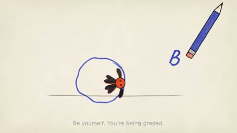</a></td>
<td width="50%" height="225" align="center" valign="middle"></td>
</tr>
<tr>
<td width="50%" valign="top"><strong>我不知道自己是否还好</strong> <a href="https://x.com/AndrewOnXYZ">@AndrewOnXYZ</a> · 叙事短片 3:54 · 收藏 144 · 资料待完善 <a href="https://guanmo-ai.github.io/awesome-ai-motion/#case-2103207512841605364">▶ 播放</a> · <a href="https://x.com/AndrewOnXYZ/status/2103207512841605364">原帖</a></td>
<td width="50%" valign="top"><strong>指环王开场的卡通重绘</strong> <a href="https://x.com/devteamdrew">@devteamdrew</a> · 叙事短片 1:33 · 收藏 143 · 资料待完善 <a href="https://guanmo-ai.github.io/awesome-ai-motion/#case-2110433119731945964">▶ 播放</a> · <a href="https://x.com/devteamdrew/status/2110433119731945964">原帖</a></td>
</tr>
</tbody>
<tbody>
<tr>
<td width="50%" height="225" align="center" valign="middle"></td>
<td width="50%" height="225" align="center" valign="middle"><a href="https://guanmo-ai.github.io/awesome-ai-motion/#case-2107572909086761325">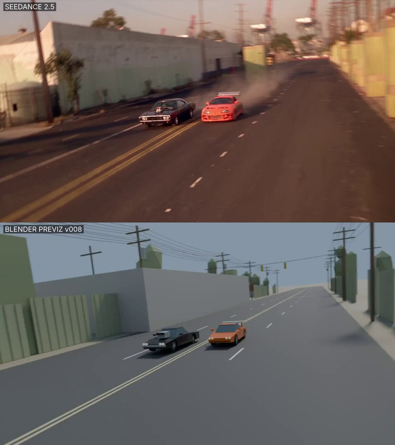</a></td>
</tr>
<tr>
<td width="50%" valign="top"><strong>火柴人闯迷宫动画</strong> <a href="https://x.com/ForwardEditor">@ForwardEditor</a> · 叙事短片 1:47 · 收藏 142 · 资料待完善 <a href="https://guanmo-ai.github.io/awesome-ai-motion/#case-2102558320695402885">▶ 播放</a> · <a href="https://x.com/ForwardEditor/status/2102558320695402885">原帖</a></td>
<td width="50%" valign="top"><strong>用 3D 预演重建追车场景</strong> <a href="https://x.com/Ror_Fly">@Ror_Fly</a> · 叙事短片 0:25 · 收藏 128 · 资料待完善 <a href="https://guanmo-ai.github.io/awesome-ai-motion/#case-2107572909086761325">▶ 播放</a> · <a href="https://x.com/Ror_Fly/status/2107572909086761325">原帖</a></td>
</tr>
</tbody>
<tbody>
<tr>
<td width="50%" height="225" align="center" valign="middle"><a href="https://guanmo-ai.github.io/awesome-ai-motion/#case-2103465246014746943">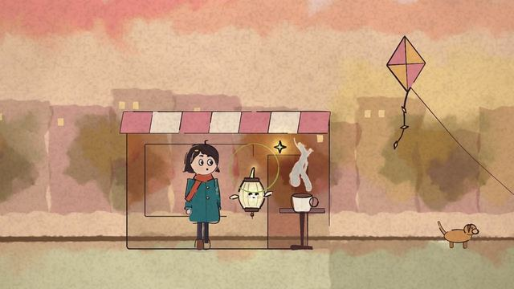</a></td>
<td width="50%" height="225" align="center" valign="middle"><a href="https://guanmo-ai.github.io/awesome-ai-motion/#case-2104392800892764552">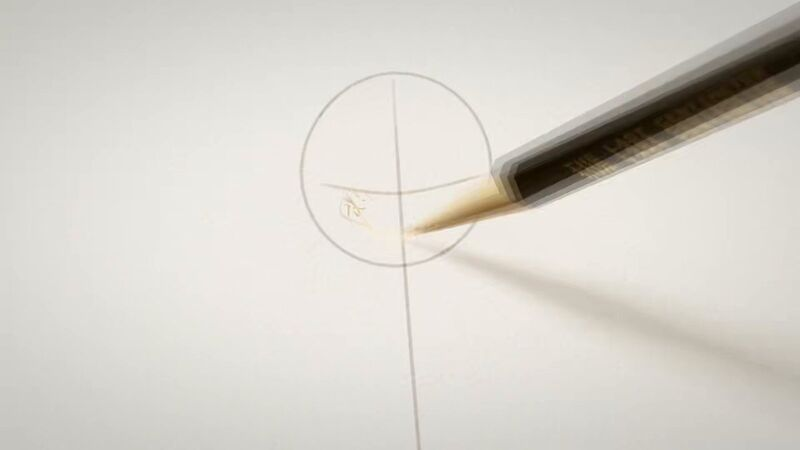</a></td>
</tr>
<tr>
<td width="50%" valign="top"><strong>手绘水彩感短片</strong> <a href="https://x.com/mablesjoseph">@mablesjoseph</a> · 叙事短片 0:46 · 收藏 127 · 资料待完善 <a href="https://guanmo-ai.github.io/awesome-ai-motion/#case-2103465246014746943">▶ 播放</a> · <a href="https://x.com/mablesjoseph/status/2103465246014746943">原帖</a></td>
<td width="50%" valign="top"><strong>Andy 的 Opus 单句动画实验</strong> <a href="https://x.com/AndyL5cc">@AndyL5cc</a> · 叙事短片 1:12 · 收藏 125 · 资料待完善 <a href="https://guanmo-ai.github.io/awesome-ai-motion/#case-2104392800892764552">▶ 播放</a> · <a href="https://x.com/AndyL5cc/status/2104392800892764552">原帖</a></td>
</tr>
</tbody>
<tbody>
<tr>
<td width="50%" height="225" align="center" valign="middle"><a href="https://guanmo-ai.github.io/awesome-ai-motion/#case-2103997282270248974">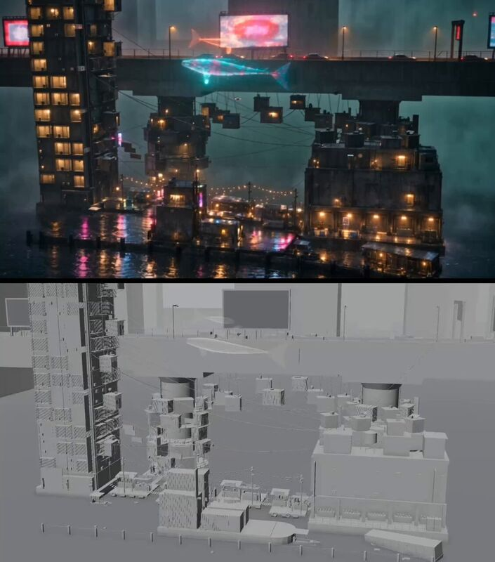</a></td>
<td width="50%" height="225" align="center" valign="middle"></td>
</tr>
<tr>
<td width="50%" valign="top"><strong>第七区下层：三维城市预演转视频</strong> <a href="https://x.com/akakuma0219">@akakuma0219</a> · 叙事短片 0:20 · 收藏 122 · 资料待完善 <a href="https://guanmo-ai.github.io/awesome-ai-motion/#case-2103997282270248974">▶ 播放</a> · <a href="https://x.com/akakuma0219/status/2103997282270248974">原帖</a></td>
<td width="50%" valign="top"><strong>小蝌蚪找妈妈水墨短片</strong> <a href="https://x.com/akokoi1">@akokoi1</a> · 叙事短片 3:55 · 收藏 113 · 资料待完善 <a href="https://guanmo-ai.github.io/awesome-ai-motion/#case-2102699703309898026">▶ 播放</a> · <a href="https://x.com/akokoi1/status/2102699703309898026">原帖</a></td>
</tr>
</tbody>
<tbody>
<tr>
<td width="50%" height="225" align="center" valign="middle"></td>
<td width="50%" height="225" align="center" valign="middle"></td>
</tr>
<tr>
<td width="50%" valign="top"><strong>星星与猫的程序化动画</strong> <a href="https://x.com/onofumi_AI">@onofumi_AI</a> · 叙事短片 0:17 · 收藏 95 · 资料待完善 <a href="https://guanmo-ai.github.io/awesome-ai-motion/#case-2102535945333657960">▶ 播放</a> · <a href="https://x.com/onofumi_AI/status/2102535945333657960">原帖</a></td>
<td width="50%" valign="top"><strong>纸飞机穿过彩色纸艺世界</strong> <a href="https://x.com/LexnLin">@LexnLin</a> · 叙事短片 0:30 · 收藏 94 · 资料待完善 <a href="https://guanmo-ai.github.io/awesome-ai-motion/#case-2108567673890111948">▶ 播放</a> · <a href="https://x.com/LexnLin/status/2108567673890111948">原帖</a></td>
</tr>
</tbody>
<tbody>
<tr>
<td width="50%" height="225" align="center" valign="middle"><a href="https://guanmo-ai.github.io/awesome-ai-motion/#case-2103677413913976912">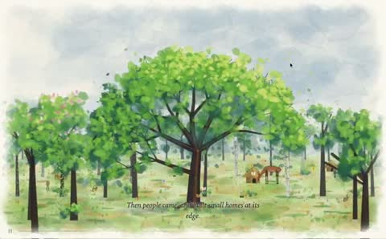</a></td>
<td width="50%" height="225" align="center" valign="middle"><a href="https://guanmo-ai.github.io/awesome-ai-motion/#case-2109856686588801285">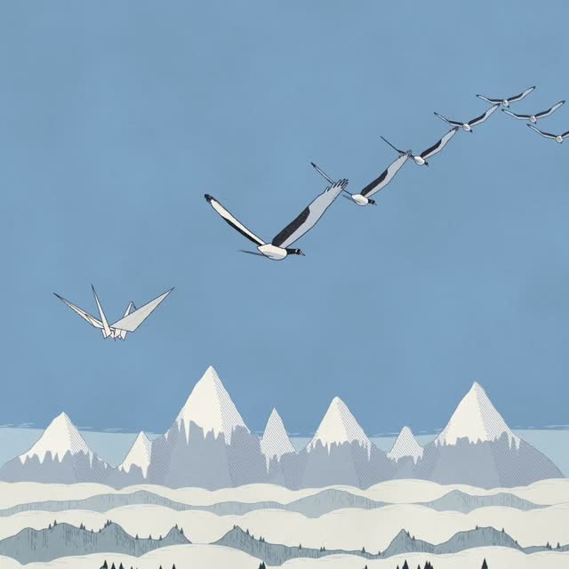</a></td>
</tr>
<tr>
<td width="50%" valign="top"><strong>一棵树经历的季节故事</strong> <a href="https://x.com/thebuggeddev">@thebuggeddev</a> · 叙事短片 1:44 · 收藏 94 · 资料待完善 <a href="https://guanmo-ai.github.io/awesome-ai-motion/#case-2103677413913976912">▶ 播放</a> · <a href="https://x.com/thebuggeddev/status/2103677413913976912">原帖</a></td>
<td width="50%" valign="top"><strong>纸鹤的一场旅行</strong> <a href="https://x.com/kevin_t_ngo">@kevin_t_ngo</a> · 叙事短片 1:09 · 收藏 93 · 资料待完善 <a href="https://guanmo-ai.github.io/awesome-ai-motion/#case-2109856686588801285">▶ 播放</a> · <a href="https://x.com/kevin_t_ngo/status/2109856686588801285">原帖</a></td>
</tr>
</tbody>
<tbody>
<tr>
<td width="50%" height="225" align="center" valign="middle"><a href="https://guanmo-ai.github.io/awesome-ai-motion/#case-2107532974254403612">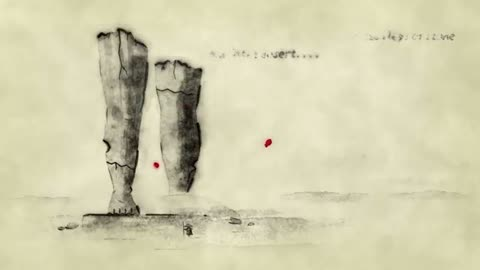</a></td>
<td width="50%" height="225" align="center" valign="middle"></td>
</tr>
<tr>
<td width="50%" valign="top"><strong>Ozymandias：诗句中的残像</strong> <a href="https://x.com/devteamdrew">@devteamdrew</a> · 叙事短片 1:47 · 收藏 93 · 资料待完善 <a href="https://guanmo-ai.github.io/awesome-ai-motion/#case-2107532974254403612">▶ 播放</a> · <a href="https://x.com/devteamdrew/status/2107532974254403612">原帖</a></td>
<td width="50%" valign="top"><strong>上海夜景中秋剪纸动画</strong> <a href="https://x.com/NFT_Chen">@NFT_Chen</a> · 叙事短片 0:39 · 收藏 83 · 资料待完善 <a href="https://guanmo-ai.github.io/awesome-ai-motion/#case-2103380404791333144">▶ 播放</a> · <a href="https://x.com/NFT_Chen/status/2103380404791333144">原帖</a></td>
</tr>
</tbody>
<tbody>
<tr>
<td width="50%" height="225" align="center" valign="middle"><a href="https://guanmo-ai.github.io/awesome-ai-motion/#case-2112231979164873157">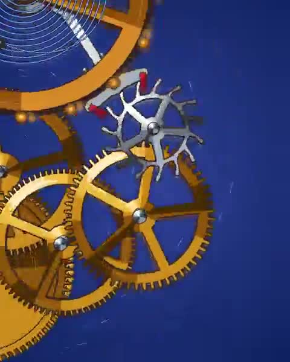</a></td>
<td width="50%" height="225" align="center" valign="middle"><a href="https://guanmo-ai.github.io/awesome-ai-motion/#case-2102726428991373480">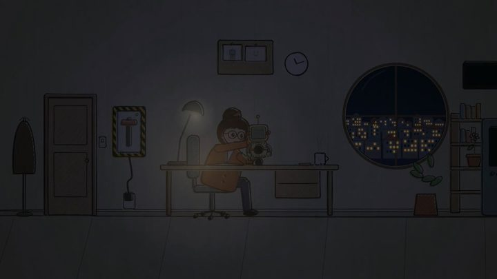</a></td>
</tr>
<tr>
<td width="50%" valign="top"><strong>与 Claude 在工坊的一天</strong> <a href="https://x.com/devteamdrew">@devteamdrew</a> · 叙事短片 0:32 · 收藏 80 · 资料待完善 <a href="https://guanmo-ai.github.io/awesome-ai-motion/#case-2112231979164873157">▶ 播放</a> · <a href="https://x.com/devteamdrew/status/2112231979164873157">原帖</a></td>
<td width="50%" valign="top"><strong>机器人短篇动画</strong> <a href="https://x.com/ctgptlb">@ctgptlb</a> · 叙事短片 1:04 · 收藏 78 · 资料待完善 <a href="https://guanmo-ai.github.io/awesome-ai-motion/#case-2102726428991373480">▶ 播放</a> · <a href="https://x.com/ctgptlb/status/2102726428991373480">原帖</a></td>
</tr>
</tbody>
<tbody>
<tr>
<td width="50%" height="225" align="center" valign="middle"><a href="https://guanmo-ai.github.io/awesome-ai-motion/#case-2109630088782463077">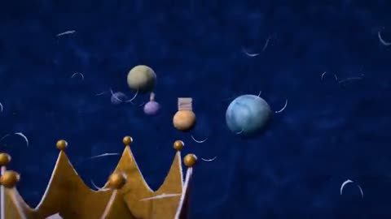</a></td>
<td width="50%" height="225" align="center" valign="middle"><a href="https://guanmo-ai.github.io/awesome-ai-motion/#case-2106190496075035096">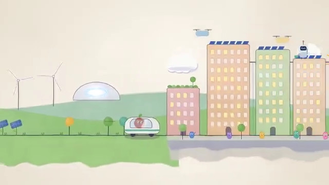</a></td>
</tr>
<tr>
<td width="50%" valign="top"><strong>小王子的三维预告片</strong> <a href="https://x.com/Saccc_c">@Saccc_c</a> · 叙事短片 0:33 · 收藏 76 · 资料待完善 <a href="https://guanmo-ai.github.io/awesome-ai-motion/#case-2109630088782463077">▶ 播放</a> · <a href="https://x.com/Saccc_c/status/2109630088782463077">原帖</a></td>
<td width="50%" valign="top"><strong>2076：未来世界的 25 秒想象</strong> <a href="https://x.com/Layton_Gott">@Layton_Gott</a> · 叙事短片 0:26 · 收藏 74 · 资料待完善 <a href="https://guanmo-ai.github.io/awesome-ai-motion/#case-2106190496075035096">▶ 播放</a> · <a href="https://x.com/Layton_Gott/status/2106190496075035096">原帖</a></td>
</tr>
</tbody>
<tbody>
<tr>
<td width="50%" height="225" align="center" valign="middle"></td>
<td width="50%" height="225" align="center" valign="middle"></td>
</tr>
<tr>
<td width="50%" valign="top"><strong>愚公移山的代码动画</strong> <a href="https://x.com/nicekate8888">@nicekate8888</a> · 叙事短片 2:00 · 收藏 70 · 资料待完善 <a href="https://guanmo-ai.github.io/awesome-ai-motion/#case-2108223333431193770">▶ 播放</a> · <a href="https://x.com/nicekate8888/status/2108223333431193770">原帖</a></td>
<td width="50%" valign="top"><strong>丛林昼夜插画动画</strong> <a href="https://x.com/untitled_sys">@untitled_sys</a> · 叙事短片 0:20 · 收藏 64 · 资料待完善 <a href="https://guanmo-ai.github.io/awesome-ai-motion/#case-2110208232392454500">▶ 播放</a> · <a href="https://x.com/untitled_sys/status/2110208232392454500">原帖</a></td>
</tr>
</tbody>
<tbody>
<tr>
<td width="50%" height="225" align="center" valign="middle"><a href="https://guanmo-ai.github.io/awesome-ai-motion/#case-2102574688769650976">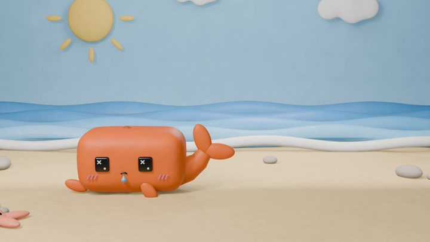</a></td>
<td width="50%" height="225" align="center" valign="middle"><a href="https://guanmo-ai.github.io/awesome-ai-motion/#case-2103475507471806929">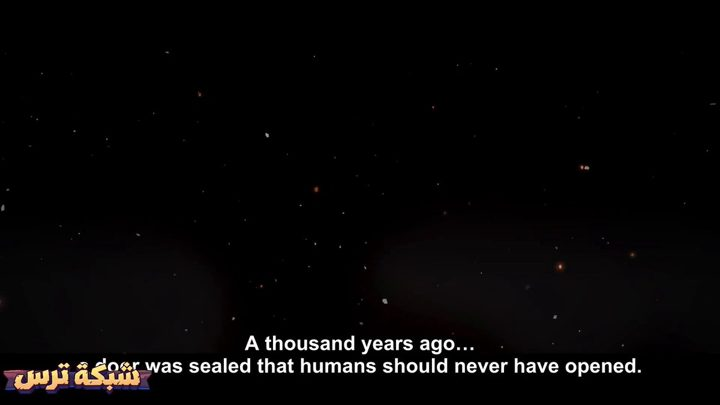</a></td>
</tr>
<tr>
<td width="50%" valign="top"><strong>小芽苗的黏土动画</strong> <a href="https://x.com/cherry_mx_reds">@cherry_mx_reds</a> · 叙事短片 0:30 · 收藏 63 · 资料待完善 <a href="https://guanmo-ai.github.io/awesome-ai-motion/#case-2102574688769650976">▶ 播放</a> · <a href="https://x.com/cherry_mx_reds/status/2102574688769650976">原帖</a></td>
<td width="50%" valign="top"><strong>阿拉伯语配音动漫试播片</strong> <a href="https://x.com/sbalhatlani">@sbalhatlani</a> · 叙事短片 8:33 · 收藏 63 · 资料待完善 <a href="https://guanmo-ai.github.io/awesome-ai-motion/#case-2103475507471806929">▶ 播放</a> · <a href="https://x.com/sbalhatlani/status/2103475507471806929">原帖</a></td>
</tr>
</tbody>
<tbody>
<tr>
<td width="50%" height="225" align="center" valign="middle"><a href="https://guanmo-ai.github.io/awesome-ai-motion/#case-2106696030716575841">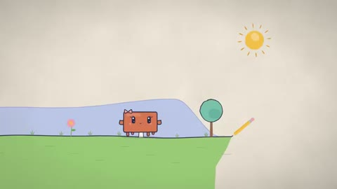</a></td>
<td width="50%" height="225" align="center" valign="middle"><a href="https://guanmo-ai.github.io/awesome-ai-motion/#case-2104457537680458228">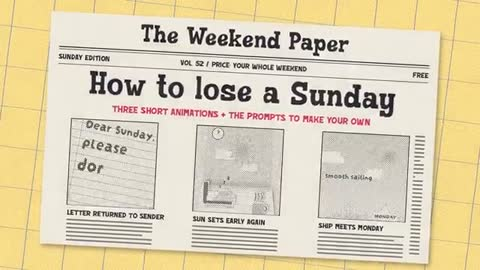</a></td>
</tr>
<tr>
<td width="50%" valign="top"><strong>小角色冲向夜空的矢量动画</strong> <a href="https://x.com/AYi_AInotes">@AYi_AInotes</a> · 叙事短片 0:30 · 收藏 61 · 资料待完善 <a href="https://guanmo-ai.github.io/awesome-ai-motion/#case-2106696030716575841">▶ 播放</a> · <a href="https://x.com/AYi_AInotes/status/2106696030716575841">原帖</a></td>
<td width="50%" valign="top"><strong>如何失去星期日：三种风格实验</strong> <a href="https://x.com/AleRVG">@AleRVG</a> · 叙事短片 0:10 · 收藏 43 · 资料待完善 <a href="https://guanmo-ai.github.io/awesome-ai-motion/#case-2104457537680458228">▶ 播放</a> · <a href="https://x.com/AleRVG/status/2104457537680458228">原帖</a></td>
</tr>
</tbody>
<tbody>
<tr>
<td width="50%" height="225" align="center" valign="middle"><a href="https://guanmo-ai.github.io/awesome-ai-motion/#case-2106204481642021333">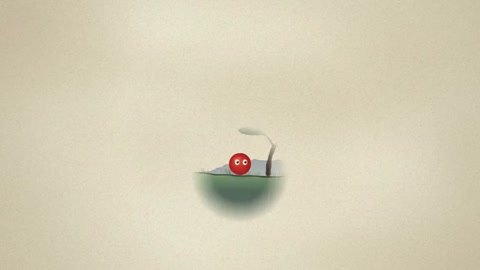</a></td>
<td width="50%" height="225" align="center" valign="middle"><a href="https://guanmo-ai.github.io/awesome-ai-motion/#case-2109551566319427805">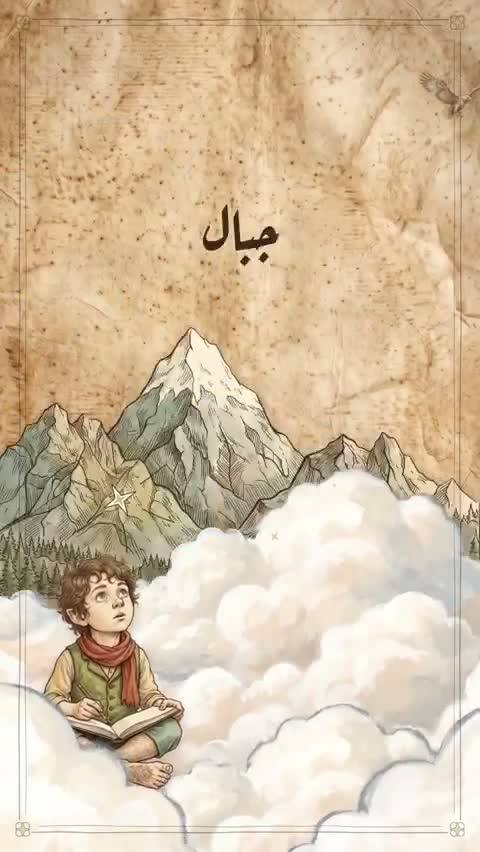</a></td>
</tr>
<tr>
<td width="50%" valign="top"><strong>早发白帝城：纸上山水</strong> <a href="https://x.com/bangbuilds">@bangbuilds</a> · 叙事短片 0:26 · 收藏 40 · 资料待完善 <a href="https://guanmo-ai.github.io/awesome-ai-motion/#case-2106204481642021333">▶ 播放</a> · <a href="https://x.com/bangbuilds/status/2106204481642021333">原帖</a></td>
<td width="50%" valign="top"><strong>创意先于工具</strong> <a href="https://x.com/ai4everyday">@ai4everyday</a> · 叙事短片 1:13 · 收藏 39 · 资料待完善 <a href="https://guanmo-ai.github.io/awesome-ai-motion/#case-2109551566319427805">▶ 播放</a> · <a href="https://x.com/ai4everyday/status/2109551566319427805">原帖</a></td>
</tr>
</tbody>
<tbody>
<tr>
<td width="50%" height="225" align="center" valign="middle"><a href="https://guanmo-ai.github.io/awesome-ai-motion/#case-2103976291699728742">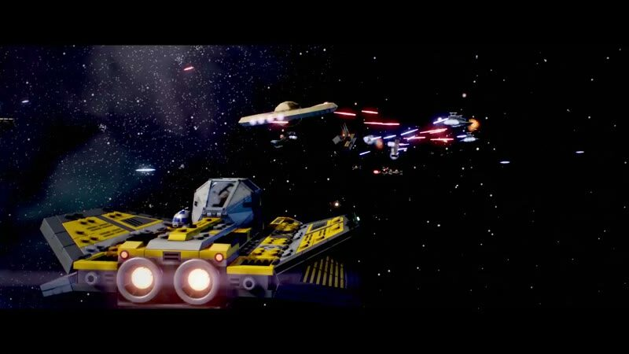</a></td>
<td width="50%" height="225" align="center" valign="middle"></td>
</tr>
<tr>
<td width="50%" valign="top"><strong>LEGO 风格《西斯的复仇》开场复刻</strong> <a href="https://x.com/ChrisGPT">@ChrisGPT</a> · 叙事短片 1:37 · 收藏 33 · 资料待完善 <a href="https://guanmo-ai.github.io/awesome-ai-motion/#case-2103976291699728742">▶ 播放</a> · <a href="https://x.com/ChrisGPT/status/2103976291699728742">原帖</a></td>
<td width="50%" valign="top"><strong>ASCII 字符组成的动画短片</strong> <a href="https://x.com/TypingMindApp">@TypingMindApp</a> · 叙事短片 0:59 · 收藏 32 · 资料待完善 <a href="https://guanmo-ai.github.io/awesome-ai-motion/#case-2102684514200015242">▶ 播放</a> · <a href="https://x.com/TypingMindApp/status/2102684514200015242">原帖</a></td>
</tr>
</tbody>
<tbody>
<tr>
<td width="50%" height="225" align="center" valign="middle"></td>
<td width="50%" height="225" align="center" valign="middle"></td>
</tr>
<tr>
<td width="50%" valign="top"><strong>儿童角色动画短片</strong> <a href="https://x.com/jackfriks">@jackfriks</a> · 叙事短片 0:35 · 收藏 30 · 资料待完善 <a href="https://guanmo-ai.github.io/awesome-ai-motion/#case-2103525576912855363">▶ 播放</a> · <a href="https://x.com/jackfriks/status/2103525576912855363">原帖</a></td>
<td width="50%" valign="top"><strong>人类：从古代到当代的代码动画</strong> <a href="https://x.com/blueemi99">@blueemi99</a> · 叙事短片 2:00 · 收藏 28 · 资料待完善 <a href="https://guanmo-ai.github.io/awesome-ai-motion/#case-2106041578204655748">▶ 播放</a> · <a href="https://x.com/blueemi99/status/2106041578204655748">原帖</a></td>
</tr>
</tbody>
<tbody>
<tr>
<td width="50%" height="225" align="center" valign="middle"></td>
<td width="50%" height="225" align="center" valign="middle"></td>
</tr>
<tr>
<td width="50%" valign="top"><strong>Gus &amp; Spark：飞行汽车篇</strong> <a href="https://x.com/ziwenxu_">@ziwenxu_</a> · 叙事短片 25:48 · 收藏 19 · 资料待完善 <a href="https://guanmo-ai.github.io/awesome-ai-motion/#case-2111563277079912473">▶ 播放</a> · <a href="https://x.com/ziwenxu_/status/2111563277079912473">原帖</a></td>
<td width="50%" valign="top"><strong>清明上河图风格的动态长卷</strong> <a href="https://x.com/HaileyAILabs">@HaileyAILabs</a> · 叙事短片 0:55 · 收藏 19 · 资料待完善 <a href="https://guanmo-ai.github.io/awesome-ai-motion/#case-2110336058579992916">▶ 播放</a> · <a href="https://x.com/HaileyAILabs/status/2110336058579992916">原帖</a></td>
</tr>
</tbody>
<tbody>
<tr>
<td width="50%" height="225" align="center" valign="middle"></td>
<td width="50%" height="225" align="center" valign="middle"></td>
</tr>
<tr>
<td width="50%" valign="top"><strong>女娲补天：四章动态绘本</strong> <a href="https://x.com/HaileyAILabs">@HaileyAILabs</a> · 叙事短片 5:07 · 收藏 18 · 资料待完善 <a href="https://guanmo-ai.github.io/awesome-ai-motion/#case-2111654722960834719">▶ 播放</a> · <a href="https://x.com/HaileyAILabs/status/2111654722960834719">原帖</a></td>
<td width="50%" valign="top"><strong>Yearning：窗边的早期三维试片</strong> <a href="https://x.com/xikhar">@xikhar</a> · 叙事短片 0:30 · 收藏 14 · 资料待完善 <a href="https://guanmo-ai.github.io/awesome-ai-motion/#case-2107918993093005610">▶ 播放</a> · <a href="https://x.com/xikhar/status/2107918993093005610">原帖</a></td>
</tr>
</tbody>
<tbody>
<tr>
<td width="50%" height="225" align="center" valign="middle"></td>
<td width="50%" height="225" align="center" valign="middle"></td>
</tr>
<tr>
<td width="50%" valign="top"><strong>三角形小主角的大冒险</strong> <a href="https://x.com/aicreataro">@aicreataro</a> · 叙事短片 0:30 · 收藏 14 · 资料待完善 <a href="https://guanmo-ai.github.io/awesome-ai-motion/#case-2110864323509923917">▶ 播放</a> · <a href="https://x.com/aicreataro/status/2110864323509923917">原帖</a></td>
<td width="50%" valign="top"><strong>黄色方块主角的个人经历动画</strong> <a href="https://x.com/servasyy">@servasyy</a> · 叙事短片 1:20 · 收藏 14 · 资料待完善 <a href="https://guanmo-ai.github.io/awesome-ai-motion/#case-2104039075175182487">▶ 播放</a> · <a href="https://x.com/servasyy/status/2104039075175182487">原帖</a></td>
</tr>
</tbody>
<tbody>
<tr>
<td width="50%" height="225" align="center" valign="middle"></td>
<td width="50%" height="225" align="center" valign="middle"></td>
</tr>
<tr>
<td width="50%" valign="top"><strong>Minecraft 预告片的双模型对照</strong> <a href="https://x.com/ITangieff">@ITangieff</a> · 叙事短片 0:30 · 收藏 13 · 资料待完善 <a href="https://guanmo-ai.github.io/awesome-ai-motion/#case-2107868519065170337">▶ 播放</a> · <a href="https://x.com/ITangieff/status/2107868519065170337">原帖</a></td>
<td width="50%" valign="top"><strong>雨从哪里来：天空鲸鱼短片</strong> <a href="https://x.com/theSethian">@theSethian</a> · 叙事短片 2:11 · 收藏 12 · 资料待完善 <a href="https://guanmo-ai.github.io/awesome-ai-motion/#case-2106063015632158974">▶ 播放</a> · <a href="https://x.com/theSethian/status/2106063015632158974">原帖</a></td>
</tr>
</tbody>
<tbody>
<tr>
<td width="50%" height="225" align="center" valign="middle"></td>
<td width="50%" height="225" align="center" valign="middle"></td>
</tr>
<tr>
<td width="50%" valign="top"><strong>中途岛海战代码短片</strong> <a href="https://x.com/WinterArc2125">@WinterArc2125</a> · 叙事短片 1:17 · 收藏 12 · 资料待完善 <a href="https://guanmo-ai.github.io/awesome-ai-motion/#case-2103505613846196323">▶ 播放</a> · <a href="https://x.com/WinterArc2125/status/2103505613846196323">原帖</a></td>
<td width="50%" valign="top"><strong>AI 开始构建自身：代码与时间线短片</strong> <a href="https://x.com/techartist_">@techartist_</a> · 叙事短片 1:36 · 收藏 11 · 资料待完善 <a href="https://guanmo-ai.github.io/awesome-ai-motion/#case-2106557414992752745">▶ 播放</a> · <a href="https://x.com/techartist_/status/2106557414992752745">原帖</a></td>
</tr>
</tbody>
<tbody>
<tr>
<td width="50%" height="225" align="center" valign="middle"></td>
<td width="50%" height="225" align="center" valign="middle"></td>
</tr>
<tr>
<td width="50%" valign="top"><strong>GPU 火焰模拟与离线电影运镜</strong> <a href="https://x.com/NathanWilbanks_">@NathanWilbanks_</a> · 叙事短片 0:38 · 收藏 10 <a href="https://guanmo-ai.github.io/awesome-ai-motion/#case-2103881538592981110">▶ 播放</a> · <a href="https://x.com/NathanWilbanks_/status/2103881538592981110">原帖</a></td>
<td width="50%" valign="top"><strong>代码报错与退款气泡的卡通短片</strong> <a href="https://x.com/LufzzLiz">@LufzzLiz</a> · 叙事短片 3:02 · 收藏 9 · 资料待完善 <a href="https://guanmo-ai.github.io/awesome-ai-motion/#case-2111659007564026121">▶ 播放</a> · <a href="https://x.com/LufzzLiz/status/2111659007564026121">原帖</a></td>
</tr>
</tbody>
<tbody>
<tr>
<td width="50%" height="225" align="center" valign="middle"></td>
<td width="50%" height="225" align="center" valign="middle"></td>
</tr>
<tr>
<td width="50%" valign="top"><strong>演化：每个时代一种艺术风格</strong> <a href="https://x.com/zwb44">@zwb44</a> · 叙事短片 0:32 · 收藏 9 · 资料待完善 <a href="https://guanmo-ai.github.io/awesome-ai-motion/#case-2109939295280615568">▶ 播放</a> · <a href="https://x.com/zwb44/status/2109939295280615568">原帖</a></td>
<td width="50%" valign="top"><strong>EVA 灵感的 Three.js 剧场实验</strong> <a href="https://x.com/LuisBizarro">@LuisBizarro</a> · 叙事短片 0:22 · 收藏 9 · 资料待完善 <a href="https://guanmo-ai.github.io/awesome-ai-motion/#case-2104780688113455342">▶ 播放</a> · <a href="https://x.com/LuisBizarro/status/2104780688113455342">原帖</a></td>
</tr>
</tbody>
<tbody>
<tr>
<td width="50%" height="225" align="center" valign="middle"></td>
<td width="50%" height="225" align="center" valign="middle"></td>
</tr>
<tr>
<td width="50%" valign="top"><strong>戏剧作品的漫画式改编</strong> <a href="https://x.com/samspike_">@samspike_</a> · 叙事短片 5:23 · 收藏 8 · 资料待完善 <a href="https://guanmo-ai.github.io/awesome-ai-motion/#case-2103171975220781332">▶ 播放</a> · <a href="https://x.com/samspike_/status/2103171975220781332">原帖</a></td>
<td width="50%" valign="top"><strong>如果太阳熄灭：方块城市的时间线</strong> <a href="https://x.com/ottollm">@ottollm</a> · 叙事短片 1:00 · 收藏 7 · 资料待完善 <a href="https://guanmo-ai.github.io/awesome-ai-motion/#case-2107797957923758205">▶ 播放</a> · <a href="https://x.com/ottollm/status/2107797957923758205">原帖</a></td>
</tr>
</tbody>
<tbody>
<tr>
<td width="50%" height="225" align="center" valign="middle"></td>
<td width="50%" height="225" align="center" valign="middle"></td>
</tr>
<tr>
<td width="50%" valign="top"><strong>人生年龄的图形循环</strong> <a href="https://x.com/loicRambo">@loicRambo</a> · 叙事短片 0:20 · 收藏 7 · 资料待完善 <a href="https://guanmo-ai.github.io/awesome-ai-motion/#case-2103428454355980558">▶ 播放</a> · <a href="https://x.com/loicRambo/status/2103428454355980558">原帖</a></td>
<td width="50%" valign="top"><strong>像素风的人类进步与未来长片</strong> <a href="https://x.com/xodud_rkd">@xodud_rkd</a> · 叙事短片 6:08 · 收藏 6 · 资料待完善 <a href="https://guanmo-ai.github.io/awesome-ai-motion/#case-2106732228181160324">▶ 播放</a> · <a href="https://x.com/xodud_rkd/status/2106732228181160324">原帖</a></td>
</tr>
</tbody>
<tbody>
<tr>
<td width="50%" height="225" align="center" valign="middle"></td>
<td width="50%" height="225" align="center" valign="middle"></td>
</tr>
<tr>
<td width="50%" valign="top"><strong>鲲鹏水墨：笔触与骨架动画</strong> <a href="https://x.com/gkxspace">@gkxspace</a> · 叙事短片 2:05 · 收藏 6 · 资料待完善 <a href="https://guanmo-ai.github.io/awesome-ai-motion/#case-2108506384711213108">▶ 播放</a> · <a href="https://x.com/gkxspace/status/2108506384711213108">原帖</a></td>
<td width="50%" valign="top"><strong>窗内世界的纸片逐格动画</strong> <a href="https://x.com/gigabit_million">@gigabit_million</a> · 叙事短片 1:11 · 收藏 5 · 资料待完善 <a href="https://guanmo-ai.github.io/awesome-ai-motion/#case-2103013908235927909">▶ 播放</a> · <a href="https://x.com/gigabit_million/status/2103013908235927909">原帖</a></td>
</tr>
</tbody>
<tbody>
<tr>
<td width="50%" height="225" align="center" valign="middle"></td>
<td width="50%" height="225" align="center" valign="middle"></td>
</tr>
<tr>
<td width="50%" valign="top"><strong>夸父逐日：会动的神话绘本</strong> <a href="https://x.com/HaileyAILabs">@HaileyAILabs</a> · 叙事短片 3:01 · 收藏 5 · 资料待完善 <a href="https://guanmo-ai.github.io/awesome-ai-motion/#case-2112015719294783622">▶ 播放</a> · <a href="https://x.com/HaileyAILabs/status/2112015719294783622">原帖</a></td>
<td width="50%" valign="top"><strong>HyperFrames 编排的混合素材短片</strong> <a href="https://x.com/mattworkman">@mattworkman</a> · 叙事短片 0:30 · 收藏 5 · 资料待完善 <a href="https://guanmo-ai.github.io/awesome-ai-motion/#case-2104662818742309357">▶ 播放</a> · <a href="https://x.com/mattworkman/status/2104662818742309357">原帖</a></td>
</tr>
</tbody>
<tbody>
<tr>
<td width="50%" height="225" align="center" valign="middle"></td>
<td width="50%" height="225" align="center" valign="middle"></td>
</tr>
<tr>
<td width="50%" valign="top"><strong>水墨武士短片草稿</strong> <a href="https://x.com/pradeepXkapoor">@pradeepXkapoor</a> · 叙事短片 1:30 · 收藏 5 · 资料待完善 <a href="https://guanmo-ai.github.io/awesome-ai-motion/#case-2102782449478668290">▶ 播放</a> · <a href="https://x.com/pradeepXkapoor/status/2102782449478668290">原帖</a></td>
<td width="50%" valign="top"><strong>水的记忆：多画风动画实验</strong> <a href="https://x.com/ishuagra02">@ishuagra02</a> · 叙事短片 2:08 · 收藏 4 · 资料待完善 <a href="https://guanmo-ai.github.io/awesome-ai-motion/#case-2105302834551935055">▶ 播放</a> · <a href="https://x.com/ishuagra02/status/2105302834551935055">原帖</a></td>
</tr>
</tbody>
<tbody>
<tr>
<td width="50%" height="225" align="center" valign="middle"></td>
<td width="50%" height="225" align="center" valign="middle"></td>
</tr>
<tr>
<td width="50%" valign="top"><strong>《清明上河图》的视频漫游预演</strong> <a href="https://x.com/TanLuAI">@TanLuAI</a> · 叙事短片 0:13 · 收藏 4 · 资料待完善 <a href="https://guanmo-ai.github.io/awesome-ai-motion/#case-2107459822438539692">▶ 播放</a> · <a href="https://x.com/TanLuAI/status/2107459822438539692">原帖</a></td>
<td width="50%" valign="top"><strong>今晚，有人敲门吗</strong> <a href="https://x.com/HaileyAILabs">@HaileyAILabs</a> · 叙事短片 4:36 · 收藏 4 · 资料待完善 <a href="https://guanmo-ai.github.io/awesome-ai-motion/#case-2111721422859227541">▶ 播放</a> · <a href="https://x.com/HaileyAILabs/status/2111721422859227541">原帖</a></td>
</tr>
</tbody>
<tbody>
<tr>
<td width="50%" height="225" align="center" valign="middle"></td>
<td width="50%" height="225" align="center" valign="middle"></td>
</tr>
<tr>
<td width="50%" valign="top"><strong>夜班邮局的猫头鹰</strong> <a href="https://x.com/SidMenonTM">@SidMenonTM</a> · 叙事短片 0:24 · 收藏 4 · 资料待完善 <a href="https://guanmo-ai.github.io/awesome-ai-motion/#case-2103169764244017396">▶ 播放</a> · <a href="https://x.com/SidMenonTM/status/2103169764244017396">原帖</a></td>
<td width="50%" valign="top"><strong>《Into the ANTVERSE》动画试片</strong> <a href="https://x.com/ChrisGPT">@ChrisGPT</a> · 叙事短片 2:00 · 收藏 2 · 资料待完善 <a href="https://guanmo-ai.github.io/awesome-ai-motion/#case-2104775199698629064">▶ 播放</a> · <a href="https://x.com/ChrisGPT/status/2104775199698629064">原帖</a></td>
</tr>
</tbody>
<tbody>
<tr>
<td width="50%" height="225" align="center" valign="middle"></td>
<td width="50%" height="225" align="center" valign="middle"></td>
</tr>
<tr>
<td width="50%" valign="top"><strong>他的糖葫芦：散步纸偶动画</strong> <a href="https://x.com/Jamee_now">@Jamee_now</a> · 叙事短片 0:31 · 收藏 2 · 资料待完善 <a href="https://guanmo-ai.github.io/awesome-ai-motion/#case-2104782293558583635">▶ 播放</a> · <a href="https://x.com/Jamee_now/status/2104782293558583635">原帖</a></td>
<td width="50%" valign="top"><strong>RONIN：游戏中的武士开场</strong> <a href="https://x.com/JuanByteLabs">@JuanByteLabs</a> · 叙事短片 0:50 · 收藏 2 · 资料待完善 <a href="https://guanmo-ai.github.io/awesome-ai-motion/#case-2108319013239427198">▶ 播放</a> · <a href="https://x.com/JuanByteLabs/status/2108319013239427198">原帖</a></td>
</tr>
</tbody>
<tbody>
<tr>
<td width="50%" height="225" align="center" valign="middle"></td>
<td width="50%" height="225" align="center" valign="middle"></td>
</tr>
<tr>
<td width="50%" valign="top"><strong>本地合成的纤维质感影像</strong> <a href="https://x.com/Tariq_at">@Tariq_at</a> · 叙事短片 0:20 · 收藏 1 · 资料待完善 <a href="https://guanmo-ai.github.io/awesome-ai-motion/#case-2102561072624410878">▶ 播放</a> · <a href="https://x.com/Tariq_at/status/2102561072624410878">原帖</a></td>
<td width="50%" valign="top"><strong>Three.js 合作恐怖游戏展示片</strong> <a href="https://x.com/AmaySignedIn">@AmaySignedIn</a> · 叙事短片 0:20 · 收藏 1 · 资料待完善 <a href="https://guanmo-ai.github.io/awesome-ai-motion/#case-2104747385692053930">▶ 播放</a> · <a href="https://x.com/AmaySignedIn/status/2104747385692053930">原帖</a></td>
</tr>
</tbody>
<tbody>
<tr>
<td width="50%" height="225" align="center" valign="middle"></td>
<td width="50%" height="225" align="center" valign="middle"></td>
</tr>
<tr>
<td width="50%" valign="top"><strong>批评与辱骂：小灯角色的故事</strong> <a href="https://x.com/RisingSunInt_">@RisingSunInt_</a> · 叙事短片 0:35 · 收藏 1 · 资料待完善 <a href="https://guanmo-ai.github.io/awesome-ai-motion/#case-2108498649269567492">▶ 播放</a> · <a href="https://x.com/RisingSunInt_/status/2108498649269567492">原帖</a></td>
<td width="50%" valign="top"><strong>住在代码编辑器里的驼鹿</strong> <a href="https://x.com/p_trawka">@p_trawka</a> · 叙事短片 0:10 · 收藏 1 · 资料待完善 <a href="https://guanmo-ai.github.io/awesome-ai-motion/#case-2103073554581671954">▶ 播放</a> · <a href="https://x.com/p_trawka/status/2103073554581671954">原帖</a></td>
</tr>
</tbody>
<tbody>
<tr>
<td width="50%" height="225" align="center" valign="middle"></td>
<td width="50%" height="225" align="center" valign="middle"></td>
</tr>
<tr>
<td width="50%" valign="top"><strong>科幻文本改编动态图像</strong> <a href="https://x.com/N8Programs">@N8Programs</a> · 叙事短片 10:09 · 收藏 1 · 资料待完善 <a href="https://guanmo-ai.github.io/awesome-ai-motion/#case-2103154189064876406">▶ 播放</a> · <a href="https://x.com/N8Programs/status/2103154189064876406">原帖</a></td>
<td width="50%" valign="top"><strong>商场的一天：清晨保洁到凌晨保安</strong> <a href="https://x.com/KanikaBK">@KanikaBK</a> · 叙事短片 0:45 · 收藏 0 · 资料待完善 <a href="https://guanmo-ai.github.io/awesome-ai-motion/#case-2105221177035940200">▶ 播放</a> · <a href="https://x.com/KanikaBK/status/2105221177035940200">原帖</a></td>
</tr>
</tbody>
<tbody>
<tr>
<td width="50%" height="225" align="center" valign="middle"></td>
<td width="50%" height="225" align="center" valign="middle"></td>
</tr>
<tr>
<td width="50%" valign="top"><strong>Blender、Remotion 与生成视频协作短片</strong> <a href="https://x.com/Tardigrade111">@Tardigrade111</a> · 叙事短片 0:52 · 收藏 0 <a href="https://guanmo-ai.github.io/awesome-ai-motion/#case-2104620857826160686">▶ 播放</a> · <a href="https://x.com/Tardigrade111/status/2104620857826160686">原帖</a></td>
<td width="50%" valign="top"><strong>古印度史诗灵感的动作游戏预告</strong> <a href="https://x.com/mayuresh_empire">@mayuresh_empire</a> · 叙事短片 0:53 · 收藏 0 · 资料待完善 <a href="https://guanmo-ai.github.io/awesome-ai-motion/#case-2104207365008687553">▶ 播放</a> · <a href="https://x.com/mayuresh_empire/status/2104207365008687553">原帖</a></td>
</tr>
</tbody>
<tbody>
<tr>
<td width="50%" height="225" align="center" valign="middle"></td>
<td width="50%" height="225" align="center" valign="middle"></td>
</tr>
<tr>
<td width="50%" valign="top"><strong>五十五年人生变成动态图形履历</strong> <a href="https://x.com/niirajrshah">@niirajrshah</a> · 叙事短片 0:34 · 收藏 0 · 资料待完善 <a href="https://guanmo-ai.github.io/awesome-ai-motion/#case-2104551258657034330">▶ 播放</a> · <a href="https://x.com/niirajrshah/status/2104551258657034330">原帖</a></td>
<td width="50%" valign="top"><strong>超现实沙漠的线条动画</strong> <a href="https://x.com/Lalulu_create">@Lalulu_create</a> · 叙事短片 2:00 · 收藏 0 · 资料待完善 <a href="https://guanmo-ai.github.io/awesome-ai-motion/#case-2104719121783091362">▶ 播放</a> · <a href="https://x.com/Lalulu_create/status/2104719121783091362">原帖</a></td>
</tr>
</tbody>
<tbody>
<tr>
<td width="50%" height="225" align="center" valign="middle"></td>
<td width="50%" height="225" align="center" valign="middle"></td>
</tr>
<tr>
<td width="50%" valign="top"><strong>荣格《红书》：手稿与几何曼陀罗</strong> <a href="https://x.com/emilbob_">@emilbob_</a> · 叙事短片 0:58 · 收藏 0 · 资料待完善 <a href="https://guanmo-ai.github.io/awesome-ai-motion/#case-2110408125530673399">▶ 播放</a> · <a href="https://x.com/emilbob_/status/2110408125530673399">原帖</a></td>
<td width="50%" valign="top"><strong>小说改编的 Minecraft 风短片</strong> <a href="https://x.com/tuboshu321">@tuboshu321</a> · 叙事短片 3:42 · 收藏 0 · 资料待完善 <a href="https://guanmo-ai.github.io/awesome-ai-motion/#case-2107768590946738440">▶ 播放</a> · <a href="https://x.com/tuboshu321/status/2107768590946738440">原帖</a></td>
</tr>
</tbody>
<tbody>
<tr>
<td width="50%" height="225" align="center" valign="middle"></td>
<td width="50%" height="225" align="center" valign="middle"></td>
</tr>
<tr>
<td width="50%" valign="top"><strong>The Beam：暗色民俗卡通短片</strong> <a href="https://x.com/Govindaiii">@Govindaiii</a> · 叙事短片 1:52 · 收藏 0 · 资料待完善 <a href="https://guanmo-ai.github.io/awesome-ai-motion/#case-2110691314765639839">▶ 播放</a> · <a href="https://x.com/Govindaiii/status/2110691314765639839">原帖</a></td>
<td width="50%" valign="top"><strong>一条线画出的信念短片</strong> <a href="https://x.com/paripune">@paripune</a> · 叙事短片 0:41 · 收藏 0 · 资料待完善 <a href="https://guanmo-ai.github.io/awesome-ai-motion/#case-2106458692669657175">▶ 播放</a> · <a href="https://x.com/paripune/status/2106458692669657175">原帖</a></td>
</tr>
</tbody>
<tbody>
<tr>
<td width="50%" height="225" align="center" valign="middle"></td>
<td width="50%" height="225" align="center" valign="middle"></td>
</tr>
<tr>
<td width="50%" valign="top"><strong>异星工业化游戏预告片</strong> <a href="https://x.com/Blackest_Frog">@Blackest_Frog</a> · 叙事短片 1:00 · 收藏 0 · 资料待完善 <a href="https://guanmo-ai.github.io/awesome-ai-motion/#case-2107897224629719415">▶ 播放</a> · <a href="https://x.com/Blackest_Frog/status/2107897224629719415">原帖</a></td>
<td width="50%" valign="top"><strong>Half a Blanket：跨越距离的分屏故事</strong> <a href="https://x.com/Vallabh469">@Vallabh469</a> · 叙事短片 0:39 · 收藏 0 · 资料待完善 <a href="https://guanmo-ai.github.io/awesome-ai-motion/#case-2108494077389926611">▶ 播放</a> · <a href="https://x.com/Vallabh469/status/2108494077389926611">原帖</a></td>
</tr>
</tbody>
<tbody>
<tr>
<td width="50%" height="225" align="center" valign="middle"></td>
<td width="50%" height="225" align="center" valign="middle"></td>
</tr>
<tr>
<td width="50%" valign="top"><strong>木工作坊的插画短片</strong> <a href="https://x.com/kudela_maxim">@kudela_maxim</a> · 叙事短片 0:35 · 收藏 0 · 资料待完善 <a href="https://guanmo-ai.github.io/awesome-ai-motion/#case-2109636175841660963">▶ 播放</a> · <a href="https://x.com/kudela_maxim/status/2109636175841660963">原帖</a></td>
<td width="50%" valign="top"><strong>生活巧合的三段动画</strong> <a href="https://x.com/YoshiKura535130">@YoshiKura535130</a> · 叙事短片 0:43 · 收藏 0 · 资料待完善 <a href="https://guanmo-ai.github.io/awesome-ai-motion/#case-2102910805721362875">▶ 播放</a> · <a href="https://x.com/YoshiKura535130/status/2102910805721362875">原帖</a></td>
</tr>
</tbody>
<tbody>
<tr>
<td width="50%" height="225" align="center" valign="middle"></td>
<td width="50%" height="225" align="center" valign="middle"></td>
</tr>
<tr>
<td width="50%" valign="top"><strong>远离尘嚣：太空前哨剪纸短片</strong> <a href="https://x.com/NoFollowers2023">@NoFollowers2023</a> · 叙事短片 5:27 · 收藏 0 · 资料待完善 <a href="https://x.com/NoFollowers2023/status/2104792004978974928">▶ 在 X 观看</a> · <a href="https://x.com/NoFollowers2023/status/2104792004978974928">原帖</a></td>
<td width="50%" valign="top"><strong>AI 时代，人类决定去向</strong> <a href="https://x.com/nakazakifam">@nakazakifam</a> · 叙事短片 1:24 · 收藏 0 · 资料待完善 <a href="https://guanmo-ai.github.io/awesome-ai-motion/#case-2105361184543133877">▶ 播放</a> · <a href="https://x.com/nakazakifam/status/2105361184543133877">原帖</a></td>
</tr>
</tbody>
<tbody>
<tr>
<td width="50%" height="225" align="center" valign="middle"></td>
<td width="50%" height="225" align="center" valign="middle"></td>
</tr>
<tr>
<td width="50%" valign="top"><strong>从洞穴手印到地球：人类大历史</strong> <a href="https://x.com/chen79639ddc">@chen79639ddc</a> · 叙事短片 2:29 · 收藏 0 · 资料待完善 <a href="https://guanmo-ai.github.io/awesome-ai-motion/#case-2105657578793672722">▶ 播放</a> · <a href="https://x.com/chen79639ddc/status/2105657578793672722">原帖</a></td>
<td width="50%" valign="top"><strong>我们见过吗：粒子叙事短片</strong> <a href="https://x.com/UnderleveledDev">@UnderleveledDev</a> · 叙事短片 4:40 · 收藏 0 · 资料待完善 <a href="https://guanmo-ai.github.io/awesome-ai-motion/#case-2106211651833987580">▶ 播放</a> · <a href="https://x.com/UnderleveledDev/status/2106211651833987580">原帖</a></td>
</tr>
</tbody>
<tbody>
<tr>
<td width="50%" height="225" align="center" valign="middle"></td>
<td width="50%" height="225" align="center" valign="middle"></td>
</tr>
<tr>
<td width="50%" valign="top"><strong>Emergence：涌现主题代码短片</strong> <a href="https://x.com/JindaLi_">@JindaLi_</a> · 叙事短片 4:37 · 收藏 0 · 资料待完善 <a href="https://guanmo-ai.github.io/awesome-ai-motion/#case-2107434660057800861">▶ 播放</a> · <a href="https://x.com/JindaLi_/status/2107434660057800861">原帖</a></td>
<td width="50%" valign="top"><strong>When Sand Speaks：第一集</strong> <a href="https://x.com/kevrussell">@kevrussell</a> · 叙事短片 0:54 · 收藏 0 · 资料待完善 <a href="https://guanmo-ai.github.io/awesome-ai-motion/#case-2107501886844891607">▶ 播放</a> · <a href="https://x.com/kevrussell/status/2107501886844891607">原帖</a></td>
</tr>
</tbody>
<tbody>
<tr>
<td width="50%" height="225" align="center" valign="middle"></td>
<td width="50%" height="225" align="center" valign="middle"></td>
</tr>
<tr>
<td width="50%" valign="top"><strong>Codex 制作的动漫介绍试片</strong> <a href="https://x.com/Quantzuma">@Quantzuma</a> · 叙事短片 0:30 · 收藏 0 · 资料待完善 <a href="https://guanmo-ai.github.io/awesome-ai-motion/#case-2108340003613053354">▶ 播放</a> · <a href="https://x.com/Quantzuma/status/2108340003613053354">原帖</a></td>
<td width="50%" valign="top"><strong>Claude in Code Land：卡通编程冒险</strong> <a href="https://x.com/meylon257">@meylon257</a> · 叙事短片 2:55 · 收藏 0 · 资料待完善 <a href="https://guanmo-ai.github.io/awesome-ai-motion/#case-2108800422433415607">▶ 播放</a> · <a href="https://x.com/meylon257/status/2108800422433415607">原帖</a></td>
</tr>
</tbody>
<tbody>
<tr>
<td width="50%" height="225" align="center" valign="middle"></td>
<td width="50%" height="225" align="center" valign="middle"></td>
</tr>
<tr>
<td width="50%" valign="top"><strong>30 秒武士：刀光与水墨冲击</strong> <a href="https://x.com/AIChaosGrepupl">@AIChaosGrepupl</a> · 叙事短片 0:30 · 收藏 0 · 资料待完善 <a href="https://guanmo-ai.github.io/awesome-ai-motion/#case-2108877703244058909">▶ 播放</a> · <a href="https://x.com/AIChaosGrepupl/status/2108877703244058909">原帖</a></td>
<td width="50%" valign="top"><strong>被复制的键盘小机器人</strong> <a href="https://x.com/flxrnc">@flxrnc</a> · 叙事短片 0:21 · 收藏 — · 资料待完善 <a href="https://guanmo-ai.github.io/awesome-ai-motion/#case-2114020631507550557">▶ 播放</a> · <a href="https://x.com/flxrnc/status/2114020631507550557">原帖</a></td>
</tr>
</tbody>
<tbody>
<tr>
<td width="50%" height="225" align="center" valign="middle"></td>
<td width="50%" height="225" align="center" valign="middle"></td>
</tr>
<tr>
<td width="50%" valign="top"><strong>验证码前的小机器人</strong> <a href="https://x.com/flxrnc">@flxrnc</a> · 叙事短片 0:22 · 收藏 — · 资料待完善 <a href="https://guanmo-ai.github.io/awesome-ai-motion/#case-2114411692365078656">▶ 播放</a> · <a href="https://x.com/flxrnc/status/2114411692365078656">原帖</a></td>
<td width="50%" valign="top"><strong>纸船、孩子与微笑的鲸鱼</strong> <a href="https://x.com/flxrnc">@flxrnc</a> · 叙事短片 0:28 · 收藏 — · 资料待完善 <a href="https://guanmo-ai.github.io/awesome-ai-motion/#case-2107477271749525706">▶ 播放</a> · <a href="https://x.com/flxrnc/status/2107477271749525706">原帖</a></td>
</tr>
</tbody>
<tbody>
<tr>
<td width="50%" height="225" align="center" valign="middle"></td>
<td width="50%"></td>
</tr>
<tr>
<td width="50%" valign="top"><strong>普罗米修斯的剪影神话</strong> <a href="https://x.com/IliaReingold">@IliaReingold</a> · 叙事短片 3:14 · 收藏 — · 资料待完善 <a href="https://guanmo-ai.github.io/awesome-ai-motion/#case-2103988928621486492">▶ 播放</a> · <a href="https://x.com/IliaReingold/status/2103988928621486492">原帖</a></td>
<td width="50%"></td>
</tr>
</tbody>
</table>
