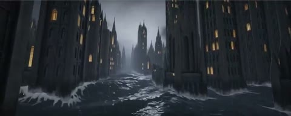

[← Back to gallery](../browse/interactive.en.md) · [简体中文](2102441628661080384.md)

# A Gothic Castle in the Waves

**[Ethan Mollick · @emollick](https://x.com/emollick)** · 3D & interactive · 10s

> Discovery pool · Source verified; catalog details being completed.

**[▶ Open gallery to play](https://guanmo-ai.github.io/awesome-ai-motion/?lang=en#case-2102441628661080384)** · [Original post](https://x.com/emollick/status/2102441628661080384)

Click the cover to open the gallery and play.

[Creator-linked shader demo](https://twigl.app/?ol=true&ss=-P291BpUn5JvZhohk-c0)

A shader renders waves, a castle and broken towers in a changing scene.

## Source & web pages

- **Public web page**：[Creator-linked shader demo](https://twigl.app/?ol=true&ss=-P291BpUn5JvZhohk-c0)
  The creator links this demo; its source and license have not been checked.
  [Link source](https://x.com/emollick/status/2102441628661080384) · Link checked 2026-10-16 07:18 UTC

No public prompt has been verified. [View the original post](https://x.com/emollick/status/2102441628661080384)

Bookmarks 127 · Likes 813 · Views 96,788

## Source record

- Original post: [@emollick](https://x.com/emollick/status/2102441628661080384) · 2026-09-22T16:55:20+00:00
- Model attribution: Opus 5.5 · [Creator’s statement](https://x.com/emollick/status/2102441628661080384)
- Prompt lookup: [Creator post](https://x.com/emollick/status/2102441628661080384) · 2026-10-16 07:18 UTC
- Cover source: [Original cover source](https://x.com/emollick/status/2102441628661080384) · 2s
- Metrics snapshot: [Original X post](https://x.com/emollick/status/2102441628661080384) · 2026-10-16 07:18 UTC
- Gallery video source: [Original post media record](https://x.com/emollick/status/2102441628661080384) · 2026-10-16 07:18 UTC · Post/media correspondence and media response checked; external reference, no re-upload

Model attribution is based on creator statements. Prompts have not been independently rerun; sound and visuals have not received a uniform quality rating. Videos reference original post media, not our uploads; redistribution permission has not been verified.
