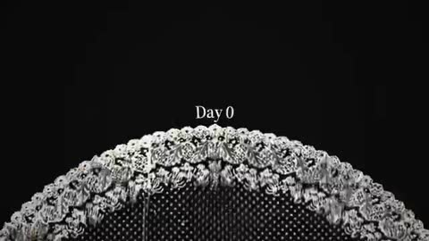

[← 返回图库](../browse/product.md) · [English](2102486455126020521.en.md)

# LiteLLM Day 0：弧形地平线发布片

**[Misbah Syed · @MisbahSy](https://x.com/MisbahSy)** · 产品宣传 · 10s

> 发现池 · 来源已核对，编目资料待完善。

**[▶ 打开画廊播放](https://guanmo-ai.github.io/awesome-ai-motion/#case-2102486455126020521)** · [作者原帖](https://x.com/MisbahSy/status/2102486455126020521)

点击封面打开画廊播放。

[LiteLLM 发布片对应示例源码](https://github.com/misbahsy/claude-horizon-animation/tree/main/skills/horizon-reel/examples/opus-5-5)

弧形地平线与品牌文字重构发布片风格，附对应示例工程。

## 源码与网页

- **直接源码**：[LiteLLM 发布片对应示例源码](https://github.com/misbahsy/claude-horizon-animation/tree/main/skills/horizon-reel/examples/opus-5-5) · 未标明许可
  作者原帖链接仓库，README 和 film.json 明确对应 Day 0 / LiteLLM。未见统一代码许可证，不推定可商用；素材、字体和音乐权利另计。
  [链接出处](https://x.com/MisbahSy/status/2102486455126020521) · 链接核对 2026-10-16 07:19 UTC

未取得作者公开提示词。 [查看作者原帖](https://x.com/MisbahSy/status/2102486455126020521)

收藏 8 · 点赞 14 · 浏览 1,342

## 来源记录

- 作品原帖: [@MisbahSy](https://x.com/MisbahSy/status/2102486455126020521) · 2026-09-22T19:53:27+00:00
- 模型归因: Opus 5.5 · [作者说明](https://x.com/MisbahSy/status/2102486455126020521)
- 提示词查阅记录: [作者原帖](https://x.com/MisbahSy/status/2102486455126020521) · 2026-10-16 07:19 UTC
- 封面来源: [原帖封面来源](https://x.com/MisbahSy/status/2102486455126020521) · 1.91s
- 互动快照: [X 原帖](https://x.com/MisbahSy/status/2102486455126020521) · 2026-10-16 07:19 UTC
- 画廊原视频: [原帖媒体记录](https://x.com/MisbahSy/status/2102486455126020521) · 2026-10-16 07:19 UTC · 已核对原帖媒体对应与媒体响应；外部引用，不重新上传

模型依据来自作者自述，未独立重跑提示词，也未对音画作统一质量评级。视频引用作者原帖媒体，未由本站重新上传，转载许可未确认。
