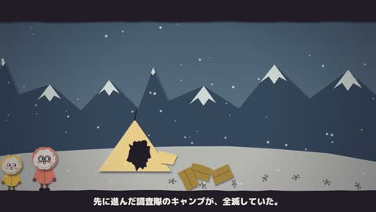

[← Back to gallery](../browse/stories.en.md) · [简体中文](2102531524663099868.md)

# A Cartoon Antarctic Cthulhu Expedition

**[yachimat - AI Short Anime · @yachimat\_manga](https://x.com/yachimat_manga)** · Narrative films · 61s

> Discovery pool · Source verified; catalog details being completed.

**[▶ Open gallery to play](https://guanmo-ai.github.io/awesome-ai-motion/?lang=en#case-2102531524663099868)** · [Original post](https://x.com/yachimat_manga/status/2102531524663099868)

Click the cover to open the gallery and play.

Paper-like explorers cross mountains and camps, telling an Antarctic horror story through motion and captions.

No public prompt has been verified. [View the original post](https://x.com/yachimat_manga/status/2102531524663099868)

Bookmarks — · Likes — · Views —

## Source record

- Original post: [@yachimat\_manga](https://x.com/yachimat_manga/status/2102531524663099868) · 2026-09-22T22:52:33+00:00
- Model attribution: Claude Opus 5.5 · [Creator’s statement](https://x.com/yachimat_manga/status/2102531524663099868)
- Prompt lookup: [Creator post](https://x.com/yachimat_manga/status/2102531524663099868) · 2026-11-02 09:52 UTC
- Cover source: [Original cover source](https://x.com/yachimat_manga/status/2102531524663099868) · 12.21s
- Metrics snapshot: [Original X post](https://x.com/yachimat_manga/status/2102531524663099868) · 2026-11-02 09:15 UTC
- Gallery video source: [Original post media record](https://x.com/yachimat_manga/status/2102531524663099868) · 2026-11-02 09:52 UTC · Post/media correspondence and media response checked; external reference, no re-upload

Model attribution is based on creator statements. Prompts have not been independently rerun; sound and visuals have not received a uniform quality rating. Videos reference original post media, not our uploads; redistribution permission has not been verified.
