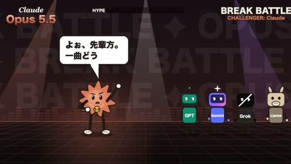

[← Back to gallery](../browse/characters.en.md) · [简体中文](2102566868028686799.md)

# An Orange Mascot Breakdance

**[Taiyo Kimura · @taiyo\_ai\_gakuse](https://x.com/taiyo_ai_gakuse)** · Pixel art & characters · 24s

> Discovery pool · Source verified; catalog details being completed.

**[▶ Open gallery to play](https://guanmo-ai.github.io/awesome-ai-motion/?lang=en#case-2102566868028686799)** · [Original post](https://x.com/taiyo_ai_gakuse/status/2102566868028686799)

Click the cover to open the gallery and play.

An orange mascot dances to music in a cartoon take on an AI-model joke.

No public prompt has been verified. [View the original post](https://x.com/taiyo_ai_gakuse/status/2102566868028686799)

Bookmarks — · Likes — · Views —

## Source record

- Original post: [@taiyo\_ai\_gakuse](https://x.com/taiyo_ai_gakuse/status/2102566868028686799) · 2026-09-23T01:12:59+00:00
- Model attribution: Claude Opus 5.5 · [Creator’s statement](https://x.com/taiyo_ai_gakuse/status/2102566868028686799)
- Prompt lookup: [Creator post](https://x.com/taiyo_ai_gakuse/status/2102566868028686799) · 2026-11-02 09:52 UTC
- Cover source: [Original cover source](https://x.com/taiyo_ai_gakuse/status/2102566868028686799) · 4.81s
- Metrics snapshot: [Original X post](https://x.com/taiyo_ai_gakuse/status/2102566868028686799) · 2026-11-02 09:19 UTC
- Gallery video source: [Original post media record](https://x.com/taiyo_ai_gakuse/status/2102566868028686799) · 2026-11-02 09:52 UTC · Post/media correspondence and media response checked; external reference, no re-upload

Model attribution is based on creator statements. Prompts have not been independently rerun; sound and visuals have not received a uniform quality rating. Videos reference original post media, not our uploads; redistribution permission has not been verified.
