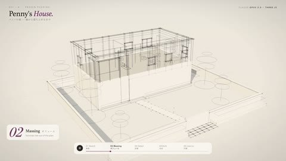

[← Back to gallery](../browse/interactive.en.md) · [简体中文](2102574373886697648.md)

# Penny's House: a house builds in stages

**[りあ｜AI creator · @ria\_aicreator](https://x.com/ria_aicreator)** · 3D & interactive · 37s

> Discovery pool · Source verified; catalog details being completed.

**[▶ Open gallery to play](https://guanmo-ai.github.io/awesome-ai-motion/?lang=en#case-2102574373886697648)** · [Original post](https://x.com/ria_aicreator/status/2102574373886697648)

Click the cover to open the gallery and play.

A house develops from wireframe massing into walls, interiors and night lighting, with a consistent view showing its progression to completion.

No public prompt has been verified. [View the original post](https://x.com/ria_aicreator/status/2102574373886697648)

Bookmarks — · Likes — · Views —

## Source record

- Original post: [@ria\_aicreator](https://x.com/ria_aicreator/status/2102574373886697648) · 2026-09-23T01:42:49.000Z
- Model attribution: Claude Opus 5.5 · [Creator’s statement](https://x.com/ria_aicreator/status/2102574373886697648)
- Prompt lookup: [Creator post](https://x.com/ria_aicreator/status/2102574373886697648) · 2026-11-09 10:53 UTC
- Cover source: [Original cover source](https://x.com/ria_aicreator/status/2102574373886697648) · 7.4s
- Metrics snapshot: [Original X post](https://x.com/ria_aicreator/status/2102574373886697648) · 2026-11-09 10:46 UTC
- Gallery video source: [Original post media record](https://x.com/ria_aicreator/status/2102574373886697648) · 2026-11-09 10:53 UTC · Post/media correspondence and media response checked; external reference, no re-upload

Model attribution is based on creator statements. Prompts have not been independently rerun; sound and visuals have not received a uniform quality rating. Videos reference original post media, not our uploads; redistribution permission has not been verified.
