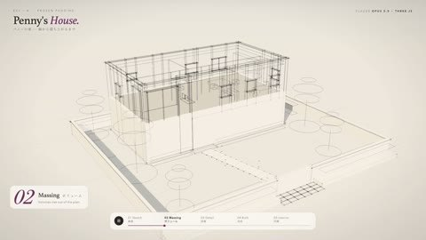

[← 返回图库](../browse/interactive.md) · [English](2102574373886697648.en.md)

# Penny's House：住宅逐层建成

**[りあ｜AI creator · @ria\_aicreator](https://x.com/ria_aicreator)** · 交互演示 · 37s

> 发现池 · 来源已核对，编目资料待完善。

**[▶ 打开画廊播放](https://guanmo-ai.github.io/awesome-ai-motion/#case-2102574373886697648)** · [作者原帖](https://x.com/ria_aicreator/status/2102574373886697648)

点击封面打开画廊播放。

住宅从线框体量逐步补齐墙体、室内和夜景照明，通过统一镜头展示结构到完成状态的变化。

未取得作者公开提示词。 [查看作者原帖](https://x.com/ria_aicreator/status/2102574373886697648)

收藏 — · 点赞 — · 浏览 —

## 来源记录

- 作品原帖: [@ria\_aicreator](https://x.com/ria_aicreator/status/2102574373886697648) · 2026-09-23T01:42:49.000Z
- 模型归因: Claude Opus 5.5 · [作者说明](https://x.com/ria_aicreator/status/2102574373886697648)
- 提示词查阅记录: [作者原帖](https://x.com/ria_aicreator/status/2102574373886697648) · 2026-11-09 10:53 UTC
- 封面来源: [原帖封面来源](https://x.com/ria_aicreator/status/2102574373886697648) · 7.4s
- 互动快照: [X 原帖](https://x.com/ria_aicreator/status/2102574373886697648) · 2026-11-09 10:46 UTC
- 画廊原视频: [原帖媒体记录](https://x.com/ria_aicreator/status/2102574373886697648) · 2026-11-09 10:53 UTC · 已核对原帖媒体对应与媒体响应；外部引用，不重新上传

模型依据来自作者自述，未独立重跑提示词，也未对音画作统一质量评级。视频引用作者原帖媒体，未由本站重新上传，转载许可未确认。
