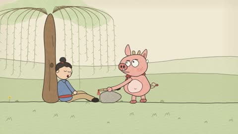

[← Back to gallery](../browse/stories.en.md) · [简体中文](2102576236883300433.md)

# A Little Pig Demon Meets Ma Liang

**[nicekate · @nicekate8888](https://x.com/nicekate8888)** · Narrative films · 120s

> Discovery pool · Source verified; catalog details being completed.

**[▶ Open gallery to play](https://guanmo-ai.github.io/awesome-ai-motion/?lang=en#case-2102576236883300433)** · [Original post](https://x.com/nicekate8888/status/2102576236883300433)

Click the cover to open the gallery and play.

Cartoon characters and animated scenes tell a story of a little pig demon and Ma Liang.

No public prompt has been verified. [View the original post](https://x.com/nicekate8888/status/2102576236883300433)

Bookmarks — · Likes — · Views —

## Source record

- Original post: [@nicekate8888](https://x.com/nicekate8888/status/2102576236883300433) · 2026-09-23T01:50:13+00:00
- Model attribution: Claude Opus 5.5 · [Creator’s statement](https://x.com/nicekate8888/status/2102576236883300433)
- Prompt lookup: [Creator post](https://x.com/nicekate8888/status/2102576236883300433) · 2026-11-02 09:52 UTC
- Cover source: [Original cover source](https://x.com/nicekate8888/status/2102576236883300433) · 24.01s
- Metrics snapshot: [Original X post](https://x.com/nicekate8888/status/2102576236883300433) · 2026-11-02 09:19 UTC
- Gallery video source: [Original post media record](https://x.com/nicekate8888/status/2102576236883300433) · 2026-11-02 09:52 UTC · Post/media correspondence and media response checked; external reference, no re-upload

Model attribution is based on creator statements. Prompts have not been independently rerun; sound and visuals have not received a uniform quality rating. Videos reference original post media, not our uploads; redistribution permission has not been verified.
