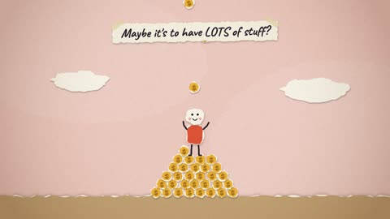

[← Back to gallery](../browse/stories.en.md) · [简体中文](2102591280538644596.md)

# A Cartoon Short on the Purpose of Life

**[Harveen Singh Chadha · @HarveenChadha](https://x.com/HarveenChadha)** · Narrative films · 39s

> Discovery pool · Source verified; catalog details being completed.

**[▶ Open gallery to play](https://guanmo-ai.github.io/awesome-ai-motion/?lang=en#case-2102591280538644596)** · [Original post](https://x.com/HarveenChadha/status/2102591280538644596)

Click the cover to open the gallery and play.

Simple figures and symbolic scenes change in sequence, exploring life's purpose through motion and graphics.

No public prompt has been verified. [View the original post](https://x.com/HarveenChadha/status/2102591280538644596)

Bookmarks — · Likes — · Views —

## Source record

- Original post: [@HarveenChadha](https://x.com/HarveenChadha/status/2102591280538644596) · 2026-09-23T02:50:00+00:00
- Model attribution: Claude Opus 5.5 · [Creator’s statement](https://x.com/HarveenChadha/status/2102591280538644596)
- Prompt lookup: [Creator post](https://x.com/HarveenChadha/status/2102591280538644596) · 2026-11-02 09:52 UTC
- Cover source: [Original cover source](https://x.com/HarveenChadha/status/2102591280538644596) · 7.81s
- Metrics snapshot: [Original X post](https://x.com/HarveenChadha/status/2102591280538644596) · 2026-11-02 09:15 UTC
- Gallery video source: [Original post media record](https://x.com/HarveenChadha/status/2102591280538644596) · 2026-11-02 09:52 UTC · Post/media correspondence and media response checked; external reference, no re-upload

Model attribution is based on creator statements. Prompts have not been independently rerun; sound and visuals have not received a uniform quality rating. Videos reference original post media, not our uploads; redistribution permission has not been verified.
