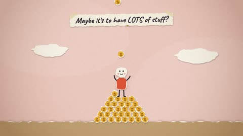

[← 返回图库](../browse/stories.md) · [English](2102591280538644596.en.md)

# 人生目的主题的卡通短片

**[Harveen Singh Chadha · @HarveenChadha](https://x.com/HarveenChadha)** · 叙事短片 · 39s

> 发现池 · 来源已核对，编目资料待完善。

**[▶ 打开画廊播放](https://guanmo-ai.github.io/awesome-ai-motion/#case-2102591280538644596)** · [作者原帖](https://x.com/HarveenChadha/status/2102591280538644596)

点击封面打开画廊播放。

简笔人物与寓意场景连续切换，用动作和图形提出关于人生意义的问题。

未取得作者公开提示词。 [查看作者原帖](https://x.com/HarveenChadha/status/2102591280538644596)

收藏 — · 点赞 — · 浏览 —

## 来源记录

- 作品原帖: [@HarveenChadha](https://x.com/HarveenChadha/status/2102591280538644596) · 2026-09-23T02:50:00+00:00
- 模型归因: Claude Opus 5.5 · [作者说明](https://x.com/HarveenChadha/status/2102591280538644596)
- 提示词查阅记录: [作者原帖](https://x.com/HarveenChadha/status/2102591280538644596) · 2026-11-02 09:52 UTC
- 封面来源: [原帖封面来源](https://x.com/HarveenChadha/status/2102591280538644596) · 7.81s
- 互动快照: [X 原帖](https://x.com/HarveenChadha/status/2102591280538644596) · 2026-11-02 09:15 UTC
- 画廊原视频: [原帖媒体记录](https://x.com/HarveenChadha/status/2102591280538644596) · 2026-11-02 09:52 UTC · 已核对原帖媒体对应与媒体响应；外部引用，不重新上传

模型依据来自作者自述，未独立重跑提示词，也未对音画作统一质量评级。视频引用作者原帖媒体，未由本站重新上传，转载许可未确认。
