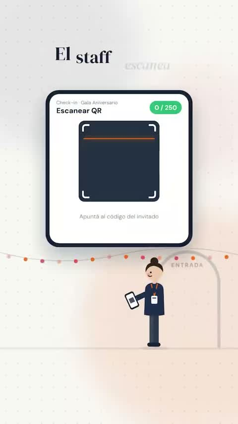

[← Back to gallery](../browse/product.en.md) · [简体中文](2102634404774629665.md)

# A Planning Manager Event-Card Promo

**[A L A N · @alanschwegler](https://x.com/alanschwegler)** · Product & marketing · 36s

> Discovery pool · Source verified; catalog details being completed.

**[▶ Open gallery to play](https://guanmo-ai.github.io/awesome-ai-motion/?lang=en#case-2102634404774629665)** · [Original post](https://x.com/alanschwegler/status/2102634404774629665)

Click the cover to open the gallery and play.

A phone, event cards and human symbols introduce an event-planning tool through movement and changing layouts.

No public prompt has been verified. [View the original post](https://x.com/alanschwegler/status/2102634404774629665)

Bookmarks — · Likes — · Views —

## Source record

- Original post: [@alanschwegler](https://x.com/alanschwegler/status/2102634404774629665) · 2026-09-23T05:41:21+00:00
- Model attribution: Claude Opus 5.5 · [Creator’s statement](https://x.com/alanschwegler/status/2102634404774629665)
- Prompt lookup: [Creator post](https://x.com/alanschwegler/status/2102634404774629665) · 2026-11-02 15:38 UTC
- Cover source: [Original cover source](https://x.com/alanschwegler/status/2102634404774629665) · 7.21s
- Metrics snapshot: [Original X post](https://x.com/alanschwegler/status/2102634404774629665) · 2026-11-02 15:08 UTC
- Gallery video source: [Original post media record](https://x.com/alanschwegler/status/2102634404774629665) · 2026-11-02 15:38 UTC · Post/media correspondence and media response checked; external reference, no re-upload

Model attribution is based on creator statements. Prompts have not been independently rerun; sound and visuals have not received a uniform quality rating. Videos reference original post media, not our uploads; redistribution permission has not been verified.
