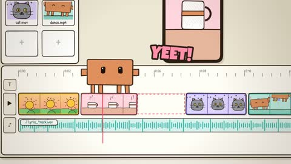

[← Back to gallery](../browse/stories.en.md) · [简体中文](2102681172367323300.md)

# An Orange Character in an Animated Editing Desk

**[SuSu\_酥酥👅 · @NFT\_Chen](https://x.com/NFT_Chen)** · Narrative films · 30s

> Discovery pool · Source verified; catalog details being completed.

**[▶ Open gallery to play](https://guanmo-ai.github.io/awesome-ai-motion/?lang=en#case-2102681172367323300)** · [Original post](https://x.com/NFT_Chen/status/2102681172367323300)

Click the cover to open the gallery and play.

A cartoon protagonist moves among a fictional timeline, preview window and waveforms to dramatize editing.

No public prompt has been verified. [View the original post](https://x.com/NFT_Chen/status/2102681172367323300)

Bookmarks — · Likes — · Views —

## Source record

- Original post: [@NFT\_Chen](https://x.com/NFT_Chen/status/2102681172367323300) · 2026-09-23T08:47:12+00:00
- Model attribution: Claude Opus 5.5 · [Creator’s statement](https://x.com/NFT_Chen/status/2102681172367323300)
- Prompt lookup: [Creator post](https://x.com/NFT_Chen/status/2102681172367323300) · 2026-11-02 15:38 UTC
- Cover source: [Original cover source](https://x.com/NFT_Chen/status/2102681172367323300) · 6.01s
- Metrics snapshot: [Original X post](https://x.com/NFT_Chen/status/2102681172367323300) · 2026-11-02 15:08 UTC
- Gallery video source: [Original post media record](https://x.com/NFT_Chen/status/2102681172367323300) · 2026-11-02 15:38 UTC · Post/media correspondence and media response checked; external reference, no re-upload

Model attribution is based on creator statements. Prompts have not been independently rerun; sound and visuals have not received a uniform quality rating. Videos reference original post media, not our uploads; redistribution permission has not been verified.
