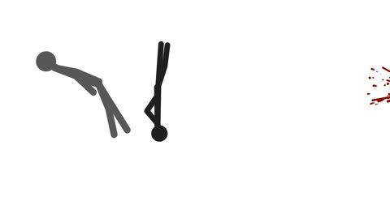

[← Back to gallery](../browse/characters.en.md) · [简体中文](2102735082218004540.md)

# A Stick-Figure Battle in One HTML File

**[J A Z I I · @notjazii](https://x.com/notjazii)** · Pixel art & characters · 25s

> Discovery pool · Source verified; catalog details being completed.

**[▶ Open gallery to play](https://guanmo-ai.github.io/awesome-ai-motion/?lang=en#case-2102735082218004540)** · [Original post](https://x.com/notjazii/status/2102735082218004540)

Click the cover to open the gallery and play.

Stick figures move through a continuous battle across lines, platforms and paths.

No public prompt has been verified. [View the original post](https://x.com/notjazii/status/2102735082218004540)

Bookmarks — · Likes — · Views —

## Source record

- Original post: [@notjazii](https://x.com/notjazii/status/2102735082218004540) · 2026-09-23T12:21:25+00:00
- Model attribution: Claude Opus 5.5 · [Creator’s statement](https://x.com/notjazii/status/2102735082218004540)
- Prompt lookup: [Creator post](https://x.com/notjazii/status/2102735082218004540) · 2026-11-02 15:38 UTC
- Cover source: [Original cover source](https://x.com/notjazii/status/2102735082218004540) · 5s
- Metrics snapshot: [Original X post](https://x.com/notjazii/status/2102735082218004540) · 2026-11-02 15:08 UTC
- Gallery video source: [Original post media record](https://x.com/notjazii/status/2102735082218004540) · 2026-11-02 15:38 UTC · Post/media correspondence and media response checked; external reference, no re-upload

Model attribution is based on creator statements. Prompts have not been independently rerun; sound and visuals have not received a uniform quality rating. Videos reference original post media, not our uploads; redistribution permission has not been verified.
