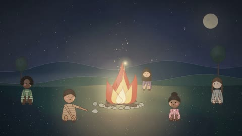

[← Back to gallery](../browse/education.en.md) · [简体中文](2102743212922384673.md)

# From Early Humans to an Orange Mascot

**[songkeys 🐿️🦋@song.work · @songkeys](https://x.com/songkeys)** · Education & explainers · 108s

> Discovery pool · Source verified; catalog details being completed.

**[▶ Open gallery to play](https://guanmo-ai.github.io/awesome-ai-motion/?lang=en#case-2102743212922384673)** · [Original post](https://x.com/songkeys/status/2102743212922384673)

Click the cover to open the gallery and play.

Cartoon figures, firelight and a mascot connect a short history from early humanity to AI.

No public prompt has been verified. [View the original post](https://x.com/songkeys/status/2102743212922384673)

Bookmarks — · Likes — · Views —

## Source record

- Original post: [@songkeys](https://x.com/songkeys/status/2102743212922384673) · 2026-09-23T12:53:43+00:00
- Model attribution: Claude Opus 5.5 · [Creator’s statement](https://x.com/songkeys/status/2102743212922384673)
- Prompt lookup: [Creator post](https://x.com/songkeys/status/2102743212922384673) · 2026-11-02 09:52 UTC
- Cover source: [Original cover source](https://x.com/songkeys/status/2102743212922384673) · 21.61s
- Metrics snapshot: [Original X post](https://x.com/songkeys/status/2102743212922384673) · 2026-11-02 09:15 UTC
- Gallery video source: [Original post media record](https://x.com/songkeys/status/2102743212922384673) · 2026-11-02 09:52 UTC · Post/media correspondence and media response checked; external reference, no re-upload

Model attribution is based on creator statements. Prompts have not been independently rerun; sound and visuals have not received a uniform quality rating. Videos reference original post media, not our uploads; redistribution permission has not been verified.
