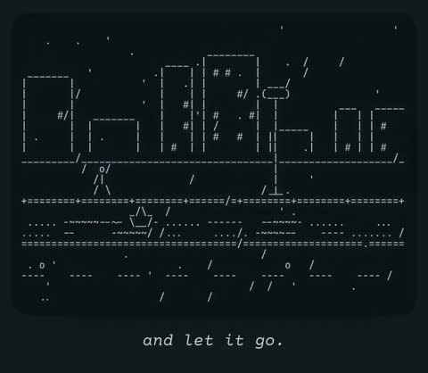

[← Back to gallery](../browse/stories.en.md) · [简体中文](2102774269587403200.md)

# The Paper Boat: An ASCII Story

**[Moll · @Moleh1ll](https://x.com/Moleh1ll)** · Narrative films · 103s

> Discovery pool · Source verified; catalog details being completed.

**[▶ Open gallery to play](https://guanmo-ai.github.io/awesome-ai-motion/?lang=en#case-2102774269587403200)** · [Original post](https://x.com/Moleh1ll/status/2102774269587403200)

Click the cover to open the gallery and play.

Characters form a paper boat, city and water, telling a story with sparse lines and captions.

No public prompt has been verified. [View the original post](https://x.com/Moleh1ll/status/2102774269587403200)

Bookmarks — · Likes — · Views —

## Source record

- Original post: [@Moleh1ll](https://x.com/Moleh1ll/status/2102774269587403200) · 2026-09-23T14:57:08+00:00
- Model attribution: Claude Opus 5.5 · [Creator’s statement](https://x.com/Moleh1ll/status/2102774269587403200)
- Prompt lookup: [Creator post](https://x.com/Moleh1ll/status/2102774269587403200) · 2026-11-02 15:38 UTC
- Cover source: [Original cover source](https://x.com/Moleh1ll/status/2102774269587403200) · 20.62s
- Metrics snapshot: [Original X post](https://x.com/Moleh1ll/status/2102774269587403200) · 2026-11-02 15:08 UTC
- Gallery video source: [Original post media record](https://x.com/Moleh1ll/status/2102774269587403200) · 2026-11-02 15:38 UTC · Post/media correspondence and media response checked; external reference, no re-upload

Model attribution is based on creator statements. Prompts have not been independently rerun; sound and visuals have not received a uniform quality rating. Videos reference original post media, not our uploads; redistribution permission has not been verified.
