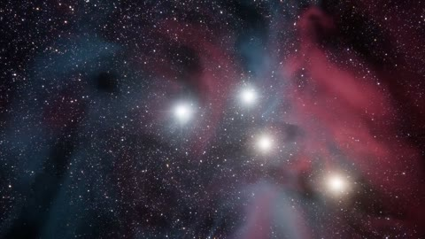

[← Back to gallery](../browse/stories.en.md) · [简体中文](2102776189060546715.md)

# GENESIS: Galaxies and Neural Networks

**[sundyme · @sundyme](https://x.com/sundyme)** · Narrative films · 57s

> Discovery pool · Source verified; catalog details being completed.

**[▶ Open gallery to play](https://guanmo-ai.github.io/awesome-ai-motion/?lang=en#case-2102776189060546715)** · [Original post](https://x.com/sundyme/status/2102776189060546715)

Click the cover to open the gallery and play.

Galaxies, light and neural networks connect a genesis theme in visuals and music the creator says are coded.

No public prompt has been verified. [View the original post](https://x.com/sundyme/status/2102776189060546715)

Bookmarks — · Likes — · Views —

## Source record

- Original post: [@sundyme](https://x.com/sundyme/status/2102776189060546715) · 2026-09-23T15:04:45+00:00
- Model attribution: Claude Opus 5.5 · [Creator’s statement](https://x.com/sundyme/status/2102776189060546715)
- Prompt lookup: [Creator post](https://x.com/sundyme/status/2102776189060546715) · 2026-11-02 15:38 UTC
- Cover source: [Original cover source](https://x.com/sundyme/status/2102776189060546715) · 11.41s
- Metrics snapshot: [Original X post](https://x.com/sundyme/status/2102776189060546715) · 2026-11-02 15:08 UTC
- Gallery video source: [Original post media record](https://x.com/sundyme/status/2102776189060546715) · 2026-11-02 15:38 UTC · Post/media correspondence and media response checked; external reference, no re-upload

Model attribution is based on creator statements. Prompts have not been independently rerun; sound and visuals have not received a uniform quality rating. Videos reference original post media, not our uploads; redistribution permission has not been verified.
