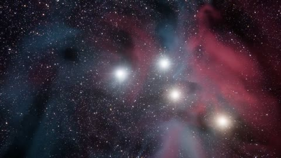

[← 返回图库](../browse/stories.md) · [English](2102776189060546715.en.md)

# GENESIS 的星系与神经网络

**[sundyme · @sundyme](https://x.com/sundyme)** · 叙事短片 · 57s

> 发现池 · 来源已核对，编目资料待完善。

**[▶ 打开画廊播放](https://guanmo-ai.github.io/awesome-ai-motion/#case-2102776189060546715)** · [作者原帖](https://x.com/sundyme/status/2102776189060546715)

点击封面打开画廊播放。

星系、光线与神经网络串联创世主题，作者声明每帧与配乐均由代码生成。

未取得作者公开提示词。 [查看作者原帖](https://x.com/sundyme/status/2102776189060546715)

收藏 — · 点赞 — · 浏览 —

## 来源记录

- 作品原帖: [@sundyme](https://x.com/sundyme/status/2102776189060546715) · 2026-09-23T15:04:45+00:00
- 模型归因: Claude Opus 5.5 · [作者说明](https://x.com/sundyme/status/2102776189060546715)
- 提示词查阅记录: [作者原帖](https://x.com/sundyme/status/2102776189060546715) · 2026-11-02 15:38 UTC
- 封面来源: [原帖封面来源](https://x.com/sundyme/status/2102776189060546715) · 11.41s
- 互动快照: [X 原帖](https://x.com/sundyme/status/2102776189060546715) · 2026-11-02 15:08 UTC
- 画廊原视频: [原帖媒体记录](https://x.com/sundyme/status/2102776189060546715) · 2026-11-02 15:38 UTC · 已核对原帖媒体对应与媒体响应；外部引用，不重新上传

模型依据来自作者自述，未独立重跑提示词，也未对音画作统一质量评级。视频引用作者原帖媒体，未由本站重新上传，转载许可未确认。
