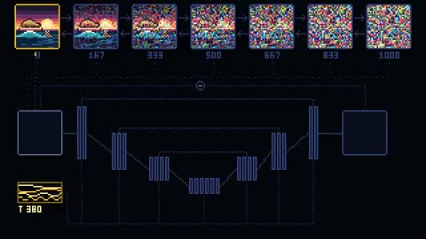

[← 返回图库](../browse/education.md) · [English](2102810407928819866.en.md)

# 扩散模型的图像流程

**[Carlos Santana · @DotCSV](https://x.com/DotCSV)** · 知识讲解 · 21s

> 发现池 · 来源已核对，编目资料待完善。

**[▶ 打开画廊播放](https://guanmo-ai.github.io/awesome-ai-motion/#case-2102810407928819866)** · [作者原帖](https://x.com/DotCSV/status/2102810407928819866)

点击封面打开画廊播放。

噪声、图像与流程节点构成动态示意，展示扩散模型主题的生成步骤。

未取得作者公开提示词。 [查看作者原帖](https://x.com/DotCSV/status/2102810407928819866)

收藏 476 · 点赞 1,658 · 浏览 71,445

## 来源记录

- 作品原帖: [@DotCSV](https://x.com/DotCSV/status/2102810407928819866) · 2026-09-23T17:20:44+00:00
- 模型归因: Claude Opus 5.5 · [作者说明](https://x.com/DotCSV/status/2102810407928819866)
- 提示词查阅记录: [作者原帖](https://x.com/DotCSV/status/2102810407928819866) · 2026-10-24 12:20 UTC
- 封面来源: [原帖封面来源](https://x.com/DotCSV/status/2102810407928819866) · 4.29s
- 互动快照: [X 原帖](https://x.com/DotCSV/status/2102810407928819866) · 2026-10-24 12:20 UTC
- 画廊原视频: [原帖媒体记录](https://x.com/DotCSV/status/2102810407928819866) · 2026-10-24 12:20 UTC · 已核对原帖媒体对应与媒体响应；外部引用，不重新上传

模型依据来自作者自述，未独立重跑提示词，也未对音画作统一质量评级。视频引用作者原帖媒体，未由本站重新上传，转载许可未确认。
