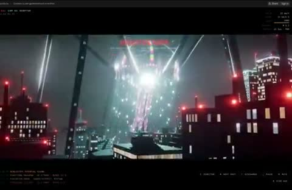

[← 返回图库](../browse/interactive.md) · [English](2102810710791401883.en.md)

# 怪兽入侵的程序化城市

**[Majid Manzarpour · @majidmanzarpour](https://x.com/majidmanzarpour)** · 交互演示 · 133s

> 发现池 · 来源已核对，编目资料待完善。

**[▶ 打开画廊播放](https://guanmo-ai.github.io/awesome-ai-motion/#case-2102810710791401883)** · [作者原帖](https://x.com/majidmanzarpour/status/2102810710791401883)

点击封面打开画廊播放。

高楼、红色灯点与巨型机械轮廓构成城市战场，能量效果在楼群间扩散；作者说明使用 Opus 5.5 与纯 Three.js 代码。

未取得作者公开提示词。 [查看作者原帖](https://x.com/majidmanzarpour/status/2102810710791401883)

收藏 76 · 点赞 170 · 浏览 12,459

## 来源记录

- 作品原帖: [@majidmanzarpour](https://x.com/majidmanzarpour/status/2102810710791401883) · 2026-09-23T17:21:56+00:00
- 模型归因: Claude Opus 5.5 · [作者说明](https://x.com/majidmanzarpour/status/2102810710791401883)
- 提示词查阅记录: [作者原帖](https://x.com/majidmanzarpour/status/2102810710791401883) · 2026-10-22 08:51 UTC
- 封面来源: [原帖封面来源](https://x.com/majidmanzarpour/status/2102810710791401883) · 26.58s
- 互动快照: [X 原帖](https://x.com/majidmanzarpour/status/2102810710791401883) · 2026-10-22 08:51 UTC
- 画廊原视频: [原帖媒体记录](https://x.com/majidmanzarpour/status/2102810710791401883) · 2026-10-22 08:51 UTC · 已核对原帖媒体对应与媒体响应；外部引用，不重新上传

模型依据来自作者自述，未独立重跑提示词，也未对音画作统一质量评级。视频引用作者原帖媒体，未由本站重新上传，转载许可未确认。
