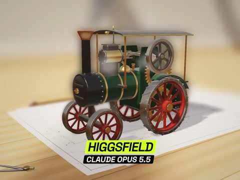

[← Back to gallery](../browse/interactive.en.md) · [简体中文](2102831492024172840.md)

# Engineering Sketches Assemble into Moving Machines

**[Higgsfield AI 🧩 · @higgsfield\_ai](https://x.com/higgsfield_ai)** · 3D & interactive · 29s

> Discovery pool · Source verified; catalog details being completed.

**[▶ Open gallery to play](https://guanmo-ai.github.io/awesome-ai-motion/?lang=en#case-2102831492024172840)** · [Original post](https://x.com/higgsfield_ai/status/2102831492024172840)

Click the cover to open the gallery and play.

Engineering drawings become mechanical models through assembly, rotation and material changes.

No public prompt has been verified. [View the original post](https://x.com/higgsfield_ai/status/2102831492024172840)

Bookmarks — · Likes — · Views —

## Source record

- Original post: [@higgsfield\_ai](https://x.com/higgsfield_ai/status/2102831492024172840) · 2026-09-23T18:44:31+00:00
- Model attribution: Claude Opus 5.5 · [Creator’s statement](https://x.com/higgsfield_ai/status/2102831492024172840)
- Prompt lookup: [Creator post](https://x.com/higgsfield_ai/status/2102831492024172840) · 2026-11-02 09:52 UTC
- Cover source: [Original cover source](https://x.com/higgsfield_ai/status/2102831492024172840) · 5.85s
- Metrics snapshot: [Original X post](https://x.com/higgsfield_ai/status/2102831492024172840) · 2026-11-02 09:15 UTC
- Gallery video source: [Original post media record](https://x.com/higgsfield_ai/status/2102831492024172840) · 2026-11-02 09:52 UTC · Post/media correspondence and media response checked; external reference, no re-upload

Model attribution is based on creator statements. Prompts have not been independently rerun; sound and visuals have not received a uniform quality rating. Videos reference original post media, not our uploads; redistribution permission has not been verified.
