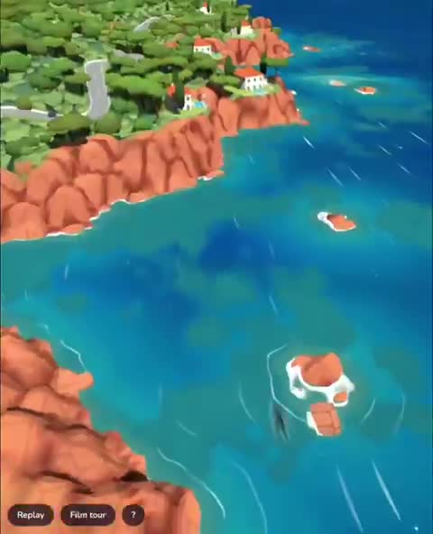

[← Back to gallery](../browse/interactive.en.md) · [简体中文](2102842401434030253.md)

# A Stylized Coastal Map in 3D

**[Aurelien · @Aurelien\_Gz](https://x.com/Aurelien_Gz)** · 3D & interactive · 35s

> Discovery pool · Source verified; catalog details being completed.

**[▶ Open gallery to play](https://guanmo-ai.github.io/awesome-ai-motion/?lang=en#case-2102842401434030253)** · [Original post](https://x.com/Aurelien_Gz/status/2102842401434030253)

Click the cover to open the gallery and play.

Coasts, buildings and vegetation expand a map into a navigable stylized scene.

No public prompt has been verified. [View the original post](https://x.com/Aurelien_Gz/status/2102842401434030253)

Bookmarks 41 · Likes 55 · Views 5,770

## Source record

- Original post: [@Aurelien\_Gz](https://x.com/Aurelien_Gz/status/2102842401434030253) · 2026-09-23T19:27:52+00:00
- Model attribution: Opus 5.5 · [Creator’s statement](https://x.com/Aurelien_Gz/status/2102842401434030253)
- Prompt lookup: [Creator post](https://x.com/Aurelien_Gz/status/2102842401434030253) · 2026-10-19 09:12 UTC
- Cover source: [Original cover source](https://x.com/Aurelien_Gz/status/2102842401434030253) · 7.05s
- Metrics snapshot: [Original X post](https://x.com/Aurelien_Gz/status/2102842401434030253) · 2026-10-19 09:12 UTC
- Gallery video source: [Original post media record](https://x.com/Aurelien_Gz/status/2102842401434030253) · 2026-10-19 09:12 UTC · Post/media correspondence and media response checked; external reference, no re-upload

Model attribution is based on creator statements. Prompts have not been independently rerun; sound and visuals have not received a uniform quality rating. Videos reference original post media, not our uploads; redistribution permission has not been verified.
