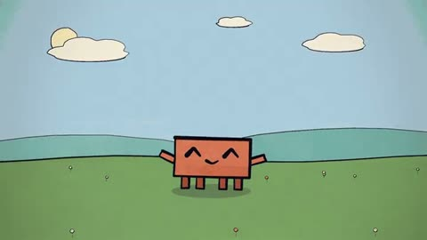

[← 返回图库](../browse/characters.md) · [English](2102860128680845789.en.md)

# Clawd 笔触动画的白昼示例

**[NotinReality · @other\_\_reality](https://x.com/other__reality)** · 角色动画 · 10s

> 发现池 · 来源已核对，编目资料待完善。

**[▶ 打开画廊播放](https://guanmo-ai.github.io/awesome-ai-motion/#case-2102860128680845789)** · [作者原帖](https://x.com/other__reality/status/2102860128680845789)

点击封面打开画廊播放。

[笔触动画起步工程](https://github.com/JohnHeibel/ClaudeAnimationBase)

绘画笔触的 Clawd 日间短循环，作者同时提供动画起步工程。

## 源码与网页

- **相关工具**：[笔触动画起步工程](https://github.com/JohnHeibel/ClaudeAnimationBase) · MIT
  作者提供的通用起步工程，README 明示测试动画使用 Opus 5.5；MIT 仅指代码，素材权利单独核对。
  [链接出处](https://x.com/other__reality/status/2102865334298632574) · 链接核对 2026-10-19 09:12 UTC

未取得作者公开提示词。 [查看作者原帖](https://x.com/other__reality/status/2102860128680845789)

收藏 218 · 点赞 318 · 浏览 21,716

## 来源记录

- 作品原帖: [@other\_\_reality](https://x.com/other__reality/status/2102860128680845789) · 2026-09-23T20:38:18+00:00
- 模型归因: Opus 5.5 · [作者说明](https://x.com/other__reality/status/2102860128680845789)
- 提示词查阅记录: [作者原帖](https://x.com/other__reality/status/2102860128680845789) · 2026-10-19 09:12 UTC
- 封面来源: [原帖封面来源](https://x.com/other__reality/status/2102860128680845789) · 2s
- 互动快照: [X 原帖](https://x.com/other__reality/status/2102860128680845789) · 2026-10-19 09:12 UTC
- 画廊原视频: [原帖媒体记录](https://x.com/other__reality/status/2102860128680845789) · 2026-10-19 09:12 UTC · 已核对原帖媒体对应与媒体响应；外部引用，不重新上传

模型依据来自作者自述，未独立重跑提示词，也未对音画作统一质量评级。视频引用作者原帖媒体，未由本站重新上传，转载许可未确认。
