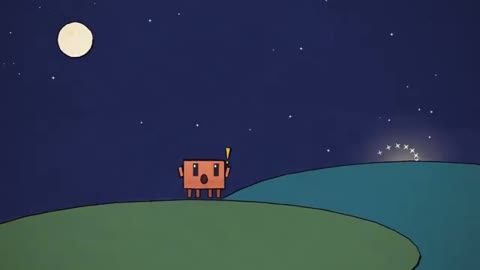

[← Back to gallery](../browse/characters.en.md) · [简体中文](2102860657158992120.md)

# Clawd and a Shooting Star

**[NotinReality · @other\_\_reality](https://x.com/other__reality)** · Pixel art & characters · 11s

> Discovery pool · Source verified; catalog details being completed.

**[▶ Open gallery to play](https://guanmo-ai.github.io/awesome-ai-motion/?lang=en#case-2102860657158992120)** · [Original post](https://x.com/other__reality/status/2102860657158992120)

Click the cover to open the gallery and play.

[Brush animation starter kit](https://github.com/JohnHeibel/ClaudeAnimationBase)

Clawd, a shooting star and changing light form a short nighttime loop.

## Source & web pages

- **Related tool**：[Brush animation starter kit](https://github.com/JohnHeibel/ClaudeAnimationBase) · MIT
  Creator-linked starter kit whose README credits Opus 5.5 for test animations. MIT applies to code; asset rights are separate.
  [Link source](https://x.com/other__reality/status/2102865334298632574) · Link checked 2026-10-19 09:12 UTC

No public prompt has been verified. [View the original post](https://x.com/other__reality/status/2102860657158992120)

Bookmarks 6 · Likes 18 · Views 723

## Source record

- Original post: [@other\_\_reality](https://x.com/other__reality/status/2102860657158992120) · 2026-09-23T20:40:24+00:00
- Model attribution: Opus 5.5 · [Creator’s statement](https://x.com/other__reality/status/2102860657158992120)
- Prompt lookup: [Creator post](https://x.com/other__reality/status/2102860657158992120) · 2026-10-19 09:12 UTC
- Cover source: [Original cover source](https://x.com/other__reality/status/2102860657158992120) · 2.2s
- Metrics snapshot: [Original X post](https://x.com/other__reality/status/2102860657158992120) · 2026-10-19 09:12 UTC
- Gallery video source: [Original post media record](https://x.com/other__reality/status/2102860657158992120) · 2026-10-19 09:12 UTC · Post/media correspondence and media response checked; external reference, no re-upload

Model attribution is based on creator statements. Prompts have not been independently rerun; sound and visuals have not received a uniform quality rating. Videos reference original post media, not our uploads; redistribution permission has not been verified.
