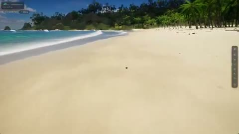

[← Back to gallery](../browse/interactive.en.md) · [简体中文](2102878170089169235.md)

# An Island, Ocean Swells and Underwater Whales

**[Dan Greenheck · @dangreenheck](https://x.com/dangreenheck)** · 3D & interactive · 227s

> Discovery pool · Source verified; catalog details being completed.

**[▶ Open gallery to play](https://guanmo-ai.github.io/awesome-ai-motion/?lang=en#case-2102878170089169235)** · [Original post](https://x.com/dangreenheck/status/2102878170089169235)

Click the cover to open the gallery and play.

A camera moves from a beach into the water among fish and whales in an island world built incrementally with Opus 5.5.

No public prompt has been verified. [View the original post](https://x.com/dangreenheck/status/2102878170089169235)

Bookmarks 3,407 · Likes 5,850 · Views 896,737

## Source record

- Original post: [@dangreenheck](https://x.com/dangreenheck/status/2102878170089169235) · 2026-09-23T21:49:59+00:00
- Model attribution: Claude Opus 5.5 · [Creator’s statement](https://x.com/dangreenheck/status/2102878170089169235)
- Prompt lookup: [Creator post](https://x.com/dangreenheck/status/2102878170089169235) · 2026-10-22 08:51 UTC
- Cover source: [Original cover source](https://x.com/dangreenheck/status/2102878170089169235) · 45.48s
- Metrics snapshot: [Original X post](https://x.com/dangreenheck/status/2102878170089169235) · 2026-10-22 08:51 UTC
- Gallery video source: [Original post media record](https://x.com/dangreenheck/status/2102878170089169235) · 2026-10-22 08:51 UTC · Post/media correspondence and media response checked; external reference, no re-upload

Model attribution is based on creator statements. Prompts have not been independently rerun; sound and visuals have not received a uniform quality rating. Videos reference original post media, not our uploads; redistribution permission has not been verified.
