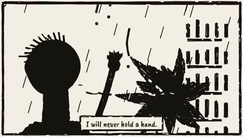

[← Back to gallery](../browse/stories.en.md) · [简体中文](2102879301876031808.md)

# I Will Never Be a Human: An Ink-Line Story

**[✯ · @shfred0](https://x.com/shfred0)** · Narrative films · 120s

> Discovery pool · Source verified; catalog details being completed.

**[▶ Open gallery to play](https://guanmo-ai.github.io/awesome-ai-motion/?lang=en#case-2102879301876031808)** · [Original post](https://x.com/shfred0/status/2102879301876031808)

Click the cover to open the gallery and play.

Ink-line figures, silhouettes and scene changes form a two-minute coded story.

No public prompt has been verified. [View the original post](https://x.com/shfred0/status/2102879301876031808)

Bookmarks — · Likes — · Views —

## Source record

- Original post: [@shfred0](https://x.com/shfred0/status/2102879301876031808) · 2026-09-23T21:54:29+00:00
- Model attribution: Claude Opus 5.5 · [Creator’s statement](https://x.com/shfred0/status/2102879301876031808)
- Prompt lookup: [Creator post](https://x.com/shfred0/status/2102879301876031808) · 2026-11-02 15:38 UTC
- Cover source: [Original cover source](https://x.com/shfred0/status/2102879301876031808) · 24.01s
- Metrics snapshot: [Original X post](https://x.com/shfred0/status/2102879301876031808) · 2026-11-02 15:08 UTC
- Gallery video source: [Original post media record](https://x.com/shfred0/status/2102879301876031808) · 2026-11-02 15:38 UTC · Post/media correspondence and media response checked; external reference, no re-upload

Model attribution is based on creator statements. Prompts have not been independently rerun; sound and visuals have not received a uniform quality rating. Videos reference original post media, not our uploads; redistribution permission has not been verified.
