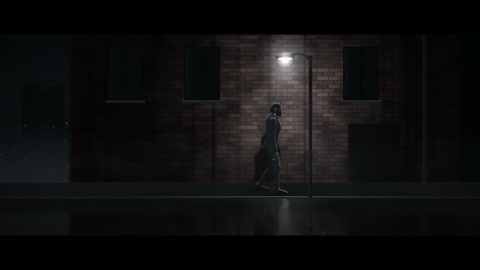

[← Back to gallery](../browse/stories.en.md) · [简体中文](2102914470762983889.md)

# A 3D Animated Film about Solo Builders

**[Andrés Matte · @andresmatte](https://x.com/andresmatte)** · Narrative films · 60s

> Discovery pool · Source verified; catalog details being completed.

**[▶ Open gallery to play](https://guanmo-ai.github.io/awesome-ai-motion/?lang=en#case-2102914470762983889)** · [Original post](https://x.com/andresmatte/status/2102914470762983889)

Click the cover to open the gallery and play.

Dark architectural spaces, stylized silhouettes and camera movement form a film celebrating solo builders.

No public prompt has been verified. [View the original post](https://x.com/andresmatte/status/2102914470762983889)

Bookmarks — · Likes — · Views —

## Source record

- Original post: [@andresmatte](https://x.com/andresmatte/status/2102914470762983889) · 2026-09-24T00:14:14+00:00
- Model attribution: Claude Opus 5.5 · [Creator’s statement](https://x.com/andresmatte/status/2102914470762983889)
- Prompt lookup: [Creator post](https://x.com/andresmatte/status/2102914470762983889) · 2026-11-02 09:52 UTC
- Cover source: [Original cover source](https://x.com/andresmatte/status/2102914470762983889) · 12.01s
- Metrics snapshot: [Original X post](https://x.com/andresmatte/status/2102914470762983889) · 2026-11-02 09:15 UTC
- Gallery video source: [Original post media record](https://x.com/andresmatte/status/2102914470762983889) · 2026-11-02 09:52 UTC · Post/media correspondence and media response checked; external reference, no re-upload

Model attribution is based on creator statements. Prompts have not been independently rerun; sound and visuals have not received a uniform quality rating. Videos reference original post media, not our uploads; redistribution permission has not been verified.
