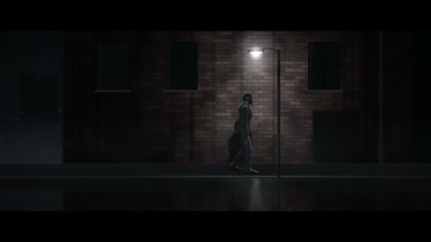

[← 返回图库](../browse/stories.md) · [English](2102914470762983889.en.md)

# 独立创作者的三维动画短片

**[Andrés Matte · @andresmatte](https://x.com/andresmatte)** · 叙事短片 · 60s

> 发现池 · 来源已核对，编目资料待完善。

**[▶ 打开画廊播放](https://guanmo-ai.github.io/awesome-ai-motion/#case-2102914470762983889)** · [作者原帖](https://x.com/andresmatte/status/2102914470762983889)

点击封面打开画廊播放。

暗色建筑空间、剪影人物与镜头运动组成献给独立创作者的短片。

未取得作者公开提示词。 [查看作者原帖](https://x.com/andresmatte/status/2102914470762983889)

收藏 — · 点赞 — · 浏览 —

## 来源记录

- 作品原帖: [@andresmatte](https://x.com/andresmatte/status/2102914470762983889) · 2026-09-24T00:14:14+00:00
- 模型归因: Claude Opus 5.5 · [作者说明](https://x.com/andresmatte/status/2102914470762983889)
- 提示词查阅记录: [作者原帖](https://x.com/andresmatte/status/2102914470762983889) · 2026-11-02 09:52 UTC
- 封面来源: [原帖封面来源](https://x.com/andresmatte/status/2102914470762983889) · 12.01s
- 互动快照: [X 原帖](https://x.com/andresmatte/status/2102914470762983889) · 2026-11-02 09:15 UTC
- 画廊原视频: [原帖媒体记录](https://x.com/andresmatte/status/2102914470762983889) · 2026-11-02 09:52 UTC · 已核对原帖媒体对应与媒体响应；外部引用，不重新上传

模型依据来自作者自述，未独立重跑提示词，也未对音画作统一质量评级。视频引用作者原帖媒体，未由本站重新上传，转载许可未确认。
