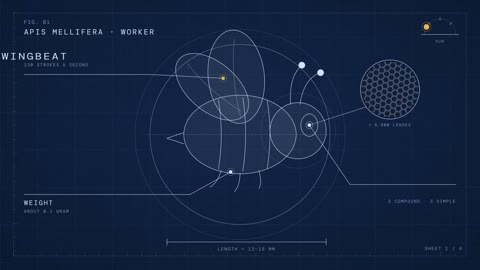

[← Back to gallery](../browse/education.en.md) · [简体中文](2102918909339066573.md)

# A Worker Bee's Life in Twenty-Nine Seconds

**[Motion · @motion\_so](https://x.com/motion_so)** · Education & explainers · 29s

> Discovery pool · Source verified; catalog details being completed.

**[▶ Open gallery to play](https://guanmo-ai.github.io/awesome-ai-motion/?lang=en#case-2102918909339066573)** · [Original post](https://x.com/motion_so/status/2102918909339066573)

Click the cover to open the gallery and play.

Orbital graphics, honeycomb and a small bee change in sequence to depict a worker bee's life.

No public prompt has been verified. [View the original post](https://x.com/motion_so/status/2102918909339066573)

Bookmarks — · Likes — · Views —

## Source record

- Original post: [@motion\_so](https://x.com/motion_so/status/2102918909339066573) · 2026-09-24T00:31:52+00:00
- Model attribution: Claude Opus 5.5 · [Creator’s statement](https://x.com/motion_so/status/2102918909339066573)
- Prompt lookup: [Creator post](https://x.com/motion_so/status/2102918909339066573) · 2026-11-02 09:52 UTC
- Cover source: [Original cover source](https://x.com/motion_so/status/2102918909339066573) · 5.82s
- Metrics snapshot: [Original X post](https://x.com/motion_so/status/2102918909339066573) · 2026-11-02 09:15 UTC
- Gallery video source: [Original post media record](https://x.com/motion_so/status/2102918909339066573) · 2026-11-02 09:52 UTC · Post/media correspondence and media response checked; external reference, no re-upload

Model attribution is based on creator statements. Prompts have not been independently rerun; sound and visuals have not received a uniform quality rating. Videos reference original post media, not our uploads; redistribution permission has not been verified.
