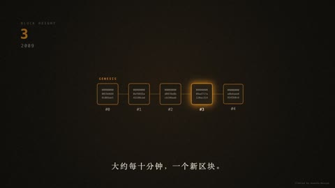

[← Back to gallery](../browse/stories.en.md) · [简体中文](2102927498858369282.md)

# Bitcoin Faith Told through Numbers and Graphics

**[偶像派作手 · @oxpsats](https://x.com/oxpsats)** · Narrative films · 49s

> Discovery pool · Source verified; catalog details being completed.

**[▶ Open gallery to play](https://guanmo-ai.github.io/awesome-ai-motion/?lang=en#case-2102927498858369282)** · [Original post](https://x.com/oxpsats/status/2102927498858369282)

Click the cover to open the gallery and play.

Numbers, circular graphics and block symbols form a thematic short with model-made music and effects.

No public prompt has been verified. [View the original post](https://x.com/oxpsats/status/2102927498858369282)

Bookmarks — · Likes — · Views —

## Source record

- Original post: [@oxpsats](https://x.com/oxpsats/status/2102927498858369282) · 2026-09-24T01:06:00+00:00
- Model attribution: Claude Opus 5.5 · [Creator’s statement](https://x.com/oxpsats/status/2102927498858369282)
- Prompt lookup: [Creator post](https://x.com/oxpsats/status/2102927498858369282) · 2026-11-02 09:52 UTC
- Cover source: [Original cover source](https://x.com/oxpsats/status/2102927498858369282) · 9.81s
- Metrics snapshot: [Original X post](https://x.com/oxpsats/status/2102927498858369282) · 2026-11-02 09:15 UTC
- Gallery video source: [Original post media record](https://x.com/oxpsats/status/2102927498858369282) · 2026-11-02 09:52 UTC · Post/media correspondence and media response checked; external reference, no re-upload

Model attribution is based on creator statements. Prompts have not been independently rerun; sound and visuals have not received a uniform quality rating. Videos reference original post media, not our uploads; redistribution permission has not been verified.
