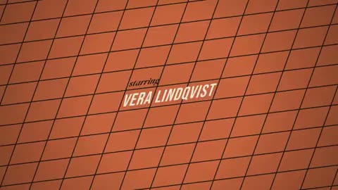

[← Back to gallery](../browse/motion.en.md) · [简体中文](2102937913726235004.md)

# Retro Credits for an Imaginary Film

**[Riley Goodside · @goodside](https://x.com/goodside)** · Motion design · 75s

> Discovery pool · Source verified; catalog details being completed.

**[▶ Open gallery to play](https://guanmo-ai.github.io/awesome-ai-motion/?lang=en#case-2102937913726235004)** · [Original post](https://x.com/goodside/status/2102937913726235004)

Click the cover to open the gallery and play.

Geometric grids, radial motifs and fictional cast names connect in a retro opening-credit sequence.

The creator has shared instructions; this catalog links to the source without redistributing the full text or translation. [Read the creator’s original](https://x.com/goodside/status/2102937913726235004)

Bookmarks 193 · Likes 449 · Views 59,244

## Source record

- Original post: [@goodside](https://x.com/goodside/status/2102937913726235004) · 2026-09-24T01:47:23+00:00
- Model attribution: Claude Opus 5.5 · [Creator’s statement](https://x.com/goodside/status/2102937913726235004)
- Prompt source: [Creator post](https://x.com/goodside/status/2102937913726235004) · 2026-10-24 12:20 UTC
- Cover source: [Original cover source](https://x.com/goodside/status/2102937913726235004) · 15s
- Metrics snapshot: [Original X post](https://x.com/goodside/status/2102937913726235004) · 2026-10-24 12:20 UTC
- Gallery video source: [Original post media record](https://x.com/goodside/status/2102937913726235004) · 2026-10-24 12:20 UTC · Post/media correspondence and media response checked; external reference, no re-upload

Model attribution is based on creator statements. Prompts have not been independently rerun; sound and visuals have not received a uniform quality rating. Videos reference original post media, not our uploads; redistribution permission has not been verified.
