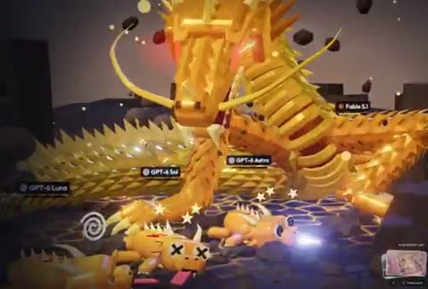

[← Back to gallery](../browse/characters.en.md) · [简体中文](2102970980398489940.md)

# A Golden Dragon and Model Mascots

**[Ryan Sael · @RyanSael](https://x.com/RyanSael)** · Pixel art & characters · 26s

> Discovery pool · Source verified; catalog details being completed.

**[▶ Open gallery to play](https://guanmo-ai.github.io/awesome-ai-motion/?lang=en#case-2102970980398489940)** · [Original post](https://x.com/RyanSael/status/2102970980398489940)

Click the cover to open the gallery and play.

A golden dragon fills a 3D arena while cartoon model mascots move around it with exaggerated dizzy effects.

No public prompt has been verified. [View the original post](https://x.com/RyanSael/status/2102970980398489940)

Bookmarks 6 · Likes 22 · Views 7,383

## Source record

- Original post: [@RyanSael](https://x.com/RyanSael/status/2102970980398489940) · 2026-09-24T03:58:47+00:00
- Model attribution: Claude Opus 5.5 · [Creator’s statement](https://x.com/RyanSael/status/2102970980398489940)
- Prompt lookup: [Creator post](https://x.com/RyanSael/status/2102970980398489940) · 2026-10-22 08:51 UTC
- Cover source: [Original cover source](https://x.com/RyanSael/status/2102970980398489940) · 5.26s
- Metrics snapshot: [Original X post](https://x.com/RyanSael/status/2102970980398489940) · 2026-10-22 08:51 UTC
- Gallery video source: [Original post media record](https://x.com/RyanSael/status/2102970980398489940) · 2026-10-22 08:51 UTC · Post/media correspondence and media response checked; external reference, no re-upload

Model attribution is based on creator statements. Prompts have not been independently rerun; sound and visuals have not received a uniform quality rating. Videos reference original post media, not our uploads; redistribution permission has not been verified.
