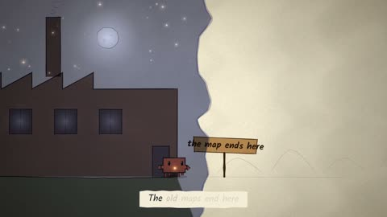

[← Back to gallery](../browse/music.en.md) · [简体中文](2102973119115690211.md)

# A Gray Clawd Leaves the Factory

**[ʞɔɐ𝘡 · @Skoorbkaz](https://x.com/Skoorbkaz)** · Music & lyrics · 313s

> Discovery pool · Source verified; catalog details being completed.

**[▶ Open gallery to play](https://guanmo-ai.github.io/awesome-ai-motion/?lang=en#case-2102973119115690211)** · [Original post](https://x.com/Skoorbkaz/status/2102973119115690211)

Click the cover to open the gallery and play.

A gray mascot moves through factories and book-like scenes as ink, watercolor and paper imagery tell a growth story with a song.

No public prompt has been verified. [View the original post](https://x.com/Skoorbkaz/status/2102973119115690211)

Bookmarks — · Likes — · Views —

## Source record

- Original post: [@Skoorbkaz](https://x.com/Skoorbkaz/status/2102973119115690211) · 2026-09-24T04:07:17+00:00
- Model attribution: Claude Opus 5.5 · [Creator’s statement](https://x.com/Skoorbkaz/status/2102973119115690211)
- Prompt lookup: [Creator post](https://x.com/Skoorbkaz/status/2102973119115690211) · 2026-11-02 09:52 UTC
- Cover source: [Original cover source](https://x.com/Skoorbkaz/status/2102973119115690211) · 62.66s
- Metrics snapshot: [Original X post](https://x.com/Skoorbkaz/status/2102973119115690211) · 2026-11-02 09:15 UTC
- Gallery video source: [Original post media record](https://x.com/Skoorbkaz/status/2102973119115690211) · 2026-11-02 09:52 UTC · Post/media correspondence and media response checked; external reference, no re-upload

Model attribution is based on creator statements. Prompts have not been independently rerun; sound and visuals have not received a uniform quality rating. Videos reference original post media, not our uploads; redistribution permission has not been verified.
