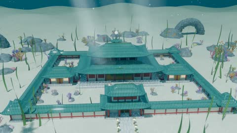

[← Back to gallery](../browse/interactive.en.md) · [简体中文](2103021748551872907.md)

# From Architectural Drawings to a Blender Scene

**[アユネオ · @Ayu\_AI\_0912](https://x.com/Ayu_AI_0912)** · 3D & interactive · 15s

> Discovery pool · Source verified; catalog details being completed.

**[▶ Open gallery to play](https://guanmo-ai.github.io/awesome-ai-motion/?lang=en#case-2103021748551872907)** · [Original post](https://x.com/Ayu_AI_0912/status/2103021748551872907)

Click the cover to open the gallery and play.

Architectural drawings become a 3D scene through camera and structural changes.

No public prompt has been verified. [View the original post](https://x.com/Ayu_AI_0912/status/2103021748551872907)

Bookmarks — · Likes — · Views —

## Source record

- Original post: [@Ayu\_AI\_0912](https://x.com/Ayu_AI_0912/status/2103021748551872907) · 2026-09-24T07:20:31+00:00
- Model attribution: Claude Opus 5.5 · [Creator’s statement](https://x.com/Ayu_AI_0912/status/2103021748551872907)
- Prompt lookup: [Creator post](https://x.com/Ayu_AI_0912/status/2103021748551872907) · 2026-11-02 15:38 UTC
- Cover source: [Original cover source](https://x.com/Ayu_AI_0912/status/2103021748551872907) · 10.5s
- Metrics snapshot: [Original X post](https://x.com/Ayu_AI_0912/status/2103021748551872907) · 2026-11-02 15:05 UTC
- Gallery video source: [Original post media record](https://x.com/Ayu_AI_0912/status/2103021748551872907) · 2026-11-02 15:38 UTC · Post/media correspondence and media response checked; external reference, no re-upload

Model attribution is based on creator statements. Prompts have not been independently rerun; sound and visuals have not received a uniform quality rating. Videos reference original post media, not our uploads; redistribution permission has not been verified.
