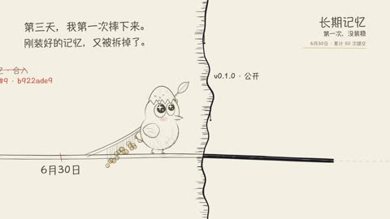

[← Back to gallery](../browse/stories.en.md) · [简体中文](2103032879496540640.md)

# Raven's Coded History from Hatching to Flight

**[海拉鲁编程客 · @hylarucoder](https://x.com/hylarucoder)** · Narrative films · 128s

> Discovery pool · Source verified; catalog details being completed.

**[▶ Open gallery to play](https://guanmo-ai.github.io/awesome-ai-motion/?lang=en#case-2103032879496540640)** · [Original post](https://x.com/hylarucoder/status/2103032879496540640)

Click the cover to open the gallery and play.

[General git-story-film production skill](https://github.com/EverMind-AI/Raven/tree/main/skills/git-story-film) · [Raven example film code and Chinese version](https://github.com/EverMind-AI/Raven/tree/main/skills/git-story-film/examples/raven-story)

A cartoon raven follows a timeline branch, with beads, visual-style changes and feature cards telling a repository's growth.

## Source & web pages

- **Related tool**：[General git-story-film production skill](https://github.com/EverMind-AI/Raven/tree/main/skills/git-story-film) · [Apache-2.0](https://github.com/EverMind-AI/Raven/blob/main/LICENSE)
  Raven repository code uses Apache-2.0; the drawing engine adapted from Alexey Fateev retains MIT terms. The general tool is not the complete project for this film.
  [Link source](https://x.com/hylarucoder/status/2104076282107723935) · Link checked 2026-11-02 09:52 UTC
- **Direct source**：[Raven example film code and Chinese version](https://github.com/EverMind-AI/Raven/tree/main/skills/git-story-film/examples/raven-story) · [Apache-2.0](https://github.com/EverMind-AI/Raven/blob/main/LICENSE)
  The example depends on the bundled drawing engine; adapted engine code retains MIT notices and fonts have separate OFL terms.
  [Link source](https://github.com/EverMind-AI/Raven/blob/main/skills/git-story-film/README.zh-CN.md) · Link checked 2026-11-02 09:52 UTC

No public prompt has been verified. [View the original post](https://x.com/hylarucoder/status/2103032879496540640)

Bookmarks — · Likes — · Views —

## Source record

- Original post: [@hylarucoder](https://x.com/hylarucoder/status/2103032879496540640) · 2026-09-24T08:04:45+00:00
- Model attribution: Claude Opus 5.5 · [Creator’s statement](https://x.com/hylarucoder/status/2103032879496540640)
- Prompt lookup: [Creator post](https://x.com/hylarucoder/status/2103032879496540640) · 2026-11-02 09:52 UTC
- Cover source: [Original cover source](https://x.com/hylarucoder/status/2103032879496540640) · 25.61s
- Metrics snapshot: [Original X post](https://x.com/hylarucoder/status/2103032879496540640) · 2026-11-02 09:30 UTC
- Gallery video source: [Original post media record](https://x.com/hylarucoder/status/2103032879496540640) · 2026-11-02 09:52 UTC · Post/media correspondence and media response checked; external reference, no re-upload

Model attribution is based on creator statements. Prompts have not been independently rerun; sound and visuals have not received a uniform quality rating. Videos reference original post media, not our uploads; redistribution permission has not been verified.
