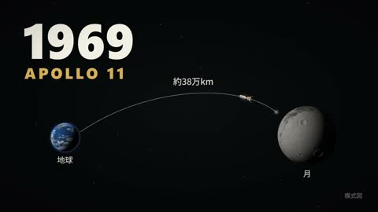

[← Back to gallery](../browse/education.en.md) · [简体中文](2103040495366857030.md)

# Apollo 11 in a Thirty-Second Animated Explainer

**[AI動画研究所 \| CREATOR'ZZ · @\_creatorzz\_](https://x.com/_creatorzz_)** · Education & explainers · 30s

> Discovery pool · Source verified; catalog details being completed.

**[▶ Open gallery to play](https://guanmo-ai.github.io/awesome-ai-motion/?lang=en#case-2103040495366857030)** · [Original post](https://x.com/_creatorzz_/status/2103040495366857030)

Click the cover to open the gallery and play.

Spaceflight graphics, paths and titles organize a Moon-landing explainer, with Opus 5.5 animation and separate TTS audio.

No public prompt has been verified. [View the original post](https://x.com/_creatorzz_/status/2103040495366857030)

Bookmarks — · Likes — · Views —

## Source record

- Original post: [@\_creatorzz\_](https://x.com/_creatorzz_/status/2103040495366857030) · 2026-09-24T08:35:01+00:00
- Model attribution: Claude Opus 5.5 · [Creator’s statement](https://x.com/_creatorzz_/status/2103040495366857030)
- Prompt lookup: [Creator post](https://x.com/_creatorzz_/status/2103040495366857030) · 2026-11-02 09:52 UTC
- Cover source: [Original cover source](https://x.com/_creatorzz_/status/2103040495366857030) · 6.01s
- Metrics snapshot: [Original X post](https://x.com/_creatorzz_/status/2103040495366857030) · 2026-11-02 09:18 UTC
- Gallery video source: [Original post media record](https://x.com/_creatorzz_/status/2103040495366857030) · 2026-11-02 09:52 UTC · Post/media correspondence and media response checked; external reference, no re-upload

Model attribution is based on creator statements. Prompts have not been independently rerun; sound and visuals have not received a uniform quality rating. Videos reference original post media, not our uploads; redistribution permission has not been verified.
