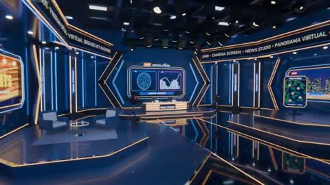

[← Back to gallery](../browse/interactive.en.md) · [简体中文](2103082459503923578.md)

# 3D Virtual Studio Intro

**[Myonisto 🔶ᛤ · @myonisto](https://x.com/myonisto)** · 3D & interactive · 8s

> Discovery pool · Source verified; catalog details being completed.

**[▶ Open gallery to play](https://guanmo-ai.github.io/awesome-ai-motion/?lang=en#case-2103082459503923578)** · [Original post](https://x.com/myonisto/status/2103082459503923578)

Click the cover to open the gallery and play.

A camera moves through a blue studio with illuminated screens and layered architecture.

No public prompt has been verified. [View the original post](https://x.com/myonisto/status/2103082459503923578)

Bookmarks — · Likes — · Views —

## Source record

- Original post: [@myonisto](https://x.com/myonisto/status/2103082459503923578) · 2026-09-24T11:21:46+00:00
- Model attribution: Claude Opus 5.5 · [Creator’s statement](https://x.com/myonisto/status/2103082459503923578)
- Prompt lookup: [Creator post](https://x.com/myonisto/status/2103082459503923578) · 2026-11-03 09:18 UTC
- Cover source: [Original cover source](https://x.com/myonisto/status/2103082459503923578) · 1.6s
- Metrics snapshot: [Original X post](https://x.com/myonisto/status/2103082459503923578) · 2026-11-03 08:42 UTC
- Gallery video source: [Original post media record](https://x.com/myonisto/status/2103082459503923578) · 2026-11-03 09:18 UTC · Post/media correspondence and media response checked; external reference, no re-upload

Model attribution is based on creator statements. Prompts have not been independently rerun; sound and visuals have not received a uniform quality rating. Videos reference original post media, not our uploads; redistribution permission has not been verified.
