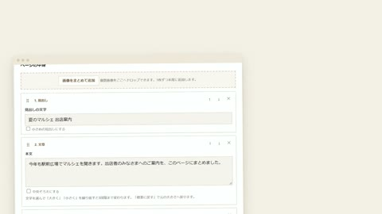

[← Back to gallery](../browse/product.en.md) · [简体中文](2103106389489127504.md)

# An App Promo in Feature Lists and Titles

**[やよい｜AIクリエイター📚スタンプアプリ60部突破✨ · @yayoi\_threee](https://x.com/yayoi_threee)** · Product & marketing · 30s

> Discovery pool · Source verified; catalog details being completed.

**[▶ Open gallery to play](https://guanmo-ai.github.io/awesome-ai-motion/?lang=en#case-2103106389489127504)** · [Original post](https://x.com/yayoi_threee/status/2103106389489127504)

Click the cover to open the gallery and play.

Feature lists, interface cards and bold titles alternate in an app promo.

No public prompt has been verified. [View the original post](https://x.com/yayoi_threee/status/2103106389489127504)

Bookmarks — · Likes — · Views —

## Source record

- Original post: [@yayoi\_threee](https://x.com/yayoi_threee/status/2103106389489127504) · 2026-09-24T12:56:51+00:00
- Model attribution: Claude Opus 5.5 · [Creator’s statement](https://x.com/yayoi_threee/status/2103106389489127504)
- Prompt lookup: [Creator post](https://x.com/yayoi_threee/status/2103106389489127504) · 2026-11-02 15:38 UTC
- Cover source: [Original cover source](https://x.com/yayoi_threee/status/2103106389489127504) · 6s
- Metrics snapshot: [Original X post](https://x.com/yayoi_threee/status/2103106389489127504) · 2026-11-02 15:08 UTC
- Gallery video source: [Original post media record](https://x.com/yayoi_threee/status/2103106389489127504) · 2026-11-02 15:38 UTC · Post/media correspondence and media response checked; external reference, no re-upload

Model attribution is based on creator statements. Prompts have not been independently rerun; sound and visuals have not received a uniform quality rating. Videos reference original post media, not our uploads; redistribution permission has not been verified.
