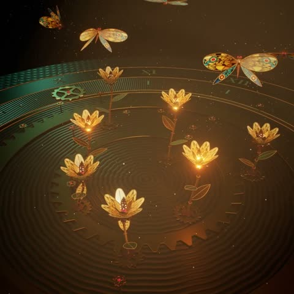

[← Back to gallery](../browse/interactive.en.md) · [简体中文](2103129303752102075.md)

# A Mechanical Butterfly and Golden Flowers

**[ハヤシモン｜AI × 個人開発 · @hayashimon1](https://x.com/hayashimon1)** · 3D & interactive · 20s

> Discovery pool · Source verified; catalog details being completed.

**[▶ Open gallery to play](https://guanmo-ai.github.io/awesome-ai-motion/?lang=en#case-2103129303752102075)** · [Original post](https://x.com/hayashimon1/status/2103129303752102075)

Click the cover to open the gallery and play.

A mechanical butterfly beats its wings among golden flowers and detailed structures.

No public prompt has been verified. [View the original post](https://x.com/hayashimon1/status/2103129303752102075)

Bookmarks — · Likes — · Views —

## Source record

- Original post: [@hayashimon1](https://x.com/hayashimon1/status/2103129303752102075) · 2026-09-24T14:27:54+00:00
- Model attribution: Claude Opus 5.5 · [Creator’s statement](https://x.com/hayashimon1/status/2103129303752102075)
- Prompt lookup: [Creator post](https://x.com/hayashimon1/status/2103129303752102075) · 2026-11-02 09:52 UTC
- Cover source: [Original cover source](https://x.com/hayashimon1/status/2103129303752102075) · 4s
- Metrics snapshot: [Original X post](https://x.com/hayashimon1/status/2103129303752102075) · 2026-11-02 09:19 UTC
- Gallery video source: [Original post media record](https://x.com/hayashimon1/status/2103129303752102075) · 2026-11-02 09:52 UTC · Post/media correspondence and media response checked; external reference, no re-upload

Model attribution is based on creator statements. Prompts have not been independently rerun; sound and visuals have not received a uniform quality rating. Videos reference original post media, not our uploads; redistribution permission has not been verified.
