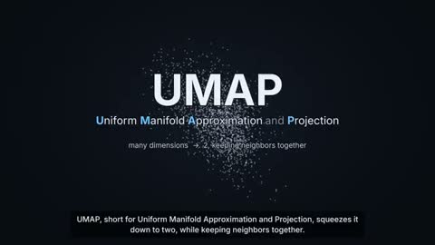

[← 返回图库](../browse/education.md) · [English](2103135072987795526.en.md)

# UMAP 的一分钟粒子讲解

**[Riley Goodside · @goodside](https://x.com/goodside)** · 知识讲解 · 60s

> 发现池 · 来源已核对，编目资料待完善。

**[▶ 打开画廊播放](https://guanmo-ai.github.io/awesome-ai-motion/#case-2103135072987795526)** · [作者原帖](https://x.com/goodside/status/2103135072987795526)

点击封面打开画廊播放。

发光点群、连线与简短字幕在空间中展开，以粒子动画介绍降维主题。

作者已公开指令；本站仅提供原帖入口，不再分发全文或译文。 [查看作者原文](https://x.com/goodside/status/2103135072987795526)

收藏 34 · 点赞 72 · 浏览 9,420

## 来源记录

- 作品原帖: [@goodside](https://x.com/goodside/status/2103135072987795526) · 2026-09-24T14:50:50+00:00
- 模型归因: Claude Opus 5.5 · [作者说明](https://x.com/goodside/status/2103135072987795526)
- 提示词出处: [作者原帖](https://x.com/goodside/status/2103135072987795526) · 2026-10-24 12:20 UTC
- 封面来源: [原帖封面来源](https://x.com/goodside/status/2103135072987795526) · 11.95s
- 互动快照: [X 原帖](https://x.com/goodside/status/2103135072987795526) · 2026-10-24 12:20 UTC
- 画廊原视频: [原帖媒体记录](https://x.com/goodside/status/2103135072987795526) · 2026-10-24 12:20 UTC · 已核对原帖媒体对应与媒体响应；外部引用，不重新上传

模型依据来自作者自述，未独立重跑提示词，也未对音画作统一质量评级。视频引用作者原帖媒体，未由本站重新上传，转载许可未确认。
