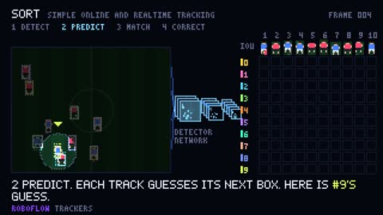

[← Back to gallery](../browse/education.en.md) · [简体中文](2103137431683739960.md)

# Pixel Animation of SORT Object Tracking

**[Alex Bodner · @AlexBodner\_](https://x.com/AlexBodner_)** · Education & explainers · 32s

> Discovery pool · Source verified; catalog details being completed.

**[▶ Open gallery to play](https://guanmo-ai.github.io/awesome-ai-motion/?lang=en#case-2103137431683739960)** · [Original post](https://x.com/AlexBodner_/status/2103137431683739960)

Click the cover to open the gallery and play.

Pixel targets, prediction boxes and trajectories change step by step to illustrate object tracking.

No public prompt has been verified. [View the original post](https://x.com/AlexBodner_/status/2103137431683739960)

Bookmarks — · Likes — · Views —

## Source record

- Original post: [@AlexBodner\_](https://x.com/AlexBodner_/status/2103137431683739960) · 2026-09-24T15:00:12+00:00
- Model attribution: Claude Opus 5.5 · [Creator’s statement](https://x.com/AlexBodner_/status/2103137431683739960)
- Prompt lookup: [Creator post](https://x.com/AlexBodner_/status/2103137431683739960) · 2026-11-02 15:38 UTC
- Cover source: [Original cover source](https://x.com/AlexBodner_/status/2103137431683739960) · 6.31s
- Metrics snapshot: [Original X post](https://x.com/AlexBodner_/status/2103137431683739960) · 2026-11-02 15:08 UTC
- Gallery video source: [Original post media record](https://x.com/AlexBodner_/status/2103137431683739960) · 2026-11-02 15:38 UTC · Post/media correspondence and media response checked; external reference, no re-upload

Model attribution is based on creator statements. Prompts have not been independently rerun; sound and visuals have not received a uniform quality rating. Videos reference original post media, not our uploads; redistribution permission has not been verified.
